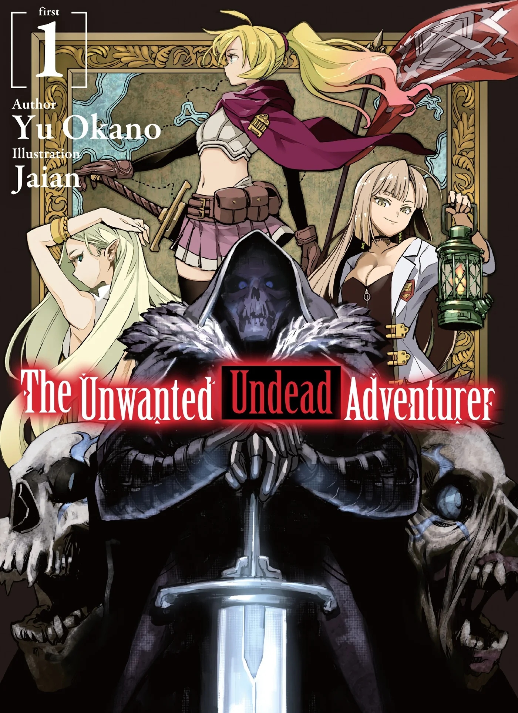
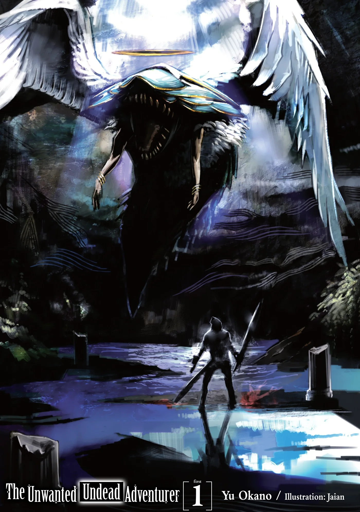
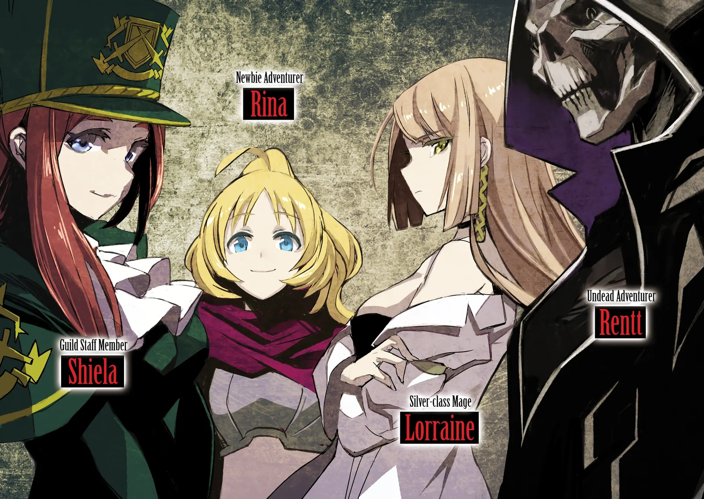
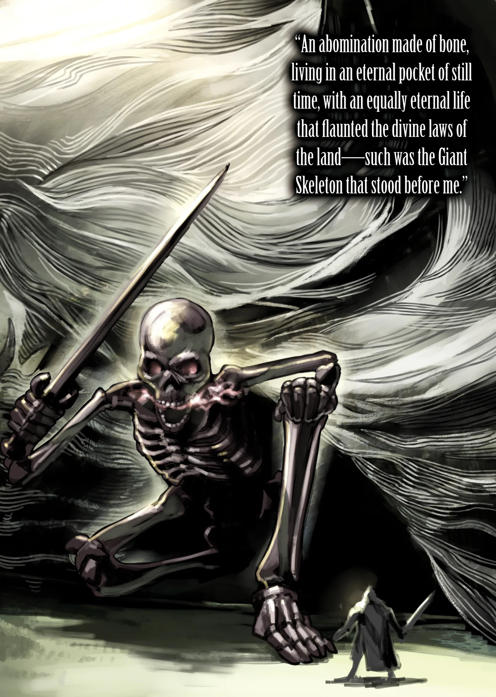
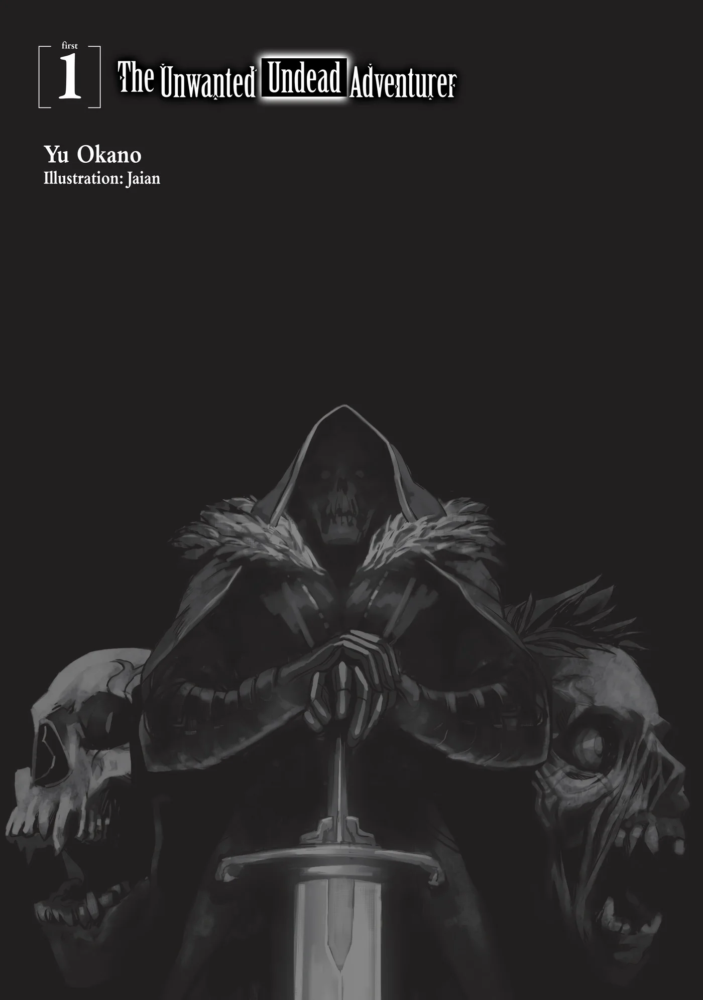
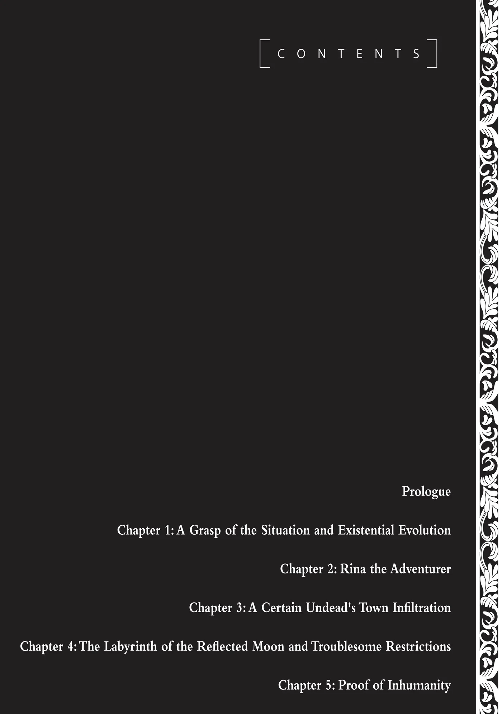
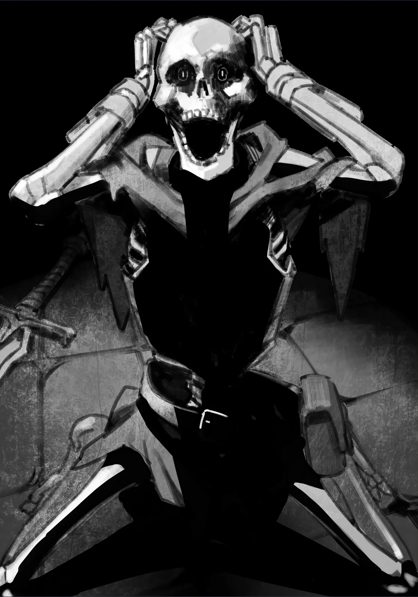

# Chương 1: Mở đầu Tập 1

Thế này... Thế này tệ thật rồi.

Đó là ý nghĩ đầu tiên lóe lên trong đầu tôi khi con quái vật trước mặt mở toang bờ môi đỏ như máu, há to cái miệng ngoác ra rồi lao thẳng về phía tôi.

Tại một góc hẻo lánh nơi vùng biên viễn có Vương Quốc Yaaran tọa lạc, và nằm ở rìa vương quốc là một thị trấn nhỏ mang tên Maalt. Tôi, Rentt Faina, một mạo hiểm giả Hạ Đồng Cấp, đang săn lùng lũ quái vật yếu ớt trong Mê Cung Nguyệt Ảnh—nơi mà, tiện thể nói luôn, nằm khá gần thị trấn Maalt. Vào ngày hôm nay, cũng như bao ngày khác, tôi vẫn miệt mài săn đuổi Khô Lâu và Goblin, gom nhặt từng chút nguyên liệu cùng quặng ma pháp ít ỏi mà mình có thể kiếm được.

Dù sao thì đó cũng là thói quen thường nhật của tôi; ngày nào tôi cũng lặp đi lặp lại chừng ấy việc, đến chiều tối lại quay về thị trấn rồi đem số nguyên liệu thu gom được tới Hội Mạo Hiểm Giả để đổi lấy vài đồng tiền còm cõi. Ít nhất thì đó là những gì tôi dự định làm trong hôm nay, hệt như mọi ngày trước đó.

Thế nhưng, sự xáo trộn ập đến với thói quen tưởng chừng bất biến của tôi lại diễn ra quá đỗi đột ngột và bất ngờ—nói một cách ví von, thì chẳng khác nào một chiếc cờ-lê bất thình lình chọc thẳng vào bánh răng đang quay.

Có lẽ tôi nên giải thích thêm đôi chút về chủ đề mê cung. Vì ngày nào cũng rảo bước qua các căn phòng và lối đi của Mê Cung Nguyệt Ảnh, nên khả năng tôi bị lạc gần như bằng không. Trớ trêu thay, chính sự quen thuộc ấy lại hại chết tôi, bởi tôi đã phát hiện ra thứ trông như một ngã rẽ hoàn toàn mới lạ nằm ngay dọc theo tuyến đường quen thuộc bấy lâu. Tôi đoán người ta có thể gọi đó là vận rủi.

Ừ, cứ coi là vậy đi.

Trong hoàn cảnh bình thường, có lẽ tôi đã ngó lơ một chuyện như thế. Rốt cuộc thì mạo hiểm giả phải là những kẻ dấn thân vào hiểm nguy. Nói là vậy, nhưng định nghĩa của từ "mạo hiểm" không hẳn là cứ đâm đầu vào mọi tình huống mà chẳng thèm thám sát hay lên kế hoạch từ trước.

Tuy nhiên trên thực tế, số mạo hiểm giả cứ thế cắm đầu lao bừa vào mọi tình thế lại chiếm phần đông hơn nhiều—và dù xấu hổ khi phải thừa nhận mình cũng nằm trong số đó, tôi cũng từng phạm phải những sai lầm như vậy.

Có lẽ tôi nên đưa ra một lý do để tự bào chữa cho bản thân ở chỗ này:

Trước hết, Mê Cung Nguyệt Ảnh đã được khai phá từ thuở xa xưa. Việc tìm thấy những căn phòng và lối đi mới trong một mê cung đã được khám phá kỹ lưỡng đến nhường này là điều gần như chưa từng nghe thấy—nói cách khác, đó là một phát hiện trọng đại. Bất cứ ai cũng có thể dễ dàng suy đoán rằng ở cuối con đường bí ẩn kia hẳn sẽ có một cuốn ma đạo thư hay thứ vũ khí nào đó với mức giá đắt đỏ đến phi lý. Thêm vào đó, người ta còn có thể gặt hái được danh tiếng và tiền tài nhất định nhờ việc vẽ lại bản đồ cho một khu vực chưa từng được ai đặt chân tới trong mê cung.

Và thế là tôi đã bước vào ngã rẽ kỳ lạ đó, với tâm trí lẫn khả năng phán đoán đều bị lu mờ trước viễn cảnh giàu sang phú quý. Thế nhưng, chuyến thám hiểm ngắn ngủi của tôi lại chẳng hề có một cái kết êm đẹp. Chẳng mấy chốc, tôi đã thấy mình đứng mặt đối mặt với một con quái vật khổng lồ bên trong một căn phòng rộng lớn. Họa vô đơn chí, phúc bất trùng lai—người đời vẫn bảo thế mà. Con quái vật ấy, trong muôn vàn sinh vật trên đời, lại cố tình phải là một con Rồng.

Bạn biết đấy. Rồng. Giống loài quái vật ngự trị trên đỉnh kim tự tháp của muôn loài quái vật. Thông thường, một người phải đạt tới cấp bậc mạo hiểm giả Bạch Kim Cấp hay Mithril Cấp thì mới mong có cơ hội đối đầu với chúng, bởi chúng chính là quái vật của mọi loài quái vật.

Thoạt nhìn, diện mạo của nó có chút khác biệt so với hình dung thông thường của mọi người về loài Rồng. Trong khi phần lớn loài Rồng đều có một dáng vẻ nhất định, thì con này lại khác biệt rõ rệt—trông nó giống một con rắn lớn, hoặc có lẽ là một con ếch. Tuy nhiên, chắc chắn con quái vật trước mắt phải là một chủng tộc Rồng nào đó—ít nhất thì tôi đã nghĩ như vậy.

Những mạo hiểm giả bất hạnh tình cờ chạm trán loài Rồng thường chẳng thể toàn mạng trở về để kể lại câu chuyện của mình. Vì loài Rồng không mấy khi xuất hiện trước mắt con người, nên những lời kể của nhân chứng là cực kỳ hiếm hoi, thậm chí mang tính lịch sử. Thực tế, số trường hợp được ghi chép lại cho tới nay chỉ đếm trên đầu ngón tay. Truyền thuyết kể rằng trên khắp thế giới này có không quá bốn con Rồng như vậy, và sức mạnh của chúng được đồn đại là sánh ngang với ma vương. Có người còn bảo chúng không phải quái vật mà là những thực thể thần thánh, trong khi kẻ khác lại cho rằng chúng còn vượt xa cả điều đó.

Nói cách khác, một kẻ như tôi, người đã chôn chân ở Đồng Cấp suốt bao năm ròng dẫu đã dốc hết sức mình, sẽ bị nghiền nát và tiêu diệt hoàn toàn nếu con Rồng chỉ cần nhấc nhẹ một ngón tay út.

—Trong một thoáng, tôi chợt tự hỏi liệu loài Rồng có ngón tay hay không nữa.

Trước một con Rồng lù lù xuất hiện trước mặt, tôi không khỏi kinh hoàng bạt vía—ngay từ đầu, tôi chẳng hề nuôi chút ảo tưởng hay mảy may có ý nghĩ sẽ chiến đấu với nó. Chính vì lẽ đó, tôi quyết định bỏ chạy. Nếu không chạy thì chắc chắn sẽ chết—và thế là đôi chân tôi bắt đầu cử động, đúng như lẽ tự nhiên.

Nhưng rồi—

Có lẽ con Rồng thực sự đúng là quái vật của mọi loài quái vật, bởi nó nhanh chóng nhận ra ý định tìm đường trốn thoát của tôi. Hoặc có thể nó chẳng cần để tâm cũng thấy rõ, hệt như đôi chân tôi lúc này bỗng chết trân tại chỗ. Cứ như thế, tôi nhận ra mình không tài nào nhúc nhích nổi.

Có lẽ nói chính xác hơn là bản thân cơ thể tôi cự tuyệt việc cử động. Nó thậm chí chẳng buồn giật lấy một cái. Một người bình thường hẳn sẽ thắc mắc tại sao lại xảy ra cớ sự này—nếu như họ là, chẳng hạn như, một kẻ bình thường chưa từng đối mặt trực diện với quái vật bao giờ.

Thế nhưng nhờ vào thâm niên dài đằng đẵng làm mạo hiểm giả, việc thấu hiểu hiện tượng lúc này đối với tôi chẳng có gì khó khăn. Mạo hiểm giả rồi cũng sẽ học được cách nhìn thấu đối thủ bất kể bản chất của chúng là gì, dù là con người hay quái vật. Nói một cách tóm gọn, áp lực và uy áp tỏa ra từ một thực thể sở hữu sức mạnh vượt trội thường đủ để áp chế và đe dọa kẻ yếu; người ta bảo cảm giác ấy giống như bị đè bẹp bởi một khối sức nặng vô hình khổng lồ.

Ít nhất thì lời đồn đại là như thế. Nhưng những gì tôi đang trải qua lúc này lại hoàn toàn khớp với lời đồn.

Không thể chống chọi nổi với uy áp ngút trời tỏa ra từ con Rồng, tôi chẳng thể nào nhấc chân nổi, hoàn toàn chôn chặt tại chỗ. Nhận thức rõ tình cảnh của mình, tận đáy lòng tôi cầu xin con Rồng rủ lòng thương tha mạng. Dẫu vậy, có lẽ nó sẽ chẳng tha đâu. Điều này thì tôi thừa hiểu.

Vào thời khắc ấy, tất cả những gì tôi có thể làm là đứng trơ mắt nhìn con Rồng từng bước tiến lại gần—trong khi không ngừng cầu nguyện rằng nó sẽ đổi ý mà không ăn thịt tôi nữa. Nhưng hiện thực nghiệt ngã lại chẳng hề khoan dung đến thế.

Sau khi bắt gặp bóng dáng tôi, con Rồng nhanh chóng ngoác miệng ra rồi lao thẳng về hướng tôi đứng. Dĩ nhiên là nó định ăn thịt tôi rồi—đúng như dự đoán. Đó là kết luận tôi rút ra được trong lúc vẫn còn đang suy ngẫm đôi chút thong dong trước lằn ranh sinh tử.

Cùng lúc đó, một giọng nói nhỏ bé trong đầu nhắc nhở tôi về việc tình thế lúc này nguy ngập đến dường nào, và sự thật rằng tôi sắp sửa mất mạng đến nơi. Thế nhưng, tôi chẳng thể làm được gì hơn—cơ thể tôi đơn giản là không chịu cử động.

Đã khoảng mười năm trôi qua kể từ ngày tôi lần đầu trở thành mạo hiểm giả vào năm 15 tuổi. Hồi đó, tôi từng tin rằng có một ngày mình sẽ vượt qua cấp bậc Bạch Kim Cấp để trở thành một trong số ít những mạo hiểm giả Mithril Cấp huyền thoại—đó chính là ước mơ thuở mới vào nghề của tôi.

Vậy nên, tôi đã nhận những nhiệm vụ giản đơn, kiếm miếng cơm qua ngày trong khi vẫn tiếp tục mơ màng về một tương lai xán lạn ấy. Khi hoàn thành xong các nhiệm vụ hàng ngày, tôi lại tiếp tục chế độ luyện tập thường nhật. Và dù tôi đã dốc lòng làm tất cả những điều đó, xem chừng mọi thứ lại sắp sửa kết thúc tại nơi đây.

Thật thảm hại; bất hạnh ư, có đấy, nhưng phần nhiều vẫn là thảm hại.

Với muôn vàn tiếc nuối tột cùng, xen lẫn một cảm giác nhẹ nhõm kỳ lạ khi biết rằng cuộc đời tương đối vô nghĩa của mình sẽ chấm dứt ngay tại đây và vào lúc này, toàn thân tôi bị nhấn chìm vào trong vòm miệng con Rồng—và mọi chuyện chấm dứt như thế đấy.

◆◇◆◇◆

Thế nhưng điều tôi không ngờ tới, lại chính là cảm giác kỳ lạ khi tỉnh giấc sau một khoảng thời gian không xác định. Có vẻ như tôi đã tỉnh lại, bất kể việc tôi đoan chắc mình đã bị một con Rồng nuốt chửng, và chính đôi mắt này đã tận mắt chứng kiến cái chết của bản thân. Vậy mà giờ đây, tôi lại đang thức giấc.

Và rồi tôi nhận ra—

Khoan đã. Không, không không không. Điều đó là bất khả thi.

Đó là những gì tôi nghĩ khi tỉnh dậy và xác nhận lại tình hình xung quanh.

Tất cả những chuyện này dường như là bất khả thi, đặc biệt là chuyện đã xảy ra với cơ thể tôi. Tôi chẳng thể nào tiếp thu nổi những chuyện đang diễn ra; dẫu vậy, trước tiên tôi cần phải nhìn vào đôi bàn tay của mình đã.

Chính vào lúc ấy, sự thật phũ phàng ập đến với tôi. Chẳng hề có chút da thịt nào trên đôi bàn tay—dù đáng lẽ ra phải có—và cũng chẳng hề có lấy một mẩu da. Thực tế, tất cả những gì còn sót lại từ thứ từng là bàn tay của tôi chỉ là những khúc xương trắng hếu và mảnh khảnh nối liền nhau.

—Và đó là tất cả những gì còn lại.

Tuy nhiên, biến chứng kỳ quái này không chỉ dừng lại ở đôi bàn tay; nó dường như đã lan ra từng tấc trên khắp cơ thể tôi. Đôi bàn chân tôi cũng trơ trọi toàn xương—tuyệt nhiên chẳng thấy da thịt đâu cả. Đùi tôi cũng vậy, và cả hai cánh tay cũng thế.

Còn về gương mặt của tôi... Chà. Mạo hiểm giả vốn chẳng có thói quen mang theo gương tay nhỏ bên mình. Không cần phải nói, tôi cũng chẳng có cái nào. Dựa trên phán đoán có cơ sở, tôi cho rằng có lẽ khuôn mặt mình giờ đây chỉ là một cái đầu lâu xương xẩu. Nói cách khác:

Tôi, Rentt Faina, mạo hiểm giả Hạ Đồng Cấp, dường như đã hoàn tất một đợt chuyển chức từ "mạo hiểm giả" sang thành "Khô Lâu" vào một thời khắc nào đó mất rồi.

Không thể nào...

