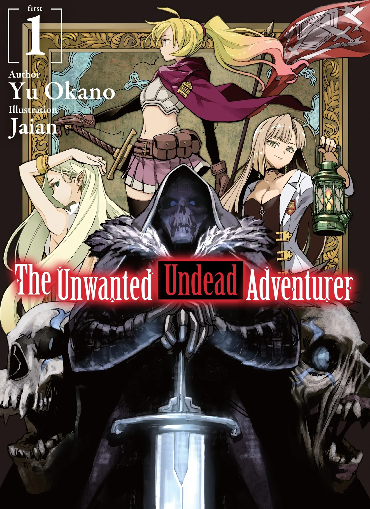
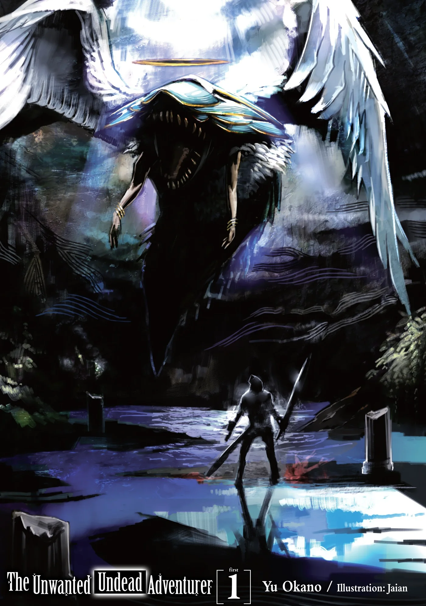
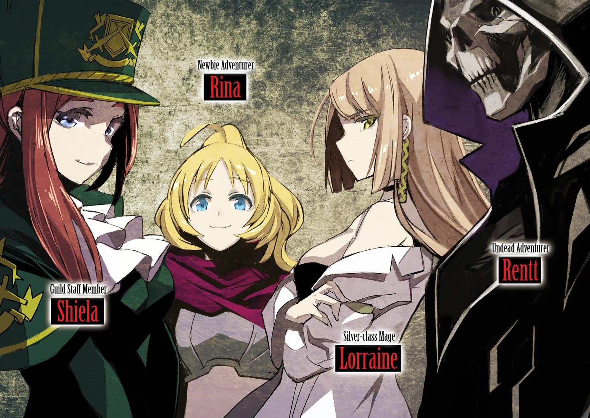
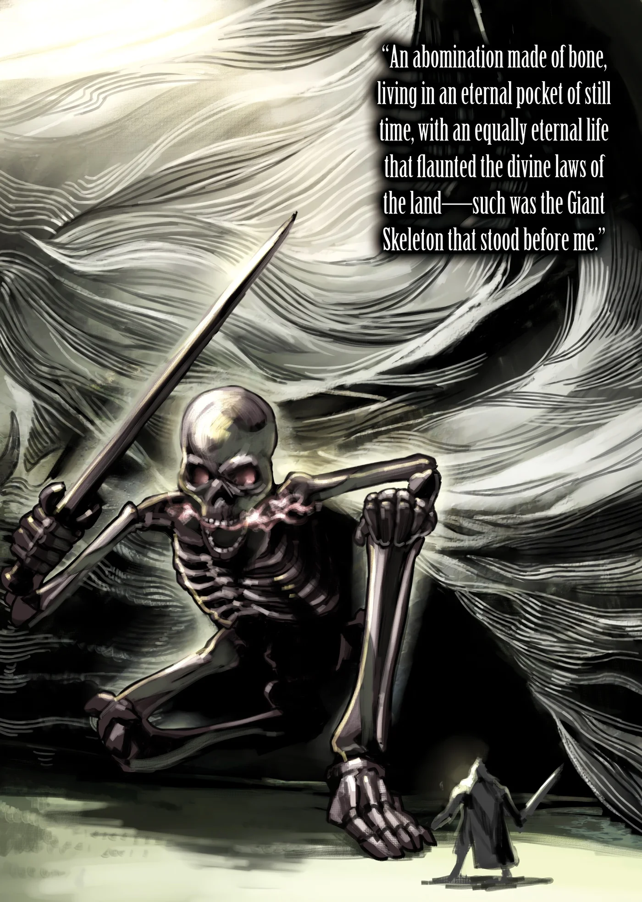
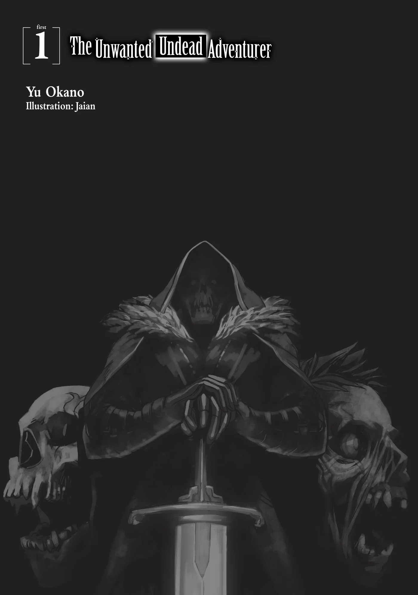
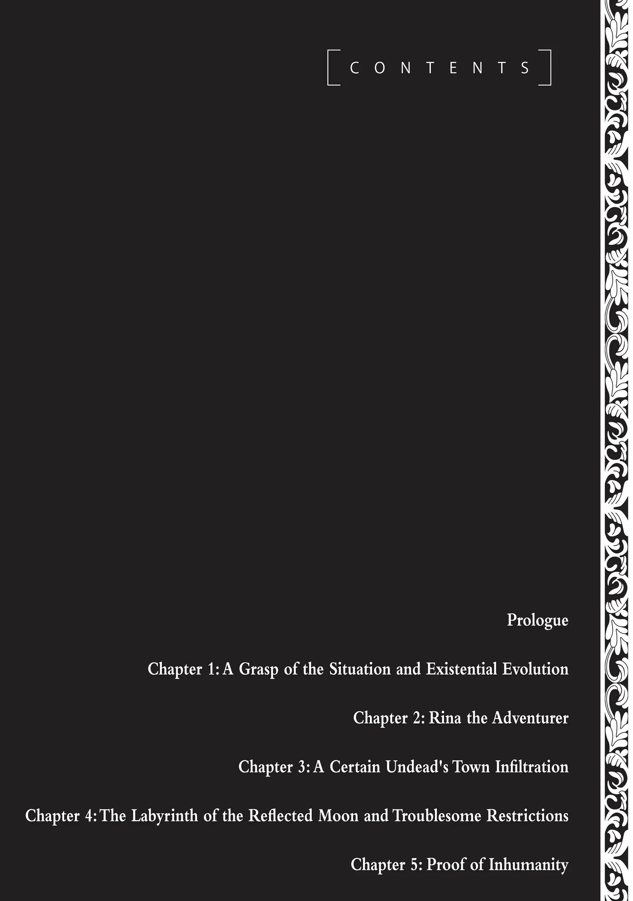
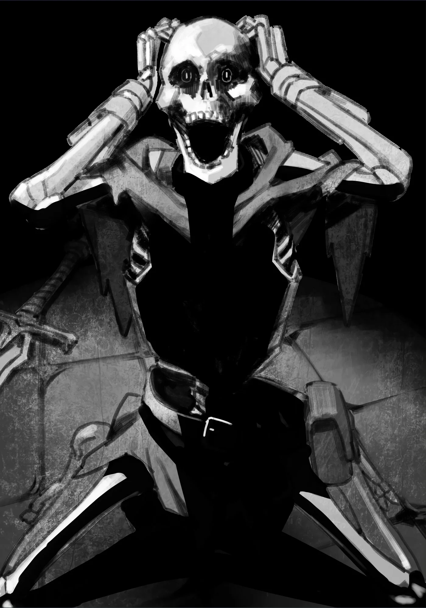

# Chương 1: Mở đầu Tập 1

Thế này... Thế này tệ thật rồi.

Đó là ý nghĩ đầu tiên lóe lên trong đầu tôi khi con quái vật trước mặt nhe cặp môi đỏ lòm, há ngoác cái miệng đỏ quạch rồi lao thốc về phía tôi.

Tận sâu nơi góc hẻo lánh của vùng đất này là Vương Quốc Yaaran, và nằm ở rìa vương quốc có một thị trấn nhỏ mang tên Maalt. Tôi, Rentt Faina, mạo hiểm giả Hạ Đồng Cấp, đang săn mấy con quái vật yếu ớt trong Mê Cung Nguyệt Ảnh—tiện thể nói luôn là nó nằm khá gần thị trấn Maalt. Hôm nay cũng như bao ngày khác, tôi lại cặm cụi săn Khô Lâu và Goblin, gom góp chút ít nguyên liệu cùng quặng ma pháp kiếm được.

Nói cho cùng thì đó là thói quen thường ngày của tôi rồi; ngày nào tôi cũng quanh quẩn làm từng ấy việc, đến chiều tối lại trở về thị trấn, đem đống nguyên liệu gom được tới Hội Mạo Hiểm Giả bán lấy vài đồng tiền còm. Ít nhất thì hôm nay tôi cũng tính làm như vậy, hệt như mọi ngày trước đó.

Có điều, cái nhịp sinh hoạt quen thuộc ấy bỗng dưng bị xáo trộn cái rụp—chẳng khác nào có ai thình lình chọc chiếc cờ-lê vào giữa guồng bánh răng đang quay.

Có lẽ tôi nên giải thích thêm đôi chút về chuyện mê cung. Vì ngày nào cũng rảo bước qua các gian phòng và lối đi của Mê Cung Nguyệt Ảnh, nên bảo tôi bị lạc thì gần như là chuyện không tưởng. Trớ trêu thay, chính cái sự quá đỗi quen thuộc ấy lại hại tôi, khi tôi tình cờ phát hiện ra một ngã rẽ mới toanh nằm ngay dọc theo tuyến đường quen thuộc bấy lâu. Chắc người ta gọi thế là vận rủi.

Ừ, cứ coi là vậy đi.

Bình thường thì chắc tôi đã bỏ qua chuyện đó rồi. Dù sao thì mạo hiểm giả cũng là những kẻ dấn thân đi mạo hiểm. Nói vậy thôi, chứ định nghĩa của hai chữ "mạo hiểm" đâu phải là cứ cắm đầu lao bừa vào mọi chuyện mà chẳng thèm thăm dò hay tính toán từ trước.

Nhưng thực tế thì số mạo hiểm giả cứ thích cắm đầu lao bừa lại chiếm đa số—và dẫu xấu hổ khi phải thừa nhận mình cũng thuộc cái hội ấy, tôi cũng từng phạm phải những sai lầm tương tự.

Cơ mà để tôi tự bào chữa cho mình một câu thế này:

Trước hết, Mê Cung Nguyệt Ảnh vốn đã được tìm ra từ thuở nào rồi. Tìm được gian phòng hay lối đi mới trong một mê cung đã bị lùng sục kỹ đến mức này là chuyện gần như chưa từng nghe thấy—nói cách khác, đó là một phát hiện động trời. Ai mà chẳng dễ dàng đoán được ở cuối con đường bí ẩn kia hẳn phải có cuốn ma đạo thư hay món vũ khí với mức giá trên trời nào đó. Chưa kể, người ta còn có thể kiếm được cả mớ danh tiếng lẫn tiền tài nếu vẽ lại được bản đồ cho một khu vực chưa từng có dấu chân người trong mê cung.

Thế là tôi bước vào ngã rẽ kỳ lạ đó, để mặc viễn cảnh giàu sang làm mờ mắt lẫn khả năng phán đoán. Có điều, chuyến thám hiểm ngắn chẳng tày gang của tôi lại chẳng có được cái kết êm đẹp. Chẳng mấy chốc, tôi đã thấy mình đứng đối mặt với một con quái vật khổng lồ bên trong một căn phòng rộng lớn. Đã đen thì đen đủ đường—người đời vẫn bảo thế mà. Con quái vật ấy, bao nhiêu giống loài không chọn, lại cứ nhất định phải là một con Rồng.

Rồng đấy. Cái giống loài đứng trên đỉnh cao của muôn loài quái vật. Bình thường, người ta phải đạt đến cấp bậc mạo hiểm giả Bạch Kim Cấp hay Mithril Cấp thì may ra mới có cửa đối đầu với chúng, bởi chúng chính là chúa tể trong muôn loài quái vật.

Thoạt nhìn, trông nó có chút khác biệt so với hình dung thông thường về loài Rồng. Trong khi phần lớn loài Rồng đều mang hình dạng đặc trưng, con này lại khác hẳn—nó giống một con rắn khổng lồ, hoặc có khi là một con ếch. Có điều, chắc chắn con quái vật trước mắt vẫn là một chủng tộc Rồng nào đó—ít nhất thì tôi đã nghĩ như vậy.

Mấy gã mạo hiểm giả số nhọ lỡ chạm trán loài Rồng thường chẳng mấy ai toàn mạng trở về để mà kể lại. Do loài Rồng rất hiếm khi xuất hiện trước mắt con người, nên người tận mắt nhìn thấy chúng hiếm vô cùng, khéo chỉ đếm trên đầu ngón tay trong suốt chiều dài lịch sử. Truyền thuyết kể rằng cả thế giới này có không quá bốn con Rồng như thế, và sức mạnh của chúng được đồn là ngang ngửa cả ma vương. Có người còn bảo chúng chẳng phải quái vật mà là bậc thần thánh, kẻ khác lại cho rằng chúng còn vượt xa hơn thế.

Nói cách khác, một kẻ dẫu trầy trật cố hết sức vẫn chôn chân ở Đồng Cấp suốt bao năm ròng như tôi, thì chỉ cần con Rồng khẽ nhấc ngón tay út cũng đủ nghiền nát bấy.

—Trong một thoáng, tôi cứ tự hỏi liệu loài Rồng có ngón tay thật không nữa.

Thấy con Rồng lù lù xuất hiện trước mặt, tôi không khỏi giật bắn người—ngay từ đầu, tôi chẳng hề ảo tưởng hay mảy may có ý nghĩ sẽ chiến đấu với nó. Thế nên tôi quyết định quay đầu bỏ chạy. Không chạy thì chắc chắn chỉ có nước chết—và thế là đôi chân tôi bắt đầu cử động, đúng như lẽ tự nhiên.

Nhưng rồi—

Xem chừng con Rồng thực sự đúng là chúa tể muôn loài quái vật, bởi nó nhanh chóng nhận ra ý định trốn chạy của tôi. Mà có khi nó chẳng cần để ý cũng thấy, giống như việc đôi chân tôi bỗng dưng chết trân tại chỗ vậy. Cứ thế, tôi nhận ra mình không tài nào nhúc nhích nổi.

Nói đúng hơn thì cả người tôi nhất định không chịu cử động. Đến khẽ run lên một cái cũng chẳng làm nổi. Một người bình thường hẳn sẽ thắc mắc tại sao lại xảy ra cớ sự này—nếu đó là kẻ chưa từng giáp mặt trực diện với quái vật bao giờ.

Thế nhưng nhờ mười năm kinh nghiệm làm mạo hiểm giả, tôi chẳng lạ lẫm gì cái hiện tượng này. Lăn lộn trong nghề đủ lâu, ai rồi cũng học được cách nhìn thấu đối thủ, bất kể đó là người hay quái vật. Tóm lại, áp lực và uy áp tỏa ra từ một kẻ mạnh vượt trội thường đủ sức trấn áp và uy hiếp kẻ yếu; người ta vẫn bảo cảm giác ấy giống như bị một khối sức nặng vô hình đè bẹp dí.

Ít nhất lời đồn là như thế. Nhưng những gì tôi đang trải qua lúc này thì đúng y như vậy.

Không chịu nổi uy áp tỏa ra từ con Rồng, tôi đứng chết trân, chẳng tài nào nhấc nổi chân. Ý thức rõ tình cảnh của mình, tận đáy lòng tôi chỉ mong con Rồng rủ lòng thương tha mạng. Cơ mà chắc nó chẳng tha đâu. Chuyện đó thì tôi thừa biết.

Lúc bấy giờ, tôi chỉ biết trơ mắt nhìn con Rồng từng bước tiến lại gần—trong bụng thầm van vái nó đổi ý đừng ăn thịt mình. Nhưng đời lại chẳng dễ dãi đến thế.

Vừa thấy bóng tôi, con Rồng liền há to mồm, lao thốc về phía tôi đứng. Dĩ nhiên là nó định ăn thịt tôi rồi—đúng như dự đoán. Đó là kết luận tôi rút ra được trong lúc vẫn còn rỗi hơi ngẫm nghĩ đôi điều trước cái chết cận kề.

Cùng lúc đó, một giọng nói trong đầu gào lên nhắc tôi rằng tình thế đang nguy ngập dường nào, và tôi sắp toi đời đến nơi rồi. Khổ nỗi tôi cũng chẳng làm gì được—cơ thể có chịu nhúc nhích cho đâu.

Thấm thoắt đã mười năm trôi qua kể từ ngày tôi lần đầu trở thành mạo hiểm giả vào năm 15 tuổi. Hồi ấy, tôi từng tin rằng có một ngày mình sẽ vượt qua cấp bậc Bạch Kim Cấp để đứng vào hàng ngũ số ít mạo hiểm giả Mithril Cấp huyền thoại—đó chính là ước mơ thuở mới vào nghề của tôi.

Thế là tôi cứ nhận những nhiệm vụ đơn giản, kiếm miếng ăn qua ngày trong khi vẫn tiếp tục nuôi mộng về một tương lai xán lạn ấy. Xong nhiệm vụ trong ngày, tôi lại lao vào chế độ luyện tập thường nhật. Trầy trật là thế, vậy mà xem chừng mọi thứ lại sắp kết thúc tại nơi đây.

Thật thảm hại; xui xẻo thì có đấy, nhưng phần nhiều vẫn là thảm hại.

Với nỗi tiếc nuối vô ngần xen lẫn chút nhẹ nhõm kỳ lạ khi biết chuỗi ngày vô nghĩa của mình sẽ khép lại ngay tại đây, cơ thể tôi bị nuốt chửng vào trong vòm miệng con Rồng—và thế là hết một đời.

◆◇◆◇◆

Có điều, thứ tôi không ngờ tới lại chính là cảm giác kỳ lạ khi tỉnh dậy sau chẳng biết bao lâu. Xem chừng tôi đã tỉnh lại, bất kể việc tôi đoan chắc mình đã bị Rồng nuốt chửng, và chính đôi mắt này đã tận mắt chứng kiến cái chết của bản thân. Vậy mà giờ đây, tôi lại đang thức giấc.

Và rồi tôi nhận ra—

Khoan đã. Không, không không không. Không thể nào có chuyện đó được.

Đó là những gì tôi thầm nghĩ lúc vừa tỉnh dậy và quan sát lại tình hình xung quanh.

Mọi chuyện trông vô lý hết sức, nhất là những gì đã xảy ra với cơ thể tôi. Đầu óc tôi chẳng kịp hiểu nổi chuyện gì đang diễn ra; dẫu vậy, trước hết cứ phải nhìn lại đôi bàn tay mình cái đã.

Chính vào lúc ấy, tôi mới bàng hoàng nhận ra. Chẳng hề có chút thịt nào trên đôi bàn tay—dù đáng lẽ phải có—và cũng chẳng hề có lấy một mẩu da. Thực tế, tất cả những gì còn sót lại từ thứ từng là bàn tay của tôi chỉ là những đốt xương trắng phau, mảnh khảnh.

—Và tuyệt nhiên chỉ có thế mà thôi.

Có điều, cái tình trạng quái gở này đâu chỉ dừng lại ở đôi tay; dường như nó đã lan ra từng tấc trên khắp cơ thể tôi rồi. Đôi bàn chân tôi cũng trơ trọi toàn xương—chẳng thấy bóng dáng da thịt đâu cả. Đùi tôi cũng thế, mà cả hai cánh tay cũng vậy.

Còn về gương mặt tôi thì... Chà. Mạo hiểm giả vốn chẳng có thói quen mang theo gương con bên mình. Khỏi phải nói, tôi cũng chẳng có cái nào. Đoán mò một cách có căn cứ thì mặt tôi giờ chắc chỉ còn trơ cái đầu lâu. Nói cách khác:

Tôi, Rentt Faina, mạo hiểm giả Hạ Đồng Cấp, chẳng biết từ lúc nào đã làm một cú chuyển chức từ "mạo hiểm giả" sang thành "Khô Lâu" mất rồi.

Không thể nào...

