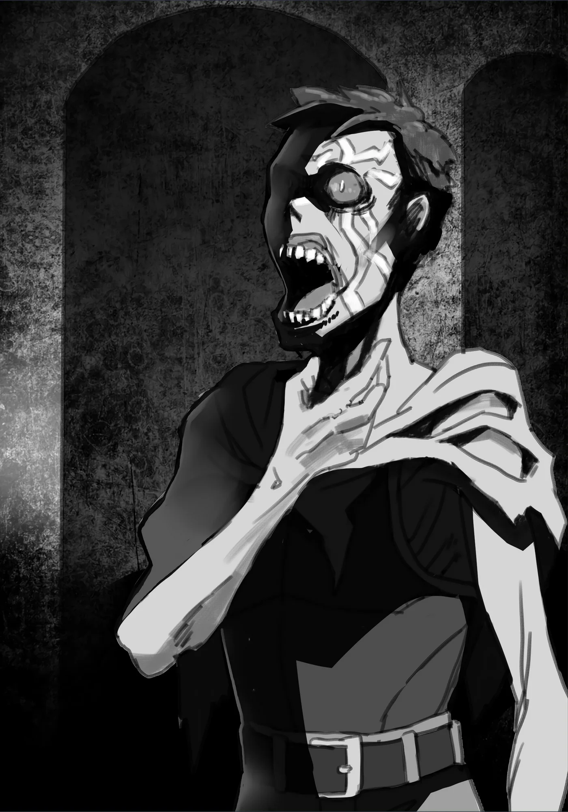

# Chương 5: Tập 1 Chương 1 - Nắm Bắt Tình Hình và Tiến Hóa Bản Thể (4)

Mãi đến khi hạ xong con Slime thứ năm trong ngày hôm đó, tôi mới bắt đầu nhận ra cơ thể mình có gì đó đổi khác. Kể từ lúc hạ con Slime đầu tiên, tôi đã lùng sục và giao chiến với không ít quái vật khác, mà xem chừng chuyện tôi một nhát chém chết con Slime lúc đầu hoàn toàn chẳng phải ăn may. Mấy con Slime đụng phải sau đó đều bỏ mạng y hệt như vậy.

Sức mạnh của tôi đang tăng tiến nhanh chóng, vượt qua cả mức lúc tôi còn sống.

Thời còn là mạo hiểm giả Hạ Đồng Cấp, dẫu có khổ luyện đến đâu tôi cũng chẳng thấy mình tiến bộ được chút nào. Thực ra, tôi gần như không nhích thêm được phân nào thì đúng hơn. Vậy mà giờ đây, sau khi chết rồi, tôi lại đang mạnh lên. Tôi chẳng biết mình nên vui hay nên buồn trước chuyện này nữa, dẫu sao thì nó vẫn tốt hơn nhiều so với cảnh cứ giậm chân tại chỗ mãi không thôi.

Dù chẳng biết nếu cứ tăng tiến với tốc độ này thì đến ngưỡng nào mình lại chững lại một lần nữa, tôi vẫn gạt phắt những suy nghĩ ấy ra khỏi đầu. Thay vào đó, tôi quyết định làm việc mình có thể làm lúc này: tiếp tục chiến đấu.

Sau khi đánh bại thêm mười con quái vật nữa, tôi thấy một cảm giác kỳ lạ trào dâng từ sâu bên trong, thứ cảm giác gần như xa lạ mà trước giờ tôi chưa từng nếm trải. Nó chẳng hề khó chịu chút nào. Nói đúng hơn, nó giống như có thứ gì đó đang trỗi dậy từ tận sâu trong tôi.

Thế nhưng, vốn tính cẩn thận như mọi khi, tôi vẫn cố hết sức kìm nén và chống lại nó. Rốt cuộc, mọi nỗ lực đều trở nên vô ích.

Tiếng răng rắc chậm rãi vang lên khắp người tôi, rồi cứ thế lớn dần khi toàn thân chìm trong một luồng sáng ấm áp.

Chuyện gì đang xảy ra thế này...?

Đầu óc tôi mới kịp nghĩ được chừng đó thì một chuyện kỳ lạ không sao giải thích nổi lại diễn ra ngay trước mắt: những thớ thịt khô quắt, teo tóp bắt đầu mọc ra quanh những khúc xương trắng toát trên người tôi. Như muốn che đi sắc trắng chói mắt của xương cốt, lớp thịt tiếp tục bò lan, rồi bọc kín toàn bộ khung xương.

Đúng là nó rồi, tôi cảm nhận được. Mong ước của tôi đã thành hiện thực—

Đây chính là Tiến Hóa Bản Thể.

Đó chính là điều đang diễn ra ngay lúc này.

Tôi vẫn tiếp tục độc thoại trong đầu khi hiện tượng biến đổi ấy chầm chậm lan ra khắp cơ thể. Lớp thịt màu nâu, khô cằn đến mức khiến tôi nghi ngờ liệu trong mạch máu có nổi một giọt ẩm nào hay không, bắt đầu mọc ra và quấn lấy hai tay, hai chân cùng bất cứ chỗ nào nó tìm thấy.

Vừa lúc nãy còn là một đống xương, thế mà cuối cùng tôi cũng có được da thịt...!

Một lát sau, hiện tượng biến đổi dừng lại. Để cho chắc, tôi quyết định kiểm tra lại cơ thể nay đã không còn trơ xương của mình.

Đúng như dự đoán, thịt đã bám chắc vào chân tay tôi, những nơi mà mới vừa rồi vẫn chỉ là những que xương trắng toát.

Thế nhưng, lớp thịt này khác một trời một vực so với hồi tôi còn làm người. Trước hết, trông nó chẳng khác nào những mảng màu nâu mỏng dính, khô khốc căng bọc lấy những khúc xương trắng lúc trước. Đã thế, lớp thịt mới có này cũng chẳng che chắn khung xương cho kín kẽ: những mẩu xương trắng vẫn lốm đốm lộ ra dưới lớp màng nâu bao phủ.

Tôi thấy mình chẳng khác gì một đống xương bị dán bừa vài miếng thịt lên trên. Nếu tôi mò lên khỏi mê cung trong hình hài này, lũ sói, chó hay mấy loài tương tự hẳn sẽ coi tôi là món ăn vặt ngon lành. Có khi lại bị ăn thịt mất.

Thân mình đã ra nông nỗi này, lại thêm không có gương soi như lúc trước, tôi đành đoán mặt mũi mình cũng y như vậy. Có điều, tôi biết rất rõ một loài quái vật mang diện mạo thế này. Vài mẩu thịt khô bám trên khung xương, chẳng đâu xa lạ ngoài Ngạ Quỷ.

Giờ thì tôi đích thị đã là một con Ngạ Quỷ, mục tiêu ban đầu trên con đường tiến hóa của mình.

Theo như tôi nhớ, Ngạ Quỷ trông chẳng khác gì người bị lột sạch da: vài mảng thịt rách rưới dính trên xương, còn xương thì lấp ló lộ ra qua những thớ cơ. Trông chúng cũng hết sức... khô khốc.

Nói cách khác, trông tôi gớm ghiếc vô cùng, nhưng dĩ nhiên, một cái xác khô thì làm sao ưa nhìn cho nổi. Tôi là một quái vật Undead cơ mà. Ai đời lại đi thích cái hình hài này, nói gì đến chuyện ước ao biến thành thứ tương tự. Thế nhưng với tôi, đây đã là một bước tiến lớn, đơn giản vì trên xương cốt giờ đã có da thịt.

Sau khi trải qua Tiến Hóa Bản Thể, tôi nhận ra chỉ cần tiếp tục cố gắng, mình hoàn toàn có thể leo cao hơn nữa trên bậc thang phân cấp quái vật. Đó là điều rất đáng để ăn mừng.

Riêng với quái vật Undead, bậc tiến hóa càng cao thì trông lại càng giống người. Chẳng hạn, nếu tiến hóa được thành Ma Cà Rồng, một tồn tại ở bậc cao hơn Ngạ Quỷ, thì về cơ bản trông tôi sẽ chẳng khác gì người bình thường, lúc đó muốn đi lại trên đường phố Maalt cũng chẳng gặp chút trở ngại nào.

Còn với hình hài hiện tại, giỏi lắm tôi cũng chỉ có thể lén lút mò vào thị trấn, chứ vẫn chưa thể đi lại tự do. Có điều, tôi vốn quen mặt đám lính gác cổng ở Maalt. Nếu khéo léo xoay xở, biết đâu tôi vẫn có thể ra vào theo ý mình.

Nhưng dĩ nhiên rồi. Dù phần lớn chỉ là thịt khô, hiện giờ tôi đã có một cơ thể thực thụ, và vì thế có một việc quan trọng tôi rất muốn thử.

"...OA... OAAA..."

Tôi gắng sức đẩy một luồng hơi qua cổ họng xem mình có nói được không. Xem chừng ít nhất tôi vẫn phát ra tiếng được.

"HE... HEEH... VVO... HEH... VO. OOD... MOV... NINV... GGGUH... HEH... VVO..."

...

Không ổn. Thế này thì chẳng ổn chút nào.

Tuy đã có thể mở miệng nói, nhưng tôi hoàn toàn không nói trôi chảy được, cũng chẳng lấy gì làm rõ nghĩa. Xem ra sẽ phải luyện tập thêm rồi.

Mặt khác, tôi vẫn thích trạng thái này hơn hẳn hồi làm Khô Lâu không nói được câu nào mà chỉ biết khua xương lách cách. Nhờ thế này, tôi sẽ có thể tìm được tiếng nói chung với bất cứ ai bước vào mê cung... Hoặc ít nhất là tôi hy vọng thế.

Dĩ nhiên, điều kiện tiên quyết là người nghe không sợ tôi đến mức hồn siêu phách lạc.

Trong lúc tôi còn đang mải tính toán các khả năng, một tiếng kim loại va chạm sắc lẹm chợt cắt ngang dòng suy nghĩ. Nghe như có ai đó đang giao chiến với quái vật ở khá xa, bởi đó rõ ràng là tiếng lưỡi kiếm chém vào một bề mặt cứng.

Tầng này vốn chỉ toàn lũ quái vật yếu ớt như hầu hết mấy con tôi đã hạ từ trước tới giờ, lấy đâu ra con nào phát ra được tiếng kim loại. Chỉ riêng chi tiết đó thôi cũng đủ suy ra tiếng động bất thường kia là từ một mạo hiểm giả, chẳng còn khả năng nào khác.

Âm thanh này... Có một con người còn sống đang ở đây! Nghĩ tới đó, tim tôi đập thót một nhịp.

Tính đến giờ, tôi mới chỉ sống hơn một ngày trong mê cung này. Thế nhưng phần lớn thời gian ấy lại dành để thui thủi chiến đấu với quái vật suốt cả đêm. Nghĩ lại thì chuyện cũng dễ hiểu thôi.

Từ trước đến giờ, tôi toàn vào mê cung lúc ban ngày rồi tối lại trở về Maalt ăn uống. Đùng một cái, chưa kịp nhận ra thì tôi đã biến thành Khô Lâu, tương lai mịt mù không thấy nổi một tia hy vọng. Cứ thế, tôi cắm đầu chém giết quái vật trong mê cung, nên chuyện tôi nhớ hơi ấm của con người cũng là lẽ tự nhiên thôi.

Tôi muốn nói chuyện với một ai đó, ai cũng được. Nếu ở đây có mạo hiểm giả, thì mạo hiểm giả cũng tốt.

Thế nhưng, tôi nhanh chóng trấn tĩnh lại sau cơn phấn khích. Với cái bộ dạng này mà cố bắt chuyện với con người thì gay go lắm.

Dù tôi không còn là một đống xương biết đi, nhưng Ngạ Quỷ thì vẫn cứ là... Ngạ Quỷ. Nếu tôi tiến lại gần một mạo hiểm giả với cái thân xác khô quắt này, họ chắc chắn sẽ cảnh giác và lập tức rút kiếm thủ thế; chuyện trò sẽ là thứ cuối cùng họ nghĩ tới.

Nếu tôi thuộc loài quái vật có tri giác và trí khôn nào đó thì may ra chuyện chạm mặt còn đỡ, đằng này tôi lại là một con Ngạ Quỷ. Nghĩ đường nào cũng thấy vô vọng. Thế nên, tôi chọn cách lùi xa khỏi nơi phát ra tiếng động rồi trốn đi, để không phải chạm mặt mạo hiểm giả kia.

Thế nhưng tính tò mò đã chiến thắng: liệu tôi có thực sự nỡ làm ngơ và bỏ đi khi một con người đang ở gần mình đến thế?

Không. Tôi không tài nào kìm lòng nổi.

Sự cô lập và nỗi cô đơn trong tôi đã lớn đến mức ấy: tôi muốn nhìn thấy một con người, bằng bất cứ giá nào.

Và thế là tôi đưa ra lựa chọn, lặng lẽ lần mò về phía phát ra âm thanh. Nếu bị phát hiện, tôi chỉ việc bỏ chạy là xong.

Tôi nghĩ đứng trong bóng tối nhìn lén thì chắc cũng không sao. Tôi cố giấu đi sự hiện diện của mình kỹ nhất có thể, bước về phía trước thật khẽ khàng.

Tiếng động càng lớn dần, nhịp tim tôi cũng đập dồn dập theo. Thêm một chút nữa thôi...

Giờ tôi đã không còn cách xa một người sống là bao. Từng bước chậm mà chắc, tôi đã tới đích, tiếng giao tranh vẫn liên tục vọng lại từ phía sau khúc ngoặt.

Tôi thận trọng men theo lối đi, khẽ ló đầu qua khúc ngoặt nhìn sâu vào hành lang mê cung phía trước. Ở đó, đúng như tôi đoán, là một mạo hiểm giả khác đang tuốt kiếm giao chiến với lũ quái vật.
