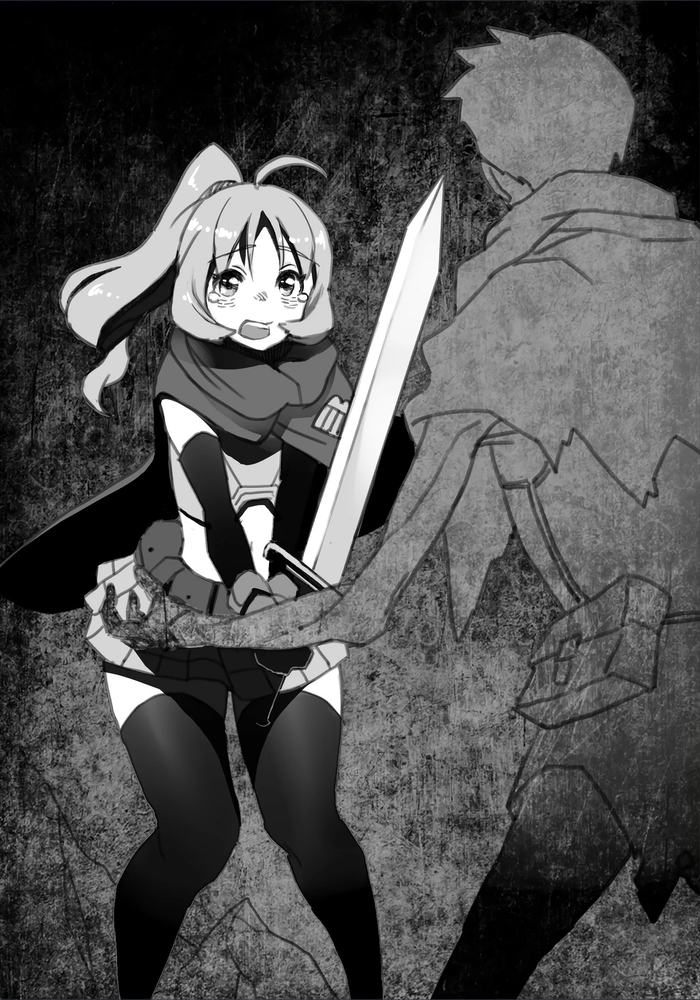

# Chương 6: Tập 1 Chương 2 - Mạo Hiểm Giả Rina (1)

"...Aaa!!"

Một cô gái trẻ đang vung vũ khí về phía con Khô Lâu, tiếng hét nghe chừng còn dồn nhiều lực hơn cả nhát chém.

Điều đầu tiên đập vào mắt tôi là chất lượng trang bị của cô gái, hay nói đúng hơn là sự thiếu thốn về mặt chất lượng. Cô mặc bộ giáp rẻ tiền, tay cầm thanh kiếm một tay cũng rẻ tiền chẳng kém. Chắc chắn đây là một mạo hiểm giả Thiết Cấp mới vào nghề.

Cũng phải nói thêm, tôi vốn rất quen mặt các mạo hiểm giả đồng nghiệp, ít nhất là những ai sống ở Maalt. Đằng này cô gái trước mặt lại là một gương mặt xa lạ, nên tôi mới đoán thế.

Dù các mạo hiểm giả Thiết Cấp sớm muộn gì cũng sẽ vượt mặt tôi và chỉ được xem như những đối thủ cạnh tranh tiềm tàng, tôi vẫn luôn nhớ mặt và tìm hiểu về họ. Làm vậy cốt chỉ để chặn trước cái cảnh hết người này đến người khác chực đem sự bất tài của tôi ra làm trò cười. Tôi luôn chủ động kết thân với họ ngay tại chỗ, tiện thể ghi nhớ xuất thân cùng các mối quan hệ của họ rồi mới ai đi đường nấy.

Khá thú vị là dù chẳng có chút năng khiếu nào trong nghề mạo hiểm giả, bù lại tôi được trời phú cho trí nhớ tốt cùng sự khôn ngoan từng trải, đủ để dễ dàng đi trước một bước trước bất kỳ mạo hiểm giả Thiết Cấp nào tính giở trò mờ ám. Nhờ vậy, tiếng khôn ngoan của tôi lan tới cả tai các mạo hiểm giả cấp cao ở Maalt, nên hầu như chẳng ai thèm kiếm chuyện với tôi. Có lẽ cũng một phần nhờ mạo hiểm giả ở Maalt đa số đều là người đàng hoàng.

Chưa kể, tôi còn chú ý chấn chỉnh đạo đức cho những kẻ xấu tính ngay từ lúc họ mới vào nghề. Lâu dần, việc đó mang lại hiệu quả rõ rệt, dần dà giúp phẩm chất chung của giới mạo hiểm giả ở Maalt tốt lên trông thấy. Đó cũng là một trong những lý do Hội Mạo Hiểm Giả suốt bấy lâu chưa từng bảo tôi gác kiếm, dù tôi đã giậm chân ở một trong những cấp bậc thấp nhất gần cả chục năm trời.

Nói đơn giản thì tôi cũng thuộc dạng biết mưu tính, dĩ nhiên là theo hướng tốt thôi.

Tôi hướng sự chú ý trở lại cô gái trẻ. Không chỉ khoác trên mình bộ trang bị tân thủ từ đầu đến chân, thực lực của cô cũng còn non lắm. Thực tế là trông cô còn yếu hơn cả tôi thời còn sống một chút.

Song, so bì như vậy kể cũng hơi bất công: bất kỳ mạo hiểm giả Đồng Cấp nào cũng dễ dàng vượt trội hơn hẳn các đồng nghiệp Thiết Cấp. Dù gì tôi cũng hạ được một con Khô Lâu mà không gặp quá nhiều khó khăn. Tuy chẳng đến mức dễ dàng, nhưng tôi hoàn toàn đủ sức, nhất là khi thường dân mà đụng phải Khô Lâu thì chỉ có nước nhắm mắt cầu nguyện. Đến cả mạo hiểm giả Thiết Cấp cũng phải lập nhóm hai ba người mới dễ dàng hạ được một con.

Thế nên, việc tôi tiếp tục thám hiểm một mình suốt bấy lâu chí ít cũng chứng tỏ tôi có chút năng lực, dù chưa đến mức đáng để tự hào.

Nghĩ vậy, tôi đánh giá cô gái trước mắt thực sự quá yếu. Dù trông cô có vẻ đang gắng sức chống trả kẻ địch xương xẩu của mình, chỉ cần cô sơ sểnh một nhịp là đối thủ sẽ lật ngược thế cờ ngay, và cô cầm chắc phần thua. Thực lực của cô chỉ đến thế là cùng.

Thế nhưng, dù non nớt đến đâu thì mạo hiểm giả vẫn cứ là mạo hiểm giả. Lỡ có sẩy chân, cô vẫn dễ dàng tháo chạy rồi mọi chuyện sẽ đâu vào đấy thôi. Tôi không quá lo cho sự an toàn của cô; ít nhất, ban đầu tôi nghĩ vậy—

Khoan đã.

Nhìn kỹ lại thì tình thế nghiêm trọng hơn tôi tưởng ban đầu nhiều. Cứ như chưa từng nghĩ tới chuyện mình có thể thua, cô gái trẻ tiếp tục dấn tới, cố dùng sức áp đảo kẻ thù.

Thế nhưng, mọi cố gắng của cô đều vô ích. Rõ ràng là không đủ thể lực, cô bắt đầu phải lùi bước, không sao theo kịp các đòn tấn công của đối phương. Tình thế này rất dễ mất mạng, nhất là khi cô đang ở trong một lối đi mê cung chật hẹp, chẳng có đường thoát nào rõ ràng.

Khi con Khô Lâu tiếp tục dồn ép cô gái lùi về sau, cô bỗng khựng lại.

"...Hử?!"

Lưng cô gái giờ đã đụng sát vào vách tường, và dường như tới tận lúc này cô mới nhận ra.

Tôi khẽ lắc đầu. Đây là cái bẫy mà những mạo hiểm giả không chịu quan sát kỹ xung quanh rất hay mắc phải. Một nữ kiếm sĩ ở trình độ như cô lại cần có khoảng trống để di chuyển và vung kiếm. Nói cách khác, số phận của cô coi như đã định đoạt ngay khoảnh khắc tự dồn mình vào góc tường vì bất cẩn.

Như thể nhận ra điều đó, con Khô Lâu đang giao chiến với cô liền áp sát, háo hức giơ hai cánh tay lên định giáng đòn bằng tay trần.

Dù Khô Lâu không có vũ khí, nhưng xét cho cùng, nó vẫn là một con quái vật. Cú đánh đó mà trúng phải một mạo hiểm giả phòng thủ yếu ớt, người đó chắc chắn sẽ bất tỉnh. Tệ hơn nữa, nếu trúng chỗ hiểm thì có khi mất mạng ngay tại chỗ. Khỏi phải nói, người bình thường chẳng thể nào chịu nổi một đòn như thế.

Tóm lại, nếu đòn đánh của Khô Lâu trúng đích, cô gái sẽ chết. Đi đến kết luận đó, tôi chỉ đành chấp nhận sự thật này.

Nói vậy không có nghĩa là tôi đành lòng nhìn cô gái chết như thế; ý tôi chỉ là ban đầu tôi định tiếp tục quan sát thôi, bởi lộ diện trước mặt cô lúc này sẽ kéo theo đủ thứ rủi ro.

Dù trước khi tới đây tôi đã bị cuốn theo sự hưng phấn nhất thời, nhưng vừa nhìn thấy một con người bằng xương bằng thịt đang hít thở trước mắt, đầu óc tôi đã bình tĩnh trở lại. Giờ mà tôi có xuất hiện trước mặt cô, cô cũng chỉ xem tôi là một con quái vật; chuyện trò với nhau là điều không tưởng.

Có điều, bỏ mặc cô gái chết là việc tôi không tài nào làm nổi.

Dù thân xác giờ đã là quái vật, trái tim tôi vẫn là của con người. Trừ phi người gặp nạn là kẻ gian ác tồi tệ, bằng không chí ít tôi nhất định sẽ tìm cách giúp đỡ. Với tôi, đây là việc đúng đắn cần làm: một mạo hiểm giả tiền bối bảo vệ tính mạng cho hậu bối giữa chốn mê cung khắc nghiệt không chút khoan nhượng.

Chính vì thế tôi mới hành động.

"...GÀOOOOO!!!"

Để kéo sự chú ý của con Khô Lâu khỏi con mồi, tôi nhảy vọt ra từ góc khuất, gầm lên dữ tợn hết mức có thể. Tôi cũng chẳng dám chắc kế hoạch có thành hay không, vì ngay từ đầu đây đã là một canh bạc năm ăn năm thua, phần nhiều cũng bởi hiện tại tôi đang là một Ngạ Quỷ.

Không phải chuyên gia về tập tính quái vật, tôi chẳng rõ một con quái vật sẽ chú ý đến mức nào trước tiếng động lớn do một con khác tạo ra. Có điều, lũ quái vật tôi từng giao chiến từ trước tới giờ dường như đều coi tôi là kẻ thù, hễ vừa thấy tôi là lập tức vào thế chiến đấu. Có lẽ ở tôi có điểm gì đó khác biệt với lũ quái vật khác, và chính chúng cũng nhận ra điều ấy. Chính vì thế tôi mới làm vậy; nói đúng hơn, kế hoạch của tôi hẳn phải có tỷ lệ thành công khá cao.

Chẳng mất nhiều thời gian để tôi thấy canh bạc của mình đã có kết quả. Con Khô Lâu khựng lại giữa chừng đòn tấn công, quay sang đối mặt với tôi rồi lao thẳng về phía này.

Đôi mắt cô gái mở to trước diễn biến bất ngờ. Có vẻ như cô từng định nhân lúc con Khô Lâu quay lưng về phía mình để chém hạ nó ngay tại chỗ. Thế nhưng, cô gái dường như quá đỗi bàng hoàng nên chỉ biết đứng chết trân ở đó.

Chẳng còn lựa chọn nào khác: tôi rút kiếm, chạy thẳng về phía kẻ địch. Dù ban đầu định để dành, tôi vẫn bắt đầu truyền Khí Lực vào thanh kiếm. Tôi phải giải quyết chuyện này thật nhanh bằng một đòn quyết định.

Sau khi tiến hóa thành Ngạ Quỷ, tôi nhận ra giờ mình đã có thể dùng đòn Khí Lực kha khá lần mà không lo cạn sạch năng lượng, thế nên dùng một đòn lúc này chắc cũng chẳng hao hụt dự trữ là bao.

Tôi giương kiếm lên bằng một động tác thuần thục rồi dồn cả sức nặng cơ thể vào đòn đánh, bổ mạnh thanh kiếm xuống. Một nhát chém gọn gàng, ngập sâu vào cơ thể xương xẩu của đối thủ. Chỉ trong tích tắc, con Khô Lâu đứt lìa làm hai nửa gọn gàng, vỡ vụn thành nhiều mảnh khi phần còn lại của cơ thể nó rơi xuống đất.

"...Tuyệt quá..."

Nữ mạo hiểm giả sững sờ, chỉ biết tiếp tục nhìn chằm chằm vào tàn tích của thứ mới vài giây trước còn là con Khô Lâu.

Tôi chẳng trách cô được. Tuy Khô Lâu nhìn chung là quái vật yếu, nhưng ở cấp bậc như tôi, hiếm mạo hiểm giả nào chém đôi chúng dễ dàng như thế. Ai gặp cảnh này cũng sẽ ngạc nhiên thôi; phải, ngay cả tôi cũng vậy.

Đúng là tuyệt thật.

Hử.

Trước giờ mình mạnh cỡ này thật à?

Đó là cảm nghĩ của tôi sau khi chém hạ con Khô Lâu. Tôi lặng lẽ đứng yên một lúc, ngẫm lại chuyện vừa xảy ra.

Xem chừng giờ tôi còn mạnh hơn trước nữa. Cứ tiếp tục phát triển với đà này, mục tiêu cuối cùng là tiến hóa thành Ma Cà Rồng có vẻ đã nằm trong tầm tay. Một tia hy vọng nhen nhóm trong lòng, dù có lẽ tôi đang hơi vội mừng quá sớm.

Vừa nghĩ tới đó, tôi chợt giật mình tỉnh ra.

Cô gái vẫn đang đứng nguyên tại chỗ. Chắc chắn cô quan trọng hơn mớ độc thoại nội tâm của tôi nhiều.

Cô ấy có bị thương không?

Dù định mở miệng hỏi han, tôi lại thấy như có thứ gì mắc nghẹn trong cổ họng, và lập tức nhớ ra mình chẳng qua chỉ là một Ngạ Quỷ. Nếu tôi bất cẩn bước lại gần, chắc chắn cô sẽ bỏ chạy; thế thì chẳng ổn chút nào.

Vậy thì... mình nên làm gì đây?

Tôi quay sang nhìn cô gái thì thấy cô đang giương kiếm lên, nhìn tôi chằm chằm đầy sợ hãi.

Xem ra chúng tôi chẳng thể dễ dàng tìm được tiếng nói chung rồi.

