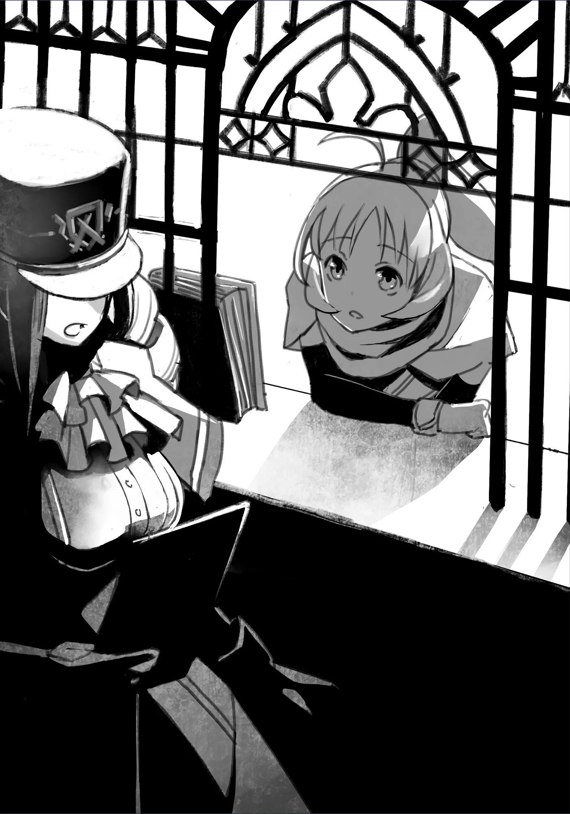

# Chương 9: Tập 1 Chương 2 - Mạo Hiểm Giả Rina (4)

Rentt Faina không quay về. Sheila Ibarss, nhân viên Hội Mạo Hiểm Giả Maalt, thấy chuyện này hết sức bất thường.

Dù mới làm việc ở hội được năm năm và vẫn là hậu bối so với các đồng nghiệp, Sheila đã quen biết Rentt từ rất lâu. Rentt chính là mạo hiểm giả đầu tiên cô gặp khi mới vào hội làm việc. Hồi ấy Rentt trẻ hơn bây giờ, một mạo hiểm giả mới hai mươi tuổi, nhưng trước đó anh đã có năm năm trong nghề; vậy mà anh vẫn chỉ là một mạo hiểm giả Hạ Đồng Cấp. Nhìn vào là thấy rõ Rentt không hẳn hợp với công việc này.

Phần lớn những mạo hiểm giả không trụ nổi đều chấp nhận bỏ nghề sau vài năm. Họ về quê hoặc tìm công việc khác khi nhận ra mình chẳng có tài năng hay năng khiếu gì để làm mạo hiểm giả. Nghe thì có vẻ như vậy, nhưng thật ra chuyện đó chẳng có gì đáng xấu hổ, và không ít mạo hiểm giả đã chọn con đường ấy.

Tuy vẫn có những kẻ ngốc nghếch chỉ trích người giải nghệ là chưa đủ chăm chỉ hay không dám liều mạng, nhưng những ai hiểu chuyện đều biết mạo hiểm giả không phải nghề có thể xem nhẹ. Đáp lại, chính những kẻ không hiểu nổi điều đó mới bị xem là lũ ngốc; đó là suy nghĩ chung của phần lớn các mạo hiểm giả biết điều.

Nói cách khác, Rentt đã ngấp nghé độ tuổi thích hợp để giải nghệ, và trách nhiệm báo tin đó cho anh rơi vào vai Sheila Ibarss, người được phân công phụ trách anh.

Thế nhưng vào thời điểm đó, Sheila từng rất bất mãn khi phải làm người phụ trách của Rentt. Không phải vì cô có ác cảm cá nhân gì với anh. Nhân viên Hội Mạo Hiểm Giả có nghĩa vụ hướng dẫn và hỗ trợ mạo hiểm giả cho tới những ngày cuối sự nghiệp. Nhìn vào tuổi tác cùng quá trình hoạt động của Rentt, rõ ràng anh nên sớm giải nghệ, và thật không may, việc nói với anh điều đó lại chính là nhiệm vụ của cô. Đó là việc ắt phải có người làm, nhưng cũng là việc chẳng ai muốn nhận. Hầu hết nhân viên thường tìm cách né tránh một phân công như thế.

Sheila từng thấy hơi chán nản khi công việc đầu tiên của mình lại là khuyên một mạo hiểm giả giải nghệ. Nhưng xem ra rốt cuộc Sheila đã lo hão.

Với Hội Mạo Hiểm Giả Maalt, Rentt dường như được miễn trừ khỏi những cân nhắc ấy. Dù số năm kinh nghiệm cùng việc anh mãi chỉ giậm chân tại chỗ chẳng có tiến triển gì đáng kể đúng là khiến anh thành đối tượng sáng giá để khuyên giải nghệ, nhưng hội lại coi anh là người quá giá trị không thể để mất. Lý do là những hoạt động của Rentt trong lẫn ngoài hội đều mang lại tác động tích cực rõ rệt cho người dân Maalt. Vì vậy, hội quyết định sẽ không thăng cấp cho Rentt, mà trước mắt cứ để anh giữ nguyên như hiện tại.

Thật ra, đích thân Hội Trưởng Hội Mạo Hiểm Giả Maalt sẽ mời Rentt vào làm nhân viên của hội nếu anh giải nghệ nghề mạo hiểm; giá trị của Rentt đối với hội lớn đến mức đó.

Trước hết, Rentt đảm đương nhiều việc và gánh vác đủ mọi vai trò trong hội. Không chỉ tinh tường trong việc đánh giá năng khiếu của các mạo hiểm giả mới, anh còn giới thiệu họ vào những tổ đội phù hợp. Anh cũng chỉ dạy cho người mới về các quy tắc, thường thức và kiến thức thực địa cần có để thám hiểm mê cung cho đàng hoàng. Chưa hết, Rentt còn thường xuyên làm hỏng những mưu đồ xấu xa của đám mạo hiểm giả có ý đồ bất chính.

Nhìn chung, đây đều là những kiến thức cơ bản mà ai cũng có thể chỉ dạy được. Nhưng vì thiếu người thật sự sẵn lòng đứng ra làm những việc đó, sự có mặt của Rentt quả là điều may mắn cho biết bao người mới bước chân vào việc thám hiểm mê cung.

Bình thường, phần lớn những việc này sẽ do người đại diện của hội đảm nhiệm. Thế nhưng Rentt lại làm hầu hết những việc đó mà không lấy một đồng thù lao. Dù thỉnh thoảng hội cũng ký hợp đồng thuê anh làm những việc này, nhưng chuyện đó rất hiếm khi xảy ra. Vậy mà Rentt vẫn luôn vui vẻ làm việc của mình, chẳng một lời than vãn.

Thêm vào đó, nhờ công sức của anh, tỷ lệ tử vong của các mạo hiểm giả mới ở những mê cung quanh Maalt đã giảm mạnh so với các vùng khác. Các mạo hiểm giả địa phương do Rentt chỉ bảo cũng có ý thức tuân thủ luật lệ và quy định hơn, nhờ vậy mà mạo hiểm giả và người dân trong thị trấn chung sống hòa thuận hơn. Có lẽ hiển nhiên phải nói rằng một người như Rentt quả là của hiếm.

Về phần Sheila, cô không phải người gốc Maalt, mà từng lên vương đô dự kỳ thi tuyển của hội. Thi đỗ xong, cô được điều tới Maalt, một nơi rất khác với quê nhà mà cô đã rời bỏ.

Trái ngược hoàn toàn, mạo hiểm giả ở quê Sheila đa phần là những kẻ có tư cách đáng ngờ. Dù cũng có những mạo hiểm giả tốt bụng, nhưng nhìn chung người dân trong thị trấn chẳng ưa gì họ; dân chúng nếu không đối xử tệ bạc lại với họ thì cũng nơm nớp sợ hãi. Trong khi phần lớn mạo hiểm giả ở đó hay thừa cơ phạm những tội vặt vãnh, thì một số kẻ thậm chí còn là tội phạm chuyên nghiệp đúng nghĩa.

Ngược lại, Maalt lại khác một trời một vực. Mạo hiểm giả ở Maalt được người dân tin tưởng, và nếu có ai trong số họ phạm tội, chính tay các đồng nghiệp mạo hiểm giả sẽ nhanh chóng bắt giữ kẻ đó. Là người phụ trách Rentt, Sheila hiểu rất rõ rằng chính sự có mặt của Rentt Faina đã tạo nên chuẩn mực đạo đức tốt đẹp cho các mạo hiểm giả ở Maalt.

Tuy nhiên, lý do hội giới thiệu Sheila với Rentt không chỉ đơn giản là để cô lấy một mạo hiểm giả lận đận ra tích lũy kinh nghiệm. Nói đúng hơn thì ngược lại mới phải: là người mới, Sheila sẽ học hỏi được rất nhiều khi làm việc cùng Rentt, một người dày dạn kinh nghiệm làm đủ thứ việc vặt cùng những nhiệm vụ chẳng ai thèm nhận, và vì thế rất thích hợp để truyền đạt lại những kiến thức quan trọng. Đó chính là quyết định của hội. Qua thời gian, Sheila đã học được từ Rentt rất nhiều điều về hội cũng như những phẩm chất cần có ở một nhân viên, và giờ cô đã trở thành một thành viên rất được coi trọng tại Hội Mạo Hiểm Giả Maalt.

Phạm vi dìu dắt của Rentt cũng chẳng hề hẹp chút nào. Thật ra, chỉ cần nhìn quanh khắp các ngóc ngách của Maalt là sẽ thấy rất nhiều mạo hiểm giả mới, phần lớn đều từng được Rentt chỉ dẫn. Sẽ chẳng có gì lạ nếu một trong số những mạo hiểm giả mới này sau đó vươn lên tới Mithril Cấp, bởi bản thân Rentt thường xuyên dõi theo các đàn em của mình để đảm bảo họ nhận được sự chỉ bảo cần thiết.

Trong khi bản thân Rentt mơ ước một ngày nào đó sẽ trở thành mạo hiểm giả Mithril Cấp, anh cũng thật sự bỏ công khổ luyện, ngày nào cũng theo một chế độ tập luyện nghiêm ngặt mà cả Sheila lẫn các mạo hiểm giả khác đều không hề hay biết. Thế nhưng, hơn ai hết, chính Rentt lại hiểu rõ và phải chấp nhận sự thật rằng mình có quá ít năng khiếu làm mạo hiểm giả. Giá như trong người Rentt có lấy một chút xíu tài năng thôi, hẳn công sức của anh đã được đền đáp. Đáng tiếc là hiện thực lại chẳng khoan dung như vậy. Chuyện này cũng đành bất lực mà thôi.

Dù Rentt hoàn toàn có thể lập đội với những mạo hiểm giả mạnh khác và gây dựng tên tuổi dưới danh nghĩa một tổ đội chung, nhiều mạo hiểm giả địa phương ở Maalt đều biết rõ mục tiêu của Rentt: giấc mơ trở thành mạo hiểm giả Mithril Cấp.

Nhưng Rentt không theo đuổi vị trí đó vì danh tiếng. Không, anh muốn trở thành mạo hiểm giả Mithril Cấp bằng chính sức mạnh và năng lực của bản thân. Do đó, dựa dẫm vào một người khác hay một tổ đội mạo hiểm giả sẽ đi ngược lại mục đích ấy. Để thực hiện giấc mơ của mình, Rentt chẳng còn lựa chọn nào khác ngoài việc tiếp tục tiến bước, dù khả năng thành công có mong manh đến đâu. Xét cho cùng, đó là con đường duy nhất dành cho anh.

Vì đơn độc mạo hiểm và chiến đấu là cách nhanh nhất để trau dồi sức mạnh, Rentt đã làm đúng như vậy. Kéo theo đó, trừ những tình huống khẩn cấp, các mạo hiểm giả khác đều tránh lập đội với Rentt. Những mạo hiểm giả ở Maalt làm thế là vì nghĩ cho Rentt, bởi họ biết giấc mơ của anh. Dù chuyện đó có vẻ xa vời đến đâu, họ cũng chẳng muốn xem thường hành trình theo đuổi sức mạnh của Rentt, ngay cả khi sự thật đã rành rành trước mắt mọi người.

Nói một cách trần trụi thì Rentt rất yếu. Vì thế, các mạo hiểm giả địa phương khác đều biết sớm muộn gì cái chết cũng sẽ tìm đến anh. Nhưng Sheila cùng các mạo hiểm giả khác lại nghĩ khả năng này tương đối thấp. Thế nên rốt cuộc họ vẫn để mặc Rentt làm theo ý mình, không nói một lời nào khi anh tiếp tục cuộc hành trình đơn độc ấy.

Tuy Rentt là mạo hiểm giả Đồng Cấp và chỉ có sức mạnh ở tầm đó, nhưng kiến thức cùng kinh nghiệm mạo hiểm của anh thừa sức sánh ngang với những tay kỳ cựu dày dạn sương gió. Ngay cả khi chẳng may chạm trán kẻ địch nguy hiểm, chắc chắn anh vẫn sẽ giữ được bình tĩnh và đưa ra những quyết định đúng đắn; ít nhất, đó là những gì các mạo hiểm giả khác ở Maalt nghĩ về Rentt.

Thế nhưng, dù có nói thế nào đi nữa, vẫn có một sự thật không đổi: Rentt Faina đã không quay về.

Rentt Faina, người mạo hiểm giả Hạ Đồng Cấp ngày nào cũng bước vào cùng một mê cung vào đúng một khung giờ, trở về hội vào đúng thời điểm đó với những nguyên liệu tương tự, ký xác nhận các nhiệm vụ được giao, rồi lại đi tập luyện ở nơi khác.

Đó là cuộc sống thường nhật của Rentt. Chuyện đó diễn ra đều đặn mỗi ngày, chưa từng sai lệch một lần nào, vậy mà—

Chẳng ai biết anh đã biến mất đi đâu. Sheila chỉ là một trong số rất nhiều người đang lo lắng trước sự vắng mặt của anh.

Rentt...

Rentt Faina—

Xin anh hãy bình an vô sự... Đó là lời cầu nguyện thầm lặng không ai nghe thấy của Sheila trong lúc cô tiếp tục công việc thường nhật tại hội.

"À, xin lỗi..."

Giọng của một cô gái trẻ kéo Sheila ra khỏi dòng suy nghĩ. Ngẩng đầu lên, cô thấy chủ nhân của giọng nói quả đúng là một cô gái trẻ, lại còn là một người quen mặt.

Cô gái là một mạo hiểm giả mới được điều từ vương đô về Maalt cách đây mới vài ngày. Vì đến vào đúng lúc khá xui xẻo nên cả Rentt lẫn các mạo hiểm giả tiền bối khác đều không có mặt; thành thử cuối cùng cô đã một mình đi mạo hiểm.

Sheila nhớ ra tên cô gái: Rina Rupaage. Nghĩ vậy, cô xếp gọn xấp giấy tờ trên tay lại, rồi lắng nghe xem Rina muốn nói gì.

◆◇◆◇◆

Vung kiếm lên, tôi chém xuyên qua lũ Khô Lâu trước mặt. Tôi chẳng còn biết mình đã hạ bao nhiêu con nữa, vì tôi đã ngừng đếm từ lâu rồi. Hồi còn sống, tôi phải tốn không ít công sức mới hạ nổi một con Khô Lâu, vậy mà giờ những ký ức ấy cứ như chuyện bịa. Tôi dễ dàng vòng ra sau lưng kẻ địch xương xẩu, bổ kiếm xuống và một lần nữa chém ngọt bộ xương trắng của đối thủ thành hai nửa.

Thật không thể tin nổi.

Những thay đổi này không hẳn đến từ việc kỹ thuật được cải thiện, mà đơn giản là tôi đã mạnh lên về mặt thể chất. Lượng Ma Lực, Khí Lực và Thần Lực dự trữ của tôi dường như cũng tăng lên sau mỗi con quái vật tôi hạ gục. Vận dụng ba nguồn năng lượng ấy, giờ đây tôi có thể cường hóa cơ thể theo nhiều cách khác nhau; cuối cùng tôi cũng cử động được đúng như mình hằng mong muốn.

Tốc độ này là điều không tưởng với tôi hồi còn sống, vậy mà giờ đây cơ thể tôi lại chuyển động mượt mà và nhanh nhẹn. Trong chuỗi ngày miệt mài tập luyện trước kia, tôi từng bị phồng rộp rớm máu không biết bao nhiêu lần. Nhưng dù có tập luyện gian khổ đến đâu, tôi cũng chẳng nhanh hơn hay khỏe hơn được chút nào.

Thế nhưng, hiện thực lúc này đã khác. Cơ thể cử động đúng như tôi chỉ huy, không hề có một sai sót nào trong từng động tác. Tôi còn nhìn rõ chuyển động của kẻ địch; các giác quan trở nên nhạy bén hơn bao giờ hết. Những mạo hiểm giả từng vượt xa tôi hẳn cũng nhìn thế giới theo cách này.

Tôi nhớ lại bản thân hồi còn sống, nhớ cái thời mình chẳng nhìn thấy được gì cả. Nếu có thể, tôi đã muốn đạt tới tầm sức mạnh này khi vẫn còn hơi thở; dù tôi biết giờ chuyện đó là không thể rồi. Nhưng có lẽ tôi nên thấy may mắn vì ngay cả khi đã chết, mình vẫn hoàn toàn làm chủ được tâm trí và năng lực của bản thân. Cứ đà này, biết đâu tôi còn chạm tới được giấc mơ trở thành mạo hiểm giả Mithril Cấp...

Đúng lúc nghĩ vậy, một câu hỏi chợt nảy lên trong đầu tôi:

Liệu sau ngần ấy thời gian, mình có tiếp tục làm mạo hiểm giả nữa không?

Dĩ nhiên, có rất nhiều kiểu mạo hiểm giả khác nhau. Người ta thích thì làm mạo hiểm giả thôi, nhưng nhiều người cũng đã dừng lại sau khi chững lại ở bậc Đồng Cấp, giống hệt tôi. Trừ một vài trường hợp đặc biệt, bất kỳ ai cũng có thể làm mạo hiểm giả miễn là đủ từ mười lăm tuổi trở lên.

Tuy nhiên:

Liệu một con quái vật có thể làm mạo hiểm giả được không?

Cùng lúc đó, một câu hỏi khác lại trỗi dậy từ sâu trong tâm trí tôi. Có lẽ là được chứ, đó là câu trả lời tôi tự rút ra, cứ như thể đó là lẽ thường hiển nhiên vậy.

Nhưng hiện thực lại chẳng dễ dàng đến thế. Tôi thử nghĩ kỹ thêm về tình huống này. Chẳng hạn, một ngày nọ bỗng có một con Ngạ Quỷ xuất hiện ở Hội Mạo Hiểm Giả, cứ thế bước tới quầy tiếp tân, chìa bàn tay thối rữa một nửa ra và cất cái giọng khàn đặc nửa nói nửa gầm...

"T... Mạo... Hiểm giả. Đăng... Đăng... Ký... Cho tôi!"

Cảnh tượng đó chẳng khác nào bước ra từ truyện kinh dị.

Cô tiếp tân chắc chắn sẽ từ chối thẳng thừng. Chưa kể, cô ấy sẽ lập tức bấm nút báo động khẩn cấp dưới gầm bàn, gọi ngay những mạo hiểm giả mạnh quanh đó tới, hoặc thậm chí là đích thân Hội Trưởng. Thế là con Ngạ Quỷ sẽ bị khử gọn, và mọi chuyện chấm dứt tại đó.

Dẫu nói vậy... tôi chưa từng một lần nghĩ tới chuyện có thể mình sẽ không tiếp tục làm mạo hiểm giả được nữa, ít nhất là cho tới tận lúc này.

Chắc tôi nên thôi nghĩ ngợi thì hơn. Quan trọng hơn là tôi phải tính xem từ giờ trở đi mình sẽ sống tiếp thế nào, bởi tôi vẫn còn một giấc mơ cần thực hiện: trở thành mạo hiểm giả Mithril Cấp.

Sau bao chuyện, nút thắt khiến tôi chật vật suốt bấy lâu nay rốt cuộc đã được tháo gỡ. Giờ tôi đã có tài năng và năng khiếu để làm mạo hiểm giả... đổi lại là những hiểm nguy từ chính hình hài quái vật hiện tại.

Thế nhưng, nếu hình hài này cản trở tôi làm mạo hiểm giả thì đó sẽ là một vấn đề lớn. Tôi đi đến kết luận rằng mình phải tìm ra cách tiếp tục làm mạo hiểm giả, bất kể vẻ ngoài có ra sao hay bản thân đã biến thành thứ gì đi nữa.

Tuy tôi đã nhắc tới những chính sách rộng mở của hội không ít lần, nhưng trông mong hội chấp nhận một con quái vật vào hàng ngũ của mình chắc là đòi hỏi hơi quá.

Tôi đã nhờ Rina mua quần áo hộ mình, nhưng việc đó vẫn không giải quyết được một vấn đề lớn khác. Áo choàng có thể che được phần lớn cơ thể tả tơi của tôi, nhưng không che nổi khuôn mặt cùng hai cánh tay. Khi đọc giấy tờ hay đưa vàng và nguyên liệu, đương nhiên tôi phải rướn người tới trước; ít nhất cũng phải nói rằng việc giấu hai cánh tay là hoàn toàn bất khả thi.

Tôi ngán ngẩm nhìn xuống hai cánh tay mình. Đúng như tôi nghĩ, chúng vừa thối rữa vừa khô khốc. Chẳng còn cách nào khác để tả nữa.

Thậm chí màu da của tôi xem ra còn tệ hơn trước: mới cách đây không lâu nó chỉ có màu nâu, mà giờ đã chằng chịt những vệt đen. Nếu một người sống sờ sờ nhìn thấy hai cánh tay tôi như thế mà không có phản ứng gì thì tôi mới kinh ngạc đấy. Dù vậy, biết đâu vẫn có vài người bỏ qua được chuyện đó và không ngại tiếp xúc với tôi...

Không. Đó chỉ là suy nghĩ viển vông thôi.

Tôi, Rentt Faina, chẳng nổi tiếng vì tài nghệ mạo hiểm gì cho cam, nhưng khuôn mặt tôi thì lại được rất nhiều người biết đến, bất chấp cái danh "Đồng Cấp Ngàn Năm". Tôi nổi tiếng, hay có lẽ là mang tiếng, vì không chịu bỏ cuộc, và nhờ vậy mà khắp Maalt ai cũng biết mặt tôi.

Nói cách khác, hơn một nửa Hội Mạo Hiểm Giả Maalt đều biết mặt mũi tôi hồi còn sống trông thế nào. Nếu tôi đột ngột xuất hiện với đôi tay trong tình trạng này, chắc chắn tôi sẽ bị hỏi han đủ chuyện.

Các nhân viên hội sẽ vì lo lắng mà hỏi thăm tôi mãi không thôi, tưởng rằng tôi đã bị một con quái vật khủng khiếp nào đó trong mê cung hại. Trong lúc họ gặng hỏi thông tin, kiểu gì chiếc áo choàng của tôi cũng bị kéo tuột ra, và thế là hết chuyện. Dù nếu chỉ bị mỗi hai cánh tay thì tôi còn có thể viện cớ này cớ nọ...

Chẳng hạn, cứ bảo là một con quái vật đã hút cạn sinh lực ở hai bàn tay tôi đi; chuyện đó cũng có thể xảy ra lắm chứ. Tuy nhiên, một khi họ nhìn thấy khuôn mặt tôi thì mọi chuyện sẽ chấm dứt ngay.

Dù không có gương soi, nhưng mặt tôi rõ ràng là mặt Ngạ Quỷ. Chắc chắn tôi sẽ bị săn lùng và tiêu diệt bất kể lý do hay hoàn cảnh của mình ra sao, nhất là khi tôi đã sa ngã và đánh mất nhân tính.

Tình hình xem chừng chẳng khả quan chút nào.

Hoàn cảnh trước mắt không cho phép hiểu theo cách nào khác được, và một lần nữa, tôi lại thấy ý chí của mình dao động.

Nhưng tôi đã quyết tâm rồi.

Vấn đề duy nhất ở đây là vẻ ngoài của tôi. Nếu xử lý được chuyện diện mạo, chắc chắn cách giải quyết sẽ tự khắc mở ra. Muốn vậy, tôi phải bình tĩnh lại, và một lần nữa tập trung vào mục tiêu ban đầu: đạt được Tiến Hóa Bản Thể. Cho tới khi bắt đầu trông giống con người ít nhất là đôi chút, tôi nên tránh xa Hội Mạo Hiểm Giả. Có điều, tôi chợt nhận ra như thế thì mình sẽ chẳng còn nguồn thu nhập nào nữa.

Một giọng nói quen thuộc chẳng mấy chốc đã kéo tôi ra khỏi bao nỗi lo toan và rắc rối ấy.

"...Rentt! ...Anh Rentt! Anh có ở đó không? Ở đâu đó quanh đây à?!"

Giọng nói đó không phải của ai khác ngoài Rina Rupaage, cô gái mà tôi đã nhờ đi mua quần áo giúp mình.