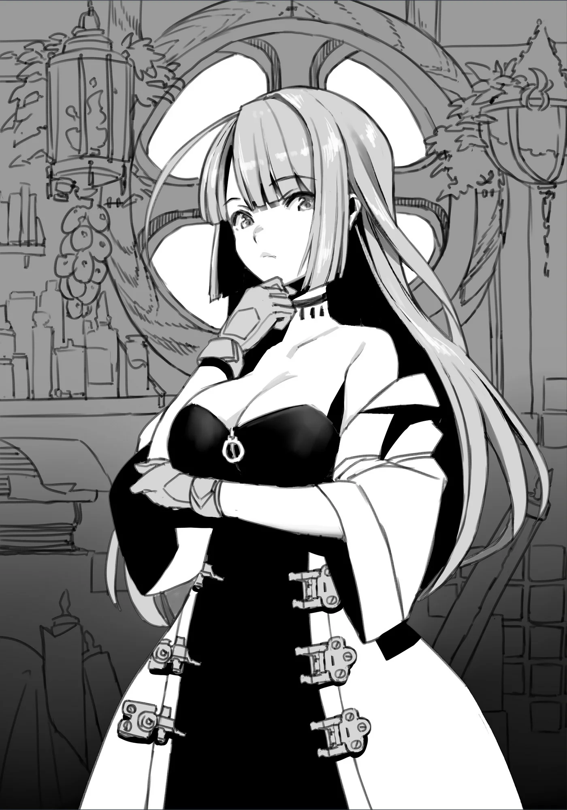

# Chương 13: Tập 1 Chương 3 - Cuộc Đột Nhập Thị Trấn Của Undead Nọ (2)

"...Rồng sao. Dù có giải thích thế nào đi nữa thì chuyện này vẫn thật khó tin. Nhưng mà..." Nói được nửa câu thì cô nhìn tôi, rồi khẽ lắc đầu chầm chậm.

"Nhìn bộ dạng này của anh thì tôi không tin cũng không được rồi. ...Mà dù có khó tin đến mức nào đi chăng nữa, thì chuyện một người bạn cũ của mình đùng một cái biến thành Undead... cũng đâu phải điều ai cũng có thể nghĩ tới trong đời chứ."

Cởi chiếc áo choàng của tôi ra, cô nheo mắt cẩn thận quan sát từng tấc da thịt khô khốc trên cơ thể tôi. Cô làm điều đó với niềm nhiệt huyết cháy bỏng của một học giả kiêm mạo hiểm giả, bởi cô chính là người bạn cũ của tôi, Lorraine Vivie.

Cô vẫn mặc chiếc áo choàng nhàu nhĩ và luộm thuộm quen thuộc mà mình luôn khoác lên người. Mái tóc lượn sóng buông xõa dài qua vai một cách tùy ý. Dù trông như thể chẳng hề bận tâm đến vẻ ngoài của mình, nhưng từ cô lại toát ra một sức hút kỳ lạ theo cách rất riêng.

Tôi quen biết cô ấy đã từ rất lâu—đâu đó khoảng mười năm kể từ khi tôi đặt chân đến Maalt. Dẫu đã biết nhau cả một thập kỷ, nhưng chúng tôi chỉ mới thân thiết hơn trong thời gian gần đây—kiến thức uyên bác của cô luôn vô cùng hữu dụng và giúp ích cho tôi về nhiều mặt. Chính vì vậy, tôi chẳng thể nghĩ ra ai thích hợp hơn Lorraine để cùng thảo luận về tình cảnh hiện tại của mình.

Rõ ràng cô ấy rất kinh ngạc trước những gì tôi kể, nhưng chưa từng một lần nghi ngờ hay khước từ lời tôi nói. Nếu có chăng, Lorraine dường như đã chấp nhận chuỗi sự việc tôi thuật lại như một sự thật hiển nhiên, và lúc này cô đang trầm ngâm suy nghĩ.

"...Người... không muốn... tin nhất... lại chính là tôi đấy. Lại biến thành... bộ dạng thế này..."

Lorraine gật đầu trước lời tôi nói.

"Ừ... Đúng thật là vậy. Mà ai lại bảo người ta sẽ biến thành Undead sau khi bị Rồng ăn thịt cơ chứ...? Rồng xuất hiện trong mê cung sao... Thật không thể tin nổi. Giờ nó vẫn còn ở đó à?"

"Không... Nó đã... biến mất rồi. Lúc tôi... tỉnh dậy. Khí tức của nó... cũng chẳng còn. Chắc là... không còn... ở đó nữa đâu."

Báo cáo về sự hiện diện của nó cho Hội là một trong những ý nghĩ đầu tiên nảy ra trong đầu tôi khi vừa tỉnh giấc—nhưng tất nhiên, vào thời điểm đó nó đã biến mất tăm mất tích rồi.

Nó biến mất không một dấu vết, cứ như thể toàn bộ trải nghiệm từ trước đến giờ của tôi chỉ là một giấc mộng... Tôi tự hỏi làm sao con Rồng có thể tùy ý thoắt ẩn thoắt hiện như vậy. Dù không sao hiểu nổi nguyên nhân đằng sau hành tung ấy, nhưng cũng có thể nói rằng việc cất công đi tìm kiếm nó sẽ chẳng mang lại kết quả gì nếu nó có khả năng tan biến vào hư vô.

Dẫu việc mở một cuộc điều tra là điều hoàn toàn cần thiết, nhưng nộp báo cáo mà không có chút bằng chứng nào trong tay lại là một hành động đầy rủi ro. Bởi làm vậy, nó sẽ chỉ bị coi là một trò chơi khăm hoặc một lời dối trá. Kể cả khi tôi có phơi bày cơ thể mình ra và khẳng định đây là hậu quả của việc chạm trán với Rồng, thì điều đó cũng lại một lần nữa đẩy bản thân tôi vào hiểm nguy tột cùng. Ngay từ đầu, chính tôi còn chẳng hiểu nổi vì cớ gì mình lại biến thành một Undead chỉ vì giáp mặt Rồng, nên họ có đoán già đoán non thì cũng mù mờ chẳng khác gì tôi.

Tóm lại, việc thiếu bằng chứng thực sự là một vấn đề nghiêm trọng, và nếu mọi chuyện chuyển biến theo chiều hướng xấu thì tôi sẽ gặp nguy to. Do đó, tôi quyết định tạm gác lại ý định báo cáo về việc mình nhìn thấy Rồng.

Lorraine dường như cũng đồng tình, cô gật đầu trước kết luận mà tôi đưa ra.

"Lập luận của anh rất có lý. Kể cả anh có bảo mình nhìn thấy Rồng, thì nếu có người tin, số đó cũng chỉ đếm trên đầu ngón tay. Tôi quen biết anh lâu năm nên mới nhận ra anh không nói dối... nhưng với những người khác thì tôi e là chẳng ai chấp nhận đâu. Cho dù họ có muốn tin anh đi nữa, thì lẽ thường tình cũng sẽ bảo họ điều ngược lại. Ý tôi là, nếu anh xuất hiện trong bộ dạng hiện tại, chắc chắn họ sẽ phái mạo hiểm giả đến trừ khử anh ngay tức khắc. Thậm chí có khi bản mặt anh còn bị dán lên bảng nhiệm vụ truy nã ấy chứ. Thôi dẹp ý định đó đi, Rentt." Vừa xua xua tay miêu tả viễn cảnh đó, Lorraine vừa mỉm cười.

Nói thật thì Lorraine tỏ ra thoải mái đến lạ lùng bên cạnh tôi, dù lúc này tôi đã là một thành viên của giống loài xác sống. Điều này có lẽ bắt nguồn từ tính cách của cô—cô khá gan dạ theo cách riêng của mình. Trong suốt quãng thời gian quen biết cô, Lorraine chưa bao giờ là kiểu người thích săm soi những tiểu tiết, dẫu việc tôi biến thành Ngạ Quỷ có phải là tiểu tiết hay không thì vẫn còn phải xem lại đã.

Lý do thứ hai có lẽ còn quan trọng hơn: cô ấy là một học giả. Chính xác hơn là một học giả nghiên cứu về quái vật và ma pháp. Nói đúng hơn thì cô lại càng tò mò hơn về việc làm thế nào mà một người sống bằng xương bằng thịt lại có thể biến thành bộ dạng này, rồi sẽ vùi đầu vào công việc để tìm kiếm câu trả lời cho những thắc mắc của mình. Những khoảng lặng trầm tư kéo dài của cô trong lúc chúng tôi trò chuyện có lẽ cũng là để nghiền ngẫm chính những câu hỏi đó.

"Nhưng mà này, càng nhìn anh tôi lại càng thấy anh giống hệt một Undead thực thụ đấy, Rentt à. Dù chẳng muốn hỏi điều này đâu, nhưng... anh có thực sự là Rentt mà tôi từng biết không? Lỡ như anh là một ai đó—hoặc một thứ gì đó tương tự, nhưng lại không hoàn toàn là cùng một người thì sao...?"

Đó là một câu hỏi hóc búa—một câu hỏi mà ngay cả bản thân tôi cũng khao khát có được câu trả lời.

Dẫu trong nhận thức tôi vẫn biết rõ mình là Rentt Faina, nhưng với tư cách một sinh vật sống, tôi đã chết một lần. Chuyện đó là không thể bàn cãi. Thực tế là khi tỉnh dậy, tôi chỉ là một đống xương khô. Thật khó lòng khẳng định mình là một sinh vật sống, ít nhất là khi ở trong tình trạng đó.

Nhưng tôi vẫn giữ trọn ký ức và ý thức của mình. Dẫu chỉ riêng điều đó chưa đủ chứng minh tôi là cùng một Rentt Faina như khi còn sống, nhưng quái vật Undead vốn dĩ đã biến đổi hoàn toàn so với cội nguồn sinh vật sống của chúng kể từ khoảnh khắc trở thành xác sống. Ít nhất tôi có thể nói rằng mình là một dạng tồn tại khác; dẫu vậy, ngay cả bản thân tôi cũng chẳng dám chắc. Và đó là lý do vì sao tôi lại nói ra điều mình đã nói—

Tôi hoàn toàn không biết.

Nghe lời giải thích của tôi, Lorraine có vẻ đã bị thuyết phục.

"Phải rồi, phải rồi. Sự thật thì chẳng thể nào chỉ ngồi suy nghĩ suông mà tỏ tường được. Nếu anh hỏi tôi, thì chỉ riêng cách anh trả lời câu hỏi vừa rồi cũng đủ để tôi nhận ra anh chính là Rentt. Dẫu anh sở hữu cùng một ký ức và tính cách... nhưng việc anh có phải là 'cùng một sự tồn tại' hay không lại là một vấn đề rẽ hướng khá xa so với hướng tìm hiểu ban đầu của chúng ta rồi.

"...Ừm. Đến tôi cũng chịu chẳng biết được. Nên cứ tạm gác chuyện đó qua một bên đi; tôi sẽ suy nghĩ về nó sau. Quan trọng hơn là, Rentt à... Từ giờ trở đi anh định tính sao đây? Đó mới là chuyện lớn nhất cần phải giải quyết lúc này, đúng không nào...?"

Lorraine rõ ràng thấy việc hướng cuộc trò chuyện theo một lộ trình thực tế là điều đúng đắn. Đó chính là điều khiến việc nói chuyện với cô ấy trở nên vô cùng thoải mái. Đổi lại, vấn đề cô vừa nêu ra cũng là một trong những lý do cốt yếu khiến tôi tìm đến đây.

Tôi lại cất tiếng nói: "...Vẫn... muốn. Làm mạo hiểm giả... Nhưng. Nhưng mà... không thể. Đến Hội..."

"Vì anh sẽ bị săn đuổi chứ gì? Hừm... Vậy hay là để tôi đi nhận nhiệm vụ và giao nộp những nguyên liệu thu thập được giúp anh nhé? Đó là lý do anh tìm đến tôi, đúng không? Và dĩ nhiên... anh muốn ở lại đây, vì chẳng còn nơi nào khác để đi nữa."

Chỉ bằng vài câu ngắn ngủi ấy, Lorraine đã đoán trúng phóc toàn bộ thỉnh cầu của tôi. Quả nhiên, cô ấy hiểu tôi quá rõ.

Thế nhưng, sự sốt sắng đón nhận đề nghị của cô lại khiến tôi nảy sinh đôi chút âu lo.

"...Cô... chắc chứ?" Tôi không kìm được mà hỏi lại.

"Tôi đâu có bận tâm. Thỉnh thoảng chính tôi cũng có việc ghé qua Hội Mạo Hiểm Giả, nên ngẫm lại thì cũng chẳng phiền phức gì cho cam. À... nhưng mà này, dẫu tôi có bảo sẽ giúp không công thì chắc anh cũng áy náy chẳng ưng đâu nhỉ? Vậy thì... chi bằng anh giúp tôi một tay trong việc nghiên cứu luôn đi."

Lorraine đáp lại không chút ngập ngừng.

"...Nghiên... cứu. Nghiên cứu... sao."

Tôi đã lường trước được kết quả này. Thậm chí nói đúng hơn là tôi tìm đến đây chính là vì luồng suy nghĩ ấy. Dù sao thì tôi cũng đã biến thành một thành viên của giống loài xác sống. Ít nhất, tôi cũng sẽ có ích cho công trình nghiên cứu quái vật của Lorraine. Có điều tôi chưa nghĩ ra cụ thể mình sẽ phải làm việc đó như thế nào.

Cứ như thể đọc thấu tâm can tôi, Lorraine liền tiếp tục giải thích.

"Đừng lo lắng, đơn giản thôi mà. Anh biết tôi đang nghiên cứu cái gì rồi đấy, đúng không?"

"...Quái vật... và. Ma pháp...?"

"Đúng vậy, chuẩn không cần chỉnh. Trùng hợp thay là đề tài Tiến Hóa Bản Thể lại nằm trọn vẹn trong phạm vi nghiên cứu của tôi. Xét về thực tế thì vì những lý do hiển nhiên nên xưa nay tôi cũng chưa thể đào sâu nghiên cứu đề tài này được nhiều... Nhưng giờ thì anh đã ở đây rồi, Rentt. Một mẫu vật sống ngoài đời thực, một kho tàng thông tin quý giá."

"...Tôi không... phiền đâu. Nhưng mà... tôi không... muốn bị... giải phẫu đâu đấy."

"Này này, tôi biết là mình hay vùi đầu vào nghiên cứu thật, nhưng tôi đâu phải loại nhà bác học điên chứ. Ầy... cơ mà có lẽ trích một ít mẫu da thịt thì chắc cũng chẳng sao đâu nhỉ..."

"..."

Tôi chợt nghĩ rằng Lorraine thừa độ điên để nhận cái danh hiệu đó ấy chứ. Thế nhưng, tôi đành giữ kín suy nghĩ ấy trong lòng... ít nhất là lúc này. Sẽ rất phiền phức nếu sự khước từ cung cấp mẫu vật của tôi làm đổ vỡ thỏa thuận trước đó giữa hai người.

Dẫu vậy, tôi khá ngạc nhiên khi biết rằng các nghiên cứu về chủ đề Tiến Hóa Bản Thể lại thiếu thốn đến vậy. Dù ngoài những kiến thức cơ bản ra tôi chẳng biết thêm được bao nhiêu, nhưng tôi từng đinh ninh rằng giới học giả chuyên nghiệp ắt hẳn phải nắm giữ nhiều thông tin hơn tôi rất nhiều.

Thấy thế, Lorraine liền nói thêm:

"Phải rồi, phải rồi. Thỉnh thoảng chúng tôi cũng gặp được vài người thuần hóa quái vật chịu hợp tác để giúp thúc đẩy nghiên cứu bằng cách này hay cách khác. Nhưng mà này, những người thuần hóa như vậy rất hiếm—ít nhất là cũng hiếm hệt như chính kỹ năng đó vậy. Tệ hơn nữa là những con quái vật một khi đã bị thuần hóa hoàn toàn dường như lại không còn tiến hóa được nữa. Yêu cầu họ phát huy tối đa thực lực để mang về một mẫu vật tương đối lành lặn vốn dĩ đã là chuyện vô cùng gian nan rồi. Dĩ nhiên, sau đó lại còn kéo theo vấn đề bản quyền nghiên cứu và chi phí thù lao nữa... Một quy trình cực kỳ nhiêu khê đấy, anh biết không?"

Xem chừng đúng là như vậy thật.

Lại một lần nữa đọc thấu suy nghĩ của tôi, Lorraine tiếp tục giải thích về những phương diện mà tôi có thể giúp sức.

"Trước hết: việc có được sự đồng thuận bằng lời nói và một thỏa thuận văn minh từ một con quái vật là điều hoàn toàn bất khả thi. Thêm nữa, bản thân anh đã từng trải qua Tiến Hóa Bản Thể một lần rồi. Nói cách khác, khả năng rất cao là anh sẽ lại trải qua quá trình đó thêm lần nữa. Nếu anh có thể báo cáo cho tôi biết mỗi khi hiện tượng ấy xảy ra, thì điều đó sẽ giúp ích rất nhiều.

"Dẫu rằng... tôi đoán là hoàn cảnh của anh sẽ khiến việc tôi công bố nghiên cứu ra ngoài trở nên khó khăn. Nhưng tính tò mò của tôi cần phải được thỏa mãn, và tôi cho rằng chính anh cũng muốn hiểu rõ hơn về bản thân mình, đúng chứ?"

"...Hiểu... rõ hơn sao? Về... bản thân tôi ư?"

"Đúng vậy, cụ thể là về những con đường tiến hóa mà anh sẽ đi từ nay về sau, cùng những điều tương tự thế. Dĩ nhiên, tôi sẽ chia sẻ kiến thức của mình và cùng trao đổi suy nghĩ với anh khi thích hợp. Anh có thể hiểu biết về quái vật nhiều hơn mặt bằng chung mạo hiểm giả nhờ việc đã đọc hầu hết số sách của tôi, nhưng tôi kiếm sống bằng nghề này đấy nhé. Anh sẽ được hưởng lợi từ nghiên cứu của tôi—chắc chắn là như vậy."

◆◇◆◇◆

Đạt được danh hiệu "Đại Học Sĩ" khi mới chỉ tròn 14 tuổi, Lorraine Vivie cảm thấy sâu thẳm trong lòng mình một nỗi chán chường khôn nguôi đối với thế giới này.

Cô được xưng tụng là thiên tài từ thuở ấu thơ, và điều đó chẳng hề thay đổi khi cô lớn dần lên, sau khi được nhận vào viện giáo dục danh giá bậc nhất vương quốc ở tuổi lên mười. Rồi cô tiếp tục giành được danh hiệu "Học Sĩ" năm 12 tuổi, và danh hiệu "Đại Học Sĩ" năm 14 tuổi. Đối với Lorraine, trên thế gian này chẳng còn mấy điều chưa được giải mã tường tận. Dẫu có một chủ đề nào đó cô chưa am tường cho lắm, thì chỉ sau một thời gian ngắn nghiên cứu, cô đã thấu suốt hơn cả những nhà nghiên cứu chuyên sâu từng bỏ công tìm tòi về chủ đề ấy suốt nhiều năm ròng.

Đối với Lorraine, thế giới này thực sự quá đỗi tẻ nhạt. Có lẽ đây chính là căn nguyên đằng sau những gì cô đã làm.

Một ngày nọ, chẳng một lời cảnh báo hay báo trước, Lorraine rũ bỏ tất cả rồi lên đường đến một trong những vương quốc hẻo lánh nhất xứ sở—Vương Quốc Yaaran. Thế nhưng đích đến của cô lại không phải là vương đô, mà là thị trấn nhỏ bé Maalt thậm chí còn hẻo lánh hơn nữa—và chính tại nơi đó, Lorraine đã chọn dừng chân định cư.

Lorraine có lý do riêng để làm điều đó. Cô đặc biệt tìm đến Maalt là để truy tìm một loài thảo dược không thể tìm thấy ở bất kỳ nơi nào khác. Với ý định đích thân tự tay hái nó, rốt cuộc Lorraine đã chuyển hẳn đến Maalt để sinh sống.

Dù cô hoàn toàn có thể chỉ cần đăng một yêu cầu ủy thác rồi phái mạo hiểm giả này hay mạo hiểm giả nọ đi tìm giúp, nhưng Lorraine đã thực sự chán ngán đến tận cùng. Cô khao khát một chút phấn khích trong cuộc đời mình, và đó cũng chính là lý do khiến cô ôm ấp ý nghĩ phi lý là tự mình cất bước đi tìm rồi đích thân hái lấy nhánh thảo dược.

Đó quả thực là một cảm nghĩ ngông cuồng—bất kỳ ai cũng sẽ phải hoảng loạn lo lắng nếu như thiếu nữ trẻ tuổi nhất và tài năng nhất trong lịch sử từng xứng đáng với danh hiệu "Học Sĩ" lại đột ngột bốc hơi vào thinh không mà không để lại một chút dấu vết.

Những đối thủ của Lorraine vào thời điểm đó, vốn đều là những bậc cao niên hơn cô ít nhất bốn lần tuổi đời, đã điên cuồng sục sạo khắp đế đô để tìm kiếm cô. Có lẽ thật khó để tưởng tượng nổi giới chức học thuật đương thời đã sốt vó đến dường nào. Dĩ nhiên, sau khi cả một thập kỷ trôi qua, ngay cả bản thân Lorraine cũng nhận thức được hành động của mình hồi đó trẻ con đến mức nào. Nhưng vào độ tuổi ấy, những mối bận tâm như thế chẳng hề vương vấn trong tâm trí cô.

Dẫu sở hữu thiên phú học thuật phi thường, nhưng Lorraine vào thời điểm đó cũng chỉ là một đứa trẻ, và cô chẳng biết được bao nhiêu về thế giới bên ngoài những trang sách. May mắn thay, đã có một người dạy cho cô biết thế giới ấy thực sự là gì—một chàng trai trẻ đang hành nghề mạo hiểm giả tại Maalt vào thuở ấy, mang tên Rentt Faina.

Mọi chuyện bắt đầu trong một chuyến tìm kiếm quanh các vùng rừng rậm bao quanh Maalt—chuyến tìm kiếm mà Lorraine đã lần đầu tiên tao ngộ Rentt.

◆◇◆◇◆

Dẫu Lorraine đã nắm giữ danh hiệu "Đại Học Sĩ" ở tuổi 14, nhưng ngoài các thành tựu học thuật ra, vẫn còn một điều kiện khác để đạt được danh hiệu này. Cụ thể, một người còn phải sở hữu năng lực ma pháp ở một trình độ nhất định. Nói cách khác, người đó phải biết thi triển ma pháp, và phải thi triển nó thật thuần thục. Theo tiêu chuẩn của Hội, mức độ thuần thục ấy tương đương với một pháp sư Ngân Cấp.

Tuy nhiên, việc phân loại và xếp hạng đó lại không tương đương với một mạo hiểm giả Ngân Cấp, mà thay vào đó nó chỉ tính đến thiên phú ma pháp cùng khả năng niệm chú của một người mà thôi. Trong hoàn cảnh bình thường, một pháp sư Ngân Cấp có lẽ cũng sẽ là một mạo hiểm giả sở hữu lượng kinh nghiệm tương xứng. Nhưng trường hợp của Lorraine lại hơi khác biệt đôi chút—do bản chất học thuật cùng lĩnh vực nghiên cứu của mình, cô đã đạt tới mức độ thiên phú ma pháp tương đương mà chưa từng một lần đặt chân ra thực địa.

Trong khi một người với quá khứ như thế chẳng bao giờ dám mơ tưởng trở thành một pháp sư chính thức vì thiếu hụt kinh nghiệm thực chiến, thì Lorraine lại được ban phước—hoặc có lẽ bị nguyền rủa ở khía cạnh này—khi đã sở hữu sẵn tư chất cần thiết nhờ vào thiên bẩm của mình. Dù thiếu thốn bất kỳ kinh nghiệm chiến đấu nào, cô vẫn có thể thi triển nhiều loại ma pháp khác nhau theo bản năng, và cuối cùng đã nắm vững nhiều thần chú thuộc phân hạng Ngân Cấp.

Vào thời điểm đó, Lorraine phải đối mặt với một tình thế tiến thoái lưỡng nan đặc biệt: cô cần sự cho phép từ Hội để bước vào một khu vực nhất định nhằm mục đích duy nhất là thu thập nguyên liệu. Do đó, Lorraine đã ghé thăm Hội với hy vọng đăng ký bản thân để có thể đi hái các loại thảo dược cần thiết. Tuy nhiên, nhân viên tiếp tân vào thời điểm ấy lại chẳng mấy để tâm đến Lorraine, và căn cứ vào danh hiệu "Đại Học Sĩ" của cô mà đinh ninh rằng cô là một mạo hiểm giả Ngân Cấp ở một phương diện nào đó, vì vậy đã đăng ký cho cô với cấp bậc ấy. Dẫu việc đăng ký mạo hiểm giả là điều chỉ có thể thực hiện nếu đương sự đã trên 15 tuổi, nhưng danh hiệu của Lorraine lại vượt trên cả độ tuổi, nên nó đã được ưu tiên hàng đầu trong quá trình đăng ký của cô.

Nói một cách nghiêm túc thì quy trình xử lý việc đăng ký cho Lorraine đầy rẫy những sai sót. Dù sự thật là cô đang nắm giữ danh hiệu "Đại Học Sĩ", nhưng quy định của Hội về giới hạn độ tuổi luôn phải được đặt lên hàng đầu.

Ấy thế mà quy định này lại đi kèm một lỗ hổng khá dai dẳng về mặt câu chữ. Nhận thức chung hoặc giả định của Hội cùng các thành viên về danh hiệu "Đại Học Sĩ" vốn rất đơn giản: một danh hiệu như thế chẳng đời nào lại có thể rơi vào tay một người dưới 15 tuổi. Những người soạn thảo luật lệ đã không lường trước được một khả năng hy hữu như vậy. Vấn đề càng trở nên trầm trọng hơn bởi hành động của người tiếp tân, người đã tự đưa ra đủ thứ suy đoán xung quanh tình huống đó.

Cũng đáng lưu ý thêm rằng điều luật đặc thù này vẫn hoàn toàn nguyên vẹn và chưa hề bị sửa đổi. Chính vì thế, một người dưới 15 tuổi rốt cuộc lại có thể đăng ký làm mạo hiểm giả—ít nhất là nếu họ nắm giữ danh hiệu "Đại Học Sĩ".

Dẫu chính Lorraine cũng nhận thấy quy trình có đôi chút vấn đề, nhưng cô chẳng rảnh rỗi đến mức chỉ bảo nhân viên tiếp tân cách làm việc của họ, và vì vậy cô chọn cách giữ im lặng. Nhờ vào những tình tiết kể trên, Lorraine thấy mình cầm trên tay tấm thẻ chứng nhận mạo hiểm giả Ngân Cấp sáng loáng, và với thứ đó, cô chuẩn bị lên đường tới đích đến trong một tâm trạng tương đối vui vẻ.

Mục tiêu của Lorraine thì quá đỗi rõ ràng: cô định kiếm một chút tiền tiêu vặt cho bản thân, bên cạnh việc thu thập nhánh thảo dược mà ban đầu cô lặn lội tới đây để tìm.

Thế nhưng, một giọng nói bất chợt cất lên gọi cô lại trước khi cô kịp bước chân ra khỏi cánh cửa Hội. Ngoảnh lại chẳng chút đắn đo, đập vào mắt Lorraine là một kiếm sĩ to lớn, cơ bắp và có vẻ ngoài trông khá kỳ dị.

"Này cô bé... Cô nhận nhiệm vụ ở Rừng Azuul đúng không? Thế thì dắt theo thằng nhóc này đi—ít nhất nó cũng xách đồ giúp cô được đấy." Vừa nói, gã kiếm sĩ vừa sảng khoái đẩy một chàng trai trẻ về phía Lorraine.

Dẫu lúc ấy Lorraine chẳng mảy may bận tâm nhiều, nhưng đây thực chất lại là một bước ngoặt vĩ đại trong cuộc đời cô, bởi chàng trai trẻ ấy không phải ai khác mà chính là Rentt Faina.

Dĩ nhiên, gã kiếm sĩ biết rõ Lorraine sẽ có những ngần ngại của riêng mình; dù sao thì việc giới thiệu một mạo hiểm giả cho một người khác theo cái cách như thế này cũng đâu phải chuyện xảy ra như cơm bữa. Vì lẽ đó, gã kiếm sĩ liền sốt sắng đưa ra lời giải thích cho hành động của mình.

"Xem này... Thằng nhóc này vẫn còn là lính mới tò te. Nó muốn tích lũy đủ loại kinh nghiệm, và thường hay lẽo đẽo theo ta vào rừng hái lượm nguyên liệu. Cơ mà đấy, hôm nay ta bận việc đột xuất—lịch trình kín cả rồi—nên ta đang tìm ai đó dắt nó đi cùng một lúc đây. Đúng lúc cô bé lại bước tới... Thế nào, thấy sao hả? Kèo này đâu có tệ, phải không? Nó sẽ xách đồ cho cô mà."

Một diễn biến thật quá đỗi bất ngờ. Mang theo một kẻ mình chưa từng thấy mặt bao giờ trong những chuyến đi thám hiểm vốn chẳng phải thông lệ bình thường. Đánh giá qua cuộc trò chuyện, chàng trai trẻ đang được nhắc tới có lẽ chỉ ở mức Đồng Cấp hoặc thậm chí thấp hơn. Nói cách khác, cậu ta sẽ chẳng là gì ngoài một gánh nặng ngáng đường đối với Lorraine, một mạo hiểm giả Ngân Cấp (vừa mới được phong danh).

Đúng lúc cô vừa toan từ chối, gã kiếm sĩ kỳ lạ lại một lần nữa phô diễn khả năng đọc thấu tâm can của mình mà ngắt lời Lorraine.

"Ha ha, đừng có lo—ta chẳng thèm đòi cô một xu phí thuê mướn nào đâu! Cứ dắt theo thằng ngốc này đi cùng là được. Nhiệm vụ cô vừa nhận là nhiệm vụ thu thập nguyên liệu đúng không? Nếu cô mang nó theo thì phần thưởng của cô chỉ có tăng lên chứ không giảm—thêm người thêm tay mà lại. Đương nhiên, cô được giữ trọn vẹn mọi thứ... Còn nó sẽ khuân vác toàn bộ chỗ đó cho cô. Đấy, thấy chưa. Nào nào, cô bé. Giúp ta một phen đi mà."

Gã kiếm sĩ thật quá đỗi dai dẳng và nài ép. Gã chẳng hề có dấu hiệu sẽ lùi bước trước lời thỉnh cầu kỳ quặc của mình. Và thế là Lorraine, chẳng còn sự lựa chọn nào khác ngoài việc gật đầu, rốt cuộc đã dắt theo một chàng trai trẻ mà mình chẳng hề quen biết cùng đi làm nhiệm vụ. Thế nhưng, Lorraine nào có hay rằng chẳng bao lâu sau, chính cô sẽ phải cảm ơn người thanh niên này từ tận đáy lòng mình.
