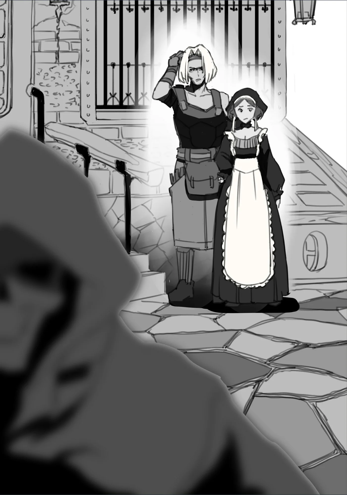

# Chương 15: Tập 1 Chương 3 - Cuộc Đột Nhập Thị Trấn Của Undead Nọ (4)

"Kính chào quý khách! ...Hử?" Vừa bước chân vào tiệm, tôi đã nghe thấy tiếng một người phụ nữ cất lời chào đón.

Tiệm tôi tìm đến chẳng phải đâu xa, chính là tiệm rèn có tiếng trong vùng mang tên "Ba Chĩa".

Cô có mái tóc vàng, đôi mắt xanh biếc cùng phong thái tao nhã chẳng khác nào một tiểu thư quý tộc; tôi thật sự không hiểu nổi sao cô lại chịu lấy một người như Clope. Nhắc mới nhớ, chính đôi mắt xanh biếc ấy lúc này đang nhìn tôi chằm chằm. Có lẽ bộ dạng trùm áo choàng kín mít kèm chiếc mặt nạ đầu lâu của tôi trông khả nghi quá mức. Dù mạo hiểm giả đeo mặt nạ chẳng phải chuyện hiếm gặp, nhưng cách phối đồ này lại trớ trêu khiến tôi trở nên quá nổi bật.

Trong lúc tôi còn mải nghĩ ngợi, Luka chậm rãi tiến lại gần, dường như định nói gì đó với vị khách có vẻ ngoài kỳ quặc này.

"...Xin... lỗi. Vì vẻ ngoài... khả nghi..."

"Ôi, không! Không sao đâu." Luka vội lắc đầu trước lời tôi. "Chỉ là... trông quý khách có nét hơi giống một người quen của tôi. Tôi xin lỗi. Mạo hiểm giả đeo mặt nạ vốn chẳng phải chuyện gì lạ lẫm, ít nhất là theo chỗ tôi biết. Xin thứ lỗi nếu ánh mắt của tôi khiến quý khách cảm thấy không thoải mái."

Luka xin lỗi như thế đấy. Xem ra cô cũng quen tiếp xúc với những vị khách như tôi rồi.

Nói rồi, Luka tiếp tục: "...Vậy cho tôi mạn phép hỏi: hôm nay tôi có thể giúp gì cho quý khách? Quý khách đến 'Ba Chĩa' là để mua vũ khí hay trang bị? Hay quý khách muốn bảo dưỡng và sửa chữa đồ?"

"Đ... Đúng. Tôi... muốn. Một thanh... kiếm mới. Đ... Đây." Vừa nói, tôi vừa đặt cả thanh kiếm lẫn bao lên quầy hàng.

Chẳng cần tôi giải thích thêm, Luka đã hiểu ngay ý tôi.

"Tất nhiên rồi. Xin thất lễ một chút." Nói rồi, Luka rút kiếm ra khỏi bao, chăm chú xem xét.

Tuy là vợ của thợ rèn chính Clope, Luka còn gánh vác việc tiếp khách và giao dịch trong tiệm. Ở vị trí đó, cô rất am tường về các chủng loại vũ khí, cũng như cách đánh giá phẩm cấp và độ hao mòn của chúng. Thậm chí tôi từng nghe nói chính Luka cũng tự tay rèn được vài món đồ đơn giản.

Ngắm nghía một lát, Luka đưa ra nhận xét, mắt vẫn dán chặt vào lưỡi kiếm tả tơi của tôi.

"Tôi e là thanh kiếm này đã hỏng đến mức không thể sửa chữa được nữa. Theo như tôi quan sát, món vũ khí này đã được sử dụng tới tận cùng giới hạn của nó rồi. Quý khách có yêu cầu cụ thể nào cho thanh kiếm thay thế không? Tôi thấy trên lưỡi kiếm có những vết quá tải mang đặc trưng của ma pháp và Khí Thuật... Không biết có đúng là như vậy không?"

Chỉ nhìn vết trầy xước trên vũ khí mà đoán ra được năng lực của người sở hữu thì chẳng phải chuyện tầm thường—tay nghề của Luka quả thực đạt tới trình độ đó.

Tôi quyết định thành thật nói rõ mức độ năng lực của mình, phần vì ngay từ đầu tôi cũng chẳng định giấu giếm.

"À... phải. Ma Lực... Khí Lực... Thần Lực. Tôi... dùng được cả ba. Nên tôi... muốn. Một thanh kiếm... có thể dẫn truyền... cả ba loại."

"...Tam Chúc Phúc... Ra là vậy. Quả thực vô cùng hiếm thấy. Quý khách là vị khách thứ hai tôi gặp có thể chất như thế này đấy."

"Nếu... có thể. Cô... giữ kín chuyện này... được không?"

"Tất nhiên rồi—tiệm của chúng tôi mà bép xép để lộ chuyện của khách thì sập tiệm mất. Nhưng... nói trước là với một đơn hàng thế này, chi phí sẽ... tương đối tốn kém, lại mất kha khá ngày để rèn. Liệu quý khách có chấp nhận được không...?"

Tôi cũng đoán trước được chừng đó. Người dùng được đồng thời cả ba nguồn năng lượng vốn đã hiếm—thực tế gần như chẳng mấy ai nghe thấy. Cả đời người ta họa chăng gặp được một hay hai người là cùng, đến người thứ ba thì quả là chuyện lạ đời.

Thế nên khỏi phải nói, rèn vũ khí cho một người như vậy ắt phải tốn không ít thời gian. Bình thường, các thợ rèn kiểu này chỉ chế tác vũ khí cho người dùng ma pháp hoặc Khí Thuật.

Mặt khác, người dùng được Thần Lực lại khá hiếm. Giới tư tế hay những người tương tự thường có tiệm chuyên biệt quen thuộc của riêng họ, chứ ít khi tìm tới thợ rèn thông thường. Bởi vậy, đơn đặt rèn của tôi tự nó đã là một trường hợp hết sức đặc biệt—

Có điều, tôi đã chuẩn bị sẵn tinh thần sẽ tốn một khoản rồi.

"Tôi... không... bận tâm. Nhưng... đây là... tất cả những gì tôi có..." Tôi rút túi tiền, đặt dứt khoát lên quầy hàng.

Bên trong có kha khá đồng vàng và đồng bạc—đây gần như là toàn bộ gia tài của tôi. (Dù cũng phải nói thêm rằng ngần ấy tiền với các mạo hiểm giả cấp cao có khi chẳng bõ bèn gì.)

Sau khi kiểm tra số tiền bên trong, Luka giải thích cách thanh toán. "...Chừng này là quá đủ để chúng tôi rèn một thanh kiếm tử tế rồi. Về tiền công, tiệm xin nhận trước một nửa làm tiền cọc. Nửa còn lại sẽ thanh toán khi vũ khí rèn xong."

"Như vậy... có được không?"

Dù sao đây cũng là một đơn đặt rèn đặc biệt. Nói thực thì riêng tiền nguyên liệu chắc cũng ngốn một món kha khá.

"Được chứ, thế là rất ổn rồi. Đổi lại—à, cũng chẳng hẳn là đổi lại, coi như một thỉnh cầu thì đúng hơn. Quý khách bớt chút thời gian nói chuyện với chồng tôi, Clope, được không? Anh ấy là thợ rèn của tiệm này, tính anh ấy thế nào cũng muốn trao đổi với quý khách. Nói thật thì trong lúc rèn, chắc anh ấy sẽ cần hỏi ý kiến quý khách khá nhiều đấy."

Tôi quen Clope từ những ngày đầu mới làm mạo hiểm giả. Khỏi phải nói, tôi quá rành tính nết lẫn những thói quen rất riêng của ông thợ rèn này. Ngay cả rèn một thanh kiếm bình thường Clope cũng làm hết sức nghiêm túc, huống hồ là đơn đặt riêng thế này. Chắc chắn gã sẽ bắt tôi cầm thử lưỡi kiếm hết lần này đến lần khác trong lúc rèn—tôi lạ gì Clope nữa. Bởi vậy tôi đã đoán trước được phần nào điều Luka sắp nói, liền gật đầu đồng ý ngay.

"Tôi... không. Phiền đâu. Khi... anh ấy cần. Tôi. Cứ liên hệ... Học Sĩ... Lorraine."

Tôi giải thích với Luka rằng Lorraine đã tốt bụng cho tôi ở nhờ nhà cô trong thời gian tôi ở Maalt. Nghe vậy, mắt Luka mở to hơn hẳn lúc nãy. Có điều, nét ngạc nhiên ấy nhanh chóng được thay bằng nụ cười niềm nở quen thuộc.

"Ồ, tôi hiểu rồi. Thế thì trước hết, tôi xin gửi lại quý khách chỗ này..." Lấy bớt một nửa số tiền bên trong, Luka cầm túi tiền đưa lại cho tôi.

"Tôi chắc Clope sẽ có nhiều điều muốn hỏi quý khách về thanh kiếm mới đấy."

Nói rồi, Luka dẫn tôi ra gian phòng rèn phía sau tiệm.

◆◇◆◇◆

Phía sau cửa tiệm là gian xưởng rèn: bễ lò, thợ rèn, hơi nóng hầm hập cùng đủ thứ lỉnh kỉnh. Đúng như tôi đoán, một gã đàn ông cơ bắp nhưng dáng người khá thon gọn đang điềm tĩnh vung búa theo nhịp bài bản, nện từng nhát xuống thanh kim loại đỏ rực hết lần này đến lần khác. Tôi thầm chuẩn bị tinh thần—những lúc thế này thì đừng hòng bắt chuyện nổi với gã.

Như đọc được suy nghĩ của tôi, Luka cũng áy náy giải thích: "...Thành thật xin lỗi quý khách. Có lẽ quý khách sẽ phải đợi khá lâu... Chắc phải chừng một tiếng nữa anh ấy mới dứt việc ra nói chuyện được. Hay quý khách ghé tạm quán nào đó ngồi nghỉ chân trong lúc chờ...?"

Vẻ mặt cô áy náy thật sự.

Khách lần đầu tới tiệm có lẽ sẽ thấy ngỡ ngàng trước tình cảnh này. Nhưng tôi thì không, bởi tôi đã quen Clope bao nhiêu năm rồi. Cứ mỗi lần rèn vũ khí là gã lại rơi vào trạng thái như lên đồng; tính Clope xưa nay vốn vậy.

Dĩ nhiên, lúc này mà nói chuyện với Clope thì vô phương. Thậm chí gã tập trung tới mức ai dám chen ngang khéo sẽ bị tiện tay nện luôn cho một nhát búa. Tốt nhất cho cả hai bên là cứ kiên nhẫn đợi người thợ rèn hoàn thành một công đoạn rồi đặt búa xuống. Dù sao thì tôi cũng chẳng còn lạ gì lề thói làm việc ở tiệm Ba Chĩa.

"...Không. Tôi không... phiền đâu. Tôi... đợi ở đây luôn. Được không?"

"Được chứ, thế thì không sao, nhưng... quý khách thấy ổn thật chứ? Ở đây chẳng có gì thú vị cả. Quý khách không thấy chán sao?" Luka hỏi, có vẻ tò mò trước quyết định của tôi.

"Ngắm... thợ... rèn. Làm việc. Không... chán đâu." Tôi đáp.

Một thoáng ngạc nhiên lại thoáng qua gương mặt Luka, rồi nhanh chóng nhường chỗ cho nụ cười niềm nở như thường lệ.

"Vậy ở góc đằng kia có chiếc ghế, quý khách có thể ngồi đó để xem cho rõ. Tôi đi lấy chút nước uống—xin phép quý khách." Nói rồi, Luka lui ra ngoài.

Thật lòng mà nói, tôi quyết định ở lại chẳng phải để làm màu hay ra vẻ gì. Tôi thực sự thích ngắm những người thợ lành nghề làm việc. Với tôi, phàm là ai đã tinh thông ngón nghề của mình thì từng động tác đều toát ra một nhịp điệu và dòng chảy rất riêng—chỉ cần đứng nhìn là có thể cảm nhận được.

Còn Clope thì không bàn cãi gì nữa, chắc chắn là một người thợ rèn thượng thặng, và người ta có thể cảm nhận được nét đẹp nhịp nhàng toát lên từ mọi khâu làm việc của người thợ ấy. Cảnh tượng như thế, bảo tôi chán thế nào được—chắc chắn là không rồi.

◆◇◆◇◆

Sau một khoảng thời gian dài tưởng chừng bất tận, những tiếng búa gõ kim loại nhịp nhàng cuối cùng cũng ngừng bặt, xua đi bầu không khí căng thẳng vô hình đè nặng khắp xưởng rèn suốt một tiếng đồng hồ qua.

Clope giơ thanh kiếm vừa rèn xong lên, chậm rãi mỉm cười. Nhìn vẻ mặt là đủ biết gã vô cùng hài lòng với thành phẩm này. Bản thân tôi cũng thấy mừng lây. Đúng lúc ấy, Clope quay người lại nhìn tôi.

"Ngại quá. Để cậu phải đợi lâu rồi nhỉ?"

Nghe Clope nói, tôi hiểu rằng thực ra gã đã nhận ra sự có mặt của tôi từ trước. Chỉ vì quá tập trung vào công việc nên Clope mới không chào tôi thôi. Khách lần đầu tới đây hẳn sẽ càu nhàu vài câu. Nhưng công việc này vốn dĩ chẳng thể dừng lại nửa chừng—về phần mình, tôi chẳng bận tâm chuyện đó.

Thế nên tôi đáp: "...Không... hề gì. Tôi không... phiền đâu. Xem... thú vị lắm."

Nghe tôi nói, Clope cười cười: "Tôi cứ thắc mắc hiếm khi nào Luka lại dẫn người vào tận đây... Xem ra cậu cũng là người thú vị đấy."

Vẻ mặt của Clope giống một chiến binh dày dạn sương gió đang nhìn đối thủ bằng nụ cười kiên định hơn là một thợ rèn thông thường. Có điều, những đường nét trên gương mặt cho thấy gã đã có tuổi—đoán chừng ngoài bốn mươi là vừa.

Trông gã già hơn Luka kha khá, nhưng thực chất hai người chênh nhau không mấy tuổi. Dĩ nhiên tôi chưa từng hỏi thẳng họ chuyện này. Đây chỉ là điều tôi tự suy ra từ những mẩu chuyện Clope kể suốt bao năm qua. Rõ ràng nhất là lần gã bảo Luka là bạn thanh mai trúc mã của mình, nhờ đó mà tôi đoán ra.

Hỏi thẳng tuổi người khác dẫu không phải điều cấm kỵ, nhưng đứng trước áp lực toát ra từ nụ cười bất biến của Luka thì khó ai mà mở miệng hỏi cho nổi. Nói chung, dù có hỏi thẳng thì khéo cũng chẳng moi được câu trả lời từ cô đâu.

"Tôi... không biết... mình có thú vị hay không. Nhưng tôi... nghe nói. Anh có thể rèn... cho tôi. Một thanh kiếm."

"Ồ, cậu muốn đặt rèn riêng một thanh kiếm à? Nhưng ngoài tiệm trưng bày nhiều kiếm lắm mà... Toàn là hàng tốt cả, tôi đảm bảo đấy. Thay vì tốn tiền đặt rèn riêng đắt đỏ, biết đâu cậu dạo quanh một vòng lại chọn được thanh vừa ý thì sao?"

Clope là người bộc trực và kiệm lời. Ai không quen hẳn sẽ tưởng người thợ rèn đang từ chối khéo, nhưng thực tế lại khác hẳn. Clope chỉ đơn thuần không muốn khách hàng phải tốn tiền vô ích mà thôi.

Với ánh mắt sắc lẹm cùng vẻ mặt đôi lúc trông rất dữ dằn, Clope như thể chỉ cần liếc mắt một cái là đủ khiến người ta phát khóc. Khổ nỗi, nửa số lời gã nói nghe cứ như đe nẹt hay bực dọc. Nhưng tôi hiểu rõ hơn ai hết rằng Clope, trái ngược hẳn với vẻ ngoài và phong thái cộc cằn, thực ra lại là một người rất đỗi hiền lành. Bởi vậy tôi mới bình thản đáp lại, chẳng hề nao núng trước điệu bộ ấy.

"Mấy... thanh kiếm... anh có. Ngoài... tiệm. Không... chịu nổi. Thần... Lực."

"Thần...? Ồ, Thần Lực! Gì cơ, cậu dùng được thánh thuật à? Trông cậu đâu có giống tư tế tí nào. Mà nếu là tư tế thì cậu phải có lò rèn riêng hay ghé chứ?"

Quả thực đúng như lời Clope nói. Nhìn kiểu gì tôi cũng chẳng có nét nào giống một tư tế. Nói đúng hơn thì hoàn toàn trái ngược là đằng khác—nhưng trong tình thế hiện tại, tôi chẳng còn cách nào ngoài việc giải thích rõ ràng.

"Không... phải tư tế. Tôi còn... dùng được. Ma pháp... và... Khí Thuật."

"Cái gì... Ý cậu là cậu mang Tam Chúc Phúc đấy à...? Hừm, ra là thế. Được rồi. Vậy thì... xem ra mấy thanh ngoài tiệm cậu chẳng dùng nổi thanh nào rồi. Thảo nào Luka lại dẫn cậu vào đây gặp tôi. Mà cậu có đủ tiền làm không đấy?"

"Người... tiếp khách. Ngoài tiệm. Bảo tôi... có đủ tiền... đặt rèn."

"Hừm. Nếu Luka đã bảo thế... Được, tôi hiểu rồi."

"Thế thì hơi gấp một chút, nhưng ta vào việc luôn thôi. Bàn cả chuyện tiền nong nữa."

Nói rồi, Clope một tay nhấc bổng chiếc ghế ở góc xưởng bằng một chân ghế. Kéo ghế lại chiếc bàn nhỏ, gã thợ rèn và tôi cuối cùng cũng bắt đầu bàn việc.

◆◇◆◇◆

"...Thế là hòm hòm rồi đấy. Còn lại chỉ là mấy chi tiết lặt vặt thôi... Khi nào cần cậu, tôi sẽ nhắn người báo, được chứ?" Clope nói sau khi tính toán xong xuôi tổng chi phí rèn vũ khí.

"Tôi không... phiền đâu." Tôi gật đầu đáp lại.

"Được rồi, thế là chốt nhé. Hợp tác vui vẻ, được chứ?" Nói đoạn, Clope chìa tay ra.

Một cái bắt tay—dĩ nhiên rồi.

Trong thoáng chốc, tôi thoáng ngập ngừng. Đây là đôi bàn tay của Undead—chúng nhơ nhuốc. Tôi có cảm giác để ai đó chạm vào đôi tay này sẽ là một điều tai hại.

Nhưng sự do dự ấy chẳng kéo dài bao lâu. Dù sao tôi cũng đâu thể cứ thế giãi bày hoàn cảnh hay số phận mới của một kẻ thuộc về cõi chết cho Clope nghe được. Tôi chỉ còn cách cố tỏ ra bình thường nhất có thể, siết chặt lấy bàn tay Clope.

"Tôi... xin gửi gắm. Nhờ cả... vào anh."

Đó là tất cả những gì tôi có thể nói.

◆◇◆◇◆

Vị khách bước qua cánh cửa rồi khuất dạng. Đó quả là một người kỳ lạ, khoác tấm áo choàng như dệt từ bóng đêm tăm tối. Trên mặt người ấy là chiếc mặt nạ hình đầu lâu trắng bệch như xương, ngỡ như được mang về từ chính cõi chết. Nhưng điều khiến tôi thấy bất an nhất chính là người đó gợi tôi nhớ đến một chàng trai trẻ vốn vẫn thường ghé tiệm chúng tôi suốt thời gian qua.

Nhưng rồi...

"Này, Luka. Sao thế? Mặt em trông lạ lắm đấy."

Clope, chồng tôi, kiêm thợ rèn của tiệm này—tiệm của hai vợ chồng chúng tôi. Vẫn nụ cười bộc trực quen thuộc, anh cất tiếng gọi tôi từ phía sau khi cuối cùng cũng chịu bước ra khỏi xưởng.

Quay người lại, tôi không kìm được mà hỏi anh: "...Anh biết rồi, phải không? Anh biết người đó là ai mà..."

Clope tiếp lời vào quãng ngập ngừng của tôi, bởi chính tôi cũng chẳng nỡ nói hết câu.

"Thì... ừ. Dạo gần đây chẳng thấy cậu ta ngoài phố hay ở quán rượu... Anh còn tưởng cậu ta đi đâu xa cơ đấy. Có vẻ như cậu ta đang vướng vào chuyện gì rắc rối to rồi..."

"Sao cậu ấy không nhờ chúng ta giúp đỡ? Hay cậu ấy không tin chúng ta?"

Clope thoáng gật đầu trước lời tôi—những lời thốt ra từ tận đáy lòng, trĩu nặng nỗi buồn.

"Ừ, khéo thế thật... Kìa. Kìa, anh đùa thôi mà! Đùa thôi."

Những lời ấy làm tôi chực trào nước mắt; có lẽ phản ứng của tôi đã đủ kéo Clope ra khỏi vẻ vô tâm thường ngày. Anh rối rít xua tay như muốn gạt phăng ý nghĩ đó đi.

Tôi trừng mắt nhìn Clope—tôi muốn nghe ý kiến nghiêm túc của anh chứ không phải mấy trò đùa cợt.

"...Thì thế này này, biết đâu cậu ta không muốn làm phiền chúng ta? Anh chẳng rõ sao cậu ta lại trùm áo choàng đeo mặt nạ như thế, nhưng... biết đâu cậu ta dính lời nguyền hay gì đó? Em biết rồi đấy, mạo hiểm giả thỉnh thoảng vẫn vướng phải mấy chuyện như thế mà."

"Nếu cậu ta thật sự bị dính lời nguyền, mấy kẻ ghét tiệm mình thể nào cũng bu lại kiếm cớ gây chuyện. Mà thực ra đám người đó lúc nào chẳng chực chờ sẵn."

"Hoặc có khi cậu ta nghĩ chúng ta không nhận ra, rồi sợ mình sẽ đuổi xéo đi vì bị dính lời nguyền chẳng hạn. Biết đâu cậu ta chỉ cần thêm thời gian rồi sẽ kể cho chúng ta sau... Đại loại là thế đấy."

"Cái gì mà 'đại loại thế' chứ! Anh chưa lỡ lời nói gì kiểu đó với cậu ấy đấy chứ?!"

"...Chưa mà," Clope vội đáp khi cảm nhận được áp lực lẫn nỗi xót xa dâng lên trong từng lời tôi nói. "Anh đâu có ăn nói bừa bãi thế. Nhưng tính cậu ta vốn vậy mà. Cậu ta xưa nay vẫn luôn như thế. ...Chắc không sao đâu. Mình biết cậu ta còn sống là được, giờ cứ để cậu ta làm những gì mình muốn. Đến lúc thích hợp rồi cậu ta sẽ kể cho chúng ta nghe... Cậu ta cũng đã để lại đủ manh mối về thân phận của mình rồi còn gì. Anh không dám chắc hoàn toàn, nhưng có lẽ lúc này cậu ta chỉ làm được đến thế thôi... Dù sao thì cậu ta vẫn ghé tiệm chúng ta đấy thôi. Y hệt như trước kia."

Những lời của Clope nghe rất có lý. Một người mang Tam Chúc Phúc lại có thể tự do ra vào nhà Lorraine—

Riêng chuyện đó thôi đã là một manh mối quá rõ ràng rồi.

Không thể nhầm vào đâu được—cậu ấy cố tình để lại manh mối đó để báo cho chúng tôi biết mình là ai. Nhưng dẫu vậy... chúng tôi vẫn không tài nào biết chính xác chuyện gì đã xảy ra với cậu ấy. Dường như ngay cả bản thân cậu ấy cũng chẳng thể thoải mái mở lời.

Thế nhưng cậu ấy vẫn tìm đến chúng tôi để đặt rèn vũ khí—chỉ riêng điều đó thôi cũng đủ cho thấy cậu ấy tin tưởng tiệm này... và tin tưởng vợ chồng tôi đến mức nào. Tôi cảm giác mình đã hiểu tình cảnh của cậu ấy hơn đôi chút.

"Ừm... em cũng nghĩ vậy," tôi nói, quay sang nhìn chồng trong lúc khẽ lau đi giọt nước mắt nơi khóe mi.

