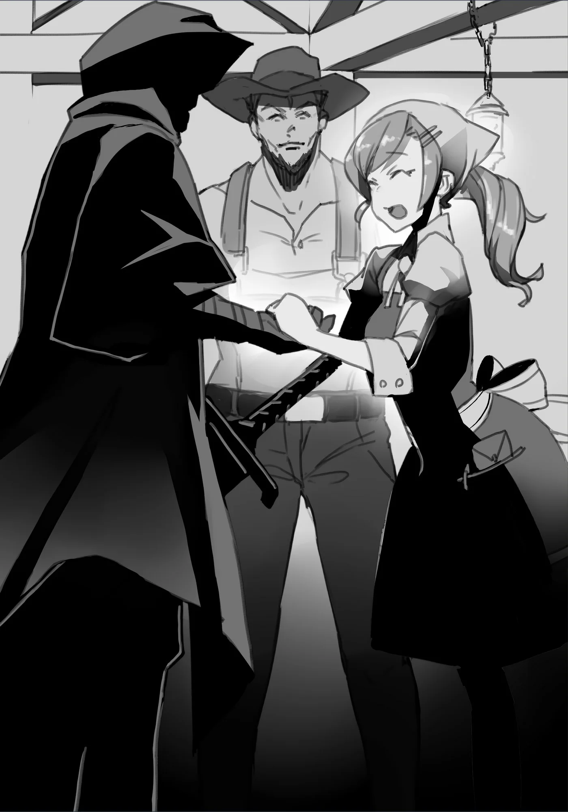

# Chương 20: Tập 1 Chương 4 - Mê Cung Nguyệt Ảnh và Những Ràng Buộc Phiền Phức (5)

Nhờ viên Ma Tinh khổng lồ, cả chuyện tìm một người chịu hợp tác lẫn món nợ của người đàn ông đều đã được giải quyết ổn thỏa. Tôi quyết định hỏi ý kiến xem ông ta tính làm gì tiếp theo, dù trong bụng tôi đã có sẵn câu trả lời rõ ràng:

Chúng tôi phải rời khỏi đây. Cụ thể hơn là rời khỏi Mê Cung Nguyệt Ảnh để quay về Maalt. Dù sao người đàn ông cũng đã có được thứ mình cần, chẳng còn lý do gì để đẩy ông ta vào chỗ nguy hiểm nữa. Bản thân tôi cũng thấy phiền phức nếu cứ để ông ta tiếp tục thám hiểm cùng mình.

Dù trong Mê Cung Nguyệt Ảnh chủ yếu chỉ có các quái vật thông thường như Goblin, Khô Lâu và Slime, thi thoảng vẫn có ngoại lệ, sự việc vừa rồi là minh chứng rõ nhất. Nếu một con Khô Lâu Khổng Lồ khác lại xuất hiện, tôi khó lòng bảo đảm an toàn cho người đàn ông, chứ đừng nói đến chuyện giữ mạng cho ông ta. Vì thế tôi mới đề nghị quay về Maalt. Người đàn ông chẳng có lý do gì để phản đối, liền rảo bước theo sau tôi.

Đúng là đường về cũng có chút đáng lo, nhưng trong lúc người đàn ông còn đang ngủ, tôi đã xử lý xong chuyện đó. Hạ xong Khô Lâu Khổng Lồ là một ma pháp trận hiện ra; trước đó ở đây vốn không hề có thứ gì như thế. Dù chưa thử bước vào xem nó dẫn tới đâu, tôi đoán chừng nó chỉ đưa cả hai quay lại căn phòng từng chuyển chúng tôi đến đây. Cứ cho là không phải thế đi nữa thì cùng lắm cả hai cũng chỉ cần tìm lối khác; căn phòng này vốn chẳng còn lối ra nào, nên đằng nào chúng tôi cũng không có nhiều lựa chọn.

Cả hai bước vào ma pháp trận và được đưa trở lại đúng căn phòng xuất phát, khiến tôi thở phào nhẹ nhõm. Chặng đường quay về sau đó tương đối êm ả. Có lẽ là nhờ người đàn ông giờ đã khác trước rất nhiều, cả thể lực, lòng can đảm lẫn tâm lý dường như đều đã vững vàng hơn hẳn.

Có thể nhờ từng tận mắt thấy Khô Lâu Khổng Lồ, hoặc nhờ được tôi chỉ dạy những điều căn bản của nghề mạo hiểm giả, người đàn ông giờ vẫn giữ được bình tĩnh dù có quái vật xuất hiện. Ông ta cũng hiểu rõ hơn mình cần phải làm gì trong tình cảnh đó. Dù lúc này vẫn chưa thể tự mình đấu tay đôi đánh thắng quái vật, ông ta đã tiến bộ tới mức biết giữ khoảng cách rồi nhanh chóng tìm cơ hội tháo chạy. Nếu cứ tích lũy kinh nghiệm với tốc độ này, chắc tầm hai năm nữa ông ta sẽ lên được ít nhất là Đồng Cấp. May mà ông ta cũng chẳng cần phải làm tới mức đó.

Dù vậy, tôi thấy ông ta chí ít cũng cần nắm được căn bản về chiến đấu, bởi từ giờ ông ta sẽ thay tôi chạy việc vặt và trả nhiệm vụ ở Hội Mạo Hiểm Giả. Những nhiệm vụ khó từ mức nào đó trở lên thì vẫn phải nhờ Lorraine trả giúp, nhưng dù sao người đàn ông cũng phải ra dáng một người đủ sức tự mình thám hiểm các tầng nông của mê cung hay trong rừng. Yêu cầu như thế cũng hoàn toàn hợp lý thôi.

◆◇◆◇◆

"...Phù... Cuối cùng cũng ra được ngoài rồi. Cứ như thể lâu lắm rồi tôi mới lại được hít thở không khí bên ngoài vậy... Thấy nhớ ghê, dù mới đi có một chốc," người đàn ông vừa nói vừa hít một hơi thật sâu, bước ra xa khỏi lối vào mê cung.

Tôi hoàn toàn thông cảm được. Dù sao ông ta cũng vừa thoát khỏi cảnh thập tử nhất sinh, giờ rời chốn nguy hiểm mới có thể thả lỏng đôi chút.

Có điều, ngay cả khi ra ngoài mê cung thì khu vực xung quanh vẫn đầy quái vật rình rập. Lẽ ra dù đã bước khỏi cửa mê cung cũng không được phép lơ là mất cảnh giác, nhưng hôm nay tôi châm chước bỏ qua. Chỉ là tôi vẫn muốn trêu người đàn ông một câu vì cái tính bất cẩn.

"Có lẽ... tôi nên. Tiếp tục... thám hiểm... cho tới khi... chúng ta. Về đến... Maalt..." Nói rồi, tôi quay người rảo bước đi thẳng, tiếng kêu hoảng hốt của người đàn ông đuổi với theo sau.

"Ấy, đợi tôi với, ông chủ! Tôi hiểu rồi, tôi hiểu rồi mà!"

Tiếng gọi của người đàn ông làm tôi nhớ lại cảm giác của những ngày làm mạo hiểm giả, và đã lâu lắm rồi tôi mới lại mỉm cười. Nói đúng hơn là tôi cố mỉm cười, nhưng lớp da khô khốc trên mặt chẳng tài nào bắt chước nổi biểu cảm của con người. Tôi ước một ngày nào đó lại có thể cười như một con người, nhưng liệu chuyện ấy có thành hiện thực được không?

Nghĩ vậy, tôi đi về phía điểm dừng chân gần đó, nơi các chuyến xe về Maalt thường ghé lại.

◆◇◆◇◆

"Tới nơi rồi đây, ông chủ... Quán của tôi đấy. Cậu thấy thế nào? Trông cũng ra trò chứ hả?"

Vừa về tới Maalt, người đàn ông đã dẫn tôi tới ngay quán của ông ta. Nó nằm ở một góc khá lạ của thị trấn, và thú thật suốt mười năm sống ở Maalt, tôi chưa từng thấy quán này bao giờ.

So với một thị trấn tỉnh lẻ, Maalt tương đối lớn. Lại thêm hai mê cung ở gần, nơi này mọc lên vô số hàng quán phục vụ mạo hiểm giả, thành thử chuyện không biết những quán nằm ngoài phạm vi quen biết của mình cũng là lẽ thường.

Có điều, đúng như lời người đàn ông nói, quán trông chẳng tồi chút nào. Đó là một tòa nhà xây gạch trông khá trang nhã; nói đúng hơn, vẻ lịch sự ấy khéo còn khiến đám mạo hiểm giả bình thường thấy hơi e dè. Nơi này toát lên bầu không khí rất riêng, thỉnh thoảng ghé qua đây đổi gió khéo lại hay. Tôi vừa ngắm nhìn vừa thầm nghĩ vậy.

Chẳng lẽ đồ ăn ở đây dở tệ sao...?

Tôi chẳng nghĩ ra lý do nào khác khiến một quán ăn trông tươm tất thế này lại rơi vào cảnh sa sút.

Người đàn ông có vẻ rất hài lòng, đưa tay đẩy cửa bước vào, còn tôi theo sát ngay sau.

◆◇◆◇◆

"...Mình ơi! Anh về bình an rồi...!"

Đập vào mắt tôi đầu tiên là một người phụ nữ xinh đẹp lao tới ôm chầm lấy người đàn ông, miệng gần như thét lên. Mái tóc màu nâu hổ phách chải ngược ra sau cùng vóc dáng mảnh mai khiến cô toát lên vẻ tháo vát, chịu khó.

Nói không quá lời thì cô quả là một người phụ nữ vừa xinh đẹp vừa đáng quý.

Có điều, nghe cách cô gọi người đàn ông, tôi cũng đoán được phần nào mối quan hệ giữa hai người.

Đến lượt người đàn ông cất giọng rối rít.

"Isabel!! Anh đã bảo em đừng lo rồi mà... Thấy chưa? Anh có làm sao đâu!"

"Nhưng... anh dám mò vào tận mê cung... Mình ơi, anh chỉ biết nấu nướng chứ có biết thám hiểm đâu! Em đã can anh không biết bao nhiêu lần là đừng có làm chuyện dại dột như thế rồi cơ mà!"

"Kìa em... Anh cũng là đàn ông mà? Mấy cái mê cung thì bõ bèn gì...... Đáng ra anh tính nói thế đấy, nhưng em nói đúng rồi... Thú thật anh suýt bị quái vật làm thịt, may mà được cứu! Thật ra anh còn đứng được ở đây lúc này hoàn toàn là nhờ cậu ấy đấy! Phải cảm ơn ông chủ đây này!"

"Hả...? Ôi! Thứ lỗi cho tôi, tôi không để ý nhà có khách... Cảm ơn cậu nhiều lắm vì đã cứu mạng người chồng dại dột của tôi..."

Giờ mới nhận ra tôi đứng sau lưng chồng, Isabel đỏ mặt rồi cúi gập đầu thật sâu để bày tỏ lòng cảm kích chân thành. Vừa xinh đẹp lại vừa duyên dáng, sức hút của Isabel khiến tôi chẳng tài nào hiểu nổi cô nhìn trúng điểm gì ở người đàn ông này. Nghĩ vậy thôi, chứ tôi đâu có vô duyên tới mức buột miệng nhận xét như thế trước mặt người ta.

Tôi khẽ gật đầu đáp lại Isabel.

"Không... tôi chỉ... tiện đường. Đi ngang qua... thôi. Đừng... bận tâm."

Isabel có vẻ hơi tò mò trước cách nói năng kỳ quặc của tôi, nhưng người đàn ông đã vội đỡ lời thay.

"Nghe anh nói này Isabel, ông chủ đây là mạo hiểm giả rất cừ, nhưng vì đánh nhau với quái vật nên dính không ít vết thương. Cậu ấy nói năng hơi khó khăn một chút, nhưng tốt tính lắm! Cậu ấy đã cứu anh, với lại, à phải rồi! Cậu ấy còn cho anh viên Ma Tinh này nữa!"

Vừa dứt lời, người đàn ông thò tay vào túi lôi ra viên Ma Tinh cỡ lớn mà tôi nhặt được từ tàn tích của Khô Lâu Khổng Lồ. Thấy viên Ma Tinh phát sáng lấp lánh, mắt Isabel tròn xoe kinh ngạc.

"Cái này... cái này... Hả...? Chuyện này là sao? Sao anh lại có được thứ này chứ..."

"Thì là ông chủ đây... Anh có kể về hoàn cảnh nhà mình, thế là cậu ấy đưa thứ này để giúp..."

Người đàn ông còn định giải thích ngọn ngành, nhưng Isabel đã dứt khoát cắt ngang, không để chồng nói hết câu.

"Không được! Anh không thể nhận thứ đắt đỏ thế này đâu, mình ơi! Anh đã làm phiền người qua đường tốt bụng này đủ nhiều rồi! Người ta còn cứu cả mạng anh nữa cơ mà! Sao anh có thể cứ thế cầm lấy thứ này từ cậu ấy được chứ...!"

Tiếng Isabel vang khắp cả quán. Trông cô có vẻ bức xúc, nhưng dường như không phải vì khó chịu khi mắc nợ tôi, mà đúng hơn là cô thực lòng lo chồng mình đã làm phiền tôi.

Có lẽ tôi nên nhấn mạnh lại rằng viên Ma Tinh này không phải của cho không. Nghĩ vậy, tôi nhìn xoáy vào người đàn ông, ngụ ý giục ông ta giải thích tiếp.

"Isabel, em nghe anh nói đã... Đây đâu phải của bố thí! Thì đúng là anh vớ được món hời thật... nhưng từ giờ anh sẽ làm việc cho ông chủ! Đổi lại, cậu ấy đưa thứ này để anh lo liệu tình hình trước mắt... Với lại anh cũng hứa cho cậu ấy ăn uống miễn phí ở quán mình rồi, có qua có lại mà..."

"...Anh lại định làm chuyện gì nguy hiểm nữa đấy à?"

"Không, không, làm gì có chuyện đó... Đúng không, ông chủ?" Người đàn ông quay sang cầu viện tôi, nhưng tôi thấy rõ vẻ mặt ông ta chẳng mấy tự tin với lời mình vừa nói.

Còn tôi chỉ lẳng lặng gật đầu.

"Thấy chưa? Đâu có gì nguy hiểm, toàn việc vặt thôi mà! Như là mang nguyên liệu tới Hội... hay đi mua đồ ở mấy cửa tiệm..."

"Những việc như thế chẳng lẽ cậu ấy lại không thể tự làm được sao...?" Isabel nói, giọng vẫn đầy vẻ hoài nghi.

"...Tôi... trông. Thế này... mà. Thực ra... tôi không muốn. Ló mặt... ở... Hội cho lắm. Cô... thấy đấy."

Vừa nói, tôi vừa tháo găng tay ra, để lộ một phần cánh tay cho cô thấy. Dù trước đó đã cho người đàn ông xem cả cẳng tay, tôi vẫn cẩn thận giữ chừng mực hơn với vợ ông ta kẻo làm cô hoảng sợ.

Đúng như tôi dự liệu, Isabel nuốt khan một cái, lộ rõ vẻ khiếp hãi trước thứ vừa nhìn thấy. Dẫu vậy, cô dường như đã xuôi lòng hơn lúc nãy.

Isabel cúi đầu lần nữa, áy náy tạ lỗi: "Tôi vô cùng xin lỗi vì đã lỡ lời thiếu tế nhị... Nhà tôi ngốc nghếch, tính lại khờ khạo nên rất hay bị lũ bất lương lừa gạt... Vì lo quá nên tôi mới can anh ấy. Nếu cậu thực sự không phiền lòng... liệu lần này chúng tôi có thể xin nhận tấm lòng của cậu được không?"

Ý cô không gì khác ngoài viên Ma Tinh. Khi đã hiểu rõ cơ sự, Isabel dường như đã sẵn lòng hơn để đón nhận món quà. Tất nhiên tôi chẳng có ý định nuốt lời hứa, liền chậm rãi gật đầu.

"Đó là... điều tôi... đã nói. Ngay từ... đầu. Vậy là... chúng ta. Thỏa thuận... xong nhé."

Nghe vậy, Isabel chìa tay về phía tôi. "Vâng, chúng tôi xin ghi nhớ ơn cậu!"

Tôi có hơi bất ngờ. Vừa nhìn thấy thứ kia xong mà cô vẫn muốn bắt tay sao? Chẳng lẽ cô không thấy sợ chút nào ư?

Thấy người chồng bên cạnh đang gật đầu lia lịa, tôi thầm nghĩ có lẽ bản tính của Isabel vốn đã là như vậy.

Nghĩ vậy, tôi chậm rãi chìa tay đáp lại. "Không... có chi..."

Nói rồi, hai chúng tôi bắt tay nhau thật chặt.

◆◇◆◇◆

"Này... ông biết không. Nghĩ lại... thì. Tôi chưa từng... hỏi. Tên... của ông."

Đứng trên con đường trước cửa quán, chính người đàn ông dường như cũng giật mình trước câu nói của tôi.

"Ờ nhỉ, cậu nhắc tôi mới nhớ... Đúng là thế thật. Thấy ông chủ không nói tên, tôi cứ ngỡ cậu cũng chẳng bận tâm tên tôi làm gì... Để tôi tự giới thiệu trước nhé?

"Tôi tên Loris, Loris Cariello. Tôi là chủ quán ăn này, Quán Phi Long Đỏ. Còn ông chủ thì sao?"

"Chẳng phải... sẽ tốt hơn... cho ông. Nếu không... biết tên tôi... sao?"

Đó chỉ là cái cớ tôi viện ra với Loris, bởi tôi còn có những lý do khác để không muốn lộ danh tính. Nhưng Loris thì chẳng chịu nghe.

"Sao lại không chứ?! Cậu cứu mạng tôi mà! Chí ít tôi cũng phải biết tên ông chủ là gì chứ! Chẳng lẽ hỏi thế là quá đáng lắm sao?"

Loris dùng ngay lý lẽ ấy để vặn lại tôi. Xem ra tôi chẳng còn cách nào khác.

"Tôi có thể... nói. Cho ông. Nhưng liệu... ông có thể. Hứa... với tôi. Một điều không?"

"Chuyện gì thế?"

"Ông... không được. Nói tên tôi... cho bất kỳ ai... khác."

"Tôi chẳng hiểu sao phải giữ bí mật dữ vậy, ông chủ... nhưng được rồi, tôi nghe cậu. Từ giờ tôi sẽ chỉ gọi cậu là 'ông chủ' thôi, chịu chưa? Kể cả có ai hỏi đích danh tên cậu, tôi cũng sẽ cạy miệng không nói nửa lời. Thế được chưa?"

"Được... thế thì. Tốt rồi. Vậy... thì. Tên tôi... là. Rentt... Rentt... Faina."

Nghe vậy, Loris chậm rãi gật đầu, chắc bụng bảo dạ một cái tên nghe bình thường thế này thì có gì mà phải giấu giếm cho mệt. Dẫu vậy, ông ta vẫn lập tức nhắc lại lời hứa để tôi yên lòng.

"Tôi hiểu rồi, ông chủ. Đội ơn cậu rất nhiều vì... ờ thì, vì gần như mọi chuyện! Lúc nào rảnh cậu cứ ghé qua ăn bữa cơm. Quán lúc nào cũng đón chào cậu." Đúng như đã hứa, Loris không hề nhắc đến tên tôi lấy nửa lời.

Tôi khẽ gật đầu rồi quay bước, một lần nữa hòa mình vào những con phố nhộn nhịp của Maalt.
