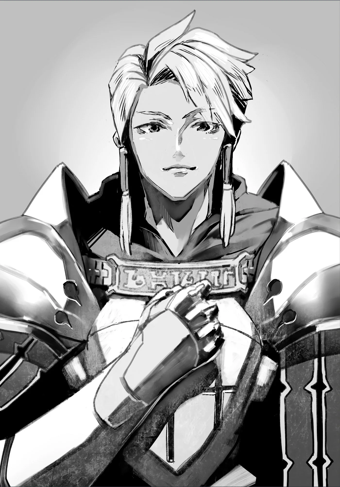

# Chương 24: Tập 1 Chương 5 - Bằng Chứng Không Còn Là Người (4)

"...Này này... Cái của nợ gì thế này?"

Clope, anh thợ rèn quen của tôi, chẳng thèm giấu vẻ khó chịu trên mặt. Vẻ mặt anh nhăn nhó, cau có bực dọc thấy rõ.

"...Là... thanh kiếm. Anh cho tôi mượn." Tôi đáp lại Clope một câu tỉnh bơ.

Clope cũng đáp lại gọn lỏn, dẫu kèm theo một tiếng thở dài thườn thượt. "Nhìn là tôi biết rồi... Cậu thừa biết tôi đâu có hỏi cái đó, đúng không?"

Nghĩ bụng có tiếp tục giấu Clope cũng chẳng để làm gì, tôi quyết định kể thật cho anh nghe những gì đã xảy ra.

"Xin lỗi anh... tôi... đã truyền... Thần Lực... vào lưỡi kiếm..."

"Hử? Sao tự dưng cậu lại làm cái trò—à mà thôi, cái đó tôi tạm bỏ qua. Nhưng cậu mới chỉ xuống Mê Cung Nguyệt Ảnh thôi đúng không? Ở đấy làm gì có quái vật nào đến mức phải dùng kiếm yểm Thần Lực mới hạ được chứ!"

Clope nói vậy hẳn là vì biết tôi dùng được cả Khí Lực lẫn ma pháp. Anh thừa hiểu hầu như mọi quái vật trong Mê Cung Nguyệt Ảnh—nếu không nói là toàn bộ—đều có thể bị hạ gục bằng một trong hai thứ đó.

Dĩ nhiên Clope nghĩ thế không sai. Có điều, thực tế lại hơi khác một chút.

"...Tôi đụng phải một con... Khô Lâu... Khổng Lồ. Đó là lý do... tôi làm vậy. Tôi... chẳng còn lựa chọn nào khác."

Clope trợn tròn mắt nhìn tôi. "Cậu đùa tôi đấy à? Khô Lâu Khổng Lồ làm sao xuất hiện ở Mê Cung Nguyệt Ảnh được? Nhưng mà... cậu đâu có lý do gì để lừa tôi. Cậu đào đâu ra một con như thế ở chỗ đó chứ...?"

"Tôi tìm thấy... một khu vực... chưa từng có trên bản đồ... của Mê Cung..."

"Cái gì cơ?! Cậu— Này. Cậu... nói thật đấy à?"

Dù lộ rõ vẻ kinh ngạc, Clope vẫn cẩn thận hạ giọng. Có vẻ anh hiểu được sức nặng của thông tin mình vừa biết.

"...Cậu thực sự... thấy một nơi như thế à?"

Tôi lặng lẽ gật đầu.

"...Chà. Hèn chi cậu lại đến đây trong bộ dạng kỳ quặc thế kia... Ra là gặp phải chuyện như vậy. Thôi thì tôi tin. Thế mới giải thích được vì sao thanh kiếm lại tơi tả đến nông nỗi này... Được rồi, không sao—tôi hiểu rồi. Thế cậu đã khám phá xong chỗ đó chưa?"

Tôi bỏ qua phần lớn những lời Clope vừa lẩm bẩm, chỉ đáp lại câu hỏi anh đặt ra.

"Chưa... vẫn chưa. Thế nên... tôi mới hy vọng. Rằng thanh kiếm của mình... sẽ sớm xong."

"Ừ... tôi hiểu. Nhưng nghe này: làm sao tôi rèn xong thanh kiếm của cậu nhanh thế được. Hàng đặt làm riêng đấy, cậu biết rồi đấy thôi. Thay vào đó, tôi sẽ cho cậu mượn tạm một thanh khác—lần này là cây tốt hơn một chút."

Tôi ghé qua vốn ôm chút hy vọng Clope biết đâu đã rèn xong thanh kiếm, nhưng xem chừng anh vẫn cần thêm thời gian.

Tôi gật đầu, nhận lấy thanh kiếm Luka—vợ Clope—chọn và đưa cho với vẻ biết ơn. Cây kiếm này xem chừng cũng dẫn truyền Khí Lực và ma pháp khá tốt, chẳng kém gì thanh kiếm đoản mệnh trước đó. Hài lòng, tôi rời khỏi cửa tiệm.

◆◇◆◇◆

Cộp!

Vừa bước chân ra khỏi cửa tiệm, đầu tôi đã va phải một cú nện điếng người. Nói đúng hơn thì chiếc mặt nạ đã hứng trọn lực va chạm; dẫu sao, xem chừng tôi vừa tông phải thứ gì đó.

Dĩ nhiên, chút va quệt ấy chẳng đời nào làm bung hay sứt mẻ nổi chiếc mặt nạ. Nó cứng chắc đến mức phiền toái, huống hồ vốn dĩ ngay từ đầu đã chẳng thể tháo ra. Nhìn kỹ lại phía trước, tôi nhận ra mình vừa va phải một người đàn ông. Cụ thể là một người khoác bộ chiến giáp trắng bạc; ai nhìn vào hẳn cũng đoán ngay anh ta là kỵ sĩ.

Dù chẳng có xích mích gì với vị kỵ sĩ nọ, nhưng vẻ ngoài của anh ta toát lên phong thái gia giáo có phần cứng nhắc, nếu không nói là mực thước nghiêm cẩn. Đã vậy trông anh ta còn toát ra vẻ áp vía theo cách riêng, nên tôi quyết định rời khỏi đây càng sớm càng tốt. Tôi cúi gằm mặt, chẳng nói chẳng rằng định cứ thế bước tiếp.

"À, thành thật xin lỗi. Ngài có bị thương không?"

Người ta đã mở lời hỏi han, tôi chẳng còn cách nào khác đành phải đáp lại.

"...À, không. Tôi không sao. Còn... ngài thì sao?"

"Ồ, xin đừng bận tâm, tôi hoàn toàn không sao. À mà... nhìn trang phục của ngài, chẳng hay ngài có phải là mạo hiểm giả không?"

Thấy anh ta đột ngột chuyển đề tài, tôi đành phải tiếp lời. Tôi vừa gật đầu vừa đáp lại.

Nghe tôi nhận mình là mạo hiểm giả, vị kỵ sĩ nhìn tôi bằng vẻ mặt nghiêm túc.

"Vậy thì... tôi mạn phép hỏi thăm một chút. Tôi đang tìm một mạo hiểm giả ở thị trấn này: một cô gái trẻ tóc vàng, mắt xanh như ngọc sapphire... Con bé xưng tên là Rina. Không biết ngài đã từng nghe nói về cô ấy chưa?"

◆◇◆◇◆

Tất nhiên là tôi nhớ cái tên đó. Rina chính là nữ mạo hiểm giả đã giúp tôi lúc còn kẹt dưới Mê Cung Nguyệt Ảnh.

Tôi không khỏi băn khoăn chẳng biết dạo này Rina ra sao rồi. Kể từ dạo đó, tôi luôn cẩn thận tránh gây chú ý khi đi lại trên các con phố ở Maalt, nên đến giờ vẫn chưa chạm mặt cô lần nào. Thành ra tôi cũng mù tịt về tung tích hiện tại của cô. Rốt cuộc cô đã tìm được mạo hiểm giả khác để lập đội cùng chưa? Hay vẫn đơn thương độc mã ở xó xỉnh nào đó? Với thực lực của cô, Hội chắc chắn sẽ chẳng khó khăn gì trong việc giới thiệu cô vào tổ đội nào đó... Chí ít thì tôi nghĩ vậy.

Tạm gác chuyện đó sang một bên... Vấn đề trước mắt là người đàn ông mặc giáp mang dáng dấp kỵ sĩ này. Mái tóc vàng, đôi mắt xanh biếc cùng diện mạo sáng sủa của anh ta hòa quyện tạo nên hình mẫu hoàn hảo của một kỵ sĩ bước ra từ truyện cổ tích.

"...Chà... trước hết. Ngài là ai...?"

Tôi cần biết người này là ai trước khi cung cấp bất kỳ thông tin nào, và điều đầu tiên tôi cần là một cái tên. Vị kỵ sĩ thoáng chút ngạc nhiên, rồi nhanh chóng lịch sự xưng danh.

"Ồ, tất nhiên rồi. Xin thứ lỗi, tôi thất lễ quá. Tên tôi là Idoles Rogue, kỵ sĩ thuộc Đệ Nhất Kỵ Sĩ Đoàn của Vương Quốc Yaaran."

Đệ Nhất Kỵ Sĩ Đoàn nghe đồn chỉ quy tụ những kỵ sĩ mạnh nhất và tinh nhuệ nhất vương quốc. Một kỵ sĩ xuất thân từ nơi ấy nói lên rất nhiều điều: thành viên của Đệ Nhất Đoàn không xuất thân từ các gia tộc quyền thế thì cũng là những kiếm sĩ tài ba xuất chúng. Dù theo cách nào, họ đều là những nhân vật tầm cỡ, bởi người bình thường chẳng đời nào có cửa bước chân vào hàng ngũ ấy.

Ấy thế mà một nhân vật như vậy lại đi tìm Rina? Rốt cuộc là vì cớ gì?

Thế là tôi gặng hỏi mục đích của anh ta.

"Tại sao một người... vai vế như ngài... lại đi tìm một cô gái trẻ...?"

Người đàn ông đáp lại rất nhanh và thẳng thắn, dường như chẳng hề giấu giếm điều gì.

"Chà... Chuyện này quả thực đáng xấu hổ, bởi Rina—cô gái tôi vừa nhắc tới—chính là em gái tôi. Tôi xin phép không kể những chi tiết vụn vặt đáng ngượng, nhưng tóm lại là một ngày nọ con bé bỗng bỏ nhà đi mất, hình như vì lý do nào đó mà nằng nặc muốn làm mạo hiểm giả. Tôi đến Maalt sau khi nghe người ta bảo trông thấy một người khá giống con bé, nên mới mạn phép hỏi ngài."

"Vậy thì... cô Rina đó có xưng là... 'Rina Rogue' không...?"

"Chắc hẳn là vậy rồi. Chẳng hay ngài có biết ai mang cái tên đó không? Tôi đã đi hỏi thăm vài nơi trước khi đến đây, nhưng Hội viện dẫn luật bảo mật thông tin nên chẳng chịu hé răng nửa lời. Kỵ sĩ mà lại la cà quán rượu để dò la thì quả thực kỳ quặc quá, thành thử ra..."

Xem ra để tìm Rina, vị kỵ sĩ nọ đã lùng sục khắp các tiệm rèn cùng những nơi mạo hiểm giả hay lui tới, thậm chí gặng hỏi cả khách khứa ở đó. Vốn dĩ ngay cả Hội Mạo Hiểm Giả cũng chẳng thể từ chối yêu cầu từ chính quyền vương quốc. Có điều anh ta dường như không hề dùng đến quyền hạn ấy, mà chỉ lẳng lặng gật đầu rời đi khi bị từ chối cung cấp thông tin.

Nhưng nếu chỉ hỏi với tư cách cá nhân, Hội Mạo Hiểm Giả đời nào chịu dễ dàng để lộ thông tin riêng tư. Điều này cũng dễ hiểu, bởi thành viên của Hội lắm kẻ có chuyện này chuyện nọ cần giấu. Kéo theo đó, mạo hiểm giả muốn chôn chặt quá khứ của mình cũng chẳng hề hiếm—

Tính toán hết những chuyện đó, tôi thản nhiên đáp:

"Tôi chưa từng nghe qua... ai có tên là... 'Rina Rogue' cả."

"...Vậy sao. Thật tiếc quá. Sau này nếu tình cờ gặp được con bé, tôi sẽ rất đội ơn nếu ngài báo lại cho tôi một tiếng. Vì vài chuyện khác, tôi còn nán lại thị trấn này một thời gian; tôi thậm chí đã xin tạm nghỉ nhiệm vụ ở Đệ Nhất Kỵ Sĩ Đoàn. Dẫu thế, kỳ nghỉ cũng không được bao lâu. Tôi hy vọng có thể gặp mặt và nói chuyện với con bé dù chỉ một lần trước lúc trở về."

Nói đoạn, vị kỵ sĩ đưa cho tôi địa chỉ quán trọ nơi anh đang trọ rồi bước vào tiệm Ba Chĩa. Có lẽ anh ta cũng muốn hỏi Clope những câu tương tự.

Idoles toát ra vẻ u sầu, cả người dường như chìm trong cô độc và quạnh quẽ. Dẫu vậy, tôi không thể tùy tiện để lộ chuyện của Rina khi chưa được cô đồng ý.

Nghĩ đi nghĩ lại, Rina tôi gặp chắc chắn không ai khác chính là người Idoles đang tìm. Tôi dám khẳng định chắc nịch như vậy vì đã sống gần trọn đời mình ở Maalt. Suốt ngần ấy năm, tôi chưa từng nghe có nữ mạo hiểm giả nào khác tên là Rina.

Những đặc điểm Idoles miêu tả cũng khớp hoàn toàn, chưa kể tóc vàng mắt xanh vốn đã hiếm gặp. Người ta đồn rằng chỉ quý tộc hay tầng lớp trâm anh thế phiệt mới sinh ra với nét tướng mạo ấy. Chẳng cần nói cũng biết, ở một thị trấn hẻo lánh như Maalt thì đào đâu ra người như thế.

Dù không loại trừ khả năng có mạo hiểm giả mới trùng cả tên lẫn ngoại hình xuất hiện trong lúc tôi vắng mặt ở Hội, nhưng xét về lý thì xác suất ấy cực kỳ thấp.

Nói cho đúng ra thì cái tên Rina cho tôi khác với cái tên Idoles nhắc tới—nhưng dĩ nhiên, Rina Rupaage hẳn chỉ là tên giả. Thủ tục đăng ký của Hội khá đơn giản lại không hề xét lý lịch, nên Rina thích lấy tên gì mà chẳng được. Suy cho cùng, Hội mạo hiểm giả hoạt động dựa trên sự tín nhiệm là chính.

Ngay cả khi bị phát hiện dùng tên giả, người đăng ký cũng chẳng bị phạt. Tất cả những gì Hội bận tâm là năng lực hoàn thành ủy thác và nhiệm vụ của mạo hiểm giả—thế là xong.

Dĩ nhiên vẫn có ngoại lệ: chẳng hạn kẻ đào tẩu hay tội phạm đăng ký để trốn tội có thể bị tống cổ cho chính quyền ngay tắp lự—miễn là có đủ chứng cứ. Nói vậy thôi chứ không ít tội phạm vẫn ngày ngày lẩn trốn sự truy bắt dưới vỏ bọc mạo hiểm giả—chuyện đời vốn dĩ là thế.

Nếu nhân viên của Hội không nhìn ra ngay một kẻ là tội phạm, chúng cứ thế mà lọt lưới. Dưới mắt kẻ trốn chạy, Hội Mạo Hiểm Giả là tấm bình phong quá đỗi tiện lợi. Đó cũng là lý do vì sao dân chúng trong thị trấn thường nhìn mạo hiểm giả bằng ánh mắt đầy ngờ vực.

Tôi không hề có ý bảo Rina dính dáng gì tới tội phạm; có điều việc cô che giấu tên thật chứng tỏ cô không muốn bị ai tìm ra.

Chính vì thế tôi mới trả lời Idoles như vậy—lời tôi nói dẫu không hẳn là bịa đặt, nhưng cũng chẳng hoàn toàn là sự thật. Bởi dù chưa nghe danh Rina Rogue bao giờ, diện mạo của Rina Rupaage lại khớp từng miêu tả của anh ta. Phỏng đoán của tôi có lẽ chẳng sai lệch là bao—nhưng chuyện cũng chỉ dừng lại ở đó.

Bản thân tôi cũng còn bao việc phải làm. Họa chăng sau này Rina có lâm vào cảnh hiểm nghèo, lúc ấy tôi chìa tay giúp đỡ cũng chưa muộn.

Một kỵ sĩ xuất hiện ở thị trấn này đã đủ chướng mắt thấy rõ—chỉ là Idoles dường như chẳng hề hay biết.

Gác lại mớ suy nghĩ ấy, tôi rảo bước quay về. Trước mắt, tôi thấy mình nên về lại nhà Lorraine.

◆◇◆◇◆

Xét tình hình hiện tại, tôi thấy mình lúc này trông đã đủ giống người. Nếu biết liệu tính, tôi hoàn toàn có thể mua một bộ giáp mới cùng vài món trang bị. Nhờ diện mạo mới này, biết đâu tôi còn có thể đường hoàng bước vào Hội—chí ít thì nguy cơ bị thanh trừng ngay tại chỗ đã giảm đi trông thấy.

Điều đáng nói là từ nay về sau, tôi sẽ phải khiêu chiến những quái vật mạnh hơn để tiếp tục Tiến Hóa Bản Thể. Nhưng muốn thế, tôi phải bắt đầu chuyển sang Mê Cung Tân Nguyệt, chứ không thể cứ quanh quẩn mãi ở Mê Cung Nguyệt Ảnh nếu muốn mạnh lên.

Thế nhưng trước khi lên đường tới Mê Cung Tân Nguyệt, tôi có việc cần phải làm trước.

"Vậy là... anh muốn đến Hội vì chuyện đó à? Tôi vẫn thấy còn quá sớm đấy..." Lorraine, chủ căn nhà tôi đang ở, lên tiếng.

Sau khi nấu xong bữa ăn cho Lorraine, hai chúng tôi cùng ngồi vào bàn. Cô thưởng thức đồ ăn tôi nấu, còn tôi nhấm nháp chút ít máu của cô. Chính giữa khung cảnh kỳ quặc ấy, tôi đã đề cập đến những dự định sắp tới của mình.

Cụ thể là, tôi sắp sửa rời Mê Cung Nguyệt Ảnh—mê cung quy mô nhỏ dành cho lính mới—để chuyển sang Mê Cung Tân Nguyệt, một mê cung lớn tấp nập đủ loại mạo hiểm giả từ tân binh chân ướt chân ráo cho đến các bậc kỳ cựu Ngân Cấp. Thế nên tôi mới định đến Hội nhận một ủy thác dài hạn, kẻo chuyến đi lại uổng công vô ích.

Điều Lorraine phản đối kịch liệt chính là chuyện tôi muốn đích thân đến Hội nhận ủy thác. Lý lẽ của cô rất đơn giản: dù vẻ ngoài đã có phần giống người hơn, trông tôi vẫn còn khả nghi lắm.

Thấy tôi chưa thông, Lorraine giải thích thêm: "Chắc chắn họ sẽ đòi xem thẻ mạo hiểm giả của Rentt Faina. Bộ dạng của anh khi ấy sẽ kéo theo hàng tá câu hỏi—đủ kỳ quặc để khiến ngay cả Hội Trưởng cũng phải để mắt tới. Chưa kể đám mạo hiểm giả kỳ cựu khác nữa. Biết đâu họ lại đang tụ tập ở đại sảnh của Hội như mọi khi—"

"Nhưng mà... họ đâu có... làm ầm ĩ đến thế. Đâu ai rảnh hơi... vì một mạo hiểm giả... Đồng Cấp."

Thành thực mà nói, tôi xưa nay vốn chẳng phải mạo hiểm giả gì ghê gớm, nên tự thấy việc mình tái xuất sau một dạo vắng bóng—dù trong bộ dạng kỳ quặc—cũng chẳng phải chuyện gì to tát.

Nhưng Lorraine lại không nghĩ vậy.

"...Có lẽ nếu chỉ xét đơn thuần về mặt sức mạnh thì đúng là như vậy, vì anh yếu thật. Đó là lý do anh dậm chân ở Đồng Cấp suốt bao nhiêu năm trời, điểm này thì tôi công nhận.

"Nhưng dù có vậy... thì đối với Hội, anh là một người cực kỳ quý giá. Vô số việc vặt và ủy thác anh làm cho Hội xét riêng lẻ thì chẳng có gì nổi bật, nhưng khắp cái đất Maalt này chẳng ai kham nổi những việc đó một cách hoàn hảo và chuẩn xác như anh. Hội xưa nay luôn đánh giá anh rất cao, đến mức sẵn sàng tuyển anh vào làm nhân viên nếu một ngày nào đó anh giải nghệ đấy."

"...Hả? Thật... vậy sao? Cô hẳn... đang đùa rồi."

Thành thật mà nói, tôi vô cùng kinh ngạc trước những lời của Lorraine. Dù đúng là tôi từng chạy vặt và làm đủ thứ việc linh tinh cho Hội, nhưng tôi chưa từng nghĩ công sức của mình lại lớn đến mức khiến Hội muốn tuyển vào làm nhân viên. Suy cho cùng, tôi đâu thể sống thảnh thơi mà đinh ninh rằng tương lai của mình đã ấm êm.

Nhưng trước cả khi kịp nghĩ tới chuyện ấy, tôi khẳng định lại một lần nữa rằng mình không hề có ý định từ bỏ đời mạo hiểm giả—chuyện đó là không thể nào.

"Tôi nói thật đấy chứ! Hừm. Thôi được rồi... Đằng nào thì chừng nào anh vẫn giữ nguyên thân phận hiện tại, việc mò đến Hội sẽ vô cùng—" Lorraine khựng lại giữa câu, lắc đầu quầy quậy rồi bắt đầu lẩm bẩm một mình. "Chừng nào vẫn là... chính mình? Nếu Rentt là Rentt... Nếu Rentt không phải là Rentt... Thì biết đâu... biết đâu lại có cách..."

Lorraine cứ lẩm ba lẩm bẩm như thế.

Dứt lời độc thoại, cô ngước mắt nhìn lên. Có điều câu nói tiếp theo của cô lại nằm ngoài dự đoán của tôi—và bảo là sửng sốt thì vẫn còn nhẹ chán.

"...Rentt này. Nếu anh nhất quyết bằng mọi giá phải nhận ủy thác và nhiệm vụ từ Hội Mạo Hiểm Giả, thì... đăng ký lại đi. Ý tôi là đăng ký lại từ đầu với Hội ấy."

"Đổi tên đi. Đừng đăng ký bằng cái tên 'Rentt Faina' nữa... Thật ra người ta cũng chẳng mấy khi để ý nếu trùng tên gọi. Anh chỉ việc đổi họ sang một họ khác rồi đăng ký dưới cái tên mới ấy thôi."

Trước đề xuất đường đột của Lorraine, tôi vẫn còn ngơ ngác chưa hiểu mô tê gì. Cô bèn chậm rãi giải thích cặn kẽ từng chút một, còn tôi thì kiên nhẫn ngồi lắng nghe.
