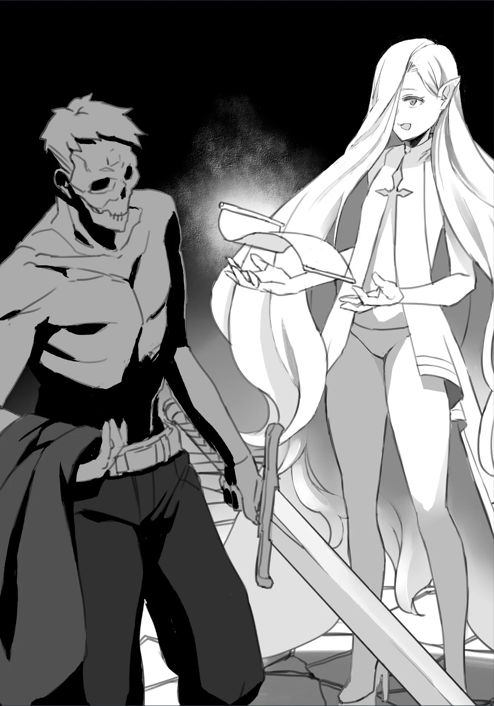

# Chương 26: Tập 1 Chương 5 - Bằng Chứng Không Còn Là Người (6)

Làm xong thủ tục đăng ký mạo hiểm giả, tôi không định sang ngay Mê Cung Tân Nguyệt. Dĩ nhiên vẫn còn vụ tôi đã nhận ủy thác thu thập nguyên liệu Orc, nhưng vẫn còn dư dả thời gian để làm việc đó vào một dịp khác.

Trước hết tôi phải tới một nơi khác đã, chính xác hơn là khu vực chưa khai phá của Mê Cung Nguyệt Ảnh. Nói đơn giản thì tôi đang hướng tới đúng nơi mình từng giao chiến với Khô Lâu Khổng Lồ lần trước.

Mê Cung Nguyệt Ảnh vẫn tĩnh lặng như mọi khi. Dù thỉnh thoảng có đi lướt qua vài mạo hiểm giả Thiết Cấp, nhưng họ dường như chẳng mảy may để ý đến tôi, bởi ai nấy đều đang mải mê chiến đấu với con quái vật nào đó của riêng mình.

Bên cạnh việc chủ động né họ từ xa, tôi còn cố hết sức kìm nén Ma Lực cùng hiện diện Khí Lực, lặng lẽ rảo bước qua các hành lang mê cung. Trước đây, muốn lén đi ngang qua cả người lẫn quái vật, tôi chỉ cần bước khẽ hơn một chút là được; bởi khi ấy năng lực của tôi yếu đến mức đằng nào cũng chẳng ai nhận ra.

Giờ đây muốn đi tiếp mà không bị phát hiện lại phải làm chuyện như thế này, tôi cũng chẳng biết mình có nên mừng hay không, vì nó hơi phiền; dẫu vậy, có lẽ những rắc rối kiểu này là nỗi bận tâm mà chỉ kẻ mạnh mới gặp phải. Tôi quyết định tạm gác mấy suy nghĩ đó sang một bên, vì đằng nào chúng cũng chẳng phải vấn đề gì to tát. Nói đúng hơn, tôi coi đây là một dịp luyện tập; việc tùy ý ẩn giấu Ma Lực và Khí Lực chắc chắn sẽ giúp tôi kiểm soát hai năng lực này thuần thục hơn theo thời gian.

Tới một lối vào quen thuộc, tôi bước vào lối đi bí mật, chẳng mấy chốc đã đến nơi và tự tin đặt chân lên ma pháp trận trên sàn đá.

Đã dùng qua một lần, ma pháp trận không còn đem lại cảm giác đáng sợ hay nguy hiểm như trước. Dù từng nghe kể về những ma pháp trận mỗi lần lại dịch chuyển người dùng tới một nơi khác nhau, tôi vẫn khó mà tin nổi một cơ chế đầy ác ý như vậy lại có ở mê cung này. Ở các mê cung có độ khó cao hơn thì bắt gặp những ma pháp trận kiểu đó có lẽ là chuyện thường, chứ Mê Cung Nguyệt Ảnh xem chừng không phải nơi như thế.

Nói là vậy, nhưng tôi cũng chẳng có cách nào khác để kiểm chứng mối nghi ngờ của mình. May sao ma pháp trận này hoàn toàn vô hại, nó đưa tôi tới đúng căn phòng nơi tôi từng chạm trán Khô Lâu Khổng Lồ lần đầu. Thủ sẵn kiếm trên tay, tôi chầm chậm bước ra khỏi vòng tròn...

Dù từng hạ gục nó lần trước, nhưng con Khô Lâu Khổng Lồ hoàn toàn có thể đã xuất hiện lại trong lúc tôi vắng mặt. Dù xét theo khía cạnh nào thì đây cũng là phòng thủ lĩnh, nên con Khô Lâu ấy có thể sẽ liên tục tái xuất theo chu kỳ, mà cũng có thể chỉ xuất hiện đúng một lần. Chưa biết căn phòng này thuộc trường hợp nào, tôi cẩn trọng tiến bước, chuẩn bị sẵn tinh thần cho khả năng phải giao chiến. Đó là điều tối thiểu tôi có thể làm, bởi trong mê cung, cẩn thận chẳng bao giờ thiệt.

Thế nhưng sau khi bước ra khỏi vòng tròn, tôi đứng đợi mãi mà con Khô Lâu Khổng Lồ vẫn chẳng xuất hiện lại, thậm chí tôi còn không cảm nhận được chút hiện diện nào của nó. Có lẽ nó cần thêm thời gian, hoặc là loại quái vật chỉ xuất hiện đúng một lần; dù thế nào đi nữa, tôi cũng hạ kiếm xuống, nhẹ nhõm hơn đôi chút so với trước. Tuy vậy, tôi vẫn không có ý định tra kiếm vào bao.

Nhìn quanh, tôi lại thấy mình đứng giữa một căn phòng rộng lớn và trống trải. Hẳn sẽ có người thắc mắc tại sao tôi lại mò tới một nơi thế này sau khi đã nhận ủy thác cần làm ở một mê cung khác, nhưng dĩ nhiên tôi có lý do của mình.

Chính ma pháp trận tôi vừa bước ra chỉ xuất hiện sau khi tôi đánh bại Khô Lâu Khổng Lồ, trước đó nó hoàn toàn vô hình. Tôi đã phát hiện ra ma pháp trận mới hình thành này trong lúc lục soát căn phòng khi Loris, chủ Quán Phi Long Đỏ, còn đang bất tỉnh.

Thế nhưng đó chưa phải là tất cả những gì tôi tìm thấy. Thật ra trên mặt đất còn có thêm một ma pháp trận nữa, nằm cách vòng tròn tôi từng bước vào để tới phòng Khô Lâu Khổng Lồ chẳng bao xa. Nếu phải đoán, có lẽ vòng tròn đó nối với một địa điểm khác. Mê Cung Nguyệt Ảnh dường như vẫn còn tiếp diễn ở phía bên kia ma pháp trận này.

Tôi chầm chậm bước vào vòng tròn trên mặt đất. Dù không hiểu ngôn ngữ khắc trên đó, cũng chẳng rõ nguyên lý đằng sau thứ ma pháp kỳ lạ cung cấp năng lượng cho nó, nhưng chí ít tôi thấy được vòng tròn này vẽ hơi khác so với cái dẫn tới phòng thủ lĩnh. Chắc chắn nó sẽ đưa tôi tới một nơi khác.

Có lẽ tất cả chuyện này chỉ là một kiểu cạm bẫy: hai vòng tròn trong cùng một căn phòng, để rồi kẻ xâm nhập nào kém may mắn hơn sẽ rơi vào căn phòng kín cùng một con Khô Lâu Khổng Lồ. Tôi đoán những chuyện như thế thỉnh thoảng vẫn xảy ra.

Vậy thì... lần này sẽ là thứ gì đây? Rắn? Ác Ma? Hay có khi là Rồng?

Dĩ nhiên, chẳng còn cách nào khác để biết. Khi ma pháp trận bắt đầu tỏa sáng rực rỡ, tôi lại thủ sẵn kiếm trên tay, chờ đợi khung cảnh xung quanh biến đổi.

◆◇◆◇◆

Khi ánh sáng dần nhạt đi, tôi nhanh chóng quay người nhìn quanh, sẵn sàng đón đỡ đòn tấn công từ bất cứ hướng nào. Không thể loại trừ khả năng vòng tròn này cũng là một cái bẫy nào đó, có quái vật hay thứ gì tương tự đang nằm phục sẵn. Thế nhưng...

Trong tầm mắt tôi, ở đây chẳng có con quái vật nào, nói chi tới cạm bẫy. Thay vào đó, tôi thấy mình đang đứng trong một căn phòng bừa bộn, ngổn ngang. Đủ thứ đồ đạc vương vãi khắp nơi, vài món đang mục rữa trên mặt đất. Mọi dấu hiệu đều cho thấy nơi đây từng có người sinh sống vào một thời điểm nào đó; nói đúng hơn, trông nó chẳng giống một phần của mê cung chút nào.

Dọc theo bức tường kê vài chiếc kệ, thậm chí có cả bàn và giường. Gần chỗ tôi đứng có thứ trông như một món đồ chơi nhồi bông mềm mại nằm trên mặt đất. Thế nhưng khi tôi đưa tay chạm vào, món đồ chơi lập tức vỡ vụn thành bụi, chẳng để lại chút dấu vết nào của hình dạng ban đầu. Tôi chỉ biết đoán rằng nơi này đã không có ai đụng tới suốt nhiều năm, thậm chí có khi đã hàng thế kỷ.

Có điều, thứ thu hút sự chú ý của tôi lại là chiếc giường ở cuối phòng, hay chính xác hơn là thứ đang nằm ngủ trên đó. Ai đó đã ngủ đêm cuối cùng của đời mình tại nơi này từ rất nhiều năm về trước, và cho đến tận bây giờ vẫn đang nối dài giấc ngủ vĩnh hằng.

Một bộ xương trắng nằm ngay ngắn, có phần thanh thản trên giường. Hai hốc mắt sâu hoắm trên hộp sọ tối om không chút ánh sáng; phần còn sót lại của đôi mắt nhìn thẳng lên trần nhà, đôi bàn tay xương xẩu đan vào nhau đặt trên ngực. Thoạt nhìn, người này dường như đã ra đi rất yên bình trong giấc ngủ.

Một bó hoa khô đặt cạnh gối của người ấy. Tôi đưa tay định chạm vào, nhưng đón chờ tôi lại là cảnh bó hoa ấy hóa thành tro bụi ngay trước mắt.

Nơi này... là gì thế?

Từng có người sống ở đây, chừng đó thì tôi nhìn ra được, nhưng tôi chưa từng nghe nói có con người nào lại sống sâu trong lòng một mê cung như thế này bao giờ.

Trước hết thì, chuyện như thế liệu có khả thi không...?

Tôi chịu không biết được. Thế nhưng chính sự tồn tại của căn phòng này đã chứng minh một điều: căn phòng đã tồn tại, thì chủ nhân của nó ắt hẳn cũng từng tồn tại và sinh sống ở đây vào một thời điểm nào đó.

Dẫu vậy... quanh đây tôi vẫn chưa thấy thứ gì giống như kho báu cả. Nơi này còn ẩn chứa ý nghĩa sâu xa gì sao?

Nghĩ vậy, tôi bắt đầu lục soát căn phòng, bới tìm trong đống mảnh vỡ và tàn tích như bất kỳ mạo hiểm giả lành nghề nào. Nhưng chẳng tìm thấy thứ gì đáng chú ý cả. Đã cất công đi xa tới tận đây rồi mà... Cơ mà trên mấy chiếc kệ kia hình như có vài cuốn sách cũ thì phải?

Liếc nhìn những chiếc kệ, nhiều cuốn trong số đó có vẻ là sách tra cứu chuyên sâu mà chắc chỉ những chuyên gia giỏi nhất mới giải mã nổi. Kỳ lạ thay, nằm lẫn giữa những tập sách ấy lại là vài cuốn trông như sách tranh mỏng. Lẽ nào từng có một đứa trẻ sống ở đây sao?

Những cuốn này dĩ nhiên đều là sách rất cổ. Nếu mang vài cuốn theo, tôi chắc chắn chúng sẽ đổi được một khoản tiền kha khá.

Tôi gật đầu, đưa tay với lấy những cuốn sách cổ...

"...Ngươi kia. Rốt cuộc ngươi nghĩ mình đang làm gì vậy?" một giọng nói bỗng vang lên từ phía sau tôi.

Đằng sau tôi sao...? Chuyện này thật bất thường, thậm chí là không tưởng. Dù sao thì tôi vẫn luôn cảnh giác cao độ vì chưa biết có thứ gì nằm sâu trong căn phòng này.

Tôi chẳng còn lựa chọn nào khác ngoài việc quay lại. Chủ nhân của giọng nói hoàn toàn có thể bất ngờ tấn công tôi, nhưng thay vì thế họ lại lên tiếng gọi, như thể đã đoán trước và đang chờ tôi quay đầu lại.

Tôi từ từ quay người về hướng phát ra giọng nói. Đó là một người phụ nữ: thoạt nhìn, trông cô ta không có gì quá đặc biệt. Mái tóc trắng mềm mại, đôi mắt xanh lam, cùng một nụ cười dịu dàng, êm ái, đó là người phụ nữ đang đứng trước mặt tôi trong căn phòng nhỏ hẹp này. Cô ta mặc một chiếc áo chùng đen; có lẽ là một ma pháp sư nào đó chăng.

Người phụ nữ lại cất lời với tôi:

"Ta hỏi lại lần nữa: Rốt cuộc ngươi đang làm gì ở nơi này?"

Đó là một giọng nói điềm tĩnh, dịu dàng và êm tai, gần như giọng một người lớn đang gặng hỏi đứa trẻ vì một lỗi nhỏ nào đó.

Còn tôi thì nín thở. Trong một thoáng, tôi bị bủa vây bởi cảm giác hồi hộp và căng thẳng tột độ...

Nếu phải nói ngắn gọn thì: người phụ nữ này cực kỳ nguy hiểm.

Tôi tin vào linh tính mà mình đã dựa dẫm suốt phần lớn cuộc đời, nên có thể khẳng định ngay điều đó chẳng chút đắn đo. Thế nhưng người phụ nữ lại đang đứng trước ma pháp trận, coi như chặn kín lối thoát duy nhất của tôi.

Tôi chẳng biết mình nên làm gì. Có lẽ lựa chọn duy nhất lúc này là trả lời câu hỏi của cô ta; đó là kết luận tôi rút ra sau một hồi suy nghĩ cuống cuồng.

Tôi trả lời người phụ nữ:

"...Tôi chỉ... tìm quanh xem... có thứ gì giá trị không... Vì tôi là mạo hiểm giả mà..."

"Haha. Giá trị, giá trị... Bất cứ thứ gì có giá trị ư... Ra vậy. Vậy ngươi là một tên trộm sao? Thế thì, ta hy vọng ngươi đã chuẩn bị sẵn tinh thần bỏ mạng tại đây rồi chứ?"

"Cái... gì...?"

"Trông ngươi có vẻ bối rối nhỉ. Nhưng ừ, tất nhiên rồi. Ta hiểu mà. Ta hiểu, nhưng... có những chuyện ta tuyệt đối không thể tha thứ. Ta không muốn làm vấy bẩn nơi này... Nhưng vì thế, e là ta đành phải xóa sổ ngươi thôi, chẳng còn cách nào khác cả."

Dứt lời, người phụ nữ khẽ giơ tay lên, chĩa về phía tôi. Tôi còn chưa hiểu cô ta định làm gì thì đúng lúc ấy, gần như ngay lập tức, tôi nhận ra một lượng Ma Lực đáng sợ đang ngưng tụ trong lòng bàn tay cô ta. Theo bản năng, tôi dồn toàn bộ năng lực của mình vào các ma pháp và kỹ năng phòng ngự. Với một lớp Khiên Chắn bằng Ma Lực, cường hóa cơ thể bằng Khí Lực, cùng việc truyền Thần Lực vào lưỡi kiếm, chắc chắn tôi sẽ chống đỡ được mọi đòn tấn công.

Dĩ nhiên nếu có thể thì tôi đã muốn né trọn đòn đánh này rồi. Thế nhưng đòn tấn công của người phụ nữ lại nhanh hơn và chuẩn xác hơn rất nhiều.

Ngọn lửa dữ dội phóng ra từ lòng bàn tay cô ta, nện thẳng vào người tôi. Cảm giác chẳng khác nào hơi thở của Rồng khi sức công phá giáng vào người tôi như một quả đạn đại bác, lực va chạm của nó khủng khiếp đến thế đấy. Đòn này nặng nề hơn, uy lực hơn cú đánh của một con Khô Lâu Khổng Lồ đơn thuần rất nhiều.

Tôi bị đánh văng đi, đập thẳng vào bức tường gần đó. Một cơn đau nhói buốt chạy dọc sống lưng. Dù mừng vì đã đỡ được một đòn, nhưng trận chiến còn lâu mới kết thúc. Tôi lập tức cảm nhận được thứ Ma Lực tương tự lại đang tụ về lòng bàn tay người phụ nữ một lần nữa; cách tôi chỉ một quãng ngắn, chính cái chết đang được cô đọng lại thành một quả cầu lửa.

Trong lúc tôi chật vật gượng dậy, người phụ nữ chậm rãi tiến lại gần, bàn tay giơ lên mang theo sát khí. Tôi tuyệt đối không có cách nào đỡ nổi đòn tiếp theo.

Dẫu vậy, tôi không thể bỏ cuộc, liền bắt đầu chuẩn bị dựng thêm một lớp khiên chắn ma pháp nữa. Có lẽ sẽ chẳng kịp mất... Nhưng rồi tôi nhận ra ánh mắt của người phụ nữ đang nhìn thẳng vào mình. Chuyện xảy ra tiếp theo thật ngoài dự đoán: người phụ nữ bỗng dừng bước ngay tại chỗ.

"...Ngươi... Cơ thể của... ngươi...?" Có vẻ như cô ta có điều muốn hỏi tôi.

Cơ thể tôi? Nó làm sao?

Dù được một luồng Ma Lực và Khí Lực bảo vệ, chiếc áo chùng của tôi vẫn bị quả cầu lửa trước đó làm bén lửa. Phần lớn trang phục trên người giờ đã cháy giòn, để lộ ra những mảng thịt thối rữa như xác chết trên cơ thể Thi Quỷ của tôi. Dù nhìn kiểu gì đi nữa, tôi cũng khó mà giống con người khi trên mình đầy những mảng thịt chỗ thối rữa, chỗ khô quắt. Người phụ nữ có vẻ ngạc nhiên trước cảnh này.

Mà cô ta ngạc nhiên cũng phải thôi; chỉ có quái vật mới mang bộ dạng thế này.

"...Thì... sao chứ. Chính tôi... cũng đâu có chọn... biến thành thế này. Cô nghĩ... tôi thích... cái bộ dạng này lắm sao?"

Tôi chẳng hề ảo tưởng về tình thế lúc này. Đơn giản là tôi không có cách nào thoát khỏi người phụ nữ này được. Đằng nào số tôi cũng phải chết trong căn phòng này rồi, chi bằng cứ nói hết những điều mình muốn nói. Đây rất có thể là lần cuối cùng tôi còn cơ hội nói ra chúng.

Thế nhưng người phụ nữ lại chẳng có vẻ gì là tức giận trước lời nói của tôi. Thay vào đó, cô ta hạ tay xuống, những tàn dư Ma Lực dần tan biến khỏi lòng bàn tay.

"...Nhưng phải rồi. Đương nhiên là thế... Ta hiểu rồi. Xem ra ta đã lầm, chỉ là một sự hiểu lầm thôi. Ta thành thật xin lỗi."

Người phụ nữ này... đang xin lỗi tôi sao?

"Ôi... Ta thấy áo chùng của ngươi chẳng may bắt lửa mất rồi. Ta lại không có sẵn bộ nào thay thế ở đây... Hay là ta tặng ngươi cái này nhé. Nó được may rất khéo, và ta tin là nó sẽ giúp ích được cho ngươi đấy."

Nói rồi, người phụ nữ cởi chiếc áo chùng đen của mình ra, gấp gọn lại rồi đưa cho tôi.

"À, còn một điều cần lưu ý: Căn phòng này có ý nghĩa vô cùng quan trọng với ta. Ta đoán ngay cả ngươi cũng hiểu nơi này rất đặc biệt. Ta có thể nhờ ngươi đừng nhắc tới căn phòng này với bất kỳ ai khác được chứ?" người phụ nữ nói, nhìn tôi với vẻ mặt thanh thản.

Người phụ nữ chắc chắn biết tôi sẽ đồng ý; dù sao thì cô ta cũng đã tha mạng cho tôi để đổi lấy việc giữ bí mật về vị trí căn phòng này. Điều tôi không hiểu là làm sao cô ta biết về căn phòng này, và tại sao tôi lại không được phép báo cáo nó cho bất kỳ ai. Vốn dĩ, kể cả không phải mạo hiểm giả thì việc phát hiện ra một khu vực chưa khai phá trong mê cung cũng là một khám phá lớn: người ta có thể nhận được khối tài sản đủ sống cả đời, nên chuyện một người bình thường báo tin này cho Hội là điều đương nhiên.

"Cô... không muốn tôi... báo cho Hội sao...?"

"Ừ, ta nghĩ thế là tốt nhất. Nói chính xác hơn, nếu không có mặt ngươi thì sẽ chẳng có cách nào bước vào căn phòng này đâu. Ngươi tới đây qua ma pháp trận kia, đúng không? Ma pháp trận đó chỉ kích hoạt khi ngươi bước vào mà thôi."

Đó là những gì người phụ nữ nói, bên cạnh nhiều điều khác mà cô ta nói tiếp sau đó nhưng tôi chẳng có cách nào hiểu nổi. Khoảng cách sức mạnh giữa chúng tôi lớn đến nhường ấy; ngay cả Lorraine, một ma pháp sư Ngân Cấp, cũng không thể sánh được với thực lực của cô ta. Nếu tôi đưa ra câu trả lời khiến cô ta phật ý, cái chết chắc chắn sẽ là câu trả lời cô ta dành cho tôi, chừng ấy thì tôi nhìn ra được.

Tuy nhiên, thăng hạng mạo hiểm giả cũng là ước mơ của tôi. Ban đầu, tôi định nhờ Loris đứng ra báo cáo khu vực chưa khai phá, rồi qua đó hoàn lại số vàng tôi đã cho ông ấy mượn thông qua viên Ma Tinh của Khô Lâu Khổng Lồ. Giờ đây, với diện mạo đã phần nào giống người, tôi từng nghĩ mình có thể báo tin này cho Hội vào lúc vắng người. Việc đó chắc chắn sẽ giúp tôi tăng hạng và tiếng nói trong Hội, đưa tôi tiến gần hơn một bước tới mục tiêu trở thành mạo hiểm giả Mithril Cấp.

Ít nhất thì đó là những gì tôi đã nghĩ. Thế nhưng người phụ nữ này lại không muốn tôi làm bất cứ chuyện gì như thế...

Như thể hiểu được tâm trạng của tôi trước tình cảnh này, người phụ nữ lại bắt đầu lên tiếng:

"...Nói là vậy, nhưng ta đoán ngươi cũng không muốn ra về tay trắng nhỉ. Ta hiểu mà. Thực ra thì mạo hiểm giả lúc nào cũng tìm kiếm một thành quả hay chiến công hữu hình nào đó. Có thể thứ này chẳng thấm vào đâu nếu coi là vật đền bù, nhưng chắc chắn nó vẫn sẽ có ích cho ngươi. Ngươi thấy sao?"

"Đây là..."

Món đồ cô ta đưa cho tôi trông như một tấm giấy da cổ, mà mặt giấy lại còn trống trơn đến lạ. Thoạt nhìn, tôi đoán đây có lẽ là một cổ vật văn tự nào đó. Tiếc là trông nó chẳng có vẻ gì đáng giá cả một gia tài.

Nhưng người phụ nữ vẫn tiếp tục giải thích:

"Đây là một cổ vật tự động vẽ lại bản đồ những khu vực mê cung mà chủ nhân của nó từng đặt chân tới, một ma cụ có tên là Bản Đồ Akasha. Hiện giờ trên mặt giấy chưa có gì cả, nhưng đó chỉ là vì người chủ trước đã xóa sạch các bản đồ lưu trữ trên đó mà thôi. Nó chắc chắn sẽ rất hữu ích cho một mạo hiểm giả như ngươi... Ngươi thấy sao?"

Nếu lời người phụ nữ nói là thật, đây đúng là một công cụ vô cùng hữu ích. Thậm chí thật đáng kinh ngạc khi một vật phẩm như thế lại có thể tồn tại; nếu tôi tính đem bán nó, chỉ riêng việc định một mức giá hợp lý thôi cũng đã là cả một bài toán khó rồi.

Nhưng dĩ nhiên, đấy là giả sử những gì người phụ nữ nói là sự thật. Liệu một công cụ kỳ diệu như thế có thực sự tồn tại trên thế giới của chúng tôi không?

"Nếu ta chứng minh cho ngươi thấy những lời ta nói là thật, liệu ngươi có chịu cân nhắc thỉnh cầu của ta không?"

Tôi gật đầu trước câu hỏi của người phụ nữ. Nếu tấm bản đồ hoạt động đúng như lời cô ta nói, sở hữu nó chắc chắn sẽ giúp việc thám hiểm mê cung của tôi dễ dàng hơn nhiều. Dù vẫn còn bán tín bán nghi về toàn bộ chuyện này, tôi nghĩ lắng nghe thỉnh cầu của cô ta cũng đáng.

"Vậy thì, hãy truyền Ma Lực của ngươi qua tấm giấy da đi..."

Tôi làm theo lời dặn, và...

"...Kinh ngạc thật..."

Tôi chỉ biết nín thở trong lòng khi những đường nét vụt chạy ngang dọc khắp bề mặt tấm giấy da vốn trống trơn trước đó, cuối cùng tạo thành một tấm bản đồ chi tiết của Mê Cung Nguyệt Ảnh. Ngay cả những chi tiết nhỏ và ghi chú mà tôi từng viết trên tấm bản đồ rách nát của mình cũng hiện lên ngay ngắn trên mặt giấy da.

"Ta đoán là chúng ta đã đạt được thỏa thuận rồi chứ?"

"...Vâng. Tôi đoán là vậy."

Dù trong lòng vẫn rất muốn báo cáo khu vực chưa khai phá này cho Hội, nhưng khả năng cao là người phụ nữ này sẽ tìm tới lấy mạng tôi nếu tôi làm thế. Dù sao thì chỉ mới vài phút trước, cô ta rõ ràng đã định giết tôi; có muốn tôi cũng chẳng thể làm trái lời cô ta được.

"Ta hiểu rồi. Thế thì mừng quá. Vậy thì, để ta tiễn ngươi một đoạn, ít nhất là ra tới lối vào."

"Hả?"

Trước khi tôi kịp nói thêm lời nào, người phụ nữ đã kích hoạt một loại ma pháp dịch chuyển nào đó. Ngay lập tức, tầm nhìn trước mắt tôi vặn xoắn lại. Cô ta mỉm cười dịu dàng vẫy tay chào, nét mặt trông khác hẳn vẻ mặt đằng đằng sát khí lúc chúng tôi mới chạm trán.

"...Vậy nhé. Hãy bảo trọng... Dù nói câu đó với một người như ngươi thì có hơi ngớ ngẩn thật."

Cùng với lời chia tay đó, cô ta biến mất, và chẳng mấy chốc tôi đã thấy mình đứng ngay tại lối vào của Mê Cung Nguyệt Ảnh.

Đó chỉ là một giấc mơ thôi sao?

Tôi nhìn xuống: chiếc áo chùng trên người đúng là đã khác, và trên tay tôi đang cầm một mảnh giấy da trông có vẻ cổ xưa.

...Rốt cuộc chuyện vừa rồi là thế nào chứ?

Tôi không sao ngừng nghĩ về những chuyện vừa diễn ra. Hôm nay tôi chẳng còn ý định thám hiểm nữa; mang theo mối lo âu về những sự việc gần đây trĩu nặng trong đầu, tôi chầm chậm bước về thị trấn Maalt.
