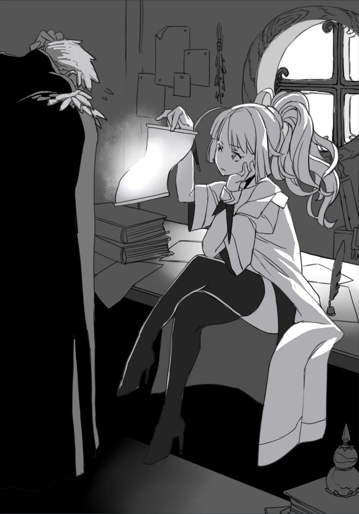

# Chương 27: Tập 1 Chương 5 - Bằng Chứng Không Còn Là Người (7)

"...Cứ như anh bị dính lời nguyền nào ấy nhỉ, Rentt. Sao dạo này mấy chuyện kỳ lạ cứ liên tục xảy đến với anh thế?"

Nghe tôi kể lại cặn kẽ chuyến mạo hiểm vừa rồi, Lorraine chỉ buông một câu như thế. Cô nhìn tôi, vẻ mặt vừa hơi khó tin vừa ngán ngẩm.

Đâu phải... tôi muốn... mấy chuyện kỳ lạ... cứ liên tục xảy đến... với mình đâu.

Dù rất muốn bật lại Lorraine một câu như vậy, nhưng chính tôi lại là kẻ mò về nơi từng chạm trán Rồng, rồi còn hăm hở tiến sâu vào vùng chưa biết của mê cung. Cho dù không còn cảm nhận được hiện diện của Rồng ở đó nữa, thò đầu vào một nơi như vậy rõ ràng chẳng khôn ngoan tí nào, thành ra tôi đành nuốt lại mấy lời định nói. Xét cho cùng, Lorraine nói chẳng sai chút nào.

"Thôi thì... mạo hiểm giả vốn hay vướng vào đủ thứ chuyện kỳ lạ, tai nạn nghề nghiệp cả ấy mà. Giờ này mới than phiền thì muộn rồi... Mà thôi, cái ma cụ này của anh xem chừng hoạt động khá tốt đấy," Lorraine nói, mắt dán vào Bản Đồ Akasha mà tôi nhận được từ người phụ nữ tóc trắng.

Tự động vẽ bản đồ mê cung thì tiện thật đấy, nhưng tôi đã gặp hơi nhiều vật phẩm dính lời nguyền rồi. Với những món đồ được tặng thế này, cẩn thận chẳng bao giờ thừa, nên tôi quyết định nhờ Lorraine kiểm tra kỹ xem có cạm bẫy hay điểm nào đáng ngại tiềm ẩn không.

Tuy sở hữu lượng Thần Lực kha khá và phát hiện lời nguyền tương đối dễ, nhưng vẫn có những vật phẩm đặc biệt nằm ngoài tầm của tôi, chẳng hạn như chiếc mặt nạ tôi đang đeo. Dùng Thần Lực, tôi giỏi lắm cũng chỉ cảm nhận đại khái xem bên trong vật phẩm có thứ gì bất ổn đang chực chờ hay không, chứ kiểm tra chi tiết thì vượt quá khả năng của tôi.

Lorraine thì khác, cô có vốn kiến thức học giả, cộng thêm kỹ năng ma pháp và thuật giả kim. Với kinh nghiệm của cô, biết đâu cô sẽ nhìn ra được đôi điều về tấm bản đồ này, thế nên tôi mới quyết định nhờ cô. Nghe đâu cô còn có chứng chỉ giám định vật phẩm chính thức cho Hội Mạo Hiểm Giả, nên với bằng cấp trong tay, cô chẳng bao giờ lo thiếu việc. Đã vậy Lorraine chỉ nhận giám định vật phẩm như việc làm thêm lúc rảnh rỗi, khiến tôi không khỏi ghen tị với năng lực của cô.

"...Cô đã tìm ra... chi tiết cách dùng... tấm bản đồ này... chưa?"

Người phụ nữ kia chỉ đưa tấm bản đồ rồi bảo tôi truyền Ma Lực vào, chứ ngoài ra tôi hầu như chẳng biết nó hoạt động thế nào, hay còn dùng được vào việc gì khác không.

"Tôi có thử tìm hiểu rồi, nhưng xem ra tự một mình tôi không dùng được tấm bản đồ này. Người ta bảo anh truyền Ma Lực qua tấm bản đồ thì nó sẽ tự vẽ, đúng không? Nhưng có vẻ nó đòi hỏi đích danh Ma Lực của anh, vì chỉ riêng Ma Lực của tôi thì không có tác dụng. Này, anh thử xem."

Dứt lời, Lorraine thuận tay đưa tấm bản đồ cho tôi. Quả nhiên, những đường nét quen thuộc phác họa chi tiết các lối đi và các tầng của Mê Cung Nguyệt Ảnh bắt đầu hiện lên trên mặt bản đồ.

"Hừm... Đúng là một thứ khác thường thật. Chỗ này... cái chấm ở đây là gì thế?"

Nhìn kỹ hơn, trên mặt bản đồ có một chấm đen đang không ngừng di chuyển. Không nén nổi tò mò, tôi đưa ngón tay chạm vào chấm đen đó, tức thì bên dưới cái chấm hiện lên thứ trông như một cái tên.

"Đây là..."

"Xem ra đúng là vậy rồi. Đây là tên của một người hiện đang thám hiểm trong mê cung. Không ngờ tấm bản đồ này còn làm được cả chuyện đó, đáng sợ thật đấy. Năng lực ghê gớm thật! Món đồ này chắc chắn sánh ngang với quốc bảo của một vương quốc," Lorraine nói, có vẻ rất ấn tượng trước năng lực của tấm bản đồ.

Thật lòng mà nói, ngay cả khi chưa biết tới các chức năng phụ này của tấm bản đồ, tôi đã biết mình vớ được một món hời rồi, chỉ có điều đổi lại thì suýt mất mạng dưới ma pháp của người phụ nữ kia. Tính cả những điểm đó vào, tôi nghĩ cuộc trao đổi này coi như huề.

Lorraine và tôi tiếp tục làm thêm đủ kiểu thử nghiệm với tấm bản đồ, rồi cuối cùng phát hiện ra rằng khu vực hiển thị trên bản đồ có thể thay đổi theo ý muốn của tôi, miễn là tôi vẫn đang truyền Ma Lực vào nó. Chẳng hạn, tôi dễ dàng điều khiển tấm bản đồ vẽ một khu vực khác, đổi phần hiển thị từ các hành lang của Mê Cung Nguyệt Ảnh sang một địa điểm khác tùy chọn.

Ngoài ra, khả năng hiện tên các mạo hiểm giả khác của tấm bản đồ chỉ hoạt động nếu người cầm nó đã khám phá trọn vẹn mê cung đó. Dù tôi đã vẽ xong bản đồ Mê Cung Nguyệt Ảnh trong suốt sự nghiệp dài đằng đẵng của mình, nhưng với Mê Cung Tân Nguyệt thì tôi hầu như chưa khám phá được bao nhiêu.

Khi thử bảo tấm bản đồ chuyển tiêu điểm sang mê cung thứ hai, tôi nhận ra chỉ những khu vực mình từng đặt chân tới trước đây mới được vẽ lên. Thêm vào đó, chức năng theo dõi mạo hiểm giả cũng không hoạt động. Bằng chứng là Lorraine và tôi cùng nhìn chằm chằm vào tấm bản đồ suốt một lúc lâu, vậy mà chẳng có lấy một chấm đen nào hiện lên trên bề mặt. Nếu phải đoán thì đơn giản là do tôi chưa vẽ bản đồ mê cung này đủ nhiều để chức năng đó kích hoạt.

Nói cho chuẩn thì đây không chỉ là phỏng đoán, bởi chức năng theo dõi vẫn hoạt động ở tầng một của Mê Cung Tân Nguyệt, nơi tôi đã vẽ xong bản đồ từ dạo trước. Xét thực tế này, có thể thấy rõ các tầng khác cũng cần khám phá đến mức độ tương tự thì chức năng theo dõi mới bắt đầu hoạt động.

Dù Bản Đồ Akasha đúng là một công cụ rất tiện lợi, nhưng nó vẫn có những hạn chế riêng.

Có điều, tôi vẫn còn một chuyện phải hỏi Lorraine:

"...Thế còn chuyện... lời nguyền các thứ... thì sao?"

"Theo những gì tôi thấy đến giờ thì có vẻ an toàn. Chắc anh cứ dùng mà không cần lo lắng gì nhiều đâu. Anh kiếm được món cổ vật ghê gớm thật đấy..."

"Thế... à?"

Lời đánh giá của Lorraine về giá trị tấm bản đồ nghe hơi đột ngột.

"Chứ còn gì nữa. Nó kháng đủ mọi loại ma pháp cực kỳ tốt, mà vật sắc nhọn cũng không dễ cắt rách được. Dù tôi không rõ nó chịu đựng được đến đâu trước một kiếm sĩ lành nghề hay một thanh kiếm rèn kỹ, nhưng xem ra sức phòng ngự của nó còn nhỉnh hơn cả giáp trụ thông thường; phải, ví như thế là chuẩn đấy."

Phép so sánh của Lorraine khiến tôi hơi sững sờ, bởi nếu đúng là vậy thì tấm bản đồ này quả là một cổ vật đáng gờm. Dù tôi đã thất vọng tràn trề khi không thể báo cáo việc phát hiện khu vực chưa khai phá cho Hội Mạo Hiểm Giả nữa, nhưng việc có được một ma cụ vừa tiện lợi vừa kiêm luôn đồ phòng vệ tạm thời thế này làm tôi rất ấn tượng. Có lẽ tôi thực sự thu lời từ cuộc trao đổi này nhiều hơn hẳn so với hình dung ban đầu.

Vả lại, dẫu tôi có báo cáo khu vực chưa khai phá đó, thì Mê Cung Nguyệt Ảnh cũng chỉ là mê cung sơ cấp, nơi lui tới của các mạo hiểm giả tối đa là Đồng Cấp. Dù có thể trông đợi một khoản tiền thưởng kha khá, nhưng xét trên đại cục thì sự ghi nhận tôi có được từ phát hiện đó cũng chẳng đáng là bao.

Nghĩ vậy, tôi thấy cuộc trao đổi này hoàn toàn có thể tính là một món lời chắc chắn. Dù sao thì số Ma Tinh tôi thu thập từ đám quái vật trong khu vực đó (trừ Ma Tinh của Khô Lâu Khổng Lồ) cũng đã được Lorraine bán đi lấy một khoản kha khá, nên giờ tài chính của tôi đã ổn định, nếu không muốn nói là dư dả.

Dù đã đưa cho Clope một nửa gia sản để đặt cọc cho vũ khí đặt rèn riêng, giờ tôi cũng không còn nguy cơ bị thâm hụt tiền bạc nữa.

"...Rồi. Cuối cùng là chuyện người phụ nữ mà anh gặp ở chỗ đó... Đáng tiếc là tôi chẳng có thông tin gì về cô ta cả. Cá nhân tôi lại hứng thú hơn với năng lực và kỹ thuật cần có để tạo dựng một nơi ở ngay trong mê cung, giữa bao nhiêu chốn ngoài kia..."

Xem ra Lorraine và tôi đồng tình ở điểm đó. Người phụ nữ kia đột ngột xuất hiện rồi nhanh chóng tiễn tôi đi mà không giải thích gì nhiều. Vì cuộc tiếp xúc giữa chúng tôi diễn ra khá ngắn ngủi, tôi không có cách nào quan sát cô ta kỹ hơn, và do đó cũng chẳng cách nào suy đoán được cô ta là ai.

Tôi vốn đã biết rõ thực lực của cô ta mạnh đến mức nào; nội việc cô ta có thể quở trách và áp chế tôi theo cách như vậy đã đủ chứng tỏ bản thân cô ta là một nhân vật cực kỳ hiếm gặp rồi.

Ở trạng thái hiện tại, có lẽ tôi đủ sức đối phó với một mạo hiểm giả Hạ Ngân Cấp. Cho dù không thắng nổi, ít nhất tôi cũng thoát thân được. Nhưng nếu phải đối đầu với mạo hiểm giả từ Kim Cấp trở lên, chắc chắn tôi sẽ bị đánh bại chỉ trong chớp mắt. Đánh giá thực lực hiện tại của tôi như thế là công bằng.

Nhưng dĩ nhiên, tôi không hề có ý định giậm chân tại chỗ ở mức này; tôi muốn vươn lên những tầm cao hơn nữa. Muốn đạt được điều đó, tôi cần một cơ thể có thể phát triển, và đây lại là thứ mà hiện tại tôi đang có.

Nói thì nói vậy, vẫn có khả năng là dù tôi có tiến hóa đến đâu đi nữa, bản thân tôi vẫn sẽ mãi là một dạng quái vật nào đó.

"Thật ra... tôi đang định... quay lại khu vực chưa khai phá đó... một chuyến..."

"Dù lần trước vừa bị đuổi ra sao? Anh cũng can đảm gớm nhỉ."

"Người phụ nữ đó bảo tôi... không được 'báo cáo' nơi đó... cho Hội. Chứ cô ta chẳng nói gì... về chuyện 'không được quay lại' đó cả."

"...Nghe anh kể thì đúng là thế thật. Nhưng đấy chỉ là bắt bẻ câu chữ thôi, vì rõ ràng cô ta đâu có muốn anh đặt chân tới nơi đó thêm lần nào nữa."

Lời Lorraine nói rất đúng, nhưng vẫn còn nhiều điều về cuộc chạm trán ấy khiến tôi bận lòng. Ít nhất tôi cũng muốn nói chuyện với cô ta thêm một lần, và hỏi cô ta vài câu, đó là điều tôi hy vọng.

Nếu không làm được thì đành chịu, nhưng ít nhất tôi cũng phải thử xem sao. Từ cách cuộc tiếp xúc lần trước khép lại, tôi có thể phần nào đoán được cô ta sẽ không lập tức ra tay đoạt mạng tôi nữa.

Đáp lại, Lorraine dặn dò tôi vài lời cảnh giác:

"...Tốt nhất là anh nên cẩn thận. Người phụ nữ đó hoàn toàn không bình thường đâu, chỉ nghe anh kể lại thôi là tôi đã khẳng định được chừng đó rồi. Chẳng biết điều gì sẽ chọc giận cô ta đâu."

"Tôi biết."

Lorraine gật đầu. Có lẽ điều đó quá rõ ràng, nhưng là người đã trực tiếp đối mặt với cô ta và suýt mất mạng sau trải nghiệm ấy, tôi hiểu điểm này rõ hơn bất kỳ ai.

Lorraine nói đúng: trên hết tôi phải hết sức cẩn thận, kẻo lại thấy mình đối mặt với cái chết một lần nữa mà chẳng hề có dấu hiệu báo trước.

◆◇◆◇◆

Đáng tiếc là mọi nỗ lực của tôi hóa ra đều uổng công, điều mà ngay ngày hôm sau tôi đã nhận ra.

Lý do rất đơn giản: nơi trước kia từng là lối vào khu vực chưa khai phá của Mê Cung Nguyệt Ảnh dường như đã biến mất không chút dấu vết. Dù tôi có nhìn kiểu gì đi nữa, ngõ cụt ấy giờ đây đã thành một bức tường liền mạch hoàn hảo, và chỉ có mỗi bức tường ấy đang đứng sừng sững tại đó.

Chưa chịu tin, tôi bước tới gần bức tường, lấy tay sờ thử chỗ này chỗ kia. Thế nhưng tất cả những gì ngón tay tôi chạm phải chỉ là một bề mặt phẳng nhẵn, lạnh ngắt, thế là hết. Vậy là mọi cách thu thập manh mối hay tìm kiếm bất kỳ câu trả lời nào từ người phụ nữ kia đều đã mất sạch.

Rốt cuộc cô ta là ai chứ...?

Tôi đứng yên tại chỗ, suy nghĩ về câu hỏi đó một lúc lâu. Thế nhưng câu trả lời vẫn nằm ngoài tầm với; suy cho cùng, đâu có ai tự dưng bước tới trao sẵn cho tôi mọi đáp án cho những thắc mắc của mình.

Liệu có ngày nào đó tôi gặp lại cô ta không?

Tôi không biết được. Nhưng có một điều vẫn luôn rõ ràng trong tâm trí tôi: tôi sẽ tiếp tục leo hạng để hướng tới mục tiêu, cuối cùng trở thành một mạo hiểm giả Mithril Cấp. Nhất định sẽ có ngày tôi gặp lại cô ta. Ít nhất thì tôi cảm thấy như vậy.

Thời còn sống, tôi đã tập luyện vất vả ngày này qua ngày khác suốt mười năm ròng mà chẳng có lấy một chút thành quả nào.

Nhưng giờ đây mọi chuyện đã rất khác. Gặp gỡ Rồng, phát hiện khu vực chưa khai phá của mê cung... và dĩ nhiên, giờ tôi đã là một Undead.

Có lẽ người bình thường sẽ bảo tôi thật bất hạnh. Nhưng tôi lại không cảm thấy như thế.

Tôi sẽ chiến đấu với nhiều quái vật, bắt gặp nhiều điều bí ẩn, và trên hết là trở nên mạnh hơn. Tất cả những điều đó cũng sẽ góp phần đưa tôi tới mục tiêu cuối cùng là trở thành mạo hiểm giả Mithril Cấp.

Đó chính là chuyến phiêu lưu mà hiện tại tôi đang dấn thân vào; nghĩ lại thì, những chuyện không may liên tiếp xảy đến với tôi dạo gần đây cũng có thể coi là những trải nghiệm vô cùng quý giá. Nhất định tôi sẽ tự tay nắm lấy giấc mơ Mithril ấy.

Nghĩ vậy, tôi củng cố quyết tâm. Ước mơ của tôi rất gian nan, và để hoàn thành nó, chắc chắn tôi sẽ phải gặp lại Rồng và người phụ nữ kia. Khi thời khắc tất yếu ấy tới, ít nhất tôi cũng phải đủ sức đứng ngang hàng với họ.

Có chí thì nên... Tôi tuyệt đối sẽ không chấp nhận bất kỳ kết cục nào khác.
