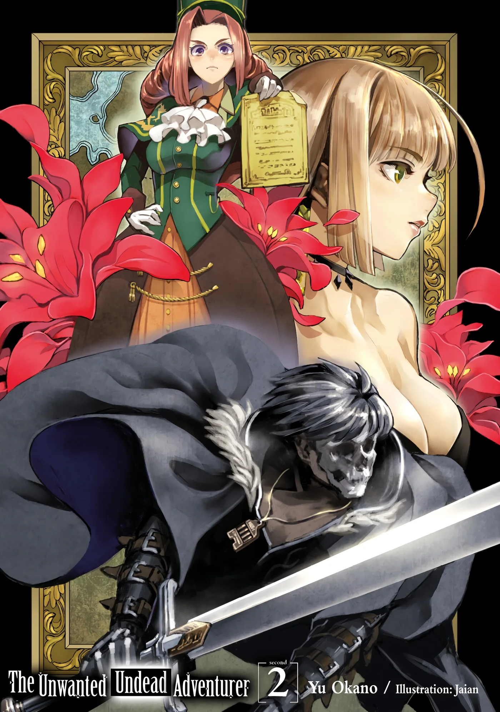
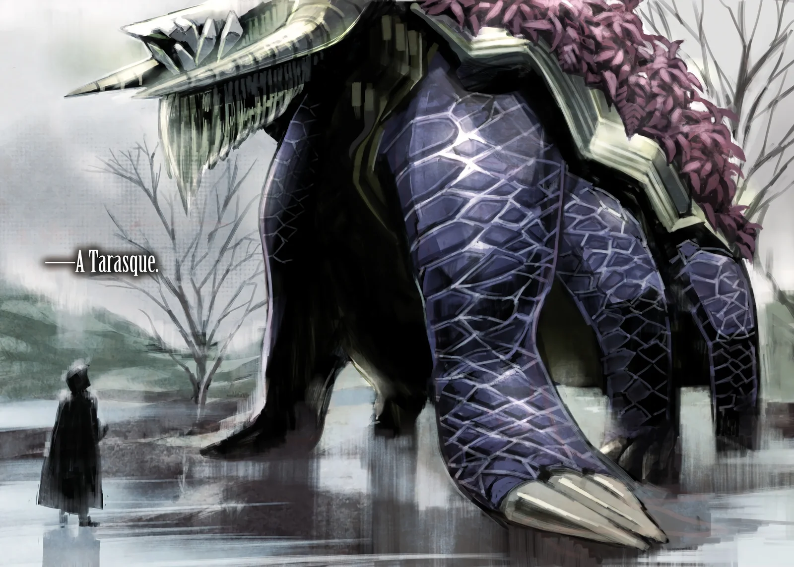
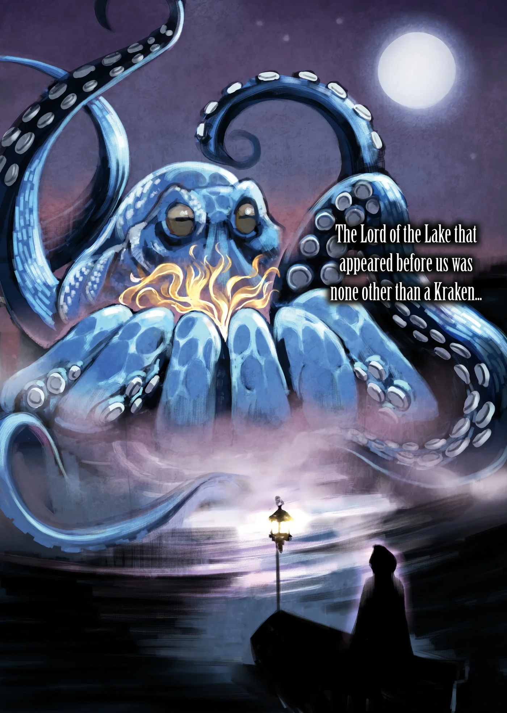
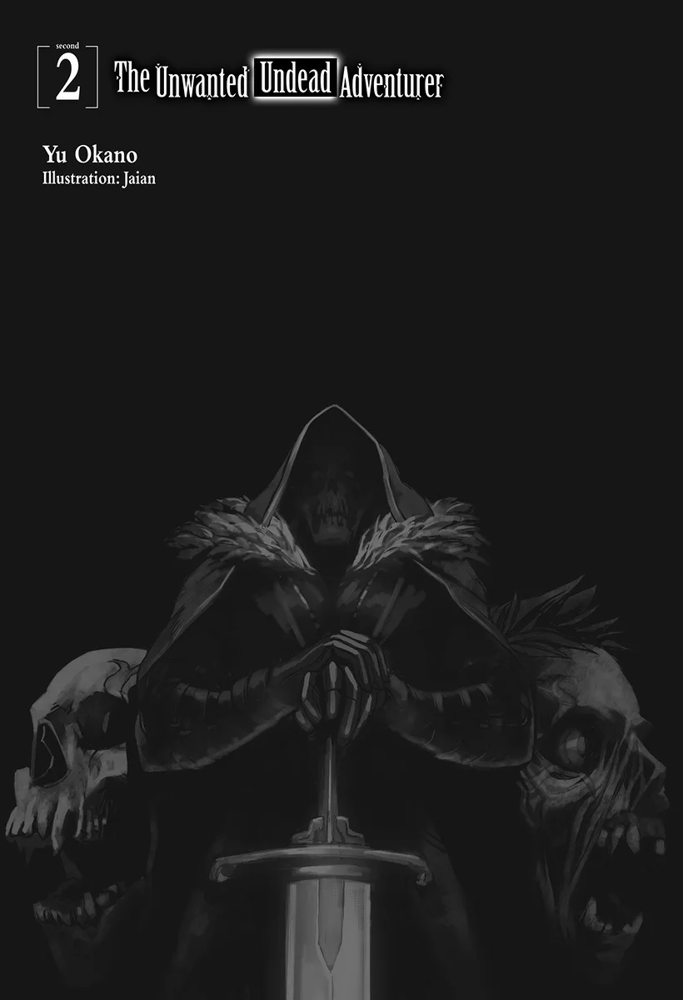
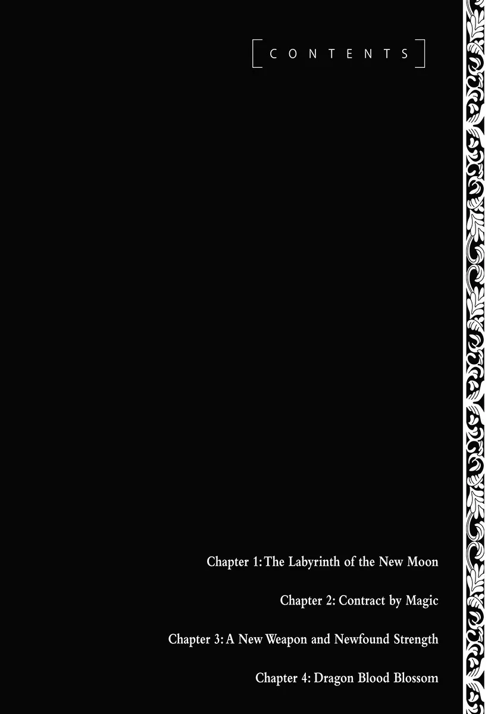

# Chương 30: Tập 2 Chương 1 - Mê Cung Tân Nguyệt (1)

Tôi có một nhiệm vụ cần phải làm cho xong. Ý tôi là cái ủy thác đã nhận từ trước; cụ thể là đi săn Orc và thu thập nguyên liệu từ chúng.

Vì vài chuyện phát sinh nên mấy hôm vừa rồi tôi đâm ra khá nhàn rỗi, bỏ trống cả một quãng thời gian. Dù vậy, thời hạn hoàn thành ủy thác vẫn còn khá dư dả, nên tôi nghĩ chắc cũng chẳng có vấn đề gì to tát.

Orc, đúng như tên gọi, là loài sinh vật có đầu lợn và thân hình gần giống con người. Có điều, chúng là quái vật nhiều hơn là người, và cũng được phân loại đúng như thế. Quanh Maalt, chúng chủ yếu sống trong các cánh rừng và những nơi tương tự, ngoài ra còn có ở Mê Cung Tân Nguyệt.

Thành thử, ai nhận ủy thác săn Orc cũng chỉ có hai lựa chọn: lùng sục trong rừng, hoặc vào săn trong các hành lang mê cung. Với tôi thì câu trả lời đã quá rõ ràng. Lý do rất đơn giản: Orc sống trong các cánh rừng quanh Maalt thường đi theo đàn, hiếm khi nào bắt gặp con đi lẻ.

Chỉ cần tính đến chuyện đó, cộng thêm việc tốc độ Tái Sinh Quái ngoài rừng vốn chẳng lấy gì làm cao, ai cũng thấy ngay độ khó giữa hai nơi chênh nhau đến mức nào.

Mà thực ra, ngại nhất vẫn là chuyện lũ Orc Rừng luôn phối hợp tác chiến theo bầy. Nói thẳng ra là người đi săn sẽ phải một mình chọi với cả đàn Orc hung hãn giữa rừng cây. Với một mạo hiểm giả đi lẻ như tôi, phần thắng rõ ràng chẳng mấy khả quan.

Trái lại, lũ Orc sống trong mê cung, cụ thể là ở các tầng nông, nói thẳng thừng ra thì tương đối đần độn.

Trước hết, lũ Orc Mê Cung này căn bản chẳng bao giờ biết tụ tập lại để phục kích mạo hiểm giả. Đã vậy, trong khi Orc Rừng thường có vũ khí và giáp trụ thô sơ, thì Orc Mê Cung lại nghèo nàn hơn nhiều, trên người thường chỉ quấn mấy mảnh giẻ rách tả tơi. Dĩ nhiên vũ khí của chúng cũng chẳng khá khẩm hơn là bao. Tóm lại, Orc Mê Cung đỡ nguy hiểm hơn hẳn vì cả công lẫn thủ đều kém xa.

Thực bụng mà nói, lý lẽ này cũng đúng với cả Goblin. Có điều Orc to xác và dữ tợn hơn nhiều, thế nên đâm đầu vào cả một bầy Orc trang bị tương đối đầy đủ rõ ràng là chuyện vô nghĩa. Lựa chọn của tôi coi như đã định sẵn ngay từ đầu, chẳng có lý do gì để không vào mê cung thám hiểm.

Nghĩ vậy, tôi tìm đến lối vào Mê Cung Tân Nguyệt. Tính ra cũng đã khá lâu rồi kể từ lần cuối tôi đứng trước cánh cổng này.

Trước lối vào lúc này đông nghịt người, nhộn nhịp như thường lệ. Khung cảnh trái ngược hoàn toàn với Mê Cung Nguyệt Ảnh, dù nghĩ lại thì mới hôm qua tôi còn đi săn ở bên đó.

Lý do cũng rất dễ hiểu: ngay cả mạo hiểm giả mới vào nghề cũng thu được mối lợi lớn và rõ rệt hơn khi đi săn ở mê cung này, miễn là họ đi theo nhóm. Còn với mạo hiểm giả độc hành thì thực tế lại khắc nghiệt hơn đôi chút.

Mà chuyện đó cũng có nguyên do đơn giản thôi: trái ngược với Nguyệt Ảnh, quái vật ở Tân Nguyệt thường tụ lại thành các nhóm nhỏ tản mát, chực chờ phục kích mạo hiểm giả bất cứ khi nào có cơ hội. Đã vậy, hành lang của Tân Nguyệt lại rộng ít nhất gấp đôi Nguyệt Ảnh, nên chỉ cần một thoáng bất cẩn là mạo hiểm giả đi lẻ rất dễ bị quái vật bủa vây.

Hơn nữa, bản thân lũ quái vật trú ngụ trong các hành lang Tân Nguyệt cũng mạnh hơn hẳn quái vật ở Nguyệt Ảnh. Vì thế, Tân Nguyệt được xem là mê cung nguy hiểm hơn và có cấp độ cao hơn, chí ít thì ai nấy đều nghĩ vậy. Có điều, thực hư ra sao thì vẫn còn phải chờ xem đã.

Len qua đám đông huyên náo trước lối vào, tôi bắt gặp nhiều nhóm mạo hiểm giả, chắc là các tổ đội cố định. Khắp nơi râm ran đủ thứ âm thanh hỗn tạp khi họ vừa bàn tán vừa khoa tay múa chân đầy hào hứng. Bỏ họ lại sau lưng, tôi rảo bước đi thẳng vào cửa mê cung.

Dĩ nhiên, tôi chẳng hề nghĩ họ chỉ đang tụ tập đùa vui. Dù sao thì việc bàn bạc chiến thuật tổ đội cùng những điều cần lưu ý trong mê cung là chuyện sống còn. Các mạo hiểm giả kỳ cựu luôn duy trì thói quen này, và việc các tân binh ở Maalt làm theo cũng chẳng phải chuyện hiếm.

Những mạo hiểm giả mới vào nghề này chắc phải cảm ơn các bậc tiền bối, bởi chính những người đi trước đã khuyến khích và lan tỏa thói quen thảo luận này khắp Maalt cùng các vùng lân cận. Đã vậy, chỉ một buổi bàn bạc chiến thuật đơn giản cũng giúp nâng cao rõ rệt cơ hội sống sót của tổ đội, nên lính mới thường rất mải mê trao đổi và răm rắp làm theo lời khuyên của người đi trước. Rèn luyện đúng cách sẽ tạo nên thói quen tốt, chí ít thì tôi cảm thấy như vậy.

Theo những gì tôi nghe kể về các thị trấn khác, tân binh ở đó hầu như chẳng mấy khi bàn bạc như thế này. So với họ, mạo hiểm giả ở Maalt có vẻ chăm chỉ hơn hẳn.

Dù vậy, khi chầm chậm tiến về phía lối vào mê cung, tôi càng lúc càng cảm nhận rõ vô số ánh mắt đang đổ dồn vào mình. Tôi không trách họ, vốn dĩ họ cũng chẳng có ý soi mói làm gì. Sở dĩ như vậy là vì việc một mình dạo bước qua các hành lang Tân Nguyệt vốn đã rất hiếm thấy, nên ánh nhìn tò mò của họ cũng là điều dễ hiểu.

Bảo rằng chẳng có ai dám đơn thương độc mã khiêu chiến mê cung này thì cũng không đúng. Những người dám làm vậy thường có chiến thuật hoặc biện pháp riêng để đối phó khi bị lũ quái vật bủa vây.

Nếu phải tự đánh giá năng lực chiến đấu của mình khi bị bao vây... Hừm. Không biết tôi sẽ xoay xở ra sao nhỉ?

Thật khó nói trước. Dù đã hấp thụ kha khá sinh lực từ lũ quái vật từng hạ gục và có thêm chút sức mạnh, nhưng đến tận hôm nay tôi cũng mới chỉ chạm trán Khô Lâu, Goblin và Slime. Do đó, tôi không tài nào hình dung nổi mình sẽ thể hiện ra sao trước Orc cùng những quái vật mạnh hơn, chí ít là cho đến khi đích thân thử sức đánh bại chúng.

Có điều, các quái vật quen thuộc như Khô Lâu vẫn xuất hiện ở các tầng nông của Tân Nguyệt. Muốn tìm những quái vật như Orc, tôi buộc phải đi sâu hơn xuống các tầng dưới của mê cung.

Dù sao đi nữa, tôi thấy trước mắt cứ thử sức ở các tầng nông đã, rồi sau đó mới có thể đưa ra đánh giá chuẩn xác.

Gác lại những suy nghĩ cùng toan tính chiến thuật, tôi sốc lại tinh thần rồi bước chân vào Mê Cung Tân Nguyệt.

◆◇◆◇◆

Xem ra ở cái chốn này, đi săn theo tổ đội đúng là hiệu quả hơn thật...

Đó là ý nghĩ duy nhất nảy ra trong đầu tôi khi cất bước qua các hành lang Tân Nguyệt.

Có lẽ tôi nên nói thêm rằng mình đang bị một đám quái vật nhỏ bao vây và tấn công. Dù sao thì chẳng tự dưng mà tôi lại nghĩ như thế.

Ít nhất thì chúng chẳng phải lũ quái vật mạnh mẽ gì cho cam. Nói đúng hơn, chúng toàn là mấy người bạn cũ gồm Khô Lâu và Slime, kéo nhau thành từng tốp dăm ba con tới mở tiệc hội ngộ với tôi. Chúng chẳng hề mạnh hơn trước, nhưng tôi cũng đâu thể chém gục cả đám dễ như bỡn. Hoàn cảnh và địa hình quá đỗi khác biệt: hồi ở Nguyệt Ảnh, tôi rất dễ nhắm vào điểm yếu của chúng để dứt điểm trận đấu, còn giữa hành lang Tân Nguyệt thì lại bị bủa vây tứ phía, chẳng còn những khe hở thuận lợi để ra tay.

Tệ hơn nữa, từng con một cứ liên tiếp lao vào tấn công; mấy người bạn cũ này khiến tôi bận túi bụi chỉ riêng việc né đòn. Dù có vừa né vừa vung bừa một kiếm thì cũng khó lòng tung ra đòn nào ra hồn. Tôi chỉ còn nước thận trọng tiến từng bước, vừa giữ thế thủ vừa chực chờ cơ hội vung kiếm. Tình cảnh này thật mệt mỏi và bực bội hết chỗ nói.

Dù hoàn toàn có thể càn quét sạch sẽ mấy nhóm quái này, nhưng tôi phải nhớ rằng mục tiêu thực sự là Orc, loài quái vật ngụ ở các tầng dưới của Tân Nguyệt. Nếu dốc cạn lượng Ma Lực và Khí Lực dự trữ ngay tại đây, lát nữa chạm trán Orc tôi sẽ chẳng còn đòn gì để đánh. Làm vậy thì đúng là tham cái nhỏ mà hỏng việc lớn. Vì thế, tôi chủ động giữ sức, không phung phí năng lượng vô ích; chuyện đó cần thiết thế nào thì đã quá rõ rồi.

Tôi tiếp tục men theo những hành lang quanh co, chỉ cường hóa cơ thể ở mức nhẹ để đỡ tốn năng lượng dự trữ. Cách đánh này khác hẳn kiểu "một đòn dứt điểm" quen thuộc của tôi, nhưng xem ra chỉ cần cường hóa cơ thể ở mức tối thiểu thế này cũng đủ dùng rồi. Cuối cùng, đám quái vật cũng bắt đầu thưa dần. Cứ giữ vững nhịp độ này mà đi tiếp không sứt mẻ gì thì coi như đã nắm chắc một nửa phần thắng.

Oái.

Trong một thoáng sơ suất, vạt áo choàng của tôi bị đòn Acid Blitz của một con Slime sượt qua. Thế nhưng chiếc áo choàng dường như chẳng hề tan chảy; xem ra nó thực sự là một vật phẩm có khả năng phòng thủ đáng nể. Tôi không tìm thấy nổi một vết khía hay vết rách nào trên bề mặt áo, dù vài kẻ địch có dùng cả vũ khí.

Biết đâu với thực lực hiện tại, mình vẫn đủ sức đấu với một con Orc cũng nên...

Nghĩ vậy, tôi thu thập Ma Tinh của lũ Slime và Khô Lâu vừa bị mình hạ gục, bỏ vào chiếc túi trên thắt lưng.

Dẫu trông chỉ như một chiếc túi nhỏ chẳng đựng được là bao, nhưng thực chất chiếc túi đeo hông này đã được phù phép, nói nôm na là bên trong rộng hơn bên ngoài. Tôi đã dùng chính chiếc túi này từ hồi còn sống; vì là một loại ma cụ nên giá của nó không hề rẻ. Dù vậy, với một món đồ như thế thì mức giá đó cũng hợp lý, và tôi đã phải dành dụm suốt năm năm trời mới mua nổi.

Dù vậy, nói thật thì sức chứa của nó cũng chẳng phải quá lớn. Dung tích của nó chỉ cỡ năm sáu chiếc ba lô bình thường cộng lại, nhưng chừng ấy là quá đủ để đựng Ma Tinh và mấy thứ lặt vặt rồi.

Dĩ nhiên ngoài kia vẫn có những loại đắt đỏ hơn với sức chứa lớn hơn nhiều, thậm chí người ta còn đồn có cái nhét vừa cả một con Rồng. Nhưng nếu ai đó thực sự có một báu vật như vậy thì đời nào họ lại đem bán. Dù sao thì những món đồ đó lúc này vẫn vượt quá khả năng của tôi, biết đâu sau này tôi mới có ngày sở hữu được. Hiện tại, tôi cứ tạm bằng lòng để mơ ước chỉ là mơ ước. Dẫu thế, tôi vẫn sẽ vững bước trên con đường biến giấc mơ trở thành mạo hiểm giả Mithril Cấp thành hiện thực.

Thu nhặt xong toàn bộ Ma Tinh từ những kẻ địch ngã xuống, tôi lại cất bước tiến sâu hơn vào lòng mê cung.

Mê Cung Tân Nguyệt mang cấu trúc rất kỳ lạ; đáng chú ý nhất là thiết kế cùng bầu không khí ở mỗi tầng đều khác hẳn tầng trước. Nếu tôi nhớ không lầm thì tầng tiếp theo là...

Một niềm háo hức dâng trào trong lòng khi tôi bước xuống những bậc thang của mê cung, tựa như sắp sửa đặt chân vào một cõi vô định.

Thật... không thể tin nổi. Mình đang ở trong một công trình kiến trúc thật đấy ư? Trong một mê cung sao?

Cảnh tượng đập vào mắt choáng ngợp đến mức khiến tôi nhất thời không thốt nên lời. Những tia nắng ấm áp rọi qua không trung, trải xuống bình nguyên trập trùng phủ đầy cỏ mềm. Phía xa xa, tôi có thể lờ mờ nhận ra bóng dáng của một cánh rừng.

Dù ngày trước từng được các mạo hiểm giả kỳ cựu dẫn tới tầng này, tôi vẫn không khỏi choáng ngợp khi ngắm nhìn khung cảnh xanh ngát trải ra trước mắt. Không ngờ bên trong một mê cung lại có thể chứa đựng một không gian như thế này... Nói đúng hơn thì khu vực này chẳng khác nào những đồng cỏ và cánh rừng trên mặt đất.

Chẳng ai biết ai hay thứ gì đã tạo nên những mê cung này, và cho đến tận hôm nay, vô vàn câu hỏi vẫn còn bỏ ngỏ. Dẫu vậy, không ai có thể phủ nhận nét kỳ dị cùng vẻ tráng lệ của cảnh tượng hiển hiện trước mắt.

Nghĩ đi nghĩ lại thì một không gian như thế này tồn tại cũng chẳng có gì quá lạ, bởi ngay cả chiếc túi đeo hông của tôi cũng nhờ ma pháp mà phá vỡ các quy luật vật lý đấy thôi. Dù dùng ma pháp hay ma thuật, người ta hoàn toàn có thể yểm phép khiến không gian biến đổi theo những cách hết sức kỳ dị. Ngay cả một nơi rộng lớn thế này cũng có thể được tạo dựng bằng ma pháp, miễn là người thi triển đủ bản lĩnh để làm nên kỳ tích đó.

Có điều, đây lại là chuyện gần như bất khả thi đối với người thời nay.

Có rất nhiều lý do cho việc đó, đặc biệt là lượng ma lực khổng lồ cần dùng, sự thất truyền của một số kỹ thuật ma pháp cổ đại, cùng những yếu tố tương tự. Dù không thực sự rành rẽ về các quy tắc và định luật kiến tạo địa hình bằng ma pháp, tôi vẫn có thể kể ra hàng tá lý do vì sao một cảnh tượng như thế này lại không thể tái tạo dưới bàn tay con người.

Dẫu vậy, những vùng đất ma thuật như nơi này vẫn thực sự tồn tại, rải rác khắp các xứ sở. Đã thế, chúng còn nổi tiếng với việc thoắt ẩn thoắt hiện hết lần này đến lần khác, vào những thời điểm tưởng như hoàn toàn ngẫu nhiên theo năm tháng.

Quả thực là một hiện tượng đầy bí ẩn...

Có lẽ xưa kia từng có một vị thần kiến tạo nên những không gian ma thuật như vậy trong mê cung; hoặc chí ít là một thực thể được con người tôn sùng, đủ sức làm nên những kỳ tích màu nhiệm như thế. Có người từng bảo mê cung là vùng cấm địa mà tri thức nhân loại không bao giờ thấu triệt. Thậm chí có kẻ còn cho rằng chỉ cần bước chân vào mê cung thôi đã là hành vi xâm phạm không thể tha thứ.

Tuy thế, không thể chối cãi rằng mê cung đã trở thành một phần cốt lõi, gắn liền với văn hóa và đời sống nhân loại. Bởi lẽ các nguyên liệu thu hoạch từ mê cung cùng lũ quái vật sống trong đó đều được dùng để chế tạo những ma cụ tinh xảo. Hiếm hoi lắm còn có mạo hiểm giả tìm thấy cả kho báu cổ đại.

Hơn nữa, chỉ cần để yên mê cung trong một thời gian ngắn là lũ quái vật sẽ lại xuất hiện, mang theo nguồn nguyên liệu hữu ích sẵn sàng cho người ta thu hoạch. Gần như có thể coi mê cung là một nguồn tài nguyên tái sinh vô tận. Vài người còn đi xa hơn khi khẳng định các mê cung có khả năng tự tái tạo vĩnh cửu.

Thực tế thì những người ủng hộ việc khai thác mê cung vẫn thường tranh cãi với những ai cho rằng các công trình cổ xưa này đe dọa sự tồn vong của nhân loại. Bên nào cũng có lý lẽ riêng. Hiển nhiên không thể phủ nhận đã có biết bao mạo hiểm giả bỏ mạng trong mê cung vì danh tiếng và vinh quang, chưa kể đến kho báu. Nhưng ngược lại, nếu một mê cung mới bất ngờ xuất hiện mà bị bỏ mặc không ai ngó ngàng tới, quái vật sớm muộn gì cũng tràn ra từ các tầng sâu, tàn phá nặng nề nơi con người sinh sống.

Xét hết mọi khía cạnh đó thì mê cung vẫn là một phần không thể thiếu trong đời sống con người. Nếu một ngày nào đó các mê cung hoàn toàn biến mất, nhiều mặt của hoạt động thương mại và sản xuất sẽ lập tức đình trệ; nhân loại hiện giờ đang ở vào đúng tình cảnh ấy.

Mọi thứ đều đến từ mê cung: vật liệu chế tạo vũ khí, giáp trụ, thuốc men, và thậm chí cả nhu cầu cơ bản nhất là thực phẩm.

Lấy ví dụ như một loài quái vật dạng người mang hình thù giống lợn: loài Orc quen thuộc. Trong số rất nhiều loại nguyên liệu thực phẩm thu hoạch từ mê cung, thịt Orc luôn là thứ được ưa chuộng nhất; quả thực, đó là cái tên gắn liền với những món ăn hảo hạng.
