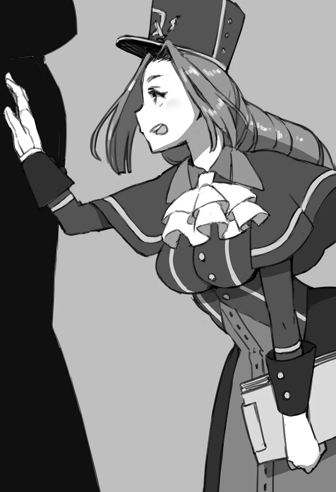

# Chương 32: Tập 2 Chương 1 - Mê Cung Tân Nguyệt (3)

Vừa bước chân vào nhà Lorraine, đập vào tai tôi đã là tiếng sặc sụa: "...Khặc! A-Anh..." Chẳng là trước lúc tôi vào cửa, cô đang nhấp ngụm trà, không ngờ giật mình đến mức phun cả ra ngoài, bụi nước trà còn lơ lửng giữa không trung như một làn sương mỏng. Nhìn kỹ lại, cô đang cúi người trên một xấp giấy tờ, mà trên đó có ghi tên đăng ký của tôi ở Hội. Cụ thể là cái tên "Rentt Vivie".

"Cô... ổn chứ?" tôi vừa hỏi vừa chống tay quỳ xuống sàn, lấy giẻ lau vũng nước trà nhỏ dưới đất. Trông Lorraine lúc này chẳng có vẻ gì là ổn cả; cô ôm đầu bằng cả hai tay, vẻ mặt bất lực không để đâu cho hết.

"...Xét về mặt nào đó thì nói thẳng là không, tôi chẳng ổn chút nào cả. Thế nên tôi mới phải hỏi đây... Sao anh lại đi đăng ký bằng cái tên đó chứ? Anh không nghĩ lấy một giây rằng dùng họ của tôi nghe sẽ kỳ quặc lắm sao, với mối quan hệ từ trước đến nay của chúng ta?"

Đúng như lời Lorraine. Cô nói chẳng sai chút nào, nhưng sự tình vốn dĩ đã kéo theo bao nhiêu chuyện rắc rối kể từ cái lần tôi đột ngột tìm đến rồi sau đó cứ liên tục ra vào nhà cô. Việc tôi khăng khăng giữ cái tên "Rentt" quả thật chỉ làm mọi chuyện thêm phức tạp. Đành rằng tôi có thể đổi sang tên khác, nhưng ngặt nỗi sự đời đâu có đơn giản như vậy.

Nếu lấy một cái tên khác, có thể tôi sẽ đỡ bị nghi ngờ hơn trong chuyện này. Nhưng rồi thế nào cũng rộ lên tin đồn một gã đàn ông lạ mặt ngày nào cũng lui tới nhà Lorraine, mà tôi thì tuyệt đối không muốn điều đó xảy ra. Dù sao Lorraine cũng là phụ nữ chưa chồng, tai tiếng như thế sẽ ảnh hưởng rất xấu đến danh dự của cô. Chính vì thế tôi mới quyết định lấy họ của cô rồi nhận mình là họ hàng xa.

Cộng thêm việc tên tôi vốn trùng với tên một vị Thánh trong lịch sử, ghép tên đó với họ của Lorraine nghe cũng chẳng có gì quá kỳ cục. Thậm chí tôi còn quen miệng khá nhanh, giờ ngày nào cũng dùng.

Nghe tôi giải thích xong, nét mặt Lorraine dần dịu lại. Ánh mắt ngờ vực ban nãy biến mất, thay bằng vẻ hiểu ra sự tình.

"...Họ hàng... Anh bảo là họ hàng à... Ừm... Thế thì nghe cũng xuôi tai đấy..."

"Cô thấy... chưa?"

"...Mà dù thế đi nữa, anh cũng đâu cần phải nhọc lòng nghĩ cho tôi đến mức ấy chứ? Tôi có để bụng đâu."

"Vốn dĩ chuyện một phụ nữ lại làm học giả ở cái chốn hẻo lánh này đã đủ khiến người ta dị nghị rồi; chí ít thì trong mắt thiên hạ, tôi chắc chắn là một kẻ lập dị."

Đúng như Lorraine nói, ở Vương Quốc Yaaran này, một nữ học giả cắm chốt tại thị trấn biên ải Maalt xa xôi hẻo lánh quả là chuyện hiếm thấy.

Dẫu vậy, luật pháp chẳng hề cấm đoán những việc Lorraine làm bấy lâu nay. Dù vẫn có người này người kia bàn tán, nhưng họ không dị nghị chuyện giới tính hay nghề nghiệp của cô, mà chủ yếu ái ngại việc cô bám trụ ở một thị trấn vùng biên đòi hỏi quá nhiều thể lực. Bởi lẽ quái vật lởn vởn khắp nơi quanh đây, chuyện một học giả đụng độ quái vật nhiều hơn hầu hết các nghề khác gần như là tai nạn nghề nghiệp khó tránh.

Vì mục đích nghiên cứu, nhiều học giả phải bôn ba khắp chốn; tôi đoán một khi đã rời các viện học thuật quy mô lớn thì người ta chẳng còn cách nào khác ngoài chu du đây đó. Thành thử, phần lớn học giả theo đuổi mảng nghiên cứu như cô thường là nam giới có thể lực vượt trội, chí ít thì thiên hạ vẫn thường nhìn nhận như vậy.

Dĩ nhiên, cái nhìn chung đó chẳng đúng chút nào với một mạo hiểm giả Ngân Cấp như Lorraine, song miệng lưỡi thế gian thì bao giờ cũng sẵn định kiến.

Dù vậy, gần đây số lượng nữ học giả cũng tăng lên đáng kể, dẫu chỉ gói gọn trong những ngành không đòi hỏi phải khảo sát thực địa quá nhiều. Nhưng với Lorraine, việc nghiên cứu quái vật và ma thuật buộc cô phải đích thân dấn thân vào những chuyến thám hiểm. Bản chất công việc của cô vốn là thế, coi như đặc thù nghề nghiệp vậy.

Mà nói vậy thôi, Lorraine chưa từng bận lòng trước những chuyện vụn vặt đó. Chính vì thế cô mới có thể tiếp tục làm những điều mình đam mê.

Giá như Lorraine nhận mình là mạo hiểm giả trước, cô đã dễ dàng tránh được những lời đàm tiếu cùng định kiến hẹp hòi của thiên hạ. Việc cô vẫn khăng khăng coi mình là học giả trước tiên cho thấy cô say mê nghiên cứu đến mức nào. Suy cho cùng, mạo hiểm giả chỉ đánh giá nhau qua thực lực, giới tính chẳng phải vấn đề gì to tát.

Dù không thiếu mạo hiểm giả thích bắt bẻ Lorraine chỉ vì cô là phụ nữ, song cách cư xử đó chỉ bộc lộ bản tính hẹp hòi của chính họ.

Chính những điều đó khiến nghề mạo hiểm giả trở nên dễ thở hơn với phụ nữ so với con đường học thuật; tình cảnh ở vùng đất này vốn là vậy.

Ở hội, nhiều người rất mực tin tưởng Lorraine, và những danh hiệu cô mang cũng chẳng phải chỉ để làm cảnh.

"Tôi không thể... cứ thế. Làm phiền cô mãi được. Vốn dĩ tôi đã... gây cho cô không ít... rắc rối rồi, Lorraine. Tôi không muốn... trở thành... gánh nặng thêm nữa đâu."

"Biết rồi, biết rồi. Đúng là chỉ có anh mới nói mấy lời như thế. Anh đừng nghĩ ngợi nhiều làm gì. Trước hết, tôi chịu ơn anh nhiều bề lắm chứ. Chẳng phải anh vẫn cơm nước dọn dẹp đó sao? Bao nhiêu việc anh lo hết cả rồi còn gì? Tính ra bây giờ chúng ta hòa nhau mới phải... mà thôi, xét những gì anh làm cho tôi từ trước đến nay thì chắc tôi vẫn còn nợ anh nhiều lắm..." Lorraine mỉm cười nói.

Những lời ấy nghe thật ấm lòng, quả là tử tế quá mức với một kẻ như tôi. Nhưng sự thật đâu có thế; tính ra thì tôi mới là người mang ơn Lorraine.

Theo lẽ thường, chẳng ai có thể viện cớ mình từng giúp bạn dăm ba việc vặt mà vác bộ dạng xác sống đến nhà người ta rồi nghiễm nhiên sống chung cả. Đó là còn chưa kể mối nguy hiểm luôn rình rập, khi mà chính tôi từng cắn đứt một miếng thịt trên vai Lorraine rồi nuốt chửng. Dù có nói giảm nói tránh thế nào thì chuyện tôi làm cũng rành rành ra đấy.

Phải người khác thì chắc đã khiếp vía trước tôi rồi, chí ít cũng chẳng đời nào dám lại gần. Vậy mà Lorraine vẫn trò chuyện với tôi như thường, đối đãi với tôi như một người bình thường và cho tôi tá túc trong nhà cô.

Tôi thật lòng biết ơn cô sâu sắc. Chính vì vậy tôi mới lên tiếng:

"Đâu... có... phải vậy. Lúc này tôi còn... giữ được nhân tính... đều nhờ cô giúp cả, Lorraine..."

"Rentt này... Chà, nếu chỉ có thế thì tôi cứ vô tư nhận vậy nhé. Cứ theo như chuyện mới nhất thì chẳng phải anh là họ hàng của tôi sao? Người một nhà với nhau thì câu nệ khách sáo làm gì."

Không ngờ Lorraine lại chộp ngay cái thân phận tôi vừa bịa ra để nói đỡ cho mình, lúc nào cô ấy cũng khiến người ta phải nể phục.

"Vậy thì... coi như tôi... xin phép tiếp tục nhận... sự giúp đỡ của cô vậy," tôi gật đầu nói.

◆◇◆◇◆

Sau cuộc trò chuyện đó, tôi và Lorraine ngồi xuống bàn. Tôi kể cặn kẽ cho cô nghe những gì mình làm được trong mê cung hôm nay, cùng những suy nghĩ về khả năng của cơ thể Thi Quỷ mới. Chúng tôi cũng bàn về Bản Đồ Akasha, nhất là cảm nhận thực tế khi sử dụng. Đáng tiếc là trao đổi một hồi cũng chẳng có gì mới, nên tôi chuyển sang nói về tiến triển hiện tại trong công việc mạo hiểm giả.

Chuyện này thì đơn giản thôi, tôi chỉ kể cho Lorraine nghe về ủy thác săn Orc, diễn biến trong chuyến đi và số chiến lợi phẩm thu hoạch được trong ngày.

Kết quả chuyến đi săn cũng rất rõ ràng: bước tiếp theo, tôi sẽ thi thăng hạng mạo hiểm giả. Chính xác hơn là thi lên Đồng Cấp. Chuyện này cũng chẳng làm tôi ngạc nhiên mấy, bởi mạo hiểm giả mới đăng ký ở hội đâu phải ai cũng lập tức hạ được Orc ngay từ đầu. Huống hồ tôi còn bình an vô sự trở về cùng chiến lợi phẩm của tận ba con Orc chứ chẳng phải một, chừng đó thừa sức thuyết phục hội rằng cấp bậc mạo hiểm giả của tôi cần phải được xem xét lại.

Thế nhưng một mạo hiểm giả giỏi không chỉ cần mỗi võ nghệ: người ta còn đòi hỏi phải có đủ vốn kiến thức cần thiết, thế nên mới có bài thi thăng hạng. Về cơ bản, đây là một dạng bài thi viết xoay quanh quy tắc của hội, thông tin về quái vật, nguyên liệu và những thứ tương tự. Chí ít thì độ khó cũng nằm trong phạm vi hiểu biết phù hợp với một mạo hiểm giả Đồng Cấp.

Dĩ nhiên, với người khác thì bài thi cũng có độ khó nhất định. Nhưng với một kẻ như tôi, nó lại dễ đến không ngờ. Tôi dám chắc mình đã chuẩn bị kỹ càng đến mức thừa sức ẵm trọn điểm tuyệt đối.

Vấn đề lại nằm ở phần thực hành; phần thi này thường được thay đổi tùy theo từng thí sinh.

Thông thường, thí sinh sẽ được giao một ủy thác cấp Đồng để thử thách bản lĩnh, nhưng dĩ nhiên chẳng có gì là chắc chắn. Nội dung cụ thể của bài thi hoàn toàn tùy thuộc vào nhã hứng của Hội Trưởng.

Người ta thay đổi phần thi này không phải chỉ để cho vui. Mục đích chính hẳn là để ngăn chặn gian lận và những trò khuất tất. Dù vậy, ai cũng ngầm hiểu rằng vài kẻ thực sự có tài vẫn luôn tìm được cách moi móc thông tin ra sau bức màn bí mật. Bản thân việc làm đó thậm chí còn được coi là thước đo chứng minh năng lực, nên họ cũng chẳng mấy khi bị khiển trách nặng nề.

Dù sao đi nữa, tốn công tìm hiểu trước nội dung bài thi làm gì cho mệt, tôi cứ đường hoàng đi thi rồi vượt qua bằng chính thực lực của mình là xong.

Tôi không khỏi tự hỏi ngày mai sẽ có thử thách nào đón đợi mình, rồi cứ thế ngồi háo hức chờ trời sáng.

◆◇◆◇◆

"Tôi đến... để thi. Thăng hạng..."

Có mặt tại Hội Mạo Hiểm Giả đúng giờ hẹn, tôi bước thẳng đến chỗ Sheila và nói rõ mục đích của mình. Sheila nghe xong cũng hiểu ngay lý do tôi tới.

"A, anh Rentt. Anh đến chuẩn giờ quá! Cảm ơn anh nhiều nhé," cô mỉm cười nói.

Đến đúng giờ mà cũng được cảm ơn thì nghe có vẻ lạ tai. Nhưng nghĩ đến chuyện khối mạo hiểm giả có khái niệm giờ giấc chẳng giống ai, tôi hoàn toàn hiểu được nỗi lòng của cô ấy.

Trước hết, không ít kẻ du thủ du thực đã dạt vào nghề mạo hiểm giả, nên suy cho cùng chuyện trễ giờ là vấn đề nằm ở thái độ. Dù có người bảo đi muộn chẳng chết ai, nhưng chính những chi tiết nhỏ nhặt ấy lại phân định rạch ròi giữa một người chuyên nghiệp với đám mạo hiểm giả xoàng xĩnh. Mấy kẻ quen thói trễ nải sớm muộn gì cũng phải trả giá cho tật xấu của mình, thường là một án phạt chính thức từ hội chứ chẳng chơi.

Thêm nữa, mạo hiểm giả càng lên cấp cao thì càng phải tiếp xúc nhiều với thân chủ con người, bởi nghề này đâu chỉ có mỗi việc săn quái. Thế nên nếu để một lũ mạo hiểm giả quen thói dây dưa lượn lờ khắp nơi thì hình ảnh của giới mạo hiểm giả trong mắt công chúng sẽ tệ đi trông thấy. Vì lẽ đó, hội luôn cố rèn cho hội viên tác phong đúng giờ. Nói thật ra, đến đúng giờ thi vốn dĩ đã là một phần của bài kiểm tra rồi.

Dẫu vậy, đi muộn ở đây không tính bằng vài phút hay vài giây, bởi những dụng cụ đo giờ chuẩn xác cỡ đó đâu phải thứ người bình thường sở hữu được, thường chỉ có hoàng gia hay thương nhân giàu sụ mới sắm nổi. Tôi cũng mạo muội đoán rằng mấy tay mạo hiểm giả hàng đầu có giắt đồng hồ trong người, nhưng điều đó thì tôi không dám chắc.

Nói chung, thí sinh nào mà đến trễ quá giờ quy định thì kiểu gì cũng bị trừ điểm. Biết tỏng chuyện này rồi nên dại gì mà tôi không đi cho đúng giờ.

Lorraine vốn tính xuề xòa chuyện giờ giấc, nhưng cô vẫn có một chiếc đồng hồ tự chế để khỏi lỡ hẹn.

Trong khi thị trấn có đặt đồng hồ ở các khu công cộng cho người dân xem giờ, tôi lại có thể thảnh thơi xem giờ ngay tại nhà Lorraine, phần lớn là nhờ cái thói quen hay mày mò chế đồ của cô ấy.

"Tất... nhiên rồi. Phần... thi viết... trước đúng không?"

"Vâng, đúng là vậy. Có điều... anh chắc chứ? Ngày mai hay ngày kia vẫn còn đợt thi mà. Anh đâu nhất thiết phải thi ngay hôm nay. Chí ít anh đã tính đến chuyện dành chút thời gian nghỉ ngơi để ôn bài chưa? Tôi khuyên thật lòng là anh nên làm thế đấy..."

Tôi hiểu nỗi lo của Sheila. Mới hôm qua cô thông báo tôi đủ điều kiện dự thi, hẳn chẳng ngờ ngay hôm sau tôi đã vác mặt tới. Cô lo cũng phải, bởi hiếm ai vừa nhận thông báo đủ điều kiện là lập tức đăng ký thi ngay đợt gần nhất như thế.

Vốn dĩ, hơn một nửa số câu hỏi hay ra trong đề thi viết nằm ngoài tầm hiểu biết của phần lớn mạo hiểm giả Thiết Cấp. Do đó, hầu hết bọn họ phải gác việc lại nhiều tuần, thậm chí vài tháng ròng để học hỏi và tích lũy đủ kiến thức mới dám đi thi viết.

Còn tôi thì vừa đăng ký xong đã lập tức chứng minh được thực lực để thi thăng hạng. Thành thử nhân viên hội làm gì kịp nhắc nhở tôi về lượng kiến thức cần chuẩn bị cho kỳ thi.

Nhưng tôi đã từng kinh qua kỳ thi này hồi còn sống, nên dẫu đề thi bây giờ có đôi chút đổi khác, tôi vẫn nhớ như in các dạng câu hỏi và chủ đề quen thuộc: quy tắc của hội; đặc tính quái vật; thông tin nguyên liệu; cùng những kiến thức căn bản của một mạo hiểm giả Đồng Cấp... Tôi thừa sức sẵn sàng cho bài kiểm tra này.

Chưa kể các đợt thi không diễn ra hằng ngày mà thường chỉ tổ chức mỗi tháng một lần. Nếu cứ giậm chân tại chỗ làm một gã mạo hiểm giả Thiết Cấp lẹt đẹt, tôi sẽ chẳng bao giờ chạm tay tới ước mơ. Vì thế, cơ hội đến là tôi phải chộp lấy ngay.

Nghĩ vậy, tôi đáp lời Sheila: "Không... sao đâu. Tôi phải... đi đâu đây?"

Nếu nhớ không nhầm thì phòng thi nằm ở tầng hai của hội, trong một phòng họp. Dù bụng đã biết tỏng câu trả lời, tôi vẫn phải làm bộ hỏi cho đủ thủ tục.

"Bài thi được tổ chức tại phòng họp trên tầng hai. Mời anh đi lối này..." Sheila vừa nói vừa rời khỏi quầy để dẫn đường cho tôi.

Vừa bước vào phòng, vài mạo hiểm giả Thiết Cấp đưa mắt liếc nhìn tôi, rồi lại cắm cúi vào đống giấy tờ trên tay. Tờ nào tờ nấy chật ních chữ viết tay cùng những dòng ghi chú chi chít. Có người còn mấp máy môi lẩm bẩm như đang tụng thần chú cổ.

Hẳn là tài liệu ôn thi rồi. Hội quả có cho thí sinh mượn mấy thứ này khi ngày thi tới gần; dẫu phạm vi câu hỏi khá rộng, nhưng nếu chịu khó viết chữ nhỏ li ti thì toàn bộ kiến thức trọng tâm vẫn có thể nhét vừa vặn trên một mặt giấy.

Dĩ nhiên, cấp bậc càng cao thì lượng kiến thức càng phình to: lên Ngân Cấp là cả một tập sách mỏng, Kim Cấp là một cuốn sách dày cộp, còn cao hơn nữa thì chẳng khác nào bộ bách khoa toàn thư; cứ thế mà nhân lên.

Đáng tiếc là lúc làm bài thí sinh không được phép dùng tài liệu, nhưng việc hội cho mượn sẵn thế này đã là tốt lắm rồi. Có điều làm mất thì phải đền một đồng bạc; số tiền đó mạo hiểm giả Thiết Cấp vẫn kham nổi. Dù sao đi nữa, chỉ cần chịu khó bỏ ra một hai tuần ôn luyện cho kỳ thi Đồng Cấp là đã thừa sức đạt điểm đỗ rồi.

Nói thật lòng thì chẳng có gì đáng phải lo lắng cả.

Có điều, với hơn nửa số mạo hiểm giả trong phòng, bài thi viết kiểu này là lần đầu tiên trong đời họ. Hẳn vì thế mà không khí mới căng như dây đàn, nghĩ lại thì ngày xưa tôi cũng từng như họ! Ai không chịu chuẩn bị kỹ thì lo sốt vó cũng phải.

Mặt khác, dù tôi chọn thi viết, hội vẫn có những hình thức khác như thi vấn đáp. Thậm chí ở những vương quốc có tỷ lệ mù chữ cao, vấn đáp mới là hình thức thi cử phổ biến.

Đó là lý do vì sao trong phòng này chỉ có lác đác vài người: thi vấn đáp phải làm riêng ở khu vực khác, đã thế còn phải đợi lâu vì giám khảo sát hạch từng người một. Vậy nên ai ngại chờ đợi thường chọn thi viết cho nhanh.

Khi tôi đã ổn định chỗ ngồi, Sheila, người vừa rời đi sau khi dẫn tôi vào, quay trở lại với một xấp giấy thô cùng mớ bút lông ngỗng ôm trên tay.

"Được rồi, chúng ta bắt đầu bài thi nhé. Tôi tin tất cả mọi người ở đây đều biết đọc biết viết, nên tôi sẽ không giải thích dông dài. Có điều... tôi xin nhắc lại đôi chút: xấp giấy này là đề thi. Mọi người viết câu trả lời vào tờ phiếu trả lời này bằng bút lông ngỗng được phát nhé. Bài thi sẽ chính thức kết thúc khi cát ở nửa trên chiếc đồng hồ cát này chảy hết. Có ai thắc mắc gì không?"

Sheila nói phải: những người ngồi đây ai cũng biết viết cả. Đến tôi còn từng dùng bút lông ngỗng cơ mà.

Đúng như dự đoán, chẳng có mạo hiểm giả nào trong phòng lên tiếng thắc mắc.

"Vậy tôi sẽ phát đề thi, phiếu trả lời và bút lông ngỗng cho mọi người. Đồng thời tôi xin phép thu lại các tờ tài liệu ôn thi mà hội đã cho mượn."

"Đề thi và phiếu trả lời chỉ có một mặt, tôi sẽ đặt úp xuống bàn. Mọi người làm ơn đợi tôi ra hiệu rồi mới lật lên nhé."

Nói xong, Sheila đi một vòng quanh phòng, phát đủ giấy bút cho từng người.

Một bầu không khí căng thẳng mà tĩnh lặng bao trùm căn phòng. Với tôi, cảm giác này thật đáng hoài niệm. Nhưng tôi cũng chẳng có nhiều thời gian để ôn chuyện cũ. Sheila đã phát xong một lượt và quay lại đứng ở đầu phòng.

Sheila nhanh nhẹn dốc ngược chiếc đồng hồ cát lớn, rồi nhẹ nhàng đặt nó xuống bàn.

"...Mời mọi người bắt đầu làm bài."

Và thế là kỳ thi bắt đầu.
