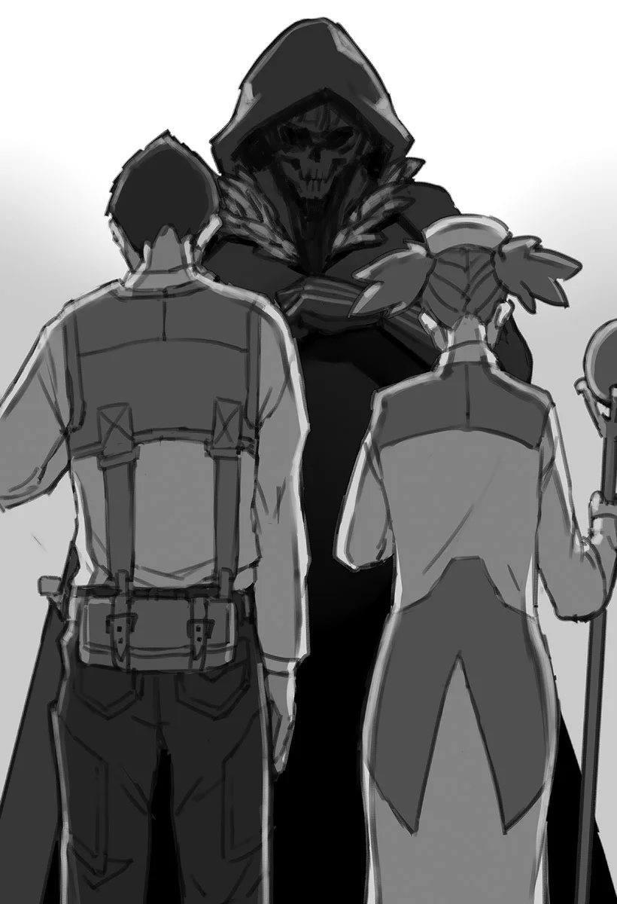

# Chương 33: Tập 2 Chương 1 - Mê Cung Tân Nguyệt (4)

Đúng như dự đoán, bài thi diễn ra hết sức suôn sẻ và kết thúc êm thấm. Đến nước này thì chuyện đó có lẽ cũng là đương nhiên, bởi dẫu sao tôi cũng từng làm bài thi này một lần trong đời rồi.

Nói vậy thôi chứ dù câu hỏi có đổi khác, mảng kiến thức liên quan nhìn chung vẫn thế. Tôi mà làm bài dở thì mới là lạ.

Các thí sinh khác trong phòng tuy trông có vẻ bồn chồn lo lắng, nhưng chắc cũng sẽ qua bài kiểm tra mà chẳng mấy khó khăn. Nhìn họ biết đọc biết viết là thấy ngay: rõ ràng từ nhỏ họ đã may mắn được học hành khá tử tế.

Kéo theo đó, việc ghi nhớ những điều cần thiết cho bài thi cũng không quá khó, bởi phạm vi kiến thức được hỏi khá hẹp. Thực tế cũng chứng minh cho nhận định của tôi: ai nấy đều biết bài thi vấn đáp có tỷ lệ đỗ thấp hơn hẳn bài thi viết.

Tôi biết đọc biết viết là nhờ trưởng làng và vị dược sư trong làng dạy cho. Hồi ấy động lực của tôi đơn giản lắm, chỉ nghĩ một mạo hiểm giả thực thụ chí ít cũng phải biết cái chữ. Điều đó cũng gắn liền với ước mơ chưa từng đổi thay của tôi: trở thành một mạo hiểm giả Mithril Cấp.

Chúng tôi không phải chờ quá lâu để biết kết quả. Chắc nhờ đợt này ít thí sinh nên chỉ một lát sau bài thi đã được chấm xong và gửi lại. Ai được xướng tên tức là người đó đã đỗ. Còn tôi thì dĩ nhiên...

"Rentt. Anh Rentt Vivie," Sheila cất tiếng khi tôi đứng dậy bước lên bàn làm việc của cô ở đầu phòng. "...Anh đã đỗ bài thi viết rồi nhé. À mà thực ra, anh đạt điểm tối đa luôn đấy! Dù bài này không hẳn là khó, nhưng kết quả thế này cũng hiếm thấy lắm. Anh cừ thật đấy, anh Rentt."

Tôi nghĩ mình làm được như thế cũng đáng khen đôi chút. Nhưng nghe cách Sheila nói thì thỉnh thoảng vẫn có thí sinh khác đạt điểm tối đa, nên riêng tôi thì chẳng thấy thành tích này to tát đến vậy.

Nghĩ lại thì hồi thi lần đầu, tôi đâu có ẵm trọn điểm tối đa. Hồi đó còn non kinh nghiệm, quên câu trả lời của vài câu rồi mắc mấy lỗi ngớ ngẩn. Dĩ nhiên chuyện đó tôi chỉ giữ trong bụng, đời nào lại đi bép xép với nhân viên của Hội là mình đã từng thi cơ chứ.

"...Tôi hiểu rồi. Thật... tốt quá. Vì tôi đỗ rồi. Giờ tôi nên làm gì... tiếp theo?" Tôi đáp lại một cách chừng mực rồi hỏi Sheila về bước kế tiếp, trọng tâm là phần thi thực hành.

◆◇◆◇◆

"...Kế tiếp là phần thi thực hành. Anh sẽ lập đội cùng vài thí sinh khác để tiến tới một địa điểm chỉ định trong mê cung. Dù vậy, đây vẫn là một cuộc đua tài, và nhóm nào tới đích đầu tiên sẽ giành chiến thắng."

Tôi gật đầu trước lời Sheila. Tôi nhớ mang máng hồi thi thực hành lần đầu nhiều năm trước, đề bài là đi hái thảo dược hay gì đó tương tự. Thoạt nghe thì tưởng đơn giản, nhưng rốt cuộc tôi phải hạ kha khá quái vật trên đường mò tới nơi cây thuốc mọc. Đã vậy còn phải chật vật căng mắt ra để không bị lạc giữa những lùm cây rậm rạp trong rừng. Nhìn nhận nhẹ nhàng nhất thì đó quả là một trải nghiệm chẳng mấy dễ chịu gì.

Nghĩ lại thì hồi đó không ít thí sinh bị lạc đường, cuối cùng nhân viên của Hội phải lặn lội đi tìm về. Dĩ nhiên chẳng cần nói cũng biết, mấy kẻ xui xẻo ấy đều trượt thẳng cẳng phần thi thực hành.

So với hồi đó thì mục tiêu lần này xem chừng dễ thở hơn. Trong mê cung chắc chắn có quái vật, nhưng chỉ cần mua một tấm bản đồ rồi chọn con đường ngắn nhất thì ai cũng có thể tới đích nhanh chóng...

Chí ít thì đó là suy nghĩ của một mạo hiểm giả Thiết Cấp lần đầu đi thi. Còn với kinh nghiệm từng nếm trải các bài thi và thử thách của Hội, tôi nhìn là biết ngay họ chẳng có ý tốt đẹp gì: đằng sau một yêu cầu ngỡ như đơn giản chắc chắn cài cắm đầy cạm bẫy và những chiêu trò thâm hiểm.

"Tôi... hiểu rồi. Có... quy định nào. Hạn chế không?"

Biết đâu là cấm dùng bản đồ, hoặc vài điều khoản tương tự thế. Nhưng Sheila chỉ thoáng mỉm cười.

"Ừm... Không hề có đâu. Mọi thứ đều được phép hết."

Cách Sheila trả lời nghe cứ cưng cứng thế nào ấy. Phía Hội chắc chắn đã sắp đặt sẵn trò gì đó, điều này tôi dám chắc. Nếu tôi cố tình tìm cách né tránh, khéo lại bị họ lấy cớ bắt lỗi, hoặc tệ hơn là tước quyền thi ngay tắp lự.

"Tôi... hiểu rồi. Vậy... mạo hiểm giả sẽ... lập đội với tôi... đâu rồi?"

"Ừm... Phải rồi, chính là hai thí sinh đằng này. Thí sinh Raiz, thí sinh Laura!"

Trước tiếng gọi của Sheila, hai bóng người tách khỏi đám đông mạo hiểm giả ở tầng một của Hội. Họ từ từ bước về phía chúng tôi: một thiếu niên và một thiếu nữ. Trông họ quen quen đến lạ; quả thực là người quen mặt...

Tôi nhớ ra ngay họ chính là hai cô cậu từng đánh nhau với Goblin và Slime trong Mê Cung Tân Nguyệt.

Chính là cặp đôi kiếm sĩ và giáo sĩ hôm nọ.

Lúc mới chạm mặt tôi đã đoán họ thuộc Thiết Cấp hoặc Đồng Cấp, xem ra tôi đoán chẳng lệch là bao. Nhưng việc họ xuất hiện ở đây chứng tỏ cả hai đều là Thiết Cấp, giống hệt như tôi lúc này.

"Tôi xin giới thiệu, đây là Raiz Dunner và Laura Satii. Còn đây... là anh Rentt Vivie," Sheila lên tiếng giới thiệu chúng tôi với nhau.

Raiz và Laura. Hừm...

Raiz là một thiếu niên vóc người nhỏ nhắn, mái tóc đỏ cắt ngắn cùng ánh mắt tràn đầy sức sống. Trái lại, Laura trông có vẻ trầm lặng, sở hữu mái tóc nâu nhạt mềm mại.

Nghe gọi tên, hai mạo hiểm giả trẻ cúi đầu chào tôi, và tôi cũng đáp lễ. Xem ra hai cô cậu này chí ít cũng có chút phép lịch sự tối thiểu, khiến tôi thấy nhẹ nhõm phần nào. Dù sao thì cái nghề mạo hiểm giả này cũng lắm kẻ du thủ du thực. Trong số đó không thiếu những đứa mang suy nghĩ kỳ quặc rằng tuyệt đối không cúi đầu trước ai để phô trương sức mạnh một cách ấu trĩ. Thực tế, chỉ cần liếc quanh phòng một vòng là thấy thừa mứa những kẻ như vậy. Phải, chúng nhan nhản khắp nơi.

Mỗi đội đều có một nhân viên của Hội kèm cặp, chắc vừa để giải thích quy trình thi cử, vừa để canh chừng xem có ai hành xử không đúng mực hay không.

...Nhìn là biết mấy kẻ đó cầm chắc phần trượt, bởi ngay cả phép chào hỏi cho đàng hoàng với bạn đồng hành còn chẳng làm nổi thì hy vọng gì. Dù vậy, tôi chỉ giữ những nhận định đó trong bụng.

Quan trọng hơn là tôi cần tìm hiểu thêm về đồng đội; chuyện này hết sức cần thiết khi cả bọn sắp sửa cùng nhau bước vào mê cung. Không chia sẻ đủ thông tin rất dễ phải trả giá bằng mạng sống, mà nếu được thì tôi muốn tránh việc phải chết thêm lần thứ hai.

"Tôi là... một kiếm sĩ. Tôi chỉ biết dùng... ma pháp cường hóa... và ma pháp Khiên Chắn... ngoài ra... chẳng còn gì khác."

Raiz và Laura nhanh chóng đáp lại lời giới thiệu ngắn gọn của tôi.

"Tôi cũng là kiếm sĩ. Khi chiến đấu, tôi dùng Khí Lực để cường hóa cơ thể và sức bền. Còn Laura đây thì..."

"Tôi là ma pháp sư... nhưng cũng dùng được ma pháp trị liệu nữa. Tôi sẽ cố gắng hỗ trợ hết sức từ tuyến sau. Mong được anh giúp đỡ nhiều, anh Vivie."

Màn chào hỏi ngắn ngủi của chúng tôi khép lại như thế, nếu thứ đó có thể gọi là một màn làm quen.

Sheila tiếp tục giải thích:

"Được rồi. Mọi người đều đã làm quen xong, giờ tôi sẽ phổ biến chi tiết về bài kiểm tra."

Lời cô lập tức kéo trọn sự chú ý của cả ba, bởi dám phớt lờ những chỉ dẫn sống còn từ Hội thì rất dễ phải trả giá bằng mạng sống. Tôi dỏng tai, chăm chú lắng nghe từng chữ.

"Như tôi vừa nói, mục tiêu của phần thi này là tới được điểm chỉ định trong mê cung. Cụ thể là điểm này, ngay trên bản đồ đây. Các bạn đã rõ chưa?"

Nói đoạn, Sheila chỉ vào một vị trí trên tấm bản đồ Mê Cung Tân Nguyệt.

"Hội sẽ cấp cho các bạn tấm bản đồ này, cứ tùy nghi sử dụng nhé. Phần hướng dẫn đến đây là hết. Nhưng có một lưu ý: các bạn được phép giao tranh với những mạo hiểm giả khác. Nhóm nào chạm tới điểm này đầu tiên sẽ giành chiến thắng. Chỉ có vậy thôi."

Cả Raiz lẫn Laura đều gật đầu. Tôi thì vẫn ôm mối hoài nghi, chắc chắn có điều gì đó mờ ám ở đây. Dù vậy, tôi vẫn chọn cách im lặng.

"Bài thi này có giới hạn thời gian, cụ thể là đến lúc mặt trời lặn hôm nay. Các bạn nhớ để ý thời gian trong lúc tiến bước nhé."

"Vậy thì, chúc cả ba cố gắng hết sức nhé. Tôi sẽ cổ vũ cho mọi người!" Sheila cười tươi tắn nói.

◆◇◆◇◆

"Giờ... ta xuất phát tới Tân Nguyệt chứ nhỉ? Cứ đi xe ngựa như mọi khi nhé? À mà... anh từng đến đó bao giờ chưa, Rentt?"

Tôi gật đầu trước câu hỏi của Raiz.

Xem ra Raiz tự đứng ra nhận vai trò đội trưởng cho cái nhóm chắp vá này. Thế lại tiện cho tôi, bởi thú thật tôi chẳng mấy rành rẽ chuyện phối hợp tổ đội. Dù sao xưa nay tôi toàn đi một mình, nên cứ để Raiz quán xuyến mọi việc cũng hay. Chừng nào có biến tôi mới lên tiếng, còn không thì cứ giữ im lặng tối đa là hơn.

Về khoản xe cộ mà Raiz đề xuất... thì chắc cũng chẳng sao.

Có lẽ vậy.

Rốt cuộc cỗ xe ngựa chở chúng tôi cũng tới được lối vào Tân Nguyệt an toàn. Dù tôi cứ nơm nớp lo tay đánh xe bẻ lái đưa cả bọn đi đứt sang chỗ khác. Suốt dọc đường tôi cứ nhìn chằm chằm gã đánh xe, chỉ thấy gã nở một nụ cười khổ. Những dịp thế này ai mà biết chuyện gì có thể xảy ra, và nếu bị chở tới một xó xỉnh nào khác thay vì điểm đến thì tôi tuyệt đối không cười nổi đâu.

Chính nụ cười gượng gạo của gã đánh xe là dấu hiệu rõ ràng nhất: khéo lại là một trò bẫy của Hội. Trong khi đó, Raiz và Laura dường như chẳng mảy may nghi ngờ gì. Mà cũng phải thôi, ai đời lại đi đề phòng cạm bẫy trong một chuyện thường nhật đơn giản đến thế chứ?

Nhưng ngặt nỗi đây lại chính là ngón đòn mà Hội rất khoái dùng, và tôi thì quá rành cái thói đó rồi.

Vừa tới cửa mê cung, Raiz và Laura đã sốt sắng chuẩn bị đồ đạc, nôn nóng muốn lên đường ngay. Tôi thấy hai đứa cũng chẳng làm gì sai, nhưng có lẽ mình nên nhắc một câu, thế là tôi cất lời.

"...Này. Hai... người."

"Có chuyện gì thế, Rentt?"

"Có chuyện gì vậy, anh Vivie?"

Chí ít thì tôi cũng chẳng mất nhiều công để lôi kéo sự chú ý của hai người.

"...Ta nên... mua bản đồ mới."

Nghe tôi nói vậy, cả hai ngơ ngác nhìn nhau rồi mới lôi tấm bản đồ được Hội phát ra khỏi túi.

"Thì chúng ta có bản đồ ngay đây rồi mà, Rentt."

"Đúng vậy đấy... Chúng ta không thể dùng luôn tấm này sao?"

Tôi lắc đầu. "...Tấm bản đồ... này. Được vẽ từ... gần mười lăm năm... trước. Chẳng có gì... bảo đảm. Là tấm này... bây giờ vẫn còn chính xác."

"Hể...? A! Anh nói đúng thật! Sao chuyện quan trọng thế này mà họ lại viết chữ bé tí xíu thế chứ? Đã vậy còn nhét tít vào cái xó này nữa!" Raiz thốt lên khi cuối cùng cũng đọc được dòng chữ in li ti nơi góc bản đồ.

Mê cung vốn không phải là cấu trúc bất biến. Các phòng ốc và kết cấu bên trong mê cung sụp đổ rồi tự tái tạo là chuyện cơm bữa, từ đó mở ra những lối đi mới dẫn vào những ngóc ngách chưa ai từng biết.

Dù nói thế chứ thông thường cũng phải mười đến hai mươi năm cấu trúc bên trong mê cung mới biến đổi một lần. Nhưng tấm bản đồ này đã mười lăm năm tuổi rồi, tôi không nghi ngờ sao cho được. Tốt nhất là cả nhóm nên mua bản mới nhất của bản đồ Mê Cung Tân Nguyệt.

Tôi thì dĩ nhiên đã có Bản Đồ Akasha nên mấy thứ bản đồ khác chẳng mấy quan trọng. Ngặt nỗi địa điểm chỉ định lại chỉ được đánh dấu trên tấm bản đồ do Hội phát. Xui cái là đường dẫn tới chỗ đó chưa từng được vẽ lên Bản Đồ Akasha, có lẽ vì tôi chưa từng đặt chân qua lối ấy. Vì những lẽ đó, tôi mới đề xuất tốt nhất là nên mua luôn một tấm bản đồ mới tinh.

"Nhưng mà mua của ai bây giờ nhỉ...?" Raiz thắc mắc, nghển cổ ngó nghiêng xung quanh một lượt.

Người bán bản đồ dạo là cảnh tượng quen thuộc trên đường phố Maalt, và dĩ nhiên trước cửa Tân Nguyệt họ cũng tụ tập đông đúc. Cái khó ở đây không phải là tìm người bán, mà là lòng tin: biết tin ai bây giờ? Ai mà chẳng quẹt nguệch ngoạc vài đường lên tấm vải rồi tự xưng đó là bản đồ.

Nghĩ vậy, tôi đảo mắt nhìn quanh một vòng, rồi gần như ngay tức khắc dừng mắt lại ở một người bán dạo đằng xa.

"...Ta sẽ mua... bản đồ. Từ người... kia."

Nhìn theo người tôi vừa chỉ, hai đồng đội của tôi đều nhướng mày ngạc nhiên.

"...Trông gã đó khả nghi cực kỳ luôn ấy chứ?" "Đúng vậy thật... Trông có vẻ chẳng bình thường chút nào..." Hai người họ thi nhau nhận xét.

Tôi chẳng trách họ được. Kẻ tôi vừa chỉ là một gã đàn ông khoác áo chùng đen, toát ra một vẻ kỳ quái khó dò. Nhìn kỹ hơn, khóe môi gã nhếch lên thành một nụ cười nửa miệng méo mó, nom cứ như thể sắp sửa gạ bán cho chúng tôi mấy thứ thảo dược nguy hiểm vậy.

...Có lẽ tôi chẳng có tư cách phán xét vẻ ngoài của những kẻ khoác áo chùng. Nói cho cùng bản thân tôi có khác gì gã kia đâu? Chỉ là hai người bạn đồng hành dường như không nghi kỵ tôi đến mức ấy mà thôi...

Dù sao đi nữa, tôi rảo bước thẳng tới chỗ gã đàn ông mặc áo chùng. Hai cô cậu kia tuy vẫn chưa yên tâm lắm nhưng cũng vội vã bám theo sau, xem chừng đã tạm gác mối ngờ vực sang một bên.
