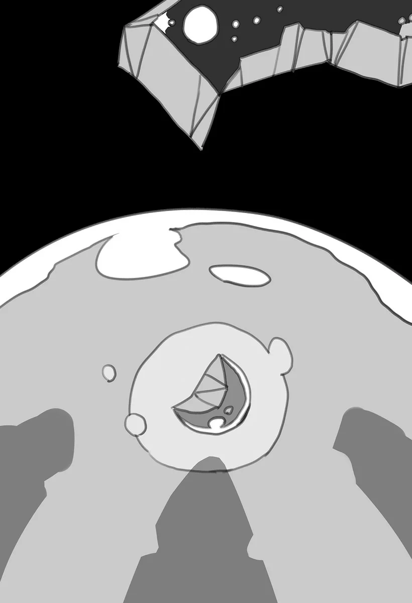

# Chương 36: Tập 2 Chương 1 - Mê Cung Tân Nguyệt (7)

Phải thừa nhận rằng mọi chuyện chẳng hề diễn ra theo đúng kế hoạch. Bước chân vào phòng thủ lĩnh, tôi không khỏi cảm thấy đôi chút thất vọng khi nhìn thấy con quái vật đang chờ đợi chúng tôi.

Nếu con quái vật ấy đã bị tiêu diệt từ trước, nó sẽ mất một khoảng thời gian mới tái sinh trở lại. Khi đó, chúng tôi có thể vượt qua nơi này một cách thuận lợi mà chẳng gặp phải trở ngại nào. Dẫu sao thì điều kiện của bài thi cũng chỉ đơn thuần là "tiến tới một điểm chỉ định".

Dù trong phòng thủ lĩnh quả thực có quái vật, và đúng là người ta không thể đi qua đây nếu nó chưa bị đánh bại, nhưng Hội không hề cấm thí sinh đi qua căn phòng mà không tự tay tiêu diệt nó. Thay vào đó, họ chỉ giữ im lặng về điểm này; một kẽ hở hoàn toàn có thể được tận dụng bởi những ai hiểu rõ sự tình.

Về phần mình, tôi rất muốn một kết cục như thế xảy ra, đó là lý do tôi nhường cho nhóm đi trước vào căn phòng. Nhưng với những người còn tràn đầy nhiệt huyết mộng mơ như Raiz và Laura, tôi đồ rằng kiểu hành xử cơ hội này sẽ làm lung lay tận gốc rễ tinh thần mạo hiểm giả của họ. Nghĩ đến điều đó, tôi đành giữ im lặng vì không muốn đập tan lý tưởng của hai người họ.

Nếu nhóm đi trước thực sự tiêu diệt được con quái vật, tôi sẽ chỉ xem đó là một sự trùng hợp may mắn. Thế nhưng trên thực tế, chẳng có gì diễn ra theo đúng kế hoạch cả. Tôi đoán ở đâu đó sẽ có người đưa ra quan điểm về chuyện này, đại loại như trên đời ai cũng phải bỏ ra một lượng công sức nhất định thì mới mong gặt hái thành quả. Có lẽ điều đó cũng có phần đúng, nhưng tạm thời tôi gác lại những suy nghĩ ấy sang một bên.

Con quái vật ở giữa căn phòng là một loài quen thuộc; quen thuộc, nhưng lại hiếm thấy theo những khía cạnh khá đặc thù.

"...Một con Slime ư? Không, một con... Slime khổng lồ...?" Raiz thì thào, dường như bị choáng ngợp bởi kích thước đồ sộ của nó.

Bất chấp lời buột miệng của Raiz, lưỡi kiếm của cậu đã rút ra khỏi bao, thế thủ vững vàng. Cậu sẵn sàng đón đỡ mọi cử động hay đòn tấn công bất ngờ; Laura cũng tương tự như vậy.

Con Slime này có lẽ to gấp vài lần một con Slime bình thường. Còn giới mạo hiểm giả thì chỉ đơn giản gọi nó là Đại Slime, một loài quái vật thượng cấp mang mối đe dọa đáng kể.

Dù những con Slime khổng lồ thường thong dong lượn lờ ở các tầng sâu của mê cung, nhưng đôi khi chúng cũng xuất hiện ở các tầng nông hơn với vai trò quái vật thủ lĩnh. Bản thân nó toát ra vẻ uy hiếp vừa đủ, với kích thước đồ sộ gieo rắc nỗi sợ hãi vào lòng các mạo hiểm giả. Một quái vật mang đặc tính như vậy có khả năng kháng các đòn tấn công vật lý nhưng lại càng dễ bị tổn thương trước ma pháp. Thêm vào đó, khối lượng khổng lồ của nó không chỉ để làm cảnh; nếu mạo hiểm giả rơi vào vị trí bất lợi, họ có thể dễ dàng bị đè bẹp dí chỉ trong nháy mắt.

Xét đến tất cả những yếu tố này, chẳng khó để hiểu tại sao thái độ của Hội đối với các bài thi thăng hạng thường bị xem là đầy ác ý.

Liệu nhân viên Hội có chịu tham gia bài kiểm tra do chính mình đặt ra không? ...Không, tôi đoán là không đâu.

Chúng tôi chậm rãi tiến lại gần con Slime, mắt không rời quan sát những rung động khẽ khàng trên cơ thể to lớn của nó. Xét về bản chất, con Slime trông khá dễ thương, nhưng đó là khi chưa tính đến những mẩu xác con mồi tiêu hóa dở thường thấy ở những con Slime cỡ này. Laura, dường như cũng có cùng suy nghĩ trong lúc chúng tôi tiến bước, bắt đầu lẩm bẩm một mình.

"Tôi muốn... có một con thú nhồi bông to chừng đó ghê... Nhìn nó cứ có cảm giác... như vậy ấy..." Vài từ khác lọt thỏm trong hơi thở khẽ khàng của cô.

Tôi ngẫm nghĩ một chút về lời lẩm bẩm của Laura. Ngay cả khi người ta thực sự sở hữu một món đồ chơi như vậy, thì việc tìm đủ chỗ trống để cất nó cũng sẽ là cả một thử thách. Chẳng lẽ cô định nhét cả con thú bông khổng lồ ấy vào căn phòng trọ thuê ở lữ quán sao?

Cuối cùng cũng nhận ra sự hiện diện của chúng tôi khi cả nhóm tiến đến giữa phòng, con Đại Slime rung lên bần bật rồi phóng một quả cầu axit to khủng khiếp về phía chúng tôi để đáp trả. Đòn tấn công đặc trưng của loài Slime, Acid Blitz, đóng vai trò như phát súng báo hiệu cho khởi đầu cuộc thử thách của chúng tôi.

Quả cầu axit đó, theo ước lượng bằng mắt thường, to gấp ít nhất mười lần so với quả cầu của một con Slime bình thường. Nếu một mạo hiểm giả bị nó bắn trúng, vết bỏng sẽ là mối bận tâm nhỏ nhất của họ. Nhưng con Slime không hề hay biết rằng chúng tôi đã chứng kiến đòn tấn công này khi nhóm bốn người giao chiến với nó; dường như đó là phản xạ tự nhiên của con Slime mỗi khi có thứ gì đó đến gần. Trong cuộc thảo luận ngắn ngủi trước đó, chúng tôi chẳng mất nhiều thời gian để tìm ra biện pháp đối phó, bởi chỉ cần né tránh khỏi quỹ đạo bay của quả cầu axit, nó sẽ trở thành một đòn tấn công tương đối vô hại.

Tuy nhiên, kích thước khổng lồ của quả cầu đồng nghĩa với việc chúng tôi phải né tránh một cách dứt khoát; chỉ cần chần chừ một thoáng là có thể bị va quệt phải. Về điểm này, tôi phải gửi lời cảm ơn đến nhóm người đi trước, bởi xem ra rốt cuộc chúng tôi cũng thu được đôi chút thông tin hữu ích từ họ.

Sau khi lăn sang một bên để né, Raiz liền lao tới phía trước, vung thanh kiếm chém mạnh vào con Slime không chút e dè. Mặc dù loài Slime có khả năng kháng cực cao trước các đòn tấn công vật lý, nhưng chúng hoàn toàn không phải là bất khả xâm phạm. Nếu lõi hạch đang xoay tít ở giữa cơ thể dạng thạch của chúng bị phá hủy, chúng vẫn sẽ mất mạng như thường. Nhờ vậy, đòn tấn công của Raiz chí ít cũng mang lại một mức độ uy hiếp đáng kể.

Trên thực tế, Raiz nhắm thẳng vào lõi của con Đại Slime, nhưng chỉ một nhát chém duy nhất là chưa đủ sâu để chạm tới nó. Đòn đánh như thế sẽ phát huy tác dụng với một con Slime bình thường, bởi chỉ cần lưỡi kiếm đâm xuyên qua cơ thể và găm trúng lõi, mọi chuyện coi như xong xuôi. Đó thậm chí còn là một việc dễ như trở bàn tay.

Tuy nhiên, một con Slime với kích thước tầm này lại sở hữu độ nhớt cao hơn hẳn so với những đồng loại thông thường của nó, và có khả năng kháng cự tốt hơn nhiều trước các đòn đâm xuyên. Bản thân thể tích khổng lồ của con Đại Slime cũng mang lại cho nó lớp phòng thủ vững chắc trước những đòn tấn công đâm thấu; một nhát đánh không tích đủ lực sẽ chẳng đời nào xuyên thủng được tới lõi của nó.

Thất bại trong nỗ lực của mình, Raiz lập tức bị một khối lồi ra như cánh tay vươn ra từ cơ thể khổng lồ của con Slime hất văng đi.

◆◇◆◇◆

Và thế là Raiz liên tục bị cánh tay ngẫu hứng của con Đại Slime hất văng hết lần này đến lần khác. Chúng tôi ai nấy đều có vai trò của riêng mình; nếu có ai thắc mắc về vai trò của tôi, thì đó là làm tấm khiên che chở cho Laura. Nói chính xác hơn, nhiệm vụ của tôi là đánh lạc hướng con Slime trong lúc Laura niệm ma pháp. Rốt cuộc thì ma pháp chính là điểm yếu duy nhất của loài Slime. Trong một trận chiến như vậy, một chiến binh tiền tuyến như tôi sẽ cầm chân con Slime để ma pháp sư của đội rảnh tay triển khai ma thuật.

Dù ban đầu tôi định đảm nhận vai trò đó, nhưng trong cuộc bàn bạc trước trận đấu, chính Raiz đã nằng nặc đòi nhận vai trò quấy nhiễu Slime, cậu xung phong tấn công nó nhằm thu hút sự chú ý.

Tôi đoán có nhiều lý do khiến Raiz đột ngột đổi ý như vậy. Đó chắc chắn chẳng phải là một nhiệm vụ dễ dàng để một mình gánh vác. Nếu phải suy đoán, thì Raiz, người lúc này đang cảm thấy xấu hổ vì cách hành xử của mình khi vừa nhìn thấy một phiên bản phóng to của loài quái vật thông thường, đang muốn chuộc lại lỗi lầm. Cụ thể là cậu thất vọng vì bản thân không thể đánh giá chính xác thực lực của quái vật so với sức mình. Vì thế, cậu đã hạ quyết tâm chiến đấu với con Slime ấy, với mục tiêu duy nhất là tích lũy càng nhiều kinh nghiệm thực chiến càng tốt để không lặp lại phản ứng tương tự vào lần tới khi chạm trán quái vật kiểu này. Nếu có bất trắc gì xảy ra, nhân viên của Hội chắc chắn sẽ can thiệp. Đây là một sự sắp xếp tốt hơn nhiều so với việc mạo hiểm mạng sống trong một cuộc đụng độ không người giám sát.

Một quyết định sáng suốt.

Tuy nhiên, việc trông chờ Hội ra tay can thiệp và hỗ trợ nếu xảy ra sự cố vốn không hợp với phong cách của một mạo hiểm giả chân chính, nhưng người ta có thể thấy rằng Raiz không hề có ý nghĩ ỷ lại như thế.

Cậu đang liều mình đâm chém vào con Slime. So với cậu, con Slime to lớn và mạnh mẽ hơn rất nhiều. Về phần mình, Raiz đã nỗ lực hết sức để quấy rối con Slime, tìm cách tấn công vào lõi của nó trong từng đường kiếm. Cậu tận dụng tối đa tình huống và chọn làm những gì mình có thể làm vào thời điểm này.

Tôi không thể trách Raiz vì những diễn biến tiếp theo, cụ thể là việc con Đại Slime lăn xả truy đuổi cậu để phản công sau khi lại hất văng cậu bằng cái chi giống như cánh tay thêm một lần nữa. Raiz chỉ là chưa có đủ kinh nghiệm, còn con Đại Slime thì mạnh hơn cậu quá nhiều—tất cả chỉ có thế.

Tôi không thể ngồi yên nhìn Raiz bị con Slime nuốt chửng, nên tôi quay lại liếc nhìn Laura. Ánh mắt cô ấy đã nói lên tất cả những gì tôi cần biết; tôi đoán cô tự tin rằng mình có thể né được ngay cả khi con Slime lao về phía cô.

Dậm mạnh chân xuống mặt đất, tôi lao vút về phía Raiz và con Slime, lúc này khoảng cách giữa nó và người đồng đội của tôi đã cận kề trong gang tấc.

Loài Slime nhìn từ góc độ nào cũng chỉ như một khối chất nhầy quánh đặc, nhưng cá nhân tôi coi "lưng" của nó là hướng đối diện với hướng mà nó đang tiến tới. Bắt kịp cả hai, tôi lập tức rút kiếm, chém một nhát ngang lưng nó. Kèm theo một tiếng bẹp nhão nhoét của thứ vật chất chẳng phải lỏng cũng chẳng phải rắn, một mảng thân của con Slime văng ra theo hướng lưỡi kiếm của tôi, rơi lộp độp xuống sàn căn phòng.

Dù tôi đã mạnh hơn nhiều so với khi còn sống, nhưng tôi không cảm thấy có nhiều khác biệt về lực cản, dù đối thủ có là Đại Slime hay không. Dẫu vậy, trên thực tế tôi chẳng thể nào chạm tới lõi của con Slime chỉ bằng vài nhát chém.

Bản thân lõi của Đại Slime cũng khác biệt so với những đồng loại nhỏ hơn của nó: nó sở hữu mô-men xoắn lớn hơn, quay với tốc độ nhanh hơn nhiều để gia tăng lực cản bên trong trước các loại vũ khí sắc bén cùng những đòn cận chiến khác. Nhưng nếu một người sở hữu đủ độ chuẩn xác hoặc lực đánh, người đó sẽ dễ dàng đâm thủng chiếc lõi ấy bất chấp lớp phòng ngự của nó. Thế nhưng, cả hai lựa chọn đó đều nằm ngoài khả năng của tôi vào lúc này. Tất cả những gì tôi có thể làm ở thời điểm hiện tại là giật lại sự chú ý của con Đại Slime khỏi Raiz và Laura, và có vẻ như đòn đánh của tôi đã làm được chính xác điều đó.

Như thể phản ứng lại nhát chém, lõi của con Slime xoay sang hướng khác, khiến toàn bộ cơ thể nó lăn về phía tôi. Đúng như tôi nghĩ, khái niệm về phương hướng tương đối linh hoạt đối với loài Slime. Có lẽ chính chiếc lõi là bộ phận chịu trách nhiệm định hướng chung cho nó chăng?

Tôi tự nhủ trong đầu sẽ hỏi Lorraine, vị Đại Học Sĩ tại gia của tôi, về điều này sau khi trở về từ bài kiểm tra, trong lúc vừa lùi lại để tránh con Slime đang đuổi theo mình. Tôi cố tình rút lui về hướng ngược lại với vị trí của Raiz và Laura.

Với tốc độ kinh ngạc mà người ta khó lòng tưởng tượng nổi ở loài Slime, con quái vật dạng thạch lao thẳng về phía tôi. Hơn ai hết, tôi ý thức rõ không gian chật hẹp trong căn phòng này; người ta sẽ chẳng thể nào trốn chạy mãi được. Nhưng tôi cũng chẳng hề có ý định chạy trốn, bởi làm gì có nhu cầu đó.

Sau khi hồi sức từ những nỗ lực trước đó, Raiz lại sẵn sàng thanh kiếm trong tay, lao về phía con Slime lúc này đang bị phân tâm. Chọn vị trí đối diện thẳng với tôi, Raiz truyền Khí Lực vào lưỡi kiếm rồi chém mạnh vào khối cơ thể núng nính của con Đại Slime.

Lúc này bị tấn công cùng lúc từ cả trước lẫn sau, con Đại Slime như thể nổi giận, lại rung lên dữ dội thêm một lần nữa. Chẳng bao lâu sau, cả hai chúng tôi đều nhìn chằm chằm vào những cái chi quen thuộc như cánh tay, khi con Slime quyết định mọc ra hai chiếc cùng lúc để đáp trả các đòn đánh của chúng tôi. Chúng chính là loại cánh tay từng hất văng Raiz lúc trước, nhưng tốc độ của các chi lúc này chậm hơn rõ rệt, có lẽ do gánh nặng của việc phải duy trì hai nhánh vươn ra như thế cùng một lúc.

Về phần Raiz, giờ cậu đã có thể né tránh được các đòn vung tay của con Slime.

Ở phía bên kia của con Slime, tôi hầu như chẳng gặp chút khó khăn nào trong việc theo kịp cánh tay quẫy đạp của nó. Thậm chí có lẽ một mình tôi cũng có thể đối đầu trực diện với con Slime này. Dẫu vậy, tôi sẽ chẳng thể tung ra một đòn dứt điểm, và cuối cùng nó sẽ biến thành một cuộc chiến tiêu hao nhanh chóng khiến người ta mệt mỏi.

Tôi cho rằng việc mài giũa một bộ kỹ năng nhất định là rất có giá trị, cụ thể là năng lực ma pháp thuộc hệ tấn công của tôi. Lại thêm một chủ đề nữa để thảo luận với Lorraine khi trở về.

"Tôi chuẩn bị xong rồi!"

Tiếng kêu vang vọng khắp căn phòng. Laura dường như đã hoàn tất bài tụng niệm, chính là bài niệm chú cho một ma pháp mà cô đã dệt nên ngay từ lúc bắt đầu cuộc chạm trán này.

Những câu thần chú đơn giản và tương tự thường có thể được thi triển bằng các bài tụng ngắn. Nhưng để đối phó với một đối thủ mạnh mẽ, chẳng hạn như con Đại Slime này, hiển nhiên là cần một ma pháp uy lực hơn nhiều. Đó là lý do tại sao tôi và Raiz đã câu giờ cần thiết cho Laura. Dù tôi vốn có nhiệm vụ bảo vệ Laura khỏi các đòn tấn công của con Slime, nhưng rốt cuộc tôi cũng đã tham gia vào trận hỗn chiến; bản chất khó lường của các trận đánh trùm vốn là như thế.

Mọi sự kết thúc êm đẹp là tốt rồi; tôi đoán nói ra câu đó lúc này hơi sớm một chút, nhưng đối với tôi thì trận chiến đã ngã ngũ.

Theo tín hiệu của Laura, tôi và Raiz lập tức nhảy lùi lại phía sau, thoát khỏi phạm vi áp sát con Slime. Tôi không dám chắc liệu Laura có đủ thong thả để bảo đảm chúng tôi đã ra khỏi bán kính ảnh hưởng của vụ nổ hay chưa, nhưng trước khi tôi kịp nhận ra, cô đã đứng sừng sững trước con Slime với cây quyền trượng giơ cao. Hít một hơi thật sâu, Laura cất vang những lời cuối cùng trong câu thần chú của mình.

"GRAND! PROX!!"

Theo những lời ấy, những chiếc lưỡi lửa khổng lồ to gấp vài lần người cô phóng vọt ra từ đầu quyền trượng của Laura. Những xúc tu rực lửa của ma pháp lao thẳng về phía con Slime với tốc độ chóng mặt.

Thông thường một con Đại Slime sẽ co thắt và vặn mình lại để né tránh một đòn tấn công như thế, nhưng con này do bị tôi và Raiz làm phân tâm suốt thời gian qua nên đã không kịp thực hiện động tác ấy. Trong khoảnh khắc tiếp theo, con Đại Slime thấy mình bị nhấn chìm giữa một biển lửa, hứng trọn toàn bộ uy lực từ đòn đánh của Laura.

Dù con Slime hầu như chẳng hề hấn gì trước lưỡi kiếm của chúng tôi, nhưng nó lại không có cơ chế phòng ngự nào trước ma pháp. Uy lực chấn động khiến một phần lớn cơ thể nó tan chảy, làm lộ ra chiếc lõi hạch trong khoảnh khắc. Nếu bị bỏ mặc trong tình trạng này, con Slime sẽ nhanh chóng tái sinh và xóa sạch mọi dấu vết tổn thương trên cơ thể. Có lẽ đây chính là điều khiến loài Slime trở nên quái dị và đáng sợ; nhưng dẫu sao thì ở trạng thái này, nó hầu như chẳng còn là mối đe dọa đối với chúng tôi.

Gật đầu tán thành với Raiz, tôi nhìn về hướng chiếc lõi đang lộ ra của con Slime. Cả hai chúng tôi đều hiểu rõ việc cần phải làm.

Việc kết liễu một con quái vật thủ lĩnh được xem là một chiến tích anh hùng đối với giới mạo hiểm giả. Trông có vẻ hơi ngập ngừng, Raiz chần chừ như thể nghi ngờ những đóng góp của chính mình trong trận chiến. Cuối cùng cũng trút bỏ sự do dự, cậu vào thế kiếm rồi lao về phía con Slime, đâm ngọt lưỡi kiếm xuyên qua chiếc lõi đang phơi bày. Ngay trong tích tắc tiếp theo, sức căng giữ cho cơ thể con Đại Slime liên kết với nhau biến mất, khiến nó mất đi hình dạng. Con Đại Slime rã rời, giờ đây chẳng còn gì hơn ngoài một vũng chất lỏng cùng vài mảnh thạch vương vãi.

Mê cung rồi sẽ sớm thu hồi lại cư dân đã gục ngã của nó theo thời gian. Tuy nhiên, tôi lại có ý định khác, liền rút ra mấy bình nón quen thuộc từ sâu bên trong chiếc túi ma thuật của mình. Đưa cho mỗi người Laura và Raiz một bình, tôi quay sang giải thích với họ.

"Chất dịch... Của một con Slime trong suốt... Như con này. Đáng giá... Khá nhiều tiền đấy. Hai người cũng nên... Thu thập một ít đi."

Họ có lẽ đang mong đợi một màn ăn mừng nào đó, bởi cả Raiz lẫn Laura đều ngây người nhìn tôi với vẻ mặt ngơ ngác, sững sờ trước những lời tôi vừa nói.

"...Ngay cả khi chúng ta... Chia nhau. Thì phần cho mỗi người... Vẫn còn rất nhiều. Chúng ta sẽ chia... Tiền thưởng. Rồi tự thưởng cho mình... Một bữa ăn ngon."

Cả hai, lúc này đã hoàn toàn bị thuyết phục rằng cái đống bầy nhầy vô hồn trước mắt đáng giá cả một gia tài, liền vội vã quỳ xuống, cầm những chiếc bình tôi đưa để thu gom chất dịch của con Slime. Tôi cho rằng sự ngây thơ của họ khiến họ trở nên đáng yêu theo một cách rất riêng.
