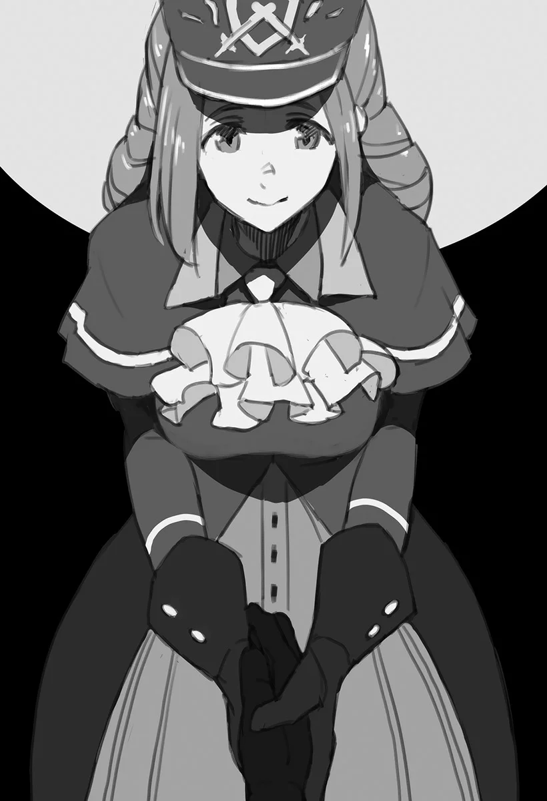

# Chương 40: Tập 2 Chương 2 - Khế Ước Bằng Ma Pháp (2)

Thành thực mà nói, dẫu cho Sheila đã nhiều lần bảo đảm cùng sự chân thành lộ rõ ra mặt, tôi vẫn còn đó những mối hoài nghi. Ý tôi là, Sheila đưa ra đề nghị này cho Rentt Faina, một con người. Đúng hơn là cựu con người. Liệu cô ấy có nuốt lời nếu nhận ra giờ đây tôi là một Undead hay không? Chẳng ai nói trước được điều gì, và tôi không tài nào gạt bỏ được nỗi băn khoăn ấy.

Thế nhưng...

Sheila đã cất công chuẩn bị cả một bản khế ước ràng buộc ma pháp. Việc tôi vẫn còn ngờ vực cô chẳng khác nào xúc phạm đến quyết tâm của cô ấy. Hơn nữa, đi ngược lại các điều khoản được ghi trong một bản khế ước như vậy là vô cùng khó khăn, dẫu không phải hoàn toàn bất khả thi. Có nhiều cách để hủy bỏ hoặc lách khỏi nó, nhưng không có cách nào trong số đó là dễ dàng hay đơn giản cả.

Trên thực tế, tôi đã hiểu rõ Sheila nghiêm túc với toàn bộ chuyện này đến nhường nào ngay từ khoảnh khắc cô rút cuộn giấy da ra. Ngay cả khi khế ước bị phá vỡ bằng cách nào đó, vẫn còn vấn đề về hình phạt. Rốt cuộc nó sẽ nặng nề đến mức nào?

"...Cá nhân tôi... cũng muốn... tin cô, cô Sheila. Có thể cô sẽ nghĩ... tôi đang bới lông tìm vết... những chi tiết nhỏ nhặt... nhưng hình phạt... cô định chọn là gì?"

Sheila nhìn thẳng vào mắt tôi, lập tức đưa ra câu trả lời.

"Tôi hoàn toàn không có ý định phá vỡ thỏa thuận này, nên bất kỳ hình phạt nào cũng được. Cho dù có phải nghỉ việc ở Hội Mạo Hiểm Giả, hay biến tôi thành nô lệ riêng của anh... Bất cứ điều gì cũng được hết."

Về phần mình, tôi cảm thấy cả hai hình phạt đó đều quá đỗi nặng nề. Dẫu tôi có lo ngại về việc bị săn lùng như một loài quái vật hiếm, nhưng tước đoạt vị trí nhân viên Hội của Sheila sau tất cả những gì cô ấy đã nỗ lực để đạt được chẳng khác nào một sự tàn nhẫn. Còn về chuyện biến cô thành nô lệ... điều đó đơn giản là lố bịch. Trước hết, chế độ sở hữu nô lệ đâu có hợp pháp ở nơi này.

Trong lúc tôi còn đang suy nghĩ xem hình phạt nào sẽ hợp lý hơn, Sheila đã trải cuộn giấy da ra chiếc bàn ở giữa phòng. Cô bắt đầu viết thoăn thoắt trước khi tôi kịp lên tiếng phản đối. Chẳng mấy chốc, Sheila giơ cuộn giấy lên trước mặt tôi. Viết bằng những nét chữ nắn nót, rõ ràng trên tấm giấy da cừu là những dòng chữ sau:

"Nếu khế ước này bị vi phạm, Sheila Ibarss sẽ tự nguyện từ chức khỏi vị trí công tác tại Hội Mạo Hiểm Giả cùng toàn bộ các tổ chức liên quan. Thêm vào đó, cô ấy cũng sẽ tiến hành các thủ tục cần thiết để từ bỏ quyền tự do và quyền công dân của mình tại một vùng lãnh thổ công nhận chế độ sở hữu nô lệ, đồng thời chuyển giao toàn bộ quyền sở hữu bản thân cho Rentt Faina."

Không, không không không. Thế này thì quá đáng lắm rồi. Làm sao tôi có thể ký vào một thứ như thế này được chứ...!

Dù muốn lên tiếng phản đối, nhưng bản khế ước đã được viết ra mất rồi. Chúng tôi sẽ phải mua một tấm giấy da khác để định ra các điều khoản mới và đem đốt bỏ tấm này.

Chí ít thì đó là những gì tôi muốn nói, nhưng tôi đâu có mù quáng trước ánh mắt kiên định của Sheila. Đây là cái giá mà cô ấy sẵn sàng đánh đổi chỉ để nghe những gì tôi sắp nói, và dường như Sheila đã hạ quyết tâm cho việc này từ rất lâu rồi. Xem ra tôi không còn quyền lên tiếng nữa.

Việc cô kéo tôi vào căn phòng này và kiên nhẫn đứng đây chờ đợi giữa những lần tôi ngập ngừng do dự mãi không thôi, rồi lại thêm bản khế ước này nữa... Cứ đà này thì tôi chẳng có cách nào từ chối cô ấy được.

Thở dài một tiếng, tôi quay sang Sheila. "...Tôi hiểu rồi. Chúng ta hãy... xác nhận lại nội dung khế ước... rồi ký tên đi. Tôi sẽ kể cho cô... mọi chuyện. Sau đó."

Sheila cuối cùng cũng nở nụ cười trước sự nhượng bộ của tôi.

"Vâng! Giờ tôi sẽ viết thêm tất cả các điều khoản thích hợp khác, anh chờ một lát nhé..."

Thế rồi Sheila giải thích và thảo luận về các chi tiết liên quan, có lẽ với tâm trạng hơi quá đỗi vui mừng, và hoàn thiện nội dung của bản khế ước. Sau khi xác nhận mọi thứ đều đâu vào đấy, Sheila hạ bút viết nốt phần còn lại của khế ước với tốc độ đáng kinh ngạc, chiếc bút lông vũ trên tay cô phẩy qua phẩy lại tựa như lá cờ bay trước gió.

◆◇◆◇◆

"Vậy thì... tôi không còn... lựa chọn nào khác. Tôi sẽ... nói cho cô biết."

Dù tôi cảm thấy đôi chút bị ép buộc vào chuyện này, song các điều khoản khác của khế ước đều công bằng và hợp lý. Hơn nữa, có được một người trong Hội hợp tác với mình là điều tôi khó lòng bỏ qua. Nhưng liệu có con người còn sống nào sẵn sàng tiếp tục đồng hành nếu họ hiểu rõ tình cảnh hiện tại của tôi chăng...?

Đó là nỗi lo lớn nhất của tôi. Ngoài Sheila ra, liệu một người như thế có thực sự tồn tại không? Đó chính là thực tế của tình thế này.

Có lẽ tình cảnh này là điều không thể tránh khỏi. Dẫu vậy, tôi thấy lòng mình đôi chút thanh thản trước hoàn cảnh hiện tại.

Nhưng tôi nên bắt đầu từ đâu đây? Đây là một chủ đề khó khăn dù tôi có tiếp cận theo hướng nào đi nữa, nhưng có lẽ bắt đầu ngay từ thuở ban đầu sẽ dễ dàng hơn. Một phần của khế ước đã quy định rõ rằng Sheila không được phép tiết lộ thân phận thực sự của tôi cho bất kỳ ai nếu chưa có sự đồng ý bằng văn bản của tôi, vậy nên tôi cho rằng chẳng còn lý do gì phải lo lắng nữa.

Thở dài một tiếng, tôi chậm rãi hạ phần mũ trùm đầu của chiếc áo choàng xuống. Điều tiện nhất là cởi phăng cả chiếc áo choàng ra, nhưng tôi chẳng đủ can đảm để làm điều đó trước mặt một cô gái trẻ. Dù sao thì chỉ riêng việc nhìn thấy khuôn mặt tôi thôi cũng đã đủ để gây sốc cho hầu hết mọi người rồi.

Dù trên đầu tôi không hẳn là có một cái lỗ, nhưng da thịt trên mặt tôi đã mục rữa và vài chỗ vẫn còn khô khốc. Song so với hồi tôi còn là một Ngạ Quỷ, diện mạo này đã gần với con người hơn rất nhiều—ít nhất là đối với một Undead.

"Cái...?! Ch-Chuyện này... Đây là..." Rướn đầu tới trước trong sự lẫn lộn giữa bối rối và sợ hãi, Sheila chậm rãi bước vòng quanh tôi, ngó nghiêng nhìn tôi từ nhiều góc độ.

Đứng trước mặt tôi thêm một lần nữa, tôi thay đổi hình dạng chiếc mặt nạ để Sheila thấy được toàn bộ khuôn mặt mình. Nếu phải nói thì đây chính là điểm gây tác động mạnh nhất về mặt thị giác trên cơ thể tôi, bởi nửa dưới khuôn mặt chẳng còn gì ngoài hàm răng, phần nướu đã mục rữa một nửa và xương quai hàm bằng cách nào đó vẫn còn nguyên vẹn.

Lorraine, vốn là một học giả quái vật, đã quá quen với những cảnh tượng kiểu này nên chẳng có vẻ gì là ngạc nhiên cho lắm. Ngược lại, Sheila dường như không thể tiếp nhận cảnh tượng trước mắt một cách dễ dàng. Sắc mặt cô giờ đây tái mét, hai đầu gối run rẩy khi cô ngồi bệt xuống đất, không còn đủ sức để đứng vững nữa.

"...Cô... có sao không?"

Dẫu tôi ân cần hỏi han, sắc mặt tái nhợt của Sheila vẫn chẳng hề thuyên giảm. Tôi cho rằng cô ấy đã quá đỗi bàng hoàng đến mức không thể thốt nên lời.

"...Cô thấy đấy. Có lẽ... thà đừng hỏi... thì hơn. Trông tôi gớm ghiếc như quái vật... phải không?"

Sheila lắc đầu nguầy nguậy trước lời tôi nói. "Không phải thế đâu!" cô hét lên, trước khi tiếp tục bằng một giọng dịu hơn.

"...Không phải... thế đâu. Tôi không ngờ đấy, anh Rentt... Thật không ngờ chuyện kinh khủng... dường nào đã xảy ra với anh... Nhưng tôi càng ghét việc mình chẳng hay biết gì hơn. Dù tôi rất sốc, nhưng... tôi thấy mừng vì giờ mình đã biết..."

Tôi cảm thấy nhẹ nhõm vì Sheila đã không thét lên bắt tôi kéo mũ trùm lên lại.

"Vậy thì...? Cô... thấy thế nào?"

Sheila ngập ngừng một thoáng trước khi trả lời.

"...Tôi phải nói sao đây...? Trông anh bị thương rất nặng... Không, là thương tích trầm trọng... và không thể chữa khỏi sao? Nhưng vẫn có các ma pháp trị liệu, hoặc thuốc hồi phục cao cấp mà... Còn Giáo Hội thì sao? Các nữ tư tế hẳn phải làm được gì đó chứ..."

Có vẻ như Sheila vẫn chưa hiểu hết mức độ tình trạng của tôi. Tôi chẳng còn cách nào khác ngoài việc giải thích.

"Không... Không phải như... vậy đâu. Tôi đã biến thành... một con quái vật rồi. Cơ thể này... của tôi. Giờ là của một... Thi Quỷ."

Dù tôi giải thích rất nhanh và bằng những từ ngữ đơn giản, dường như Sheila phải mất một lúc lâu mới có thể hiểu được những gì tôi vừa nói.

"Hể? Đó là... cái gì cơ?"

Tôi tiếp tục lời giải thích của mình.

"Cách đây ít lâu... như cô đã biết, tôi đã đi... thám hiểm. Ở... Mê Cung Nguyệt Ảnh. Tôi tìm thấy một... khu vực chưa khai phá... rồi tự mình bước vào... nhưng rồi đột nhiên chạm trán một con Rồng bên trong... và bị giết chết. Khi tôi thức tỉnh... tôi đã trở thành một... Khô Lâu. Thế nên... chẳng còn lựa chọn nào khác, tôi đành hạ gục... những con quái vật khác ở đó. Rồi thông qua... Tiến Hóa Bản Thể... tôi đã tiến hóa... biến đổi. Giờ tôi là một Thi Quỷ... Cô... thấy sao? Một câu chuyện thú vị... đúng chứ?"

Một cách diễn đạt mang tính tự giễu, nhưng tôi không thể phủ nhận rằng nó thực sự có phần thú vị. Bất giác, tôi mỉm cười gượng gạo.

"Không thể nào... Chuyện như vậy lại xảy ra sao...? Không thể nào..." Sheila, vẫn chưa thốt nên lời, chậm rãi lắc đầu. Nhưng đó chính là sự thật.

Người bình thường ngay từ đầu sẽ chẳng đời nào tin vào một câu chuyện như thế, nên phản ứng như vậy hoàn toàn nằm trong dự tính của tôi. Đánh giá qua phản ứng và tình trạng hiện tại của Sheila, tôi đoán cô cần thêm thời gian để chấp nhận những gì tôi vừa nói.

"Tôi... hiểu. Rằng cô đang bối rối... khi đột ngột nghe phải... một chuyện như thế. Vì vậy... hãy dành chút thời gian... suy nghĩ. Từ góc nhìn... của tôi. Cô có thực sự nghĩ... hợp tác với... một kẻ... một thứ như tôi là ổn không? Lẽ dĩ nhiên... tôi chẳng có ý định... làm hại ai cả. Tất cả những gì tôi muốn làm... là tiếp tục hành nghề... mạo hiểm giả. Tôi cho rằng thật khó... để cô đột ngột... tin tưởng tôi. Dù chúng ta đã ký... khế ước. Nhưng nếu cả hai bên cùng đồng thuận... khế ước có thể bị hủy bỏ. Dù sao thì... hôm nay tôi cũng nên về rồi... Cô cứ suy nghĩ xem... liệu có thể tin tưởng tôi... như một con người được không... vậy nhé."

Nói đoạn, tôi quay người, định bụng rời khỏi căn phòng.

Nếu Sheila từ chối hợp tác với tôi, vì bất kỳ lý do gì, thì tất cả những gì tôi cần làm là hủy bỏ khế ước, rồi tiến hành các bước chuẩn bị thích hợp để rời khỏi Maalt. Chẳng có lý do gì để kéo Sheila xuống bùn lầy cùng tôi; cô ấy còn có cuộc sống riêng của mình.

Trong trường hợp đó, việc đã nói hết mọi chuyện cho Sheila đồng nghĩa với việc nán lại Maalt có thể dẫn tới chuyện tôi bị bắt giữ. Tất cả những gì tôi cần làm là di cư sang một vùng khác, điều đó chẳng phải là vấn đề gì to tát. Miễn là tôi sẵn sàng cắt đứt mọi mối quan hệ xã hội, tôi có thể sống một mình rất dễ dàng. Còn về Lorraine... tôi cho là cô ấy sẽ đi cùng tôi, miễn sao tôi mở lời thỉnh cầu thật khéo léo.

Thế rồi—

"Xin anh đợi đã!" Sheila cất tiếng gọi một lần nữa, như muốn níu giữ không để tôi rời đi.

Tôi quay người lại, nhìn thẳng vào mắt Sheila.

"Tôi... Tôi tin anh. Tôi tin tưởng anh, anh Rentt... Cho dù anh có biến thành quái vật đi chăng nữa... anh cũng sẽ không làm hại con người... Ý tôi là, anh lúc nào cũng tốt bụng như vậy mà, anh Rentt! Vì thế tôi... Tôi sẽ hợp tác. Tôi sẽ cùng sát cánh với anh," Sheila nói, giọng cô gần như van nài. Chậm rãi, cô loạng choạng bước về phía tôi, rồi nắm chặt lấy đôi tay tôi bằng một lực khá mạnh.

"Anh Rentt... Từ nay về sau, nếu anh gặp bất kỳ rắc rối nào với Hội, hãy cứ trao đổi với tôi... Tôi chắc chắn... Tôi tin chắc rằng mình sẽ có thể giúp được gì đó..."

Nói rồi, Sheila cuối cùng cũng nới lỏng tay ra, ngước nhìn tôi với một nụ cười thoáng nở trên gương mặt.

◆◇◆◇◆

Cạch.

Cùng với thanh âm quen thuộc ấy, cánh cửa mở ra để lộ một không gian thân thuộc, và một gương mặt cũng quen thuộc không kém từ bên trong. Đó là gương mặt của một người phụ nữ mà tôi đã quen biết suốt một thời gian dài. Lý trí, bừa bộn, thi thoảng lại thích bày mấy trò chơi khăm phiền toái với người khác, nhưng nhìn chung là một người dịu dàng—

Lorraine.

"...Hửm? Gì thế này? Anh dẫn theo ai đó à, Rentt? Hiếm thấy thật đấy. Đừng bảo là—anh đã ra tay với người ta rồi nhé?"

Nhìn nụ cười hơi nhếch mép trên mặt Lorraine, người ta sẽ ngỡ rằng cô ấy đang nói đùa. Nhưng tôi có thể cảm nhận được một bầu không khí căng thẳng kỳ lạ—hoặc có lẽ chỉ là tôi đang mệt mỏi sau những biến cố trong ngày.

Người mà Lorraine nhắc đến không ai khác chính là Sheila Ibarss, một nhân viên của Hội hiện đang đứng sau lưng tôi. Sau cuộc thảo luận về những vấn đề trước mắt, tôi đã đề cập với Sheila rằng Lorraine cũng nắm rõ tình cảnh của tôi. Tuy nhiên, khi tôi xác nhận rằng mình đang tạm thời sống chung với Lorraine, Sheila đã nằng nặc đòi đi cùng để có một cuộc nói chuyện nào đó. Nói thế không có nghĩa là trước đây tôi chưa từng thông báo cho Sheila về việc dàn xếp này. Dù lúc đó cô không hề ngạc nhiên, nhưng giờ đây trông cô có vẻ trầm ngâm trĩu nặng tâm tư, mang nét mặt đầy phức tạp khi bước theo sau tôi.

Rốt cuộc Sheila đang nghĩ ngợi điều gì chứ?

Bản thân tôi thì hoàn toàn chịu chết. Nhưng dẫu sao chúng tôi cũng đã đồng thuận rằng một cuộc trò chuyện với Lorraine là điều cần kíp tiến hành ngay, thế nên chúng tôi mới cùng nhau lên đường.

Bên cạnh Lorraine và Sheila, người đầu tiên biết về thân phận thực sự của tôi là mạo hiểm giả Rina Rupaage. Clope cùng vợ anh ta, Luka, rất có thể cũng hiểu rằng tôi đang rơi vào một hoàn cảnh éo le nào đó, nhưng họ đã chọn cách không tọc mạch. Cả hai đều có địa vị xã hội riêng cần phải bận tâm, với tư cách là người điều hành một cơ sở kinh doanh có mối liên hệ với chính quyền địa phương và giáo hội. Có lẽ họ đã đoán ra tôi trở thành một quái vật Undead, hoặc có lẽ là chưa; chẳng ai dám chắc được.

Dù sao đi nữa, tôi sẽ kể cho Clope nghe câu chuyện của mình vào một dịp khác. Còn hiện tại, tôi chọn cách trân trọng sự hiếu khách và giữ kẽ kín tiếng của họ. Dẫu vậy, ân huệ của họ sẽ không bị lãng quên mà không được đền đáp. Dù chắc chắn tôi có ý định báo đáp vào một thời điểm nào đó trong tương lai, nhưng bây giờ chưa phải lúc.

Một lời nói từ Sheila kéo tôi giật mình bừng tỉnh khỏi dòng suy nghĩ, quay trở lại với tình huống trước mắt.

"Không đâu, cô Vivie. Anh Rentt chẳng làm gì tôi cả. Chỉ là, chúng tôi có... trò chuyện về một vài việc. Những chuyện cụ thể."

Dù điều đó dường như đã đủ để Lorraine hiểu được đại ý những gì đã diễn ra, tôi không nghĩ Lorraine chỉ qua những lời lẽ ấy mà hiểu thấu được mức độ những điều Sheila đã biết. Việc tiết lộ những thông tin như thế là phụ thuộc vào tôi, và tôi cũng chẳng trông đợi Lorraine có thể suy đoán hoàn hảo được ý đồ của mình.

Cảm nhận được rằng đây không phải là cuộc nói chuyện thích hợp để đứng trước ngưỡng cửa, Lorraine lùi lại một bước, như để đón chào chúng tôi vào nhà.

"...Thế à? Dù sao thì cũng mời vào trong. Nhà cửa hơi bừa bộn một chút, nhưng cứ tự nhiên như ở nhà nhé."

Có điều gì đó bất thường trong lời nói của Lorraine—sao lại bừa bộn đến mức này cơ chứ? Tôi đã dọn dẹp và sắp xếp ngăn nắp nhà cô ấy ngay trước khi lên đường tham gia kỳ thi thăng hạng mà. Thật không tự nhiên chút nào khi nơi này lại trở nên bừa bãi chỉ trong một khoảng thời gian ngắn ngủi đến vậy, ngay cả khi tôi đã tính đến những thói quen luộm thuộm của Lorraine.

Chí ít thì, đó là những gì tôi đã nghĩ...
