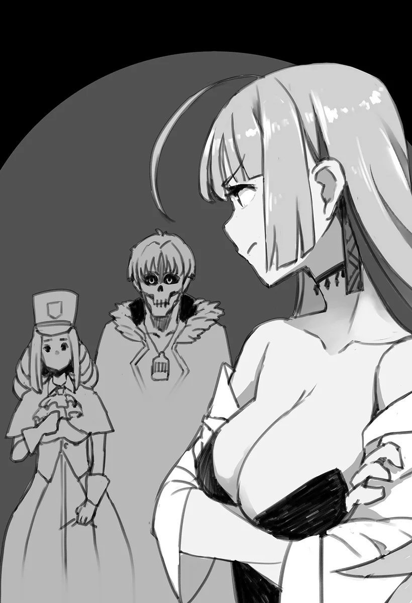

# Chương 41: Tập 2 Chương 2 - Khế Ước Bằng Ma Pháp (3)

Trong bầu không gian tĩnh mịch của căn nhà, thiết bị đo thời gian ma pháp của Lorraine lại phát ra những tiếng rè rè và lách cách theo từng nhịp đều đặn. Thứ thiết bị ấy đáng giá ngàn vàng, bởi thông thường chỉ có giới quý tộc cùng tầng lớp giàu sang mới đủ khả năng sở hữu một ma cụ chuyên biệt như vậy. Ấy thế mà chẳng hiểu vì lý do gì, Lorraine lại có một chiếc.

Căn cứ vào bề dày cùng kích thước tổng thể đồ sộ của nó, tôi đoán chừng Lorraine đã tự tay chế tạo nó từ con số không vào những lúc rảnh rỗi. Như thường lệ, tôi lại thấy khâm phục trước tính thực dụng kỳ quặc của Lorraine. Theo một nghĩa nào đó, Lorraine có thể làm được rất nhiều điều, thậm chí là hầu như mọi thứ...

Ngoại trừ việc nhà cùng những công việc nội trợ vụn vặt khác. Tôi không rõ nguyên do vì sao, nhưng trong đầu cũng lờ mờ đoán được đôi phần. Suy cho cùng, từ một thời điểm nào đó trong quá khứ, chính tôi đã nhận lãnh trách nhiệm quán xuyến việc nhà cho Lorraine, rồi cứ thế tiếp tục làm mãi. Nhận thức ấy, đi kèm một cảm giác trĩu nặng khôn nguôi, thấm sâu vào tận đáy lòng tôi.

...Có lẽ đây là chuyện tốt nhất nên để dành suy nghĩ vào lúc khác.

"...Được rồi. Giờ chúng ta nói chuyện thôi. Vậy là, cô bảo đã nghe được... vài chuyện từ Rentt rồi đúng không? Cho phép tôi nói thẳng nhé: chính xác thì cô đã biết được bao nhiêu rồi?"

Câu hỏi thoạt nghe bình thường của Lorraine lại đi kèm với một giọng điệu nghiêm nghị sắc lạnh. Bầu không khí lập tức chùng xuống đầy u ám, khiến ngay cả tôi cũng phải bất ngờ. Quay sang Sheila, tôi cũng ngạc nhiên chẳng kém khi bắt gặp một biểu cảm chưa từng thấy trên nét mặt cô. Trong ánh mắt cô lấp lánh một tia sáng kiên định, như thể cô đã hạ quyết tâm đối với chuyện này.

"...Vâng. Tôi nghe anh Rentt nói rằng anh ấy đã biến thành... một con quái vật. Và rằng anh ấy không tấn công con người..." Sheila đáp lời, giọng cô nhỏ nhẹ và đôi lúc hơi run rẩy. Tôi cảm nhận được muôn vàn cảm xúc đan xen đằng sau những lời lẽ giản đơn ấy. Còn rốt cuộc chúng là gì... thì tôi hoàn toàn chịu chết.

Lorraine như lập tức nắm bắt được tình hình, bèn hừ mũi bật cười.

"Hừm! Chỉ có bấy nhiêu thôi sao? Thế mà cô lại dám theo chân Rentt về tận nhà như thế này ư? Cô không thấy nguy hiểm chút nào à?" Lorraine nghiêng người tới trước, cất tiếng hỏi.

Sheila thì ngược lại, khẽ lắc đầu. "Không... Không hẳn đâu ạ. Anh Rentt là đang về nhà cô, nên tôi thấy chuyện đó chẳng có gì đáng ngờ cả."

"Đó chẳng phải chỉ vì cô quá thiếu cảnh giác thôi sao? Thử nghĩ xem: Rentt là một Undead, còn tôi lại là một học giả với tai tiếng chẳng mấy hay ho gì cho cam. Ờ thì, chí ít là ở chốn Maalt này. Vậy thì chuyện gì sẽ xảy ra nếu một cô gái trẻ trạc tuổi cô lại bước chân vào hang ổ của một con quái vật cùng một mụ phù thủy? Có khi cô sẽ bị quẳng vào vạc rồi đem hấp sống... Hoặc có thể chúng tôi sẽ xơi tái cô ngay tại chỗ không chừng. Ngoài phố người ta chẳng phải vẫn đồn đại như thế hay sao?" Lorraine nói, chẳng rõ vì cớ gì lại tự ví mình như một mụ phù thủy ăn thịt người.

Dù Sheila hiểu rằng đây chỉ là một trò đùa nào đó, nhưng cô lộ rõ vẻ không thoải mái. Gương mặt cô căng cứng khi cố gượng ép một nụ cười chuẩn mực đã qua khổ luyện của nhân viên Hội.

"Dạ đâu có... Không đời nào tôi lại nghĩ cô là phù thủy đâu ạ! Đến cả tôi cũng biết cô là một học giả vô cùng đáng kính mà, cô Vivie."

"Cứ gọi 'Lorraine' là được rồi... Nhưng không đâu. Cô thấy đấy, đó chỉ là vẻ bề ngoài thôi. Nói thật thì, đêm nào tôi cũng lén mò ra các con phố ở Maalt, săn lùng những cô gái trẻ ngây thơ yếu ớt để hút máu họ. Mùi vị cực kỳ thơm ngon, đúng vậy, lại còn tốt cho sức khỏe nữa. Cô có biết nó giúp ích tuyệt vời thế nào cho làn da không?"

Nét mặt của Lorraine dường như chẳng hề ăn nhập với những câu đùa thản nhiên ấy. Bản thân tôi cũng không tài nào đoán ra được ý định của Lorraine, bởi lời lẽ của cô nghe gần như một lời đe dọa. Tuy nhiên, ngay khoảnh khắc tiếp theo—

"...Đó chính là thứ mà Rentt đã trở thành. Cô có thực sự hiểu điều đó không?" Lorraine ngập ngừng hỏi, kết thúc câu nói bằng một lời dồn ép đầy bất ngờ và đanh thép nhắm vào Sheila.

Lorraine không hề để lộ chút biểu cảm nào khi nói. Cô chẳng tức giận cũng chẳng thù địch, thốt ra sự thật ấy như thể đó là điều bình thường nhất trên thế gian. Chỉ nhìn dáng vẻ của Lorraine thôi, người ta hẳn sẽ ngỡ những câu hỏi như thế là chuyện cơm bữa trong căn nhà này.

Tôi cảm thấy một nỗi sợ hãi nguyên thủy dâng lên từ tận sâu thẳm bên trong khi nhận ra góc nhìn của Lorraine. Với cô, nữ nhân viên Hội đang ngồi đối diện không phải một con người, mà đơn thuần chỉ là một đối tượng cần phải xử lý tương ứng tùy thuộc vào câu trả lời cho câu hỏi trước mắt. Xét trong hoàn cảnh của chúng tôi, có lẽ đây là một phản ứng rất đỗi tự nhiên.

Tàn nhẫn... Đó là một ánh mắt tàn nhẫn. Đây chính là vẻ mặt của Lorraine khi chạm trán quái vật trong những chuyến thám hiểm của mình. Nếu phải đoán, trong đầu cô lúc này ắt hẳn đang tràn ngập muôn vàn phương thức để trừ khử mục tiêu trước mặt.

Trong một cuộc trò chuyện với Sheila sau sự cố này, cô tiết lộ với tôi rằng bản thân chưa từng cảm thấy khiếp sợ đến vậy trong đời. Sheila, với tư cách là một nhân viên Hội, vốn không có nhiều kinh nghiệm thực chiến nơi thực địa. Cô không hoàn toàn mù tịt về khoản đó, bởi toàn bộ nhân viên Hội đều được tiếp nhận khóa huấn luyện chiến đấu cơ bản như một phần trong chương trình của họ. Cô có thể đánh bại Goblin, Slime và những loài tương tự với sự trợ giúp từ những đồng nghiệp thiên về chiến đấu hơn.

Nhưng vào những khoảnh khắc ấy, Sheila cảm thấy một nỗi sợ hãi thuần khiết. Cho đến tận lúc đó cô chỉ mới nhìn thấy quái vật từ đằng xa, vậy mà giờ đây chúng lại đang lởn vởn ngay trước mắt, bốn mắt nhìn nhau và lộ rõ sát khí muốn đoạt mạng. Đến đây, Sheila nhận ra bản thân rốt cuộc đã thấu hiểu vì sao các mạo hiểm giả đôi khi lại vô thức nín thở trước quái vật. Dù về mặt lý trí cô biết lũ quái vật ấy buộc phải bị tiêu diệt, nhưng sự xung đột giữa trách nhiệm và nỗi sợ hãi trong lòng đã đẩy cảm xúc của cô vào cảnh hỗn loạn.

Thế nhưng điều đó vẫn tương đối bình thường, và chưa phải vấn đề gì quá to tát. Thứ thực sự làm Sheila kinh hãi chính là sự hiện diện của một mẩu suy nghĩ le lói trong tâm trí, dẫu chỉ là rất nhỏ: khả năng tước đoạt sinh mạng của một sinh vật sống trước mặt mình nhân danh sự cần thiết. Cô từng chọn cách biện minh cho những suy nghĩ ấy bằng cách nghĩ đến những lợi ích mà việc tiêu diệt quái vật mang lại cho nhân loại. Cũng như các đồng nghiệp của mình, cô không được phép do dự khi tước đi sinh mạng của kẻ khác, miễn sao điều đó phục vụ cho lợi ích của chính bản thân.

Kinh nghiệm huấn luyện chiến đấu đã dạy cho Sheila nhiều điều như thế, và đó là lý do vì sao lúc này cô thấy mình như chôn chân tại chỗ. Nhìn thẳng vào mắt Lorraine, Sheila đã hiểu. Đây chính là biểu cảm mà cô từng trút lên lũ Goblin và Slime trong Mê Cung. Thế nhưng, cô chưa từng ngờ rằng lại có một con người khác nhìn mình bằng ánh mắt như vậy.

Sheila không còn cách nào khác ngoài việc hiểu ra rằng Lorraine sẽ trừ khử cô nếu đối phương thấy câu trả lời của cô có điểm nào đó chưa thỏa đáng. Chuyện ấy chưa hẳn đã là một vụ giết người, bởi lẽ điều đó chỉ có thể xảy ra khi đối phương công nhận nạn nhân là một con người.

Thế nhưng, ánh mắt của Lorraine lại nói lên một điều khác.

Đối với Lorraine, đây sẽ chẳng qua chỉ là một hành vi dọn dẹp đơn thuần. Cô có thể dễ dàng phóng hỏa thiêu rụi vô số mục tiêu thành tro bụi, dù là con người hay bất kỳ thứ gì khác. Ngay cả Sheila cũng hiểu rằng Lorraine thừa khả năng xóa sổ sự tồn tại của một sinh linh khác mà chẳng mảy may do dự. Dù sao thì Lorraine cũng là một mạo hiểm giả, hơn nữa còn là một Ngân Cấp dạn dày kinh nghiệm. Phải trả lời thật cẩn trọng; đó rất có thể là ý nghĩ duy nhất lướt qua tâm trí Sheila lúc này.

Lấy hết can đảm thêm một lần nữa, đôi môi Sheila khẽ hé mở.

◆◇◆◇◆

"Tôi... hiểu rồi."

Đó là một câu trả lời nhỏ nhẹ, gần như chẳng thể nghe thấy, tựa như ngọn lửa le lói của ngọn nến nhỏ trước cơn giông bão. Thế nhưng, ngọn lửa ấy vẫn kiên cường cháy sáng trước nghịch cảnh.

"Tôi hiểu rồi."

Câu trả lời được lặp lại của Sheila lúc này mang theo một sức nặng nhất định; giọng cô to hơn, rõ ràng hơn, nhưng dường như đang hướng về chính bản thân mình nhiều hơn là bất kỳ ai khác. Chí ít thì đối với tôi, thanh âm ấy nghe là như vậy.

Lorraine, cuối cùng cũng thấu hiểu được quyết tâm của Sheila, liền mỉm cười, nét mặt rốt cuộc cũng giãn ra mềm mại. "...Tôi hiểu rồi. Nếu vậy thì sẽ không có vấn đề gì cả."

Sheila dường như chực ngã quỵ trước những lời lẽ ấy.

"Cô phải hiểu rằng tôi đâu có hứng thú dọa dẫm những cô gái trẻ. Dù sao thì cũng muộn rồi. Chúng ta dùng bữa tối nhé?"

Nghe những lời của cô, tôi mới dần dần vỡ lẽ vì sao trước đó Lorraine lại nói năng và hành động như vậy.

◆◇◆◇◆

"...Anh Rentt... Tôi có nghe kể rồi, nhưng anh thực sự nấu ăn rất cừ đấy nhỉ...?" Sheila cất lời, nét mặt đượm vẻ phức tạp.

Chiếc bàn duy nhất trong nhà Lorraine giờ đây đã được bày biện đủ loại món ăn, những phần ăn mà tôi chuẩn bị cho Lorraine và Sheila. Cũng chẳng phải cao lương mỹ vị gì. Với tôi, đây chỉ là những món cơm gia đình mộc mạc mà tôi vốn đã quen tay nấu nướng. Bản thân tôi cảm thấy đồ ăn này chí ít cũng có hương vị chấp nhận được.

Tôi đồ rằng những nam mạo hiểm giả có hiểu biết về nghệ thuật nấu nướng hẳn là hiếm như lá mùa thu. Rốt cuộc thì, có mấy ai còn đủ thể lực để tự chuẩn bị bữa ăn cho mình sau một ngày kiệt sức săn lùng quái vật trong Mê Cung. Họ chỉ chực cắm mặt xuống giường mà ngủ vùi.

Về phần mình, các mạo hiểm giả thường kiếm được nhiều hơn hẳn một thương nhân hay người bán hàng rong, nên dẫu có ăn uống ở quán rượu hay tiệm ăn mỗi ngày thì điều đó cũng chẳng mấy suy suyển đến thu nhập của họ. Chính điều này khiến cho những mạo hiểm giả sành sỏi chuyện bếp núc trở nên rất đỗi hiếm hoi.

Các nữ mạo hiểm giả trái lại thường ôm ấp nguyện vọng được Hội tuyển dụng làm nhân viên, và cũng chính vì lý do đó mà họ tranh thủ thời gian rảnh để luyện tập nấu nướng. Chẳng hề có xu hướng nào như vậy trong giới nam mạo hiểm giả. Việc các nam mạo hiểm giả cống hiến cả cuộc đời để leo lên các thứ hạng mạo hiểm giả là điều phổ biến hơn nhiều. Người ta có thể tranh cãi xem giới tính nào dễ gây dựng sự nghiệp mạo hiểm giả hơn; còn với tôi, mỗi bên đều có những nỗi khó khăn riêng của mình.

Tôi thì khác, tôi học được ngón nấu nướng này từ thuở còn ở làng quê, từ chính người dược sư đã dạy cho tôi những kỹ năng sinh tồn khác. Nhớ lại dạo ấy, tôi thường phụ giúp chuẩn bị bữa ăn trong lúc bà bận rộn điều chế một loại thuốc nào đó. Thi thoảng bà cũng tiện tay thảy thêm vài nhánh thảo dược vào nồi cho tròn vị. Đó là môi trường học tập hoàn hảo cho những dược sư tương lai, và dẫu nó trang bị cho tôi vốn kiến thức tổng quát về thảo mộc cỏ cây, tôi cũng vô tình học được luôn cách nấu nướng trong suốt quãng thời gian đó.

"Mỗi nhà một Rentt—xã hội đáng ra nên như thế đấy, cô thấy không. Việc gì anh ấy cũng làm được, mà hầu hết lại còn làm miễn phí nữa chứ... Nhưng giờ thì phải trả phí rồi. Tôi cho rằng cô có thể nói là tôi thanh toán thù lao theo... cái kiểu kia," Lorraine nói, chỉ tay về phía chiếc lọ tôi đang cầm trên tay.

Đó chính là chiếc lọ đã được yểm ma pháp bảo quản: chiếc lọ chứa máu của Lorraine. Một giọt duy nhất ấy là tất cả những gì tôi cần cho bữa tối của mình.

Sắc mặt Sheila lại một lần nữa tái mét khi nghe nói chiếc lọ tôi luôn mang theo bên mình chứa đầy máu. Tôi đồ rằng đây chính là lý do vì sao trước đó Lorraine lại nói những lời như vậy trong cuộc trò chuyện ban nãy.

"Tôi hiểu rồi... Dù sao thì Thi Quỷ cũng là một dạng Ma Cà Rồng cấp thấp, nên là..."

Có vẻ như Sheila tiếp thu tình hình rất nhanh chóng.

Dù nhìn theo góc độ nào đi nữa, tôi thực chất vẫn là một con quái vật đang ngồi bên bàn ăn của con người, liếm láp từng giọt máu từ miệng lọ. Đối với một người bình thường tình cờ nhìn thấy, tôi hẳn chỉ giống một kẻ đeo mặt nạ đang liếm chất lỏng màu đỏ từ chiếc que nhỏ nhúng vào một chiếc lọ trông có vẻ vô hại. Đó không phải một cảnh tượng đáng sợ, mà có lẽ kỳ quặc và lập dị thì đúng hơn.

"Tình hình thực tế là như vậy đấy. Gác chuyện đó sang một bên, tôi có thể hiểu là hai người đã ký một bản khế ước ràng buộc ma pháp rồi đúng không?" Lorraine hỏi, thản nhiên lái câu chuyện sang việc thảo luận những chi tiết tường tận trong bản khế ước giữa Sheila và tôi.

Tôi không có nghĩa vụ phải kể tường tận chi tiết cho Lorraine nghe, nhưng xét thấy giờ đây cả ba chúng tôi đều đã rõ bí mật này, tôi nghĩ tốt hơn hết là nên bàn bạc khi có mặt đầy đủ các bên.

Tôi gật đầu đáp lời. "...Đúng vậy. Về cơ bản... Đó là bản khế ước... Cấm Sheila tiết lộ... Bất cứ điều gì về việc tôi... Thực sự là thứ gì."

"Hừm... Đúng là tôi cũng tò mò về những điều khoản cụ thể. Nhưng có lẽ chúng ta nên để dành chuyện đó sau bữa ăn. Dù sao cũng chỉ là chuyện vụn vặt thôi mà," Lorraine vừa nói vừa xúc một thìa thức ăn đưa lên miệng.

Sheila thì ngược lại, cô sốt sắng rút cuộn giấy da cừu ra từ một chỗ nào đó bên trong bộ đồng phục Hội của mình.

"Tôi có mang bản khế ước ở ngay đây. Cô có muốn xem qua không ạ?" cô hỏi, chìa cuộn giấy về phía Lorraine.

Đặt chiếc thìa xuống, Lorraine đón lấy cuộn giấy, mở ra rồi giơ lên ngang mặt.

Dù chúng tôi đã ký kết khế ước và về cơ bản dường như chẳng có vấn đề gì, Lorraine lại đặc biệt lão luyện trong việc rà soát văn bản để tìm ra các kẽ hở, và đó chính xác là điều cô đang làm. Cá nhân tôi không nghĩ Sheila sẽ cố tình vi phạm các điều khoản khế ước, nhưng nguy cơ cô ấy vô thức để lộ thông tin quả thực là một mối rủi ro hiện hữu. Sẽ rất bất công cho Sheila nếu những sơ suất buột miệng ngoài ý muốn lại khiến cô phải rời khỏi Hội.

Thế nhưng một ý nghĩ u ám hơn bỗng thoáng hiện trong tâm trí tôi: tôi không thể loại trừ khả năng Sheila bị một bên thứ ba bí ẩn nào đó khống chế tâm trí vào một thời điểm nào đó trong tương lai. Những loại ma pháp như vậy quả thực có tồn tại ở đâu đó trên thế giới này, và trong khi những người có ý chí kiên định có thể kháng cự lại mưu toan đó, thì những người yếu ớt sẽ bị bẻ gãy tinh thần và dễ dàng bị ép buộc phải khai ra bất cứ thông tin nào họ nắm giữ.

Nếu viễn cảnh ấy thực sự diễn ra, cả Sheila và tôi đều sẽ rơi vào thế bất lợi. Vì lẽ đó, việc có một người như Lorraine rà soát kỹ lưỡng bản khế ước là điều tối sức cần thiết.

Tính cách và năng lực của Lorraine đã đóng góp rất lớn cho mục đích của chúng tôi. Bản khế ước vốn mang bản chất ma pháp, nên tốt nhất là được soi xét bởi một người có kiến thức uyên thâm về ma thuật và những lĩnh vực liên quan. Lorraine dẫu chẳng phải luật sư hay quan chức ngành luật, nhưng bề dày học thức của cô là quá đủ để kiểm chứng tính hiệu lực của bản khế ước trước mắt.

Chẳng mất bao lâu để Lorraine cuộn tờ giấy da lại thêm một lần nữa, rõ ràng là đã sẵn sàng đưa ra lời phán định của mình.

"...Thoạt nhìn thì, tôi cho là không có vấn đề gì quá lộ liễu. Đương nhiên là có cả tá điểm tôi có thể săm soi bới lông tìm vết. Gạt chuyện đó sang một bên, bản này nhìn chung khá ổn thỏa, miễn sao bản thân Sheila không hé răng về cái gọi là bí mật của Rentt cho bất kỳ ai bên ngoài. Vấn đề chính cần cân nhắc ở đây sẽ là tình huống cô bị một loại ma pháp xâm lấn nào đó khống chế trái với ý muốn... Trong trường hợp ấy, tôi e là cô sẽ phải từ bỏ cuộc sống hiện tại mà trở thành nô lệ của Rentt."

"Chẳng lẽ không... Thể làm gì đối với... Cái điều khoản đó của khế ước sao...?"

"Chà, mọi bản khế ước ma pháp mang tính chất này đều vướng phải những vấn đề tương tự thôi. Trong trường hợp giả định rằng Sheila bị ma pháp khống chế ngoài ý muốn và rơi vào cảnh nô lệ do hiệu lực ràng buộc của khế ước, thì tất cả những gì anh cần làm chỉ là đơn phương hủy bỏ khế ước từ phía anh thôi, Rentt. Nếu cô ấy thực sự trở thành nô lệ của anh, quyền sở hữu cô ấy đằng nào cũng tự động chuyển sang cho anh, nên anh hoàn toàn có thể tháo gỡ vấn đề từ bước đó. Dù theo cách nào đi nữa, điều khoản này của khế ước dường như cũng chẳng có vấn đề gì."

Bản thân tôi cảm thấy chính những chi tiết ấy của bản khế ước lại tiềm ẩn cả tá vấn đề rắc rối của riêng chúng. Dẫu vậy chẳng rõ vì lý do gì, xét theo góc độ logic thì nó rõ ràng là có thể vận hành trót lọt, và thế là êm xuôi.

"Dù sao đi nữa," Lorraine tiếp tục giải thích, "nếu chuyện như thế thực sự diễn ra, hai người có thể bỏ qua mọi thủ tục giấy tờ phiền hà mà chỉ việc hủy bỏ khế ước dựa trên sự đồng thuận của đôi bên. Điều tôi vừa nhắc tới đơn thuần chỉ là kịch bản tồi tệ nhất mà thôi..."

Kịch bản tồi tệ nhất mà Lorraine vạch ra quả thực vô cùng gay gắt. Trong trường hợp Sheila bị thao túng, và ma pháp ấy mạnh đến mức không thể hóa giải, khế ước sẽ phát huy hiệu lực của nó, và chúng tôi buộc phải chấp nhận hậu quả. Dưới hoàn cảnh bình thường, tôi đồ rằng chẳng ai cần phải trù tính xa xôi đến nhường ấy cho một kịch bản tồi tệ nhất. Thế nhưng, hoàn cảnh của tôi lại cách quá xa mức bình thường. Sự thận trọng của Lorraine hoàn toàn là có cơ sở xác đáng.

"Như tôi vừa nói đấy... Bí mật này giờ đây là của chung giữa ba chúng ta. Mỗi người trong chúng ta đều phải làm tròn bổn phận của mình để đảm bảo giữ kín bí mật ấy. Do Rentt có ý định tiếp tục sự nghiệp mạo hiểm giả, nên vai trò của cô đặc biệt quan trọng đấy, Sheila, vì thế chúng tôi trông cậy vào cô trên rất nhiều phương diện."

"Vâng... Đương nhiên, đó cũng là điều tôi dự định làm, nhưng..."

"Nhưng sao cơ?"

"Chỉ là, dạo gần đây anh Rentt... có phần hơi nổi bật quá mức..." Sheila nói, đưa mắt liếc về phía tôi.

"Đã có chuyện gì khác thường xảy ra sao...?" Lorraine nhướn một bên mày, quay sang hỏi tôi.
