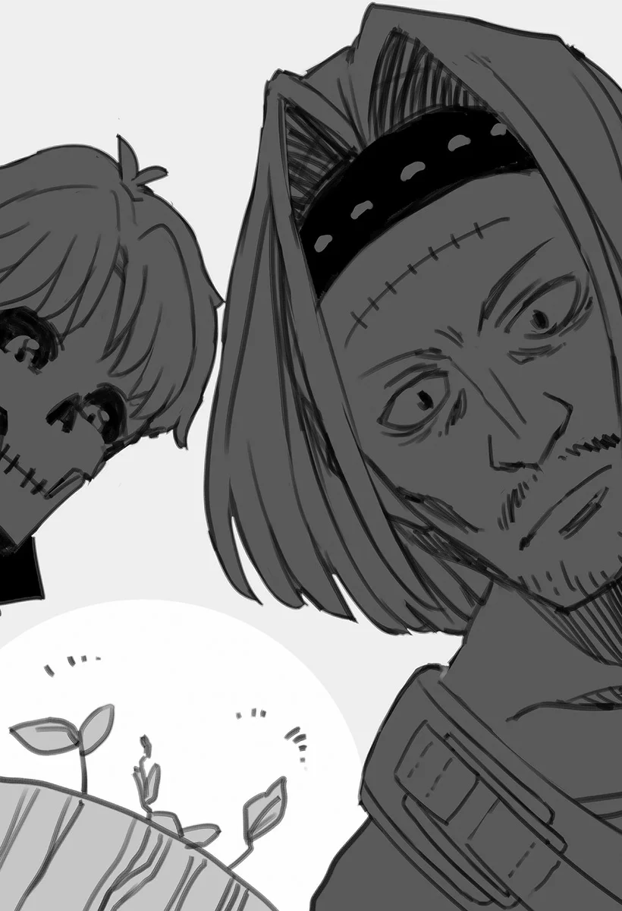

# Chương 43: Tập 2 Chương 3 - Vũ Khí Mới Và Sức Mạnh Mới (1)

"Ồ, đến rồi đấy à? Tôi biết cậu đang tìm gì rồi. Xong xuôi cả rồi đấy." Nét mặt góc cạnh đanh thép của Clope hơi giãn ra khi chào tôi, khóe môi gã khẽ nhếch lên thành một nụ cười mỉm.

Liếc về một góc tiệm, tôi nhìn theo hướng mắt của Clope. Quả nhiên, ánh mắt tôi dừng lại ở một thanh kiếm duy nhất đang tỏa sáng lấp lánh, lưỡi kiếm ánh lên sắc bạc rực rỡ.

Tôi đoán là nó đã thực sự hoàn thành, bởi đây chính là thanh kiếm mà tôi đã nhờ Clope rèn.

"Đó là... kiếm của tôi... ư?"

"Phải." Clope gật đầu đáp. "Ma Lực, Khí Lực, Thần Lực... Nó đã được rèn để có thể chịu tải cả ba. Nguyên liệu tốn kém không ít đâu đấy... nhưng bằng cách này hay cách khác thì bọn tôi cũng xoay xở gom đủ."

"Tôi sẽ gửi thêm... thù lao. Cho các khoản... chi phí phát sinh."

Đã quen biết Clope từ lâu, tôi rất rõ nguyên tắc của gã, nhất là thói quen tự mình gánh chịu mọi chi phí phát sinh nếu trước đó chưa báo giá trước. Chính vì vậy, tôi chủ động đề nghị trả phần sòng phẳng của mình.

Tuy nhiên, Clope chỉ xua tay gạt phắt lời tôi nói, ngẫm nghĩ một thoáng rồi mới đáp lại.

"...Hừm. Cậu lúc nào cũng vậy nhỉ? Được rồi, tôi hiểu rồi." Clope gật đầu, như thể chấp thuận đề nghị của tôi.

"À phải rồi... Làm ra được là một chuyện, nhưng đây là một lưỡi kiếm đặc biệt. Không phải ai cũng dùng được nó đâu, nên tôi muốn cậu thử qua một chút. Nếu có điểm nào chưa vừa ý thì bọn tôi có thể chỉnh sửa lại. Dù sao thì đây cũng là kiếm do chính tay tôi làm ra, và tôi đã dồn hết tâm huyết vào nó... Nhưng một món vũ khí dành cho người sở hữu Tam Chúc Phúc thực sự là một thứ hoàn toàn khác biệt. Chẳng thể biết trước điều gì sẽ xảy ra đâu," Clope nói, mắt nhìn thẳng vào tôi.

Clope nói có lý. Dù những mạo hiểm giả có khả năng sử dụng cả Ma Lực lẫn Khí Lực quả thực có tồn tại, nhưng những người có thể vận dụng cả ba loại năng lực bao gồm cả Thần Lực lại cực kỳ hiếm thấy. Ngay cả việc sử dụng thành thục cả ba loại một cách đồng đều và hữu dụng trong thực chiến cũng gần như là điều chưa từng nghe thấy. Một yêu cầu mang tính chất như thế này sẽ là thách thức đối với bất kỳ thợ rèn nào, kể cả những người tay nghề lão luyện nhất. Việc Clope yêu cầu tôi thử nghiệm vũ khí là hoàn toàn tự nhiên. Sẽ thật đáng ngạc nhiên nếu gã không làm vậy.

Tôi gật đầu ngắn gọn tán thành.

"Tôi cứ... ra thẳng sân sau... của anh nhé?"

Khách hàng ghé tiệm của Clope thường được mời ra đó để thử vũ khí. Đó là một khoảng không gian thoáng đãng, thừa rộng rãi để tôi vung kiếm. Tôi đoán tiếp theo Clope sẽ bảo tôi ra đó.

Clope khịt mũi. "Ồ, hóa ra cậu đã biết tỏng rồi à? Đúng là chỗ đó đấy. Lối này."

Đứng dậy, Clope có vẻ thích thú khi tôi hỏi câu đó. Có lẽ điều này cũng dễ hiểu thôi, xét việc tôi vốn đã biết trước câu trả lời của gã. Tay cầm thanh kiếm, Clope dẫn tôi ra phía sau tiệm, băng qua vài cánh cửa quen thuộc. Đi theo sau gã, quãng đường chẳng hề dài chút nào.

Chẳng mấy chốc, Clope trao thanh kiếm cho tôi, và tôi đón lấy món vũ khí bằng cả hai tay. Cảm giác cầm nắm rất vừa vặn, như thể thanh kiếm có sinh mệnh riêng và đang tự bám chặt vào lòng bàn tay tôi. Sẽ chẳng thể nào tạo ra được một thứ vừa tay đến nhường này nếu Clope không nắm rõ thói quen và sở thích của tôi từ khi còn sống.

Không thể nhầm lẫn vào đâu được: Clope đã chế tác thứ này cho tôi khi biết đích xác tôi là ai.

Có lẽ việc tiến hóa thành Thi Quỷ cũng không hẳn là điều tồi tệ. Suy nghĩ ấy vang vọng trong tâm trí khi tôi siết chặt tay cầm thanh vũ khí.

Đó là một cảm giác khác biệt rõ rệt; không quá khác so với khi tôi còn là một Ngạ Quỷ, nhưng chắc chắn là một bước chuyển biến vượt bậc so với thời tôi vẫn chỉ là một Khô Lâu. Tôi phải cảm ơn lớp da thịt trên bàn tay mình, bởi chúng không còn khô khốc nữa, mà là những lớp đệm thịt khá dày dù trông vẫn chưa có vẻ gì là còn sống.

Dù sao đi nữa, xúc giác và lực cầm nắm đồ vật của tôi đang dần dần trở lại như thời còn sống. Đó quả thực là một dấu hiệu tốt.

"Cậu thấy độ vừa tay thế nào?" Clope hỏi.

"Khá... tốt. Tôi muốn... thử qua một chút. Vung thử... vài nhát."

"Tôi hiểu rồi. Chà, bia mục tiêu nào cũng được nhỉ? Tôi sẽ đẩy một hình nhân gỗ ra đây, đợi tôi một lát."

Một lát sau, Clope quay lại cùng một loại hình nhân gỗ, dựng nó lên ở giữa sân. Có rất nhiều loại bia mục tiêu, thậm chí có cả loại khoác giáp tre. Một hình nhân gỗ trơn không bọc giáp là một lựa chọn cơ bản nhưng mộc mạc. Nếu trên tay tôi là một món vũ khí huyền thoại làm từ Mithril và Orichalcum, có lẽ một thứ gì đó cao cấp hơn mới xứng tầm—chẳng hạn như một hình nhân khoác giáp kim loại kèm phụ kiện. Tuy nhiên, món vũ khí tôi đặt rèn không phải thứ tầm cỡ như vậy, nên tôi cho rằng một hình nhân gỗ là quá ổn rồi.

Dù đây là một đơn đặt hàng đặc biệt, nó vẫn là một món vũ khí thông thường ở hầu hết các khía cạnh khác. Nếu tôi cố chém xuyên kim loại bằng thanh kiếm này quá nhiều lần, chắc chắn tôi sẽ làm mẻ lưỡi của nó. Dẫu vậy, điều đó chưa tính đến chuyện thanh kiếm đặc thù này có thể được phù phép cường hóa bằng Ma Lực hoặc Khí Lực. Khi ấy tôi sẽ chẳng phải bận tâm về việc làm hư hại lưỡi kiếm, dù ngay từ đầu tôi cũng chẳng có ý định làm hỏng nó trên một hình nhân tập luyện.

Thủ thế thanh kiếm, tôi vững vàng bộ pháp, vung vũ khí vài nhát dứt khoát tại chỗ. Tôi phải đảm bảo trọng lượng và trọng tâm của nó được căn chỉnh chuẩn xác—tất nhiên toàn bộ đều là quy trình tiêu chuẩn.

Đây là điều tôi luôn làm sau khi nhận một đơn rèn mới từ Clope.

Không nhận thấy bất kỳ vấn đề nào, tôi bao bọc thanh kiếm trong một luồng khí ma thuật, rồi chém thẳng xuống hình nhân. Đó là một nhát chém nhẹ nhàng, gần như chẳng tốn chút sức lực nào, và kèm theo một tiếng vỡ ngọt lịm vang lên, thanh kiếm cắt ngọt qua thớ gỗ.

Clope chẳng buồn che giấu vẻ ngạc nhiên của mình.

"...Này này này, cái gì thế kia? Cậu tiến bộ vượt bậc rồi đấy nhỉ?"

Hệ quy chiếu để so sánh trong trường hợp này chẳng phải ai khác ngoài chính bản thân tôi, hay ít nhất là khi Rentt Faina vẫn còn hơi thở của người sống. Dù khi còn sống tôi cũng có chút bản lĩnh, nhưng những gì tôi vừa làm được lại vượt xa khả năng lúc đó. Tôi có thể chẻ củi, nhưng tuyệt nhiên chẳng thể nào cắt ngọt được như vậy. Nếu phải miêu tả, nó giống một cú bổ chém thô bạo hơn, tựa như dùng một vật thể kim loại đập mạnh vào hình nhân hơn là dùng kiếm chém ngọt qua nó.

Ngược lại, những mảnh vỡ của hình nhân gỗ lại tự nói lên tất cả. Các bề mặt được cắt qua một cách phẳng phiu ngọt lịm, minh chứng cho chất lượng của món vũ khí, và quan trọng hơn cả là dấu chỉ cho thấy trình độ của người sử dụng.

So với những gì tôi có thể làm được thuở ấy, kỹ năng của tôi đã tăng tiến vượt bậc, đến mức tôi có thể cảm thấy tự hào chính đáng về sự tiến bộ của mình. Chính vào những khoảnh khắc như thế này, tôi mới có thể cảm nhận và thấu hiểu một cách cụ thể bản thân đã đi được bao xa; đó là một thành quả đáng để tự hào.

◆◇◆◇◆

Tất nhiên, đây mới chỉ là bài kiểm tra đầu tiên trong số rất nhiều bài thử; tôi đặt rèn riêng một thanh kiếm có thể sử dụng cả ba năng lực bẩm sinh của mình đâu phải chỉ để làm cảnh. Tôi còn rất nhiều việc phải làm, nên tôi cần phải thử qua từng tổ hợp khả dĩ một.

Clope hiểu ý tôi, nhanh chóng đổi hình nhân vừa ngã xuống lấy một cái mới toanh. Khi gã vừa chuẩn bị xong xuôi, tôi bắt đầu dẫn truyền Ma Lực của mình vào thanh kiếm, bao bọc lưỡi kiếm bằng luồng khí của bản thân.

Hầu hết các mạo hiểm giả tinh thông kiếm đạo đều vận dụng Ma Lực hoặc Khí Lực—đôi khi là cả hai. Có thể nói đó là tiêu chuẩn của giới trong nghề. Tôi thì không đủ khả năng làm những trò quá đỗi phức tạp như thế với ma pháp của mình. Cường hóa các đòn đánh vật lý bằng sức mạnh ma thuật đã là giới hạn năng lực của tôi rồi, và đòn đánh sinh ra từ đó đã thừa sức nặng phục vụ cho các mục đích của tôi.

Hơn thế nữa: Ma Lực, cùng ma pháp được đan dệt từ nó, còn có khả năng duy trì độ sắc bén của lưỡi kiếm, kéo dài tuổi thọ của nó, và quan trọng hơn cả là dễ dàng chém xuyên qua các vật liệu cứng rắn.

Với thêm một nhát chém thử nghiệm nữa của món vũ khí mới, tôi thấy lưỡi kiếm của mình gần như trượt xuyên qua hình nhân trước khi chẻ nó làm đôi, một trải nghiệm êm mượt hơn hẳn so với lần thử đầu tiên. Vô vàn công năng của ma pháp thật đáng sợ. Nhát chém ấy hầu như chẳng cần dùng chút sức nào, nhưng nó vẫn cắt ngọt một cách chuẩn xác. Khi quan sát kỹ hơn, tôi nhận thấy không hề có lấy một mảnh vụn gỗ nào dính lại trên mép lưỡi kiếm. Trên thực tế, nhát vung ấy đã để lại một bề mặt nhẵn bóng đến khó tin trên hai nửa bị tách rời của hình nhân.

Tuyệt vời.

Với thứ này, tôi sẽ có thể nhanh chóng hạ gục lũ quái vật hệ nham thạch ở các tầng sâu hơn của các mê cung. Tôi thấy vô cùng hài lòng với món vũ khí mới của mình.

Tiếp theo là bài kiểm tra về các ứng dụng của Khí Lực. Một lần nữa, Clope lại bắt tay vào việc thay thế hình nhân bia đỡ bằng gỗ.

Bản thân tôi không hề bảo gã làm vậy, đơn giản là Clope tự mình làm công việc lặt vặt đó. Có lẽ điều này cũng dễ hiểu, xét việc chúng tôi đã quen biết nhau suốt một thập kỷ qua.

Thu hồi luồng khí Ma Lực, tôi hít một hơi thật sâu trước khi chuyển sang truyền Khí Lực vào thanh kiếm của mình.

Về mặt lý thuyết, những lợi ích của Khí Lực có phần tương tự như Ma Lực và ma thuật, chẳng hạn như lưỡi kiếm được truyền Khí Lực sẽ giữ được độ sắc bén và bền bỉ ngay cả khi sử dụng trong thời gian dài. Tuy nhiên, người ta có thể quan sát thấy những hiện tượng khác nếu vận dụng Khí Lực theo những cách thức nhất định.

Một lần nữa, tôi nâng kiếm lên, chém thẳng xuống hình nhân. Ngay khi lưỡi kiếm bắt đầu tách rời hình nhân gỗ, tôi liền giải phóng luồng Khí Lực trong vũ khí của mình. Kèm theo một tiếng rít xé toạc chói tai, nó lập tức nổ tung, trút xuống một cơn mưa dăm gỗ khắp sân sau của Clope.

Đây là một trong vô số ứng dụng của Khí Lực: kích nổ mục tiêu có kiểm soát một khi lưỡi kiếm xuyên thấu da thịt nó. Ở vài phương diện, người ta có thể nói rằng Khí Lực mang tính hủy diệt cao hơn so với những ứng dụng phổ biến của Ma Lực.

Hai cách vận dụng này tương phản rõ rệt với nhau; trong khi những người sử dụng ma pháp chuộng dùng các bùa chú cường hóa nguyên tố lên lưỡi kiếm để nhắm vào điểm yếu của quái vật, thì những người dùng Khí Lực lại đơn thuần phá hủy mục tiêu bằng sức mạnh thuần túy. Đây có thể coi là những phương pháp khác nhau để giải quyết một vấn đề, mỗi cách đều có công năng phù hợp riêng.

Cá nhân tôi thích đối phó với kẻ địch thuộc loài Slime bằng Khí Lực hơn, trong khi Goblin, Orc và những kẻ tương tự lại dễ dàng bị hạ gục bằng ma pháp. Sau cùng thì điều đó phụ thuộc vào sở thích của từng người.

Cuối cùng nhưng không kém phần quan trọng là việc vận dụng Thần Lực. Đó là một năng lực mang lại những hiệu ứng khác biệt rõ rệt so với hai loại trước, vậy mà tôi lại thấy bản thân không thể miêu tả chính xác nó đã làm được những gì. Ngay cả phần lớn những cá nhân có thể dẫn truyền Thần Lực, thường là các tư tế và những người tương tự, cũng rất khó lòng giải thích phương thức vận hành Thần Lực của chính họ.

Hơn nữa, những kiếm sĩ có khả năng truyền Thần Lực vào vũ khí lại vô cùng hiếm hoi. Thường được biết đến với tên gọi Thánh Kỵ Sĩ, họ thường được giao trọng trách làm gương mặt đại diện trước công chúng của Giáo Hội hoặc các tổ chức tôn giáo khác, và không mấy khi tiếp xúc với thường dân. Lẽ đương nhiên là những chi tiết cụ thể về việc dẫn truyền Thần Lực qua một thanh kiếm vẫn còn phần nào chưa được biết tới, hoặc nói đúng hơn là vô cùng bí ẩn.

Dù vậy, tôi cho rằng phương thức truyền thống đã được thời gian kiểm chứng là cứ đơn thuần truyền Thần Lực vào lưỡi kiếm vẫn có tác dụng—và chừng đó thì tôi làm được.

Thần Lực được cho là một loại sức mạnh phi phàm bắt nguồn từ các vị thần hoặc các tinh linh thứ cấp khác. Do đó, những người sử dụng thường biết cách dùng năng lực theo bản năng, ngay cả khi không có các lý thuyết hay phương pháp luận bài bản. Vẫn có những viện nghiên cứu cổ xưa chuyên tâm tìm hiểu về những kỹ thuật và kỹ năng như vậy, nhưng đó là tri thức mà tôi không sở hữu, cũng chẳng có cách nào tiếp cận được.

Dù sao đi nữa, điều này khiến cho việc kiểm tra trở nên đơn giản. Không chần chừ thêm, tôi dẫn truyền Thần Lực vào thanh vũ khí. Điều đầu tiên cần cân nhắc khi dẫn truyền Thần Lực là liệu món vũ khí có thể chịu nổi áp lực từ kỳ tích ấy hay không, bởi Thần Lực có sức mạnh thanh tẩy và đưa một vật thể trở về hình dạng ban đầu của nó.

Tuy nhiên, điều này đồng nghĩa với việc vũ khí được rèn bằng thuật giả kim và các biện pháp ma pháp khác sẽ lập tức bị bản chất của Thần Lực vô hiệu hóa, bị cưỡng ép quay về các vật liệu cơ bản để rồi cuối cùng biến thành vài cục quặng. Để ngăn chuyện đó xảy ra, cần phải có bàn tay của một thợ rèn lành nghề. Mặc dù vậy, hầu hết các thợ rèn đều không đủ khả năng rèn ra những món vũ khí có thể chịu đựng được việc dẫn truyền và sử dụng Thần Lực.

Trái lại, Clope là một thợ rèn hạng nhất. Thanh vũ khí của tôi không hề biểu lộ bất kỳ sự bất thường nào khi Thần Lực cuộn trào qua nó, lưỡi kiếm được bao bọc trong một vầng sáng dịu nhẹ, lung linh.

Xoay người về phía hình nhân thêm một lần nữa, tôi nâng kiếm lên, tiến hành thêm một bài thử nghiệm năng lực của nó. Lực cản ít ỏi đến đáng kinh ngạc. Hầu như chẳng có chút ma sát nào khi lưỡi kiếm trượt xuyên qua, kể cả khi so sánh với lúc tôi dùng ma pháp. Tôi đoán chừng đó là điều có thể mong đợi từ các vị thần và tinh linh; công năng của nó quả thực vô cùng độc đáo.

Thế nhưng những hiệu ứng khác của Thần Lực lại biến nó thành một năng lực đầy thử thách khi đưa vào thực chiến.

"...Này. Có thứ gì đó đang mọc ra từ cái hình nhân kia kìa..." Clope nói, nhìn xuống hai nửa đã ngã rạp của bia mục tiêu bằng gỗ.

Tò mò, tôi bước lại gần những mảnh vỡ, để rồi nhìn thấy hết mầm non này đến mầm non khác đang đâm chồi nảy lộc từ những mảnh vụn của hình nhân đã ngã gục.

Liệu đây có phải là một ví dụ nữa về khả năng phục hồi của Thần Lực mang lại những hệ quả ngoài ý muốn hay không? Tôi cũng hoang mang chẳng kém gì Clope.

"...Trước đây anh... đã từng thấy cảnh này... từ những nhát chém... của người dùng khác chưa?"

"Chưa, chưa từng thấy thứ gì tương tự cả. Người ta bảo năng lực của mỗi người sử dụng sẽ khác nhau tùy thuộc vào nguồn cội đã ban cho họ sức mạnh đó ngay từ đầu... Thế rốt cuộc cậu lấy Thần Lực từ đâu ra vậy?"

"Tôi từng sửa chữa... một ngôi miếu cũ. Gần nơi tôi từng sống... trước đây."

"Hử. Một hành động sùng đạo ra phết nhỉ?"

"Cũng chẳng có... ý nghĩa gì to tát... sau việc tôi làm đâu. Chỉ là tôi thấy... thích làm thôi."

Trên thực tế, tôi sửa chữa ngôi miếu vào thời gian rảnh rỗi vì không nỡ nhìn nó trơ trọi trong tình trạng hoang tàn đổ nát. Tôi đồ rằng một người qua đường bình thường sẽ chẳng dừng chân rồi nghĩ đến chuyện thử ra tay sửa một ngôi miếu hoang, và đó là lý do vì sao ban đầu nó lại rơi vào cảnh điêu tàn như thế. Ngôi miếu đáng tiếc đã bị lãng quên coi như chuyện đương nhiên... ít nhất là cho tới khi tôi tu sửa lại nó.

"Bất kể lý do là gì," Clope tiếp tục, "tôi đồ rằng đó là nơi cậu có được số Thần Lực của mình nhỉ? Từ ngôi miếu cũ đó."

"...Phải."

"Thế thì chúng ta có thể phỏng đoán rằng có một loài tinh linh thực vật nào đó từng ngụ trong ngôi miếu ấy... hoặc đại loại vậy. Đó hẳn là lý do Thần Lực cùng luồng khí của cậu lại mang lại hiệu ứng như thế này. Còn nhớ vị Thánh Nữ từng đến Maalt thuở xưa không? Người ta đồn cô ấy được một vị thần trị liệu ban phước, chữa lành bệnh nhẹ cho người ta chỉ bằng một cái chạm tay. Của cậu... nếu tôi phải nói thì chắc là phiên bản thực vật đấy."

Lời giải thích của Clope nghe khá có lý. Dù tôi quả thực nhớ mang máng từng nhìn thấy bóng dáng vị Thánh Nữ từ đằng xa vào một thời gian dài trước đây, nhưng hôm đó người tôi không được khỏe cho lắm, nên cũng chẳng nhớ rõ sự việc lúc ấy.

Nếu phải diễn đạt thành lời, thì độ mạnh yếu trong Thần Lực của một người tỷ lệ thuận trực tiếp với sức mạnh của hữu thể đã ban tặng nó. Tôi nhớ mình từng đọc một đoạn như vậy trong một cuốn sách của Lorraine.

Ai mà ngờ trong muôn vàn thứ, tôi lại có thiên phú chữa lành cho giới thực vật cơ chứ... Nghe chừng chẳng phải một năng lực hữu dụng cho lắm.

Clope, như thể đọc được suy nghĩ của tôi, lại kéo sự chú ý của tôi về phía những mầm non một lần nữa.

"Những mầm cây này được ban phước đấy, cậu biết không. Nếu lớn lên, chúng sẽ cho ra loại gỗ mang đặc tính thần thánh. Cậu cho tôi chúng được chứ?"

"Tôi không... phiền đâu. Biết đâu chúng chỉ... trở thành những cái cây... bình thường thôi đấy."

"Thế với tôi cũng quá tốt rồi. Sở thích của tôi ấy mà, cậu thấy đấy. Biết đâu chúng sẽ lớn thành những thân cây vững chãi mang cành nhánh thần thánh... hoặc không. Dù sao thì cũng là hàng hiếm. Tôi chẳng biết cậu ra sao, chứ gần đây tôi chưa từng nghe thấy chỗ nào bán cây giống được tinh linh thực vật ban phước cả."

Lời của Clope mang phần nào sự thật lịch sử, bởi người ta nói rằng nhân loại thời nay không còn nhận được nhiều ân phước từ các vị thần và tinh linh rừng rậm nữa. Trên hết, mối quan hệ giữa con người và elf dạo gần đây ngày càng xấu đi, trong khi nếu trí nhớ của tôi không nhầm, hai chủng tộc từng qua lại với nhau trên mối bang giao tương đối hòa hảo.

—Chuyện đó để khi khác hẵng nghĩ vậy.

Tôi thấy bản thân có phần bất ngờ trước sở thích làm vườn của Clope. Có lẽ đây chỉ là chuyện mà trước giờ chúng tôi chưa từng nói tới. Trong lúc tôi đứng đó, Clope lại bắt tay vào việc thay thế hình nhân bia đỡ thêm lần nữa, lần này với một nụ cười mỉm nhỏ trên môi. Dù tôi vốn quen thuộc với vài sở thích của Clope, nhưng tôi đồ rằng gã thực sự có niềm yêu thích đặc biệt đối với việc làm vườn ẩn sâu bên trong đôi bàn tay tôi luyện qua lửa đỏ ấy.

Thật không ngờ một người với khuôn mặt như gã lại có một sở thích nâng niu vun trồng đến vậy. Đúng là tôi không nên nói ra điều đó, nhưng tâm trạng phấn chấn thấy rõ của Clope là điều không thể phủ nhận.

Chuẩn bị xong xuôi hình nhân, Clope tiến lại gần tôi, đưa một bàn tay rảnh rỗi ra hiệu về phía nó.

"Chà, thế này là đủ rồi chứ nhỉ? Dọn dẹp được rồi chứ nhỉ?"

Tôi đứng lặng một thoáng, suy ngẫm về câu hỏi của Clope. Vẫn còn một điều cuối cùng mà tôi chưa thử nghiệm.

"...Ma Lực. Khí Lực... Thần Lực. Chuyện gì... sẽ xảy ra... nếu tôi truyền tất cả vào... thanh kiếm này?"

"Này nghe đây nhé..." Nụ cười mãn nguyện trước đó của Clope biến thành một cái nhăn mặt khi gã đưa tay lên cằm, nhắm mắt lại suy nghĩ lung lắm. "Cậu đã từng nghe ai làm chuyện như thế chưa? Chứ tôi thì chưa nghe bao giờ đấy. Có thể ở đâu đó có người làm được. Nhưng nghe này... chúng ta chẳng thể biết chuyện gì sẽ xảy ra nếu cậu cứ thế đâm đầu vào thử đâu."

"...Tốt nhất là... tôi không nên thử... sao?"

Đúng như lời Clope nói, những người nắm giữ cả ba nguồn năng lượng vốn dĩ đã hiếm hoi, chưa nói đến một cá nhân có thể vận dụng an toàn từng loại trong chiến đấu. Chúng ta có thể thu hẹp phạm vi hơn nữa nếu nghĩ đến con số giả định về những người có thể dẫn truyền an toàn cả ba yếu tố vào cùng một món vũ khí cùng lúc. Người ta đòi hỏi một sự tập trung tột độ chỉ để dẫn truyền một nguồn năng lượng duy nhất vào vũ khí. Dẫn truyền cả ba loại cùng một lúc quả thực có thể là quá sức đối với ngay cả một mạo hiểm giả lão luyện.

Dù vậy...

"Chẳng phải từng có vài... Khí Thuật... liên quan đến cả... ma pháp và Khí Lực sao?"

"Thứ đó à. Người ta gọi nó là gì nhỉ... Ma Khí Dung Hợp Thuật? Cậu phải khổ luyện một thời gian dài mới làm được trò đó đấy. Ngay cả cậu cũng biết chỉ một số ít người làm được thôi mà. Nhưng mà, chà... Thanh kiếm này có lẽ chịu được hai loại cùng lúc mà không có vấn đề gì đâu. Song nếu cậu ném thêm Thần Lực vào mớ hỗn độn đó... thì ngay cả tôi cũng chịu chết. Nếu cậu thực sự muốn thử, thì ít nhất hãy bắt đầu với một Dung Hợp Thuật hai nguồn năng lượng trước đã. Và dùng thanh này này, chứ đừng dùng thanh kiếm mới của cậu."

Ma Khí Dung Hợp Thuật là một chuyện vô cùng phức tạp, bởi nó đòi hỏi việc dẫn truyền đồng thời cả nguồn dự trữ Ma Lực và Khí Lực của một người, cường hóa cho cả thanh kiếm lẫn người sử dụng. Điều này mang lại cho người thi triển năng lực hủy diệt to lớn và thể lực dồi dào. Rất ít cá nhân có thể vận dụng nó theo cách thực chiến, và tính chất tiêu hao ghê gớm của ứng dụng này khiến nó rất khó kiểm soát. Một vụ nổ hoàn toàn có thể xảy ra nếu phạm phải bất kỳ sai sót nào, do đó ngay cả việc thử tập luyện để dùng kỹ thuật này cũng là một canh bạc mạo hiểm. Chẳng khó để hiểu tại sao những cá nhân có khả năng sử dụng kỹ thuật này lại hiếm hoi như lá mùa thu.

...Thế nhưng cấu tạo thể chất của tôi lại khác biệt. Tôi có lẽ sẽ không chết ngay cả khi đầu mình bị đánh bay đi đâu đó. Tương tự như vậy, những thương tích trên cơ thể cũng có thể bỏ qua một cách nhẹ nhàng. Dù tôi không dám khẳng định việc mình luyện tập thứ như thế là an toàn, nhưng nó chẳng hề mạo hiểm như đối với một người bình thường.