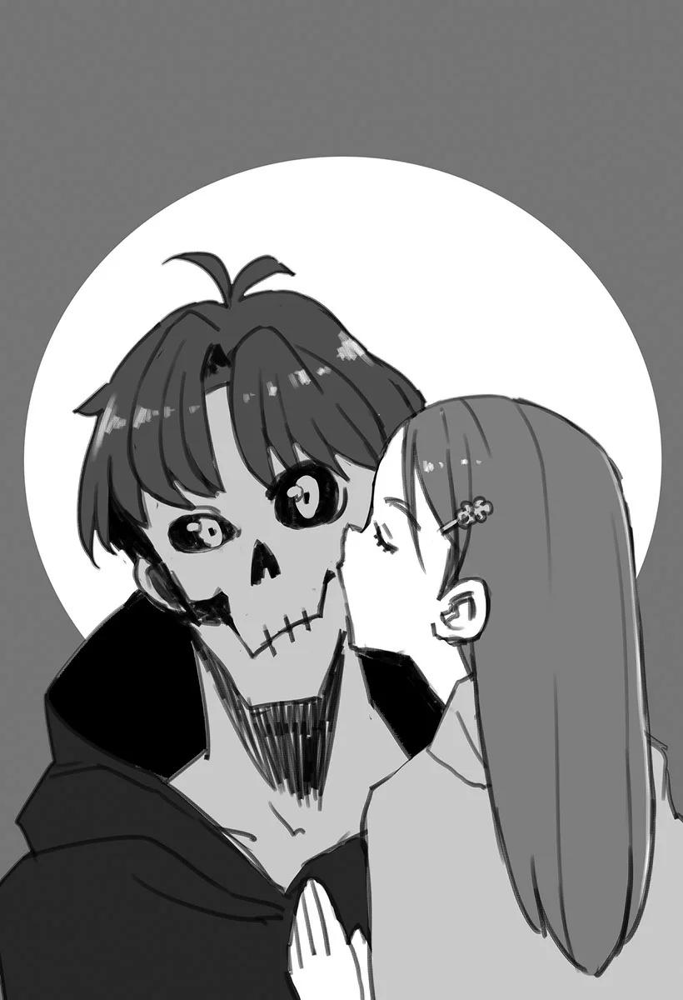

# Chương 47: Tập 2 Chương 3 - Vũ Khí Mới Và Sức Mạnh Mới (5)

Lễ hội đang bắt đầu. Đám đông tụ tập bên bờ hồ, nhiều người trong số họ cầm trên tay những ngọn nến. Mọi người đều hướng ánh mắt về phía vài chiếc thuyền được trang hoàng kỳ lạ, điểm xuyết bằng vô số món đồ trang trí lấp lánh.

Vào ngày này, một thiếu nữ trẻ tuổi sẽ ngồi trên một trong những chiếc thuyền ấy chèo ra giữa hồ, trở thành vật hiến tế dâng lên Chúa Tể Hồ. Lẽ tự nhiên, dân làng đều cảm thấy cắn rứt lương tâm và đầy tội lỗi.

Thế nhưng, hiện thực lại vô cùng nghiệt ngã: nếu không dâng tế vật, ngôi làng sẽ phải hứng chịu sự tấn công, hoặc từ chính Chúa Tể Hồ, hoặc từ lũ Kelpie dưới quyền chỉ huy của nó. Tất cả những gì dân làng có thể làm là nhắm mắt lại và nói lời xin lỗi. Đó có lẽ là phương án duy nhất của họ. Rốt cuộc thì một nhóm cư dân nơi ngôi làng hẻo lánh này còn có thể làm gì khác được nữa đây?

Amiris, người sẽ phải bước lên một trong những con thuyền ngay trong đêm nay, đứng cách những chiếc thuyền trang trí bên bờ hồ một đoạn ngắn. Khoác trên mình bộ lễ phục dệt từ thứ vải lấp lánh, màu sắc rực rỡ của nó tạo nên sự tương phản sắc nét với lớp trang điểm nghi lễ trên khuôn mặt cô. Cô bé không thể phủ nhận là rất xinh đẹp.

Cô sẽ lên thuyền cùng những người áp giải của mình, trước khi khởi hành hướng về đích đến cuối cùng.

Đứng quanh cô là hai bóng người đang dõi theo che chở. Ban đầu, lẽ ra phải có ba người—ít nhất thì đó là những gì mà những ai quen thuộc với lễ hội này sẽ nghĩ. Thế nhưng, vai trò của một người áp giải tế vật thực chất chỉ mang tính phụ trợ. Vốn dĩ thì có bao nhiêu người áp giải cũng được chấp nhận. Phần lớn dân làng thường chỉ bị chọn vào vai trò này ngoài ý muốn.

"Chuyện này xem chừng vẫn hơi mạo hiểm... Liệu chúng ta có bị phát hiện không anh?" Ryuntus, một trong những người áp giải, lên tiếng.

"Chẳng ai dám chắc đâu anh trai... Dù sao thì trong lễ hội người ta cũng chỉ dồn mắt vào trinh nữ hiến tế thôi... Chắc là ổn cả thôi mà," Amiris, nhân vật chính của lễ hiến tế, nói.

"...Hai người... thoải mái hơn. Tôi tưởng... đấy," tôi nói với hai anh em họ.

"Chỉ vì có anh ở đây thôi, anh Rentt! Tôi trông cậy cả vào anh đấy!"

"Đúng thế đấy ạ. Dù vậy... em có lẽ cũng chẳng kỳ vọng nhiều vào anh đâu."

Ở một vài phương diện thì rất giống nhau, nhưng ở những phương diện khác lại hoàn toàn trái ngược. Đúng là một cặp anh em kỳ lạ.

May mắn thay, các nghi thức của lễ hội diễn ra mà không gặp phải vấn đề gì lớn, bản thân Amiris bước về phía những con thuyền khi trưởng làng ban phước lành cho cô bằng các nghi lễ phù hợp.

"Chúng ta đi thôi, anh Rentt..."

Tôi theo sát ngay sau Ryuntus. Mặc dù cậu đã giải thích chi tiết về buổi lễ, tôi vẫn để mặc hầu hết các bước phức tạp cho cậu lo liệu, chỉ bắt chước hành động của cậu ở những chỗ có thể. May mắn thay, nhóm chúng tôi dường như đã thoát khỏi sự soi mói kỹ càng của mọi người, khi Ryuntus, bản thân tôi và Amiris thuận lợi lên thuyền và chèo ra phía giữa hồ.

Dù vài người dân làng nhìn số lượng người áp giải ít hơn thường lệ của chúng tôi bằng ánh mắt kỳ lạ, nhưng chẳng có ai lên tiếng phàn nàn điều gì. Tôi cho rằng bản thân họ cũng đã kiệt quệ tinh thần vì việc định kỳ phải đem chính đồng bào của mình đi hiến tế, nên chẳng còn hơi sức đâu mà phản đối thêm nữa.

Sau một hồi, đoàn thuyền nhỏ của chúng tôi đã đến đích. Chúng tôi đã hoàn toàn khuất khỏi tầm mắt của dân làng sau khi chèo một quãng đường dài rời xa bờ.

"Chỗ này... ổn rồi chứ?"

"Vâng, em nghĩ vậy." Amiris nhanh chóng đáp lời. "Dù sao thì đây cũng là giữa hồ rồi... Và Quả Cầu đang phát sáng. Chắc chắn là nơi này rồi."

Amiris xòe lòng bàn tay ra; trong đó là một khối cầu bằng pha lê, dường như là một món ma cụ thần bí được lưu truyền qua nhiều đời của ngôi làng. Nó có khả năng phát sáng khi được mang ra giữa hồ.

Nó hoàn toàn chẳng phải một vật phẩm phức tạp gì. Ngay cả Lorraine rất có thể cũng sẽ xem nó như một món đồ chơi lặt vặt ngớ ngẩn. Tuy nhiên, đối với dân làng, nó dường như là một báu vật quý giá, thứ không thể thiếu cho lễ hội.

"Ban đầu, những người áp giải vốn chẳng có nhiệm vụ bảo vệ vật tế gì cả... Vai trò của họ chỉ là lấy lại Quả Cầu này, rồi bỏ lại vật tế ở phía sau..."

Lời giải thích của Ryuntus nghe có phần hợp lý. Nếu phải suy đoán, điều kiện ban đầu là cần ba người áp giải trong đoàn thuyền chính là để đảm bảo không một ai có thể tự ý cuỗm báu vật bỏ trốn.

Dù sao đi nữa, chúng tôi cũng đã đến nơi.

"...Vậy thì. Chúa Tể Hồ... sẽ xuất hiện ở đây sao?"

"Theo như truyền thuyết thì nó—"

Ngay khi Ryuntus định trả lời câu hỏi của tôi, mặt hồ phẳng lặng khi nãy đột nhiên bị xáo động bởi hàng loạt đợt sóng dữ dội bất thường.

"Có thứ gì đó đang tới...!"

Hốt hoảng, Ryuntus ngồi thụp xuống lòng thuyền. "...Khoan đã... Đùa... đùa nhau đấy à...?" cậu thì thào trong hơi thở, trừng mắt nhìn con quái vật sừng sững trước mặt.

Nhưng tôi hiểu tại sao cậu lại thốt ra lời ấy. Chúa Tể Hồ xuất hiện trước mắt chúng tôi không phải thứ gì khác ngoài một con Kraken—chính là loài Kraken mà trong điều kiện bình thường chỉ có thể sinh sống ở những vùng biển khơi rộng lớn.

◆◇◆◇◆

"Hự...! C-Cái gì thế này?! Làm sao chúng ta đánh bại được nó chứ? Sao nó lại có thể xuất hiện ở hồ nước ngọt này được cơ chứ...?!" Amiris hét lên, thuyền của cô chao đảo dữ dội giữa những con sóng.

Dù bản thân cũng cảm thấy tương tự, tôi không thể nao núng. Mạo hiểm giả không bao giờ bỏ cuộc.

Quay sang Amiris, tôi cất lời ra lệnh: "Amiris... Cô đổi. Sang thuyền của Ryuntus đi."

"Anh... anh nghiêm túc đấy à?! Anh định chiến đấu... với thứ đó sao?!"

Một vẻ mặt hoài nghi khó tin; tôi cũng không trông đợi gì khác. Bất kỳ người bình thường nào cũng sẽ nghi ngờ sự tỉnh táo của tôi. Thế nhưng tôi từng đối mặt trực diện với một con Rồng trong quá khứ. Liệu còn có thứ gì đáng sợ hơn thế nữa sao?

Hồi ấy, tất cả những gì tôi nghĩ đến chỉ là bỏ chạy. Thế nhưng giờ đây...

"Nhanh lên nào. Amiris. Đổi... thuyền đi."

Tôi nhảy ra khỏi thuyền của mình, chạy dọc trên mặt nước. Nắm lấy Amiris nhấc khỏi con thuyền hiến tế của cô, tôi ném cô sang thuyền của Ryuntus, rồi sẵn sàng nghênh chiến trận đấu sắp tới.

"Hểểể?!" Tiếng thốt lên đồng thanh từ cô em gái vừa bị ném sang và người anh trai vừa đỡ lấy cô.

Tuy nhiên, tôi chẳng buồn quay đầu lại. Thay vào đó, tôi rút kiếm ra, hướng thẳng về phía con Kraken. Tôi thủ thế vững vàng, vào tư thế chiến đấu trong lúc giơ cao lưỡi kiếm.

Người ta có thể thắc mắc tại sao tôi lại đứng được trên mặt nước. Xem nào, tôi từng nhờ Lorraine chế tạo một món ma cụ như vậy trước khi lên đường tới đây. Thế nhưng hóa ra cô ấy vốn đã có sẵn một món đồ phù hợp cho mục đích này từ lâu rồi.

Lorraine, người vốn có hứng thú với lễ hội, từng muốn đi cùng tôi, nhưng cô không thể đi được vì phải tổng hợp một số tài liệu cho khách hàng. Tuy nhiên, khi nghe nói điểm đến lần này của tôi là một vùng hồ nước, Lorraine chỉ đơn thuần đưa món ma cụ tương ứng cho tôi, thế là xong. Quả không hổ danh là Lorraine—có bạn bè là nhà giả kim quả thực vô cùng tuyệt vời.

"Anh Rentt! Đừng làm điều gì điên rồ! Nếu... nếu không thể thì em sẽ bỏ cuộc và chấp nhận làm vật hiến tế, nên là...!"

Tôi biết ơn sự lo lắng của Amiris, nhưng tôi không thể khuất phục trước những tiếng khóc than sầu thảm của cô bé, nhất là sau khi đã cất công đến tận nơi này.

Siết chặt tay cầm, tôi dậm mạnh chân lên mặt nước, lao cả người lẫn kiếm thẳng vào tầm khống chế của con Kraken.

◆◇◆◇◆

Nó... to lớn thật. Một sự thật mà tôi buộc phải thấu hiểu khi áp sát con Kraken. Thân mình và những xúc tu của nó phủ đầy chất nhầy, và nếu phải đoán, nó dài ít nhất cũng phải mười mét.

Tuy nhiên, so với các cá thể sinh sống ngoài biển khơi, con này vẫn thuộc dạng nhỏ bé. Dựa theo những gì tôi học được từ một vài cuốn sách, loài Kraken ngoài đại dương có khả năng bẻ gãy đôi những con tàu và thuyền khổng lồ chỉ bằng một đòn duy nhất, và chiều dài thường dao động từ ba mươi đến năm mươi mét. Đó mới là kích thước bình thường của chúng.

Con này nhỏ hơn—nhỏ hơn rất nhiều.

Hàng loạt xúc tu ập tới kéo tôi ra khỏi dòng suy nghĩ. Con Kraken đã nhìn thấy và giờ đang tìm cách nghiền nát tôi.

Với số lượng xúc tu nhiều như vậy, việc né tránh từng cái một quả thực là một kỳ công. Thế nhưng, chúng không phải là không thể né được. Nhờ đôi ủng bước trên nước do Lorraine chế tạo đặc biệt, tôi thấy mình có thể di chuyển dễ dàng, bước đi trên mặt hồ như thể đang bước trên đất bằng.

Không một lời cảnh báo, con Kraken há to miệng, dường như có ý định bắn thứ gì đó về phía tôi. Nhanh chóng đạp mạnh lên mặt hồ, tôi lách người sang một bên, để rồi nhận ra mình vừa suýt soát né được một quả cầu lửa lớn, phát bắn khiến hơi nước bốc lên nghi ngút ngay tại nơi tôi vừa đứng.

"Một con Kraken... lại phun lửa sao?"

Một sự kết hợp kỳ quặc.

Cười thầm trước sự phi lý của tình huống này, tôi lại một lần nữa lao mình về phía trước, cuối cùng cũng tiếp cận được mục tiêu. Bằng một cú bật nhảy dũng mãnh, tôi vung thanh kiếm qua đầu, chém xuống một chiếc xúc tu bằng một đường chém ngang tàn khốc.

Ngay khi tôi làm vậy—

Toạccc!!!

Đây hoàn toàn chẳng phải âm thanh mà một loài động vật không xương sống phát ra khi bị chém đứt.

"C-Cái gì cơ?! Chuyện gì thế này? Con Kraken...!"

Tôi có thể nghe thấy tiếng nói của Amiris vẳng qua những con sóng; cô bé có vẻ vô cùng kinh ngạc.

"Tại sao lại...?" Ngay cả Ryuntus cũng phải thốt lên.

Tôi cho rằng họ cảm thấy như vậy cũng phải thôi. Con Kraken mà tôi vừa vung kiếm chém qua lập tức biến mất tăm. Thay vào đó là một tấm vải lớn, cùng một con thuyền gỗ to gấp nhiều lần những chiếc thuyền hiến tế mà chúng tôi đã đi. Trên con thuyền này có vài người đàn ông đang điều khiển.

Đây chẳng phải Kraken gì cả.

"Thằng khốn kiếp! Đừng có coi thường bọn tao! Giết nó đi! GIẾT NÓ MAU!!!"

Chỉ tay vào tôi, đám đàn ông hò hét ầm ĩ trước khi phóng ra hàng loạt mũi tên cùng những đòn tấn công ma pháp về hướng tôi.

Kỹ năng của chúng còn kém xa lắm. Dễ dàng né tránh những đòn tấn công đang bay tới, tôi lại một lần nữa phóng mình lên không trung, đáp xuống thuyền của chúng chỉ bằng một cú nhảy. Bằng một loạt động tác thuần thục quen thuộc, tôi đánh ngất từng tên một, rồi cuối cùng tra kiếm vào bao.

◆◇◆◇◆

"Vậy... chuyện gì...? Chuyện này... rốt cuộc là sao ạ?" Amiris hỏi, vẻ mặt vẫn còn lộ rõ sự hoang mang.

"Đây chính là... những kẻ. Đã liên tục... đưa ra những yêu cầu vô lý. Với ngôi làng. Ngoài ra, Amiris... người đàn ông này trông có quen... với cô không?" tôi hỏi, chỉ tay về phía một trong những kẻ vừa bị khuất phục.

Cuối cùng cũng nhận ra, Amiris thảng thốt kêu lên. "G-Gã thương nhân lữ hành!"

"Đúng là như vậy."

"Nhưng... tại sao lại thế?"

Ryuntus và Amiris đứng trừng mắt nhìn tôi, không thể tin nổi vào mắt mình. Đáp lại, tôi bồi thêm một cú đá thích đáng vào mạn sườn gã thương nhân đang bị trói bằng đôi ủng bước trên nước do Lorraine chế tạo đặc biệt.

"Trả lời... cô ấy đi."

Chậm rãi, và có phần miễn cưỡng, gã thương nhân lữ hành bắt đầu mở miệng khai.

Theo lời gã, đám thương nhân này đã đánh hơi được tin tức về lễ hội, và chẳng mấy chốc quyết định kiếm chác từ nó. Phương thức của chúng rất đơn giản: chúng sẽ giả dạng làm Chúa Tể Hồ và bắt cóc bất kỳ vật tế nào được dâng lên, trước khi đem bán cô gái làm nô lệ hoặc hàng hóa. Để phục vụ mục đích này, bọn chúng có một ma pháp sư hợp tác cùng, cũng như một thương nhân quen thuộc với các tuyến đường buôn bán nô lệ ngầm. Dù ban đầu bọn họ chỉ là một thương nhân lữ hành cùng lính hộ tống, nhưng họ đã bị lòng tham làm mờ mắt, và quyết định bóc lột người dân ngôi làng này.

Bản thân con thuyền chỉ là một chiếc thuyền đánh cá đơn giản mượn từ một ngôi làng khác bên hồ.

Những dấu vết trên các cánh cửa cũng là do chính đám người này để lại, chứ chẳng phải Kelpie nào cả. Vì nỗi sợ hãi bao trùm lên toàn bộ dân làng, không một ai nhận ra sự thật ấy.

Quả là một mưu đồ tinh vi...

Ảo ảnh con Kraken chỉ là một hình ảnh được ma pháp sư chiếu lên tấm vải. Những chiếc xúc tu cũng chẳng qua là những sợi dây thừng được ma thuật điều khiển và cử động. Khỏi phải nói, quả cầu lửa bắn ra từ mỏ của con Kraken cũng chỉ là một quả cầu lửa thông thường, một biện pháp được dùng để xử lý những người áp giải đi theo các vật tế xấu số. Đây dường như là lần đầu tiên quả cầu lửa không phát huy tác dụng. Dĩ nhiên, toàn bộ hình ảnh một con Kraken phun ra lửa xem ra cũng chỉ buồn cười là cùng.

Mặc dù đám người này đã lên kế hoạch cho những việc làm ác độc của chúng với không ít tâm tư, chúng rõ ràng không đủ mạnh để chống lại bất kỳ ai có sức mạnh lớn hơn một người dân làng đang sợ hãi.

"Vậy... còn những cô gái bị 'ăn thịt' từ trước đến nay thì sao...?"

Gã thương nhân thành thật trả lời câu hỏi của Ryuntus: có vẻ như tất cả họ đều đang ở trong khoang thuyền. Dù bọn chúng đã bắt cóc các cô gái suốt khoảng hai tháng qua, nhưng chúng chỉ định đem bán một khi đã gom đủ số lượng nhất định, thật là may mắn cho các cô gái vừa được giải cứu.

"Anh Rentt... Anh đã biết chuyện này... ngay từ đầu rồi sao?" Amiris hỏi.

"À thì... Chuyện này đáng ngờ... ở một chừng mực nào đó. Theo kinh nghiệm... của bản thân tôi. Chúa Tể thực sự của một vùng... chẳng bao giờ lại đột nhiên... trở nên ngỗ ngược hay... vô lý như thế cả. Hơn nữa... khi chúng ta đi ngang qua... gã thương nhân lữ hành này... ở trong làng. Tôi đã ngửi thấy... mùi. Của máu."

Điều này hoàn toàn phù hợp với sự thật rằng tôi là một Undead sống dựa vào máu—dù tôi chẳng thể nào giải thích điều đó cho Ryuntus và Amiris nghe được.

Dù sao đi nữa...

"Với chuyện này... bí ẩn. Đã được sáng tỏ... Tôi cho là ủy thác... đã được hoàn thành. Thỏa đáng rồi chứ?"

"Tất nhiên rồi ạ!" "Vâng ạ!!"

Câu trả lời của hai anh em gần như đồng thanh.

◆◇◆◇◆

Cảm thấy lời giải thích của gã thương nhân đã thỏa đáng, chúng tôi dong buồm trở về Làng Todds, để rồi được chào đón bằng một sự náo động lớn đúng như dự đoán. Amiris, người ngỡ như đã bị đem đi hiến tế, vẫn còn sống sót. Cùng với cô là những thiếu nữ bị bắt cóc, và đám thương nhân lữ hành bị trói chặt từ đầu đến chân.

Sau khi giải thích rằng chúng tôi đã vạch trần chân tướng đằng sau những vụ việc gần đây, dân làng hết lời cảm ơn tôi, và thậm chí còn đề nghị báo cáo vụ việc lên hội để những nỗ lực của tôi được ghi nhận.

Tôi lịch sự từ chối.

Bề ngoài, tôi tuyên bố điều này là do tính chất của ủy thác, rằng nó không được tiếp nhận qua các kênh chính thức của hội và do đó, không phải là thứ tôi có thể nhận công lao. Trên thực tế, tôi chỉ không muốn bị dính líu đến vụ bắt cóc này. Nếu tin tức lan truyền rằng tôi đã triệt phá một đường dây buôn bán bắt cóc nô lệ, điều đó sẽ chỉ càng khiến người ta nghi ngờ tôi nhiều hơn. Ngay cả khi tôi đã giải quyết ổn thỏa vụ việc, tôi cũng rất dễ bị nghi ngờ là "tự giải quyết" một vấn đề mà ban đầu chính mình "chịu trách nhiệm gây ra".

Trông tôi vốn đã rất đáng ngờ, dù tôi chẳng thể làm gì nhiều để thay đổi điều đó. Dù sao thì, tôi quyết định không làm bất cứ điều gì thừa thãi. Dân làng, tin chắc rằng tôi chỉ đang khiêm tốn, ban đầu khá phản đối chuyện này, nhưng tôi phải cảm ơn Ryuntus và Amiris vì đã thuyết phục họ nghĩ khác đi. Hai anh em hết lời cảm ơn tôi, nhưng có lẽ tôi mới là người nên cảm ơn họ mới phải.

Dân làng đề nghị tổ chức lại lễ hội, nếu chỉ là để bày tỏ lòng biết ơn thỏa đáng tới Chúa Tể Hồ. Đó sẽ là một sự kiện đơn giản hơn nhiều, không còn những vật hiến tế như Amiris trôi dạt ra nơi sâu thẳm của hồ nữa. Dù đơn giản, bầu không khí ở Làng Todds giờ đây đã khác biệt rõ rệt; không còn ủ rũ ảm đạm nữa, mà thay vào đó là sự tươi sáng và tràn đầy hy vọng. Nếu trí nhớ của tôi còn chuẩn xác, đây mới chính là dáng vẻ vốn có ban đầu của lễ hội này.

Giữa đám đông dân làng đang ăn mừng, một đốm nhỏ ở góc xa của mặt hồ thu hút sự chú ý của tôi. Một thiếu nữ mờ ảo bán trong suốt trên lưng một con Kelpie... Chúa Tể Hồ thực sự, hoặc có thể chỉ là một ảo ảnh phức tạp của ánh sáng. Trong chớp mắt, họ đã biến mất, và sự tĩnh lặng lại một lần nữa trở lại trên mặt hồ.

◆◇◆◇◆

"Anh sắp đi rồi sao... Thật lòng thì, anh nên ở lại thêm chút nữa chứ..." Amiris nói khi đứng trước cỗ xe ngựa.

"Đúng đấy ạ... Hơn nữa lễ hội cũng được kéo dài thêm rồi mà!" Ryuntus tiếp lời.

Tôi chỉ lắc đầu. "Tôi là... một mạo hiểm giả. Còn nhiều việc... phải làm lắm."

Do thực tế là chuyến đi nhỏ này của tôi đến hồ không được tính là một công việc chính thức, tôi thấy mình đang phải đối mặt với một vài hạn chót về mặt thủ tục hành chính. Hội sẽ chẳng dành nhiều lời khen ngợi cho một mạo hiểm giả Đồng Cấp không làm những công việc có ý nghĩa, và điều này có nghĩa là tôi cần phải nhanh chóng quay trở lại Maalt.

"Sao anh lại làm được việc tốt như vậy mà lại không muốn nhận công chứ? Thật là... kỳ lạ quá đi."

"Vậy... sao? Những chuyện như thế này... không hiếm đến vậy đâu. Dù sao... thì. Tôi đi đây." Tôi đặt tay lên tay nắm cửa của cỗ xe ngựa.

"Anh Rentt...!"

Tôi quay người lại khi nghe thấy tên mình được cất lên, và chẳng hề báo trước, Amiris lao thẳng về phía tôi, đôi môi cô bé khẽ chạm vào một bên mặt tôi...

Hay nói đúng hơn là, chiếc mặt nạ của tôi.

"C-Cái gì... Amiris...?"

Tôi có thể nghe thấy giọng nói run rẩy của Ryuntus.

"Gì chứ? Đó chỉ là cử chỉ cảm ơn thôi, được chưa nào?!" Amiris nói, khuôn mặt cô đỏ bừng bừng.

Quả thực là một màn trao đổi nho nhỏ ấm lòng.

"Hơi... bất ngờ đấy. Nhưng cảm ơn cô, Amiris. Một cử chỉ... tốt bụng. Nếu có dịp... tới Maalt, hãy ghé thăm... tôi nhé. Khi ấy tôi sẽ làm người dẫn đường cho các bạn..."

"Vâng ạ...!"

"Cậu cũng... bảo trọng nhé. Ryuntus."

"Vâng. Cảm ơn anh rất nhiều, anh Rentt... Lần tới lên Maalt em nhất định sẽ đến thăm anh...!"

Gật đầu, tôi vẫy tay chào hai người họ, rồi cuối cùng bước lên cỗ xe ngựa. Đích đến của nó không phải nơi nào khác ngoài thị trấn Maalt.

Vì lý do nào đó, cảm giác dường như đã cả một đời trôi qua kể từ lần cuối tôi bước qua cánh cổng của thị trấn...

◆◇◆◇◆

"Khoan đã, đừng nói với tôi là, Rentt. Anh cất công đi xa đến tận đó chỉ để hớp hồn một cô bé đấy nhé?"

Một bữa tối với Lorraine là điều tất yếu sau chuyến rời khỏi Maalt suốt một thời gian dài của tôi. Thế nhưng, những lời của Lorraine suýt nữa đã khiến tôi phun cả thức ăn ra ngoài.

"...Đừng có... nói ngớ ngẩn thế. Lorraine. Chẳng có chuyện... như vậy đâu."

"Đùa thôi, Rentt. Nhưng anh thấy đấy, con bé đó chắc chắn..."

Tôi biết Lorraine sắp sửa nói điều gì, nên tôi đã ngắt lời cô ngay giữa câu.

"Cô bé sẽ quên. Một kẻ... như tôi thôi. Sớm muộn gì cũng vậy."

Đó chính là cuộc đời của một kẻ lữ hành lang bạt.

Những cô gái nơi làng quê hẻo lánh có thứ hạnh phúc của riêng họ, khi một ngày nào đó họ sẽ tìm được một người bạn đời thích hợp trong làng của mình, kết hôn, và nhiều khả năng sẽ sinh con đẻ cái. Đó là bức tranh trọn vẹn về niềm vui của một cư dân vùng thôn dã.

Khỏi phải nói, ngay từ đầu đã chẳng có chỗ đứng trong bức tranh hạnh phúc ấy cho những kẻ như tôi rồi.

Lorraine thở dài, vừa dùng bộ dao nĩa trên tay ra hiệu về phía tôi vừa nói.

"Anh đấy, Rentt... đáng bị trừng phạt thích đáng vì tội lỗi của mình."

Nói một cách nhẹ nhất thì điều đó thật đáng tiếc. Thực sự vô cùng đáng tiếc, nhưng...

Sự đời vốn dĩ là như vậy đấy.

Dù vậy tôi vẫn sẽ sẵn lòng dẫn đường cho họ đi tham quan Maalt nếu như hai anh em họ có dịp ghé thăm; đó là điều tối thiểu mà tôi có thể làm.
