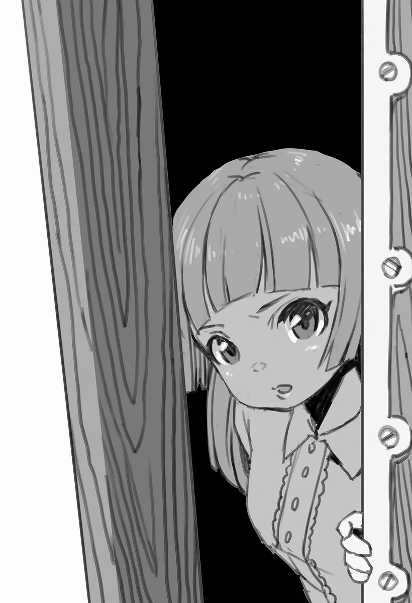

# Chương 48: Tập 2 Chương 4 - Hoa Long Huyết (1)

"Chắc lần này... mình nên nhận. Một ủy thác đàng hoàng," tôi tự nhủ khi đứng một mình, chăm chú nhìn lên một trong những tấm bảng ủy thác của Hội Mạo Hiểm Giả.

Dù cách đây không lâu tôi đã giải quyết xong vụ việc ở hồ, nhưng đó không phải ủy thác nhận qua kênh chính thức của Hội, vả lại tôi cũng chẳng thể đứng ra nhận công.

Mình phải chấn chỉnh lại thôi.

Tôi lại tiếp tục đảo mắt tìm...

"Ngay đây... có một cái..."

Ánh mắt tôi dừng lại ở tờ ủy thác này. Nó chẳng có gì nổi bật bởi phần thưởng hoàn thành chỉ vỏn vẹn một đồng xu đồng. Chẳng trách nó cứ bị bỏ mặc trên bảng; đi săn một con Goblin kiếm còn được nhiều tiền hơn thế.

Nhưng cụ thể thì ủy thác này yêu cầu làm việc gì?

Thấy tò mò, tôi ghé sát đọc kỹ phần còn lại, để rồi nhận ra công việc này chẳng hề đơn giản chút nào.

"Anh Rentt...? Anh định nhận ủy thác đó sao? Được thế thì chúng tôi biết ơn anh lắm đấy..."

Quay đầu lại nhìn theo giọng nói quen thuộc, tôi thấy ngay Sheila, người nãy giờ hẳn vẫn đang trực ở quầy tiếp tân.

Tôi chỉ ghé Hội vào những khung giờ vắng vẻ, nên lúc này đại sảnh chẳng có mấy ai, họa hoằn lắm mới thấy một hai mạo hiểm giả. Sheila cũng không có mấy việc tiếp tân phải làm, thành thử cô mới thong thả bước lại gần chỗ tôi đứng.

"Lý do... ủy thác này. Vẫn còn nằm đây... không phải chuyện... thù lao, đúng không? Mà là do... nội dung ủy thác."

"Vâng. Thoạt nhìn thì một đồng xu đồng chẳng đáng là bao, nhưng nhìn tên người ủy thác thì cũng dễ hiểu thôi. Dù sao đó cũng là truyền thống của Hội mà."

Truyền thống đó là chỉ đưa ra một đồng xu đồng duy nhất làm phần thưởng. Đây là cách dành cho những ai cần mạo hiểm giả giúp đỡ nhưng không kham nổi một khoản thù lao lớn. Có thể xem việc này gần giống như làm tình nguyện vậy. Những ủy thác kiểu này đã rất phổ biến từ ngày đầu thành lập Hội, và các tân binh thường được tiền bối chỉ bảo về truyền thống đó.

Sheila khẽ hắng giọng rồi nói tiếp.

"Có điều, dù không thiếu mạo hiểm giả sẵn lòng nhận việc thiện nguyện không công, nhưng nội dung ủy thác này thì... hơi..."

"Thu thập... Hoa Long Huyết. Một ủy thác khó... ở quanh vùng này. Rất khó."

Hoa Long Huyết là loài hoa có những cánh đỏ thẫm như máu. Đây là loài cây quý hiếm, vừa dùng làm cảnh vừa dùng làm thuốc. Từ những bông hoa này, người ta có thể chiết ra một thứ chất lỏng cùng màu gọi là Long Hoa Huyết, dùng để điều chế nhiều loại thuốc khác nhau.

Tương truyền xưa kia có một thiếu nữ loài người đem lòng yêu một con Rồng, tình cảm giữa họ vượt qua cả ranh giới giống loài. Nhưng rồi vì hàng loạt hiểu lầm đáng tiếc, một người anh hùng đã tìm đến và giết chết con Rồng. Máu của nó thấm sâu xuống lòng đất rồi hóa thành loài hoa này. Cho đến tận ngày nay, Hoa Long Huyết đôi khi vẫn được dùng làm quà tặng cho những thiếu nữ xinh đẹp đang yêu.

Nghĩ đến cái kết buồn của câu chuyện thì chọn hoa này làm quà nghe có vẻ hơi kỳ lạ. Nhưng trong truyện kể, người anh hùng kia lại chính là anh trai của thiếu nữ. Dù con Rồng thừa sức đánh bại anh ta chẳng mấy khó khăn, nó lại chọn hiến dâng mạng sống của mình vì tình yêu dành cho cô gái. Nhờ vậy, loài hoa này trở thành biểu tượng cho ý chí kiên định không khuất phục trước mọi nghịch cảnh, nên ngày nay mới được xem là món quà tình yêu lãng mạn.

Hiếm đến thế nên gần như chẳng thể nào tìm được loài hoa này. Các tiệm hoa bình thường hầu như không có bán, mà giá của chúng cũng đắt cắt cổ.

Ủy thác này lại yêu cầu đi tìm đúng những bông hoa ấy. Bảo sao mạo hiểm giả bình thường chẳng ai có động lực nhận một công việc như thế.

Tuy nhiên, Sheila có nhắc rằng cũng có kha khá mạo hiểm giả từng cân nhắc nhận ủy thác này. Lý do nằm ở cái tên của người ủy thác.

Trên tờ ủy thác, từng chữ in hoa viết rõ ràng ngay ngắn như sau:

"NGƯỜI ỦY THÁC: TRẺ MỒ CÔI CÔ NHI VIỆN THỨ HAI MAALT"

Dù hoàn cảnh như vậy, tờ giấy tuyệt nhiên không được viết theo kiểu gợi lòng thương hại. Chi tiết ủy thác được trình bày gọn gàng, rõ ràng và đúng mực. Và dẫu phần thưởng cho công việc này có nhìn nhận tích cực nhất thì cũng chẳng đáng là bao, việc ủy thác này có đáng bỏ thời gian công sức hay không hoàn toàn tùy thuộc vào quyết định của mỗi mạo hiểm giả.

"Anh tính sao đây...?" Sheila khẽ mỉm cười hỏi. Hiểu tính Sheila, tôi biết cô đã đoán được câu trả lời của mình rồi.

"Tôi sẽ... nhận. Ủy thác này."

◆◇◆◇◆

Cô Nhi Viện Thứ Hai Maalt—

Tuy về mọi mặt Maalt chỉ là một thị trấn vùng biên, nhưng nhờ có tới hai mê cung ở gần nên dân số nơi đây khá đông đúc. Nhìn chung, Maalt là một thị trấn phát triển khá quy củ. Các công trình công cộng ở đây cũng có kha khá—ít nhất là tương xứng với quy mô dân số của Maalt. Cô nhi viện mà tôi đang tìm đến là một trong những nơi như vậy.

Tùy theo từng vùng và từng vương quốc, các cô nhi viện được điều hành bởi nhiều tổ chức khác nhau. Riêng cô nhi viện này ở Maalt do một nhóm tu sĩ và nữ tu thuộc Giáo Hội Đông Thiên trông coi. Giáo hội này tin rằng xưa kia có một Thiên Sứ từng giáng xuống bầu trời phía đông Yaaran và ban phát nhiều phép màu nhân từ. Bởi vậy, Giáo Hội xem vị Thiên Sứ ấy là hiện thân của Thần linh và lấy đó làm đối tượng tôn thờ. Đúng như những hoạt động của mình, họ là một tổ chức khá ôn hòa, không truyền đạo rầm rộ ép buộc, cũng chẳng đòi hỏi người dân phải quyên góp.

Tuy nhiên, họ lại nghèo hơn hẳn các tổ chức tôn giáo tương tự. Tín đồ Đông Thiên vốn nổi tiếng với lối sống thanh bần và tâm nguyện cao đẹp, được người dân khắp Vương Quốc Yaaran kính trọng. Có điều sự kính trọng ấy cũng chỉ gói gọn trong phạm vi Yaaran mà thôi. Do tổ chức này chưa bao giờ mở rộng quy mô là bao, cái tên của họ dường như chẳng mấy khi được nghe thấy ở bên ngoài vùng đất này.

Dù sao thì tôi đoán các tổ chức tôn giáo địa phương chỉ tập trung ở một vài vùng nhất định thường đều như vậy cả.

Sự hiện diện của Giáo Hội tại Maalt được thể hiện qua Cô Nhi Viện Thứ Hai này, dù trông nó chẳng lấy gì làm khang trang. Bản thân tòa nhà đã xuống cấp nặng và rất cần được sửa sang lại, nhưng tôi đoán hoàn cảnh nó vốn vậy rồi. Những vết nứt và lỗ thủng trên tường chỉ được trát vá tạm bợ bằng đá sỏi trắng ở chỗ này chỗ kia. Dù mấy chỗ sửa chữa chắp vá đó xem chừng vẫn dùng tạm được, nhưng nhìn vào đấy là thấy rõ ngay tình cảnh thiếu thốn kinh phí triền miên đang đeo bám Giáo Hội Đông Thiên.

Theo những cuốn sách tôi từng đọc cùng mấy lời tán gẫu lan man của Lorraine, ở một Đế Quốc nọ phía tây Yaaran có khá nhiều tổ chức tôn giáo lớn. Thế lực họ nắm trong tay lớn khủng khiếp, quyền hành chẳng kém gì bản thân Đế Quốc. Nghe đâu các tư tế và người đại diện của họ khoác lên mình nhiều đá quý và trang sức lộng lẫy đến mức người ta thường nhầm họ với thợ kim hoàn. Thế nhưng ở Yaaran lại chẳng thấy bóng dáng một tín đồ nào của họ.

Nhìn tình trạng của cô nhi viện lúc này, tôi cảm thấy Giáo Hội Đông Thiên có thêm một cái vạc đồng để nấu ăn thì thiết thực hơn là trang sức đá quý. Cơ mà vạc đồng cũng đắt đỏ lắm, nên nghĩ vậy cũng chẳng giải quyết được gì.

Chẳng mấy chốc tôi đã đứng trước cửa cô nhi viện; trên cánh cửa có gắn một chiếc vòng gõ khá to. Giơ tay nắm lấy chiếc vòng kim loại, tôi định gõ cửa báo có khách. Ý định của tôi là thế, cho đến khi cả chiếc vòng gõ cửa bung rời khỏi cánh cửa, biến thành một cục sắt nằm gọn trong lòng bàn tay tôi.

"...Mình... chưa thấy gì hết."

May thay, mối nối kim loại trên cả chiếc vòng gõ lẫn cánh cửa đều vẫn còn, nên chỉ cần sửa sơ qua là được. Lấy một lọ dịch Slime từ đai dụng cụ ra, tôi đổ một ít lên chiếc vòng gõ rồi giữ chặt nó vào đúng chỗ cũ trên cửa trong vài giây yên ắng. Từ từ buông tay ra, tôi hài lòng thấy chiếc vòng gõ đã nằm yên ở vị trí ban đầu.

Không muốn phá hỏng thêm cơ sở vật chất của cô nhi viện nữa, tôi gõ lên cánh cửa gỗ ọp ẹp—thật nhẹ tay, kẻo lại làm cánh cửa bung luôn khỏi bản lề. Tránh chỗ quanh chiếc vòng gõ ra, tôi tiếp tục gõ sao cho âm thanh truyền qua mặt cửa vừa đủ nghe thấy. Đúng là một thao tác đòi hỏi kỹ thuật cao, có lẽ đây là màn gõ cửa công phu nhất mà tôi từng thực hiện trong suốt sự nghiệp mạo hiểm giả của mình. Nhưng làm vậy cũng khiến tôi thoáng tự hỏi rốt cuộc mình đang làm cái gì với cuộc đời thế này. May sao cánh cửa chẳng mấy chốc đã bắt đầu hé mở, kéo tôi ra khỏi dòng suy nghĩ đang ngày càng đi xa.

Một tràng tiếng bước chân huỳnh huỵch dồn dập vang lên từ phía bên kia cánh cửa—nghĩ mà xem, tôi vừa mới sửa xong cái vòng gõ cửa đấy! Ngay khoảnh khắc tiếp theo, cánh cửa gỗ cuối cùng cũng mở ra; người ở phía bên kia dường như chẳng mấy bận tâm đến tình trạng của cánh cửa, hay cả sự hiện diện đầy khả nghi với chiếc mặt nạ đầu lâu của tôi. Thậm chí cô bé còn mỉm cười.

"A, có khách ạ? Em xin lỗi nhé, nhưng hôm nay Sơ Lillian không có ở nhà..."

Một cô bé có nhìn nhận thế nào thì lớn lắm cũng chỉ khoảng mười hai tuổi. Mái tóc ngắn được cắt tỉa gọn gàng của cô bé trông rất bắt mắt. Dù sống trong cảnh nghèo khó, cô bé vẫn ăn vận tươm tất, toát lên vẻ thanh lịch; tôi đoán ngay cả cảnh nghèo túng cơ cực cũng không lấy đi được nét ấy của cô bé.

Nhưng tôi chẳng biết Lillian là ai, cũng chẳng biết phải đáp lại thế nào. Thế nên tôi đành giải thích lý do mình tìm đến đây.

"...Tôi là mạo hiểm giả... từ Hội. Người đã nhận... ủy thác của các em. Hay là em định đuổi một kẻ... như tôi về?"

Nghe tôi nói vậy, mắt cô bé mở to.

"A! Sao anh không nói sớm? Em cứ tưởng anh là người đến đòi nợ... Mời anh vào trong ạ. Mong là chỗ này không quá chật chội với anh."

Cô bé mở rộng cánh cửa, đón tôi bước vào cô nhi viện.
