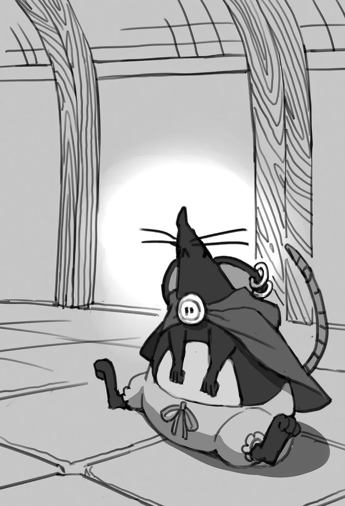

# Chương 51: Tập 2 Chương 4 - Hoa Long Huyết (4)

Con Puchi Suri dưới hầm chứa của cô nhi viện đã trở thành quyến thuộc của tôi, nên chắc có thể coi như nó hết nguy hiểm rồi. Dù sao thì ngay từ đầu việc xử lý con quái vật đó đâu nằm trong ủy thác của tôi, nên tôi có nhúng tay vào thì về cơ bản cũng chẳng ảnh hưởng gì tới chuyện ấy.

Hạ gục con Puchi Suri to xác xong, chúng tôi lùng sục kỹ lại căn hầm thì phát hiện thêm kha khá mấy con nhỏ hơn. Đám chuột nhỏ này không nguy hiểm lắm, nên tôi nghĩ cứ để Alize trực tiếp đối đầu với một con cũng an toàn. Dĩ nhiên là Alize chỉ đấu với đúng một con chứ không phải cả đàn. Dù vậy, khi hạ được con Puchi Suri, mặt con bé vẫn lộ rõ vẻ hớn hở. Trông em lúc đó, tôi lại nhớ tới nét mặt của mấy mạo hiểm giả tân binh khi lần đầu tiêu diệt được quái vật.

Tôi bảo Alize cứ giữ lấy viên Ma Tinh, xem như kiếm thêm chút tiền tiêu vặt. Phải đăng ký làm mạo hiểm giả mới bán được chiến lợi phẩm cho Hội, nhưng con bé hoàn toàn có thể đem viên tinh thể đổi cho mấy thương nhân quanh vùng. Giá họ trả cũng khá sòng phẳng, ít nhất là theo mặt bằng chung của dân buôn bán dạo.

Trong khi Alize còn mải vui mừng, tôi quyết định kiểm tra năng lực của con quyến thuộc mới thu nhận. Dù gặp đôi chút khó khăn lúc đuổi bắt đám đồng loại nhanh thoăn thoắt, con quyến thuộc của tôi vẫn có một ngón đòn tủ. Nó chỉ cần trừng mắt một cái là lũ Puchi Suri yếu hơn đã đứng sững lại, hệt như chuột chết trân trước mắt rắn. Ánh nhìn áp chế ấy hiệu nghiệm đến nỗi nạn nhân chẳng dám nhúc nhích lấy nửa bước, kể cả khi tôi bước lại gần lấy ngón tay chọc thử. Con Puchi Suri cứ đứng chôn chân tại chỗ, như sợ chỉ cần khẽ động đậy là sẽ bị trừng phạt.

"...Mày... Bắt chúng... Nghe lời rồi à?"

Qua sợi dây liên kết tâm trí giữa hai bên, tôi cảm nhận được câu trả lời khẳng định. Có vẻ quyến thuộc của tôi sở hữu năng lực chi phối những biến thể yếu hơn cùng loài, tương tự cách Ma Cà Rồng điều khiển lũ Thi Quỷ do chúng tạo ra. Hiện tượng này thỉnh thoảng vẫn xuất hiện ở quái vật: một cá thể cấp cao hơn sẽ thống trị những con yếu hơn cùng giống loài.

Ví dụ điển hình là Đại Tướng Goblin hay Vua Goblin, những kẻ đúng như danh hiệu của mình, có vô số Goblin dưới trướng chỉ huy. Còn năng lực biến quái vật khác loài thành tay sai ngoan ngoãn của Ma Cà Rồng có thể coi là phiên bản cấp cao hơn của chiêu thức này. Có điều, Ma Cà Rồng phải truyền máu của mình vào nạn nhân thì mới có tác dụng, và họ có lẽ chuộng chất lượng hơn số lượng chứ không tràn lan như lũ Goblin.

Dù vậy, tôi vẫn chưa thể dám chắc về năng lực chỉ huy của con quyến thuộc. Những giới hạn cụ thể, chẳng hạn phạm vi hiệu lực của sự kiểm soát này kéo dài bao xa, tôi đều chưa rõ. Không loại trừ khả năng ngay từ đầu con Puchi Suri to xác này vốn đã là đầu đàn của lũ chuột nhỏ trong hầm, và việc chúng phục tùng chẳng dính dáng gì đến năng lực của quyến thuộc tôi cả.

Vấn đề này chắc chắn phải nghiên cứu thêm, và điều đó bảo đảm sẽ khiến Lorraine thích mê.

Tôi định bụng dắt luôn con chuột quyến thuộc về nhà, dù ban đầu đã bảo nó canh giữ căn hầm trong lúc Sơ Lillian vắng mặt. Nhưng thấy đám đồng loại nhỏ hơn giờ đây răm rắp nghe lời nó... liệu có thể để lũ chuột nhỏ canh gác nơi này thay cho nó trong lúc chúng tôi đi vắng không nhỉ?

Lại phải hỏi quyến thuộc rồi, thế là tôi truyền một ý nghĩ sang cho con chuột to xác.

"Ban đầu... Ta định để mày... Canh căn hầm này. Nhưng giờ... Giao lại cho mấy con nhỏ này... Được không?"

Đôi mắt đỏ rực của con Puchi Suri nhìn thẳng vào tôi trân trối, rồi truyền qua một ý nghĩ có vẻ lại là lời đồng ý.

Khả năng giao tiếp không cần lời nói hay ngôn ngữ chung quả là đặc ân tuyệt vời giữa chủ nhân và quyến thuộc. Mà cũng tiện lợi ra phết.

Tôi quay sang Alize, giải thích tình hình cho em.

"Em thật sự... chẳng hiểu gì hết trơn. Ý anh là... từ giờ lũ quái vật sẽ canh giữ chỗ này sao? Mấy đứa nhỏ khác xuống đây liệu có sao không anh? Em cấm tụi nó không được chơi ở đây rồi, nhưng thỉnh thoảng chúng vẫn lén chui vào..."

Tôi truyền lại câu hỏi cho quyến thuộc, và lập tức nhận được một đợt sóng ý nghĩ mạnh mẽ đáp lại. Luồng ý nghĩ ấy mang lại cảm giác bình yên và trấn an.

Quay sang bầy chuột nhỏ đang xếp hàng ngay ngắn trước mặt, con quyến thuộc của tôi trừng mắt nhìn, cái nhìn áp đảo khiến bầu không khí xung quanh như chùng xuống. Đám Puchi Suri nhỏ liền ưỡn thẳng người, kêu chít chít đáp lời.

"Nó bảo... Sẽ không. Có vấn đề gì đâu."

"Trông thì đúng là vậy thật..." Alize gật đầu, tiếp tục nhìn bầy Puchi Suri với vẻ kinh ngạc không giấu nổi trên mặt.

Với tôi, chuyện đó giống như sự phục tùng đến từ nỗi sợ hơn, bởi lũ Puchi Suri rõ ràng đang khiếp vía trước con quyến thuộc của tôi. Trật tự thứ bậc thông thường xem ra chẳng còn ý nghĩa gì nữa, khi mà một con trong số chúng giờ đã là một chú chuột nửa Ma Cà Rồng.

Thấy mọi chuyện trước mắt đã êm xuôi, tôi chào tạm biệt rồi quay về nhà Lorraine để chuẩn bị lên đường.

◆◇◆◇◆

"Mừng anh về—?!"

Như thường lệ, Lorraine đang nằm dài trên sofa, giơ cuốn sách lên đón ánh sáng để đọc. Tiếng mở cửa khiến cô chú ý như mọi khi. Cô chậm rãi quay lại nhìn tôi, nhưng rồi khựng lại giữa câu chào, tiếng nín thở nghẹn lại nghe rõ mồn một.

Hít một hơi thật sâu, cuối cùng Lorraine cũng cất lời, chậm rãi và điềm đạm.

"Tôi mạn phép hỏi câu này nhé, Rentt... Rốt cuộc con chuột đen béo núc ních to dị thường đang ngự trên vai anh là thế nào vậy? Chắc không phải tôi nhìn gà hóa cuốc đấy chứ."

Trông thấy con Puchi Suri làm Lorraine kinh ngạc đến mức tưởng mắt mình có vấn đề.

Khẽ hít mũi, tôi ngửi thấy một mùi khó chịu. Hẳn là Lorraine lại đóng kín cửa sổ để pha chế mấy thứ thuốc kỳ dị nữa rồi. Tôi rảo bước tới bên cửa sổ, đẩy toang ra cho thoáng rồi mới quay lại chỗ cũ.

"Tôi nhặt được nó... Dưới hầm chứa... Cô nhi viện. Từ nay... Chúng ta sẽ... Nuôi nó..."

"Tóm tắt thế thì ngắn gọn quá mức rồi đấy, Rentt. Ít nhất anh cũng phải kể từ đầu chí cuối thì tôi mới biết đường mà nhận xét chứ."

"Ừ... Chắc là vậy." Quả thật tôi cần phải giải thích rõ ràng.

Nghe tôi kể lại đầu đuôi mọi chuyện, Lorraine gật gù ra chiều suy ngẫm. "Tôi hiểu rồi... Nhận một ủy thác như thế đúng là phong cách của anh. Nhưng bao nhiêu nơi không đến lại đâm đầu vào Đầm Lầy Tarasque? Đến cả tôi còn chẳng muốn bén mảng tới đó nữa là. Liệu anh có ổn không đấy, Rentt?"

"Tôi đã tính... Nhiều. Phương án dự phòng rồi... Sẽ không có... Vấn đề gì đâu."

"Anh đã nói vậy thì chắc không sao, nhưng tôi vẫn thấy lo. Mà thôi, giờ có nói thì cũng chẳng cản được anh nữa rồi. Cơ mà thật không ngờ anh lại có thể tự tạo ra và điều khiển quyến thuộc của riêng mình đấy... Đúng là tôi đã làm đủ thứ thí nghiệm, nhưng chưa từng nghĩ đến chuyện lấy máu của anh cho sinh vật sống khác uống."

Suy luận của Lorraine hoàn toàn có lý; vốn là Ma Cà Rồng cấp thấp, Thi Quỷ thường bị coi là thiếu cả năng lực lẫn trí khôn để tự tạo quyến thuộc cho riêng mình. Bảo sao cô không tùy tiện lấy máu tôi cho bất kỳ con vật nào vớ được uống. Về phần mình, Lorraine giải thích rằng các thí nghiệm của cô ban đầu chỉ tập trung vào việc đảm bảo sức khỏe cho tôi, cùng những đặc điểm và năng lực chính mà cơ thể Thi Quỷ này sở hữu. Thế nên những năng lực kín kẽ kiểu này cô không phát hiện ra cũng là lẽ đương nhiên.

"Mình... Nuôi nó... Được không?"

"Tùy anh thôi, Rentt. Giờ mới nghĩ đến chuyện đó chẳng phải hơi muộn rồi sao? Nhà này vốn có một Undead đang ở rồi, mà Undead đó chính là anh chứ ai. Thêm một hai con chuột nữa thì có khác gì đâu. Tuy nhiên, nó cũng phải làm gì đó để bù tiền ăn ở đấy nhé."

"Nó phải... Trả... Tiền nhà à?"

"Đừng có ngốc thế. Mẫu vật! Chỉ cần mẫu máu của nó với mấy cọng lông là đủ rồi. Tôi nghĩ ra được bao nhiêu là thí nghiệm đây này, phải... cơ man là bài thử nghiệm. Dĩ nhiên là tôi không rút cạn máu nó đâu. Lấy một lượng vừa phải là được. Mà nhắc tới sức khỏe mới nhớ, Rentt này. Nó ăn cái gì thế?" Lorraine chìa tay về phía con Puchi Suri.

Con quyến thuộc của tôi vươn người tới, ngửi ngửi mấy ngón tay của Lorraine rồi ngoạm lấy một ngón.

"Ái!"

Đó chỉ là một cú cắn nhẹ, vừa đủ làm rách da Lorraine chứ không gây thương tích gì nặng.

Nhả ngón tay cô ra, con Puchi Suri khẽ liếm lên vết thương nơi vài giọt máu nhỏ đang rỉ ra.

"Ra vậy. Máu à? Giống hệt kẻ tạo ra mày nhỉ? Hừ, đoán ngay mà," Lorraine ngao ngán nói. "Ít ra thì nó cũng dễ hiểu. Cơ mà... dạo này máu của tôi đắt hàng gớm nhỉ?"

Tôi chẳng rõ Lorraine đang nói đùa hay nói thật, nhưng trông cô có vẻ đang vui. Tạm thời thế là được rồi. Chắc chắn Lorraine đang rất hào hứng với hàng tá thí nghiệm nảy ra trong đầu về người bạn lắm lông mới gia nhập này. Ngược lại, con quyến thuộc của tôi thì chẳng mặn mà chút nào.

"Tha cho tôi đi..." trông nó như muốn nói thế. Đáng tiếc là tôi chẳng thể can thiệp được gì vào cơn cuồng thí nghiệm của Lorraine, bởi chính tôi cũng từng nếm trải đủ mọi bài thử nghiệm y như thế rồi. Tôi chỉ đành bảo nó ráng mà nhịn thôi. Con Puchi Suri đáp lại bằng một nỗi bất an và sợ hãi thấy rõ.

◆◇◆◇◆

Trời rạng sáng trên thị trấn Maalt. Mặt trời chầm chậm nhô lên sau những tầng mây, chan hòa ánh nắng xuống những con phố của Maalt, hay đúng hơn là khoảng phố xá tôi thấy được từ khung cửa sổ. Dưới ánh ban mai, những đám mây tím ban nãy dần chuyển sang sắc đỏ, báo hiệu ngày mới đã bắt đầu.

Đó là cảnh tượng tôi vẫn thường thấy. Chẳng phải hiếm hoi gì, nhưng hồi còn sống, tôi phải dậy thật sớm mới đón được cảnh này. Từ lúc biến thành Thi Quỷ, tôi gần như chẳng cần ngủ nữa. Hình như từ lúc biến thành thế này đã vậy rồi. Lâu lâu tôi cũng có chợp mắt một lát, nhưng cơ thể tôi không ngủ cũng chẳng hề hấn gì.

Nói thật là chán không chịu nổi. Để giết thời gian, tôi chỉ biết nhìn ra cửa sổ hoặc thắp đèn ngồi đọc sách. Nhờ thế mà lúc làm ủy thác tôi có thể cày suốt ngày đêm, dù một mạo hiểm giả chẳng cần nghỉ ngơi thì người ta nhìn vào sẽ nghi ngay. Nghề mạo hiểm giả đâu phải cứ hùng hục làm một lèo là xong việc; dù dày dạn kinh nghiệm đến đâu, nếu không nghỉ ngơi tử tế thì rất dễ xảy ra sơ suất nghiêm trọng. Thế nên tôi vẫn buộc phải dành thời gian nghỉ ngơi.

Nhưng nhờ cái thói quen thức đêm mới này, suốt một tháng qua tôi đọc sách nhiều chẳng khác nào một học giả. Kiến thức của tôi dĩ nhiên chẳng thấm vào đâu so với Lorraine, có điều mỗi khi thắc mắc, tôi chỉ cần cất tiếng hỏi là có câu trả lời ngay. Đúng là tiện đủ đường.

Trái lại, con Puchi Suri tôi mang về từ cô nhi viện thì lại ngủ rất say. Lúc này nó đang ngửa bụng ngáy khò khò, nằm xoài ra mặt bàn nơi tôi ngồi đọc sách.

Tôi thấy hơi tị nạnh với con quyến thuộc của mình. Trong khi người chủ nhân đáng thương là tôi đây đang phải vật lộn khổ sở với nỗi cô đơn giữa đêm hôm khuya khoắt, thì con chuột này lại lăn ra ngủ say như chết.

Lẽ nào làm quyến thuộc mà lại không thừa hưởng mọi đặc tính từ tôi sao?

Tôi cứ tưởng là vậy, ai ngờ thực tế lại khác xa.

Đúng là một con chuột vô lo vô nghĩ...

Bất chợt, tôi bắt được một thoáng ý nghĩ mơ hồ từ con quyến thuộc, cùng vài cảm xúc cơ bản mà tôi có thể hiểu được. Xem ra việc ngủ say không hoàn toàn cắt đứt sợi dây liên kết giữa hai bên. Cứ kiểm tra và làm vài bài thử nghiệm bài bản thì chắc sẽ rõ hơn, nhưng việc chi tiết này cứ để mặc cho Lorraine lo liệu. Dù sao thì chẳng cần ai giục cô ấy cũng sẽ tự nhảy vào làm thôi.

Tôi cũng hơi áy náy vì đùn hết cho Lorraine, nhưng tôi còn phải lo vụ Tiến Hóa Bản Thể của mình nữa, nên đành chịu thôi. Có điều trong tình cảnh này, tôi lại thấy mình rảnh rỗi quá mức. Có khi người ngoài nhìn vào còn bảo tôi là một gã ăn bám ấy chứ.

Tốt nhất là nên gạt mấy suy nghĩ ấy sang một bên. Bên ngoài, người dân Maalt bắt đầu rục rịch thức dậy, vài người thậm chí đã rời khỏi nhà. Đang lúc nghĩ vẩn vơ thì bỗng một mùi hương lạ thoảng qua mũi tôi.

Mùi từ đâu ra thế nhỉ? Bên ngoài ư? Không thể nào. Sau khi Lorraine đi ngủ, chính tay tôi đã đóng chặt và cài then tất cả các cửa sổ rồi.

Vậy thì...

Tính tò mò nổi lên trước mùi hương lạ, tôi lần theo hướng phát ra mùi thơm, và nơi đó rõ ràng là gian bếp.

Trước mắt, tôi quyết định cứ để con quyến thuộc nằm đó; lỡ nó có thức giấc thì với cái mũi thính nhạy, chắc nó cũng nhận ra ngay đây là mùi gì.

Vừa bước vào bếp, đập vào mắt tôi là một cảnh tượng hết sức kỳ lạ.

"Suýt nữa thì... Tôi tưởng. Hôm nay... Trời đổ tuyết... Rồi chứ," tôi vừa nói vừa thấy buồn cười trước cảnh tượng đó.

"Đừng có vớ vẩn thế, Rentt. Nếu chịu để tâm thì đến tôi cũng nấu ăn được nhé."

Người đáp lại không ai khác chính là Lorraine, chẳng hiểu sao sáng nay cô lại có hứng vào bếp làm bữa sáng. Đủ loại ma cụ cùng dụng cụ giả kim được bày la liệt trong bếp, và Lorraine đang thao tác từng món bằng đôi tay vô cùng thuần thục.

Bình thường giờ này Lorraine còn đang ngủ say như chết, nhưng đúng như cô nói, chuyện cô biết nấu nướng tàm tạm cũng chẳng có gì lạ. Dĩ nhiên công lớn thuộc về tôi, bởi chính tôi là người đầu tiên dạy cô nấu ăn.

Thỉnh thoảng có hứng thì Lorraine cũng sẽ xuống bếp. Nếu tôi đoán không lầm thì hôm nay chính là một lần hiếm hoi như thế.

"Có phần... Nào. Cho tôi... Không?"

Dù chỉ cần uống máu là sống được, nhưng lâu lâu được ăn một bữa ngon lành thì tôi vẫn thích lắm chứ.

"Có chứ, có chứ." Lorraine trấn an. "Như anh thấy đấy, tôi đang làm đây này, Rentt. Ngồi xuống đi, xong ngay bây giờ đây."

Dù cách làm có phần hơi dị, nhưng Lorraine vẫn biết rất rõ mình đang làm gì.

Tôi gật đầu rồi quay bước về phía bàn ăn.
