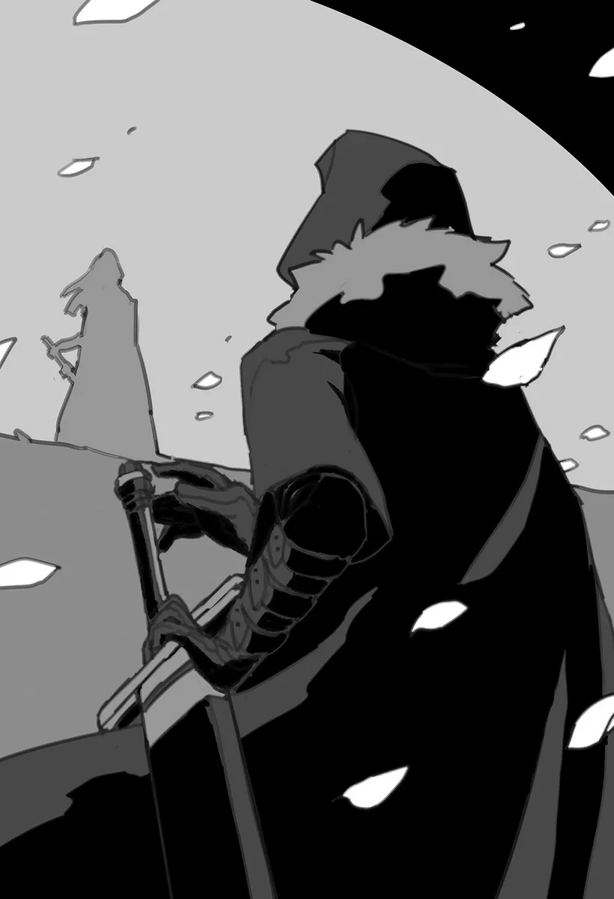

# Chương 55: Tập 2 Chương 4 - Hoa Long Huyết (8)

Thêm một tiếng sấm sét nữa vang vọng khắp đầm lầy khi thân xác khổng lồ của con quái thú đổ ầm xuống mặt đất. Sau một hồi giãy giụa và quẫy đạp dữ dội trong thoáng chốc, cái xác không đầu của con Tarasque cuối cùng cũng hoàn toàn bất động. Chiếc cổ tựa như rắn của nó quằn quại cuộn tròn trong đau đớn, tạo nên một cảnh tượng thật kinh tởm khi nhìn vào.

Thật không ngờ một thứ to lớn cỡ này lại có thể quằn quại và co giật theo cái cách như thế; một cảnh tượng mà tôi hy vọng mình sẽ chẳng bao giờ phải chứng kiến lần thứ hai.

Có lẽ một kẻ vừa tự tay hạ sát con Tarasque như tôi mà buông ra lời ấy thì nghe thật kỳ cục. Dù vậy, ngay từ đầu tôi đâu thực sự có ý định giết nó; chỉ trách con quái thú cứ khăng khăng bám riết đuổi theo chúng tôi mà thôi.

Ta sẽ không xin lỗi đâu, đồ quái vật.

Vốn dĩ là một ma thú, con Tarasque cũng sở hữu một viên Ma Tinh bên trong, hệt như mọi quái vật khác. Dù vị trí của Ma Tinh thay đổi tùy theo từng chủng loài quái vật, người ta thường có thể yên tâm cho rằng nó nằm ở gần tim của quái thú.

Thế nhưng Ma Tinh của Tarasque lại bị vùi sâu bên dưới lớp mai giáp, và tôi chẳng còn cách nào khác ngoài việc phải xẻ xác đào nó ra. Nhưng làm thế sẽ ngốn một lượng thời gian đáng kể, trong khi Đầm Lầy Tarasque tuyệt đối không phải nơi người ta có thể an tâm nán lại thảnh thơi. Gần như chắc chắn sẽ có một con Tarasque khác nặng nề mò tới trong lúc tôi đang loay hoay giải phẫu xẻ thịt. Đó là điều tôi bắt buộc phải tránh bằng mọi giá.

Tôi đồ rằng việc đánh bại thêm một con Tarasque nữa là hoàn toàn khả thi, xét việc giờ đây tôi đã nắm được điểm yếu của giống loài chúng. Dẫu vậy, trước khi thật sự giao chiến thì tôi đâu thể nào lường trước được điều gì. Dù sao thì tôi cũng nhận ra mình chẳng có mấy điều phải sợ hãi trước một con Tarasque. Chưa kể Edel cũng có thể hỗ trợ tôi nữa.

Vấn đề duy nhất trong tất cả chuyện này là lượng sức lực còn sót lại trong tôi. Sau khi đã tiêu hao một lượng lớn Thần Lực, tôi sẽ rất chật vật nếu muốn chém bay đầu một con Tarasque khác. Tệ hơn nữa, trữ lượng Thần Lực của tôi lại ít hơn đáng kể, chí ít là khi so với Ma Lực và Khí Lực. Kết quả là tôi thường dùng cạn nó nhanh hơn, và hiển nhiên là cũng mất nhiều thời gian hơn để hồi phục.

Tôi không thể cứ dựa dẫm vào việc liên tục thi triển cùng một chiêu thức hết lần này đến lần khác mà không có thời gian nghỉ ngơi. Đó là lý do vì sao tôi đã cố gắng tiết kiệm Thần Lực, và rốt cuộc lại dẫn đến kết cục là phải tiêu hao gần như sạch bách.

Đúng là một tình thế tiến thoái lưỡng nan.

Vậy thì liệu tôi có nên từ bỏ cái xác của con Tarasque cùng viên Ma Tinh bên trong nó?

Không. Tôi đâu thể làm cái chuyện như thế.

Tôi sẽ chẳng bao giờ làm chuyện như thế.

Tôi căn bản là không thể nào làm chuyện như thế được.

—Bởi tôi đang ngập trong nợ nần. Tệ hơn nữa, phần thưởng của cô nhi viện dành cho tôi khi thu thập một đóa Hoa Long Huyết chỉ vỏn vẹn đúng một đồng xu đồng hậu hĩnh. Tuy nhiên, bất chấp khoản nợ đè nặng, tôi vẫn bấm bụng tự bỏ tiền túi ra chi trả cho một món đồ rất đỗi đặc thù trước khi đặt chân tới đầm lầy: không gì khác ngoài một chiếc túi ma pháp.

Bản thân tôi vốn đã sở hữu một chiếc túi như vậy, nhưng cái đó tương đối nhỏ, chứa vừa cái xác một con Orc là đã chật ních. Chẳng đời nào nó có thể nhét vừa thân xác của một quái thú khổng lồ như Tarasque.

Tôi hoàn toàn có thể xẻ thịt con Tarasque và thu hoạch các nguyên liệu quý giá bên trong, nhưng nơi này lại chẳng hề thuận lợi cho một nỗ lực như thế. Đó là lý do vì sao một chiếc túi dung lượng lớn là vô cùng cần thiết, và cũng là lý do tôi chuẩn bị một món như vậy trước chuyến thâm nhập vào Đầm Lầy Tarasque.

Dẫu vậy, lý do để tôi chuẩn bị sẵn một chiếc túi như thế từ trước lại đơn giản hơn nhiều: dạo gần đây, tôi đã tính đến vận may tương đối tệ hại của mình. Thử hỏi trên đời này có ai chỉ đi khám phá một mê cung sơ cấp mà lại bị một con Rồng huyền thoại xơi tái rồi biến thành một Khô Lâu cơ chứ?

Nói đúng hơn thì, tôi đã quen với việc chuẩn bị cho những điều tồi tệ nhất ở thế giới này rồi.

Vậy thì điều gì sẽ xảy ra nếu một kẻ như tôi dấn thân vào Đầm Lầy Tarasque? Bất chấp mọi xác suất, chắc chắn tôi sẽ chạm trán một con Tarasque. Phải, một lối suy nghĩ đậm mùi định mệnh, nhưng xem ra những phỏng đoán—và linh tính mách bảo—của tôi quả không sai chút nào.

Có lẽ tôi đã có được một loại bản năng nguyên thủy nào đó sau khi biến thành quái vật...

Rốt cuộc thì tôi cũng đã chạm trán một con Tarasque thật. Thậm chí tôi có thể nói rằng bản năng của mình đã được mài giũa khá chuẩn xác đấy chứ.

Dù nói là vậy, chiếc túi ma pháp dung lượng lớn này thực chất chỉ là món đồ tôi đi thuê. Có lẽ cũng dễ hiểu thôi, khi mà những ma cụ chất lượng cao bực này đều đắt giá tựa vàng ròng. Với mức giá niêm yết của chiếc túi này, người ta thậm chí còn có thể mua đứt cả một căn nhà.

May mắn thay, việc thuê nó là hoàn toàn khả thi, miễn là người ta có đủ tiền. Người ta ắt sẽ nghĩ một món đồ quý giá dường ấy không đời nào lại được cho thuê dễ dàng đến thế, nhưng họ chỉ cần nhìn vào Hội, nơi tôi thuê chiếc túi này, là sẽ hiểu. Nếu có bất kỳ mạo hiểm giả nào dại dột cuỗm nó bỏ trốn, các chuyên viên thu hồi được huấn luyện bài bản của Hội sẽ lập tức bám gót truy lùng ngay tức khắc. Tùy thuộc vào giá trị của món ma cụ được đề cập, thậm chí cả các mạo hiểm giả Kim Cấp hay Bạch Kim Cấp cũng sẽ được huy động cho nhiệm vụ này. Điều đó đồng nghĩa với việc bất kỳ kẻ phạm tội nào cũng khó lòng sống yên ổn ở bất cứ vương quốc nào, đó là lý do vì sao những vụ trộm cắp kiểu này là cực kỳ hiếm thấy.

Những vụ trộm cắp ấy dường như phản ánh bản chất đen tối vô tận của con người, và có lẽ là của cả thế giới rộng lớn này.

Dù sao đi nữa, giờ đây tôi đã được trang bị phương tiện để vận chuyển xác con Tarasque vừa bị hạ gục.

Thân xác nó là cả một mỏ vàng nguyên liệu. Ngay cả khi chưa tính đến số tiền thu được từ việc bán viên Ma Tinh, riêng lớp vảy và mai của Tarasque thôi cũng đã thừa đủ để vớt tôi ra khỏi vũng lầy nợ nần. Tổng số tiền thu về từ riêng cái xác này sẽ đủ để tôi kiếm được một khoản lời kha khá, ngay cả khi đã khấu trừ toàn bộ chi phí cho chuyến thám hiểm lần này.

Nghĩ đến cảnh mình sẽ lại có thể thoải mái chi tiêu, mà lại làm được điều đó chỉ nhờ chiến lợi phẩm từ một trận chiến duy nhất! Đây chính là một trong vô vàn lý do khiến tôi không thể dứt khỏi nghiệp mạo hiểm giả.

Đây là lần đầu tiên tôi có được một món hời lớn nhường này trong suốt một thập kỷ qua, quãng thời gian mà phần lớn tôi dành để làm mạo hiểm giả. Dù cách đây một dạo tôi từng thu hoạch được một viên Ma Tinh cỡ lớn từ con quái vật khổng lồ mà mình đã tiêu diệt, tình thế khi đó lại khiến tôi chẳng kiếm chác được một đồng nào từ vụ việc ấy.

Lần này thì sẽ khác. Tôi mở chiếc túi ra, quỳ một gối xuống bên cạnh xác con Tarasque. Tôi không hề có ý bảo mình sẽ phải tìm cách trùm chiếc túi qua cái xác to lớn không tưởng này, bởi chuyện đó hoàn toàn không cần thiết. Người ta chỉ việc để chiếc túi ma pháp tiếp xúc với vật thể trong một khoảng thời gian vừa đủ, và chẳng mấy chốc nó sẽ được dịch chuyển êm thấm vào chiều sâu không đáy bên trong.

Quả thực là một công cụ vô cùng tiện lợi.

Ngay cả cái đầu đứt lìa của Tarasque cũng rất có giá trị, vì thế tôi cũng tận tâm để chiếc túi nuốt trọn nốt phần đó. Nếu trí nhớ của tôi còn chuẩn xác, nhãn cầu, não bộ cùng các tuyến độc của nó cũng có giá trị không hề nhỏ.

Sau khi hoàn thành công việc, tôi dạo một vòng quanh khu vực, chủ yếu là để xác nhận xem có con quái vật nào khác lảng vảng ở vùng lân cận hay không. Đúng như dự đoán, có vài con Goblin đang lấp ló sau bụi cây, tôi đồ rằng chúng đang ngóng chờ nhặt nhạnh chút đồ ăn thừa.

Đối với chúng, thân xác một con Tarasque chứa đựng vô số nguyên liệu chế tác quan trọng. Người ta chỉ cần quan sát một con Goblin Đầm Lầy là sẽ nhận ra chúng chẳng hề kén chọn nguyên liệu mình sử dụng. Bất cứ thứ gì cũng đều dùng được, kể cả những mảnh vụn vỡ ra từ vảy và mai của Tarasque. Những thứ đó sau đó sẽ được đan ghép lại với nhau một cách hết sức chắp vá.

Đây đúng là một cơ hội hoàn hảo để quan sát hệ sinh thái của đầm lầy cùng vòng tuần hoàn sinh tử bất tận bao trùm khắp nơi này. Thế nhưng, tôi lại nhặt một nắm đá dưới đất lên rồi dồn hết sức bình sinh ném thẳng về phía bầy Goblin đó. Dẫu hành động này nghe có vẻ tàn nhẫn, tôi thực chất chỉ đang phòng vệ chính đáng mà thôi, bởi lũ Goblin đã bắt đầu giương cung và chĩa thẳng mũi tên về hướng tôi rồi.

Những hòn đá xòe ra theo một hình vòng cung rộng, đập trúng ngay giữa hai mắt của một con Goblin đặc biệt xui xẻo. Chứng kiến đồng bọn bất ngờ ngã gục, những con Goblin khác lập tức bỏ chạy tán loạn. Chẳng có lấy một con Goblin nào dừng lại giúp đỡ người bạn ngã xuống của mình, và con Goblin bất hạnh kia nằm run rẩy trên mặt đất một hồi lâu trước khi gắng gượng đứng dậy. Lắc đầu lia lịa, nó tập tễnh chạy tháo thân theo chân đồng bọn trong nỗi hoảng loạn tột cùng.

Một cảnh tượng thật ấm lòng, hay nói đúng hơn là có phần buồn cười. Tôi cảm thấy các dây thần kinh của mình đã ổn định trở lại đôi chút sau khi tâm trí bị bào mòn đáng kể từ cuộc chạm trán với Tarasque.

Thế rồi, chẳng hề có điềm báo trước, con quái ngư từng hất văng tôi ra khỏi hồ nước độc lại một lần nữa trồi lên từ vùng nước sâu, ngoạm trọn vài con Goblin đang tháo chạy trước khi lặn mất tăm dưới làn sóng. Con Goblin duy nhất còn sống sót chính là kẻ đã bị choáng váng bởi hòn đá tôi ném.

Đúng là quy luật sinh tồn chốn hoang dã...

Nghĩ kỹ lại thì, tôi nhận ra đây gần như là hiện trạng thường nhật ở vùng đất này.

Rõ ràng là sững sờ trước những gì vừa diễn ra ngay trước mắt, con Goblin đơn độc đứng chôn chân, nom có vẻ hoàn toàn mất phương hướng. Đăm đăm nhìn vào bóng lưng nó, tôi không khỏi tự hỏi liệu nó có cảm thấy một nỗi tuyệt vọng ngập tràn hay không. Liệu nó có cảm thấy xót thương cho sự mất mát của những người bạn, bất kể việc chính chúng vừa mới bỏ mặc nó cho số phận chỉ vài khoảnh khắc trước đó?

Thói đời vốn là như thế đấy.

Tôi đồ rằng mình nên tiếp tục lên đường thôi; tôi vẫn còn phải tìm Hoa Long Huyết nữa.

Sau khi xác nhận đã có một khoảng cách khá an toàn giữa bản thân và con Goblin đơn độc—kẻ vào một lúc nào đó đã quyết định rút lui sâu vào đầm lầy—tôi quay trở lại với cuộc tìm kiếm của mình. Khỏi phải nói, tôi di chuyển hết sức thận trọng và chậm rãi, chẳng hề muốn chạm trán thêm một con Tarasque nào nữa.

May mắn thay, tôi không đụng độ thêm bất kỳ quái thú nguy hiểm nào khác, có lẽ một phần là nhờ vào sự tiến bước đầy cẩn trọng của tôi. Thêm vào đó, kết quả trận chiến vừa rồi đã khẳng định rằng loài Tarasque thực sự rất ghét Nước Thánh. Theo mạch suy nghĩ ấy, tôi đồ rằng mình có thể giả định chúng căm ghét Thần Lực nói chung, và sẽ tránh xa các nguồn phát ra nó bất cứ khi nào có thể.

Tôi bao bọc bản thân trong một luồng khí tức Thần Lực mờ ảo, rồi lại chầm chậm tiến bước qua đầm lầy một lần nữa.

◆◇◆◇◆

Cuối cùng khi đã ra khỏi lãnh địa của loài Tarasque, tôi nhận thấy mình đang ở một nơi thực sự đẹp đến nghẹt thở, và trong thoáng chốc tôi hoàn toàn không thốt nên lời.

Xét việc Đầm Lầy Tarasque tràn ngập khí độc, nước độc, thực vật độc cùng quái vật mang độc, người ta ắt sẽ đinh ninh rằng nơi đây là một chốn địa ngục trần gian không thể kiểm soát. Chí ít thì đó cũng là một giả định hết sức hợp lý. Xét cho cùng, những cá nhân duy nhất dám đặt chân vào đầm lầy chỉ là những mạo hiểm giả không biết sợ hãi, cùng những kẻ đầu óc có phần không được bình thường. Thị dân cùng những người bình phàm khác thì ngay từ đầu thậm chí còn chẳng dám mơ đến chuyện bén mảng lại gần.

Người ta hẳn cũng sẽ cho rằng chính nơi sâu thẳm nhất và là trái tim của đầm lầy sẽ là nơi ngự trị của những quái vật nguy hiểm nhất cùng những loại chất độc cực mạnh nhất. Dù suy nghĩ theo hướng đó là hoàn toàn hợp logic, những gì tôi chứng kiến trước mắt lại đi ngược lại toàn bộ logic ấy.

Phải rồi... Đây ắt hẳn chính là vẻ đẹp đích thực...

Tôi chưa từng mường tượng một cảnh tượng như thế này lại có thể tồn tại, mà lại ngay bên trong Đầm Lầy Tarasque cơ chứ. Nơi đây không thể nghi ngờ gì nữa chính là một chốn thiên đường.

Trước mắt tôi là một mặt hồ tuyệt đẹp, với làn nước trong vắt đến mức tôi có thể nhìn thấy cả lớp đá nền bên dưới. Những đóa hoa đỏ thẫm viền quanh bờ nước, thi thoảng lại có một cánh hoa rơi xuống bập bềnh trôi nổi trên mặt nước. Bầy hoa vây quanh và nở rộ khắp ven hồ, tựa như một đội quân binh lính đỏ trung thành đang bảo vệ nữ hoàng của mình trước các loài thực vật khác của đầm lầy.

Thấp thoáng giữa muôn hoa là côn trùng, chim chóc, thậm chí thi thoảng còn có cả dã thú, tất cả đều đang dạo quanh trong một sự hài hòa tương đối. Đây là điều cuối cùng tôi ngờ rằng mình sẽ được trông thấy ở nơi tận cùng của một vùng đầm lầy độc hại.

Lý do cho sự tồn tại của nơi này chính là nhờ những bông hoa. Những đóa hoa màu đỏ rực rỡ này chính là loài hoa mà tôi đã cất công tìm kiếm bấy lâu:

Hoa Long Huyết.

Loài hoa này sở hữu khả năng thanh lọc và gột rửa môi trường xung quanh chúng, và chính những đóa hoa ngay dưới chân tôi lúc này chịu trách nhiệm tạo nên quả cầu thanh sạch mà tôi đang đứng bên trong.

Mặc dù hệ động thực vật bên trong không gian này dường như được bảo bọc bởi Hoa Long Huyết, thực tế lại tàn nhẫn hơn nhiều. Dù chúng có thể tự do sinh sống và hít thở bên trong quả cầu bảo hộ của Hoa Long Huyết, chúng sẽ bỏ mạng chỉ trong vòng một giờ nếu bằng cách nào đó bị đưa ra bên ngoài.

Một chốn thiên đường, phải, nhưng đồng thời cũng là một ngục tù vĩnh cửu.

Vô số loài chim chóc, côn trùng và dã thú quý hiếm coi chốn ngục tù này là nhà, và chúng sẽ có giá trị tựa vàng ròng nếu được vận chuyển ra khỏi đầm lầy. Quy trình này sẽ cực kỳ gian nan, xét việc người ta phải đưa sinh vật ra khỏi quả cầu không khí thanh sạch này và đi vào làn độc chất của đầm lầy bao quanh. Chỉ riêng việc vận chuyển một sinh vật thôi đã là cả một kỳ công to lớn, bởi người ta phải duy trì một vùng không khí tương đối thuần khiết quanh mình vào mọi thời điểm. Một vài loại ma cụ nhất định có thể làm được điều này, cũng như một số loại phong ma pháp đặc thù, khi được một ma pháp sư có trữ lượng Ma Lực dồi dào trong cơ thể duy trì không ngừng nghỉ.

Dù người ta có thể trông đợi một mức độ công nhận nhất định cho kỳ tích như vậy, công sức bỏ ra thường lấn át hoàn toàn phần thưởng nhận lại. Đó là lý do vì sao hệ sinh thái của quả cầu mong manh này phần lớn vẫn được duy trì nguyên vẹn.

Nếu có ai đó gây tổn hại đến một trong số ít những hệ sinh thái nơi Hoa Long Huyết có thể sinh sôi nảy nở, họ chắc chắn sẽ hứng chịu sự chỉ trích dữ dội từ vô số hội nhóm và tổ chức. Miễn là người ta cẩn trọng trong cách thu hoạch hoa, sẽ chẳng có bất kỳ thiệt hại lâu dài nào xảy ra. Hoa Long Huyết sở hữu một sức sống mãnh liệt đặc biệt, và chúng thường tái tạo lại bất kỳ phần hư hại nào tương đối nhanh chóng. Bằng chứng cho điều này chính là việc loài hoa nói trên lại mọc ở chính nơi đây, cùng với thực tế là chúng có khả năng hấp thụ độc tố trong môi trường rồi chuyển hóa toàn bộ thành sinh mệnh lực. Đây rất có thể là lý do vì sao nó lại bén rễ ở chốn này, giữa vô vàn khí độc, ma thú và loài Tarasque.

Xác của một con Tarasque quả thực tỏa ra lượng khí độc cực lớn trong quá trình phân hủy, và đây chính là một trong nhiều lý do khiến đầm lầy bị ô nhiễm nặng nề đến vậy. Điều này cũng dẫn đến sự tụ hội kỳ lạ của các sinh vật sống dựa vào độc tố, để rồi cuối cùng kết tinh thành xứ sở thần tiên kỳ dị này giữa màn sương độc mịt mùng.

Loài Tarasque thực sự là trụ cột của hệ sinh thái đầm lầy; nếu chúng không tồn tại, thì những đóa Hoa Long Huyết trước mắt tôi lúc này cũng chẳng thể nào có mặt. Thật mỉa mai làm sao, khi xét đến truyền thuyết đằng sau loài hoa này, cùng thực tế rằng Tarasque là họ hàng xa của loài Rồng.

...Có lẽ tôi nên quay lại với công việc trước mắt thôi. Lorraine ắt sẽ phù hợp hơn tôi rất nhiều khi nói đến việc giải thích những khái niệm kiểu này.

Giờ thì, phải hoàn thành các chi tiết của ủy thác thôi....

Tôi bước một chân về phía trước, tiến vào khu vườn đỏ thẫm. Tôi rảo bước dứt khoát băng qua những đóa hoa; thô bạo thật đấy, nhưng tổn hại cỡ đó vẫn hoàn toàn nằm trong khả năng tự tái tạo của loài hoa này.

Theo một cuốn cổ thư mà tôi từng tình cờ đọc được, một đóa Hoa Long Huyết sẽ hồi phục chỉ trong vòng một ngày ngay cả khi bị giẫm đạp thô bạo dưới gót chân. Đây cũng là một biện pháp cần thiết, nếu chỉ để gột sạch lớp bùn độc đang bám chặt trên đôi ủng của tôi.

Việc thu thập hoa khá dễ dàng, bởi người ta chỉ cần đào trọn cả cây, bao gồm cả rễ. Dù người ta có thể cắt và chỉ lấy phần thân, phương pháp như thế sẽ dẫn đến việc thất thoát một lượng dịch cây. Điều đó về cơ bản sẽ làm hỏng mục đích chuyến đi lần này của tôi.

Xét tính chất phiền toái của toàn bộ chuyện này, người ta ắt sẽ tự hỏi liệu có khả thi chăng nếu đem chiết vài nhánh hoa này về trồng ở một nơi an toàn, rồi định kỳ bón cho chúng chất độc Tarasque đậm đặc. Điều đó đã từng được thử nghiệm trước đây, nhưng những bông hoa như vậy hầu như chẳng bao giờ chuyển sang màu đỏ, và chúng không thể dùng để điều chế Long Hoa Huyết.

Thay vào đó, những bông hoa trắng tuyệt đẹp sẽ bung nở, dẫu chẳng mang bất kỳ đặc tính trị liệu hay dược tính nào. Được biết đến với cái tên Hoa Bạch Long, loài hoa này hoàn toàn chỉ dùng làm cảnh, và chúng chẳng có công dụng nào khác được biết tới... Nhưng tôi đồ rằng sự đời vốn dĩ là như thế.

Quỳ một gối xuống, tôi đào một lượng đất kha khá lên, nhổ một cụm hoa trọn vẹn cả rễ. Bọc phần đất vừa đào trong một mảnh vải, tôi mở chiếc túi ma pháp ra một lần nữa, cẩn thận đặt những bông hoa vào sâu bên trong nó.

Tôi hoàn toàn có thể chỉ hái đúng một bông hoa, nhưng có đến hàng ngàn cây hoa đang nở rộ ở đây, và sự vắng bóng của vài cành thì khó lòng nhận ra được. Vạt đất này có lẽ sẽ lại mọc kín Hoa Long Huyết chỉ trong vòng chưa đầy một tuần nữa.

Đã cất công tới tận đây, tôi vốn đã có sẵn kế hoạch cho những bông hoa hái thêm, một vài cành sẽ được chuyển tới tiệm hoa, và số còn lại sẽ vào tiệm thuốc.

Khi còn sống, tôi từng nghĩ đến những lợi ích của việc sở hữu một loại dược phẩm như thế này, và những mạo hiểm giả đồng nghiệp của tôi cũng chung một nỗi niềm ấy. Dĩ nhiên là tôi sẽ bán chúng với một mức giá cao thích đáng. Các cặp đôi trẻ mong muốn cầu hôn nhau theo những cách đặc biệt lãng mạn có thể ghé qua tiệm hoa, trong khi những ai cần dược liệu đặc biệt có thể mua từ tiệm thuốc của Maalt.

Dẫu vậy, tôi không quá tham lam, chỉ chú ý thu hoạch chừng mười cành. Chừng đó đã là quá đủ rồi, và một lần nữa tôi không khỏi cảm thấy biết ơn chiếc túi ma pháp dung lượng lớn này.

Nghĩ lại thì, đây là lần đầu tiên tôi có thể tự tay thu thập Hoa Long Huyết bằng chính đôi bàn tay mình. Xét việc khi còn sống tôi căn bản chẳng đời nào có thể hái được những bông hoa này, tôi cảm thấy có đôi chút vui mừng trước thành quả đạt được.

“...Ai da.”

Tôi cảm thấy một cơn đau nhói như kim chích chạy dọc ngón tay trong lúc đào bới đất cát, nhưng nếu trí nhớ của tôi chuẩn xác thì Hoa Long Huyết đâu hề có gai.

Tò mò, tôi quan sát kỹ một đóa hoa gần đó, để rồi nhận thấy một cảm giác tê dại chạy dọc ngón tay khi chạm vào cánh hoa. Tôi phỏng đoán đây là một loại cơ chế tự vệ nào đó. Cũng là lẽ tự nhiên thôi, xét cách mà loài hoa này sinh tồn trong một môi trường như thế này.

Thu hoạch xong xuôi, tôi đứng dậy, phủi sạch bụi đất trên người. Giờ tất cả những gì còn lại là quay về điểm đón, trở lại Maalt, và trao một đóa hoa cho Alize. Người bạn dược sư của cô bé sẽ ghé qua, và khi đó nhiệm vụ của tôi coi như hoàn thành.

Tôi bắt đầu quay bước về phía lối vào của con đường mòn, để rồi đập vào mắt tôi là một bóng hình đằng xa.

Kẻ địch ư...? Không, không hẳn. Trông chẳng giống một con Goblin, mà ở Đầm Lầy Tarasque thì lại chẳng có quái vật dạng người nào khác.

Tôi đồ rằng đó là một mạo hiểm giả nào đó.

Dẫu vậy, tôi vẫn phải hết sức cảnh giác. Dưới những hoàn cảnh nhất định, các mạo hiểm giả hoàn toàn có thể rút kiếm chĩa vào nhau. Trong khi thẻ mạo hiểm giả có thể dễ dàng được tìm thấy bên trong phạm vi Mê Cung, giao chiến ở một nơi như Đầm Lầy Tarasque rất có thể sẽ khiến bằng chứng về cái chết của một người chìm nghỉm xuống đáy sâu độc hại.

Quá đủ lý do để phải thận trọng, vì thế tôi rút thanh kiếm của mình ra một lần nữa, giữ vững thế thủ trong lúc chờ đợi, cho tới khi tôi có thể nhìn rõ tròng mắt của đối phương...

Còn tiếp...

