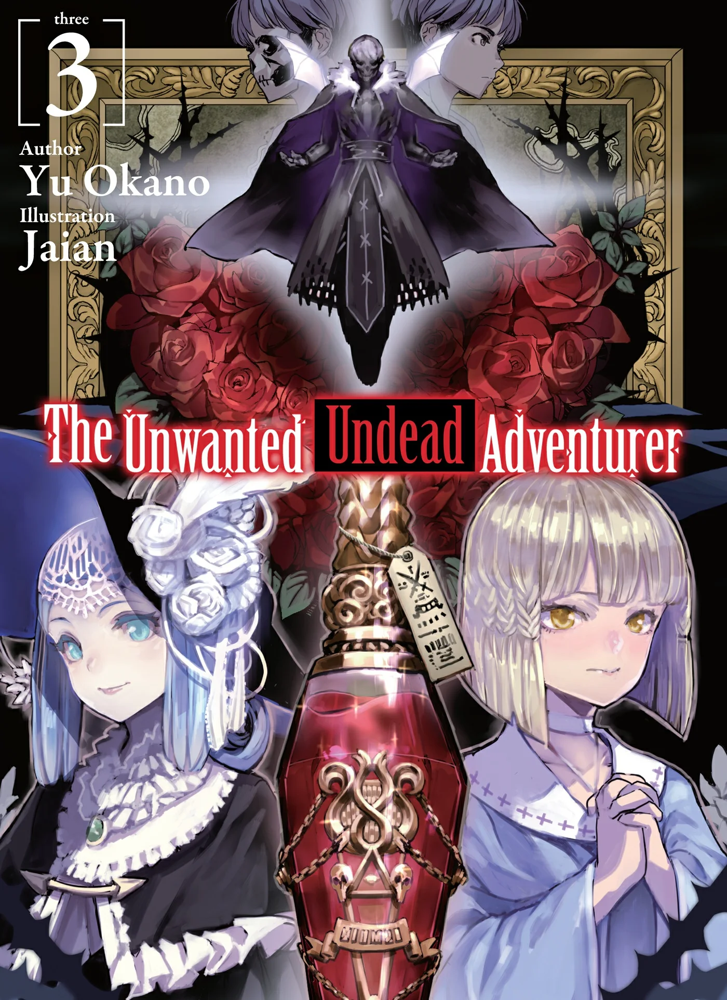
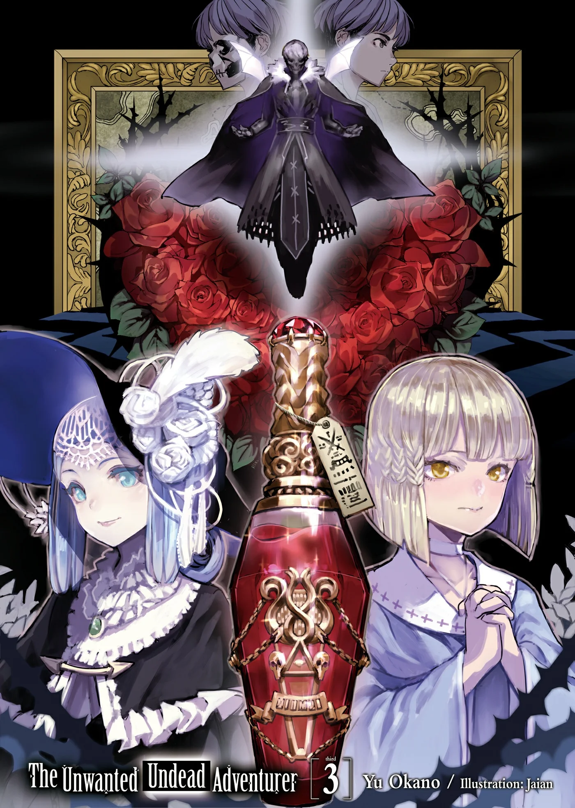
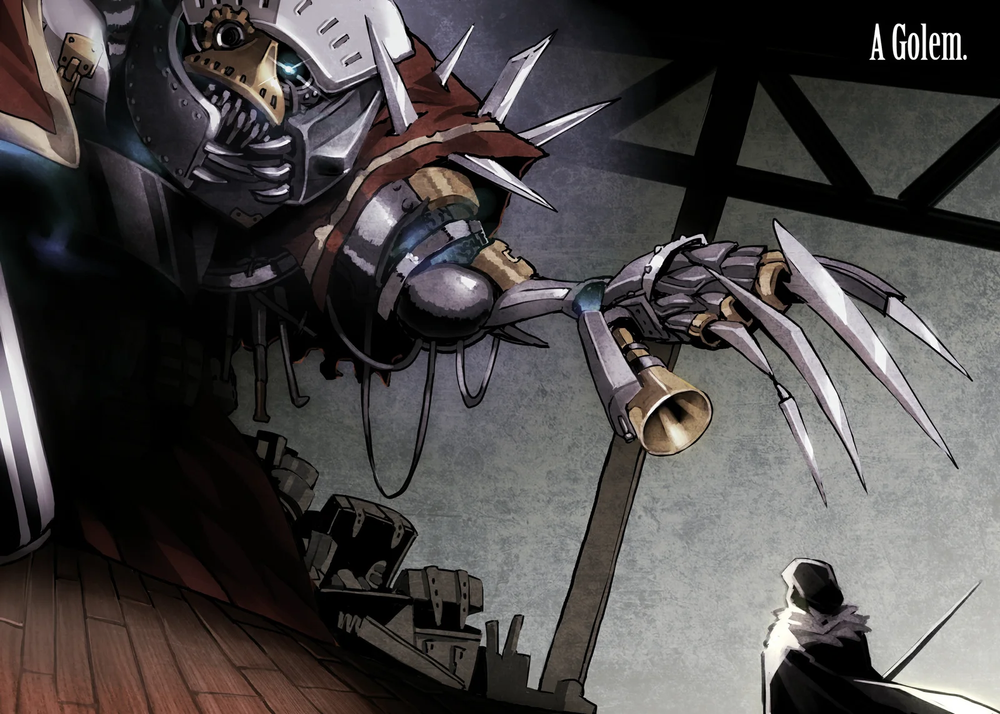
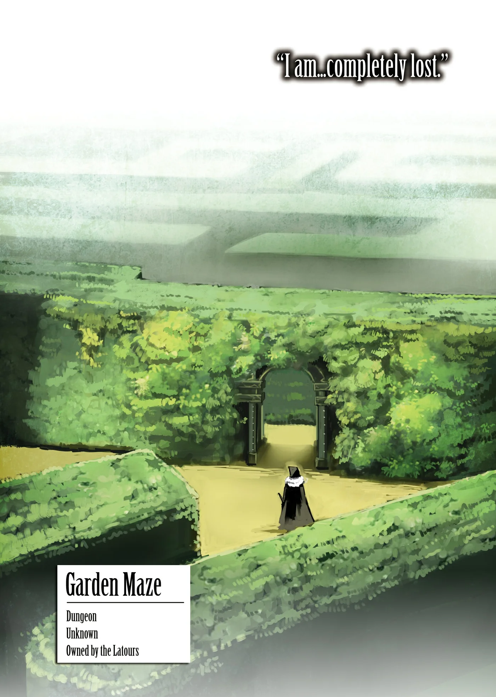
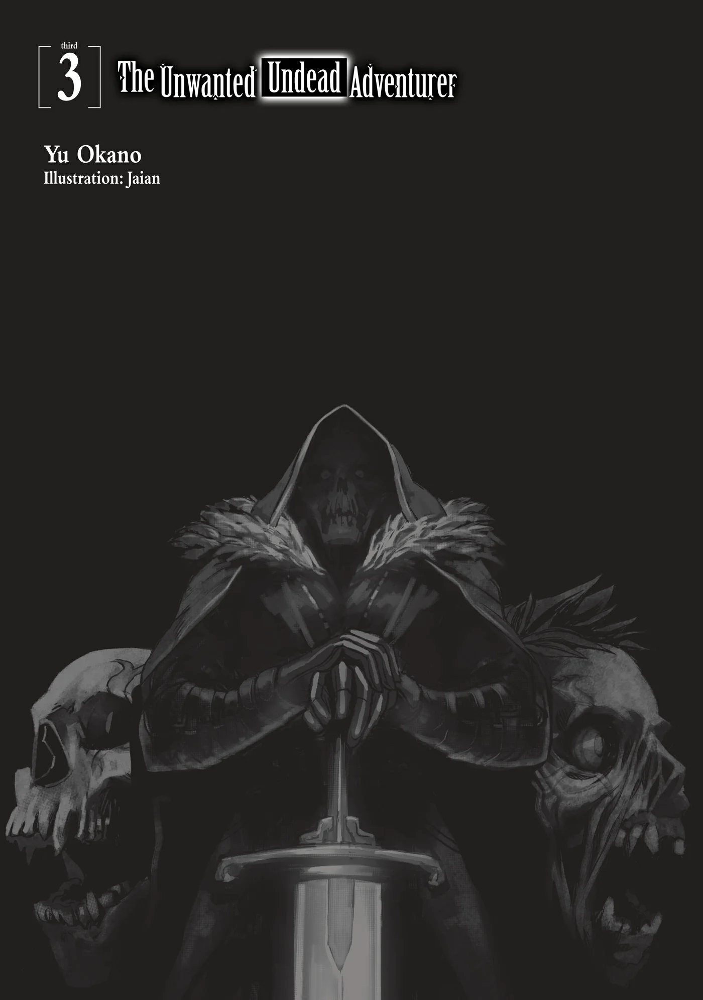
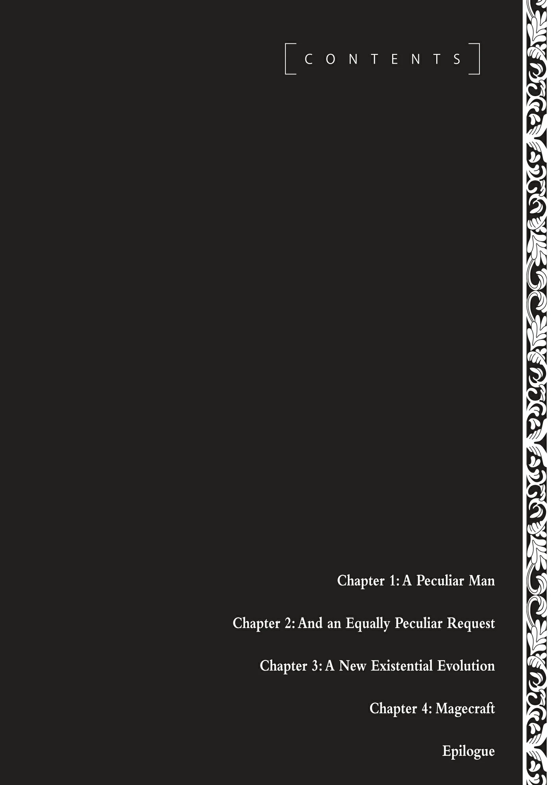
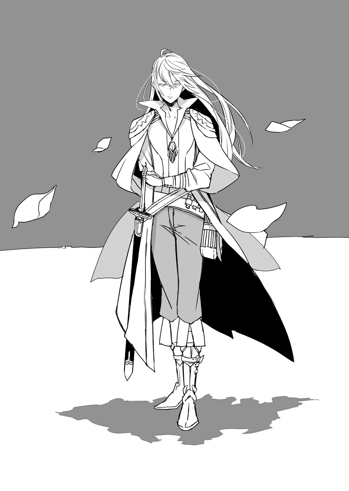

# Chương 56: Tập 3 Chương 1 - Người Đàn Ông Kỳ Lạ (1)

“Ồ...? Thật hiếm khi bắt gặp người khác ở tận sâu trong này.”

Gương mặt người đàn ông lộ vẻ ngạc nhiên. Anh ta cất giọng khá hòa nhã, chẳng có vẻ gì là đe dọa, như muốn cho thấy mình không phải kẻ nguy hiểm. Nhìn kỹ lại, trông anh ta cũng không có ác ý với tôi, càng không giống hạng mạo hiểm giả bất lương sẵn sàng ra tay cướp bóc cả đồng nghiệp.

Dù vậy tôi vẫn cảnh giác, bởi đâu biết được phán đoán của mình có đúng hay không. Trước mắt cứ trò chuyện thăm dò vài câu đã.

“Tôi cũng... Ngạc nhiên. Dù sao thì... Chẳng ai tỉnh táo... Lại đi lang thang. Vào tận chỗ sâu này của... Đầm Lầy Tarasque cả.”

Người đàn ông mỉm cười khi nghe tôi đáp.

“Nghe cứ như ngài đang tự nhận mình không được tỉnh táo cho lắm vậy, thưa quý ngài. Nhưng tôi xin phép không đồng tình đâu, bởi đầu óc tôi vẫn hoàn toàn tỉnh táo. Phần lớn là nhờ mấy thứ này đây, tôi đoán ngài cũng trang bị tương tự chứ?”

Người đàn ông giơ lên thứ trông như một ma cụ, nếu đoán không nhầm thì dùng để hóa giải độc tố. Ngoài ra, anh ta còn mang theo vài lọ Nước Thánh thật sự, chắc chắn là mua từ một nhà thờ có tiếng. Tay kia anh ta cầm một tấm bản đồ đầm lầy chất lượng tốt, ghi chú rất tỉ mỉ. So với kẻ chỉ cậy vào thể chất dị biệt để chống chọi với môi trường rồi cứ thế xông vào đầm lầy như tôi, người này rõ ràng chuẩn bị chu đáo hơn nhiều.

Trông đúng chất một nhà thám hiểm Đầm Lầy Tarasque thực thụ.

Tôi hơi cúi đầu trước lời anh ta. Tôi đâu có chuẩn bị chu đáo được như thế, dẫu vậy cũng chẳng việc gì phải nói thật ra.

Hoàn cảnh của tôi hoàn toàn khác: thể chất Undead giúp tôi chặn đứng độc tố, còn Thần Lực đã giúp tôi thoát khỏi tình thế hiểm nghèo trước con Tarasque. Nhưng tôi không giải thích chuyện này cho anh ta.

Đơn giản là không thể nói ra được.

Tôi chỉ khẽ gật đầu, hơi miễn cưỡng.

“...Đúng như, anh nói.”

“Ra là vậy! Quả không hổ là người dám dấn thân vào đầm lầy. Nhân tiện... ngài cũng đến đây tìm Hoa Long Huyết sao?”

“...Phải. Anh cũng... Tìm thứ đó sao? Vậy thì tốt rồi. Đỡ phải tranh giành... Mấy bông hoa. Không ngờ lại có một mạo hiểm giả khác... Đến đây cùng lúc với tôi.”

Nói thật thì hiếm mạo hiểm giả nào đủ sức mò tới tận đây. Dù có thực lực, sắm sửa trang bị phù hợp cũng tốn một khoản không nhỏ. Chưa kể chẳng mạo hiểm giả bình thường nào lại muốn thường xuyên phơi mình trong kịch độc. Người nào thực sự đủ bản lĩnh băng qua Đầm Lầy Tarasque thì thà xuống thám hiểm các tầng sâu trong mê cung để kiếm bộn tiền còn hơn.

Có điều, nếu muốn tìm Hoa Long Huyết thì đây là nơi duy nhất. Dù vậy, cũng hiếm ai dám mạo hiểm tiến sâu vào đầm lầy đến mức này.

Tôi ngẩng đầu nhìn lại người đàn ông, không khỏi chú ý tới vẻ tuấn tú của anh ta. Làn da anh ta trắng xanh, cứ như chưa từng chạm phải ánh mặt trời. Đường nét trên gương mặt toát lên vẻ lạnh lùng, đi kèm ánh nhìn gần như vô cảm. Mái tóc dài màu bạc xõa quanh gương mặt, mang đậm phong thái của một quý tộc.

Bên hông anh ta giắt một thanh kiếm liễu, một bên tay đeo chiếc khiên kim loại nhẹ chế tác rất khéo. Chẳng hiểu sao tôi cứ có cảm giác trang bị của người này để trang trí hơn là để thực chiến. Nói đúng hơn thì anh ta hợp với những bộ trang phục sang trọng; thực sự thì anh ta chỉ cần khoác lên mình bộ lễ phục quý phái thôi là đã hợp lắm rồi, chẳng cần đến kiếm với khiên làm gì.

Giữa vùng đầm lầy u ám và dáng vẻ sang trọng của người đàn ông này là một sự tương phản không thể rõ rệt hơn. Sẽ chẳng có gì lạ nếu anh ta lặn lội vào đầm lầy chỉ với mục đích duy nhất là hái những bông hoa này.

“À, thật ra thì...” người đàn ông nói tiếp, “tôi không phải mạo hiểm giả đâu.”

“...Vậy sao?”

“Đúng vậy. Nói thế nào nhỉ... Tôi đại khái là một quản gia, phụng sự một nhân vật đáng kính. Chủ nhân của tôi cần Hoa Long Huyết định kỳ, nên tôi mới phải thường xuyên lui tới đây.”

Nếu tôi không nghe nhầm thì anh ta là một quản gia, vâng lệnh chủ nhân đi hái Hoa Long Huyết. Bất chấp hiểm nguy rình rập đến mức này, quả là một mối quan hệ chủ tớ đáng nể thật.

Tôi quay sang nhìn con chuột đen đang đậu trên vai, khẽ càu nhàu trong cổ họng rồi quay lại nhìn người đàn ông.

Edel... Cái con chuột này chẳng đời nào chịu làm chuyện tương tự cho tôi đâu.

Tôi thầm nhủ đừng có trông mong gì nhiều ở con quyến thuộc của mình, rồi hỏi người đàn ông: “...Thứ lỗi cho tôi. Hỏi thẳng. Chủ nhân của anh... Không khỏe sao?”

“À, vâng. Cũng có thể nói như vậy. Dạo gần đây, ngay cả việc ngồi dậy cũng là cả một sự nhọc nhằn... Thật lòng mà nói, đáng lẽ lúc này tôi phải túc trực bên cạnh chủ nhân, chứ không phải ở ngoài này hái hoa. Dù vậy, không thể phủ nhận là chủ nhân rất cần Hoa Long Huyết. Dịch chiết của hoa tuy có thể dễ dàng bào chế thành thuốc công hiệu, nhưng chủ nhân của tôi lại... chuộng dùng hoa tươi vừa ép hơn, nếu tôi có thể nói như vậy. Nhân tiện... ngài có tình cờ biết cách nào để bảo quản Long Hoa Huyết tươi vừa chiết xuất không? Là mạo hiểm giả, biết đâu ngài lại nắm được phương pháp đó...?” người đàn ông tò mò hỏi.

Hoa Long Huyết tuy có thể bào chế thành thuốc, nhưng Long Hoa Huyết tươi vừa chiết xuất lại có dược lực mạnh hơn nhiều. Dù không nắm rõ chi tiết như dược sư, tôi cũng biết Long Hoa Huyết sẽ giảm chất lượng chỉ sau vài ngày và phải dùng hết trong khoảng thời gian đó. Nếu vì lý do nào đó mà cần dùng đều đặn, người ta chẳng còn cách nào khác ngoài việc liên tục lui tới đầm lầy.

Với người bình thường, đây là chuyện bất khả thi, đòi hỏi cả đống tiền của lẫn công sức. Ma cụ một khi đã mua về, chỉ cần bảo dưỡng tử tế là vẫn giữ nguyên được công năng, chứ Nước Thánh lại là chuyện khác. Hiệu quả bảo vệ của nó trước hiểm họa đầm lầy thì đã rõ, nhưng chỉ một lọ thôi cũng ngốn đứt của người mua vài đồng vàng rồi.

Trước giờ tôi chưa từng nghĩ nhiều về chuyện này, nhưng việc các giáo hội độc quyền nguồn cung Nước Thánh như thế gần như chẳng khác nào phạm pháp.

Dù sao đi nữa, tôi làm gì biết cách nào bảo quản Long Hoa Huyết. Tuy quãng thời gian ngắn ngủi làm học việc cho dược sư giúp tôi học được không ít mẹo vặt và kỹ năng, nhưng điều người đàn ông này hỏi rõ ràng nằm ngoài tầm hiểu biết của tôi. Mà cho dù có phương pháp đó thật, nhiều khả năng đến nay vẫn chưa ai tìm ra.

“...Không. Nếu tôi biết... Cách đó. Tôi đã... Bỏ nghề mạo hiểm giả và. Đi làm dược sư rồi.”

Đó là câu trả lời của tôi. Một lời nói dối trắng trợn, bởi tôi bắt buộc phải trở thành mạo hiểm giả Mithril Cấp. Kể cả có tìm ra phương pháp đó, tôi cũng chẳng bao giờ bỏ nghề mạo hiểm; có điều người đàn ông trước mặt cũng đâu cần biết chuyện này. Dù vậy, việc tôi không rành cách bảo quản Long Hoa Huyết thì hoàn toàn là sự thật.

Người đàn ông chỉ mỉm cười, như thể đã đoán trước câu trả lời. “Tôi đoán cũng phải thôi,” anh ta đáp lại bằng phong thái rất mực điềm đạm, thuần thục.

“Tôi... Xin lỗi. Vì không giúp được gì.”

Vẻ mặt người đàn ông dịu lại khi nghe tôi xin lỗi, nét mặt anh ta cũng thoáng vẻ áy náy. “Không, không sao đâu. Xin ngài đừng bận tâm. Thật ra chính tôi mới phải xin lỗi vì đã kỳ vọng quá nhiều ở một người mới gặp lần đầu. Xin ngài cứ coi đó là một câu hỏi bâng quơ thôi, thưa quý ngài. Đừng để tâm làm gì.”

Trông anh ta có vẻ thực lòng áy náy.

“Cảm ơn sự... Quan tâm của anh.” Tôi quyết định đáp lại bằng vài lời xã giao. “Tôi... Không quen. Với việc... Làm người mới gặp phải thất vọng. Nhưng nếu có việc gì... Tôi làm được. Tôi sẽ rất sẵn lòng... Giúp đỡ.”

Người đàn ông hơi sững lại trước lời tôi nói, rồi thoáng ngập ngừng như đang suy tính điều gì. “Thật vậy sao...? Nếu thế thì... dù ngài không biết điều tôi cần tìm, có lẽ việc được làm quen với ngài hôm nay vẫn là một sự may mắn. Chủ nhân của tôi chắc chắn cũng sẽ thấy vậy.”

Tôi nghiêng đầu, chưa hiểu rõ ý anh ta lắm.

“À, tôi thành thật xin lỗi. Đôi khi tôi lại mải chìm vào suy nghĩ riêng. Ý tôi là chuyện ngài vừa nhắc tới trước đó, rằng liệu có việc gì ngài có thể giúp được không ấy.”

“Tôi đúng là... Đã nói vậy. Phải.”

“Nói thật thì chúng tôi vẫn đang tìm một người đáng tin cậy để định kỳ mang Hoa Long Huyết về. Đương nhiên là việc tìm kiếm tiến triển chẳng mấy thuận lợi...”

“Ồ...?”

Cũng phải thôi. Nếu là mạo hiểm giả cấp cao, việc liên tục phơi mình trước hiểm nguy ở Đầm Lầy Tarasque chẳng mang lại lợi lộc gì xứng đáng cho họ. Dù thù lao có hậu hĩnh, hay đôi khi còn có phần khuất tất về mặt pháp lý, đa số mạo hiểm giả vẫn sẽ từ chối một ủy thác như thế nếu không có lý do thật sự chính đáng.

Đó cũng là lý do cô bé Alize ở cô nhi viện phải khổ tâm đến vậy. Nếu yêu cầu của ủy thác không quá khó khăn, hẳn đã có người sẵn lòng giúp cô bé rồi, bởi bên thuê vốn là một cô nhi viện.

Một ý nghĩ bất chợt lóe lên trong đầu tôi:

“...Tôi hiểu rồi. Người... Đáng tin cậy mà anh nói. Là chỉ tôi sao?”

“Chính xác là vậy. Tôi thành thật xin lỗi vì lời đề nghị có phần đường đột này. Đương nhiên chúng tôi sẽ gửi một loạt ủy thác chính thức thông qua Hội, cũng như thu xếp các điều khoản hợp đồng và thù lao thỏa đáng. Nếu ngài nhận lời, tôi sẽ vô cùng cảm kích... Xin thứ lỗi vì nói chuyện nãy giờ mới hỏi, nhưng ngài là một mạo hiểm giả, đúng chứ?”

Cứ như thể anh ta đã biết thừa tôi là mạo hiểm giả rồi vậy. Nghĩ thế, tôi thấy mình cũng nên tự giới thiệu.

Tôi cho người đàn ông biết tên và cấp bậc mạo hiểm giả của mình: “Phải. Tôi là mạo hiểm giả... Đồng Cấp. Rentt... Vivie. Tôi đến đây vì... Một ủy thác. Mà tôi đã nhận.”

Gương mặt người đàn ông lại thoáng vẻ ngạc nhiên. Tôi hiểu lý do vì sao: chẳng gì khác ngoài cấp bậc mạo hiểm giả của tôi.

“...Tôi không ngờ ngài lại là một mạo hiểm giả Đồng Cấp...” người đàn ông nói tiếp.

“Giờ anh có bớt... Hào hứng. Với việc giao nhiệm vụ đó... Cho tôi chưa?”

Người đàn ông lắc đầu. “Không, hoàn toàn không có chuyện đó. Quả thực tôi có bất ngờ trước cấp bậc của ngài, nhưng chỉ vậy thôi. Việc ngài đứng trước mặt tôi mà không hề hấn gì đã là minh chứng rõ nhất cho thực lực của ngài rồi. Tôi sẽ rất vinh hạnh nếu ngài nhận ủy thác của chúng tôi, hoặc ít nhất là cân nhắc về nó, thưa quý ngài.”

“...Anh đúng là một người. Kỳ lạ.”

Người bình thường sẽ chẳng bao giờ nghĩ đến chuyện giao một nhiệm vụ như thế cho mạo hiểm giả Đồng Cấp. Nhưng người đàn ông này dường như chẳng mấy bận tâm đến thứ hạng của tôi. Có lẽ anh ta coi trọng năng lực thực tế của tôi hơn.

Bản thân tôi cũng chẳng biết mình có kham nổi công việc đó không, nhưng việc có người đánh giá mình như vậy cũng khiến tôi thấy vui vui trong lòng.

Như sực nhớ ra điều gì quan trọng, người đàn ông liền nói tiếp: “À, phải rồi... Tôi sơ suất quá. Tên tôi là Isaac Hart. Xin ngài cứ tự nhiên gọi tôi là Isaac. Tôi rất muốn giới thiệu ngài với chủ nhân của mình... nhưng dĩ nhiên phải sau khi các thủ tục chính thức được thu xếp xong xuôi đã.”

