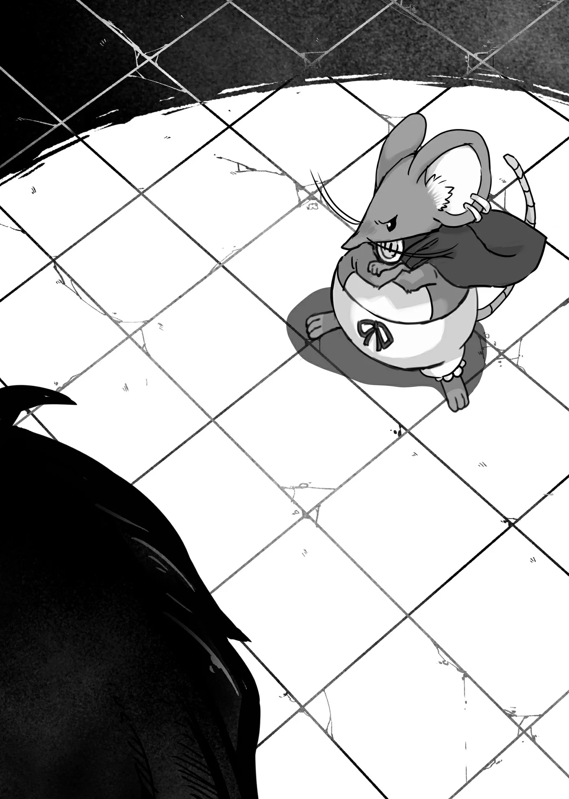

# Chương 59: Tập 3 Chương 1 - Người Đàn Ông Kỳ Lạ (4)

"Thế... có thật không anh? Anh xong rồi sao? Xong xuôi rồi hả anh?" Alize hỏi ngay khi tôi vừa ngồi xuống căn phòng tiếp khách chật chội, nơi chúng tôi gặp nhau lần đầu.

Trông Alize ngạc nhiên hơn là ngờ vực. Nghĩ lại thì đúng là tôi xong việc nhanh thật.

Chỉ là cô bé đâu biết câu vừa rồi của tôi thực ra ám chỉ điều gì: số phận hẩm hiu của chiếc vòng gõ cửa bị gãy. Dĩ nhiên, nếu giấu được thì tôi sẽ để sự thật ấy vĩnh viễn chìm vào bóng tối.

Giấu đi nỗi ngượng ngùng sau vụ đó, tôi đáp lại Alize bằng giọng đều đều.

"Phải. Đây... Tự mình... Xem đi."

Tôi rút một cành hoa từ chiếc túi ma cụ rồi đặt đóa Hoa Long Huyết xuống chiếc bàn gỗ ọp ẹp kê giữa hai người. Tôi cẩn thận trải sẵn một mảnh vải lót vì sợ làm bẩn bàn, dẫu cái bàn vốn đã cũ mòn, sờn rách. Giờ thì đóa hoa nằm ngay ngắn trên tấm vải, cả rễ lẫn cành đều được bọc kỹ.

Thế nhưng Alize chẳng hề để tâm xem cái bàn ra sao. Toàn bộ sự chú ý của cô bé đều dồn cả vào đóa hoa, mắt tròn xoe nhìn nó đầy tò mò.

"Đây... là nó sao? Lần đầu tiên em được thấy tận mắt đấy! Hoa đẹp quá..."

Có lẽ vì vẻ đẹp, vì độ quý hiếm, hay vì công hiệu làm thuốc tuyệt vời của nó; dẫu là lý do gì, Alize trông thật sự xúc động trước nhành hoa đặt trước mặt.

Nhưng đúng như Alize nói, Hoa Long Huyết quả thực rất đẹp. Cánh hoa đỏ thẫm không bao giờ ngửa lên trời mà khẽ rủ xuống, với những phiến lá to bản càng tôn thêm dáng hoa. Nâng đỡ cả cây là phần thân cứng cáp, minh chứng cho sức sống dẻo dai bền bỉ của loài hoa này.

Nét hài hòa mộc mạc mà gần như kỳ diệu ấy có lẽ là lý do loài hoa này được chuộng trong các dịp cầu hôn đến thế. Còn nếu chẳng có ai để cầu hôn, người ta vẫn có thể ngắm nhìn vẻ đẹp tự nhiên của nó, tôi đoán vậy.

"Thế này... Được chưa...?"

"Em cũng chẳng biết nói sao nữa," Alize như vẫn còn đang mải nghĩ ngợi, mãi mới ngước lên nhìn tôi đáp. "Em không biết đây có phải Hoa Long Huyết thật không... Á. Ý em không phải là nghi ngờ anh đâu! Chỉ là... em chịu không nhìn ra! Cái này vượt quá hiểu biết của em rồi."

"Không phải em bảo... Có người bạn... Làm dược sư với thầy trị liệu sao? Họ sẽ bào chế... Thuốc cho Sơ Lillian mà."

"Vâng, đúng rồi. Để em đi gọi cả hai người đến ngay. Anh phải đợi một lát đấy—thế có được không anh?" Alize hỏi, rõ là muốn chạy đi tìm người thầy trị liệu và dược sư đó về ngay.

Bản thân tôi cũng muốn xong giấy xác nhận ủy thác càng sớm càng tốt, gọi họ đến chỉ càng nhanh việc. Nghĩ vậy, tôi gật đầu với Alize.

Alize cũng gật đầu một cái rồi vội vã chạy ra khỏi phòng, chắc là đi thẳng tới chỗ ở của hai người kia.

Dược sư và thầy trị liệu thường làm việc trong giáo hội hoặc các cơ sở y tế, mà phần lớn những chỗ đó đều cách cô nhi viện một quãng khá xa. Đoán chừng Alize đi phải lâu mới về, đồng nghĩa với việc tôi đang có một khoảng thời gian rảnh rỗi. Chờ cô bé thì chẳng có gì khó, nhưng phải chịu đựng cảnh buồn chán lại khá phiền.

Đang định bụng cam chịu ngồi chờ trong buồn chán, thì Edel – nãy giờ vẫn nằm ườn trên vai tôi – bỗng phóng vút xuống, đáp gọn xuống đất. Chạy biến ra một góc, nó bắt đầu cào vào vách tường.

"...Mày. Đang làm cái gì đấy, chuột?"

Nghe tôi hỏi, Edel ngước nhìn quả đấm cửa rồi tự mình nhảy phắt lên đó. Dù đáp trúng quả đấm cũ kỹ kêu một tiếng uỵch rõ to, nhưng đây đâu phải loại tay gạt ấn xuống là mở, nên cánh cửa vẫn trơ trơ.

Nghĩ lại chuyện nó từng húc thẳng vào cổ Tarasque với sức mạnh kinh người thế kia... Mà cũng phải, với thân hình bé tí ấy thì chuột làm sao mở cửa dễ dàng được. Nói đúng hơn thì, trông cảnh ấy tôi thấy khá buồn cười.

Tôi không rõ có nên mở cửa không, nhưng cũng chẳng định nhốt Edel trong gian phòng tiếp khách chật hẹp này mãi tới lúc Alize về. Miễn là nó không bén mảng vào chỗ cấm thì đi dạo một lát cũng chẳng sao. Đương nhiên, nếu ai phàn nàn chuyện thú cưng chạy rông, tôi cứ đổ hết lên đầu con chuột là xong. Xét về lý thì thế cũng chẳng phải nói dối.

Dù còn phân vân từ lúc Edel đòi mở cửa, nhưng mọi thắc mắc hay độc thoại trong đầu tôi đều bị con chuột dập tắt chỉ bằng một cái lườm. Xem ra nó thực sự muốn ra khỏi căn phòng này rồi.

Tôi đứng dậy bước ra cửa. Vặn mạnh quả đấm rồi hé mở cánh cửa ra, chỉ chờ có thế, con chuột phóng vút đi ngay. Tôi đi theo sau, tò mò muốn biết nó định đi đâu. Điểm đến khá dễ đoán, bởi chẳng mấy chốc tôi đã thấy mình đứng trong kho chứa dưới tầng hầm của cô nhi viện—đúng căn phòng nơi tôi gặp Edel lần đầu.

Edel thoăn thoắt chạy ra giữa phòng, đứng dựng bằng hai chân sau rồi cất tiếng kêu chít chít the thé vào không khí ẩm lạnh. Gần như ngay lập tức, không dưới năm con Puchi Suri từ trong bóng tối lao vút ra với tốc độ kinh người, xếp thành một hàng thẳng tắp trước mặt quyến thuộc của tôi.

Hình như mình từng thấy cảnh này ở đâu rồi thì phải...?

Tôi nhớ rõ từng thấy cảnh lũ Puchi Suri nhỏ hơn xếp hàng trước một con to lớn thế này. Thật ra mấy con Puchi Suri này trông rất quen; vết sẹo với hoa văn lông của chúng tôi đều đã thấy qua. Chỉ là trông chúng có vẻ lớn hơn một chút, to ra thấy rõ so với lần trước tôi gặp.

Trong khi tôi còn mải nghĩ ngợi về hoa văn lông chuột, Edel lại kêu lên lần nữa, như thể đang trò chuyện gì đó với đồng loại. Tiếng kêu của Puchi Suri dĩ nhiên chỉ toàn tiếng chít chít vô nghĩa với hầu hết con người, nhưng tôi lại có lợi thế nhờ liên kết tâm trí với Edel. Dần dà, tôi bắt đầu hiểu rõ nội dung cuộc trò chuyện của chúng.

Qua những tiếng chít chít râm ran, năm con Puchi Suri dưới trướng Edel vẫn giữ lời hứa bảo vệ nhà kho dưới tầng hầm. Trong thời gian đó, chúng từng bị những bầy Puchi Suri khác từ đường phố Maalt mò vào tấn công. Dù vậy, cả bọn vẫn kiên cường giữ vững trận địa, bảo vệ kho hầm mà không để kẻ nào xâm nhập. Chúng làm được thế là nhờ Edel đã biến đổi đồng loại đôi chút bằng cách truyền một ít Ma Lực và Khí Lực vào người chúng. Chưa kể đám Puchi Suri này vốn đã khỏe hơn lũ chuột ngoài đường một chút, nên mới giành được phần thắng.

Nói cách khác, xem chừng bản thân chúng cũng sắp bước vào một lần Tiến Hóa Bản Thể của riêng mình rồi.

Có điều điểm này lại làm tôi thấy lấn cấn. Vốn dĩ chỗ Ma Lực với Khí Lực đó chẳng phải của tôi sao? Sức mạnh của Edel được lấy từ ai khác ngoài chính chủ nhân của nó là Rentt Faina này chứ.

Thế nhưng Edel lại quay người sang, nhìn chằm chằm về hướng tôi rồi kêu lên khá dữ dằn. Xem ra con chuột quyến thuộc muốn tôi giữ kín mấy ý nghĩ đó trong bụng thì hơn.

Thật là một con chuột ngang ngược hết chỗ nói!

Rõ ràng tôi là chủ, còn Edel là tớ! Thế mà xem chừng nó chẳng hề nghĩ vậy.

Thấy tiếng kêu của nó gắt quá, tôi đành để mặc nó muốn làm gì thì làm... chí ít là lúc này. Vả lại, cuộc trò chuyện giữa Edel và đám đàn em cũng mang lại vài điều hữu ích cho tôi. Đám thuộc hạ của Edel không chỉ đánh bại lũ Puchi Suri định xâm nhập kho hầm mà còn thu phục luôn bọn chúng. Nhờ thế, chúng nắm được thông tin về mọi tòa nhà, đường xá và lối đi bí mật khắp Maalt qua mạng lưới chuột thành thị tinh vi này. Nhờ mối hợp tác mới mẻ đó, bầy Puchi Suri sống dưới hầm bước vào một thời kỳ thịnh vượng mới, con nào con nấy đều được sống trong yên bình. Tất cả đều nhờ công đại ca chuột Edel của chúng...

Chí ít thì theo chỗ tôi hiểu là vậy.

Tôi thật sự cạn lời... Dù nghe thì tốt đẹp đấy, nhưng nguồn sức mạnh của Edel đâu có đến từ ai khác ngoài tôi cơ chứ...

Tôi rất muốn nói to điều đó ra, nhưng đành chịu, chẳng thể mở miệng. Mà có nói thì lũ chuột nhỏ kia cũng đâu hiểu được tiếng người.

Chưa kể tôi cũng chẳng có được sức hút như Edel; tiếc thật đấy.

Đang mải tủi thân thì một luồng ý nghĩ bất ngờ từ Edel cắt ngang dòng suy nghĩ của tôi. Hóa ra, nó có thể sai đám đàn em đi thu thập tin tức cho tôi nếu tôi muốn. Nhờ thân hình bé nhỏ, tốc độ nhanh nhạy và vẻ ngoài bình thường chẳng ai để ý, Puchi Suri có mặt ở khắp ngóc ngách Maalt. Giết một con thì chẳng khó, nhưng tốc độ sinh sản kinh hồn của chúng khiến việc diệt tận gốc gần như vô nghĩa. Nếu tôi tận dụng được lợi thế này, để mạng lưới chuột thu thập tin tức khắp Maalt...

Mọi chuyện trong thị trấn này tôi đều sẽ nắm rõ.

Không ngờ chuyện đó lại diễn ra lúc nào tôi chẳng hay—giờ đây trong tay tôi đã có cả một mạng lưới chỉ điểm và gián điệp tí hon.

Thứ này sẽ có ích lắm đây. Thật sự rất hữu dụng...

◆◇◆◇◆

"Cái... Cái này tuyệt quá! Đáng kinh ngạc thật! Tôi chưa bao giờ thấy mẫu vật nào được bảo quản hoàn hảo đến mức này!"

Người đứng trước mặt tôi lúc này không ai khác chính là Unbert Abeiyu, người thầy trị liệu mà Alize từng nhắc tới. Đi cùng anh là dược sư Norman Hanel.

Unbert là một người đàn ông trung niên cao gầy, còn Norman trẻ hơn hẳn, một thanh niên đẫy đà trạc cuối đôi mươi. Nhìn phong thái và nụ cười thân thiện của hai người, tôi hiểu họ có mối quan hệ gắn bó với cô nhi viện.

"Thế sao...? Dù gì thì... Chỉ mạo hiểm giả cấp cao. Mới dám khám phá Đầm Lầy... Tarasque. Người ta hẳn sẽ nghĩ họ... Chí ít cũng phải biết. Cách hái và bảo quản... Hoa Long Huyết chứ."

Tay nghề mạo hiểm giả đúng là tăng tỉ lệ thuận với cấp bậc. Những người xếp hạng cao thường có sức mạnh vượt trội hơn, đồng thời trên đường hành nghề họ cũng học thêm vài kỹ năng khác, như mổ xẻ hay hái thảo dược. Tất nhiên, người ta cũng bắt buộc phải học phép tắc xã giao trong làm ăn và hiểu biết chung về việc đời. Dù không ai đòi hỏi mạo hiểm giả phải nắm lượng kiến thức nhiều như dân chuyên nghiệp, nhưng càng leo lên cấp cao, chí ít họ cũng phải tiếp tục học hỏi và trau dồi các kỹ năng cốt lõi của mình.

Tất nhiên vẫn có ngoại lệ. Những người chỉ nhận ủy thác thảo phạt sẽ phát triển sức mạnh lệch hẳn. Tương tự, những mạo hiểm giả xoay xở gian lận hoặc phô trương lừa gạt để vượt qua bài thi thăng hạng sẽ có bộ kỹ năng khá kỳ quặc.

Tính hết những yếu tố đó, theo lẽ thường ai cũng sẽ nghĩ mạo hiểm giả khám phá Đầm Lầy Tarasque chí ít phải đạt Ngân Cấp hoặc Kim Cấp. Trừ những trường hợp đặc biệt như tôi ra, họ sẽ thành thạo ở mọi mặt: chiến đấu, hái thảo dược hay những việc tương tự.

"Không hẳn thế đâu, không hẳn thế đâu. Chốn đó hiểm trở như vậy, phần lớn mạo hiểm giả lo sợ bị trúng độc còn chưa xong, làm gì còn tâm trí để ý tới bông hoa mình đang hái! Thật ra đa số họ đều hái rất ẩu, cứ nghĩ miễn mang được một mẫu vật về là ổn cả rồi. Có điều xét tính chất của nơi ấy... chẳng mấy mạo hiểm giả dám bước vào, nên chúng tôi cũng đâu phàn nàn được. Thậm chí, tìm được một mạo hiểm giả có khả năng đặt chân vào đó đã là chuyện đáng mừng lắm rồi!"

Lời Norman nói cũng đúng. Rất ít mạo hiểm giả sẵn lòng nán lại đầm lầy lâu hơn mức cần thiết. Đa số những người có đủ năng lực đều thà đi chỗ khác còn hơn; dù vậy, những ai chịu bước vào chắc hẳn đều được trả thù lao hậu hĩnh cho thời gian họ bỏ ra. Những người làm tình nguyện như tôi có lẽ là chuyện xưa nay chưa từng thấy trong hoàn cảnh này.

Mạo hiểm giả và người thuê thường ở vị thế ngang hàng, nên người thuê phải đưa ra thù lao xứng đáng mới mời được một mạo hiểm giả đủ năng lực bước vào đầm lầy. Vì có nhiều yếu tố phức tạp, mạo hiểm giả thường nắm thế thượng phong khi thương lượng chuyện này. Tuy nhiên ở phần lớn trường hợp khác, mọi chuyện lại ngược lại. Quan hệ cân bằng giữa người thuê và mạo hiểm giả nghe thì lý tưởng đấy, nhưng thực tế lại rất khác.

"Tôi mừng là... Mọi chuyện suôn sẻ."

"Đương nhiên là suôn sẻ rồi chứ!" Norman hào hứng đáp.

"Có đóa Hoa Long Huyết được bảo quản hoàn hảo thế này thì chuyện chế thuốc chữa Bệnh Tích Tụ Chướng Khí dễ dàng thôi! Nhờ hoa còn nguyên vẹn hoàn hảo nên tôi chế biến cũng thuận lợi hơn nhiều. Thậm chí tôi còn có thể làm thêm nhiều loại thuốc khác nữa. Giá mà chúng ta có thêm Hoa Long Huyết thì tốt biết mấy..." Norman nói, như thể hiểu rằng chỉ riêng việc có được một bông hoa thôi đã là may mắn lắm rồi.

"Các anh... Cần bao nhiêu?"

"Hở...? Hừm. Để xem nào. Chà, thêm chừng ba bốn cành nữa thì tuyệt nhất. Tôi sẽ chia đều dịch chiết ra, làm thêm nhiều loại thuốc khác để chữa cho người bệnh!" Norman nói, như đang lẩm bẩm với chính mình hơn là nói với ai khác.

Trông anh không có vẻ gì là đang nài nỉ tôi đưa thêm hoa; vả lại tôi cũng chưa hề báo cho họ biết chuyện mình hái được nhiều hoa. Norman chắc chỉ đang tưởng tượng ra viễn cảnh có nhiều mạo hiểm giả tốt bụng mỗi người mang về một bông mà thôi.

Anh không giống kiểu người hay nói dối—như để xác nhận suy nghĩ của tôi, Alize ghé sát lại, thì thầm vào tai tôi.

"Bác sĩ Norman giúp đỡ nhiều người nghèo lắm, không chỉ riêng cô nhi viện đâu anh! Bác sĩ còn tự bỏ tiền túi ra lo thuốc men nữa đấy, anh biết không? Bác sĩ là một thầy thuốc nhân hậu hiếm có! Thời buổi này tìm đâu ra người như thế nữa!" Alize hết lời khen ngợi Bác sĩ Norman tốt bụng. Xem chừng vị bác sĩ này rất được cô bé tin quý.

Không nghi ngờ gì việc bác sĩ giúp đỡ Alize và cô nhi viện rất nhiều, nhưng nghề dược sư nhìn chung cần kha khá vốn liếng để hoạt động. Thuốc thang đâu phải miễn phí, bởi người ta phải thu gom đủ nguyên liệu thích hợp. Đặc thù công việc vốn là thế. Thành ra đa phần dược sư chẳng còn cách nào khác ngoài việc bán thuốc với giá nhỉnh hơn đôi chút, chí ít cũng để tiệm thuốc tiếp tục duy trì được.

Dù vậy... Nghĩ tới cảnh vị bác sĩ tự bỏ tiền túi ra giúp người bệnh, tôi không khỏi thấy lo. Nhỡ có chuyện gì xảy ra với Bác sĩ Norman, cô nhi viện chắc chắn sẽ chịu ảnh hưởng xấu.

Ít nhất Alize sẽ nghĩ theo hướng đó. Nhưng thực tế mà nói, bác sĩ hẳn phải có cách riêng để duy trì công việc làm ăn của mình. Những lý do đó là gì thì tôi không dám chắc, có điều tôi nghĩ mình đóng góp một chút thế này cũng chẳng mất gì.

Tôi thò tay vào chiếc túi ma thuật, quyết định góp thêm vài bông hoa từ chỗ dự trữ của mình. Thêm vài cành hoa cũng chẳng phải mất mát gì lớn, mà lại dùng vào việc tốt.

"Đây... Cầm lấy. Mấy cành này đi."

Tôi lấy thêm bốn cành Hoa Long Huyết nữa đặt lên bàn. Cả Norman lẫn Unbert đều trợn tròn mắt kinh ngạc trước cảnh đó. Chắc họ không ngờ một mạo hiểm giả đi lẻ lại đủ khả năng tự mình hái được nhiều hoa đến thế.

Hoa Long Huyết vốn mọc thành từng cụm lớn, nhưng hai người họ đâu biết chuyện đó, cũng như phần lớn người ngoài nghề chẳng hề biết tới chiếc túi ma thuật sâu không đáy. Tôi đã phải tích cóp suốt năm năm trời mới mua được chiếc túi này—một khoản đầu tư hoàn toàn xứng đáng. Đến mạo hiểm giả Ngân Cấp cũng phải tiết kiệm ít nhất một năm; chuyện chẳng dễ dàng gì khi đa số mạo hiểm giả đều tiêu xài hoang phí chẳng chút nghĩ ngợi. Đã vậy loại ma cụ này đâu có sẵn ngoài quầy, trước hết người ta phải tìm mua ở các buổi đấu giá công khai, hoặc thậm chí ngoài chợ đen.

Nhờ quen biết rộng và có nhiều người cung cấp tin tức, tôi đã mua được một chiếc túi dung tích lớn, trong khi đa số mạo hiểm giả thường chỉ có chiếc túi to bằng nửa của tôi. Những chiếc túi nhỏ hơn thì sau khi xếp nhu yếu phẩm, lương khô và đồ đựng thông thường vào là chẳng còn trống bao nhiêu.

Tất nhiên, người ta có thể lập tổ đội để mang được nhiều đồ hơn. Nhưng cách này lại không hiệu quả mấy khi khám phá Đầm Lầy Tarasque, chủ yếu vì trang bị chống độc thường chiếm khá nhiều diện tích. Đó là lý do hầu hết mạo hiểm giả thường chỉ mang về được một bông Hoa Long Huyết duy nhất.

Còn tôi thì thuê một chiếc túi dung tích lớn từ Hội, lại chẳng cần biện pháp chống độc nào nên chỗ trống còn lại kha khá.

Nghĩ đi nghĩ lại thì cơ thể này của tôi cũng có chỗ hữu dụng. Một cảm xúc kỳ lạ chợt dâng lên từ đáy lòng: dù mong có ngày trở lại làm người, liệu lúc đó tôi có mất đi khả năng kháng độc không? Nghĩ thế có lẽ hơi tham lam, nhưng ngẫm lại thì con người vốn dĩ là sinh vật tham lam từ trong bản chất. Một khi đã có được thứ gì đó, chắc chắn họ sẽ lại muốn nhiều hơn nữa.

Cắt ngang dòng suy nghĩ của tôi là Edel, nãy giờ vẫn đậu im lìm trên vai. Nó như muốn tuyên bố rằng bản thân chẳng hề có mấy ý nghĩ tham lam kia, mà một con chuột thì chắc sẽ nghĩ thế thôi. Đáp lại, Edel siết chặt móng vuốt bám trên vai tôi hơn.

Rồi rồi, chuột à. Tao xin lỗi.

Dù sao đi nữa, tôi quay sự chú ý lại với hai người làm nghề y trước mặt, cả hai lúc này vẫn còn đứng chôn chân nhìn những bông hoa trên bàn. Norman là người phản ứng đầu tiên.

"Có... Có thật không anh? Anh chịu bán số hoa này cho chúng tôi ư? Nhưng... nếu có nhiều thế này, anh Rentt, đem bán cho một hiệu thuốc lớn chẳng phải hợp lý hơn nhiều sao...?"

Xem chừng Norman không đủ tiền trả cho chỗ hoa này. Vốn dĩ anh cũng đâu yêu cầu nhiều đến thế, nên vậy cũng dễ hiểu.

"Không." Tôi chậm rãi lắc đầu. "Tôi... Tặng. Chỗ hoa này cho các anh. Miễn phí... Coi như chút lòng cảm kích. Trước ý định... Chính đáng và cao đẹp của các anh. Đừng... Lo. Trong túi... Tôi vẫn còn."

Tôi không muốn Norman phải nợ mình ân huệ nào, bởi tôi chỉ đơn giản muốn làm việc tốt đôi lần mà thôi. Nói cho cùng cũng chỉ để bản thân thấy thoải mái—chẳng hơn, chẳng kém.

Tôi hái thêm hoa đâu phải với hy vọng bán được giá cao; tôi chỉ muốn giúp đỡ những người quen tình cờ gặp khó khăn, nên tặng chỗ hoa này chẳng phải vấn đề gì lớn. Hơn ai hết, Bác sĩ Norman sẽ dùng những dược liệu này vào mục đích tốt đẹp. Có mối quan hệ với một dược sư giỏi lúc nào cũng tốt, và giúp đỡ Bác sĩ Norman sẽ là khởi đầu cho một mối quan hệ có lợi.

Dù Lorraine cũng biết điều chế thuốc men và những thứ tương tự, nhưng cô chủ yếu chuyên về dược thủy và dung dịch ma thuật, nên việc chữa bệnh nằm ngoài chuyên môn của cô. Ngược lại, Bác sĩ Norman là người trực tiếp chữa trị cho người bệnh.

Hồi trẻ tôi từng theo học một dược sư nên hiểu biết về mảng này hơn mạo hiểm giả thông thường, song làm sao sánh được với một chuyên gia thực thụ. Có được Bác sĩ Norman về phía mình là có lợi nhất. Nghe thì không được hay ho cho lắm, nhưng trong chuyện này chẳng ai chịu thiệt cả.

Cuối cùng cũng bình tâm lại sau phút kinh ngạc ban đầu trước lời tôi nói, Bác sĩ Norman lấy lại bình tĩnh rồi đáp lời.

"Tôi xin lỗi. Vâng, chuyện này giúp ích lớn lắm. Biết bao nhiêu sinh mạng có thể được cứu sống nhờ chỗ hoa này... Nếu có bất cứ việc gì, bất cứ điều gì tôi làm được, anh Rentt, xin anh cứ lên tiếng. Chí ít tôi cũng rất tự tin về kiến thức thảo dược và y thuật của mình—dám chắc chẳng thua kém ai ở vùng đất này đâu!"

Đó là những lời cảm tạ chân thành của vị bác sĩ tốt bụng.
