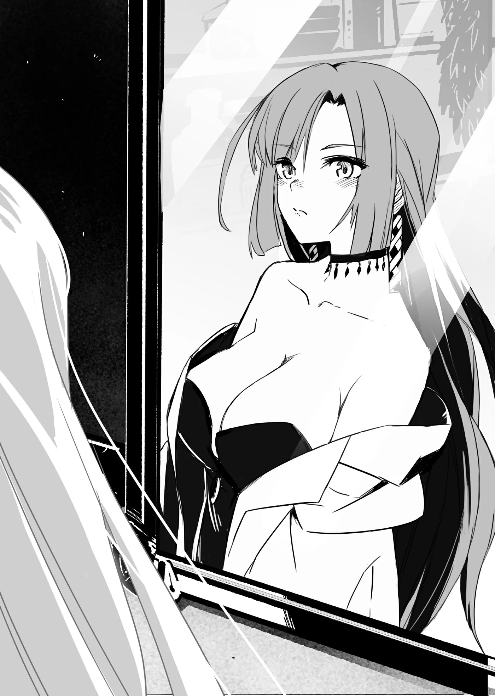

# Chương 60: Tập 3 Chương 1 - Người Đàn Ông Kỳ Lạ (5)

"Vậy là xong ủy thác rồi..." Alize nói, đặt bút ký vào tờ giấy trên bàn sau khi Norman và Unbert rời đi.

Vì người ủy thác trên giấy tờ không phải cô nhi viện mà là lũ trẻ nơi đây, nên chỉ cần chữ ký của Alize là đủ để xác nhận ủy thác chính thức hoàn tất.

Một nét bút lông lia nhanh, mọi việc thế là xong xuôi, ủy thác của cô bé coi như đã hoàn thành trọn vẹn. Giờ tôi chỉ cần tới Hội nhận thưởng nữa là xong.

So với những việc thường ngày thì ủy thác lần này khó nhằn hơn hẳn, thành ra làm xong rồi, trong lòng tôi cứ dâng lên một cảm xúc lắng đọng khó tả.

Có điều dĩ nhiên... thù lao của tôi chỉ vỏn vẹn một đồng xu đồng.

"...Ừ. Cảm ơn em... Alize," tôi vừa nói vừa cuộn tờ giấy đã ký trên bàn lại.

"Không đâu... em mới là người phải cảm ơn anh chứ, anh Rentt. Thú thật thì... treo ủy thác lên là một chuyện, chứ em gần như đã hết hy vọng rồi! Ai đời lại đi hái Hoa Long Huyết chỉ vì một đồng xu đồng cơ chứ? Vậy mà... anh lại nhận, rồi còn mang hoa về thật nữa! Em không biết phải cảm ơn anh bao nhiêu cho xuể... Cảm ơn anh, thực sự cảm ơn anh nhiều lắm... Sau này có bất cứ việc gì, dù là chuyện nhỏ đến đâu, anh Rentt cứ bảo bọn em nhé. Em với tụi nhỏ sẽ làm hết sức để giúp anh... Mà thôi, chắc anh chẳng cần bọn em giúp gì đâu nhỉ."

"Đến cả tôi... thỉnh thoảng... cũng cần giúp đỡ chứ. Tới lúc đó... tôi sẽ nhờ... tới em. Tùy tình hình mà tính. Với lại... cũng có vài người khác. Ý tôi là ngoài tôi ra... từng nghĩ tới chuyện... nhận ủy thác đấy. Chỉ là... việc này hơi quá khó... với đa số mọi người thôi."

Alize nói vậy chẳng qua vì cô bé đã mất niềm tin vào phần lớn mạo hiểm giả, dù tôi không nghĩ cô bé nói thế với bụng dạ ác cảm. Nói đúng hơn thì trong tiềm thức, có lẽ Alize luôn xem đa số mạo hiểm giả là những kẻ ích kỷ và máu lạnh.

Suy nghĩ đó cũng dễ hiểu thôi. Xét cho cùng, hiếm có mạo hiểm giả nào chịu mò vào đầm lầy.

Nhưng mạo hiểm giả tốt bụng vẫn có chứ, bằng chứng là trước tôi đã có những người tính nhận ủy thác. Sau khi bàn đi tính lại, họ nhận ra việc này vượt quá sức mình. Đó là quyết định sáng suốt, bởi mạo hiểm giả mà bỏ mạng thì chẳng giúp được ai. Một khi đã biết rõ thực lực của bản thân mà còn đâm đầu vào chết uổng trong đầm lầy thì đúng là dại dột.

Dù chẳng muốn mất niềm tin vào đồng nghiệp mạo hiểm giả, tôi vẫn hoàn toàn hiểu được suy nghĩ của Alize.

"Thật vậy sao ạ?" Alize có vẻ ngạc nhiên trước lời tôi nói. "Em cứ tưởng ngay từ đầu đã chẳng ai thèm đoái hoài tới ủy thác của cô nhi viện rồi chứ..."

Nếu nhớ không lầm, hồi mới gặp Alize khá khép nép và câu nệ; tôi đoán cô bé thất vọng về giới mạo hiểm giả nên mới tỏ ra như vậy. Hẳn cô bé nghĩ tôi chỉ là một gã Thiết Cấp vô danh nào đó ghé qua, kinh nghiệm chẳng có, thực lực cũng không, lại chẳng buồn suy nghĩ chín chắn về ủy thác mình nhận.

Mà nghĩ lại, vẫn còn một chuyện nữa...

"Em từng bảo em... muốn... trở thành mạo hiểm giả nhỉ...?"

"Vâng... Em từng nói bệnh của Sơ Lillian tiến triển rất chậm mà, đúng không ạ? Vậy nên... dù có mất nhiều thời gian, rồi thế nào em cũng làm được—ý em là tự mình vào đầm lầy hái Hoa Long Huyết. Vả lại, nếu làm mạo hiểm giả, em sẽ phụ được tiền sinh hoạt cho cô nhi viện... hay chí ít cũng đỡ đần được phần nào! Nghĩ lại thấy ngây thơ thật... nhưng lúc đó em đâu nghĩ ra được cách nào khác!"

Nghe thì có vẻ viển vông, nhưng Bệnh Tích Tụ Chướng Khí quả thực mất khá nhiều thời gian mới cướp đi sinh mạng người bệnh, thường là trong khoảng từ năm đến mười năm. Nếu tôi không xuất hiện, rồi mười năm sau Alize trở thành một mạo hiểm giả cừ khôi, thì biết đâu Sơ Lillian vẫn gắng gượng chờ được.

Ít nhất chuyện đó không phải là bất khả thi. Dù Alize sẽ phải khổ luyện gian nan mới đạt tới trình độ ấy, nhưng với lượng Ma Lực tiềm tàng trong người, biết đâu một ngày nào đó cô bé thực sự có thể bình an ra vào đầm lầy.

"Xem ra... em đã suy nghĩ... rất nhiều. Dù rằng... rốt cuộc... quyết tâm của em... lại thành ra không cần đến nữa. Giờ... em tính sao? Em có định... bỏ ý định làm mạo hiểm giả không?" tôi tò mò hỏi.

Alize lắc đầu lia lịa. "Không đâu ạ. Qua chuyện lần này, em lại càng quyết tâm làm mạo hiểm giả hơn bao giờ hết. Đúng là... giờ không cần phải lặn lội vào đầm lầy tìm Hoa Long Huyết nữa thật, nhưng em muốn trở thành mạo hiểm giả giống anh, anh Rentt. Một mạo hiểm giả tốt bụng, luôn giúp đỡ mọi người!"

Hở? Tôi á...?

Đó là ý nghĩ đầu tiên xẹt qua đầu tôi. Nhưng tôi không nói ra.

"Tôi không nghĩ... mình là một mạo hiểm giả... cừ khôi như em tưởng đâu."

"Anh nói gì kỳ vậy? Nhờ có anh mà Sơ Lillian mới được cứu mạng đấy chứ! Sơ sắp khỏe lại rồi! Với lại... nhờ có anh mà cô nhi viện cũng sạch sẽ hơn hẳn nữa!"

Sạch hơn ư?

"Ý em... là sao?"

"Hở?" Alize có vẻ hơi ngớ người trước phản ứng của tôi. "Anh không biết thật ạ? Đám đàn em của con chuột trên vai anh chạy lăng xăng khắp nơi, diệt sạch sâu bọ với côn trùng trong nhà đấy. Trước đây thỉnh thoảng vẫn thấy gián với mấy con bọ bò lung tung, thế mà đùng một cái bọn em thấy xác chúng chất thành đống! Lúc em lại xem thử thì thấy mấy con Puchi Suri đang đứng từ xa ngó cái đống gián chết đó. Chắc tụi nó lùng sục bắt sạch sâu bọ trong khu nhà cũ kỹ này, rồi vun xác lại một chỗ cho dễ quét dọn. Mọi người ai cũng biết ơn lắm luôn!"

Xem chừng đàn em của Edel đã làm được việc ra trò trong lúc chúng tôi vắng mặt; nghĩ cũng lạ thật, vì chúng vốn là lũ chuột được cường hóa bằng Khí Lực và Ma Lực kia mà. Mà thôi, thế này cũng tốt.

Tôi tò mò quay sang nhìn Edel. Cậu chàng đáp lại bằng vẻ mặt có phần ngán ngẩm, bảo rằng ngay cả đàn em của nó cũng thích sống ở nơi sạch sẽ, không bị sâu bọ quấy rầy.

Hóa ra lũ chuột này cũng chẳng cao thượng như tôi tưởng.

Dù sao thì việc chúng làm cũng có lợi cho Alize và lũ trẻ mồ côi—xem như đôi bên cùng có lợi.

"Tôi chẳng biết gì... về chuyện đó cả. Nhưng mà... tôi không thể nhận công... thay cho những việc... lũ chuột đó làm được."

"Nhưng nếu không nhờ có anh thì làm sao được như thế chứ!"

Alize quả quyết đến vậy thì tôi cũng chịu, chẳng biết nói gì để cãi lại.

"...Được rồi, được rồi. Em muốn nghĩ thế nào... thì tùy. Còn chuyện này nữa... nếu em thực sự... vẫn muốn làm... mạo hiểm giả, thì nên bắt đầu... rèn luyện sớm đi. Dù đến mười lăm tuổi... mới được đăng ký, nhưng nếu không nắm được... những điều cơ bản... của nghề này... thì em sẽ mất mạng... nhanh lắm đấy."

Ai cũng biết trên đời không thiếu những kẻ dại dột vừa rời làng là vội vàng đăng ký làm mạo hiểm giả ngay. Cho nên nói gì thì nói, đây vẫn là một lời khuyên chí lý.

Alize gật đầu. "Nhưng em phải rèn luyện thế nào bây giờ ạ?"

Hỏi cũng phải.

"Có nhiều... cách lắm. Ở Hội có mấy lớp... dành cho... người mới bắt đầu. Nếu rảnh... tôi cũng có thể... chỉ cho em vài đường."

Chẳng hiểu sao tôi lại buột miệng nói ra câu đó. Dù chưa từng nhận đồ đệ, nhưng trước đây tôi từng thay mặt nhân viên Hội dạy chính những lớp vỡ lòng cho người mới như thế. Tôi tin chắc bài dạy của mình hữu ích, bởi tôi đã truyền đạt kiến thức căn bản của nghề mạo hiểm—từ kỹ năng, kinh nghiệm cho đến mọi thứ liên quan—cho không biết bao nhiêu lính mới từng bước chân vào sảnh Hội.

Ngoài ra còn một chuyện nữa...

"Vì em có... Ma Lực tiềm tàng... nên học ma thuật đi. Dù tôi không giúp... được gì nhiều ở khoản đó... nhưng tôi có người bạn... làm được. Em có... hứng thú không?"

Người bạn đó không ai khác chính là Lorraine. Cô thường bận bù đầu với việc nghiên cứu học thuật, nhưng lúc dở chứng thì lười đừng hỏi. Trong lúc nằm dài ườn mình trên ghế sofa, tiện thể chỉ cho Alize vài ngón ma thuật chắc cũng chẳng mất miếng thịt nào.

Thế nhưng Alize nghe xong lại có vẻ hơi ngợp.

"Nhưng... em đâu có tiền..."

Dĩ nhiên là không có rồi. Alize vốn là trẻ mồ côi, đến ủy thác nguy hiểm vừa rồi cô bé cũng chỉ gom góp được đúng một đồng xu đồng trả công cho tôi. Lấy đâu ra tiền cho được.

Đã vậy, đa số pháp sư chịu dạy nghề thường lấy học phí đắt cắt cổ. Còn Lorraine thì đời nào đòi tiền thù lao, nên tiền nong chẳng phải vấn đề.

"Đừng... lo... chuyện đó."

"Thế sao được ạ."

"Tôi đoán... em sẽ nói thế mà. Vậy thì... tôi có... cách này."

"Dạ?"

"Tôi sẽ cho em mượn... tiền học phí. Không tính lãi. Sau này... làm mạo hiểm giả rồi... em trả lại tôi sau cũng được. Thấy... thế nào?"

Tính thế là vẹn cả đôi đường; hẳn Alize cũng hiểu được ý tốt của tôi.

Dĩ nhiên, thấy tôi bảo cho mượn không tính lãi là có khi cô bé đã đoán ra tỏng tòng tong rồi.

Quả nhiên...

"Anh nói thật chứ ạ...? Vậy thì được ạ, em xin nhận lòng tốt của anh. Nhưng mà... tiền lãi em nhất định sẽ trả. Đợi em làm mạo hiểm giả... kiếm được kha khá tiền rồi, em sẽ trả lại sòng phẳng cả vốn lẫn lãi! Như vậy... có được không anh?"

Biết tính Alize rồi nên tôi đã đoán trước cô bé sẽ nói thế.

Tôi chậm rãi gật đầu. "Vậy thì... quyết định thế nhé."

Tôi chìa tay ra. Alize nắm lấy, siết thật chặt.

◆◇◆◇◆

"Tôi không phiền đâu, Rentt. Đúng như anh nói đấy, tính lười của tôi cứ đến theo từng đợt. Lúc rảnh thì tôi thấy thì giờ của mình nhiều vô thiên lủng," Lorraine nói, mắt khẽ nheo lại nhìn tôi trong khi vẫn tiếp tục ăn bữa tối.

Lúc này tôi đã về tới nhà và đang ngồi bên bàn ăn với Lorraine. Đề tài chúng tôi bàn dĩ nhiên là chuyện nhờ Lorraine tranh thủ lúc rảnh rỗi dạy ma thuật cơ bản cho Alize. Vừa kể cho Lorraine nghe những chuyện xảy ra trong ngày, tôi vừa lựa lời gợi ý sau khi chắc mẩm cô đang trong thời gian rảnh rang. Ngặt nỗi, tôi lại lỡ mồm tả sự rảnh rỗi của Lorraine theo hướng chẳng mấy hay ho.

Cô đâu phải người lười biếng. Mãi sau khi lỡ lời tôi mới nhận ra lời mình nói nghe chối tai cỡ nào. May mà Lorraine bỏ qua cho, làm tôi chỉ biết hơi rụt vai lại, thầm nghĩ suýt nữa thì đã làm hỏng bét chuyện tìm người dạy ma thuật cho Alize. Lúc này tôi mới thấy biết ơn tấm lòng rộng rãi của cô xiết bao.

"Tôi... xin lỗi. Ý tôi không phải bảo... cô lúc nào cũng... rảnh rỗi đâu. Chỉ là thỉnh thoảng... biết đâu... cô có thể bớt chút... thời gian thôi."

Nghe tôi phân trần, nét mặt Lorraine giãn ra, trông có vẻ buồn cười hơn là giận dỗi. Cô phẩy nhẹ tay mấy cái rồi bật cười.

"Tôi biết rồi, biết rồi mà, Rentt. Không nhận ra tôi đang đùa đấy à? Thật là. Nhưng chắc trên đời cũng có những phụ nữ chẳng có tí khiếu hài hước nào đâu. Anh nên để ý mấy chuyện đó hơn đấy, Rentt. Làm mạo hiểm giả thì hòa đồng với đủ mọi người, thế mà lại vô tâm phớt lờ tình cảm của một thiếu nữ thế à?" Lorraine nói, suýt nữa thì phì cười thích thú.

Hóa ra Lorraine chỉ trêu tôi thôi. Tôi thực sự thở phào nhẹ nhõm.

Nghĩ lại thì nhận xét và lời khuyên của Lorraine chẳng sai chút nào. Mục tiêu của tôi là trở thành mạo hiểm giả Mithril Cấp, và tôi đã dành trọn cả đời cho mục tiêu đó, tiện thể học đủ mọi kỹ năng trên đường đời. Ngặt nỗi, cách ăn nói xã giao sao cho phải phép với các cô gái trẻ lại chưa từng là thứ tôi bỏ công tìm hiểu.

Dù năng lực của tôi khó lòng đủ để nhận ủy thác từ khách hàng quý tộc, tôi vẫn luyện tập lễ nghi giao tiếp đến một chừng mực nhất định—đủ để khi cần thì vẫn có thể ứng xử với các quý cô quý bà. Thế nhưng tôi lại chẳng học được mấy về cách trò chuyện với phụ nữ nói chung. Phép tắc xã giao của phái nữ lúc nào cũng làm tôi lúng túng. Chẳng hạn, tôi rất dở khoản hiểu những câu chuyện phiếm vu vơ. Đã hơn một lần tôi đáp lại niềm nở để rồi đối phương bộc lộ bản chất thật, còn tôi thì lỡ mồm nói ra những câu thừa thãi. Nói chung là rắc rối vô cùng.

Sau này tôi nên cẩn thận hơn về mấy chuyện này mới được.

"Cảm ơn cô... đã nhắc nhở... Lorraine. Nhưng với cái bộ dạng này... của tôi... thì con gái nhà người ta... dù dễ thương hay không... cũng đời nào thèm để mắt tới."

Ý tôi là bản thân đang khoác chiếc áo chùng đen tuyền cùng chiếc mặt nạ đầu lâu đầy vẻ mờ ám. Con gái xứ này dại gì mà đi thích một kẻ trông quái dị như tôi chứ? Nhìn cái bộ dạng ấy, chí ít một cô gái bình thường cũng phải tránh tôi thật xa.

Chẳng hạn như, một gã trùm áo chùng đi trong hẻm nhỏ tình cờ gặp một cô bé bán hoa... thì cảnh tượng sẽ ra sao?

"X-Xin chào... c-cô bé..."

"Áaaa! Cứu với! Cứu người với!!!"

"K-Khoan đã! Không phải như cháu nghĩ đâu! Chú chỉ muốn n-nói chuyện chút thôi mà!"

"Áaaa! Người kia! Cái gã quái dị đằng kia bảo muốn mua hoa của cháu kìa!!!"

Thế là gã đàn ông trùm áo chùng bị bắt ngay tắp lự.

Dĩ nhiên, từ "hoa" trong ngữ cảnh đó rất dễ bị hiểu lệch sang nghĩa đen tối.

Thế thì... chẳng hay ho gì rồi. Tốt nhất là tôi phải tự khắc cốt ghi tâm: tuyệt đối không được bắt chuyện với bất kỳ cô gái nào trên phố Maalt.

"Này này, Rentt," Lorraine cắt ngang dòng suy nghĩ của tôi. "Trước mắt anh chẳng có một thiếu nữ sờ sờ ra đây là gì! Đây này." Lorraine giơ ngón tay cái chỉ vào mình.

Tôi lắc đầu, mắt nhìn chòng chọc vào ngón tay cái đó.

"Đâu cơ...? Tôi... có thấy ai đâu."

"Cái anh này..." Lorraine siết chặt tay thành nắm đấm. "Anh còn định lợi dụng lòng tốt với tính hiếu khách của tôi đến bao giờ nữa hả Rentt? Tôi nói cho anh biết, cứ tiếp tục thế này là tôi mất hết kiên nhẫn cho anh một trận nhừ tử đấy nhé. Ai đời lại nói câu đó với một thiếu nữ hai mươi tư tuổi không hả? Hừm... Nhắc mới nhớ, dạo này tôi vừa đọc được mấy nghiên cứu mới về nguyền chú cực mạnh..."

Nói rồi, Lorraine bật dậy khỏi ghế, một tay vớ lấy trượng phép, tay kia giơ cuốn ma đạo thư trông dị hợm lên. Tôi hoảng hốt giơ hai tay làm cử chỉ nhận lỗi, cuống cuồng tìm cách xoa dịu cô bạn đang nổi cơn lôi đình.

"Khoan... Khoan đã! Trẻ chứ! Cô... trẻ măng mà! Tiểu thư Lorraine... là một thiếu nữ! Tính tình dịu dàng, làn da trắng muốt! Lại có... nét mặt thanh tú... dáng người nở nang cân đối! Đúng là... hiện thân... của Thần Sắc Đẹp! Đến cả các nàng tiên thời xưa... cũng đời nào... sánh kịp! Một bậc tôn quý... trẻ mãi không già! Trí tuệ lại còn... sánh ngang... với cả các Vị Thần tri thức! Vừa dịu dàng... đằm thắm... lại tinh thông ma thuật huyền bí! Quý cô Lorraine... chính là hình mẫu... của một thiếu nữ cực kỳ đáng yêu!"

Những lúc thế này, tốt nhất là rót vào tai Lorraine đủ lời khen ngợi. Cứ tưởng tượng nếu không nói được ngần ấy lời, tiếng bước chân của Thần Chết hẳn đã văng vẳng bên tai tôi ngày một rõ. Muốn tránh kiếp nạn, liêm sỉ với xấu hổ gì tôi cũng vứt hết, chỉ chăm chăm tìm lời tâng bốc cô.

Nếu không làm thế thì tôi sẽ ra sao đây? Mà thật ra, không biết mấy lời khen vụng về này Lorraine có hiểu nổi không nữa?

Tôi nhớ có lần từng ngồi nhắm rượu với một gã mạo hiểm giả đã có vợ. Anh ta nức tiếng với tài tránh cơn tam bành của vợ bằng đủ mọi chiêu, và may sao lúc chén thù chén tạc, anh ta đã truyền cho tôi vài bí quyết. Chẳng biết dạo này anh ta thế nào rồi... Nghe đâu lần cuối cùng tôi biết thì anh ta đang tính mở quán trọ ở đâu đó quanh vùng này.

Trong lúc đầu óc còn mải nghĩ vơ vẩn, tôi vô tình liếc sang Lorraine, để rồi khựng lại khi thấy cô đang nhìn tôi trân trân bằng vẻ mặt tôi chưa từng thấy bao giờ.

Hử...? Gì thế nhỉ?

"Rốt cuộc thì," Lorraine hoàn hồn lại, cất giọng, "anh học cái điệu ăn nói tán tỉnh lả lơi đó ở đâu ra vậy hả Rentt...?"

Lorraine có vẻ cạn lời hơn là giận dữ. Nói đúng hơn thì tôi không còn cảm thấy cơn lôi đình ngùn ngụt bốc ra từ phía cô bạn nữa. Thật nhẹ cả người.

"Ở đâu á...? Cũng không hẳn là... một chỗ cố định nào. Đi dạo quanh phố... Maalt, thỉnh thoảng... lại nghe lỏm được... vài câu chỗ này chỗ nọ. Trong mấy vở kịch... cũng thấy người ta nói thế. Dù sao thì... tôi cũng chỉ nghĩ sao nói vậy thôi."

"Nghĩ sao nói vậy ư, Rentt? Gặp phụ nữ nào anh cũng buông lời như thế đấy à?"

Thấy Lorraine ngạc nhiên đến vậy, tôi lắc đầu. "Thì... cảnh tượng này... đâu phải ngày nào... cũng gặp, đúng không?"

Nói với một người quen tính như Lorraine là một chuyện, chứ bảo tôi thốt ra mấy câu đó với một cô gái tình cờ đi ngang qua trên phố thì chịu chết. Đời nào tôi nói ra được.

"Hừm..." Lorraine khựng lại, thoáng ngẫm nghĩ lời tôi. "Chắc đúng là vậy thật. Cho tôi xin lỗi nhé, Rentt; xem ra tôi vừa hỏi một câu hơi kỳ quặc rồi..."

"Nếu tôi quen với việc... nói những lời như thế với mọi... phụ nữ tôi gặp, thì giờ tôi đâu còn... làm mạo hiểm giả nữa, khéo thành... gã chủ quán ở làng nào đó rồi. Cái lối sống... lông bông như thế... chỉ cần làm mạo hiểm giả Đồng Cấp... chăm chỉ một chút... là cũng đủ sống rồi."

"Đúng như tôi nghĩ, Rentt. Nghe vậy cũng nhẹ cả người."

"Nhẹ cả... người ư?" Tôi khó hiểu nghiêng đầu nhìn Lorraine.

"À... chuyện đó hả. Thì ít ra tôi cũng nhẹ nhõm vì anh không phải là một con dã thú háo sắc thôi."

Lorraine nói năng chẳng kiêng nể chút nào. Nhưng nghĩ lại thì cũng đáng; cách dùng từ của tôi xét một cách nhẹ nhàng nhất thì cũng vụng về đến phát ngượng.

Nét mặt thanh tú với dáng người nở nang... đúng là mấy từ ngữ nghe có phần dê xồm thật. Tự dưng tôi thấy mình nên xin lỗi Lorraine vì màn nịnh nọt vụng về vừa rồi.

"Thì... tôi thật lòng... xin lỗi. Tôi không có ý... đen tối thế đâu."

"Tôi hiểu mà, Rentt. Phải đấy, sau này tiếp xúc với mấy cô gái trẻ anh nhớ phải cẩn thận... Mà thôi, anh có muốn ăn thêm chút gì không? Bát sạch trơn rồi kìa."

Lorraine nhìn chiếc bát trống trơn trên tay tôi. Mới ban nãy, bát còn đầy ắp món ăn do chính tay cô nấu—dĩ nhiên có nhỏ thêm một giọt máu của Lorraine để lấy vị. Tôi đã ăn sạch bách trong nháy mắt, vì nó thực sự rất ngon.

Dạo gần đây Lorraine hay nhỏ vài giọt máu vào đồ ăn, chưa kể cô cũng chịu khó vào bếp thường xuyên hơn. Cô bảo làm vậy là để theo dõi tình trạng sức khỏe cùng thể trạng của tôi, nói cách khác thì tất cả chỉ nhằm phục vụ nghiên cứu. Đúng là không trật đi đâu được.

"Vẫn còn đấy." Lorraine gật đầu. "Muốn ăn thì cứ ăn thêm—ơ kìa, anh đi đâu đấy?" Lorraine gọi giật giọng khi thấy tôi toan bước về phía bếp. "Thôi, anh cứ ngồi yên đó đi, Rentt. Tôi mang ra cho. Dù sao cũng nấu hai nồi riêng mà."

Lorraine giật lấy cái bát trên tay tôi rồi tự mình đi vào bếp. Trông bước chân cô như thể đang nhún nhảy, nhưng khéo lại là do tôi tưởng tượng ra cũng nên.

◆◇◆◇◆

Tay cầm chiếc bát bước vào bếp, Lorraine ngước nhìn tấm gương treo ngay ngắn trên tường. Trong gương phản chiếu gương mặt cô, trông vẫn khá bình thản.

Lorraine vén lọn tóc sang bên, để lộ đôi vành tai tròn trịa xinh xắn.

"Má mình đỏ ửng lên rồi... Đỏ gay thế này. Chắc tại uống hơi quá chén chăng..."

Hai người quả có nhấp chút rượu vang sau bữa tối. Dù cái cớ Lorraine tự nghĩ ra không phải là không có cơ sở, nhưng ngặt nỗi tửu lượng của cô xưa nay vốn rất cao, chưa bao giờ say đỏ mặt chỉ vì mấy ngụm rượu.

Cả vành tai cô cũng đỏ bừng.

Về lý trí, chính Lorraine cũng hiểu rõ mặt mình đỏ không phải vì men rượu. Thấy suy nghĩ của mình bắt đầu trôi dạt sang hướng nguy hiểm, cô vội lắc đầu gạt phắt đi.

"Mình không nên uống nhiều quá... Không được uống nhiều quá..."

Vừa lẩm bẩm một mình, Lorraine vừa thoăn thoắt múc đầy bát thức ăn rồi quay lại bàn. Dù bước chân cô đúng là có phần tung tăng sảng khoái thật, nhưng ở đây chẳng có ai nhìn thấy để mà nhắc cho cô, cho Rentt, hay cho bất kỳ ai biết.

