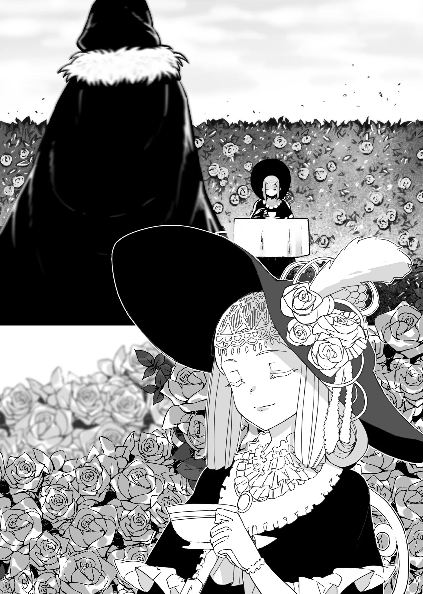

# Chương 62: Tập 3 Chương 2 - Và Một Ủy Thác Kỳ Lạ Không Kém (2)

Tôi... lạc đường mất rồi.

Đó là ý nghĩ duy nhất quanh quẩn trong đầu tôi lúc này, trên đường tiến vào cơ ngơi của Gia tộc Latuule.

Tôi định tới gặp Isaac để bàn bạc chi tiết về ủy thác. Phía Hội dĩ nhiên đã chỉ dẫn cặn kẽ cho tôi. Vị trí dinh thự được vẽ rất rõ ràng trên bản đồ, nhìn chung đường đi nước bước chẳng có gì khó hiểu. Dinh thự nằm ở ngoại ô Maalt, và tôi đã tới đúng nơi mà không hề lạc bước. Có điều, rắc rối lại nằm ở địa thế nơi đây.

Gia tộc Latuule ngụ trong một dinh thự khổng lồ bề thế, và dẫu đó là đích đến, tôi vẫn phải băng qua một khu vườn rộng lớn trong khuôn viên trước khi thật sự chạm tới cửa dinh thự. Kiểu bố trí này chẳng hề hiếm gặp, nhất là với những dinh cơ xa hoa của các danh gia vọng tộc quanh vùng này. Vấn đề không nằm ở dinh thự, mà là khu vườn phía trước nó.

Nếu phải đoán, khu vườn này có lẽ bắt nguồn từ ý thích nhất thời của một nhân vật tầm cỡ nào đó của Gia tộc Latuule thời trước. Thay vì một lối đi thẳng tắp dẫn vào dinh thự như thường thấy, khu vườn này lại là một mê cung ngoằn ngoèo uốn lượn. Chỉ cần bước sâu vào một chút, những hàng rào cây cao ngút đã chắn kín tầm mắt. Hàng rào được dựng từ một loài cây bụi tựa hoa hồng, mọc cao đến khó tin. Xung quanh tôi bấy giờ chỉ có một màu xanh bạt ngàn.

Càng dấn sâu vào trong, tôi rẽ hết hướng này sang hướng khác, rồi trước mắt lại chia thành nhiều ngả. Hết ngã rẽ này lại đến ngã rẽ khác, những dãy hàng rào mê cung cứ thế trải dài tít tắp. Chẳng mấy chốc, tôi nhận ra mình, nói thẳng thừng ra là, đã lạc đường.

Thật lòng mà nói, qua mấy ngã rẽ đầu tôi vẫn định hướng rất tốt. Nhưng càng dấn sâu vào khu vườn mê cung, mọi chuyện chẳng còn dễ dàng như vậy nữa.

Tôi đành dừng chân giữa mê cung hàng rào, ngẫm lại từng chi tiết trong ủy thác.

Nếu tôi nhớ không nhầm, tôi đã hỏi hết những câu cần hỏi rồi. Tôi cố giữ bình tĩnh, nhớ lại cuộc trò chuyện ban đầu với người gác cổng trước khi bước chân vào cái mê cung rậm rịt vô lý này. Tôi nhớ rất rõ chi tiết ủy thác, nhưng tuyệt nhiên chẳng có dòng nào bảo tôi phải đi thám hiểm mê cung cả.

Đúng là tôi đã đưa giấy tờ cho người gác cổng xem, và anh ta chẳng ngần ngại gì mà cho tôi vào. Ánh mắt anh ta như dán vào một khoảng trời xa xăm vô định, và trông có vẻ mừng rỡ khi tiễn được tôi đi.

Nhưng trước khi đi, tôi có hỏi anh ta vài câu.

"Còn... lối vào nào. Khác không...?"

Người gác cổng thoáng liếc nhìn mê cung hoa hồng, rồi chậm rãi quay lại lắc đầu với tôi.

"Theo tôi biết thì không có đâu, thưa ngài... Họa may có lối vào khác thật, nhưng tôi thì không rõ." Vẻ mặt anh ta rất nghiêm túc và chân thành, như thể đã suy nghĩ rất kỹ trước khi trả lời.

Một thoáng tuyệt vọng dâng lên trong lòng tôi. Muốn gõ được cửa dinh thự, tôi chẳng còn cách nào khác ngoài việc vượt qua cái khu vườn mê cung kỳ quái này.

"Bình thường... đi mất. Bao lâu?"

"Tới dinh thự sao, thưa ngài? Ờm... cái đó còn tùy vào từng người nữa... Khổ nỗi mê cung này thỉnh thoảng lại tự đổi lối đi. Thành ra bảo tôi ước chừng thời gian chính xác thì thực sự quá sức tôi..." người gác cổng vừa nói vừa lộ vẻ áy náy.

Mê cung mà thỉnh thoảng lại tự đổi lối đi ư? Thế thì ai mà coi nó là mê cung bình thường cho nổi.

Như đoán được sự ngờ vực của tôi, người gác cổng tiếp lời: "Nhưng quả đúng vậy đấy, thưa ngài. Thực ra bản thân mê cung này vốn là một loại ma cụ đặc biệt. Các đời gia chủ của Gia tộc Latuule đều có chung sở thích sưu tầm ma cụ, và mê cung này chính là hiện tượng do một trong số đó tạo ra..."

Tôi khó lòng giấu nổi sự kinh ngạc. Lại có cả loại ma cụ thế này cơ à? Nhưng ngẫm lại thì cũng có thể lắm. Ma cụ nhìn chung được chia thành ba nhóm: Thần Cụ, Kỳ Cụ và Nguyền Cụ. Rất có thể một món đồ thuộc một trong ba nhóm ấy đã tạo nên mê cung này.

Phần lớn ma cụ đều có công năng theo quy chuẩn nhất định, nhưng cũng có những món cá biệt khác hẳn số đông. Đơn cử như ma cụ phát sáng, một món đồ đơn giản dùng để soi sáng nơi tối tăm. Nó được dùng rất phổ biến nhờ cấu tạo giản dị. Do có thể sản xuất hàng loạt nên giá bán trên thị trường cũng khá rẻ.

Trái lại, những món đồ đặc biệt thì khác hẳn, thường là độc nhất vô nhị. Chẳng hạn như chiếc mặt nạ bị nguyền hay tấm áo choàng chống nước của tôi. Chúng thường có hiệu ứng đặc thù hoặc kỳ quặc, và giá trị thì tùy người định đoạt. Có những ma cụ đặc biệt rất đỗi hữu dụng, nhưng cũng có món chẳng biết để làm cái tích sự gì. Chính vì muôn hình vạn trạng như thế nên giá của chúng cũng biến động khôn lường.

Cứ lấy chiếc mặt nạ của tôi làm ví dụ: một món đồ cực kỳ hữu dụng trong hoàn cảnh và thể chất độc nhất vô nhị của tôi, nhưng Rina mua lại với giá vỏn vẹn ba đồng xu đồng. Chắc gã thương nhân bán món này nghĩ nó chỉ là thứ đồng nát vô dụng nên mới để giá rẻ mạt như vậy. Hóa ra nó lại là chiếc mặt nạ bị nguyền mà từ lúc đeo vào tôi không tài nào tháo ra được, xem ra trực giác của gã cũng chẳng sai mấy. Còn với cái mặt hiện giờ của tôi, tôi cũng chẳng biết lời nguyền của chiếc mặt nạ này thực ra là họa hay là phúc nữa...

"...Có sở thích độc lạ thì... cũng được thôi. Tôi đoán vậy. Nhưng mà... ai ngờ tôi lại phải... vượt qua cái. Sở thích ấy của họ. Mới vào được tới nơi..." tôi nói, không giấu nổi vẻ bực dọc trước tình cảnh này.

Người gác cổng chỉ mỉm cười đáp lại.

"Tôi cũng thông cảm với ngài lắm. Nhưng sao ngài không thử một phen xem? Mê cung này được thiết kế để sau một khoảng thời gian nhất định, nó sẽ mở ra một lối đi thẳng tắp dẫn tới cửa vào. Thậm chí tôi còn nghe đồn, hễ ai tự mình vượt qua mê cung trước thời gian đó thì thỉnh thoảng sẽ được tặng một món ma cụ làm quà tưởng thưởng..."

Có vẻ như người gác cổng đang ngầm mách nước điều gì... Như nhận ra suy nghĩ đó của tôi, anh ta vẫn giữ nguyên nét mặt mà nói tiếp.

"Hồi trước tôi cũng từng thử sức với mê cung này đấy, thưa ngài. Bình thường nếu không có khách hẹn trước thì cổng luôn đóng kín, nhưng dạo đó lại mở toang. Chẳng là tôi tình cờ thấy tờ cáo thị bảo rằng ai vượt qua mê cung sẽ được thưởng một món ma cụ. Trên đó có vẽ sẵn bản đồ tới dinh thự, nhờ thế tôi mới tìm đến tận cánh cổng này."

Xem ra người nhà Latuule tính khí khá tùy hứng, lại còn thích bày trò tiêu khiển.

Với một gia tộc lâu đời giàu nứt đố đổ vách, việc họ cao hứng tổ chức những trò như thế này cũng chẳng có gì lạ. Giới quý tộc thường chỉ quanh quẩn với tiệc tùng hay thú vui tao nhã, nhưng những kẻ đã phát ngấy các buổi giao tế tẻ nhạt lại hay tìm đến những trò... khác người hơn.

Trường hợp này chắc cũng vậy.

"Dĩ nhiên," người gác cổng kể tiếp, "đâu chỉ mình tôi thấy tờ cáo thị đó. Không ít người đã tìm tới tận cánh cổng này, ai nấy đều chung một mục đích. Nhiều người bước vào rồi cũng ngần ấy người bị lạc, loanh quanh một hồi lại thấy mình đứng ở đây. Họ mất phương hướng giữa mê cung, rồi chẳng bao lâu sau, mê cung tự chuyển dịch mở ra một lối dẫn ngược về cổng vào. Lúc mới nghe tôi cũng ngạc nhiên lắm, nhưng nghĩ bụng ma cụ chắc làm được chuyện đó. Dù ngỡ là bất khả thi, nhưng biết mê cung sẽ tự dẫn người lạc về lại cổng khiến tôi an tâm hơn hẳn, thế là tôi đánh liều bước vào lần nữa..."

"Và anh đã tới... đích."

"Vâng. Nói đúng hơn thì đó hoàn toàn là nhờ may mắn. Bản thân tôi biết rất rõ mình chẳng thể nào làm lại lần thứ hai. Dù vậy, đúng như đã hứa, vị gia chủ của Gia tộc Latuule thời đó đã mang ra khá nhiều ma cụ cho tôi tùy ý chọn một món. Toàn là những món đồ hữu dụng hiếm thấy cả, nhưng mà... chà, dạo ấy tôi lại đang thất nghiệp, thưa ngài. Kể ra thì cũng hơi ngượng... nhưng tôi chẳng nhận món ma cụ nào, mà xin một chân làm việc ở dinh thự. Và thế là..."

"Họ nhận... anh vào làm. Ra là thế..."

Nhìn dinh thự đồ sộ cùng cơ ngơi mênh mông của họ, việc sở hữu cả một bộ sưu tập ma cụ uy lực cũng là điều dễ hiểu. Tính ra công việc gác cổng này cũng tương đối nhàn nhã. Được cái anh ta làm việc rất nghiêm túc, chắc sẽ còn gắn bó lâu dài.

"Nhân tiện... cho tôi hỏi. Thứ lỗi nếu... câu này hơi đường đột. Nhưng sao hồi đó anh lại... mất việc?"

"À, chuyện đó à thưa ngài. Chẳng giấu gì ngài, hồi đó tôi cãi lệnh cấp trên. Nghĩ lại mà tiếc, suýt nữa là tôi có được một công việc ổn định cả đời rồi đấy! Thật đáng xấu hổ. Nhưng cũng nhờ thế mà tôi mới được nhận vào đây, rồi từ đó quyết định sống thực tế, làm ăn đàng hoàng, như người ta vẫn thường nói."

"Sống đàng hoàng... được vậy thì tốt. Quả là điều... đáng quý."

Ngay cả một kẻ như tôi cũng có thể tìm lại phần người; chà, nếu chịu khó cố gắng thì chắc là được. Dù sao chăng nữa, quyết tâm sống một cách tử tế của tôi vẫn chẳng hề suy suyển.

Ấy thế mà... việc tiến hóa thành một sinh vật mạnh mẽ hơn sau khi bị Rồng thần thoại nuốt trọn cũng chẳng đến nỗi nào. Cuộc đời đúng là lắm ngã rẽ bất ngờ.

Tôi nhìn người gác cổng, bỗng thấy có chút đồng cảm kỳ lạ.

"Tôi hiểu ra... nhiều điều rồi. Từ cuộc trò chuyện. Nho nhỏ này. Có lẽ tôi cũng nên thử sức với... mê cung này. Xem sao. Có lời khuyên nào... cho một lính mới như... tôi không?"

Đó là câu hỏi mà các tân binh mạo hiểm giả hay hỏi tiền bối. Như hiểu được trò đùa của tôi, người gác cổng cười đầy ẩn ý.

"Vâng... vâng. Có lẽ ngài đừng nên nhìn mặt trời mà định hướng thì khôn ngoan hơn, thưa ngài..."

Tôi hơi nghiêng đầu trước lời dặn ấy, nhưng dẫu sao người gác cổng cũng là kẻ dày dạn kinh nghiệm với mê cung này. Tôi đành đặt đôi phần tin tưởng vào lời anh ta.

Sau khi cảm ơn người gác cổng, tôi quay người về phía lối vào, dứt khoát bước vào mê cung.

◆◇◆◇◆

Nơi này đúng là... ngoài sức tưởng tượng rồi.

Tôi ôm đầu ngao ngán nhìn quanh. Chẳng thể trách tôi được, bởi nhìn đâu cũng chỉ thấy hàng rào cây vây kín. Con đường dẫn tôi tới đây đã biến mất, mà lối thoát khỏi cái mê cung này cũng chẳng thấy tăm hơi.

Rốt cuộc người ta chế ra món ma cụ này để làm cái trò trống gì không biết? Dù trong đầu nghĩ vậy, nhưng nói toạc ra miệng thì khiếm nhã quá. Chắc hẳn những món đồ kỳ quặc như thế này vẫn tồn tại đâu đó. Bản thân nó có thể đã bị mang đi khỏi nơi chốn ban đầu, nơi nó từng phục vụ cho một mục đích đặc thù nào đó.

Thợ chế tác ma cụ, dù thời nay được xem như những nhà phát minh mang lại tiện nghi cho đời sống, thì xưa kia từng bị coi là lũ bịp bợm lừa đảo. Ma cụ vốn sinh ra từ khao khát của con người muốn sao chép những gì họ tìm thấy hoặc trông thấy trong mê cung. Nghĩ vậy, cứ chiếu theo lịch sử ra đời ấy thì món ma cụ nguyên bản kia hẳn là một vật phẩm huyền bí với đủ loại công năng khó lòng biết rõ được.

Thực ra hiếm có món ma cụ nào hoàn toàn vô dụng. Người ta ít khi thấy món nào chỉ biết phát ra ánh sáng leo lắt, hay cứ bị gõ ngón tay vào là cười the thé không dứt. Ngay cả khi tình cờ vớ phải một món đồ tưởng như vô tích sự, người ta vẫn có thể nghiên cứu, mổ xẻ, thậm chí bóc tách những nguyên liệu quý hiếm từ nó. Mớ nguyên liệu ấy bán đi cũng được khối tiền, công dụng của ma cụ đa dạng là vì thế.

Ngay cả tôi cũng hiểu món ma cụ tạo nên mê cung hoa hồng này chắc hẳn từng có công dụng đặc biệt nào đó trong quá khứ.

Dù vậy, khu vườn này quả thực quá rộng. Duy trì một mê cung quy mô cỡ này, lại còn là loại thỉnh thoảng tự đổi đường đi, ắt hẳn đòi hỏi lượng Ma Lực khổng lồ. Nhưng với người nhà Latuule vốn tiêu tiền như nước thì chắc chuyện đó chẳng đáng bận tâm. Giàu cỡ họ thì mua bao nhiêu Ma Tinh mà chẳng được, thế nên nỗi lo mê cung đột ngột ngưng hoạt động của tôi hoàn toàn là thừa thãi. Biết đâu người tạo ra cỗ máy này chỉ muốn nếm thử cảm giác lạc lối hoàn toàn, rồi chế ra nó để trốn tránh thực tại tù túng? Nghĩ ngợi lan man là vậy, chứ mọi suy đoán ấy chẳng giúp thay đổi được tình cảnh hiện tại của tôi chút nào.

Tôi lạc đường thật rồi.

Lẽ nào thật sự chẳng còn cách nào sao?

Dòng suy nghĩ của tôi bị cắt ngang khi cảnh vật trước mắt bỗng mở ra một khoảng không gian khác.

"Ở đâu... cái gì thế? Nơi này là đâu...?"

Tôi lại thấy mình bị hàng rào vây kín trên một con đường thoạt nhìn chẳng khác mấy những lối tôi vừa đi qua. Có điều, khoảng không trước mắt lại bừng sáng, và trên những hàng rào vốn chỉ toàn cành lá trơ trụi lúc trước giờ lại rực rỡ hoa hồng. Từ nãy tới giờ, mọi hàng rào tôi đi qua chỉ tuyền một màu xanh buồn tẻ. Thảng hoặc cũng có vài đóa hồng hé nở, nhưng mỗi bông một màu và mọc rải rác lộn xộn, trông giống hiện tượng tự nhiên hơn là do con người chăm sóc.

Nhưng chỗ này thì khác hẳn. Hoa hồng nở rộ khắp nơi; tôi đã đưa tay sờ thử để xác nhận chúng là hoa thật. Giữa khoảng sân ngập tràn hoa hồng này cũng có nét khác lạ, hay đúng hơn là lại rất ăn nhập với khung cảnh xung quanh? Một chiếc bàn bằng chất liệu lấp lánh như xà cừ đặt giữa khoảng sân, bên trên bày bộ ấm chén bằng sứ trắng đắt tiền. Ngồi bên bàn trên chiếc ghế xà cừ óng ánh không kém là một bóng người, đang nâng tách trà với phong thái tao nhã lạ thường. Người đó khẽ đưa tách lên môi nhấp một ngụm, từng cử chỉ đều toát lên vẻ quý phái.

Thấy tôi xuất hiện, người đó ngẩng đầu lên nhìn thẳng về phía tôi.

"Ngài định bỏ cuộc rồi sao...?"

Ra vậy. Thấy tôi lạc đường nên chắc người của Gia tộc Latuule định chỉ lối thoát cho tôi đây mà. Đối phương là một cô bé chừng mười hai, mười ba tuổi, toát lên vẻ gì đó như thể không thuộc về thế giới này.

Cô bé ngồi đó, ánh mắt xa xăm hướng về phía tôi trong bộ váy đen bèo nhún rườm rà trông chẳng tiện hoạt động chút nào. Làn da trắng muốt của cô bé tương phản rõ rệt với đôi mắt màu xanh lam.

Trông cô bé thật sự có phần... ốm yếu. Quanh người cô bé toát lên vẻ mong manh, uể oải suy nhược; phải chăng là hệ quả từ huyết thống quý tộc?

"...Không," tôi không chút ngần ngại đáp lời cô bé. "Tôi đang tính... cố thêm một chút. Tôi có thể xin thêm... chút thời gian không? Không được à...?"

Cô bé mỉm cười đáp lại. So với nét mặt không chút biểu cảm ban nãy, nụ cười làm gương mặt cô bé bừng sáng, trông đúng với lứa tuổi hơn hẳn.

Dù đây chỉ là cảm nhận chủ quan, tôi thấy nét mặt này hợp với cô bé hơn nhiều. Nhưng thôi, để lúc khác hãy nghĩ tiếp.

"Nếu vậy ngài cứ đi theo lối đằng kia nhé. Mê cung vẫn còn một đoạn khá dài nữa đấy. Mà nhân tiện... nếu ngài muốn dừng chân nghỉ mệt, hay là uống với tôi một tách trà? Tôi có chuẩn bị sẵn vài loại trà, biết đâu lại có loại hợp khẩu vị của ngài."

Dù hơi ngập ngừng trước nhã ý bất ngờ này, cuối cùng tôi vẫn bước lại gần, tự kéo một chiếc ghế ngồi xuống.

"...Vậy tôi xin phép."

"Được rồi. Để tôi..."

Tôi định với tay lấy ấm tự rót, nhưng cô bé ngồi đối diện đã nhanh tay hơn, thoăn thoắt rót đầy tách của tôi bằng thứ trà vừa pha nghi ngút khói.

Trong ấm dường như đã có sẵn nước sôi. Chắc bản thân nó cũng là một món ma cụ, ngoài khả năng tự pha trà ra hẳn còn công năng khác. Dù không thấy tách trà có gì khác lạ, nhưng chỉ riêng chi tiết nhỏ này cũng đủ thấy người nhà Latuule mê sưu tầm đủ loại ma cụ đến mức nào.

Những món ma cụ biết tự pha trà lúc nào cũng đắt khách, nhưng ngay cả dưới tầng sâu nhất của những mê cung hiểm trở nhất thì chúng vẫn vô cùng hiếm thấy. Hễ xuất hiện trong các buổi đấu giá là chúng liền bị tranh mua ráo riết với mức giá trên trời. Thợ thủ công nào làm được loại này thường vừa ra lò mẻ nào là bán hết sạch mẻ đó. Đã vậy, chế tác những món này chẳng hề đơn giản chút nào, nên hiếm có người làm ra được bộ trà cụ ma pháp đạt chuẩn.

Thị trường hiện nay có không ít nhà sưu tầm. Có thể nói đây là một nhánh cạnh tranh vô cùng khốc liệt trong giới săn lùng ma cụ.

Đây chẳng phải thú vui độc quyền của giới quý tộc, bởi thường dân mê trà cũng nhảy vào cuộc. Người ta vẫn thường bảo, hễ có tiền thì ai cũng muốn tậu cho mình ít nhất một bộ.

Ngay cả trong cái thị trường cạnh tranh gay gắt ấy, trà cụ ma pháp vẫn luôn chiếm vị trí rất cao. Công năng càng hiếm và phức tạp thì giá lại càng đắt đỏ. Vượt quá một mức nào đó, người ta phải có cả một gia tài mới theo đuổi nổi thú chơi này.

"Mời ngài dùng trà. Chắc ngài cũng nhận ra chiếc ấm này là ma cụ rồi. Chỉ cần cho lá trà vào, sau mỗi lần pha xong, ngài chỉ việc truyền Ma Lực vào ấm là bã trà sẽ tự động được thay bằng một mẻ lá mới."

Tôi chỉ có thể tưởng tượng cảnh người ta tranh nhau đấu giá một món trà cụ ma pháp tuyệt vời đến cỡ này...

Tôi từng đi xem vài buổi đấu giá hồi còn sống, nhưng mấy chiếc ấm trà hiếm hoi từng thấy cũng chỉ giữ ấm trà bên trong mãi mãi, hay ngăn không cho cặn lá lọt vào tách khi rót. Tôi cũng nhớ có chiếc ấm đặc biệt bền, hầu như không thể vỡ.

So với chiếc ấm này thì...

Rốt cuộc nhà Latuule phải bỏ ra bao nhiêu tiền mới tậu được chiếc ấm trà này cơ chứ?

Bàn tay đang cầm tách trà đầy ắp của tôi bất giác run lên khi nghĩ tới số của cải mà Gia tộc Latuule đã đổ vào đây.

Dù bản thân chiếc tách không mang ma thuật hay được phù phép gì, nhưng từ kiểu dáng đến chất liệu đều đồng điệu với chiếc ấm. Bề mặt tách khảm hoa văn tuyệt đẹp hình hoa hồng và dây leo, như thể được làm riêng để ăn nhập với khung cảnh xung quanh. Chắc người nhà Latuule đã đặt thợ làm riêng những chiếc tách này cho hợp với ấm.

Bản thân tôi cũng biết đôi chút cơ bản về nghề làm đồ gốm, nhưng chỉ bậc thầy thủ công mới có thể vẽ nên những họa tiết tinh xảo và đều tăm tắp trên một món đồ nhỏ bé cỡ này. Nhìn bề ngoài, chỉ riêng chiếc tách trà này thôi cũng đáng giá cả gia tài, dẫu nó chẳng có chút ma thuật nào. Khi đó, người ta sẽ bán nó như một tác phẩm nghệ thuật.

Tôi chẳng dám nghĩ tới hậu quả nếu lỡ tay làm vỡ chiếc tách này...

Cô bé khẽ cười như thể đọc thấu tâm can tôi. Lẽ nào vẻ lo âu hiện rõ trên mặt tôi đến thế sao?

"Dù ngài có lỡ làm vỡ thì cũng không sao đâu. Dĩ nhiên nếu ngài không đứng phắt dậy rồi dùng hết sức bình sinh ném nó xuống đất thì tốt hơn nhiều. Nhưng tôi đoan chắc mình sẽ chẳng giận vì một chuyện vô tình đâu. Xin ngài cứ tự nhiên, thong thả thưởng trà."

Cả giọng nói lẫn ánh mắt của cô bé đều chẳng vương chút ác ý nào. Phải chăng đây chính là lý do người ta bảo chớ bao giờ đắc tội với kẻ giàu? Thật... quá đỗi đáng sợ, và đó là suy nghĩ chân thành xuất phát từ tận đáy lòng một kẻ nghèo rớt mồng tơi như tôi.
