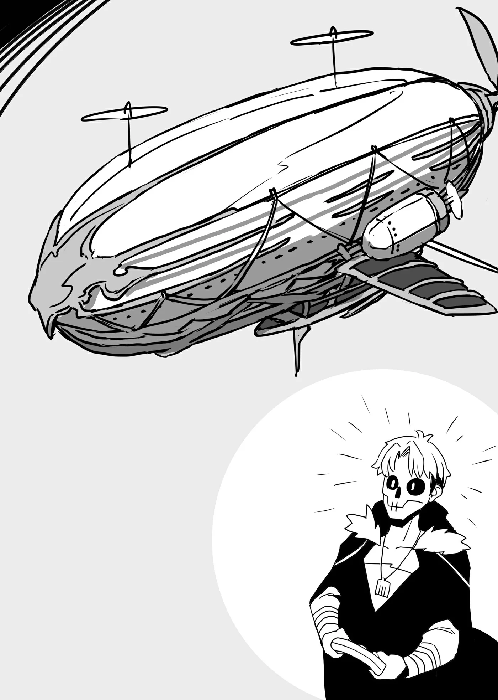

# Chương 65: Tập 3 Chương 2 - Và Một Ủy Thác Kỳ Lạ Không Kém (5)

Laura tiếp tục cất bước đi thẳng về phía trước, không hề dừng lại hay tỏ ra chút ngần ngại nào trước bóng tối đang bao bọc quanh chúng tôi.

Bất chợt, cô bé dừng bước thêm một lần nữa—

"Hãy tỏa sáng."

Trước những lời ấy, tôi bỗng thấy mắt mình chói lòa; chúng tôi bị bao vây, ngập chìm trong một thứ ánh sáng chói chang đến mức phi lý. Mắt tôi chỉ mất một thoáng để thích nghi với không gian xung quanh vừa bừng sáng.

"Chỗ này... Chỗ này. Thật đáng kinh ngạc."

Vây quanh tôi là những thứ trông như các gò đồi nhỏ chất đầy ma cụ, xếp chồng lên nhau có phần tùy tiện. Nhìn kỹ hơn, tôi nhận ra chúng thực chất đã được sắp xếp; kích thước muôn hình vạn trạng cùng số lượng áp đảo của chúng dễ khiến người nhìn lầm tưởng rằng đống ma cụ này bị chất thành một mớ lộn xộn.

Như thể đọc thấu tâm can tôi, Laura nhanh chóng đưa ra lời giải thích.

"Ngài hãy nhớ rằng chúng tôi đã sắp xếp lại các ma cụ rồi đấy nhé. Trước đây thì... bừa bộn hơn nhiều, vì chúng chỉ được quẳng bừa vào đây theo thứ tự thu thập về. Tuy nhiên hiện tại, phần lớn ma cụ đã được phân loại theo công năng, thời kỳ chế tác, nghệ nhân chế tạo, hoặc mê cung xuất xứ—tất cả những tiêu chí liên quan. Với số lượng đồ sộ đến nhường này, cộng thêm sự hiện diện của không ít món đồ mà công dụng vẫn chưa được biết đến, sẽ phải mất một khoảng thời gian nữa mới có thể phân loại xong xuôi tất cả."

Laura nói có lý—căn phòng chứa nhiều ma cụ tới mức việc phân loại chúng chắc chắn sẽ tiêu tốn bộn bề thời gian. Rốt cuộc thì việc phân loại ma cụ đâu giống như dọn dẹp một căn gác mái hay nhà kho bình thường.

Trong số các ma cụ có một vật thể đặc biệt đồ sộ, lớn gấp ít nhất ba lần một người bình thường. Tôi tự hỏi món ma cụ đó dùng để làm gì, và người ta di chuyển nó bằng cách nào? Với vóc dáng của Laura, việc để cô bé tự mình bê vác nó là điều bất khả thi. Có lẽ Isaac đã hỗ trợ cô bé vận chuyển chăng?

Xem ra những người hầu của gia tộc Latuule cũng phải vất vả ra trò...

"Ngài có thể chọn một món ma cụ tùy thích từ căn phòng này," Laura nói tiếp. "Tất cả các món ma cụ ở đây đều là thượng phẩm—ít nhất tôi muốn nói như vậy, nhưng quả thực bản thân tôi cũng không dám chắc chắn. Hy vọng ngài có con mắt tinh tường với ma cụ, Rentt."

"Ý cô bé... Là sao?" Tôi hỏi Laura để nghe lời giải thích.

"Có lẽ ngài cũng đã biết điều này rồi, Rentt, nhưng những món đồ có giá trị thực sự thường bị lẫn lộn giữa những Kỳ Cụ đơn thuần. Dù sao thì các ma cụ lọt vào mắt xanh của tôi đều được tập hợp trong căn phòng này. Thật khó để nói liệu những món ma cụ được nhắc tới có mang bất kỳ giá trị nội tại nào không, hay chúng chỉ đơn thuần là đồ bỏ đi. Dù tôi không phiền nếu ngài chọn một thứ vừa ý rồi mang đi, nhưng tôi đồ rằng một mạo hiểm giả sẽ muốn một món ma cụ có chút hữu dụng, vì thế nên tôi mới đưa ra lời cảnh báo ban đầu."

"Tôi hiểu rồi..."

Trên thực tế, có những món ma cụ chỉ chuyên dùng để trôi nổi hoặc nhảy nhót tại chỗ. Sẽ thật là một lựa chọn tồi tệ về phía tôi nếu đã cất công cân nhắc kỹ lưỡng mà rốt cuộc lại rước về một món đồ chẳng có công năng ý nghĩa nào.

Tuy nhiên, việc để tôi tự mình phân định giá trị thực sự của các ma cụ quả là có phần khó khăn. Tôi có thể nhận biết những loại ma cụ phổ biến thường dùng trong đời sống hàng ngày, nhưng nhiều món đồ dưới chân tôi lại mang hình thù vô cùng xa lạ. Nếu phải đoán, hơn một nửa số ma cụ này được mua lại từ các buổi đấu giá và có lẽ là độc nhất vô nhị; trong trường hợp đó, chỉ nhìn bằng mắt thường sẽ chẳng giúp ích được gì nhiều.

Suy ngẫm về chuyện này một lúc, tôi sớm quyết định nhờ Laura giúp đỡ một chút.

"Nếu có thứ gì thu hút sự chú ý của ngài, tất cả những gì ngài cần làm là cất tiếng hỏi. Tôi sẽ giải thích những gì mình biết về công năng của nó cho ngài. Dĩ nhiên, trong một số trường hợp ngay cả tôi cũng không rõ món ma cụ đó có tác dụng gì... bởi vậy, ngài vẫn sẽ phải là người đưa ra quyết định cuối cùng."

"Tôi rất... Biết ơn. Vì sự hiếu khách của cô bé. Nhưng tôi tự hỏi... Tại sao cô bé lại. Thu thập... Những ma cụ như thế này?" Nói một cách logic, nếu người ta không biết một món ma cụ dùng để làm gì, nó cũng chẳng khác mấy một đống phế liệu.

Laura lập tức bật cười trước câu hỏi của tôi.

"Dĩ nhiên là vì tôi thích thu thập đồ đạc thôi! Cứ có được là tôi lấy! Chỉ đơn giản vậy thôi," cô bé thích thú đáp lại.

Tôi nghĩ mình có thể thấu hiểu động cơ của Laura; ở một khía cạnh nào đó, đây là một kiểu chân lý phổ biến, đặc biệt là trong giới quý tộc và các gia đình cự thương giàu có. Sở hữu khối tài sản dư dả trong tầm tay, nhiều người trong số họ tự nhiên hướng đến thú vui sưu tầm đồ vật. Họ có thể sưu tầm đủ mọi thứ trên đời—từ những chiếc ổ khóa cho đến Ma Tinh của Goblin, thậm chí cả chính bản thân lũ Goblin nữa. Thỉnh thoảng người ta vẫn nghe đồn về những kẻ lập dị như vậy cùng các thói quen kỳ quặc của họ.

Những bộ sưu tập như vậy vốn dĩ mang sức hút riêng, nhưng dưới con mắt của một người quan sát bình thường thì chúng lại thật kỳ dị. Miễn là người sưu tầm cảm thấy thích thú với việc mình làm thì mọi chuyện đều ổn cả, nên tôi cho rằng việc gặng hỏi lý do cũng chỉ là bản tính tự nhiên của con người mà thôi.

Tuy nhiên, trong những trường hợp như thế này, đôi khi chẳng có câu trả lời thực sự nào cả; người sưu tầm chỉ đơn giản là muốn sưu tầm, thế là xong.

Thật dễ hiểu cho sở thích sưu tầm ma cụ của gia tộc Latuule—và nếu tôi có thể kiếm được chút lợi lộc bằng cách chọn ra một món ma cụ hiếm có, tôi cũng chẳng dại gì mà phàn nàn.

◆◇◆◇◆

"Cái này... Là gì vậy?"

Rảo bước quanh căn phòng, một vật thể nọ đã thu hút sự chú ý của tôi. Nó có dạng đĩa—hoặc có lẽ giống một hình trụ hơn—và đang nằm nghiêng một bên. Tò mò, tôi đưa ngón tay chỉ vào nó, và Laura nhanh chóng gật đầu, đưa ra lời giải thích ngắn gọn.

"Món đó giống một dạng mô hình hơn là ma cụ. Mô hình của một phương tiện chuyên chở chủ nhân của nó bay qua các vùng đất: một chiếc phi thuyền. Nó cũng di chuyển gần giống hệt như một chiếc phi thuyền thật sự vậy—nếu ngài làm như thế này..."

Laura nhặt viên Ma Tinh nằm cạnh mô hình bay nhỏ bé đó lên rồi gắn vào bên trong vật thể. Sau khi truyền một chút Ma Lực vào món đồ vừa lắp ráp, Laura dường như trầm ngâm trong chốc lát, hai tay cầm một vật thể vô hình nào đó. Ngay sau đó, hơi nước phụt ra từ mô hình nhỏ, phóng nó vút lên không trung.

"Trên thực tế," Laura nói tiếp, "những chiếc phi thuyền bay ngang dọc khắp các vùng đất ngày nay không vận hành bằng Ma Lực, mà bằng hơi nước. Nói một cách chuẩn xác thì đây không hẳn là một mô hình, mà có lẽ là một món đồ chơi nào đó nhằm mô phỏng công năng của một chiếc phi thuyền."

Ngay cả tôi cũng từng nghe nói về phi thuyền vào một thời điểm nào đó trong sự nghiệp mạo hiểm giả của mình—dù chưa từng có cơ hội ngồi thử. Đúng như Laura đã nói, những chiếc phi thuyền này bay qua các vùng đất, nhưng chúng hiếm khi có lý do để cập bến ở một vương quốc biên ải xa xôi hẻo lánh như Vương Quốc Yaaran. Đôi khi tôi có nghe nói về việc phi thuyền xuất hiện trong các dịp lễ hội tại vương đô, nhưng cũng chỉ dừng lại ở đó.

Thêm vào đó, giá vé cũng như cước phí vận chuyển hàng hóa trên phi thuyền đắt đỏ đến tương xứng, nên những người bước lên khoang thuyền chủ yếu là các cá nhân sở hữu tiềm lực tài chính hùng hậu. Là một mạo hiểm giả Đồng Cấp, lẽ dĩ nhiên là tôi chưa từng tiếp xúc với bất kỳ khách hàng nào thuộc tầng lớp xã hội ấy, vì thế tôi tương đối xa lạ với phi thuyền.

Thế nhưng, ngước nhìn mô hình phi thuyền bay lượn nhỏ bé đang lao qua lao lại, tôi có thể cảm nhận được rằng việc du hành trên một chiếc phi thuyền thực thụ chắc hẳn sẽ là một trải nghiệm vô cùng ấn tượng.

Vật thể Laura đang cầm trong tay dường như là một tác phẩm điêu khắc bằng đá trang trí nào đó, và nếu phải đoán, đó chính là thiết bị dùng để điều khiển chiếc phi thuyền bay lượn nhỏ bé kia.

"Ngài có muốn thử điều khiển nó di chuyển không?" Laura hỏi, đưa món đồ ra trước mặt. Tôi háo hức gật đầu.

Đó là một thiết bị khá đơn giản. Tất cả những gì người ta cần làm là cầm lấy khối điêu khắc và nghĩ về hướng bay cùng độ cao mà mình muốn chiếc phi thuyền nhỏ di chuyển tới. Chẳng mất bao lâu để tôi cảm nhận được sự cuốn hút đầy mê hoặc của nó. Chỉ những ma pháp sư đã làm chủ các loại ma thuật đặc thù mới có thể bay lượn trên không trung như mô hình phi thuyền nhỏ bé này. Hoặc có lẽ sẽ chính xác hơn nếu nói rằng bản thân nhân loại ở một mức độ nào đó luôn khao khát được bay lượn.

Dù người ta có thể dễ dàng du ngoạn xuyên qua những tầng mây trên boong phi thuyền, tôi lại chẳng có đủ tiềm lực tài chính để làm điều đó. Bởi vậy, việc có thể điều khiển mô hình phi thuyền này lướt đi trên bầu trời quả thực là một niềm thích thú tột cùng.

"Tôi đoán là ngài đang rất vui thích phải không?" Laura cất tiếng hỏi, ánh mắt cô bé dõi theo chiếc phi thuyền đang lượn qua lượn lại.

Tôi lập tức gật đầu. "...Vâng. Gần như khiến tôi... Muốn mang nó về nhà."

"Tôi hiểu rồi. Vậy ngài có bằng lòng chọn mô hình phi thuyền này không?"

"...Không, có lẽ là chưa."

Dù tôi vô cùng muốn mang nó về nhà, việc đem theo một món đồ chơi không có bất kỳ công năng đáng kể nào khác lại có phần... Chà, trong khi phần trẻ con bên trong tôi sẽ vui vẻ chấp nhận thứ đồ ấy, thì phần người lớn lại kịch liệt phản đối, khăng khăng rằng tôi nên chọn một món ma cụ có thể hỗ trợ mình trong cuộc sống hàng ngày.

Nhưng dĩ nhiên, phần người lớn đã đúng.

Phải rồi, có lẽ ngươi nói đúng, hỡi phần người lớn bên trong ta. Nhưng lẽ nào công việc và lẽ thường là tất cả những gì tồn tại trong cuộc sống sao? Đó có thực sự là niềm vui không? phần trẻ con bướng bỉnh vặn lại.

Chà... Hừm. Đúng vậy, cũng có lý lẽ đó nữa. Dù sao thì tôi cũng thực sự nên kiềm chế lại, dẫu điều đó khiến tôi thấy tiếc nuối khôn nguôi...

Ngay khi tôi vừa hạ quyết tâm, Laura đã ngắt lời tôi, dường như cô bé còn nhiều điều muốn nói về chiếc phi thuyền nhỏ.

"Vì ngài đang thấy vui như vậy, sao không thử dùng những công năng khác của nó xem? Ngài hãy thử tập trung suy nghĩ vào chính chiếc phi thuyền ấy."

Tôi ngoan ngoãn làm theo chỉ dẫn của Laura. Không một lời báo trước, khung cảnh trước mắt tôi lập tức biến mất, thay thế bằng một cảnh tượng vô cùng kỳ lạ—tôi dường như đang nhìn xuống từ chính chiếc phi thuyền. Từ góc nhìn trên cao này, tôi có thể thấy một người đàn ông mặc áo choàng đeo mặt nạ cùng một thiếu nữ xinh đẹp đứng cạnh anh ta.

"Chuyện... Chuyện gì. Thế này?"

Sự hoảng hốt trong thoáng chốc đã phá vỡ sự tập trung của tôi, và trước khi kịp nhận ra, tầm nhìn của tôi đã trở lại bình thường. Đứng trước mặt tôi là Laura, cô bé tiếp tục giải thích về các công năng của chiếc phi thuyền.

"Chiếc phi thuyền nhỏ bé đó không chỉ biết bay đâu; nó còn có khả năng tạm thời dung chứa ý thức của người điều khiển. Dù ban nãy tôi gọi nó là mô hình, nhưng nói vậy cũng chưa hẳn chuẩn xác. Thực tế, những chiếc phi thuyền trên khắp vùng đất đều được tạo tác dựa theo hình bóng của vật nhỏ bé này đây. Có thể nói món này chính là bản nguyên mẫu. Rốt cuộc thì nó được sinh ra từ tầng sâu của một mê cung mà."

Nói cách khác, những chiếc phi thuyền tráng lệ dong buồm băng qua các vương quốc và đất nước rộng lớn trên thế gian chẳng qua chỉ là sự bắt chước phương tiện nhỏ bé tựa như món đồ chơi đang lơ lửng trong căn phòng này.

Dẫu nói vậy, phần lớn ma cụ trên thế gian đều được tạo ra theo cách tương tự, lấy cảm hứng từ những vật phẩm tìm thấy trong mê cung. Dù thế, những chiếc phi thuyền thời nay lại vận hành bằng hơi nước chứ không phải ma thuật, nên tôi cho rằng việc sao chép trọn vẹn cơ chế phức tạp của thiết bị nhỏ bé này đã vượt quá khả năng hiện tại của con người.

Các ma cụ được tìm thấy ở tầng sâu của một mê cung khét tiếng là khó hiểu, ngay cả sau khi đã trải qua quá trình phân tích và mổ xẻ chi tiết. Dù vậy, phần lớn thời gian thì việc tạo ra một vật phẩm có công năng gần tương tự vẫn nằm trong khả năng của nhân loại. Nhưng khả năng dung chứa ý thức của người khác tự thân nó đã là một điều hết sức phi thường rồi.

Tôi tập trung tâm trí vào phương tiện đó một lần nữa, và gần như ngay lập tức, tôi được chiêm ngưỡng góc nhìn bao quát từ trên cao của căn phòng chúng tôi đang đứng. Đây không còn là một món đồ chơi đơn thuần nữa rồi. Trái lại, nó là một công cụ hữu dụng đến đáng sợ. Có món này, tôi sẽ có thể quan sát những địa điểm xa xôi từ trên không. Đây sẽ là một công cụ trinh sát vô giá.

Phải, đây chẳng còn là một món đồ chơi đơn thuần nữa. Laura dường như cũng đồng tình với suy nghĩ của tôi.

"Chà, vâng, tôi cho rằng nó có thể được dùng theo cách như vậy. Tuy nhiên, ngài cũng nên lưu ý... Vì nó vận hành bằng Ma Lực nên sẽ rất khó để bay đi khoảng cách quá xa. Người ta sẽ khôn ngoan khi biết chọn thời điểm sử dụng nó; chẳng hạn như khi trinh sát con đường phía trước, hoặc để khảo sát nhanh một khu vực từ trên không. Nó hoàn toàn có khả năng làm được chừng ấy việc."

Laura nói có lý. Dù cô bé vừa truyền một lượng Ma Lực tương đối vào viên Ma Tinh ban nãy, tôi vẫn có thể cảm nhận được rằng nhiên liệu còn lại trong thiết bị không có nhiều. Tôi đoán nó chỉ có thể bay được khoảng năm phút là cùng, vì dường như việc giữ chiếc phi thuyền nhỏ ở trên không lâu hơn thế là điều rất khó khăn.

Nếu không thể di chuyển quãng đường dài, công năng chuyển dịch ý thức của nó rốt cuộc cũng chẳng hữu dụng đến thế. Có lẽ nếu người ta sở hữu trữ lượng Ma Lực dồi dào thì vẫn có thể tận dụng được ở một mức độ nào đó. Nhưng xét thấy Laura ngay từ đầu đã dùng một viên Ma Tinh khá lớn, tôi đoán chừng toàn bộ Ma Lực của tôi cũng chỉ có thể cung cấp năng lượng cho món ma cụ này trong mười phút là cùng.

"...Tôi nghĩ nó. Là... Một món ma cụ. Khá tốt."

"Vậy thì, tôi đoán món này không hoàn toàn hợp ý ngài chăng?" Laura kiên nhẫn hỏi.

Tôi dừng lại suy nghĩ trước khi đưa ra câu trả lời.

"...Không, nhưng tôi... Vẫn chưa. Loại bỏ nó vội. Rốt cuộc có khi... Tôi lại chọn món này. Vào phút chót."

Dù hiện tại tôi chưa thể khai thác được nhiều từ nó, nhưng rất có thể trong tương lai tôi sẽ làm được, khi trữ lượng Ma Lực của tôi được gia tăng dung lượng.

Trên hết tất cả... thật vui khi ngắm nhìn chiếc phi thuyền nhỏ bay lượn xung quanh. Lẽ dĩ nhiên đó không phải lý do chính cho lựa chọn của tôi, nhưng tôi không thể phủ nhận rằng mình muốn chơi đùa với nó và để nó lao vun vút trên không trung.

Dù sao đi nữa, tôi nghĩ mình nên hướng sự chú ý sang các món đồ khác ở đây. Cùng với Laura và Isaac tháp tùng, tôi tiếp tục cất bước qua căn tầng hầm rộng lớn.
