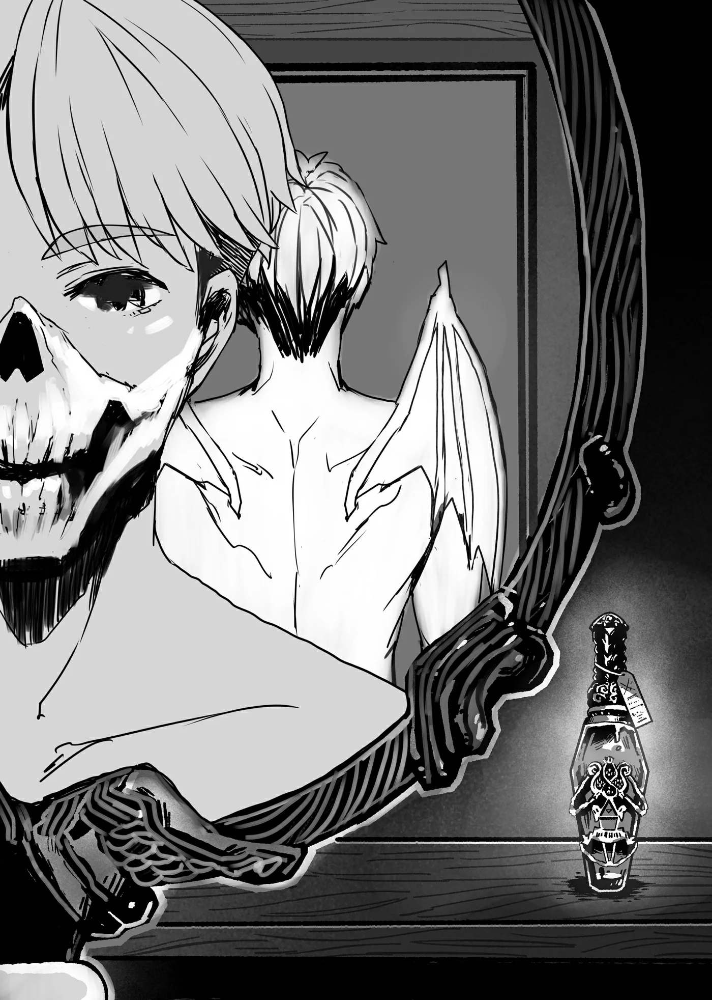

# Chương 71: Tập 3 Chương 3 - Tiến Hóa Bản Thể Mới (2)

Tiến Hóa Bản Thể ư? Sao cô ấy lại nhắc đến chuyện đó cơ chứ...?

Tôi thật sự chẳng có ý định giả ngây giả ngô gì, chỉ đơn giản là tôi không hề nhận ra cho đến khi Lorraine nhắc tới—để rồi sau đó cô liền hỏi xem có phải não bộ của tôi cũng đã thối rữa hết trong suốt quãng thời gian làm xác sống rồi hay không. Tôi chẳng thể nghĩ ra lời nào để vặn lại, bởi lẽ Lorraine nói cũng có lý.

Dẫu vậy, nói một cách thành thực thì tôi cảm nhận được một sự thay đổi khá rõ rệt trên khắp cơ thể mình. Vì đầu óc vẫn còn rất mơ màng do vừa mới tỉnh giấc, tôi chưa thể nắm bắt trọn vẹn tình hình thực tế. Thế nhưng... đúng là đã lâu lắm rồi tôi mới lại có cảm giác mơ màng hay có thể chợp mắt ngủ. Cho đến tận sáng nay, những xung động tự nhiên như thế vẫn luôn bị vùi sâu vào tận ngóc ngách tâm trí tôi.

Trong suốt khoảng thời gian làm Thi Quỷ, tôi sở hữu một sự bình thản đến chết chóc. Cảm xúc của tôi gần như luôn phẳng lặng như mặt nước hồ không một gợn sóng, ngoại trừ lúc trải qua đợt tiến hóa vừa rồi. Tôi sẽ ép bản thân phải bật cười nếu mọi người xung quanh đều đang cười, như một tín hiệu xã giao để tự nhắc nhở rằng cảnh tượng trước mắt rất buồn cười. Chẳng hiểu sao, giờ đây mọi trải nghiệm trước kia của tôi đều mang lại cảm giác như thế.

Trống rỗng đến đau lòng, quả đúng là vậy... nhưng tôi đồ rằng thực tế vốn dĩ là như thế.

Dù sao đi nữa, so với trước đây, giờ tôi cảm nhận được cảm xúc một cách rõ rệt và tràn trề hơn hẳn. Tôi vẫn còn cách rất xa so với thời tôi còn sống, nhưng chí ít thì tôi cũng cảm thấy đỡ... trống rỗng hơn trước. Sự trống rỗng và bình thản mà tôi cảm thấy giờ đây bớt mang đặc tính của Undead hơn, thay vào đó giống như sự trống rỗng theo nghĩa đen bên trong các khoang cơ thể tôi vậy. Trái tim tôi khi ấy cũng mang một khoảng trống vô hình theo nghĩa bóng.

Tuy nhiên, giờ đây tôi đã có thể cảm nhận được nội tạng của mình. Cơ thể vốn trống rỗng trước kia nay đã được lấp đầy thỏa đáng. Tôi đồ rằng mình có thể rạch bụng ra để ngó xem sao... dẫu điều đó nghe chẳng phải một ý kiến hay ho gì cho cam.

Dù sao thì tôi vẫn chưa biết trông mình ra sao; giá mà lúc này có sẵn một chiếc gương trong tay thì tốt biết mấy...

Như thể đọc được suy nghĩ của tôi, Lorraine khiêng một tấm gương khá lớn lại chỗ tôi đang đứng. Tấm gương hóa ra đã dựng tựa vào tường suốt từ nãy đến giờ—có lẽ Lorraine đã chuẩn bị nó từ trước. Trước đây cô đâu có chiếc gương lớn nào như vậy, nên có thể đây là món đồ mới sắm gần đây.

Xét về mọi mặt thì đây là một chiếc gương khá to, và tôi cảm thấy hơi áy náy khi để Lorraine phải tự tay vác một thứ cồng kềnh như vậy đi lại.

"Tôi chẳng... thấy có gì khác biệt cả," tôi vừa nhìn chằm chằm vào gương vừa nói, để rồi ngay lập tức bị một Lorraine đang bực bội quở trách.

"Cởi áo choàng với mặt nạ ra đi, đồ ngốc này! Đương nhiên là anh nhìn y như cũ nếu cứ mặc kín mít như thế rồi, Rentt. Đầu anh làm bằng gỗ đá đấy à?"

Tôi ngoan ngoãn làm theo lời chỉ dẫn của cô, nhưng... vậy thì làm sao Lorraine biết được là tôi đã tiến hóa cơ chứ...?

Luôn tinh ý như mọi khi, Lorraine đưa ra lời giải thích trước cả khi tôi kịp cất lời hỏi.

"Tôi chỉ việc tháo một chiếc găng tay của anh ra thôi, Rentt. Chắc chắn chỉ cần nhìn vào đó thì ngay cả anh cũng nhận ra rồi."

Ra là vậy... Quả không hổ danh là Lorraine. Ngước nhìn lên, tôi thấy đôi găng tay của mình đã được đặt ngay ngắn trên chiếc bàn nhỏ trong phòng.

Nhìn xuống đôi bàn tay mình, nếu bảo tôi ngạc nhiên thì vẫn còn là nói giảm nói tránh. Bàn tay tôi giờ đây đã nhẵn nhụi và trông tương đối bình thường, đối lập hoàn toàn với vẻ ngoài của chúng vào buổi sáng. Bất cứ ai từng nhìn vào đôi tay tôi trước đây hẳn đều sẽ tự hỏi liệu chúng có phải được làm từ những que củi khô, với những mẩu thịt người khô quắt vụng về dính lên hay không. À phải rồi, tay tôi trước kia quả thực quái đản và gớm ghiếc đúng như vậy đấy.

Dù đôi bàn tay tôi lúc này đã nhẵn nhụi và có nét giống người đôi phần, chúng lại vô cùng nhợt nhạt, cứ như thể bên trong chẳng có lấy một chút máu nào chảy qua, hoặc nếu có thì cũng cực kỳ ít ỏi. Chí ít thì chúng không còn mang vẻ ngoài của Undead hay quái vật nữa, và sẽ chẳng có ai chạy xộc tới trước mặt tôi mà bảo rằng: "Ôi chao, Undead phải không ạ? Làm ơn cho tôi xin chữ ký với được không?" Nhưng tất nhiên, tôi chưa từng được ai xin chữ ký vào bất kỳ thời điểm nào, bất kể là khi tôi còn là Khô Lâu, Ngạ Quỷ hay Thi Quỷ... đơn giản chỉ vì tôi chưa từng bị phát giác. Ngay cả khi có bị phát hiện đi chăng nữa, những kịch bản tồi tệ giờ đây cũng sẽ không còn xảy ra nữa.

Hừm... Một ví dụ về kịch bản tồi tệ sẽ là, chẳng hạn như, một đám đàn ông trung niên cơ bắp cuồn cuộn vác kiếm tiến lại gần tôi, rồi nói mấy câu đại loại như: "Này, mày là Undead đúng không hả? Cái ủy thác mà Hội Mạo Hiểm Giả đưa ra trả hậu hĩnh lắm đấy, biết chứ... Không phiền nếu bọn tao lấy đầu mày chứ?!" Hự...

Tôi chẳng muốn nghĩ thêm về chuyện này nữa. Nhưng nói đi thì cũng phải nói lại...

"Giờ tôi trông giống con người hơn một chút rồi à?" Tôi lẩm bẩm.

"Tôi cho là đã có chút tiến triển rồi đấy. Ngay từ đầu, chuyện liệu anh có thể hoàn toàn biến trở lại thành con người hay không vốn dĩ đã là một dấu chấm hỏi lớn. Hiện tại thì rất khó nói. Thoạt nhìn thì anh trông giống người, chắc chắn rồi. Dù thế nào đi nữa, Rentt, cởi mặt nạ với áo choàng ra mau—tôi không thể đưa ra đánh giá xác đáng nếu chưa tự mắt chứng kiến đâu."

Xét một cách nhẹ nhàng nhất thì câu trả lời của Lorraine có vẻ hơi bối rối, nhưng cô nói đúng. Như mọi khi, việc ảo tưởng hy vọng của mình sẽ trở thành hiện thực thật là ngốc nghếch; việc có thể phân biệt rạch ròi giữa hai điều đó là vô cùng quan trọng vào những thời khắc như thế này.

Đúng như lời Lorraine nói: chẳng một ai biết liệu tôi có thể quay trở lại làm người được hay không. Thế nhưng cú sốc từ sự thật phơi bày này dường như không tác động quá nặng nề đến tôi như tôi từng nghĩ. Có lẽ là nhờ lời tuyên bố trước đó của Lorraine rằng cô chẳng hề bận tâm nếu tôi cứ mãi là một Undead cho đến tận cùng. Ít nhất thì tôi cũng không phải trải qua trọn vẹn phần đời còn lại trong sự cô độc, sống lay lắt như một sinh vật quái vật bị ruồng bỏ.

"Được rồi, được rồi..." Tôi vừa nói vừa cởi chiếc áo choàng ra.

Bên dưới lớp áo choàng tôi cũng có mặc quần áo, nhưng xét một cách nhẹ nhàng nhất thì chúng cũng chỉ là những bộ đồ rẻ tiền. Chính xác hơn là tôi chỉ mặc một chiếc áo lót trong và chiếc quần dài. Tôi cố tình làm vậy, chủ yếu là vì có thời điểm cơ thể tôi từng thủng lỗ chỗ khắp nơi. Nếu tôi mặc phong phanh ít vải, tôi sợ rằng da thịt mình sẽ có cơ hội rơi rớt ra ngoài.

Nói một cách thực tế thì tôi có thể dễ dàng sửa sang lại bất kỳ vùng tổn thương nào bằng ma pháp trị liệu hoặc Thần Lực. Nếu chẳng may có thứ gì đó rơi ra ngoài, nó cũng chẳng gây ra vấn đề gì quá to tát. Thực ra đây chỉ là sở thích cá nhân mà thôi. Dù chẳng tạo ra mấy sự khác biệt về mặt thị giác, tôi vẫn rất cần mẫn chăm chút cho cơ thể mình, chẳng khác nào việc mấy cô tiểu thư trẻ tuổi vô cùng đam mê dưỡng ẩm cho làn da. Hệ quả từ nỗi ám ảnh ấy của họ là dịch nhờn Slime giờ đây có giá đắt đỏ đến chóng mặt—nhưng tôi là ai mà dám bảo các quý cô cuồng nhiệt ấy dừng những việc họ đang làm lại chứ. Nếu tôi thật sự thốt ra lời như thế ở nơi công cộng, chẳng biết chừng tôi sẽ bị đánh hội đồng trong một con hẻm tối lúc nào và ra sao đâu. Trong rất nhiều trường hợp, tốt nhất là nên ngậm chặt miệng lại—sự đời trên thế gian này vốn dĩ là như vậy đấy.

"Hừm..." Lorraine khẽ gật đầu khi chăm chú nhìn vào cơ thể giờ đã để trần của tôi.

"Cô có thấy khác biệt gì rõ rệt không...?"

"Chà... không, không hẳn, chí ít là nhìn từ phía trước. Dù sao thì cũng đã lâu rồi tôi mới nhìn kỹ lại... Cơ thể anh vạm vỡ thật đấy, đúng như dự đoán. Nhưng tất nhiên, với ngần ấy bài tập luyện mà anh đã trải qua thì điều đó cũng là đương nhiên thôi... Tôi không thấy có nhiều thay đổi lắm. Sao anh không tự mình nhìn xem, rồi bảo cho tôi biết anh có cảm thấy điều gì khác lạ không?" Lorraine nói sau khi đảo mắt đánh giá tôi một lượt.

Hừm... Liệu có khác biệt nào không nhỉ?

Tôi chăm chú nhìn hình ảnh phản chiếu của mình trong gương. Đáng tiếc là chẳng có sự thay đổi rõ rệt nào cả. Cho đến tận bây giờ, cơ thể tôi vốn tương đối khô khốc và đáng buồn thay là thủng lỗ chỗ khắp nơi. Tôi khó lòng nhớ được nhiều về dung mạo của mình thời còn sống, nhưng có lẽ thế này cũng khá gần với khi đó rồi.

Điểm khác biệt lớn nhất là da tôi tái nhợt cùng cực. Thậm chí một vài chỗ còn hơi ánh xanh, có lẽ là do thiếu máu. Nhưng một người lạ mặt nếu nhìn vào cơ thể tôi lúc này hẳn sẽ không lập tức nhảy bổ tới kết luận rằng tôi là Undead. Với riêng cá nhân tôi, vào thời điểm này thì điều đó dường như đã là quá đủ rồi.

Giờ tôi đã có làn da, và trên người cũng không còn lỗ thủng nào nữa... Đó thực sự là một điều vô cùng tuyệt vời.

Cảm giác mà tôi trải qua khi thức dậy có lẽ chính là độ căng của làn da mới hình thành. Nó hầu như chẳng có lấy một nếp nhăn, đối lập hoàn toàn với bộ dạng của tôi trước đây. Cứ như thể tôi vừa mới chào đời vậy.

"Lạnh quá..."

Một luồng khí lạnh buốt ập vào lưng—chắc chắn có hơi giật mình đôi chút, nhưng đó chỉ là bàn tay của Lorraine đang nhẹ nhàng vuốt ve làn da trên lưng tôi.

"... Một làn da mà phần lớn các cô tiểu thư đều phải ghen tị đấy, đúng thế." Cô gật đầu, vẻ đầy hài lòng. "Đây không còn là sự tái tạo nữa rồi... đúng hơn là một sự tái sinh, một sự tạo tác làn da mới hoàn toàn—thành thử mới nhẵn mịn đến thế này. Dĩ nhiên anh là đàn ông, lại còn là một mạo hiểm giả từng trải qua cuộc sống gian truân vất vả, dấn thân vào chốn mê cung các thứ. Trước đây da dẻ anh thô ráp lắm, vậy mà giờ thì..."

Trước kia, Lorraine từng chăm sóc tôi mỗi khi tôi bị thương, cô nhìn ngắm phần thân trên trần như nhộng của tôi một cách thản nhiên, đồng thời chạm vào đó để chữa trị vết thương. Tôi đồ rằng làn da của tôi lúc này nhẵn mịn hơn rất nhiều so với những gì cô còn nhớ trong ký ức.

"Cũng chẳng còn lấy một vết thương hay vết sẹo nào nữa cơ đấy..." Lorraine tiếp tục nói. "Trước đây anh từng có một vết thương cũ ở chỗ này, đúng chứ? Cái vết chém lớn kéo dài ngang qua lưng anh ấy... Vết đó để lại sẹo rõ lắm mà. Vậy mà giờ đã biến sạch không còn dấu vết rồi."

Đúng như Lorraine nói, mọi vết sẹo tôi mang từ thời còn sống giờ đây đã biến mất hoàn toàn. Tôi đồ rằng cơ thể mình đã tái cấu trúc lại theo nghĩa đen sau khi tôi biến thành Undead, điều đó giải thích cho sự biến mất của chúng. Dù sao thì tôi cũng chẳng thể chắc chắn tuyệt đối được, nhưng cũng chẳng phải là tôi bận tâm gì đến mấy vết sẹo của mình cho lắm.

Lorraine ngắt lời trước khi tôi kịp bày tỏ ý kiến về chuyện đó.

"Chẳng còn vết sẹo cũ nào sót lại... ngay cả vết ở chỗ này cũng không. Mạo hiểm giả vốn thích có những vết sẹo kiểu này lắm, đúng chứ...? Chà, chúng đã biến mất rồi thì cũng chịu thôi..." Cô nói, như thể đang tiếc thương sự mất mát của một món cổ vật vĩ đại vậy.

Cô ấy có vẻ ủ rũ trước sự thật này hơn cả tôi. Có lẽ cảm giác ấy cũng giống như nỗi lòng của lũ trẻ con khi những đường chỉ khâu trên món đồ chơi nhồi bông yêu thích của chúng bỗng dưng biến mất vậy.

"Chà, thực ra xung quanh cũng không có quá nhiều thay đổi đâu, ngoại trừ đôi cánh nhỏ này sau lưng anh..." Lorraine tiếp tục nói, bằng một giọng điệu hết sức thản nhiên.

"Chẳng còn gì khác đáng chú ý nữa cả, ừ."

Cô thốt ra cái thông tin đáng ra phải cực kỳ kinh ngạc ấy bằng một chất giọng tỉnh bơ không cảm xúc.

◆◇◆◇◆

"Cánh ư?"

Tôi nghiêng đầu sang một bên, hơi làm quá lên một chút vì quá đỗi bàng hoàng. Đáp lại, Lorraine cũng nghiêng đầu y hệt như vậy.

"Anh thật sự không nhận ra sao, Rentt?" Cô hỏi một cách thẳng thừng.

Có lẽ Lorraine không hề có ý giấu giếm chuyện đó. Nếu tôi đoán không lầm thì chỉ đơn giản là cô đinh ninh tôi đã biết về đôi cánh được cho là đang mọc sau lưng mình rồi. Dẫu vậy thì...

"Sao tự dưng tôi lại ngoái lại nhìn lưng mình làm gì chứ? Cô đâu thể kỳ vọng là tôi sẽ tự nhận ra được, đúng không?" Tôi nói với Lorraine, cảm thấy toàn bộ tình huống này có chút khó tin.

"Chà, lúc nãy chúng vừa cử động—hoặc là giật giật—rất khẽ đấy, Rentt. Tôi cứ tưởng là anh đang có ý thức điều khiển chúng cử động cơ chứ. Cho tôi xin lỗi nhé. Vậy là chúng cử động trong vô thức, tự động nhúc nhích à? Giống như mí mắt chăng...? À phải rồi. Một chiếc gương khác. Tôi nên đi lấy một cái nữa... Chắc là khó mà ngoái người lại để nhìn chăm chú vào lưng mình được rồi. Tôi có đúng thứ cần dùng đây... Đợi chút nhé."

Nói đoạn, Lorraine lục lọi quanh vài chiếc kệ trong phòng mình trước khi dừng lại và lôi ra một chiếc gương.

Mặc dù tôi đang tạm thời sống ở đây, nơi này rốt cuộc vẫn là nhà của Lorraine. Thêm vào đó, bản thân tôi hầu như chẳng có mấy của cải vật chất trần tục nào, và phần lớn những thứ còn lại trên các kệ sách cùng rương chứa đồ trong căn phòng này đều là tài sản của Lorraine.

Cầm chiếc gương vừa tìm được giơ lên, Lorraine đứng phía sau lưng tôi, phản chiếu hình ảnh tấm lưng tôi vào chiếc gương mà tôi đang đối diện. Nhờ thế, tôi đã có thể nhìn thấy lưng mình, và thứ phản chiếu trong gương không gì khác ngoài...

"Chắc... là cánh nhỉ..."

"Phải, Rentt. Là cánh. Gọi là màng bay cũng được—thực ra anh muốn gọi là gì cũng xong. Đúng y như tôi vừa bảo, phải chứ?"

Cánh... Những phần nhô ra sau lưng tôi là không thể nhầm lẫn vào đâu được. Đâm chồi từ khoảng giữa lưng xuống dưới bả vai tôi là đôi cánh đối xứng nhau, một chiếc bên phải và một chiếc bên trái. Chúng không có lông vũ, chẳng giống cánh chim chút nào. Chúng giống đôi cánh mỏng bằng màng da của loài dơi hơn, đầy đủ cả màng cánh các thứ. Dù chúng đang gập lại thành một hình dạng tương đối gọn gàng, tôi phát hiện ra mình có thể cử động chúng đôi chút nếu tập trung ý nghĩ vào đó.

Tận mắt chứng kiến cảnh tượng ấy, Lorraine có vẻ rất thỏa mãn.

"À, ra là anh có thể tự mình cử động chúng. Thế lúc nãy rốt cuộc là sao chứ...?"

Lorraine đặt hai tay lên những bộ phận vừa mới mọc ra của tôi, rõ ràng là đang kiểm tra lớp màng của chúng và nhẹ nhàng kéo căng ra. Cảm giác nhồn nhột buồn buồn, nhưng Lorraine là người hiểu rõ nhất; dẫu sao thì cô cũng là một học giả đáng kính trong lĩnh vực nghiên cứu quái vật.

Để Lorraine kiểm tra kỹ lưỡng cơ thể mình cũng giúp tôi hiểu thêm về năng lực của bản thân. Tôi chẳng còn lựa chọn nào khác ngoài việc tạm thời chấp nhận những hành vi tò mò hiếu kỳ của cô...

"Khoan đã nào, Rentt. Anh không nên tìm cách trốn tránh thế đâu..." Lorraine nói bằng giọng hơi đều đều.

"Trốn tránh? Tôi đâu nhớ là mình có ý định làm vậy."

"À, nhưng anh đang làm đúng y như thế đấy, Rentt. Cơ thể anh thì có lẽ không, nhưng đôi cánh của anh thì chắc chắn là có. Hay là tôi nên gọi chúng là màng bay nhỉ? Dù sao thì tôi cũng chẳng câu nệ việc phải dùng thuật ngữ nào để miêu tả cơ quan bay của anh đâu, nên chắc gọi bằng từ nào cũng được cả. Nói là vậy, nhưng anh giữ yên đôi cánh giùm cái đi. Chúng đang trốn khỏi tay tôi, cứ đập phành phạch hết bên này sang bên nọ kìa."

Cố vận dụng ý chí để giữ chúng đứng yên, tôi đứng im thin thít.

"Tốt lắm. Lần này tôi thấy không còn nhúc nhích lộn xộn nữa rồi," Lorraine nói bằng một giọng đầy hài lòng.

Thế nhưng Lorraine dường như vẫn còn bối rối trước những gì mình vừa trông thấy lúc nãy. Ngoẹo đầu nhìn quanh quất, cô lẩm bẩm, phần lớn là tự nói với chính mình.

"Tại sao lúc nãy nó lại... Hừm. Ra là thế. Có lẽ là..."

Lorraine bắt đầu chạm vào cánh của tôi theo một cách đáng ngờ, gần như thể cô đang có ý định thọc lét tôi vậy. Liếc mắt nhìn lên gương, tôi bắt gặp thoáng nét biểu cảm của Lorraine—đương nhiên là trên môi cô đang nở một nụ cười mỉm thoang thoảng.

Hóa ra là Lorraine đang cố tình thọc lét đôi cánh của tôi.

Dẫu vậy, tôi đâu phải kẻ dễ dàng chịu khuất phục. Cắn răng chịu đựng, tôi vận dụng ý chí ép đôi cánh không được nhúc nhích, và trong một khoảng thời gian, đó là tất cả những gì tôi nghĩ tới. Dù có nhột đi chăng nữa, tôi vẫn có thể nhẫn nhịn được. Có chí thì nên, dẫu cô có làm trò này liên tục hàng giờ liền đi nữa tôi cũng chịu được.

Phải rồi, hàng giờ... hàng giờ... liên miên bất tận. Không... Không thành vấn đề... Hự! Nhột quá mức chịu đựng rồi!

Cứ thế, cuộc đấu tranh giành độc lập khỏi sự co giật vô thức của đôi cánh đã chính thức kết thúc. Và đúng ngay vào khoảnh khắc ấy...

"Ồ! Ra rồi nhé. Lúc nãy anh có cử động cánh một cách có ý thức không đấy, Rentt?"

"Không hề. Nhột lắm, nhưng tôi đã ráng chịu đựng lâu nhất có thể... Chà, ít nhất là tôi đã muốn làm như vậy."

Tôi chẳng thể chịu đựng nổi những động tác tay như ma quỷ của Lorraine thêm được nữa vào giai đoạn cuối của cuộc kháng cự ngắn ngủi, nhưng sự thật là tôi chưa từng chủ động cử động đôi cánh vào bất kỳ lúc nào cả.

"Đúng như tôi dự đoán rồi." Lorraine gật đầu khi nghe câu trả lời của tôi.

"Anh có thể tự mình cử động chúng... nhưng thỉnh thoảng chúng cũng cử động một cách vô thức. Đôi cánh của anh cứ phành phạch hết chỗ này sang chỗ khác khi tôi cố thọc lét chúng, như thể chúng có ý chí của riêng mình vậy... Đôi khi, trông gần như có hai thực thể riêng biệt đang tranh giành quyền kiểm soát đôi cánh này vậy. Đoạn cuối là anh chịu thua rồi, đúng chứ?"

"Phải. Nó hơi quá sức chịu đựng đối với tôi."

"Vào đúng thời điểm ấy, tiềm thức đã giằng lại quyền kiểm soát đôi cánh từ phần ý thức của anh. Đó là lý do vì sao đôi cánh lại tự động đập phành phạch để né tránh tôi... nếu thích thì anh cứ hình dung nó giống như cái đuôi của loài động vật vậy."

Có vẻ như Lorraine đã đi tới một kết luận khá kỳ lạ. Ý cô là cô có thể đọc được tâm trạng và cảm xúc hiện tại của tôi chỉ bằng cách liếc nhìn những cử động của đôi cánh này sao? Cho dù khả năng quan sát của Lorraine chưa tới mức sâu xa như thế, thì cái việc đôi cánh thỉnh thoảng lại tự ý cử động cũng tự mang tới vài vấn đề rắc rối, một trong số đó là tôi sẽ chẳng thể giấu kín suy nghĩ của mình được nữa. Mặt khác, việc dạo bước quanh các con phố ở Maalt với một đôi cánh chĩa ra sau lưng là điều hoàn toàn bất khả thi.

Hử...?

Phải rồi, vẫn còn điều gì đó nữa... Có lẽ là một vấn đề khác.

"Chẳng phải việc cánh cứ chĩa ra sau lưng, hoặc tự ý ngọ nguậy bên dưới lớp quần áo sẽ trông khá đáng sợ sao?"

"Để xem đã nào."

Lorraine đi lấy thứ trông giống một bộ quần áo rẻ tiền, dường như được may bằng vải lanh. Mặc bộ quần áo vào, tôi xoay người lại, để Lorraine kiểm tra lưng mình.

"Sao rồi?"

"Hừm... Chà, đúng vậy, thế này quả thực là khá đáng sợ đấy. Có vẻ như có thứ gì đó trên lưng anh đang phồng lên và nhấp nhổm ngọ nguậy. Trông khó chịu vô cùng."

Bản thân tôi không thể tự nhìn thấy, nhưng tôi có thể hình dung ra nỗi kinh hoàng mà nó sẽ gieo rắc vào lòng một cư dân Maalt bình thường. Dù sao thì cũng có vài loài quái vật mang cái thói xấu xí là đẻ trứng vào bên trong cơ thể con người, và chính bản thân tôi cũng từng tận mắt chứng kiến những cảnh tượng rùng rợn như thế trong suốt sự nghiệp mạo hiểm giả dài đằng đẵng của mình. Bề mặt da của nạn nhân sẽ cựa quậy và uốn lượn nhấp nhô, như thể có cả ngàn con giun đất đang đào bới xuyên qua cơ thể họ. Quả thực là một cảnh tượng kinh tởm và rợn tóc gáy. Cuối cùng... chúng sẽ xé toạc làn da, phá vỡ vật chủ chui ra trong một thảm cảnh nổ tung đầy kinh hoàng.

Một trong những ký ức ghê rợn nhất mà tôi có thể nhớ lại từ thời còn sống. Thực tế thì nó có lẽ nằm trong tốp ba ký ức kinh hoàng nhất.

Hai ký ức ghê rợn còn lại là những mẩu cơ thể thối rữa mà tôi từng nhìn thấy trong quãng thời gian làm Ngạ Quỷ và Thi Quỷ. Việc có thể nhìn thấy nội tạng của chính mình—lại còn là nội tạng khô quắt nữa chứ—quả thực là rùng rợn. Chẳng có cách nào để phủ nhận điều đó cả.

Dù tốt hay xấu thì dạo gần đây tôi cũng đã quen dần với cái cảnh tượng ấy rồi... Nhưng giờ đây, một thứ quái dị không kém lại đang ngự trên lưng tôi ư? Không. Thế này thì hoàn toàn không ổn chút nào...

Không. Thế này thì tệ thật rồi!

Lorraine, người đã quan sát tôi suốt từ nãy đến giờ, cuối cùng cũng đưa ra một gợi ý.

"Nghĩ lại thì, Rentt... Anh không thể đơn giản là thu đôi cánh đó lại sao? Phần lớn quái vật đều có khả năng làm vậy, thu cánh thu vào trong cơ thể hay đại loại thế."

"Tôi cho là cô nói đúng. Vài loài quái vật quả thực có năng lực đó... Nhưng tôi phải làm thế nào để thu lại cơ chứ?"

"Làm như tôi biết câu trả lời ấy! Trước tiên anh hãy thử hình dung điều đó trong tâm trí xem sao, Rentt. Có lẽ chúng sẽ cử động khi có một hoặc hai ý nghĩ mãnh liệt chăng...?"

Trong một khoảnh khắc ngắn ngủi, ánh mắt chúng tôi chạm nhau, và từ ánh nhìn của Lorraine, tôi có thể nhận ra cả hai chúng tôi đều có chung một suy nghĩ. Đúng vậy, đây là một cuộc trò chuyện ngớ ngẩn, nhưng đáng tiếc thay lại là điều chúng tôi bắt buộc phải bàn tới. Nói một cách thực tế thì chẳng có cách nào khác để tránh né chuyện này, xét tới việc tôi là người duy nhất ở quanh đây rơi vào hoàn cảnh kỳ quặc đến vậy. Đâu phải là tôi có thể đơn giản nhìn vào một ai khác để lấy cảm hứng xem mình nên làm gì đâu.

Dù sao đi nữa, lúc này làm theo chỉ dẫn của Lorraine vẫn là điều khôn ngoan nhất.

Tôi nhắm mắt lại và nghĩ về việc thu đôi cánh gập vào trong cơ thể mình—rồi với một lực bất thình lình, tôi cảm nhận thấy có thứ gì đó khẽ đẩy nhẹ sau lưng.

"Ồoo!" Lorraine, người đã dõi theo suốt từ nãy đến giờ, khẽ reo lên một tiếng. Giọng cô nghe có vẻ vô cùng ấn tượng khi vỗ nhẹ vào lưng tôi. "Anh làm được rồi, Rentt! Giờ chúng đã thu lại ngay ngắn rồi đấy."

Vén chiếc áo sơ mi vải lanh tôi đang mặc lên, Lorraine chăm chú nhìn vào lưng tôi, rõ ràng là vẫn chưa kết thúc màn kiểm tra của mình.

"Hừm... Phải rồi. Tôi không còn thấy chúng nữa, Rentt. Hừm... Tôi cũng vừa mới bắt đầu thấy vui vẻ với chúng xong. Tôi cho là những phản ứng này vẫn nằm trong phạm vi chấp nhận được..." Lorraine gật đầu, chủ yếu là tự nhủ với bản thân. "Có đau ở đâu không, Rentt?"

"Có một cảm giác áp lực," tôi thành thật đáp lời, "như thể nội tạng của tôi đang bị ép chặt vào trong vậy. Dẫu thế, tôi cho là đôi cánh của mình sẽ không tự dưng bật—"

"HÙ!!!" Lorraine bất thình lình hét toáng lên.

Lẽ dĩ nhiên là tôi giật bắn cả mình. Thật chẳng giống tính cách của cô chút nào! Tôi đã toan bụng đòi Lorraine một câu trả lời; thế nhưng, đón chờ tôi khi quay người lại là một cái nhìn bực dọc. Lorraine có vẻ chẳng hề thấy vui vẻ gì.

Trong khi tất cả những gì tôi muốn chỉ là trấn an Lorraine rằng đôi cánh của tôi sẽ không tự tiện bật tung ra ngoài...

"Tôi thấy là anh chẳng chịu nổi mấy trò giật mình bất ngờ rồi đấy..."

Lorraine nâng chiếc gương cô đang cầm lên, và thứ phản chiếu bên trong chính là đôi cánh dang rộng, giương ra hết cỡ của tôi. Tệ hơn nữa, chúng không hề buông lỏng và hơi gập lại như trước kia, mà đang xòe rộng hết cỡ. Tôi chỉ có thể hình dung ra điều gì sẽ xảy đến nếu có thứ gì đó làm tôi giật mình trên phố. Liệu đôi cánh có thình lình bung ra từ sau lưng tôi, kéo theo những tiếng la hét thất thanh từ thị dân về ác ma, hay đại loại như thế chăng?

May mà chúng tôi phát hiện ra chuyện này sớm... Phải, quả thực là một điều rất may mắn...
