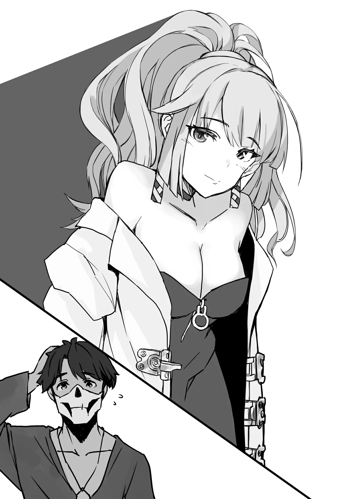

# Chương 73: Tập 3 Chương 3 - Tiến Hóa Bản Thể Mới (4)

Ý Lorraine là sao cơ? Cánh tôi phát sáng thật đấy à?

Đó là ý nghĩ đầu tiên lóe lên trong đầu tôi khi nghe Lorraine nói vậy. Dù sao thì tôi vẫn quay người lại để kiểm chứng, rồi nhìn ngay vào bóng mình trong gương.

Đúng như lời cô nói: khác hẳn với lúc nãy, đôi cánh sau lưng tôi đang phát sáng, tỏa ra một luồng ánh sáng trắng rực rỡ. Đó không phải là thứ ánh sáng chói gắt; chắc chắn không phải ánh sáng của ma pháp tấn công hay mang theo địch ý. Nói đúng hơn thì nó rất dịu dàng và êm dịu, từng đốm sáng lả tả rơi xuống từ đôi cánh như những bông tuyết buông trong thinh lặng.

Thảo nào Lorraine lại nói vậy. Luồng sáng bao quanh đôi cánh tôi đẹp một cách huyền ảo, đẹp đến khó tin.

Đẹp thì đẹp thật đấy, nhưng tôi vẫn có một điều băn khoăn với đôi cánh vừa phát sáng này.

"Đẹp... thì có đẹp đấy. Nhưng rốt cuộc chuyện này có ý nghĩa gì nhỉ...?" tôi trầm ngâm, nghiêng đầu nghĩ ngợi.

Rót Ma Lực và Khí Lực thì lần lượt tạo ra lực nâng và lực đẩy, nhìn là thấy ngay. Thế nhưng đằng này lại là chuyện hoàn toàn khác.

Thần Lực là một nguồn sức mạnh lớn, uy lực hơn Ma Lực và Khí Lực rất nhiều. Tôi vốn kỳ vọng một hiệu ứng rõ rệt và hoành tráng hơn, ai dè truyền Thần Lực vào cánh lại chỉ làm chúng phát sáng. Nghĩ mà hụt hẫng không để đâu cho hết.

Giờ có biến thành cây đuốc sống lúc nào tùy thích thì làm được trò trống gì chứ? Đem cây đuốc sống ra so với một con sóc bay hay mấy loài cùng họ với nó thì rõ ràng sóc bay có ích hơn nhiều. Tôi thà bay lượn được còn hơn làm một cái đèn sống kỳ quặc.

"Thì ít nhất đi trong tối người ta cũng dễ nhận ra anh hơn mà, Rentt... Hửm? Cái này..." Chợt nhận ra điều gì đó, Lorraine quay sang hướng khác, bỏ lửng câu nói đùa giữa chừng.

Nhìn theo hướng mắt cô, tôi thấy cô đang đăm đăm nhìn chậu thảo dược tôi để ở góc phòng. Tôi đặt nó ở chỗ nhiều nắng nhất trong căn phòng ở nhờ này, thường hái vào nấu nướng, thỉnh thoảng còn lấy lá để bảo quản thức ăn. Một chậu cây tôi trồng lúc rảnh rỗi thì có gì lạ cơ chứ?

Lorraine vẫn im lặng, chăm chú quan sát chậu cây.

"Rentt này... hình như cây của anh đang... lớn lên đấy."

Trông nó có vẻ nhỉnh hơn lúc nãy một chút, nhưng bảo là nhìn nhầm thì cũng chẳng sai. Như đọc được suy nghĩ của tôi, Lorraine bước ngay tới bê chậu cây lên, hứng vào luồng sáng từ đôi cánh của tôi. Gần như tức khắc, đám thảo dược trong chậu lớn nhanh như thổi, vươn cành bò nhánh ra tứ phía.

"Chuyện này..."

"Vậy ra khi anh truyền Thần Lực vào cánh, cây cối xung quanh sẽ lớn nhanh hơn đấy Rentt! Nhưng... tôi cũng chưa biết phải lý giải hiện tượng này thế nào..."

Lorraine có vẻ hài lòng khi thấy giả thuyết của mình chuẩn xác, nhưng niềm vui vừa chớm đã tắt, cô lại một lần nữa chìm sâu vào suy nghĩ.

Tôi cũng thắc mắc y như Lorraine: đôi cánh của tôi lại có tác dụng kiểu này là sao nhỉ? Khổ nỗi, chính tôi cũng chịu chẳng trả lời được.

"Hay là tôi cứ bay lượn trên trời, thỉnh thoảng lại sà xuống ban phước cho mọi người một mùa màng bội thu nhỉ?"

"Ra thế. Anh cao cả thật đấy, Rentt à. Ý anh là anh định từ bỏ nghề mạo hiểm giả để đi làm người bán phân bón dạo đấy hả?"

Không đời nào. Nghề đó thực sự chẳng hấp dẫn chút nào.

Nhưng tôi không thể phủ nhận rằng mình làm được điều đó thật.

Đến tôi còn từng nghe phong phanh về những người được tinh linh hay thổ thần ban phước có thể làm được chuyện tương tự như tôi vừa làm. Những ai được đất đai phù hộ thì cuối vụ kiểu gì cũng được mùa bội thu, nhưng ruộng đồng của họ vẫn phải cày cấy và chờ đến ngày thu hoạch như tự nhiên. Còn tôi lại có thể thúc cây cối lớn nhanh, bỏ qua hẳn quãng thời gian chờ đợi ấy. Rõ ràng đây là một năng lực cực kỳ hữu ích.

Nếu tôi bước chân vào một nhà thờ hay tổ chức tôn giáo nào đó trên vùng đất này, chắc hẳn tôi sẽ được tôn sùng như một Thánh Giả mùa màng, hay đại loại vậy. Trái lại, những ai không mấy coi trọng tôi thì nhiều khả năng sẽ chỉ xem tôi như người đi bón phân dạo gọi đâu có đó.

Dĩ nhiên là tôi chẳng có chút hứng thú nào với nghề nông rồi. Mục tiêu tôi luôn tự nhắc nhở bản thân là trở thành một mạo hiểm giả Mithril Cấp cơ mà.

Tất nhiên là tôi quay sang nói ngay với Lorraine: "Tôi không định bỏ nghề đâu. Nhưng... chắc phải còn công dụng nào khác mà tôi chưa nghĩ ra chứ nhỉ..."

"Thì ngay cả tôi cũng đoán được thế. Có lẽ... Hừm. Phải rồi, sao lại không nhỉ..."

Chắc Lorraine thấy mình cũng phải có trách nhiệm sau khi trót gợi ý tôi đi làm nông dân phép thuật.

Như vừa nảy ra ý gì, Lorraine thò tay vào trong áo choàng, rồi nắm lấy thứ gì đó trong lòng bàn tay.

Cái gì thế nhỉ...?

"Cô định làm gì với con dao đó đấy, Lorraine...?"

"À, có gì to tát đâu. Chỉ là... thế này thôi." Lorraine thản nhiên đáp rồi lấy lưỡi dao khẽ cứa vào đầu ngón tay cái của mình.

Nhìn cách cô cầm dao là biết động tác này đã quá quen tay. Cũng dễ hiểu thôi, vì các khế ước ma pháp và một số kỹ thuật giả kim thường cần đến một hai giọt máu. Bản thân Lorraine cũng chẳng mảy may bận tâm tới vết cứa nhỏ trên ngón cái. Huống hồ dạo gần đây cô vẫn thường lấy máu đóng vào lọ cho tôi, nên chắc lại càng quen với việc này hơn.

Có điều tôi chưa hiểu vì sao cô lại tự cứa tay mình. Như để trả lời ánh mắt tò mò của tôi, Lorraine chỉ lẳng lặng giơ ngón tay bị thương lại gần đôi cánh đang phát sáng.

"Biến mất rồi, đúng như dự đoán."

Lorraine chìa ngón tay cái ra cho tôi xem.

"Ra vậy. Ngón tay cô lành hẳn rồi... Vậy là ánh sáng này có khả năng trị liệu."

"Nói theo cách đó thì đúng là vậy đấy. Thế này chẳng phải rất đáng ăn mừng sao, Rentt? Không những có thể bón phân cho đồng ruộng, anh còn có thể chữa lành vết thương cùng bệnh tật cho những người nông dân chăm chỉ nữa đấy!"

Mong là cô chỉ đùa; dù vậy, Lorraine nói cũng có lý. Chúng tôi vừa phát hiện thêm một công dụng tiềm năng nữa của đôi cánh phát sáng này.

Cứ đà này thì nếu tôi truyền Thần Lực vào cánh rồi bay qua một khu vực nào đó, những người ở bên dưới đều sẽ được chữa lành. Với các tư tế hay Thánh Nữ có năng lực trị liệu thì chuyện đó chẳng có gì khó, nhưng trước giờ mỗi lần tôi chỉ chữa được cho một người. Tuy chỉ là một bước tiến nhỏ của bản thân, nhưng có tiến bộ vẫn hơn.

"Tác dụng nghe hơi đơn điệu... nhưng có còn hơn không."

"Đúng đấy. Thử nghĩ xem anh làm được bao nhiêu chuyện chứ, Rentt! Khéo ăn nói một chút là người ta còn sùng bái anh không chừng! Dù sao anh cũng phát sáng rực rỡ thế kia mà. Cứ tự xưng là sứ giả của thần linh hay đại loại thế là xong."

Chắc Lorraine lại đùa thôi... nhưng lời cô nói cũng không hẳn là vô lý. Có điều, mới nghĩ tới cảnh tự xưng như thế rồi được người đời sùng bái là tôi đã thấy rùng mình. Tôi chẳng ham hố gì kiểu gây chú ý kỳ quặc đó cả. Xem ra muốn dùng năng lực này thì phải chọn lúc cho khéo mới được.

"Nhưng nghĩ đi nghĩ lại thì, tôi là một mạo hiểm giả độc hành... Xem chừng cũng chẳng có nhiều cơ hội cho tôi dùng đến nó đâu, Lorraine."

Câu nói nghe thật cô đơn, nhưng đúng là sự thật: tôi hầu như toàn đi làm nhiệm vụ một mình. Một mạo hiểm giả độc hành như tôi thì làm được gì với một kỹ năng trị liệu diện rộng như thế này chứ?

Lorraine dường như không nghĩ vậy.

"Chưa chắc đâu, Rentt à. Anh không nhớ những lần quái vật sinh sôi bất thường sao? Khi ấy các mạo hiểm giả sẽ ồ ạt kéo đi ứng phó, đúng chứ? Những người có kỹ năng trị liệu diện rộng luôn rất được trọng vọng, phải không nào? Nhưng dĩ nhiên, những biến cố như vậy luôn đi kèm một Ủy Thác Cưỡng Chế từ phía Hội..."

Lorraine đang nhắc tới việc quái vật thỉnh thoảng lại sinh sôi đột biến xung quanh các thị trấn. Để nhanh chóng dẹp bỏ mối đe dọa, các hội mạo hiểm giả thường huy động toàn bộ thành viên nhằm giảm bớt số lượng của chúng. Những cuộc đụng độ như vậy chẳng khác nào những cuộc chiến thu nhỏ vì quân số đôi bên quá đông, và những mạo hiểm giả tinh thông thuật trị liệu luôn được Hội coi trọng hết mực. Người biết ma pháp trị liệu hoặc sử dụng được Thần Lực vốn đã hiếm, mà phần lớn mỗi lần lại chỉ chữa được cho một người. Bởi thế, mạo hiểm giả nào có khả năng trị liệu cho nhiều người cùng lúc trên diện rộng đều được quý như vàng.

Bình thường thì mạo hiểm giả vẫn có thể xin miễn Ủy Thác Cưỡng Chế nếu có lý do chính đáng, hoặc nếu không giữ vai trò thiết yếu trong chiến dịch. Thế nhưng một thầy trị liệu diện rộng thì muốn hay không cũng sẽ bị lôi ra chiến trường.

Xem ra năng lực này của tôi lại phải giấu nhẹm đi thôi...

Nhưng... làm vậy thì lại cắn rứt lương tâm mạo hiểm giả của tôi. Dù không còn là con người, tôi vẫn sẽ nhận lời triệu tập của Hội nếu biến cố như thế xảy ra. Nếu tôi làm ngơ, nhỡ đâu quái vật tràn được vào Maalt thì lúc ấy có hối hận cũng đã quá muộn. Huống hồ giờ trông tôi đã giống người hơn trước rất nhiều, nên sẽ không bị săn đuổi ngay chỉ vì vẻ bề ngoài nữa.

Dẫu vậy, nếu trong đám mạo hiểm giả có ai tinh mắt thì chắc tôi vẫn sẽ gặp rắc rối. Tốt nhất là tôi cứ giữ mình đừng quá nổi bật—hoặc ít nhất là tôi nghĩ thế.

"Nếu có ngày đó thật thì tôi cũng đành nghe theo lệnh triệu tập của Hội thôi... Chỉ mong sao tìm được cách xử lý cái ánh sáng này..."

Dù có đem kỹ năng trị liệu mới này ra dùng đi nữa, cảnh vác đôi cánh phát sáng rực rỡ sau lưng vẫn cứ quá sức chịu đựng với tôi.

Tôi ôm đầu thở dài ngao ngán suốt một lúc lâu, cố nghĩ xem có cách nào giải quyết không. Với bộ dạng của tôi bây giờ, bị người ta coi như Thiên Sứ thần thánh đúng là chuyện tôi chẳng mong muốn chút nào.

◆◇◆◇◆

"Vậy là chúng ta đã thử nghiệm xong hết mọi thứ cần thiết với đôi cánh của anh rồi đấy," Lorraine tuyên bố, vẻ mặt hết sức thỏa mãn.

Theo lời Lorraine, tôi vừa thử truyền Thần Lực vào cánh trong lúc bay. Giống như những lần thử trước, có vẻ Thần Lực và Ma Lực đi qua những mạch dẫn khác nhau trong cánh, nên may mà không xảy ra vụ nổ nào do sự cố Dung Hợp Thuật. Chắc cấu trúc bên trong đôi cánh đã tách biệt đủ rõ để ngăn tai nạn kiểu đó.

Đôi cánh này mới mọc ra sau lần tiến hóa vừa rồi. Điều làm tôi mừng nhất là chúng được cấu tạo sao cho không tự dưng sụp nổ từ trong hay phát nổ bừa bãi. Đổi lại, tôi cũng không thể tạo ra luồng sức mạnh công phá đột ngột trên đôi cánh như khi dùng Dung Hợp Thuật với kiếm. Nhưng với tôi thì chỉ cần bay lượn được đã là quá đủ rồi. Đòi hỏi thêm nữa thì thật bất công với đôi cánh mới nhú này quá.

"À... phải rồi. Còn một chuyện nữa... Rốt cuộc thì tôi đã tiến hóa thành thứ gì thế...?" tôi hỏi, chợt nhớ ra Lorraine vẫn chưa xếp tôi vào chủng quái vật cụ thể nào như mọi lần.

Tôi có cảm giác Lorraine đã đoán được đại khái tôi biến thành gì, chỉ là tôi chưa hỏi kỹ mà thôi. Thế nhưng nghe tôi hỏi vậy, Lorraine lại chỉ lắc đầu.

"Thú thật đấy Rentt, tôi chẳng biết đâu," cô vừa nói vừa tiếp tục lắc đầu.

"Thôi nào Lorraine. Trông cô như thể đã nắm được phần nào rồi mà. Lúc tôi tỉnh dậy, cô đang đọc cuốn sách dày cộp về Ma Cà Rồng đấy thôi. Chắc chắn cô làm vậy là vì đã có chút suy đoán về việc tôi có thể là thứ gì rồi, đúng chứ?"

Tất nhiên cũng có thể lúc đó Lorraine chỉ đang cuống quýt lật sách tìm xem có loài nào giống với thứ tôi vừa biến thành hay không. Nhưng nhìn dáng vẻ đọc sách của cô lúc ấy thì chẳng có nét gì là vội vã cả. Trông giống như cô đã đoán được phần nào, chỉ đang tra sách để kiểm chứng lại suy đoán của mình rồi báo cho tôi ngay khi tôi tỉnh dậy mà thôi.

Biết đâu tôi đoán trật; mà dù sao thì Lorraine cũng bắt đầu giải thích tiếp.

"Ừ thì, nói vậy cũng không sai... Nhưng Rentt này... Nhìn thấy đôi cánh đó của anh xong là tôi hết dám chắc rồi. Vốn dĩ Ma Cà Rồng đâu phải loài quái vật có cánh. Bề ngoài của chúng hầu như chẳng khác gì con người—tất nhiên là có răng nanh để hút máu, nhưng mà... A! Phải rồi, nhắc mới nhớ. Mặt mũi anh thế nào rồi? Chỉnh lại mặt nạ cho tôi xem thử nào."

Tôi gật đầu, chỉnh lại mặt nạ cho Lorraine dễ nhìn. Tôi tập trung ý nghĩ để đổi hình dạng mặt nạ, chẳng mấy chốc đã để lộ nửa mặt dưới. Dù cũng muốn mở hết cho cô xem trọn khuôn mặt, nhưng kiểu biến hình này ổn định và giữ được lâu hơn cả, nên cuối cùng tôi chọn cách này.

Trước đây, răng hàm và xương quai hàm của tôi đều lộ cả ra ngoài, chỉ có vài mẩu thịt khô và thớ cơ bám lơ thơ trên da chỗ này chỗ nọ. Vừa ngó vào xem xét, Lorraine đã khẽ thốt lên một tiếng ngạc nhiên.

"Ồ! Chỗ này có da thịt đàng hoàng lại rồi này. Cũng mềm mại, mịn màng y như mấy chỗ khác trên người anh... Nhìn mà phát ghét. Nhưng đúng là da anh trắng bợt thật. Nói thật thì trông chẳng giống người khỏe mạnh chút nào."

Lorraine nói vậy thôi, chứ cá nhân tôi thấy việc cô giữ được làn da mịn màng như thế dù ăn ở bừa bộn và sinh hoạt thất thường mới là kỳ tích đáng nể hơn nhiều.

Nói mới nhớ, dạo gần đây Sheila cũng từng than thở chuyện này. Da dẻ cô ấy vốn đã mịn màng tươi tắn sẵn, nhưng để giữ được như vậy cô ấy cũng phải tốn không ít thời gian và tiền bạc chăm chút, nên bức xúc cũng phải thôi.

Bản thân Lorraine cũng chẳng lạ gì chuyện làm đẹp, còn dùng thuật giả kim tự điều chế đồ dưỡng da và mỹ phẩm cao cấp để dùng. Có điều nếp sinh hoạt và ăn uống thường ngày của cô lại bê bối hết chỗ nói, bảo sao cánh phụ nữ bình thường ở Maalt nhìn vào cứ tức anh ách.

"Tôi thực sự không thể nào hiểu nổi khái niệm về một Undead khỏe mạnh đâu, Lorraine à..."

"Hừm. Anh nói cũng có lý, Rentt à. Một mặt thì anh đã chết, nhưng mặt khác anh lại là Undead. Đã chết mà vẫn sống sờ sờ thế này chẳng phải là trạng thái sung mãn nhất của cái chết rồi sao...? Mà thôi, bắt bẻ chữ nghĩa thế đủ rồi. Đúng là anh có răng nanh thật. Không lẫn đi đâu được, đích thị là răng nanh của Ma Cà Rồng—ít nhất là tôi thấy vậy..."

Lorraine đưa hai tay lên má tôi rồi bắt đầu thẳng tay nhào nặn—hết đẩy, kéo lại ấn—rõ ràng là đang cố vạch ra để nhìn cho rõ.

"Không lộ rõ như tôi tưởng nhỉ? Mà cũng phải... bình thường làm gì có cơ hội ngắm răng Ma Cà Rồng mỗi ngày đâu... Thú vị thật đấy. Nhưng chỉ thế này thì tôi vẫn chưa dám khẳng định anh là Ma Cà Rồng... Biết đâu răng anh chỉ nhọn hơn người thường một chút thì sao... Hừm..."

Cuối cùng cũng chịu buông tha cho đôi má tội nghiệp của tôi, Lorraine bước tới bên bàn, cầm lấy một lọ máu rồi quay trở lại.

"Há to miệng ra nào, Rentt."

Tôi ngoan ngoãn há miệng. Lorraine mở ngay nút lọ, lấy một que gỗ nhỏ chấm vào máu rồi đưa vào miệng tôi.

"Ồ. Hừm. Xem ra lúc anh nghĩ tới chuyện hút máu thì răng nanh mới dài ra. Thế thì nhận diện Ma Cà Rồng chẳng phải dễ ợt sao? Có điều làm sao mà bắt hết dân trong thị trấn xếp hàng há miệng ra để kiểm tra được... Nghĩ quẩn thật đấy."

Xem chừng Lorraine đang lấy tôi làm mẫu để nghĩ cách kiểm tra và vạch mặt Ma Cà Rồng trà trộn trong dân cư Maalt. Nhưng đúng như cô nói, cách này có nói nhẹ đi nữa thì vẫn quá kỳ quặc, vì làm sao bắt toàn bộ người dân trong thị trấn ra thử cho được. Chưa kể Ma Cà Rồng thường sống tụ tập thành từng nhóm khăng khít. Dù có phát hiện ra một tên thì chắc chắn nó cũng sẽ đánh động cho cả bọn. Thông thường, mời một tư tế hay Thánh Nữ giỏi nhận diện quái vật tới để lần dấu và tiêu diệt chúng sẽ hiệu quả hơn nhiều. Cách của Lorraine có chăng chỉ dùng để kiểm tra bổ sung mà thôi.

"Vậy thì, Rentt à. Tiếp theo cho tôi xem nửa trên khuôn mặt của anh nào... Dù sao thì Ma Cà Rồng cũng có đôi mắt đỏ mà."

Tôi gật đầu, một lần nữa đổi hình dạng mặt nạ, để lộ nửa mặt trên giờ cũng đã có lại đầy đủ da thịt.

"A, phải rồi. Trông thân thuộc thật đấy... Ý tôi là gương mặt đó của anh kìa. Khác hẳn bộ dạng trước kia, lúc còn toàn những hốc sâu hoắm với mấy dải cơ thịt phơi cả ra ngoài. Đã có lúc trông anh chẳng còn chút nét người nào nữa..."

Lorraine đưa tay chạm lên mặt tôi. Đôi bàn tay cô lúc này thật dịu dàng, khác hẳn lúc thẳng tay nhào nặn hai má tôi vừa nãy.

"Nhìn anh lúc này, tự nhiên tôi cảm thấy mình nên nói một câu trước mặt anh..."

Tôi nghiêng đầu nhìn Lorraine. "Chuyện gì thế?"

"Còn có thể là chuyện gì khác được chứ?"

"Mừng anh trở về, Rentt Faina."

Đó là những lời Lorraine đã thốt lên.

Tôi có cảm giác như một thứ gì đó vừa thực sự trở về với mình; phải chăng là cảm giác được làm người một lần nữa? Hay biết đâu... chỉ là tôi tự tưởng tượng ra mà thôi.

◆◇◆◇◆

"Vậy thì... về những chi tiết cụ thể trong việc phân loại anh là Ma Cà Rồng..."

Đang trò chuyện có phần xúc động mà thoắt cái đã quay ngoắt sang giọng điệu khoa học lạnh lùng thì đúng là phong cách của Lorraine rồi. Dù tôi biết điều cô sắp nói đây cũng quan trọng chẳng kém.

"Vậy... rốt cuộc thì cô nghĩ sao?"

"Ừm... nếu phải đoán thì anh đã tiến hóa thành một dạng Hạ Cấp Ma Cà Rồng nào đó. Có lẽ là một biến thể. Chắc chắn là trên Thi Quỷ một bậc và thuộc nhánh Ma Cà Rồng. Có điều rốt cuộc tôi vẫn không xếp anh vào một phân loại cụ thể nào được. Mắt anh màu đỏ, răng nanh lại phản ứng khi thấy máu... Xét những điểm đó thì đúng là Ma Cà Rồng rồi, nhưng ngoài ra tôi chẳng dám chắc thêm điều gì nữa."

Một câu trả lời mơ hồ hiếm thấy so với tính cách thường ngày của cô.

Chắc vẻ mặt tôi đã lộ rõ sự chưa thỏa mãn, vì Lorraine liền nhíu mày, cộc lốc giải thích tiếp.

"Anh còn muốn tôi làm thế nào nữa đây, Rentt? Tôi chưa từng nghe nói về bất kỳ loại Ma Cà Rồng nào có cánh cả. Anh kỳ vọng quá nhiều vào một học giả nơi thị trấn biên ải hẻo lánh như tôi rồi đấy. Vả lại... anh cũng quá khác biệt so với phần lớn quái vật. Cơ thể anh rất đặc biệt, và anh... chẳng giống ai. Đã độc nhất vô nhị như thế thì làm sao xếp vừa vào mấy bảng phân loại có sẵn hay những biến thể, phân loài từng được ghi nhận được. Nhận định như vậy mới là chuẩn xác nhất. Cùng lắm thì tôi chỉ có thể nói anh gần giống một dạng Hạ Cấp Ma Cà Rồng nào đó, nhưng nói đi nói lại, xét một cách khách quan thì tôi cũng chỉ kết luận được đến thế thôi."

"Cô nói thế thì chẳng phải khỏi bàn tiếp luôn rồi sao, Lorraine?"

"Chính xác. Đó là lý do ban đầu tôi định chẳng nói gì cả đấy, Rentt à."

Lorraine hơi bực mình; có lẽ cô mong đợi tôi không nói gì nếu bản thân tôi cũng đã đi tới kết luận tương tự. Xem ra tôi đã hơi chậm hiểu rồi...

"Tôi xin lỗi."

"Anh hiểu ra là tốt rồi. Đùa thế thôi chứ lần này anh đã tiến hóa tương đối thuận lợi, chẳng phải sao? Ít nhất thì chẳng có lý do gì để nghi ngờ việc anh đang không ngừng tiến hóa và mạnh lên. Dù vậy tôi vẫn băn khoăn... Rốt cuộc sau cùng anh sẽ biến thành thứ gì đây, Rentt? Chắc là thứ mà tôi có nằm mơ cũng không mường tượng nổi đâu. Sở hữu một đôi cánh kỳ dị vượt ngoài mọi phân loại trong khi anh chỉ đơn giản là một biến thể của Hạ Cấp Ma Cà Rồng... Tiếp theo anh định mọc sừng, hai mươi cánh tay, và có khi là năm mươi con mắt đấy hả? Cho dù anh có làm thế thật, tôi cũng khó mà thấy ngạc nhiên được nữa."

"Tôi cầu mong mình sẽ không biến thành bất cứ thứ quái quỷ gì tương tự như thế..."

Lời cô nói làm trong đầu tôi hiện lên hình ảnh méo mó về một con quái vật điên loạn đúng như miêu tả ấy.

Dẫu vậy lời Lorraine nói cũng có lý, bởi chưa từng có tiền lệ nào dám chắc rằng tôi sẽ không biến thành một sinh vật dị hợm, phi nhân tính. Nếu được, tôi chỉ mong cứ giữ nguyên bộ dạng hiện tại mà thôi—và suốt thời gian còn lại của ngày hôm đó, đầu óc tôi cứ luẩn quẩn mãi quanh chuyện ấy.

