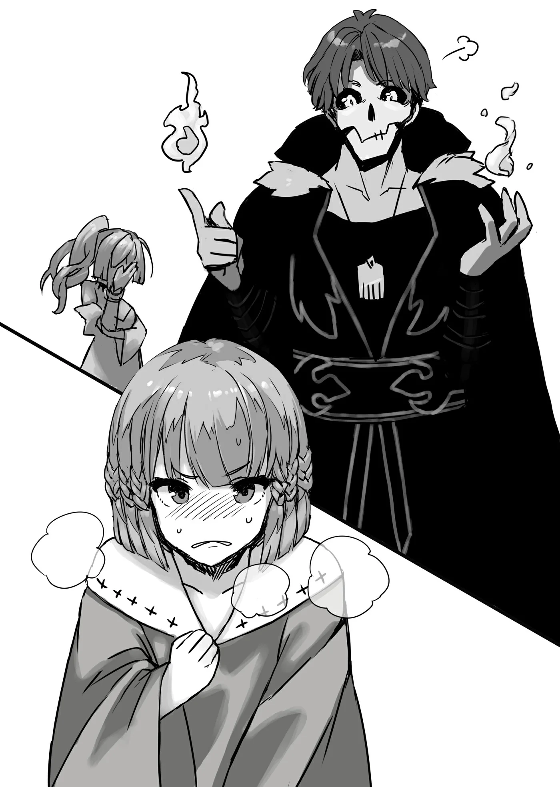

# Chương 78: Tập 3 Chương 4 - Ma Thuật (2)

"Có... đau không ạ?" Alize quay sang nhìn Lorraine, vẻ mặt vẫn chưa hết bồn chồn.

"Không, chẳng đau chút nào đâu. Ma Lực của người khác truyền vào người thì có thể sẽ thấy như có sức nặng đè lên bụng một chút. Nhưng lực ép đó không đến mức làm em đau. Tả sao cho đúng nhỉ... À, giống như hơi hụt hơi một thoáng, đại loại vậy. Tóm lại là không có gì đáng lo đâu, Alize."

"Nếu thế thì... nhờ cả vào cô, thưa Học Sĩ Lorraine. Cô cứ làm đi ạ."

Nghe Lorraine giải thích xong, Alize có vẻ yên tâm hơn hẳn. Cô bé cúi gập đầu, còn Lorraine khẽ gật lại.

"Được rồi. Đưa hai tay em đây."

"Vâng ạ."

Alize làm theo lời dặn, còn Lorraine lập tức nắm lấy hai bàn tay cô bé.

"Được rồi, giờ tôi sẽ truyền một luồng Ma Lực vào người em. Em chuẩn bị tâm lý xong chưa?"

"Dạ rồi... Ừm, em có điều này muốn hỏi. Nếu chỉ cần bị ma pháp đánh trúng, thì dùng ma pháp cường hóa hay thứ gì tương tự cũng có tác dụng như vậy chứ ạ?"

"Tác dụng thì có đấy." Lorraine đáp ngay. "Nhưng ma pháp sư làm thế với học trò tương lai của mình thì chẳng được ích lợi gì. Cách tôi vừa kể chỉ dành cho những ai không tìm đâu ra thầy, hoặc không gặp được ma pháp sư nào đủ khả năng truyền dạy ma thuật cho thôi."

"Em không hiểu lắm, thưa Học Sĩ Lorraine... Ý cô là sao ạ?"

"Nếu em chọn cách bị ma pháp 'đánh trúng', Alize, Ma Lực trong người em sẽ cuộn trào dữ dội, chẳng khác nào sóng biển giữa bão. Chưa biết cách điều khiển Ma Lực trong người mà đã để ma pháp sư niệm phép lên mình thì cũng thế thôi. Lúc đó, cả người em sẽ đau nhức ê ẩm, buồn nôn dai dẳng suốt mấy ngày liền. Đương nhiên là đầu óc cũng sẽ quay cuồng một thời gian dài nữa... Rentt từng nếm mùi rồi đấy. Đúng không, Rentt?"

Tôi gật đầu theo lời Lorraine: "Nói thật thì có những lúc tôi còn nghĩ 'thà chết quách cho xong'. Bảo tôi nếm lại lần thứ hai thì xin kiếu."

Đó là suy nghĩ thật lòng của tôi. Trải nghiệm đó kinh khủng lắm: đầu óc cứ chập chờn, khái niệm thời gian thì mơ hồ, lẫn lộn, lại thêm cảm giác đau đớn dường như kéo dài đến vô tận nữa... Chẳng ai muốn dính vào thứ đó lần nào nữa đâu. Đúng là một lần tởn tới già.

Họa chăng chỉ có kẻ thích hành xác mới thấy trải nghiệm lần hai... hấp dẫn. Còn tôi thì đương nhiên chẳng phải hạng người đó rồi.

"Nếu em chịu được những hậu quả đó thì tôi niệm một ma pháp đơn giản lên người em cũng được. Em thấy sao, Alize?"

Alize lắc đầu nguầy nguậy trước câu hỏi của Lorraine.

"K-Không đâu ạ! C-Cứ dùng cách bình thường thôi, thưa Học Sĩ Lorraine!" Alize gần như hét toáng lên.

Một phản ứng hoàn toàn dễ hiểu. Như tôi đã nói, hiếm ai lại tự nguyện đâm đầu vào cái thứ đó. Ngay cả tôi cũng đâu có rỗi hơi đi hứng đòn ma pháp cho vui! Chẳng qua lúc ấy tôi không còn cách nào khác để cảm nhận được Ma Lực mà thôi.

Một ma pháp sư bình thường chẳng đời nào ngại hét giá trên trời với một đứa dân làng. Nghĩ đi thì họ làm vậy cũng có lý, bởi ngay từ đầu họ đã có đủ Ma Lực để được gọi là ma pháp sư rồi. Nhưng đắt thì vẫn cứ là đắt. Hồi đó tôi đào đâu ra ngần ấy tiền, mà lại nung nấu ý định đánh thức nguồn năng lượng trong người, nên rốt cuộc cũng chẳng còn lựa chọn nào khác.

"Hừm. Nghe rồi đấy nhé, Alize. Vậy thì... Lần này tôi sẽ truyền Ma Lực qua người em. Tập trung vào, Alize. Hãy cảm nhận luồng cảm giác kỳ lạ sắp sửa lan khắp cơ thể em."

"V-Vââânggg?!"

Alize vừa gật đầu thì Lorraine đã siết chặt hai tay cô bé. Đôi mắt Alize mở to hơn bao giờ hết. Chỉ nhìn thế thôi là tôi hiểu ngay: người có thiên phú được trải nghiệm cảm giác như thế nào.

Thấy mà... ghen tị ghê...

"Thế nào rồi? Giờ em cảm nhận được chưa?" Lorraine vẫn nắm tay Alize, cất tiếng hỏi.

"Vâng..." Alize chậm rãi gật đầu. "Em... em nghĩ là mình hiểu rồi. Có cái gì đó... dính dính, nhờn nhợt như bùn, đang chảy... trong người em..."

Đến lượt Lorraine mở to mắt, dẫu phản ứng của cô bình tĩnh hơn Alize nhiều.

"Vốn dĩ Ma Lực trong người em đã nhiều hơn người khác rồi, nhưng cảm nhận được rõ đến mức này thì... Ấn tượng thật đấy. Đúng rồi, đó chính là Ma Lực đấy, Alize. Vừa rồi là tôi mượn năng lượng của mình để dẫn nó chảy đi. Nhưng em có thể tự dùng ý nghĩ điều khiển nó chuyển động được không?"

"Hơi... khó một chút ạ..."

Trán Alize bắt đầu lấm tấm mồ hôi. Xem ra việc luân chuyển Ma Lực đi khắp cơ thể chẳng phải chuyện dễ dàng.

Thấy Alize đang chật vật, tôi cũng thử vận Ma Lực trong người xem sao. Từ bụng, tôi cho nó chảy lên hai cánh tay, rồi bao bọc khắp cơ thể. Chuyện này... thật đơn giản, ít nhất là với tôi. Nhưng cũng phải thôi, bởi tôi có nhiều kinh nghiệm hơn. Dù gì tôi cũng đã dùng Ma Lực cả chục năm trời rồi, thứ duy nhất kìm chân tôi bấy lâu nay chỉ là dung lượng Ma Lực ít ỏi mà thôi.

Ma Lực là một thứ rất kỳ lạ: càng có nhiều thì lại càng dễ cảm nhận. Thế nhưng, Ma Lực càng nhiều thì việc kiểm soát và điều khiển nó lại càng khó khăn. Chắc cũng giống như việc xoay xở di dời cả đống đồ đạc trong một căn phòng chật chội vậy.

Ví như một chiếc bao tải nhồi căng cứng, có lắc thế nào thì đồ bên trong cũng khó mà xê dịch. Nhưng nếu là một chiếc bao vơi vơi, đồ đạc bên trong sẽ va lắc lách cách ngay. Đó là lý do vì sao khi đã cảm nhận được Ma Lực rồi, tôi lại điều khiển nó rất dễ dàng. Vả lại tôi đã luyện dùng suốt một thời gian dài, nên thao tác mới mượt mà như thế.

Nhưng chỉ bấy nhiêu thôi thì tôi cũng chẳng thể trở thành một ma pháp sư cừ khôi được. Dù tôi đã có thể tùy ý luân chuyển Ma Lực trong người, điều chỉnh cường độ và niệm phép rất nhanh, nhưng khả năng của tôi cũng chỉ dừng lại ở đó. Muốn thi triển những ma pháp uy lực mạnh mẽ, người ta buộc phải có dung lượng Ma Lực lớn hơn. Thậm chí có người còn bảo việc kiểm soát Ma Lực khéo léo đặc biệt có giá trị với phụ nữ, đơn giản là vì họ có thể dẫn Ma Lực tới bất cứ vị trí nào trên cơ thể. Kéo theo đó, tạo nước lại là ma pháp cơ bản người mới học nào cũng tập đầu tiên, thành ra phụ nữ có thể dễ dàng nhờ Ma Lực mà nhỏ nước mắt cá sấu. Thế nên các nữ ma pháp sư thường thuần thục kỹ năng này khá nhanh...

Càng nghĩ lại càng thấy trò đó đáng sợ thật.

"Được rồi, mình nghỉ tay một lát nhé?"

Lorraine nhìn Alize với vẻ thoáng lo lắng. Cô buông tay Alize ra, ngắt dòng chảy Ma Lực. Alize lập tức thở dốc ngắt quãng, rồi khuỵu xuống.

Cảm giác đó không hẳn là đau đớn, nhưng chắc chắn chẳng phải chuyện dạo chơi nhẹ nhàng. Để Ma Lực của người khác chảy trong người tuy không chết ai, nhưng cũng chẳng dễ chịu gì. Nếu kéo dài quá lâu còn có thể gây hại cho cơ thể.

Thông thường quá trình này phải mất nhiều ngày, cứ để người học nghỉ ngơi hồi sức rồi lại làm đi làm lại. Thế nhưng Alize đã cảm nhận được Ma Lực gần như ngay tắp lự. Đúng như Lorraine nói, cô bé quả thực có thiên phú phi thường.

"Em có sao không? Hay hôm nay dừng ở đây thôi nhé."

Hơi thở của Alize đã dần đều lại, nhưng mồ hôi vẫn đầm đìa trên mặt, trông tình cảnh chẳng khá khẩm là bao. Xem chừng cô bé đã ráng sức quá đà.

Nghe Lorraine nói, Alize thoáng vẻ bối rối.

"M-Mất... Mất bao lâu ạ. Phải bao nhiêu lần... nữa thì em...?"

"Bao lâu để quen ấy hả? Đương nhiên là đến khi em tự do điều khiển được Ma Lực trong người rồi, Alize. Chừng nào chưa làm được, tôi sẽ còn phải tiếp tục truyền Ma Lực vào người em. Chẳng có cách nào khác đâu. Sẽ vất vả lắm đấy."

"K-Không thể nào... Thật thế ạ...?"

Mặt Alize tràn ngập vẻ tuyệt vọng. Rõ ràng là cô bé đang khổ sở lắm.

Thấy phản ứng của Alize, Lorraine cười trừ.

"Không việc gì phải vội học hết trong một ngày đâu, Alize. Ban đầu tôi cũng tính việc này phải mất vài ngày cơ mà. Thế nên..."

Ý Lorraine là buổi học của chúng tôi sẽ dừng lại ở đây, ít nhất là cho ngày hôm nay. Tôi bèn chìa một bàn tay ra, nhen lên một ngọn lửa nhỏ trên đầu ngón tay. Ở tay kia, nước từ lòng bàn tay tôi tuôn trào ra. Làm xong, tôi nhìn thẳng về phía Alize, bụng nghĩ muốn cho cô bé thấy ma thuật thực ra cũng chẳng khó khăn đến thế.

Trò đó lập tức thu hút sự chú ý của Alize.

"M-Mất... Mất bao lâu... m-mới làm được... như thế?" Alize vừa thở hổn hển vừa hỏi, đôi mắt lườm tôi với vẻ bực bội ra mặt.

Alize đã coi màn trổ tài nho nhỏ của tôi là trò khiêu khích. Nghĩ vậy thì cũng chẳng sai, bởi trong mắt cô bé, tôi lúc này chẳng khác nào một kẻ thích làm màu. Đương nhiên tôi đâu có cố ý, chỉ thị phạm chút thôi mà.

Lorraine quay ngoắt sang nhìn tôi, vẻ mặt chẳng lấy gì làm thích thú trước màn biểu diễn đó.

"Anh bớt chọc tức con bé đi, Rentt..." Cô thì thầm rồi quay sang dịu giọng trấn an Alize: "Em sẽ sớm làm được hết thôi mà, Alize. Mấy cái đó chỉ là ma pháp vặt đơn giản, không tốn của em nhiều thời gian đâu."

Đấy, mười năm khổ luyện của tôi bị cô ấy gạt phắt đi chỉ bằng một câu nói...

Nhưng mà Lorraine nói cũng đúng. Tôi không phủ nhận thứ ma thuật mình vừa dùng quá đỗi đơn giản; nói đúng hơn thì lúc này tôi cảm thấy nếu muốn, mình thừa sức bắn ra cả một vòi nước từ lòng bàn tay. Đó chỉ là ma pháp vặt nằm trong kho tàng ít ỏi của Ma Thuật Sinh Hoạt. Đương nhiên quy mô của nó rất nhỏ, nhưng nếu tôi dồn đủ Ma Lực vào, khéo lại khuếch đại được uy lực của nó không chừng...

Nghĩ bụng biết đâu cũng đáng để thử một phen, nhưng tiếng thốt lên của Alize khi đứng dậy đã cắt ngang dòng suy nghĩ của tôi.

"Thế thì... chừng nào chưa làm được như thế, em sẽ còn tiếp tục cố gắng!"

Chẳng hiểu sao Alize lại hừng hực khí thế trở lại, vẻ háo hức hiện rõ trên mặt. Đang mệt lả là thế, vậy mà giờ cô bé lại gượng đứng dậy bằng chính ý chí kiên cường.

"Thế cơ à?" Lorraine mỉm cười nhìn cô học trò đầy nhiệt huyết. "Vậy thì... mình thử thêm một chút nữa nhé."

Lorraine liếc nhìn tôi, khóe môi thoáng nở nụ cười. Tôi còn chưa kịp phản ứng thì cô đã lại nắm lấy hai cánh tay Alize, tiếp tục quá trình truyền dẫn Ma Lực.

◆◇◆◇◆

"Ư..." Alize rên khẽ, tập trung cao độ ra sức dồn Ma Lực vào đầu ngón tay trỏ.

Chỉ cần dùng quen thì người ta có thể dẫn Ma Lực tới gần như mọi bộ phận trên cơ thể. Nhưng với đa số con người, hai bàn tay vẫn là nơi Ma Lực dễ chảy tới và giải phóng ra nhất.

Ở những vùng đất này, ai nấy đều quen với ý nghĩ ma pháp được bắn ra từ lòng bàn tay hoặc đầu ngón tay. Người ta đưa ra nhiều cách giải thích cho hiện tượng này: nào là Ma Lực dễ dẫn qua cánh tay nhất, nào là hầu hết mọi người dễ hình dung như thế. Dù giải thích thế nào đi nữa thì thực tế đúng là như vậy.

Riêng tôi thì có quen một ma pháp sư bắn được ma pháp từ mắt, nên tôi thấy giả thuyết về trí tưởng tượng có lý hơn. Người đó thừa sức dẫn Ma Lực qua tay. Có lần tôi hỏi sao lại chọn dùng mắt, câu trả lời của anh ta làm tôi nhớ mãi: "Tại trông nó ngầu." Đúng là một con người khó quên.

Đùa vậy thôi chứ tôi đoán với người quen ma pháp sư đó của tôi, bắn ma pháp từ mắt là cách nhanh và dễ nhất với anh ta. Những ma pháp sư kỳ lạ như thế vẫn có, dù số lượng chẳng được bao nhiêu.

"Hừm... Được đấy. Không tệ chút nào. Xem ra em đã điều khiển được Ma Lực chuyển động trong người rồi. Tuy lượng đó vẫn còn ít so với toàn bộ Ma Lực em có, nhưng chừng này cũng đủ để em dùng một hai ma pháp vặt mà không gặp mấy trở ngại đâu."

Alize không đáp, chỉ thở dốc từng hơi khò khè hổn hển.

"Hự... Hộc... Hộc..."

Mất tập trung, luồng Ma Lực nơi đầu ngón tay Alize liền tan biến.

"Em có sao không, Alize? Lần truyền tiếp theo sẽ mệt lắm đấy..."

Lorraine cảnh báo, giọng thoáng chút lo lắng. Alize lúc này đang chống tay quỳ rạp dưới sàn, cố thở dốc để lấy lại hơi.

Những đợt gồng mình trước đó của Alize chẳng khác nào hai ba lượt chạy nước rút hết tốc lực. Còn cơn mệt mỏi lúc này thì hệt như cô bé vừa chạy việt dã mấy vòng quanh tường thành Maalt vậy, đâm ra đã gần chạm tới giới hạn chịu đựng.

Người ngoài nhìn vào hẳn sẽ thấy ngày đầu tiên mà thế này là hơi quá, nhưng có khi vậy lại hay. Đã rèn thì phải rèn nghiêm khắc ngay từ đầu. Mới học ma thuật thôi mà Alize đã chịu khó vắt kiệt sức mình đến thế... Sau này cô bé nhất định sẽ là một mạo hiểm giả cừ khôi.

Dù ma pháp sư thường yếu sức và kém bền hơn các mạo hiểm giả khác, nhưng muốn sinh tồn thì thể lực của Alize vẫn phải vượt trội hơn hẳn dân thị trấn thông thường. Ngay cả Lorraine, một học giả chính hiệu chỉ thỉnh thoảng hứng lên mới nhận ủy thác của Hội, cũng là một tay đáng gờm. Đơn cử như việc vật tay, cô chẳng bao giờ chịu thua mấy gã du côn ất ơ ngoài đường. Dù sao thì mạo hiểm giả cũng luôn phải vận động tay chân nặng nhọc, hoặc rồi cũng đến lúc quen dần với việc đó. Cách để đạt được thì muôn hình vạn trạng: có thể do rèn luyện vất vả, hoặc đơn giản là hấp thụ sức mạnh từ những kẻ địch mà họ đã tiêu diệt.

"Em... không... sao đâu ạ. Chừng nào chưa làm được... như anh Rentt... Như những gì anh Rentt làm... em sẽ còn... cố..."

Suốt lúc ấy Alize cứ nhìn tôi như muốn tóe lửa. Có lẽ tại cái vòi nước vẫn đang không ngừng phun ra từ lòng bàn tay tôi.

Với một đứa trẻ tầm tuổi cô bé thì quả là kiên cường đáng nể. Rơi vào cảnh đó thì chắc tôi đã xin nghỉ từ tám đời rồi.

Lorraine quay sang Alize, giọng lộ rõ vẻ lo lắng:

"Tôi thì không sao đâu... nhưng em đừng ráng sức quá, Alize. Rõ ràng là Rentt đang chọc tức em đấy. Trông anh ấy như đùa cợt thế thôi, chứ hồi trước để làm được như vậy, anh ấy phải khổ luyện chẳng khác nào địa ngục. Đấy là cách anh ấy khích lệ em, muốn em cố gắng thêm chút nữa dù đã mệt lử rồi đấy."

Nói nhảm thật! Tôi đâu có ý đó...

Chắc thế...

Con người vốn là giống loài có thể làm nên những chuyện phi thường nếu chịu dốc sức. Vừa thở dốc, Alize vừa nhìn Lorraine mỉm cười.

"Em hiểu mà. Em... không... giận đến mức đó đâu ạ. Nhưng mà thưa Học Sĩ Lorraine... liệu có thật không ạ? Em thực sự có thể làm được như... anh Rentt sao? Chỉ trong một ngày thôi ạ?"

"Hừm. Chà... Rentt không gợi ý điều gì vượt quá tầm với của em đâu. Nếu phải nói thì... em sắp chạm tới mức đó rồi. Ráng thêm một chút nữa thôi. Khi nào làm được thì buổi học hôm nay có thể kết thúc."

"Thế thì... em sẽ làm. Em làm được mà... Giờ em phải làm gì tiếp ạ?"

Lorraine gật đầu. "Tiếp theo là học về cái ma pháp vặt mà Rentt vừa dùng. Nói cách khác, đó là thứ giúp em định hình ma thuật đó trong đầu. Có mấy cách làm: niệm đầy đủ câu thần chú, niệm chú rút gọn, hoặc không cần niệm chú gì cả. Đương nhiên vẫn còn những cách khác đặc biệt hơn, nhưng tạm thời ba cách này là đủ rồi. Em hiểu chứ, Alize?"

"Em nghĩ là mình... nắm được đại ý rồi ạ..." Alize chậm rãi gật đầu, nhưng vẻ mặt ngơ ngác đã tố cáo cô bé hiểu chẳng được bao nhiêu, nếu không muốn nói là chưa hiểu tí gì.

Chuyện này cũng dễ hiểu thôi, và Lorraine biết tỏng.

"Được rồi, được rồi. Xem ra phải làm mẫu một lần mới được. Vậy thì nhờ Rentt nhé, người nãy giờ đứng ngoài nhiệt tình chọc ngoáy. Liệu mà nhận trách nhiệm đi. Anh vẫn nhớ câu thần chú chứ hả, Rentt?"

Nhìn nụ cười trên môi Lorraine là đủ biết cô đang khoái chí lắm.

◆◇◆◇◆

"..."

Quả là một cảnh tượng buồn cười. Tôi đứng câm như hến giữa phòng, dưới ánh mắt chăm chú của Alize và Lorraine.

Đấy, thị phạm Ma Thuật Sinh Hoạt là thế này đây. Dù chỉ là mạo hiểm giả Đồng Cấp nhưng tôi cũng thuộc hàng kỳ cựu trong nghề, nên việc lôi tôi ra làm giáo cụ ma thuật trực quan xem chừng cũng hợp lý, một bước chuyển tự nhiên trong giáo án.

Khổ nỗi tôi chẳng tự tin chút nào... Cơ mà ngẫm lại thì đó cũng chỉ là ma thuật sơ đẳng, đúng cái ma pháp vặt vừa khích lệ Alize khi cô bé nhìn thấy lần đầu.

Vấn đề là Lorraine lại đòi tôi niệm chú, trong khi tôi vốn chẳng mấy khi dùng tới thần chú. Bảo hoàn toàn không dùng thì cũng không đúng, vì tôi vẫn còn nhớ vài câu mẫu chuẩn sách giáo khoa học từ thời niên thiếu.

Ma thuật là thứ càng dùng quen tay thì càng mang tính bản năng. Câu chú dài rút thành câu chú ngắn, rồi theo thời gian, ma pháp đã quen thuộc thì chẳng cần niệm chú nữa. Suốt cả chục năm trời, tôi cứ thi triển đi thi triển lại ba ma pháp cỏn con này. Thành ra chẳng bao giờ tôi phải niệm chú để gọi chúng ra. Đó là lý do vì sao tôi hầu như chẳng nhớ nổi câu thần chú nào thời còn sống...

Khoan đã... Chẳng lẽ Lorraine bắt tôi làm việc này là vì cô thừa biết tôi sẽ bí sao? Chậc...

"Hừm... À. 'Hỡi ngọn lửa. Hãy để Ma Lực của ta hóa thành nguồn nuôi dưỡng, và hiển hiện trước mắt ta... Ignite Aryumage.'"

Câu chú vừa dứt, một ngọn lửa nhỏ liền bùng lên nơi đầu ngón tay tôi. Đây là ma pháp đã cứu cánh cho tôi mỗi lần hạ trại nơi hoang dã suốt bao năm qua. Tôi thi triển nó dễ dàng như trở bàn tay cũng là điều tự nhiên.

Có điều câu thần chú thì sao, liệu tôi có đọc đúng không? Chắc là trúng được phần lớn, nhưng chi tiết thì thế nào? Tôi không chắc về câu từ cho lắm... Là ngọn lửa? Hay tàn lửa? Hay lửa? Có thiếu chữ nào không? Hiển hiện trước mắt ta? Xuất hiện trước mắt ta? Hãy được triệu hồi... Hừm. Thôi chịu, tôi chẳng tài nào nhớ nổi.

Vẻ hoang mang chắc đã lộ rõ trên mặt tôi, vì Lorraine chẳng nói nửa lời. Cô chỉ lặng lẽ nhìn tôi, khóe mắt ánh lên vẻ khoái trá thấy rõ. Nỗi hoang mang trong lòng tôi lại càng trĩu nặng.

Còn Alize thì ngước nhìn tôi đầy ngưỡng mộ, cứ như thể tôi là bậc tiền bối vĩ đại đang soi đường dẫn lối cho cô bé vậy... Đó là nếu câu chú vừa rồi đúng.

Vài phút trôi qua nghẹt thở như tra tấn, Lorraine vẫn im bặt rồi mới chịu mở miệng.

"Hô... Hóa ra anh vẫn nhớ cơ à? Bất ngờ thật đấy. Làm tốt lắm, Rentt." Cô nói, nụ cười vẫn đọng trên môi.

Tôi thở phào nhẹ nhõm. Thế là cái ải này rốt cuộc cũng qua.

"Lúc nãy tôi cũng không chắc lắm đâu... Thật sự rất mung lung đấy... Dù sao thì nhớ ra được là may rồi. Em làm được như vậy không, Alize?"

Tôi cứ tưởng Alize sẽ phát cáu vì bị mình chọc ngoáy nãy giờ, nào ngờ cô bé lại phản ứng theo cách khá bất ngờ.

"Hừm... Em cũng không rõ nữa. Liệu em có làm được thật không? Cơ mà em thấy anh vẫn cừ lắm, anh Rentt..."

Trong lời nói của cô bé chẳng có chút ác ý nào. Giữa Alize và tôi, chẳng biết ai mới là người chín chắn hơn nữa.

À mà... nói thế cũng không đúng. Rõ ràng là tôi trẻ con hơn rồi. Tôi tự biết tỏng mà.

Lorraine liền tiếp lời: "Dĩ nhiên là em làm được rồi, Alize. Có nhiều mẹo cơ bản em có thể áp dụng lắm... Mà đương nhiên hỏi Rentt thì hơn. Dù sao anh ấy cũng là bậc thầy lão luyện trong mấy món ma thuật vỡ lòng."

Mức độ thuần thục một loại ma thuật ảnh hưởng trực tiếp tới tốc độ niệm và uy lực của phép đó. Luyện đi luyện lại đúng ba ma pháp suốt hơn chục năm trời, tôi dám tự tin khẳng định độ thuần thục của mình với chúng chẳng thua kém gì Lorraine.

Alize quay sang ngước nhìn tôi đầy mong đợi. Chưa gì đã muốn xin bí quyết rồi đây.

"Tập trung Ma Lực của em vào một điểm duy nhất. Sau đó giữ cho luồng Ma Lực ấy ổn định lại. Rồi hình dung kết quả em mong muốn trong đầu... Ma thuật nào cũng áp dụng mấy bước này cả. Cứ tưởng tượng điều em muốn làm, chẳng mất gì đâu... tôi nghĩ thế."

Dù dày dạn kinh nghiệm ở mảng này, nhưng ngoài Ma Thuật Sinh Hoạt ra tôi chẳng biết dùng phép nào khác, nên cũng không dám phán bừa về ma thuật cấp cao.

"Rentt nói đúng đấy." Lorraine gật đầu tán thành. "Trí tưởng tượng rất quan trọng. Hình dung kết quả trong đầu sẽ giúp ích cho mọi loại ma thuật khác. Dĩ nhiên với từng loại phép lại có những mẹo riêng... Nhưng tốt nhất là em cứ bắt tay vào thử luôn. Câu thần chú là bước đầu tiên: nhớ kỹ rồi niệm lên. Em làm được chứ, Alize?"

Alize lập tức gật đầu, đứng dậy lấy lại thế sẵn sàng.
