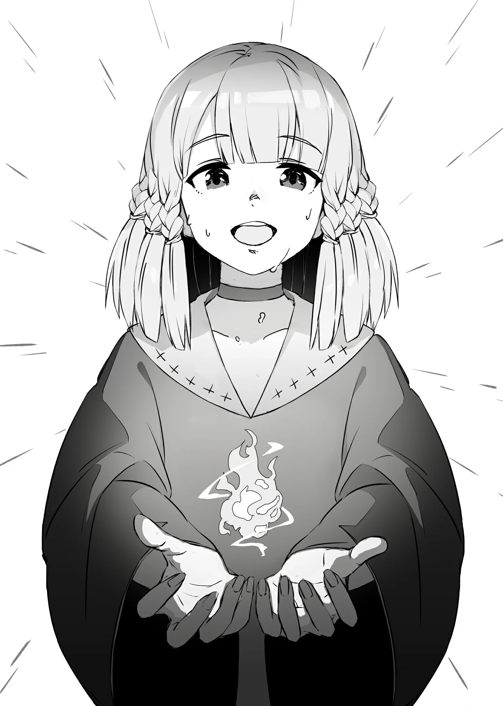

# Chương 79: Tập 3 Chương 4 - Ma Thuật (3)

"Được rồi. Trước hết em phải tập trung Ma Lực lại, Alize. Như em đã làm lúc nãy, hãy tập trung nó vào đầu ngón tay trỏ."

Alize khẽ gật đầu với Lorraine trước khi dồn hết sự tập trung, gom tụ Ma Lực trong cơ thể mình lại. Dù tôi không thể nhìn thấy sự chuyển dịch Ma Lực bên trong cơ thể người khác, nhưng Lorraine dường như lại có thể.

"Cô bé làm thế nào rồi?"

"Hừm... Theo tôi thấy thì khá tốt đấy. Không nhanh đến mức kinh tởm như cái cách anh vận chuyển Ma Lực vòng quanh cơ thể lúc trước đâu, Rentt, nhưng dù sao đây vẫn là tiến bộ đáng khen cho ngày đầu tiên. Việc con bé có thể làm được ngần này đã là quá đỗi tuyệt vời rồi." Lorraine thông thái gật đầu.

"Được rồi. Giờ là lúc thực hành ma thuật sơ cấp, Alize. Em hãy thử hình dung lại những gì em vừa thấy Rentt làm lúc nãy. Hãy mường tượng ra khung cảnh đó trong tâm trí, rồi niệm câu thần chú. Chính là câu này đây."

Lorraine chĩa cây gậy phép của mình vào tấm bảng gỗ; cô đã chép sẵn câu chú thích hợp lên đó từ lúc nào không hay, có lẽ là khi tôi không để ý.

Những giọt mồ hôi lấm tấm trên trán, Alize gật đầu thêm lần nữa rồi khẽ hé môi.

"‘Hỡi ngọn lửa... Hãy để Ma Lực của ta... hóa thành nguồn nuôi dưỡng... và hiển hiện... trước mắt ta... Ignite Aryumage’!"

Dứt lời, luồng Ma Lực nơi đầu ngón tay cô bé chao đảo, run rẩy rồi dao động, trước khi tỏa ra ánh sáng rực rỡ trên ngón tay đang vươn ra của em. Đây là hiện tượng chưa từng xảy ra khi tôi ra tay thử sức. Cảnh tượng như vậy chỉ xuất hiện khi Ma Lực không được chuyển hóa thành ma thuật một cách trọn vẹn. Lượng Ma Lực dư thừa không được dùng đến sẽ phân tán dưới dạng ánh sáng.

Do tôi đã liên tục chuyển hóa Ma Lực thành ma pháp suốt từ nãy đến giờ, hiện tượng hao hụt Ma Lực đã không hề xảy ra. Song Alize lại chỉ là người mới bắt đầu và chưa quen với ma thuật. Khi một người ngày càng trở nên quen thuộc với ma thuật nói chung, sự hao hụt và lãng phí Ma Lực sẽ càng ít đi. Có thể chuyển hóa Ma Lực thành các hiện tượng khác nhau một cách nhanh chóng và trọn vẹn vốn là ước mơ của bất kỳ ma pháp sư nào. Bởi vậy, việc hao hụt đôi chút Ma Lực là điều không thể tránh khỏi đối với trường hợp của Alize.

Khi ánh sáng dần lắng xuống, một ngọn lửa nhỏ hiện ra, nhảy múa lững lờ trên ngón tay Alize. Nó nhỏ hơn ngọn lửa tôi tạo ra lúc trước chừng một nửa. Đó là một đốm lửa bập bùng, chập chờn bất định, thậm chí còn quá nhỏ để có thể làm tàn lửa hay tia lửa.

Alize ngước nhìn đốm lửa đầy vẻ kinh ngạc, đôi mắt mở to. Có vẻ như cô bé vẫn thấy khó tin rằng mình thực sự có thể thi triển ma thuật, dẫu đã học qua lý thuyết và đã có khả năng điều khiển Ma Lực trong cơ thể.

Ma pháp sư là những cá nhân hiếm hoi, chí ít là giữa những con người bình thường. Họ sở hữu sức mạnh biến một người thành tro bụi chỉ bằng một đòn duy nhất, thậm chí có thể uốn nắn đủ mọi loại vật chất theo ý muốn mà không cần chạm vào chúng. Chẳng có gì ngạc nhiên khi Alize lại hoang mang chẳng dám tin vào mắt mình khi giờ đây cô bé đã trở thành một trong số họ. Hầu hết những ai sử dụng ma pháp lần đầu tiên đều có phản ứng như vậy. Người ta có thể mong muốn trở thành một ma pháp sư, hay miệng nói về chuyện làm ma pháp sư, nhưng hiếm ai thực sự sẵn sàng tâm lý cho khoảnh khắc ấy.

"Tuyệt vời quá... Cả... Cả em cũng dùng được ma thuật sao? Á!"

Vừa lúc Alize thốt lên, đốm lửa bập bùng liền biến mất, nhiều khả năng là do sự tập trung của em đã bị gián đoạn. Trong khi một người có thể duy trì ma pháp trong vô thức nếu họ đã quen thuộc với nó, thì kỳ tích như vậy lại gần như là bất khả thi vào thuở mới bắt đầu chặng đường, bởi khi ấy người ta cần phải dồn toàn bộ sự chú ý.

"Đó là vì em đã nghĩ sang chuyện khác đấy, Alize. Không sao cả, sau vài lần luyện tập, em sẽ có thể làm được điều này mà chẳng cần bận tâm suy nghĩ đâu," Lorraine giải thích.

"Em chưa từng nghĩ mình lại phải gắng sức đến thế chỉ vì một ngọn lửa cỏn con dường này... Em cảm thấy mình khó mà làm được như lời cô nói lắm, thưa Học Sĩ Lorraine..."

"Không, không hề." Lorraine lắc đầu với cô học trò của mình. "Chẳng có chuyện đó đâu. Hãy nghĩ mà xem: ngay cả Rentt còn làm được cơ mà, đúng chứ? Thậm chí, nếu em quen thuộc với nó hơn nữa, em còn có thể làm được thế này cơ."

Một ngọn lửa nhỏ tự động bùng lên trên ngón tay Lorraine. Một dòng nước nhỏ tuôn ra từ lòng bàn tay cô trước khi nhảy múa đầy tinh xảo, phác thảo nên đường nét của một tấm bản đồ trông vô cùng phức tạp.

Chà, đúng là kỹ thuật của một bậc thầy thực thụ. Hiếm có ai có thể điều khiển hình dạng Ma Lực của mình xuất sắc đến thế.

Nhưng ngần ấy thì ngay cả tôi cũng có thể làm được. Tuy nhiên, những gì Lorraine làm tiếp theo mới là thứ tôi chẳng bao giờ dám mong bắt chước nổi.

Ngọn lửa cùng dòng nước từ tay cô dần lớn hơn, định hình thành dáng dấp của muông thú và đủ loại sinh vật. Những ngọn lửa hóa thành hình một chú chim, còn những tia nước trôi nổi biến thành rồng, rồi lại thành voi—cả một gánh xiếc muông thú lặng lẽ xoay vần giữa không trung. Nếu tôi có thể nhận xét, thì rõ ràng đây chẳng thể nào là bất kỳ loại ma thuật sơ cấp nào được rồi.

Đối với một người mới bắt đầu, việc phóng to ngọn lửa và dòng nước được triệu hồi tới kích thước như vậy là điều không tưởng, chưa nói tới việc phóng chúng ra xa khỏi cơ thể mà vẫn duy trì được quyền kiểm soát. Chính việc làm được điều đó đồng nghĩa với việc những gì chúng tôi đang chứng kiến đã chẳng còn là ma pháp cơ bản dưới bất kỳ hình thức nào. Nếu tôi có thể thực hiện được kỳ tích như vậy, tôi đã bắt đầu nghịch ngợm với những con thú bằng lửa biết bay của riêng mình từ lâu rồi.

"Oa..." Miệng Alize há hốc ra kinh ngạc.

"Cả thứ này nữa." Lorraine vẫn còn nhiều ngón nghề giấu trong tay áo.

Chỉ bằng một cái phẩy tay, đất đá liền hiện hình từ hư không, mang hình dáng của vô số công trình kiến trúc trôi nổi. Đầu tiên là những tòa nhà của hội mạo hiểm giả, tiếp đến là nơi ở của Lorraine; một dinh thự, rồi một tòa lâu đài nguy nga tráng lệ. Mỗi một công trình trong số đó lại mang những màu sắc khác nhau; chẳng ai nghĩ rằng chúng lại được tạo nên từ những hạt đất vụn.

Tôi nhận được một lời nhắc nhở cay đắng về việc trình độ kỹ năng của mình còn cách Lorraine xa đến nhường nào.

Cuối cùng, Lorraine thu hồi toàn bộ ma pháp của mình và những cảnh tượng kỳ thú ấy dần tan biến.

"Em thấy sao? Rất ấn tượng phải không? Chí ít thì cũng hơn hẳn Rentt rồi," Lorraine tự đắc khoe khoang.

À, tôi hiểu rồi. Cô ấy chẳng phải đang phô diễn cho Alize thấy những tiềm năng vô hạn của ma thuật... mà đơn thuần chỉ muốn chứng minh trong hai chúng tôi thì cô là ma pháp sư giỏi hơn mà thôi.

Thật là trẻ con quá đấy, Lorraine.

Nhưng đương nhiên, trong số tất cả mọi người, tôi lại là kẻ không có tư cách nói ra những lời như vậy nhất. Dẫu sao thì, Alize rõ ràng là vô cùng kinh ngạc.

"Tuyệt quá đi mất! Cả Học Sĩ Lorraine lẫn anh Rentt đều giỏi quá! Em sẽ cố gắng hết sức! Để có thể trở nên giống như hai người ạ!"

Lời khen ngợi chân thành của Alize khiến gò má Lorraine thoáng ửng lên một vệt đỏ hồng tươi tắn.

"V... Vậy sao? À, ừ. Đương nhiên rồi. Anh cũng làm tốt lắm, Rentt..."

Cũng chẳng hề có ác ý nào trong lời nói của cô ấy. Có lẽ cô đã bất ngờ trước những lời khen ngợi không ngớt của Alize.

Alize vẫn nhiệt tình, hăng hái như mọi khi.

"Vâng ạ! Nghĩ đến chuyện cả hai người chịu dạy dỗ một đứa như em... Em sẽ làm được! Em sẽ cố gắng thật nhiều, thật nhiều! Mong hai người tiếp tục chỉ dẫn cho em từ nay về sau ạ!" cô bé nói, vừa nói vừa cúi đầu thật sâu.

Và thế là, buổi học ma thuật đầu tiên của chúng tôi rốt cuộc cũng khép lại...

◆◇◆◇◆

"Dạ, hẹn gặp lại mọi người ạ!" Alize nói, ôm khư khư cuốn giáo trình mà Lorraine đã soạn riêng cho em trước ngực khi rảo bước quay về cô nhi viện.

Lorraine và tôi vẫy tay tiễn cô bé, cho tới khi bóng dáng đứa trẻ chỉ còn là một chấm nhỏ nơi phương xa. Chỉ đến lúc ấy, chúng tôi mới quay trở vào trong nhà.

"Con bé khá có khiếu đấy chứ, anh thấy đúng không Rentt? Cứ đà này thì chẳng bao lâu nữa con bé sẽ tiến rất xa trên con đường của một học giả ma thuật cho xem," Lorraine lẩm bẩm, ngả người vươn vai trên chiếc ghế sofa với vẻ mặt đầy thư thái.

"Không, đâu có được... Chẳng phải Alize định trở thành một mạo hiểm giả sao? Hôm nay con bé có thể đã học đạo làm ma pháp sư, nhưng kể từ ngày mai, con bé sẽ học những điều cơ bản của nghề mạo hiểm giả."

Dẫu cho Lorraine có phần nhiệt tình thái quá trong việc cổ xúy con đường học giả ma thuật, song chính Alize đã nói rằng cô bé muốn làm một mạo hiểm giả. Mục tiêu đó đâu thể đơn giản gạt phắt đi như vậy được. Tôi thậm chí đã xác nhận lại điều này với Alize khi cô bé bước ra khỏi cửa, rằng em sẽ học những điều căn bản của nghề mạo hiểm giả trong buổi học tiếp theo. Khi ấy, cô bé đã quay sang tôi, háo hức gật đầu với một nụ cười hồn nhiên. Kể cả lúc này, Alize vẫn kiên định với khát vọng trở thành một mạo hiểm giả.

Con bé còn có thể làm gì khác được nữa chứ? Em ấy sẽ trở thành một mạo hiểm giả, đúng không? Nhất định phải là mạo hiểm giả rồi.

Đúng vậy... Phải như thế.

Lorraine dường như hơi nhíu mày đầy vẻ chán ghét.

"Hừ. Anh bướng bỉnh thật đấy, đúng không? Tôi đoán là chẳng còn lựa chọn nào khác rồi. Chúng ta sẽ tạm gác chuyện đó lại ở đây... vào lúc này," cô nói, như thể đang ưng thuận cho phép giáo trình mạo hiểm giả của tôi.

Có điều gì đó sai sai ở đây. Không, chắc chắn rồi. Một điều gì đó...

Hoặc giả là tôi đã nghĩ thế.

Nhưng dẫu vậy, việc chúng tôi cãi cọ vì những tiểu tiết này cũng chẳng đem lại ích lợi gì.

"Vậy thì sao nào? Anh đang trù tính điều gì trong đầu? Màn... huấn luyện mạo hiểm giả này của anh ấy. Anh định cho Alize làm gì đầu tiên?"

Lorraine xem chừng đã tạm gác lại những lời trêu đùa của mình—trong lúc này. Tôi không trả lời ngay tắp lự, mà khựng lại để suy nghĩ.

"Trước hết... tôi nên dạy cho con bé kiếm thuật cơ bản. Sau đó, tôi sẽ dẫn em vào rừng, hoặc có lẽ là tới các mê cung... và dạy em những điều căn bản: nguyên liệu, quy tắc của giới mạo hiểm giả... tất cả những thứ đó."

Một thoáng hoài niệm lướt qua nét mặt của Lorraine.

"Tôi hiểu rồi. Khá giống với những gì anh từng dạy cho tôi năm xưa, Rentt... Chính tại những nơi chốn ấy..." Lorraine ngập ngừng, như thể vừa bất chợt nảy ra một tia cảm hứng. "Này Rentt. Anh có phiền nếu tôi đi cùng không?"

Vùng đất ngoài kia là chốn tự do, nhưng cũng cần cân nhắc đến chuyện Lorraine là sư phụ dạy ma thuật cho Alize. Sẽ là thận trọng nếu để cô ấy đi cùng trong trường hợp Alize cần dùng đến ma thuật trong chiến đấu.

Alize cần kinh nghiệm thực tế. Vì mục đích đó, cô bé sẽ theo chân tôi vào các mê cung, và tôi sẽ phải chỉ bảo cho em những ngón nghề cần thiết trong khi em quan sát. Tôi khó lòng trông mong Alize có thể tự mình hạ gục một con quái vật... nhưng nếu chúng tôi tìm thấy một con đủ yếu, hoặc một con mà tôi đã đánh cho suy kiệt từ trước... Hừm. Tôi đoán rốt cuộc con bé sẽ không chỉ đứng nhìn đâu.

"Tôi không phiền đâu. Nhưng còn công việc nghiên cứu của cô, cùng những sự vụ đại loại thế thì sao?"

"Chẳng sao cả đâu, Rentt. Thêm vào đó, chuyện này đâu chỉ liên quan đến mỗi Alize. Tôi đã thấy anh chiến đấu nhiều lần trước khi tiến hóa, nhưng giờ thì sao? Chắc chắn mọi thứ đã đổi khác rồi."

Ngay cả tôi cũng chẳng thể trả lời được câu hỏi đó. Phương thức chiến đấu của tôi đã thay đổi rõ rệt qua từng lần tiến hóa, và tôi đã đánh nhau theo cách khác hẳn khi còn là một Ngạ Quỷ hay Thi Quỷ. Sẽ là thận trọng nếu giả định rằng năng lực hiện tại của tôi đã khác trước. Tôi cũng phải cân nhắc tới việc mình từng xoay vặn cơ thể theo đủ mọi góc độ kỳ dị và bất khả thi trong suốt thời gian làm một Thi Quỷ và Ngạ Quỷ... Tôi vẫn có thể làm điều tương tự... nếu ráng thử sức. Song, phần da thịt trên cơ thể tôi lúc này có lẽ sẽ khó lòng chịu đựng nổi những động tác kỳ quặc như vậy. Trên thực tế, đó không chỉ là gánh nặng về mặt thể xác, bởi còn có cả khía cạnh tinh thần khi tôi tự vặn vẹo mình theo một cách thức dứt khoát không phải của con người.

Tôi đoán việc xác lập giới hạn của bản thân là điều khôn ngoan, bởi một khi sự đã rồi thì có hối cũng chẳng kịp. Vì lẽ đó, tôi cho rằng để Lorraine quan sát cũng là điều hợp lý. Khi ấy chúng tôi có thể thấu hiểu nhiều hơn về cấu tạo sinh lý và năng lực hiện tại của tôi.

Tôi chậm rãi gật đầu với Lorraine khi những dòng suy nghĩ dần lắng xuống trong tâm trí.

◆◇◆◇◆

Dẫu chúng tôi đã bàn luận khá nhiều về việc dạy Alize những điều căn bản của nghề mạo hiểm giả, nhưng trước hết có một vài món đồ mà chúng tôi cần phải sắm sửa.

Những bài học ma thuật của Lorraine chỉ cần đến bản thân Alize, cuốn giáo trình mà Lorraine đã soạn riêng cho em, cùng sự chỉ dẫn của cô. Mặt khác, một khóa học ngắn hạn về những điều cơ bản của nghề mạo hiểm giả lại đòi hỏi đủ loại dụng cụ, khí cụ và trang bị. Dù cho Alize được trời ban lượng Ma Lực dồi dào, cô bé có thể chiến đấu như một ma pháp sư nếu muốn, song việc làm mạo hiểm giả lại chẳng phải một công việc đơn giản như thế. Alize sẽ gặp rắc rối nếu lượng dự trữ của em cạn kiệt giữa trận chiến, hoặc nếu em chạm trán phải một con quái vật có khả năng phản đòn hay miễn nhiễm với ma pháp. Tốt nhất là em nên có một phương thức phòng thủ khác.

Ngay cả những mạo hiểm giả ma pháp sư cũng đòi hỏi phải có một trình độ võ nghệ nhất định, cũng như thể lực dẻo dai. Lorraine cũng không phải ngoại lệ, bởi cô đã được rèn luyện đầy đủ để xử lý những tình huống mà ma thuật của mình không thể phát huy hiệu quả. Đây chính là lý do vì sao Alize cần phải trải qua mức độ huấn luyện tương tự, dưới hình thức võ thuật này hay hình thức khác.

Quá trình huấn luyện một mạo hiểm giả chủ yếu bao gồm việc đi tới các mê cung hoặc vùng ngoại ô thị trấn và tìm hiểu về những loài quái vật cư ngụ tại đó, hoặc nắm rõ nơi chốn có thể thu hoạch một số loại nguyên liệu nhất định. Dẫu kiến thức thu thập được từ sách vở và nghiên cứu là vô cùng trọng yếu, song ứng dụng thực tế cũng quan trọng không kém, chí ít là để thấu hiểu rõ hơn cách thức áp dụng vốn hiểu biết của một người. Những mạo hiểm giả hành nghề mà không hiểu rõ các ứng dụng thực tế đó thì nhìn nhận tích cực nhất cũng chỉ là làm việc kém hiệu quả.

Mang tất cả những suy nghĩ đó trong lòng, bước hành động tiếp theo thật vô cùng đơn giản: Alize cần một món vũ khí. Tuy nhiên, vì là một đứa trẻ mồ côi sống trong cô nhi viện, Alize khó lòng có được nhiều đồ đạc cá nhân, huống hồ là bất kỳ loại vũ khí nào. Tôi sẽ phải chu cấp cho em công cụ đó, và việc này sẽ đòi hỏi phải có tiền. May mắn thay, một tân thủ như Alize không cần đến một món vũ khí đắt tiền. Dẫu vậy, em vẫn cần một thứ vũ khí tươm tất, và tôi rất sẵn lòng tặng cho em một món. Thế nhưng, với tính cách vốn có của mình, Alize khó lòng chấp thuận chuyện như vậy, cô bé sẽ lắc đầu và từ chối thẳng thừng. Nói đúng hơn thì, chắc Alize sẽ khăng khăng đòi ghi khoản tiền mua vũ khí ấy vào sổ nợ của em cho mà xem.

Alize sẽ cần một món vũ khí được rèn tương đối tốt, nhưng giá cả vẫn phải chăng. Vì mục đích này, ngân quỹ là điều cần thiết, song tình cảnh tài chính của tôi hiện tại lại có phần... thiếu thốn. Đương nhiên, vẫn còn khoản tiền mà tôi chưa nhận được từ Laura, do chưa giao bất kỳ đóa hoa nào, cộng thêm việc toàn bộ nguyên liệu tôi bán được từ trước tới nay đều đã dồn hết vào trang bị và vũ khí của bản thân. Tôi cũng đã cắn răng chi một món tiền lớn đau đớn để tậu chiếc túi ma pháp dung lượng lớn. Tệ hơn nữa, tôi đã bốc đồng mua luôn một chiếc hộp đựng đặt làm riêng cho chiếc phi thuyền mô hình của mình—giờ ngẫm lại, có lẽ đó chẳng phải một quyết định mua sắm sáng suốt cho lắm. Với hoàn cảnh kinh tế hiện tại, tôi hoàn toàn không đủ khả năng chi trả cho vũ khí của Alize, chưa nói tới việc trả học phí mà tôi vẫn còn đang nợ Lorraine.

Tuy nhiên, tôi đã có những toan tính liên quan đến tiền bạc, hay đúng hơn là sự thiếu thốn tiền bạc của mình.

Vẫn còn một loại nguyên liệu mà tôi chưa bán—đương nhiên rồi! Tôi đang nói tới con Tarasque. Cách đây một khoảng thời gian, tôi đã nhận được thông báo từ Hội, báo cho tôi hay rằng có một vài chuyện cần bàn bạc liên quan tới cái xác ấy. Nếu phải đoán, thì ắt hẳn đám nguyên liệu rốt cuộc cũng đã được bán đi; và nhờ thế, mùa đông lạnh giá kéo dài trong túi tiền của tôi rốt cuộc cũng sẽ chấm dứt.

Ngâm nga một điệu nhạc trên môi, tôi vui vẻ vẫy tay chào Lorraine trước khi bước qua cánh cửa nơi ở của cô.

"Chẳng phải họ chỉ cần đơn giản báo cho anh biết nếu món đồ đó đã bán được sao, Rentt? Cơ mà lại là một cuộc thảo luận... Nghe chẳng giống cách nói thông thường chút nào. Dù sao đi nữa, hãy cẩn thận khi anh ra ngoài làm việc đấy nhé."

Có lẽ chỉ do cô ấy tưởng tượng mà thôi. Chẳng việc gì phải nói những lời gở miệng như vậy.

Chẳng chần chừ thêm nữa, tôi hân hoan rảo bước tiến về phía hội mạo hiểm giả.

◆◇◆◇◆

"A, anh Rentt!"

Giọng của Sheila vang lên ngay khoảnh khắc tôi vừa bước chân vào đại sảnh của Hội. Dường như cô đã chờ đợi tôi suốt từ nãy đến giờ, và cô muốn tôi đi theo mình.

Rốt cuộc thì cái xác ấy cùng đống nguyên liệu của nó đã bán được chính xác bao nhiêu tiền nhỉ? Nó hẳn phải có giá trị một món tiền kếch xù, đúng không?

Sheila tiến lại gần tôi trong khi tôi còn đang mải mê chìm đắm trong viễn cảnh về món tiền kếch xù tiềm năng ấy.

"Tarasque đã bán được rồi đúng không? Được bao nhiêu vậy, cô Sheila?"

Sheila chỉ tròn mắt nhìn tôi với vẻ mặt kinh ngạc.

"Ơ...? Anh Rentt... Giờ anh nói chuyện... trôi chảy quá..."

Giờ ngẫm lại mới nhớ, Sheila vẫn chưa được nhìn thấy hình dạng tiến hóa mới của tôi. Trong tâm trí cô, tôi hẳn vẫn là một cái xác biết đi lảo đảo.

Khẽ xê dịch chiếc mặt nạ để lộ nửa dưới khuôn mặt, tôi cởi mũ ra, không nói một lời đáp lại thắc mắc của cô. Mắt Sheila mở to trước cảnh tượng ấy.

"Hả...? Anh Rentt, đây là... Cái đó gọi là gì nhỉ? Anh đã tiến hóa rồi, phải không?" Sheila nói, với giọng khẽ khàng hơn thường lệ. Đặc biệt từ "tiến hóa" được thốt ra như một lời thì thầm.

"Phải." Tôi gật đầu. "Mới hôm qua thôi. Theo lời Lorraine, giờ tôi là một dạng... Hạ Cấp Ma Cà Rồng nào đó. Đúng là giờ tôi trông giống như một con người. Có điều sắc mặt hơi nhợt nhạt đôi chút."

Sheila gượng cười trước lời giải thích của tôi rồi chậm rãi gật đầu.

"Vâng, gương mặt anh đúng là hơi thiếu... huyết sắc. Dẫu vậy thì anh trông vẫn giống hệt như thời còn sống, anh Rentt à. A... làn da của anh cũng... mịn màng quá chừng."

"Ừ, Lorraine cũng bảo thế. Một tác dụng phụ kỳ lạ..."

"Hừm... Nhìn sự... mịn màng đó, anh Rentt à. Nó khiến tôi cũng muốn trở thành giống như anh... một chút xíu..."

Những chuyện liên quan đến làn da dường như luôn là chủ đề nóng bỏng đối với phái nữ, nếu như lời bộc bạch có phần đáng ngại của Sheila là thứ có thể dựa vào để suy đoán.

Tôi chậm rãi lắc đầu. "Cô đừng dại mà nghĩ đến chuyện đó, cô Sheila. Nếu cô còn nhớ, tôi đã bắt đầu từ một đống xương tàn đấy."

Dù sao đi nữa, đó cũng là giai đoạn đầu tiên mà tôi tiến hóa lên. Nếu có bất kỳ con đường khả dĩ nào khác, tôi cũng chẳng hề hay biết.

Với cái thân xác không ngừng lách cách lách cách ấy, tôi đã liên tục tiêu diệt quái vật, chậm rãi tiến hóa thành một cái xác khô cằn, rồi một cái xác còn vương chút da thịt dính trên người... cuối cùng trở thành một Hạ Cấp Ma Cà Rồng sau khi có được đôi chút máu Ma Cà Rồng một cách thần kỳ. Ngay cả tôi cũng hiểu rằng đó là một con đường gian nan đến tột cùng.

Có lẽ tôi chỉ may mắn nên mọi sự mới diễn ra êm đẹp như vậy. Cho dù một người có tài giỏi đến đâu, người ta vẫn phải bắt đầu từ hai bàn tay trắng thuở ban đầu. Có lẽ đó mới là phần gian nan nhất.

Sheila dường như thấu hiểu chuỗi suy nghĩ không cất thành lời của tôi.

"Tôi hiểu rồi. 'Ngay cả khi thực sự trở nên giống anh thì tôi sẽ làm được gì cơ chứ?' vốn là điều mà tôi muốn hỏi, nhưng... làm vậy thì thật không phải phép.

"A, phải rồi," Sheila tiếp tục. "Vì giờ đây anh trông ít nhiều đã giống như bản thân thời còn là con người, anh muốn làm gì với hồ sơ cũ của mình? Anh có thể tiếp tục hoạt động với tư cách Rentt Faina... Hay anh muốn tiếp tục với thân phận Rentt Vivie...?"

Một câu hỏi xác đáng; tuy nhiên, chỉ có duy nhất một câu trả lời mà tôi có thể đưa ra:

"Dù thế nào thì chúng ta cũng nên tiếp tục dùng cái tên Rentt Vivie."

"Tại sao lại thế ạ?" Sheila có vẻ hơi bối rối trước câu trả lời dứt khoát và nhanh chóng của tôi.

"Rất đơn giản thôi, cô Sheila. Trước hết, chiếc mặt nạ này không thể tháo ra được... và người ta sẽ đặt câu hỏi tại sao Rentt Faina lại đeo một chiếc mặt nạ như thế này ngay từ đầu. Kế đó sẽ là vấn đề về... những năng lực vượt trội của tôi. Nếu đột nhiên bị yêu cầu phải giải thích tất cả những chuyện đó... Chà, sẽ khó xử lắm đấy."

Vẫn luôn có một lựa chọn thậm chí còn đơn giản hơn: tôi chỉ việc nói với họ rằng mình đã biến thành quái vật. Cho dẫu đó là một lời biện giải đầy thuyết phục, tôi vẫn sẽ bị săn lùng và xử tử ngay lập tức, vì thế rốt cuộc đó chẳng phải hướng đi tốt nhất. Chừng nào tôi chưa thể khẳng định chắc nịch rằng mình là con người mà không chút hoài nghi, thì việc dùng danh tính "Rentt Faina" tại thị trấn Maalt sẽ là vô cùng khó khăn. Có quá nhiều người quen biết tôi ở nơi này.

"Tôi hiểu rồi... Vậy thì, anh Rentt. Kể từ giờ tôi sẽ xử lý các yêu cầu và ủy thác của anh đúng như mong muốn. A, phải rồi... Vẫn còn chuyện mà chúng ta cần phải bàn bạc..."

"Đúng rồi. Về con Tarasque phải không? Không biết là nó có bán được món tiền hời không nhỉ..."

Những dòng suy nghĩ tràn trề mong đợi của tôi sớm bị chém làm đôi bởi lời nói của Sheila.

"Hả? Đâu có, món đó hoàn toàn chưa bán được đâu, anh Rentt à. Đâu phải về chuyện đó—như bên tôi đã nói, là một cuộc thảo luận mà! Dù sao đi nữa, xin anh hãy theo tôi tới phòng mổ xẻ..." Cô nói với nét mặt thoáng vẻ ngạc nhiên.

Nhưng... còn tình hình tài chính của tôi thì sao...?

Có lẽ tôi đã tính cua trong lỗ quá sớm rồi...

Lúc này tôi chẳng thể làm gì khác được nữa, thế nên tôi chỉ đành đưa ra câu phản hồi tốt nhất mà mình có thể gom góp được khi gật đầu phụ họa theo:

"À... À. Ừ. Phải rồi."

Tôi cất bước theo sau Sheila với một nỗi thất vọng nặng nề đang bao trùm lấy tâm can.
