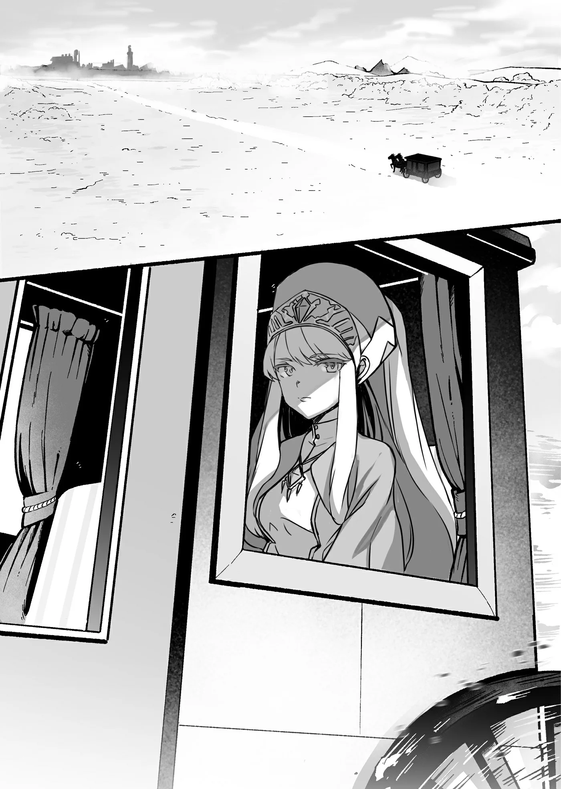

# Chương 81: Phần kết Tập 3

Ở vùng đất này có một tổ chức tôn giáo mang tên Giáo Hội Lobelia. Nếu hỏi những người dân đang qua lại trên đường phố Maalt, họ sẽ bảo rằng giáo hội đó chẳng có mấy tiếng tăm ở đây. Điều đó có lẽ đúng ở Vương Quốc Yaaran, nhưng tại các vương quốc lớn phía tây thì hoàn toàn trái ngược, bởi Giáo Hội Lobelia là một trong những tổ chức tôn giáo quyền lực bậc nhất nơi ấy. Dù có một nhà thờ tại Maalt, nhưng bên trong hiếm khi thấy bóng dáng tín đồ. Vì thế, nhà thờ ở Maalt chỉ là một tòa nhà nhỏ bé, tương xứng với lượng tín đồ ít ỏi của thị trấn. Thế nhưng, thứ Nước Thánh mà nơi này bày bán lại có mức giá đắt đến phi lý, mức giá mà nếu là bất kỳ giáo hội nào khác thì chẳng ai có thể chấp nhận nổi.

Bản chất của Giáo Hội Lobelia vốn là thế. Dẫu những nhận định trên ít nhiều đều chuẩn xác, chúng vẫn chưa phản ánh trọn vẹn bức tranh toàn cảnh, nói đúng hơn là còn cách rất xa.

Tuy có ít tín đồ và sự hiện diện mờ nhạt, hoạt động của giáo hội tại Vương Quốc Yaaran lại chẳng hề ngơi nghỉ, bởi gián điệp thì vẫn là gián điệp.

"Ra đây là Maalt sao..." một bóng người cất tiếng khi nhìn qua khung cửa sổ xe ngựa.

Chỉ cần nhìn lướt cảnh vật xung quanh là đủ hiểu họ không còn ở Thánh Vương Quốc Ars nữa. Nơi Maalt này phảng phất nét gì đó hoang sơ hơn.

Điểm đến lúc này của họ chính là Maalt, một thị trấn vùng biên hẻo lánh thuộc Vương Quốc Yaaran. Nhìn nơi này, người ta không khỏi tự hỏi liệu những người mở đất can trường ở đây có phải trải qua cuộc sống gian khổ hay không.

Đây không phải lần đầu tiên họ đặt chân tới Yaaran. Trước đây họ từng ghé thăm vương đô cùng vài thị trấn và thôn làng nhỏ quanh đó. Rời xa các đô thị trung tâm thế này đem lại cảm giác khá mới mẻ, mà cũng đậm vẻ thôn quê.

Ít ra, đó là cảm nghĩ của Myullias Raiza, Thánh Nữ thuộc Giáo Hội Lobelia, về nơi mình sắp đến.

Myullias có vẻ đăm chiêu, đưa đôi mắt tím trong trẻo như pha lê nhìn ra ngoài khung cửa sổ xe ngựa. Đôi mắt ấy được tôn lên bởi mái tóc bạc óng ả, càng làm tăng thêm vẻ bí ẩn bao quanh người cô.

Thánh Nữ trên đời không ít, và họ không chỉ thuộc về riêng Giáo Hội Lobelia. Họ là những người được tinh linh, hay thậm chí thần linh ban phước, thường sở hữu Thần Lực dồi dào cùng một số năng lực huyền bí khác. Myullias chính là một trong những Thánh Nữ ấy. Vị thần chúc phúc cho cô chẳng phải ai khác ngoài vị thần duy nhất mà Giáo Hội Lobelia tôn thờ, và năng lực của cô cũng đáng kinh ngạc chẳng kém.

Nữ Thần Lobelia, đấng đã tạo ra vùng đất này, thế giới này cùng muôn vàn sinh linh khác.

Những ai nhận ân phước từ Người thường sở hữu những năng lực khác nhau, phần nhiều mang nét đặc trưng riêng cho từng người. Chẳng hạn, Myullias nắm giữ sức mạnh chuyên về trị liệu và thanh tẩy. Nếu muốn, cô hoàn toàn có thể bao phủ cả thị trấn Maalt trong ánh sáng trị liệu, thanh tẩy sạch sẽ toàn bộ nơi này. Dẫu sau một kỳ tích như thế Myullias sẽ khó lòng đứng vững nổi, song chuyện cô có thể làm được điều phi thường ấy tự nó đã đủ khiến người ta chấn động rồi.

Myullias cũng mới trở thành Thánh Nữ chưa lâu. Tại tổng đàn Giáo Hội Lobelia không thiếu những kẻ sẵn sàng khịt mũi cười nhạo thứ năng lực tưởng chừng đáng nể ấy của cô. Vì thế, bản thân Myullias chỉ chuyên tâm làm tròn bổn phận, chẳng hề có chút kiêu ngạo nào trong tác phong.

Vì Nữ Thần Lobelia và để truyền bá giáo lý của Giáo Hội Lobelia khắp muôn nơi, cô đi thuyết giảng truyền đạo, chữa trị và ban phước. Tất cả nhằm đưa ánh sáng dẫn đường soi rọi khắp xa gần.

Đó là lý do cô đi qua các thị trấn để thể hiện năng lực của mình, và cũng là lý do cô đang trên đường đến Maalt lúc này.

Mới hôm qua thôi, một Thánh Nữ thuộc giáo phái khác đã đến chữa trị và ban phước cho dân chúng nơi này, hay chí ít cô nghe nói là vậy. Theo lời người ta kể, vị Thánh Nữ ấy không thuộc Giáo Hội Đông Thiên, tổ chức tôn giáo lớn nhất tại Yaaran. Chỉ riêng chuyện đó cũng đủ chứng minh rằng có nhiều tổ chức tôn giáo khác nhau đang hoạt động tại vương quốc này.

Từ lâu người ta đã nói Vương Quốc Yaaran nằm trên một vùng đất đầy bất ổn. Do phần lớn người dân Yaaran đều theo và sùng bái Giáo Hội Đông Thiên, một giáo hội ngoại lai khó lòng tự tiện chen chân vào truyền bá giáo lý của riêng mình. Ngặt một nỗi, giáo lý của Giáo Hội Đông Thiên lại khá... đặc biệt. So với các tổ chức tôn giáo khác, họ đặt rất ít gánh nặng lên tín đồ, đồng thời khuyến khích tu sĩ và nữ tu sống cuộc đời mộ đạo, thanh đạm; đây quả là thực tế cay đắng đối với phần lớn các tôn giáo khác.

Dù chẳng nêu đích danh tổ chức nào, nhưng ai cũng rõ tệ tham nhũng hoành hành nơi thượng tầng của nhiều giáo hội, cùng những khoản tiền cúng tiến nặng nề trút lên đầu tín đồ. Giáo Hội Đông Thiên lại khác, và các thành viên của họ thường rất tự hào khi thuộc về giáo hội.

Tuy vậy, thi thoảng vẫn có những tư tế hay tu sĩ lầm đường lạc lối, mượn danh nghĩa mở rộng giáo hội để che giấu động cơ thật sự. Nhưng người dân Yaaran lại rất tinh mắt trước những mánh khóe đó, họ thường vạch trần chúng trước khi gây ra thiệt hại thực sự. Có lẽ đó là lý do Giáo Hội Đông Thiên nắm giữ thế độc tôn tại Vương Quốc Yaaran, khiến các tổ chức tôn giáo khác chật vật mãi cũng chẳng lập nổi cơ sở.

Thế nhưng, tình hình dạo gần đây đã làm thay đổi điều đó.

Quái vật xuất hiện ngày một nhiều khắp nơi. Khi thế giới dần chìm vào bóng tối, ngay cả một vương quốc vùng biên hẻo lánh như Yaaran cũng không tránh khỏi ảnh hưởng. Tiếng kêu cứu tuyệt vọng của người dân ngày một lớn hơn, kéo theo những lời rao giảng và hứa hẹn từ đủ hạng tư tế cùng đám người tự xưng là bậc thánh thiện cũng rộ lên, tất cả đều đưa ra một con đường cứu rỗi đơn giản.

Giáo Hội Đông Thiên tin rằng con người phải tự tìm kiếm sự cứu rỗi từ nội tâm mình, một giáo lý khá nghiêm khắc. Việc quái vật xuất hiện ngày càng nhiều dường như đã làm lung lay niềm tin ấy.

Có thể nói, các tổ chức tôn giáo chỉ thực sự tỏa sáng khi thế giới chìm vào hỗn loạn.

Người ta hẳn sẽ nghĩ các tổ chức đó sẽ lợi dụng cảnh hỗn loạn này để lôi kéo thêm tín đồ. Thế nhưng Giáo Hội Lobelia lại không nhìn nhận như vậy. Họ coi sự hỗn loạn này là thử thách lớn lao từ thần linh, và con người nên đặt niềm tin vào giáo hội để vượt qua nó. Thực chất thì cũng chẳng khác là bao, song đó quả là một góc nhìn khá thú vị, nếu nói theo cách đó.

Nếu bị hỏi quan điểm cá nhân về chuyện này, bản thân Myullias có lẽ sẽ chỉ trả lời qua loa mơ hồ. Nhưng chừng nào còn thuộc về Giáo Hội Lobelia, cô chẳng có lựa chọn nào khác ngoài việc phải chấp nhận giáo lý của họ là chân lý duy nhất.

Có điều, chuyện đó lại khiến Myullias cảm thấy hết sức phiền toái và khó chịu, nhất là vào dạo gần đây.

Một Thánh Nữ mà nói ra điều này có lẽ là rất không phải phép, nhưng liệu Giáo Hội Lobelia có thực sự đúng đắn? Nữ Thần Lobelia đã ban phước cho cô, vị Thần duy nhất ấy, liệu có thực sự là Lobelia hay không?

Giáo Hội Lobelia tin rằng chính Nữ Thần Lobelia mang nhiều hình thái khác nhau, và ân phước mà những người khác trên khắp thế gian nhận được đều là do Người ban xuống. Chẳng hạn, Phong Thần Vansurt được tôn thờ ở các tôn giáo khác cũng được coi là Lobelia dưới một diện mạo khác. Vị Nữ Thần mang trăm ngàn diện mạo, đấng là tất cả và tất cả là một: Nữ Thần Lobelia.

Ân phước mà mỗi người nhận được đều được thiết kế riêng theo tính cách và phẩm chất của họ, cốt để họ tiếp nhận sức mạnh của Nữ Thần Lobelia vĩ đại một cách tốt hơn. Ít ra lời giải thích chính thức là như vậy.

Nhưng đó có thật sự là ân phước từ các vị thần? Xét cho cùng, trừ vài trường hợp tương đối đặc biệt, người ta gần như chẳng thể nào lần ra ân phước thần thánh của một người bắt nguồn từ đâu.

Các trường hợp đó khá đơn giản, chẳng hạn như trực tiếp cầu nguyện trước một bàn thờ nào đó rồi được ban phước, hoặc những tình huống tương tự. Hoặc có lẽ ai đó đã làm việc gì xứng đáng nhận ân phước, rồi ít lâu sau bỗng cảm thấy suối nguồn Thần Lực thức tỉnh trong người, đại loại là những bằng chứng gián tiếp như thế.

Ngoài vài cách ấy ra, phần lớn mọi người chẳng thể lần ra nguồn gốc sức mạnh của mình, và đó cũng là chuyện bình thường. Myullias cũng vậy, một ngày nọ khi tình cờ nhìn chăm chú vào một người bị thương, cô bỗng cảm thấy mình có thể làm gì đó cho vết thương của họ.

Mọi chuyện thực sự chỉ có vậy thôi.

Thế rồi một ngày nọ, một tư tế đột nhiên xuất hiện tại nhà cô, tuyên bố rằng cô đã nhận được ân phước từ Nữ Thần Chân Thực Duy Nhất Lobelia. Đến cả cô cũng thấy lời vị tư tế kia thật đáng ngờ. Thế nhưng các tư tế cùng Thánh Nữ của Giáo Hội Lobelia lại tin tưởng Nữ Thần một cách tuyệt đối, không chút nghi vấn. Có người còn bảo niềm tin của họ đã mấp mé ranh giới của sự điên rồ và ám ảnh, một khả năng hoàn toàn có thật.

Chẳng mất bao lâu để họ nhận ra Myullias mang những suy nghĩ dị giáo. Cũng không quá khó hiểu khi cho rằng những suy nghĩ ấy bằng cách nào đó đã ảnh hưởng tới hành vi bên ngoài của cô. Đó rất có thể là lý do dạo gần đây cô bị đặt dưới sự giám sát, và cũng là nguyên nhân có một vị tư tế giám sát ngồi đối diện cô ngay trên cỗ xe ngựa này. Dĩ nhiên gã cũng có tên: Gilly.

Đó là một thanh niên trẻ có đôi mắt sắc lẻm cùng ánh nhìn còn sắc bén hơn. Nhìn vào cử chỉ và nét mặt, gã giống một sát thủ hơn là tư tế. Rồi còn món vũ khí có lưỡi sắc bén được gã giắt gọn gàng một bên hông nữa. Chẳng mấy phù hợp với một tư tế, nên mới có nhận định ban đầu như vậy. Cứ như thể ngầm báo rằng nếu cô chỉ cần cư xử lệch lạc dù chỉ một chút, gã sẽ lập tức ra tay xử lý. Myullias thừa hiểu điều đó, cũng như hiểu rằng đây rất có thể là ý muốn của những kẻ nắm quyền ở tổng đàn.

"Rốt cuộc chuyến này chúng ta đến đây làm gì ấy nhỉ...? Ý tôi là chuyến đi thăm này ấy."

Dù đã cố hết sức, Myullias vẫn chẳng thể phá tan bầu không khí nặng nề ngột ngạt trong xe ngựa. Cô chỉ lẩm bẩm tiếp, như đang tự nói với mình, hệt như từ nãy đến giờ. Trông như cô đang nói với Gilly, nhưng có thật vậy không? Mọi thứ đều rất... mơ hồ...

Dù Myullias lầm bầm một mình suốt từ nãy, nhưng câu nói vừa rồi dường như đã gợi được một lời đáp lại.

"Cô phải tuyên bố rằng mình đang trị liệu và thanh tẩy thị trấn này nhân danh Giáo Hội Lobelia. Cô cũng phải tập hợp người dân Maalt lại và thuyết giảng để dẫn dắt họ."

Gilly lắc đầu trước thái độ bất kính rõ rệt của Myullias.

"Khi vào thị trấn rồi, xin cô chú ý đừng nói những lời như thế. Cô là Thánh Nữ của Giáo Hội Lobelia; gợi ra bất cứ điều gì làm nảy sinh... sự ngờ vực về mục đích cao quý của giáo hội sẽ chẳng có lợi cho cô đâu. Tốt hơn hết cô nên nghĩ kỹ về những chỉ thị đã được giao ở tổng đàn. Đó là vì chính bản thân cô đấy."

Một gã cứng nhắc; lại còn ngột ngạt nữa chứ.

Myullias thoáng ngạc nhiên trước chút dịu dàng hiếm hoi mà cô cảm nhận được từ những lời lẽ vốn mang tính đe dọa của Gilly.

"Hình như tôi nghe thấy chút lo lắng trong giọng anh thì phải...?"

"Lời lẽ của cô lộ liễu quá mức rồi. Tôi đang lo sốt vó là có ngày cô sẽ rơi vào kết cục như Fourostoroa đấy."

Fourostoroa là tên của một anh hùng từng hạ sát một con rồng tà ác khổng lồ từ thuở xa xưa. Con rồng từng gieo rắc tai ương cho dân chúng, và Fourostoroa đã nhanh chóng trừ khử nó. Ngặt nỗi anh ta lại uống quá chén trong buổi tiệc ăn mừng ngay đêm đó, để rồi làm bẽ mặt nhà vua trước toàn thể thần dân, ngay trước mặt quốc vương. Vì tội lỗi ấy, Fourostoroa đã bị xử tử. Một câu chuyện về người anh hùng dại dột.

Một câu chuyện ngụ ngôn xưa đại loại thế, dẫu khó lòng nói chắc được liệu người đó có thật sự tồn tại hay không.

Dù bình thường đây chẳng phải sự so sánh đáng cười chút nào, Myullias vẫn thấy buồn cười trước tình cảnh hiện tại của mình, vốn chẳng khác câu chuyện ví dụ kia là bao.

"Hì... Được rồi. Tôi nhất định sẽ cẩn thận..."

Gilly điềm nhiên gật đầu trước nụ cười thoảng qua của Myullias. "Tôi cầu nguyện rằng cô sẽ làm đúng như thế."

Giọng gã vang lên, không gợn một chút cảm xúc.
