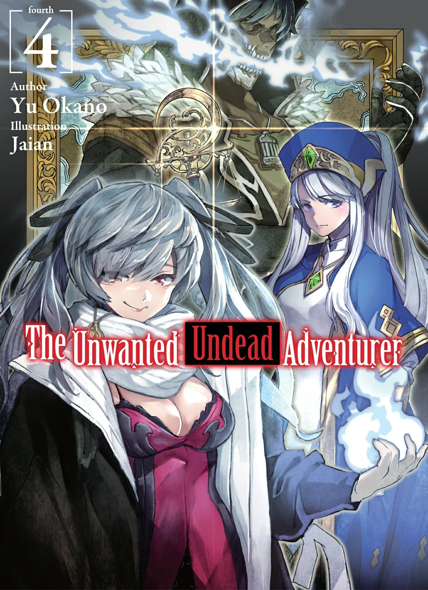
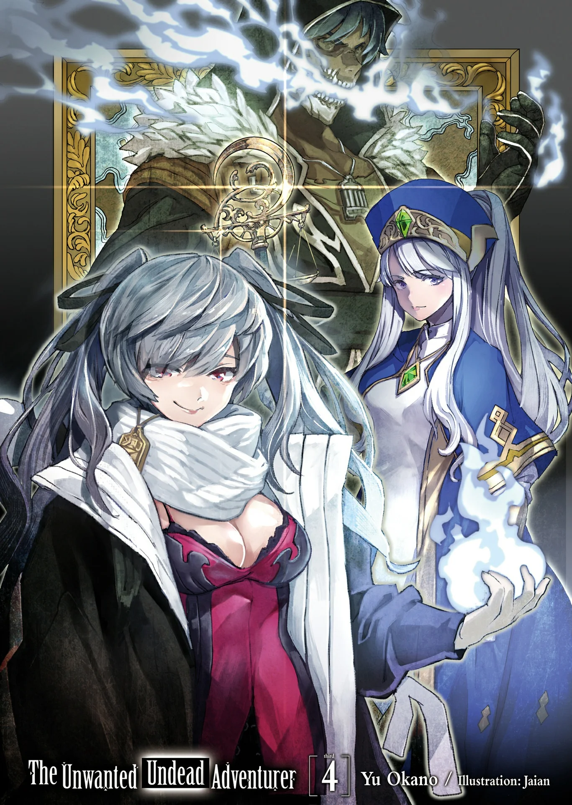
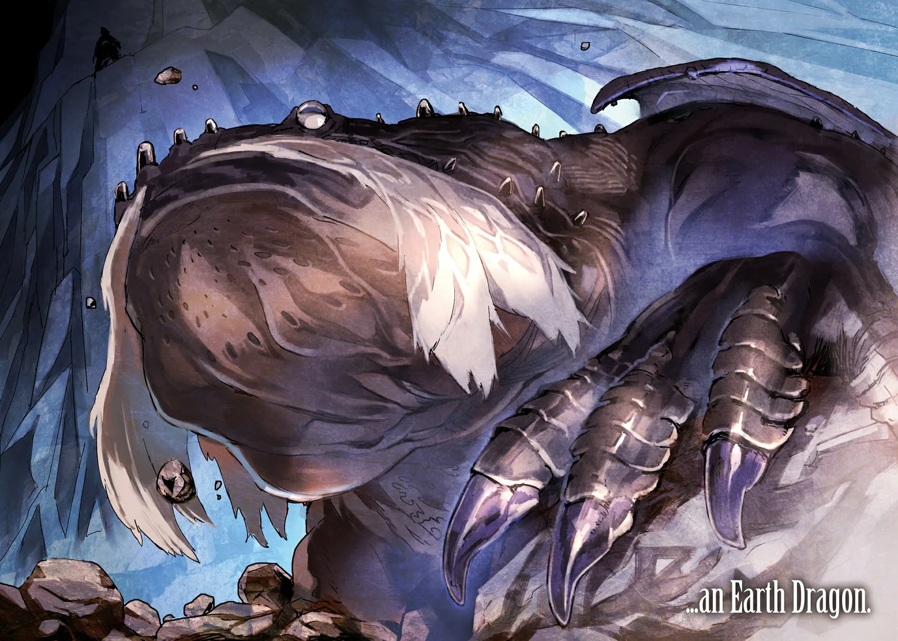
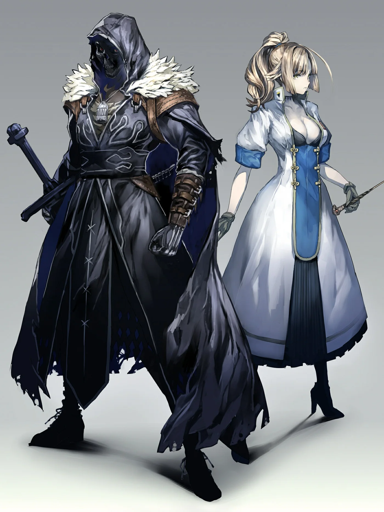
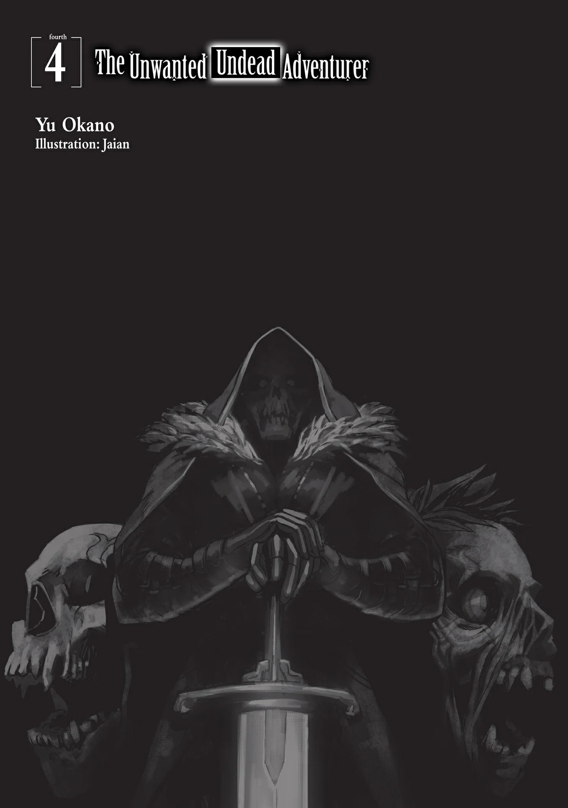
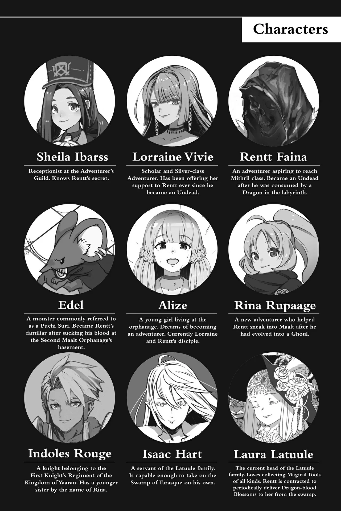
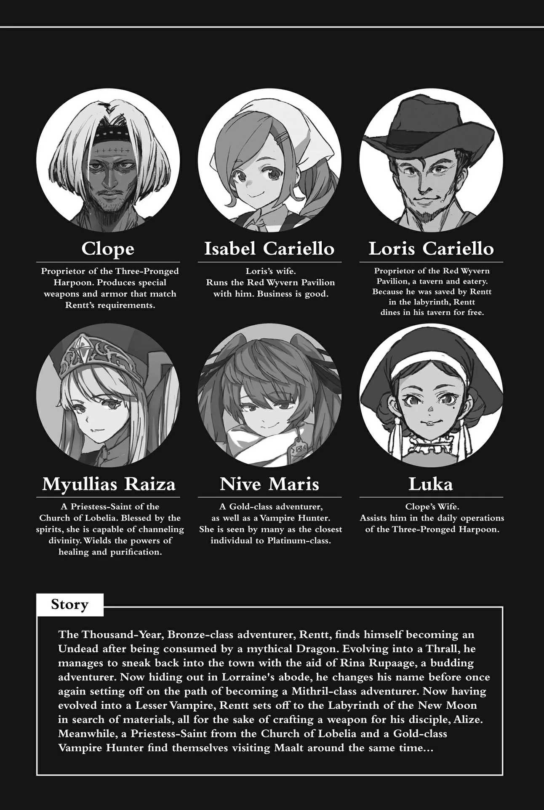
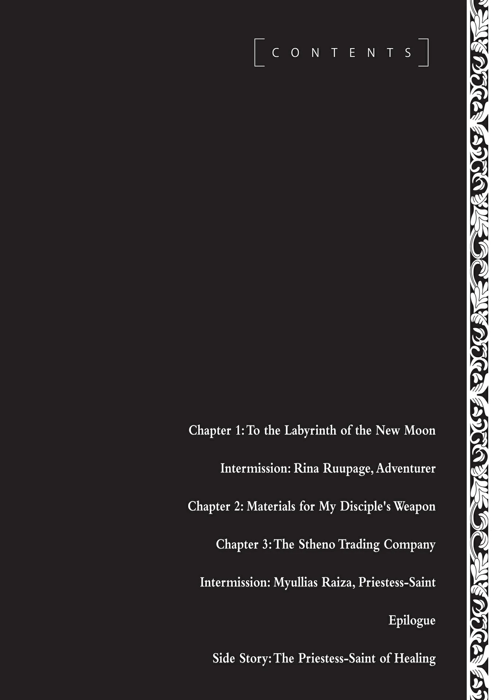

# Chương 88: Tập 4 Chương 1 - Tiến Về Mê Cung Tân Nguyệt (1)

Tự dưng tôi lại có chút thời gian rảnh rỗi. Hôm nay Hội Mạo Hiểm Giả gọi tôi tới, chắc hẳn là để thanh toán tiền bán xác Tarasque. Nghĩ vậy, tôi lên kế hoạch ghé qua chỗ thợ rèn, thợ làm giáp, rồi cuối cùng tạt vào một tiệm tạp phẩm. Tôi cũng đã căn giờ cẩn thận để làm cho xong xuôi mọi việc. Bán xác Tarasque đúng là được một món khá, ngặt nỗi số tiền nhận về lại chẳng thấm vào đâu so với cái lịch trình mua sắm vung tay mà ban đầu tôi vạch ra cho ngày hôm nay.

À phải rồi. Lỗi tại tôi tính toán dở quá...

Thực ra, nếu ghé chỗ thợ rèn và tiệm tạp phẩm là để sắm trang bị mạo hiểm cơ bản cùng vũ khí cho Alize, thì tới tiệm giáp lại là chuyện riêng của tôi. Quần áo thì dĩ nhiên tôi có không ít, tích cóp suốt cả quãng đời làm một con người bình thường mang tên Rentt Faina. Khỏi phải nói, sau lưng những bộ đồ ấy làm gì có khe hở nào. Thành thử đôi cánh của tôi chắc chắn sẽ rất chật vật mới thò ra ngoài được—mà nói thế thực ra vẫn còn nhẹ chán.

Nghĩ vậy nên tôi mới định đi đặt vài bộ đồ may riêng. Đồ may theo yêu cầu, lại phải gia công theo quy chuẩn chịu được hiểm nguy nơi mê cung, thế nên giá đắt hơn hẳn. Tôi cứ đinh ninh tiền thù lao từ xác Tarasque sẽ dư sức trang trải, ai ngờ lại lầm to.

Chết tiệt thật.

Đã vậy, mấy bộ đồ cũ của tôi vốn đã sờn rách và cần sửa lại từ lâu. Hồi mới vào nghề mạo hiểm thu nhập còm cõi, tôi hiếm khi mua sắm thứ gì thừa thãi, chưa kể bộ đồ trên người này đã theo tôi suốt một thời gian dài—kinh qua cả hai lần tiến hóa thành Ngạ Quỷ rồi Thi Quỷ. Nói một cách nhẹ nhàng nhất thì nó bẩn kinh khủng, lại còn dính đủ thứ cặn bã khác thường vào từng thớ vải. Dù sao thì máu me với thịt vụn đâu phải thứ bình thường xuất hiện trên quần áo.

Ngày nào tôi cũng giặt giũ đấy chứ... nhưng vấn đề không nằm ở chỗ đó. Giờ đây trông tôi đã chẳng khác gì người bình thường, nên chỉ nghĩ đến chuyện tiếp tục khoác lên mình bộ đồ từng mặc hồi còn mang hình dạng gớm ghiếc như quái vật... chà, nói thế nào cũng thấy khó chấp nhận được. Tiện dịp này, tôi mới tính đi sắm đồ mới thay thế.

Tiếc thay... mọi chuyện lại chẳng được như ý.

Vấn đề lớn nhất dĩ nhiên vẫn là tiền. Tôi đúng là có nhận được một món kha khá từ tiền mổ xẻ bán xác, nhưng nếu đem đi đặt may đồ riêng thì chẳng còn lại bao nhiêu để lo vũ khí, trang bị các thứ cho Alize... Chưa kể còn tiền học phí dạy kèm của Lorraine nữa.

Bất giác tôi thấy áp lực tiền bạc đè nặng trĩu. Cảm giác như sức nặng của những món nợ đang nghiến nát cả con người mình.

Than ôi, cái phận nợ nần chồng chất... Không ngờ có ngày tôi lại phải sống cảnh chạy ăn từng bữa mà lưng cõng đầy nợ thế này... Rốt cuộc thời còn sống tôi đã gây nên tội tình gì để chuốc lấy cơ sự này chứ? Không chừng ở quãng đời trước tôi phải sống ngoan đạo và ngay thẳng hơn mới phải.

Mà thôi... chuyện đã thế này rồi thì đành chịu. Thay vì cứ ngồi càm ràm chuyện thiếu tiền, tôi nên nghĩ cách thì hơn. Phải, một kế hoạch để kiếm được một khoản kha khá. Sớm muộn gì chiếc mai nguyên vẹn của Tarasque cũng sẽ bán được, và khi ấy tôi sẽ vớ được một món hời lớn. Còn từ giờ tới lúc đó, tôi đành tiếp tục sống cảnh chạy ăn từng bữa, chắt bóp được đồng nào hay đồng nấy...

Khổ một nỗi...

Chính cái thói nghĩ ngợi kiểu ấy mới là lý do đẩy tôi vào tình cảnh khốn đốn như bây giờ.

Tôi lắc đầu. Nếu cứ sống mà trông chờ vào mấy món lộc trời cho kế tiếp, tôi sẽ chẳng bao giờ tích cóp nổi một khoản tiết kiệm ra hồn.

Rentt này: chẳng lẽ mày không biết tự kiềm chế à? Hồi trước mày từng dành dụm đủ tiền mua túi ma thuật cơ mà. Chỉ cần quyết tâm thì việc bớt xén chút tiền đâu phải là không làm được. Chắc chắn phải có cách nào đó để giải quyết chuyện này chứ. Một... ý tưởng nào đó... Hừm. Động não đi nào, Rentt... Tiết kiệm... chắt bóp...

Cách cơ bản nhất để một mạo hiểm giả tiết kiệm tiền là gì nhỉ...?

À phải rồi—tự lo nguyên liệu. Khi muốn làm trang bị mới, mạo hiểm giả có thể tự tay đi gom rồi đem nguyên liệu phù hợp tới cho thợ.

Ít nhất thì tôi từng tính thế. Nhưng ngặt nỗi cơ thể tôi hiện giờ rất dị biệt, đồ tôi cần hầu hết đều phải đặt làm theo yêu cầu riêng, nên xét một cách nhẹ nhàng nhất thì việc tự kiếm nguyên liệu phù hợp cũng khó khăn vô cùng.

Như thanh kiếm của tôi chẳng hạn: một món vũ khí có khả năng dẫn truyền cả Ma Lực, Khí Lực lẫn Thần Lực. Muốn làm ra thứ như vậy chắc chắn không thể thiếu những nguyên liệu quý hiếm, khó tìm. Đã vậy, thợ thủ công mấy ai lại sốt sắng đi giải thích cặn kẽ cho mạo hiểm giả biết trang bị của họ được chế tạo thế nào. Thế nên tôi mới bí, vì ngay từ đầu tôi còn chẳng biết phải mang thứ gì đến cho thợ. Tôi có thể tới đặt hàng rồi chờ xưởng bảo cần kiếm thứ gì; dẫu vậy, trừ phi được dặn rõ ràng, tôi cũng chẳng dám tự tiện đoán mò. Bởi lẽ, chỉ thợ lành nghề mới biết họ cần những gì để chế tác một món đồ. Thành thử ý định tiết kiệm chi phí rèn vũ khí và trang bị cho bản thân coi như bế tắc.

Nhưng với Alize thì khác...

Đúng là cô bé có thể dùng một món vũ khí tốt hơn, hay ít nhất là đạt chuẩn theo kỳ vọng của tôi. Nhưng món vũ khí đầu đời của Alize chẳng cần phải quá mức cầu kỳ làm gì. Bởi nếu mới chân ướt chân ráo vào nghề đã dùng vũ khí được chế tác đặc thù, mạo hiểm giả rất dễ sinh thói ỷ lại, dần dà dẫn tới việc lệch lạc kỹ năng chiến đấu. Thậm chí người đó còn có nguy cơ thiếu hụt nghiêm trọng khả năng ứng biến. Dù chuyện này chưa hẳn sẽ lấy mạng mạo hiểm giả, nhưng chuẩn bị sẵn cho mọi tình huống vẫn hơn. Vì muốn tốt cho cô bé, tôi nên chỉ dẫn để Alize tránh xa cái bẫy tiềm ẩn này.

Nghĩ đi nghĩ lại, tự tay đi kiếm nguyên liệu làm trang bị cho Alize cũng chẳng phải ý tồi. Nguyên liệu bậc trung với hiệu năng vừa phải... Đó là những thứ tôi định đi gom. Việc này chẳng có gì nặng nhọc, mà may sao tôi lại đang rảnh rỗi. Tôi dư sức dành trọn cả buổi chiều để lùng sục Mê Cung Tân Nguyệt.

Hừm... Nếu chuyến này mất nhiều thời gian hơn dự kiến, chắc phải sáng mai tôi mới về lại nhà Lorraine. Có lẽ tôi nên tạt về báo cho cô ấy một tiếng. Dù sao tôi cũng đâu cần ngủ nghê gì. Kể cả phải làm việc thâu đêm, tôi cứ việc cắm cúi đi lùng cho tới khi cạn sạch thể lực mới thôi. Mà sau ngần ấy thời gian sống trong bộ dạng này, tôi nhận ra thể lực của mình gần như chẳng bao giờ cạn. Coi như đây là một đặc tính riêng của Undead đi. Có chăng chỉ là mệt mỏi tinh thần tích tụ dần theo thời gian, và nếu có nói đến chuyện kiệt sức thì đó cũng là dạng duy nhất tôi gặp phải.

Đã biết mình cần làm gì, tôi quay bước, định bụng trở về nhà Lorraine bàn bạc mọi chuyện với cô ấy.
