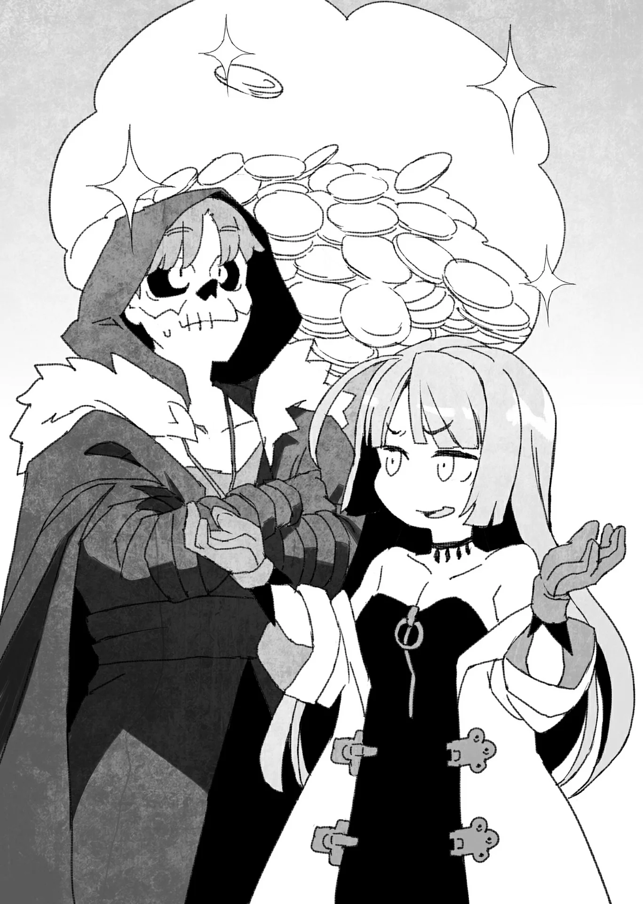

# Chương 89: Tập 4 Chương 1 - Tiến Về Mê Cung Tân Nguyệt (2)

"Vũ khí cho Alize sao, Rentt? Đúng là anh cần phải chuẩn bị một món thật... nhưng có nhất thiết phải tự mình đi thu gom từng chút nguyên liệu thô như thế không?" Đó là phản ứng của Lorraine khi tôi vừa trở về và cho cô biết suy tính của mình.

Cô ấy không hẳn là phản đối. Nói đúng hơn thì cô chỉ đang bày tỏ suy nghĩ về vấn đề này mà thôi. Thực tế, không khó để hiểu vì sao cô lại thấy như vậy. Trong phần lớn trường hợp, trang bị cho các tân binh mạo hiểm giả thường được giải quyết gọn gàng ở các tiệm rèn và tiệm chế tạo giáp; những món trang bị như thế vốn chẳng có gì khó khăn để làm ra.

Tuy nhiên...

"Vấn đề là tiền bạc đấy, Lorraine. Tôi nghĩ mình nên tiết kiệm chi phí phần nào, nên mới quyết định tự tay đi thu thập nguyên liệu..."

"À, ra vậy sao? Thế thì tôi hiểu rồi. Cơ mà... chẳng lẽ anh vẫn chưa bán được cái xác Tarasque à?" Lorraine gặng hỏi.

Nói đúng hơn thì, rất có thể ngay từ sáng nay Lorraine đã đoán ra chuyện này rồi, và đúng như dự liệu, mọi chuyện diễn ra y hệt như cô phán đoán. Tôi vừa tiếp tục giải thích, vừa thầm cảm thấy đôi chút nản lòng trước sự chuẩn xác trong những suy luận của Lorraine.

"Ừ... Sự việc quả thực đã trở nên khá rắc rối..."

"Hửm? Anh giải thích rõ hơn xem nào, Rentt."

Tôi cho rằng ngay cả Lorraine cũng chưa thể hình dung trọn vẹn toàn bộ bức tranh, xét đến những ngã rẽ kỳ lạ trong các diễn biến gần đây. Lorraine vẫn giữ vẻ tò mò, đầu hơi nghiêng sang một bên khi tôi kể lại chính xác những gì đã diễn ra trong phòng mổ xẻ của Hội. Trong lúc tôi thuật lại, nét mặt Lorraine dần chuyển sang vẻ lo lắng lẫn ngao ngán.

"Xem chừng việc đâm đầu vào mấy chuyện kỳ quái đã trở thành cơm bữa đối với anh rồi nhỉ, Rentt..."

Rõ là ngao ngán hết chỗ nói.

"Đừng nói vậy chứ, Lorraine. Trước hết, chính người phụ trách đấu giá đã đưa ra yêu cầu đó với tôi. Cái xác sẽ chẳng thể tự bán được nếu cứ để mặc nó ở đó. Hơn nữa nơi đó lại là một cơ sở lớn và khá có tiếng tăm, nên việc gắn kết lợi ích đôi bên về lâu dài sẽ đem lại những mối lợi... tương đối đáng kể. Cô không thấy vậy sao?"

"Được rồi, được rồi. Tôi cho rằng chuyện này cũng có mặt lợi, và đây cũng không hẳn là tình huống có thể làm ngơ bỏ qua. Tuy nhiên, anh hãy cân nhắc điều này xem, Rentt: Nguy cơ thân phận thực sự của anh bị phát giác là hoàn toàn có thật. Trong trường hợp cụ thể này... đó là bất lợi duy nhất, nhưng lại cực kỳ lớn."

Tôi khó lòng bác bỏ lý lẽ xác đáng trong những lời cô nói. Tuy nhiên, chừng nào tôi còn tiếp tục sinh sống tại Maalt, thì sớm muộn gì tôi cũng buộc phải đối mặt với một trong hai vấn đề. Khi nghĩ theo hướng đó, tôi lại có cảm giác rằng việc dấn bước táo bạo hơn trong toàn bộ vụ đấu giá này mới là con đường đúng đắn.

Tôi bèn bộc bạch những suy nghĩ ấy với Lorraine.

"Tôi hiểu góc nhìn của anh rồi, Rentt. Hừm... Về phương diện cá nhân, tôi vẫn khuyên anh không nên làm vậy, nhưng đúng là hai vấn đề đó đều là những diễn biến tất yếu không thể tránh khỏi. Nếu không phải ở đây, thì cũng sẽ vào một thời điểm khác, ở một nơi chốn khác... Nguy cơ anh bị lộ tẩy cũng ngang ngửa như nhau. Nếu suy nghĩ theo hướng cụ thể đó... thì tôi cho rằng ý tưởng của anh cũng chẳng hẳn là một lựa chọn tồi."

Có vẻ như Lorraine đã thông suốt mạch lập luận của tôi. Nhưng cô vẫn chưa nói xong.

"Nếu anh cảm thấy bất kỳ mối nguy hiểm nào, dẫu chỉ là mảy may, Rentt à—hãy chạy trốn càng nhanh càng tốt. Đây chẳng phải chuyện tôi thích nghĩ tới... nhưng anh thấy đấy, ngay cả Hạ Cấp Ma Cà Rồng cũng có giá một món tiền khổng lồ. Tôi không dám loại trừ khả năng có những kẻ tìm cách bắt sống anh đâu. Nếu anh bước chân vào toàn bộ chuyện này với mục đích đem một món đồ đi bán đấu giá, rồi một sớm mai thức dậy lại thấy bản thân mình nằm trong danh mục vật phẩm đấu giá... thì chuyện đó tôi chẳng cười nổi đâu, Rentt. Nếu cái ngày đó thực sự xảy đến, tôi sẽ giúp anh trốn khỏi Maalt... trốn ra khỏi biên giới Vương Quốc Yaaran. Vì vậy... hãy luôn giữ cho mình tỉnh táo đấy, Rentt."

Nét mặt Lorraine vô cùng nghiêm nghị. Tôi gật đầu thật mạnh đáp lời.

"Tôi hiểu rồi..."

Tuy nhiên, có một điều Lorraine vừa nói đã thu hút sự chú ý của tôi.

"Rốt cuộc thì, một con Ma Cà Rồng có thể bán được bao nhiêu tiền nhỉ...?"

Trong một thoáng, nét ngao ngán lại hiện lên trên gương mặt Lorraine, có lẽ vì thấy tôi dường như chẳng mấy bận tâm đến những mối hiểm nguy mà bản thân có thể phải đối mặt. Nhưng cô nhanh chóng trầm ngâm suy nghĩ một chút, rồi nghiêm túc trả lời tôi.

"Chà... Phải là mưa đồng xu bạch kim đấy, Rentt. Tôi đồ rằng chưa đến mức là một khoản tiền khổng lồ để bơi trong đó, nhưng chắc chắn không phải là con số mà một người bình thường có thể mơ tới việc chi trả..." Chân mày Lorraine nhíu lại, rồi cô tiếp tục dòng suy nghĩ. "Này... Rentt. Chẳng lẽ anh định nói với tôi là... Anh đang tính tự bán mình lấy tiền đấy à?"

Ánh mắt Lorraine xoáy sâu vào tôi khi cô nheo mắt lại.

"Đừng nói ngớ ngẩn thế chứ, Lorraine!" Tôi hoảng hốt lắc đầu lia lịa. "Làm sao tôi có thể làm cái chuyện như thế được!"

"Không đâu, Rentt." Lorraine nhanh chóng nói tiếp. "Không phải theo kiểu đó—ít nhất là không phải đem bán toàn bộ bản thân anh... Mà theo hướng như là, lấy ví dụ nhé, bán các mẫu máu hoặc mẫu thịt chẳng hạn. Tôi cho rằng hoàn toàn có khả năng anh sẽ làm chuyện đó..."

Tôi nuốt nước bọt cái ực. Lorraine nói đúng—tôi từng cân nhắc chuyện đó... vào một lúc nào đấy. Dẫu chỉ một chút xíu thôi. Tôi chỉ vừa thoáng nghĩ qua viễn cảnh ấy. Thực ra thì, máu Ma Cà Rồng có giá trị dược liệu khá lớn đối với giới quý tộc. Nó được xem như linh dược của sự trường sinh bất lão, của sự bất tử. Dù tôi không dám chắc thứ máu đó sẽ phát huy bao nhiêu phần hiệu nghiệm, nhưng tôi tin chắc mình sẽ thu về một món tiền hậu hĩnh nếu thử đem bán một lọ tại buổi đấu giá. Nhà đấu giá chắc chắn sẽ có cách để kiểm định độ xác thực của máu, nhờ đó họ có thể xác minh xem liệu nó có thực sự bắt nguồn từ một con quái vật hay không. Chính xác hơn là từ một con Ma Cà Rồng. Chỉ cần có đủ tiền bạc, người ta hoàn toàn có thể gửi mẫu vật thẳng đến Viện Nghiên Cứu Quái Vật ở thủ đô Yaaran. Tại đó, mẫu vật sẽ được kiểm nghiệm thích đáng để xác thực nguồn gốc. Chính vì thế, tôi từng nghĩ đó là một cách nhanh chóng và dễ dàng để kiếm được một khoản tiền kếch xù.

Thế nhưng tôi không hoàn toàn liều lĩnh, và đã suy xét vấn đề cẩn thận hơn. Tuy rằng máu của Ma Cà Rồng có tác dụng ban cho người uống sự bất tử, cụ thể là bằng cách biến họ thành Undead giống như mình, nhưng nó cũng mang một mục đích khác, có lẽ mới chính là mục đích nguyên bản: máu của Ma Cà Rồng được dùng để tạo ra tay chân thuộc hạ, tức là quyến thuộc.

Theo mạch lý lẽ đó... liệu kẻ nào uống máu của tôi có trở thành một quyến thuộc khác của tôi hay không? Tương tự như trường hợp của chú chuột Puchi Suri Edel vậy.

Mà như... Edel thật sao? Chuyện đó... quả là rắc rối to. Nhưng tốt hơn hết tôi nên gạt phăng suy nghĩ ấy sang một bên. Dù sao đi nữa, số lượng quyến thuộc cứ thế tăng lên...

Theo lẽ thông thường, chúng ta có thể đoán rằng chỉ những kẻ giàu sang và quyền lực mới đủ khả năng mua một thứ đắt đỏ như máu Ma Cà Rồng, hoặc chí ít là có chủ đích khao khát sở hữu nó. Bỗng dưng có được một thuộc hạ nắm trong tay tiềm lực tài chính lẫn quyền lực xã hội thì chắc chắn có cảm giác như một mối hời lớn, thế nhưng tôi chẳng thể nào hình dung nổi cảnh mình đột nhiên đi chỉ đạo một kẻ khác theo cái kiểu ấy. "Được rồi, từ giờ ngươi làm việc cho ta," tôi sẽ nói vậy sao... Không. Chẳng ra làm sao cả. Tôi không tài nào tưởng tượng nổi bản thân mình lại mang cái khí chất đó.

Không... nói đúng hơn là bất khả thi. Đó là cảm giác bao trùm trong tôi.

Cuối cùng, tôi lắc đầu, vờ như những suy nghĩ ấy chưa từng thoáng qua trong tâm trí.

"Không, tôi đâu có nghĩ thế bao giờ. Tôi chỉ đang suy ngẫm về những mối hiểm nguy liên quan thôi... Tiền bạc là thước đo dễ hình dung nhất mà. Tôi chỉ... hơi bị cuốn theo hình dung đó một chút thôi."

Thú thật mà nói... bản thân cái ý nghĩ về một cơn mưa đồng xu bạch kim đã đủ đáng sợ lắm rồi. Dù trong bất kỳ hoàn cảnh nào, tôi cũng tuyệt đối không được phép để bị bắt.

Dẫu vậy, ước tính tiền bạc của Lorraine phần lớn dựa trên thực tế rằng tôi là một trường hợp đặc thù. Để so sánh, những con Hạ Cấp Ma Cà Rồng phổ biến hơn vẫn sẽ mang lại một khoản tiền kha khá, dẫu con số đỡ lố bịch hơn, bởi dẫu là quái vật hiếm gặp nhưng người ta vẫn thỉnh thoảng bắt gặp chúng. Chúng cũng cực kỳ khó bắt sống—sự thật trần trụi là như thế.

Phần lớn Ma Cà Rồng có xu hướng sống thành từng bầy đàn, thường được gọi chung là một "bầy", trong đó con Ma Cà Rồng có thứ bậc cao nhất sẽ thống trị tất cả những con còn lại. Thông thường, một con Trung Cấp Ma Cà Rồng sẽ đóng vai trò là thủ lĩnh trên thực tế, chi phối mọi hành động của lũ Hạ Cấp Ma Cà Rồng dưới trướng. Đổi lại, các Thi Quỷ và đám người hầu nhân loại sẽ nghe lệnh của Hạ Cấp Ma Cà Rồng, đó là kịch bản phổ biến nhất. Trong tình huống như vậy, ngay cả khi ai đó bằng cách nào đó bắt sống được một con Hạ Cấp Ma Cà Rồng, người ta vẫn phải dè chừng sự ảnh hưởng từ thủ lĩnh của nó, tức con Trung Cấp Ma Cà Rồng. Chẳng hạn, máu của nó có thể bị thao túng từ xa, nó có thể bị ép phát điên rồi bị thủ lĩnh kích nổ tung xác, có lẽ là ngay vào lúc con Hạ Cấp Ma Cà Rồng đang bị những kẻ săn bắt giam giữ. Sau khi bị con Trung Cấp Ma Cà Rồng vốn tạo ra nó tước đoạt toàn bộ sức mạnh, nguồn sức mạnh ma cà rồng của nó sẽ không còn nơi giải phóng, và các xung lực sinh ra từ đó sẽ khiến nó không thể duy trì nổi hình dạng giống người. Ít nhất thì đó là một cách giải thích cho hiện tượng này, còn nguyên do thực sự đằng sau chuyện đó đến nay vẫn là một ẩn số.

Điểm cốt lõi rút ra từ chuyện này là Hạ Cấp Ma Cà Rồng có thể chết ngay vào khoảnh khắc bị bắt, hoặc có lẽ là không lâu sau khi bị tóm gọn. Sức mạnh của chúng sẽ bị Ma Cà Rồng bậc cao hơn tước đoạt, rồi chúng sẽ phát nổ, và những mảnh thịt cùng dịch cơ thể bắn tung tóe sẽ chẳng còn mang bất kỳ đặc tính nào của ma cà rồng nữa. Điều này khiến người ta dễ dàng hiểu được độ khó khăn cùng cực khi bắt sống chúng. Thực sự mà nói, điều đáng nói hơn chính là sự vô ích của toàn bộ công cuộc đó ngay cả khi người ta có bắt sống được chúng đi chăng nữa.

Nhưng trong trường hợp của tôi... sẽ chẳng có con Ma Cà Rồng cấp cao nào kích nổ tôi kể cả khi tôi bị tóm. Cân nhắc tất cả những điều này, ngay cả nguyên liệu từ một con Hạ Cấp Ma Cà Rồng cũng cực kỳ quý hiếm, và sẽ bán được với giá ngất ngưởng. Trừ các trường hợp đặc biệt như tôi, những con Ma Cà Rồng duy nhất có thể bị bắt sống chỉ là những con Hạ Cấp Ma Cà Rồng đơn độc sinh sống tự nhiên trong mê cung. Ngoại trừ những cá thể đó ra, phần lớn Hạ Cấp Ma Cà Rồng đều có thủ lĩnh và thuộc về một bầy đàn.

Giờ thì tôi đã hiểu bản thân mình là một sự tồn tại hiếm hoi đến nhường nào. Chắc chắn tôi sẽ bị săn lùng và tóm cổ mất thôi.

Đáng sợ thật đấy...

Nói một cách đơn giản, các nguyên liệu Ma Cà Rồng trôi nổi trên vùng đất này hoặc là được thu hoạch từ một thủ lĩnh, hoặc từ những con Hạ Cấp Ma Cà Rồng không bị cấp trên tước đoạt sức mạnh khi bị bắt. Còn về chiếc lọ tôi nhận được từ gia tộc Latuule, tôi không thể chắc chắn tuyệt đối. Dẫu vậy, cho đến nay tôi chưa từng cảm nhận thấy bất kỳ sự hiện diện nào chi phối tâm trí mình, nên tôi đoán đó hẳn là máu từ trường hợp thứ hai. Tất nhiên, vẫn luôn có khả năng là do tôi ở quá xa, hoặc các nguồn sức mạnh bên trong cơ thể tôi đang tích cực kháng cự lại sự chi phối giả định này... Dù thế nào đi nữa, chừng nào nó vẫn còn ngủ yên hoặc nằm trong tầm kiểm soát, thì cũng chẳng có ích gì khi cứ lo lắng thái quá về chuyện đó.

Laura đã từng cảnh báo tôi về những mối nguy hiểm liên quan, nên nếu có chuyện gì xảy ra... tôi đồ rằng tới đâu hay tới đó vậy. Vào thời điểm đó, tôi có cảm giác mình sẽ không thể nào đạt tới giai đoạn Tiến Hóa Bản Thể tiếp theo nếu không uống cạn thứ chất lỏng trong chiếc lọ ấy. Rút cuộc, tôi đã chẳng thể tìm ra bất kỳ giải pháp hay con đường tiến bước nào khác, và việc hối hận sau khi sự đã rồi cũng chẳng dẫn tôi tới đâu.

"Thật thế sao...? Được rồi. Dù sao thì... anh cũng phải cẩn thận đấy, Rentt. À phải rồi, anh định đi thu thập nguyên liệu đúng không? Nếu vậy thì tôi cũng có vài món cần nhờ. Anh có thể trừ các khoản chi phí liên quan vào tiền học phí của mình."

Nói đoạn, Lorraine liền đọc ro ro một danh sách các món đồ cô cần, bao gồm vài loại quặng ma thuật cùng nhiều loại nguyên liệu linh tinh khác. Nhìn vào những món cô yêu cầu, chẳng mất bao lâu để tôi nhận ra mục đích thực sự của cô.

"Cô cũng đang tính tặng Alize món gì đó sao?"

"Chính xác là vậy đấy. Nếu tôi dạy em ấy con đường của một pháp sư... thì chắc chắn em ấy sẽ cần một vật dẫn ma pháp, nếu không muốn nói là vài món. Ngay từ đầu, tôi cũng đã dự định sẽ giảng vài bài về cách chế tạo vật dẫn ma pháp rồi... thế nên mới cần chỗ nguyên liệu này."

"Thảo nào cô lại đòi tới vài phần nguyên liệu giống hệt nhau..."

Dẫu vậy, suy đoán của tôi vẫn hơi trật một chút xíu. Ma pháp, hay có lẽ là ma thuật nói chung, đều hưởng lợi từ tác dụng của vật dẫn ma pháp, thứ giúp pháp sư thi triển ma pháp dễ dàng hơn, đồng thời khuếch đại cả lượng ma lực phát ra. Trong một số trường hợp, một vài loại ma pháp nhất định ngay từ đầu đã bắt buộc phải có vật dẫn ma pháp mới thi triển được, và vào những lúc ấy người ta kỳ vọng một pháp sư phải có khả năng tự tay chế tạo vật dẫn cho riêng mình. Đây chính là lý do vì sao các pháp sư nhìn chung đều nắm được kiến thức thuật giả kim cơ bản. Tích lũy kinh nghiệm thực tế là điều rất tốt, và đó có lẽ là lý do Lorraine muốn chỉ dạy Alize về chủ đề đặc thù này.

Tất nhiên tôi cũng có chân trong tiết học đó; dẫu sao thì số nguyên liệu cũng dành cho ba người mà. Điều đó quá rõ ràng rồi.

"Đại khái là vậy đấy. Món vũ khí đầu tiên của một người luôn là thứ đặc biệt, Rentt à. Tôi nghĩ sẽ rất tốt nếu để Alize tự tay thử sức với lĩnh vực này."

Xét theo cách Lorraine miêu tả, tôi có thể suy ra rằng việc tạo ra vật dẫn đầu tiên không phải là điều một pháp sư xoàng xĩnh có thể làm được. Một vật dẫn ma pháp đòi hỏi kỹ thuật và tay nghề ở mức độ nhất định, nên ngay cả một vật dẫn cơ bản với hiệu suất trung bình cũng tuyệt nhiên không phải chuyện đơn giản. Việc Lorraine dạy cho Alize cách thực hiện... tôi đồ rằng đó cũng là ước muốn của Lorraine để cô học trò nhỏ tìm thấy niềm vui trong các bài giảng và quá trình rèn luyện. Bản thân tôi cũng muốn Alize có được chút niềm vui thích.

"Chẳng phải anh cũng đang làm điều tương tự sao, Rentt?" Lorraine nói tiếp. "Anh nại cớ rằng đi thu thập nguyên liệu là vì muốn tiết kiệm chút tiền bạc, nhưng liệu có thật sự chỉ có thế thôi không? Nếu anh chỉ muốn có tiền nhét túi, thì bán một vài lọ máu chẳng phải là quá thừa thãi rồi sao. Thế nhưng anh lại quyết định tự tay đi thu thập nguyên liệu, tất cả chỉ vì muốn tạo ra một món vũ khí—món quà dành tặng cho Alize. Và thế là hai chúng ta rốt cuộc lại làm chuyện y hệt như nhau. Thật là kỳ lạ làm sao..."

Kỳ lạ ư? Có thật là vậy không nhỉ...? Không, tôi không nghĩ thế.

"Chẳng phải đó là điều mà bất kỳ người thầy nào cũng sẽ làm cho học trò của mình sao? Thực tế, người ta nói rằng từ xa xưa từng có truyền thống là món vũ khí đầu tiên của người học trò sẽ là món quà do chính người thầy trao tặng đấy."

Ngày nay, việc học trò tự sắm sửa vũ khí cho mình đã trở nên phổ biến hơn. Điều đó hoàn toàn hợp lý, xét đến việc nhận học trò hay đệ tử dưới trướng đang ngày càng trở nên hiếm hoi. Thêm vào đó, những người có gia sư riêng phần lớn đều là con nhà khá giả.

"Đúng là một tập tục xưa cũ." Lorraine gật đầu. "Giờ hiếm ai còn làm theo tập tục đó nữa... nhưng tôi cho rằng chúng ta khôi phục lại truyền thống này cũng chẳng có vấn đề gì."

Lorraine mỉm cười trước đề xuất của chính mình.

◆◇◆◇◆

Và thế là tôi đã đặt chân tới Mê Cung Tân Nguyệt. Tất nhiên, tất cả chuyến đi này đều vì mục đích thu thập nguyên liệu để chế tạo vũ khí cho Alize.

Khô Lâu và Slime là cảnh tượng thường thấy ở tầng một, còn Orc xuất hiện ở tầng hai—đó là cách đặt tên cho những khu vực được phân chia này. Vì tổng số tầng của mê cung vẫn là một ẩn số, nên tôi không biết phải gọi tầng sâu nhất của nó là gì. Dù thế nào đi nữa, đây cũng là một mê cung khá sâu. Trái lại, Mê Cung Nguyệt Ảnh dường như kết thúc ngay ở tầng đầu tiên... nếu không tính các khu vực chưa ai biết tới và cái cổng dịch chuyển kỳ lạ kia, tôi đoán vậy, nhưng chuyện đó chẳng liên quan ở đây. Trong hiểu biết của đại chúng, đó là tầng duy nhất được biết đến của Mê Cung Nguyệt Ảnh.

"Thời khắc tỏa sáng của mình... Chẳng biết là khi nào và ở đâu nữa..." Tôi lẩm bẩm một mình vu vơ.

Trước đây, tôi từng phải cất công đi qua những con đường dài ngoằn ngoèo quanh tầng một, tất cả chỉ để vẽ kín Bản Đồ Akasha. Giờ đây, tôi lại thấy mình thong thả dạo bước qua các hành lang. Dẫu là tầng nông nhất của mê cung, quái vật vẫn xuất hiện như một lẽ dĩ nhiên. Người ta có thể thẳng tay tàn sát vài con quái vật ló mặt ra, và về cơ bản là khiến đám cư dân của tầng này khắc sâu ấn tượng rằng chúng chẳng có lấy một cơ hội chiến thắng. Tuy nhiên, một mạo hiểm giả thản nhiên rảo bước thì gần như chắc chắn sẽ bị tấn công bằng cách này hay cách khác, bất kể thực lực bẩm sinh của người đó có ra sao.

Tôi chỉ thấy mình đang dạo bước chẳng chút bận tâm sự đời, khi chứng kiến Edel đang giao chiến với lũ Goblin và Slime ngay trước mắt. Vì hôm nay có ý định lùng sục kỹ lưỡng mê cung, tôi đã dắt theo Edel để phụ giúp tìm kiếm. Thân hình nhỏ bé sẽ giúp nó dễ dàng định vị và thu thập những nguyên liệu li ti hơn trong khu vực. Thế nhưng chẳng ngờ, Edel lại chọn cách phát huy tác dụng ở phương diện chiến đấu. Nó không hẳn là sự gia tăng lớn cho tiềm năng chiến đấu của tôi; dẫu kích thước có to lớn hơn, nó vẫn chỉ là một con Puchi Suri. Khả năng chiến đấu của Puchi Suri vốn thấp hơn cả Goblin lẫn Slime; ngay cả một đứa trẻ chừng mười tuổi cũng có cơ hội đánh bại một con miễn là cầm trong tay một món vũ khí nào đó. Puchi Suri thực sự là loài quái vật yếu nhất trần đời. Dù trong lần chạm trán với Tarasque nó đã phô diễn sức mạnh đáng nể, nhưng tôi đồ rằng đó là kết quả của việc Edel đã tự tiện rút cạn nguồn năng lượng dự trữ của tôi để cường hóa bản thân. Về cơ bản, chừng nào tôi không cung cấp Ma Lực cho Edel, năng lực của nó sẽ có giới hạn.

Nhưng thực tế lại khác xa. Vào thời điểm này, tôi đang kìm hãm rõ rệt lượng sức mạnh chia sẻ cho Edel. Dẫu ban đầu Edel từng không báo trước mà ngốn mất một mảng lớn trong nguồn dự trữ của tôi, nhưng sau sự kiện đó tôi đã phát hiện ra mình có thể kiểm soát và giới hạn dòng chảy sức mạnh từ bản thân truyền sang quyến thuộc. Thế nhưng bất chấp điều đó... giờ đây tôi đang tận mắt chứng kiến Edel đối đầu với cả Goblin lẫn Slime mà chẳng gặp mấy khó khăn.

Thân hình nhỏ nhắn của Edel... giờ chẳng còn nhỏ bé cho lắm nữa. Nó đã to cỡ, chẳng hạn như, tương đương với đầu của một con Goblin thông thường. Nó tự do thoăn thoắt lao qua lao lại quanh lũ quái vật, trèo lên vách tường rồi phóng mình vào đám quái, dùng toàn bộ thân mình tông mạnh vào chúng trong quá trình đó.

Là một mạo hiểm giả Đồng Cấp, tôi phải rót Khí Lực vào một nhát chém chuẩn xác duy nhất mới có thể làm lộ ra hạch tâm của Slime. Lũ Slime là những sinh vật rắc rối phiền toái. Trái lại, Edel bắt đầu xoay tít người trong lúc tung cú tông mình, vận dụng lực ly tâm sinh ra từ đó để đánh tan xác thân thể con Slime thành lớp bụi mịn. Những mảnh vụn của con Slime không thể nào tụ lại được nữa, giờ chỉ nằm bất động trên mặt đất.

"...Gigi!"

Một con Goblin ú ớ kêu lên, dường như hoang mang cực độ trước uy lực hủy diệt khủng khiếp từ cú tông mình của Edel. Tuy nhiên, trước khi nó kịp phản ứng, Edel đã áp sát, và con Goblin nhận ra mình không tài nào né nổi đòn tấn công của quyến thuộc tôi. Với một cú xoay tít tốc độ cao mãnh liệt cùng cực, toàn thân Edel tông thẳng vào đầu con Goblin, nghiền nát bấy nó trong nháy mắt. Dưới góc nhìn của tôi, cảnh tượng hệt như đầu con Goblin vừa bị một vụ nổ thổi tung tan tác.

Quả là một cảnh tượng gớm ghiếc tột cùng...
