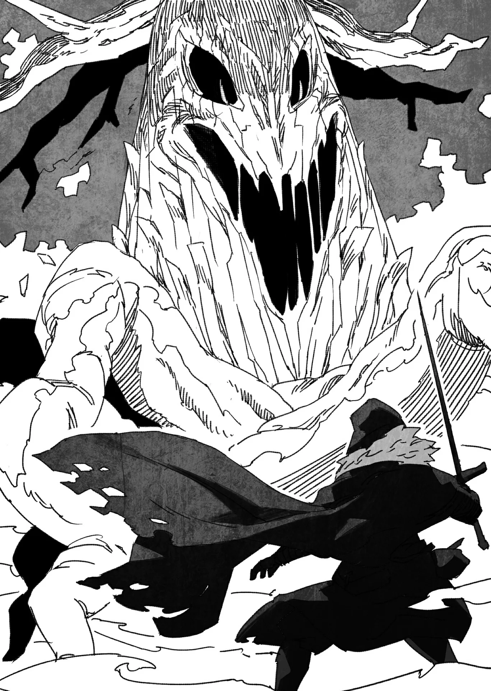

# Chương 92: Tập 4 Chương 1 - Tiến Về Mê Cung Tân Nguyệt (5)

Xét cho cùng thì... lũ này đông thật sự. Nếu chỉ có hai, ba con thì chúng tôi dễ dàng hạ gọn mà chẳng tốn mấy sức. Nhưng theo những gì tôi cảm nhận được thì quanh đây có ít nhất bốn mươi con đang vây kín. Đàn Kesem Kofu đông thế này, chúng tấn công tiếp là điều chắc chắn. Đã vậy chúng còn thoăn thoắt nhảy nhót, đu đưa từ cành này sang cành khác. Tôi thấy tình hình này khá là nan giải.

Đây chẳng phải lần đầu tôi chiến đấu trong rừng. Tôi từng đi thu thập nguyên liệu ở các khu rừng lân cận và chạm trán Goblin hay Slime không ít lần. Xấu nhất thì cũng chỉ gặp phải Orc là cùng. Còn đằng này thì sao? Lũ quái vật chuyền cành thoăn thoắt, lợi dụng địa hình để tập kích bất ngờ? Tôi chưa từng có kinh nghiệm đối phó với loại kẻ địch thế này. Trước khi xuống tầng ba, tôi cũng đã tìm hiểu kỹ. Tôi gom đủ thông tin về Kesem Kofu từ trước, nhưng thấy tận mắt lại là chuyện khác hẳn. Những câu chữ miêu tả tôi từng đọc chẳng thể nào sánh được với cảnh tượng trước mắt tôi lúc này.

Trước hết... nắm bắt tình hình xung quanh đã thấy khó rồi. Dù có căng mắt ra nhìn, tôi cũng chỉ thấy toàn cành lá với bóng râm. Lũ quái vật thoăn thoắt lướt đi, vừa thoáng thấy là tôi đã mất dấu ngay.

Nói cho đúng thì cách chuẩn nhất lúc này là vận Ma Lực hoặc Khí Lực vào cơ thể rồi dò quét xung quanh. Thế nhưng về khoản dẫn truyền Ma Lực bài bản thì tôi vẫn chỉ là người mới tập, còn Khí Thuật thì tôi cũng chẳng biết nhiều ngoài việc cường hóa cơ thể đơn giản. Những việc như cảm nhận xung quanh hay mài sắc giác quan lúc này đều nằm ngoài khả năng. Tôi vừa thiếu kỹ thuật, mà khéo còn thiếu cả năng khiếu bẩm sinh cho mấy việc đó nữa. Thần Lực xem chừng cũng chẳng giúp ích được gì trong hoàn cảnh này. Chắc tôi chẳng còn cách nào khác ngoài việc trông cậy vào trực giác.

Tôi lách người né đòn tấn công trong đường tơ kẽ tóc của một con Kesem Kofu khác rồi vung kiếm chém trả, nhưng chẳng tài nào chém trúng phát nào; chuyển động của chúng quá đỗi thất thường. Cái cách chúng bám dây leo tụt xuống quả thực làm người ta bực mình.

Hay là châm lửa đốt rụi cả khu rừng này luôn cho xong nhỉ?

Hừm... Thôi bỏ đi. Châm lửa ở đây thì thế nào tôi cũng tự biến mình thành tro trong đám cháy mất. Tôi chẳng muốn quay lại làm Khô Lâu thêm lần nào nữa đâu...

Thành thật mà nói, dường như cách duy nhất để xử lý chuyện này là chém đứt đám dây leo kia, nói đúng hơn là làm cho chúng ngắn bớt lại. Việc này nhọc nhằn thật sự, nhất là khi tôi có thể bị tấn công từ bất kỳ góc nào vào bất cứ lúc nào... nhưng có lẽ chẳng còn cách nào khác. Chí ít tôi cũng muốn bẻ gãy đợt phối hợp tấn công của chúng, dẫu rằng lúc này làm thế e là quá sức với tôi. Kể cả có trèo lên được cây thì tôi cũng chẳng đời nào đuổi kịp lũ đó.

Tôi còn đang đau đầu nghĩ cách thì bỗng nhiên...

"Chít!!!"

Cùng với tiếng kêu quen thuộc, Edel vận Ma Lực vào hai chân rồi phóng vút lên thân cây gần đó với tốc độ kinh người, móng vuốt cắm phập vào lớp vỏ cây. Ai ngờ nó lại làm được chuyện đó cơ chứ... Tôi thực sự ngỡ ngàng, một phần vì chính tôi cũng chẳng tài nào bắt chước được. Dù tôi có thử vận Ma Lực vào chân thì việc chạy thẳng lên thân cây như thế cũng khó vô cùng. Đoán chừng Edel đã cường hóa móng vuốt, tạo thêm lực ma sát để vọt đi với tốc độ đó. Còn nếu tôi mà thử làm theo thì mấy cây mảnh khảnh thế này chắc gãy gục chỉ sau vài bước chân mất. Edel làm được vậy cũng là nhờ vóc dáng nhỏ bé của nó.

Chẳng làm gì khác được, tôi đành đứng dưới đất tiếp tục né các đòn tấn công của đàn Kesem Kofu, tiện tay chém đứt bất cứ sợi dây leo nào lọt vào tầm mắt một cách tẻ nhạt hết sức.

"...Khẹc!" "Khẹc khẹccc!!!"

Sau vài tiếng kêu the thé từ trên cao, một con Kesem Kofu rơi uỵch xuống đất nghe thật vang. Trên mình con quái vật chằng chịt những vết cào sâu hoắm, nhìn là biết ngay do Edel làm.

Có điều những vết cào đó chẳng phải vết thương chí mạng. Vừa rơi xuống đất, con quái vật đã lồm cồm bò dậy toan trèo tót lên cây lần nữa. Nhưng tôi đâu có tốt bụng đến mức bỏ qua cơ hội này. Tôi lập tức tăng tốc áp sát, vung kiếm bằng cả hai tay chém thẳng xuống.

Tôi thẳng tay chém mạnh chẳng cần e dè là vì người ta khó lòng thu hoạch được thứ gì hữu ích từ Kesem Kofu. Da thì mỏng, lông lại cứng và đầy gai nhọn, chẳng dùng được vào việc gì. Thịt cũng dở tệ, khó mà nuốt nổi. Thứ duy nhất lấy được từ chúng chỉ có Ma Tinh.

Ma Tinh của Kesem Kofu nằm ngay cạnh tim. Chỉ cần tôi không sơ ý chém trúng chỗ đó thì việc móc viên tinh thể ra khá đơn giản. Chém nát những chỗ khác cũng chẳng hề hấn gì.

Tôi cứ bám theo nhịp tấn công của Edel, hễ con Kesem Kofu nào rơi xuống là tôi dứt điểm con đó. Cuối cùng, Edel cũng đáp xuống một khoảng đất trống nhỏ, nơi không có xác con nào rơi trúng. Chú chuột tiếp đất nghe bịch một tiếng rõ to, nhưng xem chừng chẳng hề hấn gì. Nó đã cuộn tròn người lại, chắc là tận dụng lớp mỡ dày cộm trên người làm tấm đệm êm để giảm chấn.

Dù sao thì thấy Edel không bị thương là tôi mừng rồi.

Có điều tôi lại chẳng thấy được Edel đã làm những gì trên đó. Tôi bèn hỏi thăm xem sao, và nó truyền ý nghĩ báo rằng mình vừa có một trận chiến ra trò trên các cành cây. Dù không tận mắt thấy nó ra tay, nhưng nhìn những vết thương trên xác lũ quái, tôi biết chú chuột đã bỏ ra không ít công sức.

Trước giờ gần như toàn đi mạo hiểm một mình nên tôi chưa quen với chuyện phân chia vai trò thế này. Xem ra tùy thuộc vào đặc tính của kẻ địch mà Edel lại hữu dụng ra phết. Dĩ nhiên, đâu ai biết trước được điều gì đang chờ chúng tôi phía trước. Tôi thầm nhủ sau này phải rèn luyện thêm cho những tình huống thế này, lỡ có phải chiến đấu một mình thì còn biết đường mà xoay xở.

Dù sao thì giờ cũng tới lúc mổ xẻ lấy chiến lợi phẩm. Lần này chỉ lấy Ma Tinh nên tôi làm loáng cái là xong. Rốt cuộc cũng chỉ có tầm chục con, và chung quy chúng chẳng tạo ra mối đe dọa nào đáng kể.

Có điều nếu cứ bị Kesem Kofu phục kích hết lần này tới lần khác thì mệt mỏi thật sự. Tốt hơn hết là tôi nên bảo Edel cảnh giác dò xét xung quanh, rồi chúng tôi chọn tuyến đường nào né được lũ quái phiền toái này chừng nào hay chừng nấy.

◆◇◆◇◆

Tôi phải tìm một con Ent Jyulapus rồi lấy từ nó phần nguyên liệu cần thiết để tôi và Alize mỗi người tự làm một cây đũa phép. Còn Ma Tinh... Trong trường hợp xấu nhất thì dùng tạm mấy viên lấy từ lũ Kesem Kofu cũng được.

Nhưng nói thật lòng thì tôi vẫn muốn kiếm loại Ma Tinh có phẩm chất tốt hơn. Ma Tinh của Kesem Kofu là loại kém ấn tượng nhất ở tầng ba Mê Cung Tân Nguyệt; chúng vừa nhỏ, hơi đục, lại chẳng chứa mấy năng lượng. Đã mất công đi kiếm thì tôi vẫn muốn lấy thứ gì đó ra hồn hơn.

Có điều Lorraine từng bảo tốt hơn hết là không nên dùng Ma Tinh của Ent Jyulapus để làm đũa phép. Xét theo góc độ giả kim thuật thì điều này rất hợp lý, bởi viên tinh thể thường được gắn trên đầu đũa. Dùng tinh thể của loài quái vật khác sẽ giúp khuếch đại đáng kể uy lực ma pháp phát ra. Còn nếu dùng tinh thể của chính con Ent đó thì Ma Lực bên trong đũa phép sẽ bị tụ lại một chỗ và ứ đọng, khiến vật dẫn ma pháp rất khó dùng. Một cây đũa phép cân bằng đòi hỏi người chế tạo phải căn chỉnh và tinh chỉnh tỉ mỉ. Dĩ nhiên tôi và Alize sẽ được học những kỹ năng này trong quá trình làm đũa, nhưng cái khó thực sự lại nằm ở chỗ phải đi gom nguyên liệu từ các loài quái vật khác nhau. Đôi khi đũa phép làm thuần từ một loài quái vật lại phát huy hiệu quả tốt hơn, nhưng nguyên tắc căn bản thì vẫn cần đôi chút biến tấu đa dạng.

Dẫu vậy...

Nói thì dễ hơn làm, nhất là ở tầng ba này. Giờ tôi chỉ biết cố hết sức thôi. Ráng thêm một tầng nữa thôi nào, Rentt...

Nói thì nói vậy chứ... tìm được một con Ent Jyulapus khó khăn thật sự. Chúng vốn là đối thủ đáng gờm, nên ngay từ khâu tìm kiếm đã gian nan cũng là chuyện dễ hiểu. Đã thế lại còn giữa một khu rừng rậm rạp như thế này nữa. Một khi chúng đã hòa mình vào cảnh vật xung quanh thì người không chuyên khó lòng mà phân biệt nổi Ent Jyulapus với cây cối bình thường.

Ent Jyulapus hình thành khi Ma Lực tụ lại và tích lũy trong một thân cây. Về bản chất, chúng là quái vật sinh ra từ cây cối, nên nếu chỉ trừng mắt nhìn thì chẳng ích gì vì bề ngoài chúng cơ bản chẳng khác gì nhau. Có điều nhờ nguồn gốc hình thành cùng lượng Ma Lực tích tụ bên trong, một ma pháp sư dày dạn kinh nghiệm có thể liếc qua là phân biệt được với cây thường, tiếc là tôi thì chưa đủ trình độ để làm được như vậy.

Cũng có những cách khác, chẳng hạn như dùng loại ma cụ hình mắt kính giúp người đeo nhìn thấy lờ mờ dòng Ma Lực. Có điều mấy món đó đắt đỏ lắm, mà thường chỉ dùng được một lần. Chính xác hơn thì loại ma cụ đó được phù phép để duy trì tối đa trong vòng một ngày, và tôi thì chẳng đời nào chịu bỏ tiền ra mua một thứ xa xỉ lãng phí như thế.

Rốt cuộc việc tìm kiếm cứ mãi gian nan, khiến tôi bất giác ước gì ban đầu mình chịu mua lấy một món... Dĩ nhiên lúc này mà nghĩ vậy thì cũng vô ích.

Đó là lý do tôi phải viện tới giải pháp cuối cùng, cũng là cách quyết liệt nhất. Độ an toàn của nó thì khỏi bàn rồi, chẳng bảo đảm chút nào, nhưng tôi đâu còn nhiều lựa chọn. Cách của tôi là: cứ vung kiếm chém vào mọi thứ xung quanh, kể cả mấy bụi cây. Vậy nếu một nhát chém tình cờ trúng phải Ent Jyulapus thì sao? Kết quả thế nào hẳn rất dễ đoán.

Dù từng có thời điểm trong đời Ent Jyulapus là một cái cây bình thường, nhưng giờ nó đã biến thành quái vật. Trừ một vài trường hợp cá biệt, quái vật đa phần đều là lũ sinh vật hung tợn và bạo lực. Nếu bị tập kích hoặc bị một vật thể đánh trúng...

"...JYUUURRRRRRUUUVVVAAA!!!"

Một âm thanh ầm ầm vang lên, thứ âm thanh lẽ ra một cái cây chẳng thể nào phát ra, vọng tới từ một cái cây khá nhỏ cỡ bụi rậm mà lưỡi kiếm của tôi vừa chém trúng. Bình thường thì cành cây với dây leo làm sao cử động được, thế nhưng lúc này chúng đang quăng quật điên cuồng, rõ ràng là đang sống. Chớp mắt sau, chính đám dây leo đó quất vun vút về phía tôi như roi, còn những cành cây thì vươn dài đâm tới tấp tựa như ngọn giáo gỗ. Rõ ràng là cái cây này đã hạ quyết tâm tấn công tôi cho bằng được.

Vốn dĩ dây leo với cây thân gỗ chẳng hòa thuận gì nhau. Nhưng chuyện đó xem ra đã đổi khác, có lẽ do cái cây đã biến thành quái vật. Cả cây lẫn dây leo lúc này đều nhắm thẳng vào tôi, như muốn siết cổ và đâm xuyên người tôi cho tới chết. Tôi thì chẳng muốn chết theo kiểu nào trong hai cách đó đâu...

Đó quả thực là mong muốn từ tận đáy lòng. Tôi liên tục chém đứt những sợi dây leo đang quất tới, vừa khéo léo vặn người né mấy cành cây nhọn hoắt lao về phía mình. May sao phần có vẻ là cốt lõi của Ent Jyulapus lại là một thân gỗ khá dày, nên con quái vật không thể tự do di chuyển.

Đám dây leo bị tôi chém đứt trườn ngoe nguẩy như rắn rồi tự cắm vào lòng đất, đâm rễ mới ở bất cứ chỗ nào có thể.

Sao mãi mà mày vẫn chưa chịu chết hả?

Sức sống của lũ này đáng nể thật đấy, tôi định bụng nói vậy, nhưng một Undead như tôi thì quả thực chẳng có tư cách gì để nói người khác.

Liệu bị siết cổ hay bị đâm thủng lỗ chỗ có giết được tôi không nhỉ? Muốn tiêu diệt một con quái vật mang đặc tính Ma Cà Rồng thì phải dùng vũ khí bằng bạc hoặc tẩm Nước Thánh đâm xuyên tim, dân gian vẫn truyền miệng như vậy. Trên thực tế, Hạ Cấp Ma Cà Rồng đúng là bị tiêu diệt theo cách đó thật. Nếu nhớ không lầm thì cũng từng có vài trường hợp hạ gục thành công cả Trung Cấp Ma Cà Rồng.

Thế nhưng tôi chưa từng nghe chuyện Ma Cà Rồng vượt trên cấp bậc đó bị hạ bằng cách này. Nói thật thì tôi còn chẳng rõ điều đó có khả thi hay không. Thôi thì tốt nhất là tôi cứ nên cẩn thận với đồ bạc và Nước Thánh.

Nghĩ lại thì trước đây tôi hầu như chẳng bị Nước Thánh ảnh hưởng gì, vậy chắc chỉ còn mỗi bạc. Nhưng kể cả bạc... tôi từng chạm vào đồ bạc trong vài thí nghiệm của Lorraine mà cũng chẳng thấy hề hấn gì. Xét đủ mọi điểm khác biệt thì dường như tôi khác xa so với Ma Cà Rồng thông thường. Vậy tức là nếu bị siết cổ hay đâm xuyên người thì tôi vẫn chết ư? Chịu, tôi chẳng tài nào biết được...

Tạm gác mấy suy nghĩ lan man về cơ thể mình sang một bên, tôi thấy nhẹ nhõm hơn đôi chút. Chém rụng bớt cành nhánh và dây leo của con quái vật giúp tôi có thêm chút khoảng trống để thở. Mấy cái rễ mọc ra từ đám dây leo đứt đoạn tuy phát triển chậm, nhưng mắt thường vẫn nhìn thấy rõ. Chí ít thì chúng cũng lớn nhanh hơn nhiều so với cây cối bình thường. Liệu cứ mặc kệ thì chúng có mọc thành những con Ent Jyulapus mới không nhỉ...?

Quan trọng hơn lúc này là con quái vật trước mắt. Đúng như vẻ ngoài của nó, Ent Jyulapus là một cái cây đã biến thành quái vật, có thể gọi là một cái cây quái vật biết cử động. Trên một phần thân gỗ đặc biệt dày, có lẽ đánh dấu phần lõi của con quái vật, hiện lên một khuôn mặt hung tợn ngập tràn thù hằn. Trông nó gớm ghiếc vô cùng, nhìn chẳng dễ chịu chút nào. Dây leo quấn dọc theo các cành nhánh và thân cây, còn mắt và miệng nó thì lập lòe thứ ánh sáng mờ ảo mỗi khi nó cử động. Chẳng rõ đám dây leo này đã bám vào từ lúc nó còn là cây thường, hay chỉ mới mọc ra sau khi biến thành Ent Jyulapus nữa.

Theo sách tôi từng đọc thì loài quái vật này có cá thể quấn dây leo quanh mình, có cá thể lại không. Nếu phải đoán thì cái cây này chắc đã bị dây leo quấn chặt từ lâu trước khi tiến hóa thành quái vật rồi. Con Ent Jyulapus trước mắt lúc này vẫn đang quăng quật điên cuồng, cố dùng những cành gỗ sắc nhọn đâm xuyên người tôi; thớ gỗ của nó hơi ánh sắc trắng, nên ban đầu có lẽ nó là một cây bạch dương.

Dù sao thì tôi cũng chẳng biết nhiều về lâm nghiệp và cây cối, nên không có cách nào xác định loại gỗ này phù hợp đến đâu trong việc làm đũa phép. Theo lời Lorraine giải đáp về chuyện này, bất kỳ loại gỗ nào lấy từ Ent Jyulapus đều giúp tăng tiềm năng phát lực của đũa phép. Điều đó thấy rõ qua cách con quái vật dùng cả thân mình làm vũ khí, từ cành nhánh cho đến đám dây leo.

Tôi đã vung kiếm chém vào nó khá mạnh, thế mà thân cây không hề gãy hay đứt đôi. Dù tôi có thể vận Ma Lực hoặc Khí Lực vào vũ khí để chém đứt nó, nhưng với hầu hết các loại vật liệu gỗ thì cũng đều như vậy cả. Nói cách khác, tôi chẳng cần phải bận tâm về độ bền hay tính phù hợp của loại gỗ này.

Còn về lượng gỗ thực sự cần... Vì chúng tôi làm đũa phép ngắn nên mỗi cây chắc cũng chẳng tốn quá bốn mươi phân gỗ thô. Tôi thực sự chẳng cần nhiều hơn thế. Nhưng vì không thể tốn quá nhiều thời gian cho một con quái vật duy nhất, tôi định bụng sẽ cắt lấy luôn vài mẫu gỗ cỡ ấy cho mục đích này.

Sau vài đợt đụng độ liên tiếp với Ent Jyulapus, một điều đã rõ ràng: nó chẳng có đòn tấn công nào đặc biệt. Cùng lắm nó chỉ quăng quật dây leo hoặc lấy cành nhánh đâm tôi, họa chăng áp sát thì tông cả thân vào. Tất cả chỉ có thế. Nếu nó chỉ quanh đi quẩn lại có ngần ấy chiêu thì tấn công tổng lực xem ra rất hợp với mục đích của tôi.

Tin rằng suy đoán của mình là đúng, tôi chờ đợt tấn công tiếp theo của Ent Jyulapus. Tôi gọn gàng né loạt cành cây đang lao tới, tiện tay chém đứt vài cành trên đường tiến vào. Áp sát trong chớp mắt, tôi đâm sâu lưỡi kiếm vào hốc mắt con quái vật, một sơ hở dễ đánh trúng trên khuôn mặt gớm ghiếc nơi thân cây.

Khoang trống phía sau khuôn mặt con quái vật xem chừng rỗng không, nhưng mọi sự không chỉ đơn giản như mắt thấy. Chính xác thì khoảng rỗng này mới là cái gọi là bản thể chính của Ent Jyulapus. Con quái vật này không đơn thuần là một cái cây hay mấy mảnh gỗ; chân thân của Ent Jyulapus là một thể tinh linh vô định hình trú ngụ trong hốc rỗng ấy. Tức là loài quái vật này có một điểm yếu chí mạng lộ rõ. Bình thường thì người ta sẽ nhắm đòn vào đúng chỗ đó của con Ent, nhưng thực tế lại hiếm ai làm vậy.

Nhưng nghĩ lại thì điều đó cũng dễ hiểu. Bởi cái gọi là cốt lõi của con quái vật này là một thể tinh linh phi vật chất. Đòn tấn công vật lý thông thường hầu như chẳng thể gây ra bao nhiêu sát thương cho nó. Dẫu vậy vẫn có cách thuần vật lý để hạ gục Ent Jyulapus, đó là phá hủy hoàn toàn thân cây của nó.

Cách đó hiệu quả là vì thể tinh linh bên trong Ent Jyulapus rất bất ổn, không có nhiều điểm bám víu trên bình diện vật chất. Nếu thân cây mà nó bám vào bị phá hủy, nó sẽ mất đi vật trung gian để kết nối và về cơ bản là ngừng tồn tại. Nhưng đó chẳng phải cách hay nhất để thu hoạch gỗ từ Ent. Dù không thực sự cần quá nhiều gỗ từ con quái vật này, tôi vẫn muốn gom được càng nhiều nguyên liệu càng tốt. Nếu còn thừa gỗ, đem bán cũng được giá gấp mấy lần gỗ thường. Mà trong đầu tôi thì lúc nào cũng tâm niệm chuyện "chắt bóp từng đồng, kiếm thêm tiền vàng", nên tôi chẳng có ý định phá nát nó bằng đòn vật lý. Vậy thì người ta sẽ dùng thứ gì để đấu với một đối thủ phi vật chất, miễn nhiễm đòn đánh vật lý?

Ma Lực và Khí Lực là những lựa chọn khả thi. Nếu mạo hiểm giả không có một trong hai thứ đó thì không tài nào đánh lại kẻ địch phi vật chất. Thường thì cách hữu hiệu nhất để đối phó với thể tinh linh là Thần Lực. Nhưng người sở hữu Thần Lực lại rất hiếm hoi, và cũng chẳng có phương pháp nào phổ biến để diệt quái vật bằng nguồn năng lượng này.

Dẫu vậy, tôi đã có sẵn kế hoạch trong đầu. Cắm sâu lưỡi kiếm vào hốc mắt nó, tôi dẫn truyền và bọc lấy thanh kiếm của mình bằng Ma Lực. Gần như ngay tức khắc—

"GIGGGIIIAAAYAAA!!!"

Một tiếng rít the thé vang lên từ cái miệng hở trông khá rợn người của Ent Jyulapus. Khi tiếng rít lịm dần, một chất màu đen mỏng manh tỏa ra từ thân xác con Ent tựa như một vệt khói, rồi tan biến hoàn toàn vào không khí. Cùng với đó, ánh sáng nơi mắt và miệng con Ent cũng từ từ lụi tắt. Khi độ căng cứng biến mất khỏi đám cành nhánh và dây leo, con quái vật đổ gục xuống, thân xác nó rơi xuống đất nghe bịch một tiếng.

Tôi cho rằng nó đã bị tiêu diệt.

Đám dây leo dưới đất cũng không còn đâm rễ nhanh như trước nữa, quay trở lại tốc độ sinh trưởng bình thường hơn. Ít nhất thì từ chỗ tôi đứng, mắt thường không còn phân biệt được chuyện chúng đang lớn thêm.

Thân gỗ chính của Ent Jyulapus giờ đang nằm nghiêng một bên, hầu như chẳng hề sứt mẻ. Tôi có thể tự tin nói rằng số nguyên liệu thu được từ cái vỏ xác bất động này là quá dư dả. Sau khi đảo mắt nhìn quanh một lượt xác nhận không có quái vật nào gần đây, tôi tiến lại thu gom số nguyên liệu mà mình đã cất công tới lấy.
