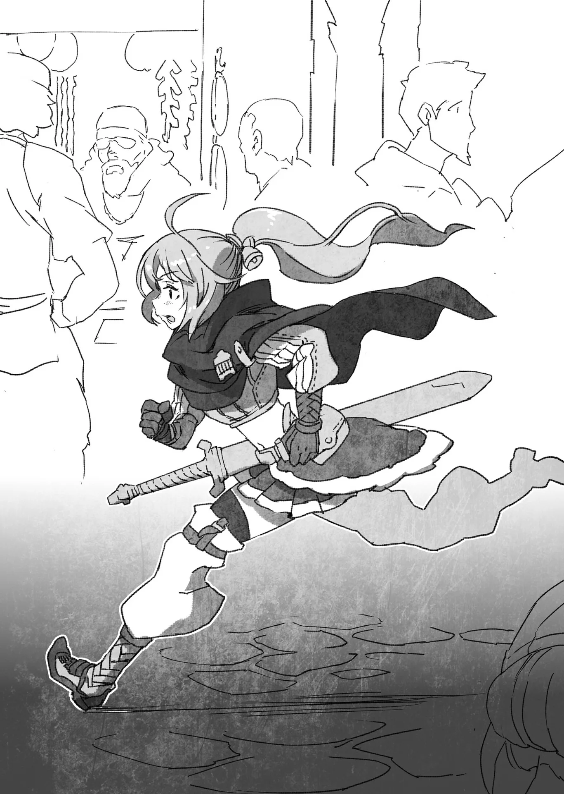

# Chương 93: Chương đệm Tập 4 - Mạo Hiểm Giả Rina Rupaage

Đã khá lâu kể từ cuộc gặp gỡ kỳ lạ bậc nhất ấy. Đó là lần cô chạm trán một con Ngạ Quỷ, mà lại là một con Ngạ Quỷ hiền lành, trên mặt vẽ những hình xăm chằng chịt màu lam. Tính mạng Rina lẽ ra đã kết thúc ngay lúc ấy, nếu không nhờ con Undead kỳ lạ này ra tay can thiệp.

Nghĩ lại, đó quả là một trải nghiệm kỳ quặc hết sức. Giờ ngẫm lại, chuyện ngỡ như chỉ là một giấc mơ. Rina đã chuẩn bị quần áo cùng mặt nạ cho con Ngạ Quỷ, thậm chí còn tiếp tay lừa lính gác ở một cổng thành Maalt để đưa anh vào trong. Đó là chuyến phiêu lưu thực thụ đầu tiên trong đời cô. Một chuyến phiêu lưu đầy bí ẩn, nói đúng hơn thì nghe hệt như chuyện hoang đường.

Dù vậy... càng nghĩ... Không, dù có nghĩ thế nào đi nữa, Rina vẫn hiểu rằng đưa một Undead vào thành là chuyện không thể tha thứ. Rina không hề thiếu thường thức. Thế nhưng cô lại cứ làm, dù thừa biết đó là điều cấm kỵ.

Lý do của cô là Rentt có vẻ không phải người xấu. Dĩ nhiên, nếu Rentt chỉ là một con Undead thông thường, Rina đời nào lại làm vậy. Nói cách khác, chỉ trong khoảng thời gian ngắn ngủi bên nhau, Rina đã dành cho Rentt một niềm tin sâu sắc. Dẫu vậy, ngẫm lại thì trước đó cô chưa từng trải qua cảm giác như thế bao giờ: tin tưởng một ai đó sâu sắc đến vậy.

Cha Rina rất nghiêm khắc. Ông thậm chí còn lên sẵn kế hoạch cho cả đời cô, sắp đặt những việc cô nên làm và phải làm. Mẹ cô cũng chẳng khá hơn, hễ cô mở miệng là lại bị bà chê thiếu vẻ nhã nhặn. Hết chuyện đó, mẹ cô lại quay sang thao thao bất tuyệt không hồi kết về các mối dạm hỏi. Bảo cha mẹ không thương Rina thì cũng không hẳn, nhưng họ nhất quyết chẳng chịu lắng nghe, dẫu cô có nài nỉ rằng mình cũng có những hoài bão muốn theo đuổi, những việc bản thân muốn làm. Người duy nhất chịu lắng nghe mọi điều cô tâm sự là anh trai, người hơn cô khá nhiều tuổi.

Rina tự hỏi không biết lúc này anh trai đang làm gì...

Anh trai cô, Idoles Rogue, là trưởng nam của gia tộc Rogue, dĩ nhiên đó cũng là gia tộc danh chính ngôn thuận của Rina. Anh thuộc Đệ Nhất Kỵ Sĩ Đoàn tinh nhuệ của Vương Quốc Yaaran. Sinh ra trong một gia đình kỵ sĩ, Rina luôn ngưỡng mộ anh và mơ ước trở thành một kỵ sĩ giống như anh trai. Đó chính là cách cô muốn sống trọn đời mình.

Thế nhưng, thực tế lại... khác. Ở Vương Quốc Yaaran quả thực có nữ kỵ sĩ, nhưng cũng chỉ có chừng mực. Anh trai cô thậm chí từng kể về hai nữ kỵ sĩ trong Đệ Nhất Kỵ Sĩ Đoàn, cả hai đều được cử đi làm nhiệm vụ y như các đồng đội nam.

Thế nhưng cha mẹ Rina lại không chấp nhận nổi chuyện cô ngưỡng mộ anh trai rồi nuôi mộng trở thành kỵ sĩ. Đó chính là nguồn cơn của mọi rắc rối.

Cha Rina giữ quan điểm hết sức cứng nhắc. Ông không nghĩ phận nữ nhi nên nuôi mộng làm kỵ sĩ. Mẹ cô cũng chung suy nghĩ, bà cho rằng phụ nữ chỉ cần được một quý ông tử tế che chở là đủ, và coi đó là niềm hạnh phúc lớn nhất của đời người con gái. Vì lẽ đó, bà nhất quyết không chịu nhượng bộ trong chuyện sắp đặt hôn sự cho Rina.

Dẫu thế, Rina không hẳn cho rằng cha mẹ mình sai. Đối với giới quý tộc, suy nghĩ của cha mẹ hợp với lẽ thường ở đời hơn, thậm chí có thể coi là đúng đắn. Nhưng tại sao cha mẹ lại cứ phải cứng nhắc đến thế? Chẳng lẽ nới lỏng dù chỉ một chút cũng không được sao? Rina chỉ mong cha mẹ lắng nghe nỗi lòng mình, và có lẽ cùng nhau tính chuyện tương lai. Chí ít cũng cho cô một lần được trò chuyện đàng hoàng chứ.

Nhưng cha mẹ Rina lại chẳng nghĩ như vậy. Người duy nhất không làm thế... là anh trai cô. Anh chăm chú lắng nghe từng suy nghĩ của cô. Anh tìm cách gỡ rối, rồi đứng ra nói chuyện với cha mẹ. Thế nhưng kết quả vẫn chẳng suy chuyển, cha mẹ vẫn một mực không chịu lay chuyển. Dù vậy, anh trai đã làm tất cả những gì có thể vì cô, chí ít thì Rina luôn nghĩ thế.

Khi mọi chuyện đã đến nước này, anh trai vạch rõ cho Rina những lựa chọn trước mắt. Nói thẳng ra, nếu cứ ở lại nhà, sớm muộn gì cô cũng sẽ bị gả cho một quý tộc xa lạ nào đó. Đó chưa hẳn là điều xấu, nhưng Rina nhất quyết không chịu, thế nên anh trai mới đưa ra một gợi ý nữa: bỏ nhà ra đi. Có điều trong hoàn cảnh ấy, Rina sẽ rất khó trở thành kỵ sĩ, bởi một khi đã dứt bỏ gia đình, cô sẽ phải tự đứng trên đôi chân của mình. Sinh ra trong một gia tộc như thế, Rina từ nhỏ đã sống trong nhung lụa, chưa từng nếm mùi cơ cực hay thiếu thốn. Liệu cô có thể tự lập, và cô có đủ quyết tâm hay không? Anh trai đã hỏi cô như vậy.

Rina không hẳn là không hiểu sự đời. Cô biết đó sẽ là một lựa chọn vô cùng khó khăn. Cô cũng hiểu rõ một thiếu nữ phải tự thân bươn chải kiếm sống giữa thế giới này gian nan đến nhường nào. Trong khi cha mẹ luôn muốn bao bọc Rina, không để cô nhìn thấy góc khuất tăm tối của thế giới, thì anh trai Idoles lại khác hẳn. Anh thậm chí còn hay dẫn cô đến những chốn bệ rạc, đáng sợ ấy. Hễ cha mẹ đi dự tiệc là hai anh em lại lẻn ra ngoài, lân la đến những ngõ hẻm mờ ám đầy rẫy hiểm nguy rình rập. Rina mặc quần áo sờn rách của con gái thường dân, còn anh trai thì ăn vận như một gã du côn đầu đường xó chợ. Cả hai cứ thế cùng nhau rảo bước qua khắp phố cùng ngõ hẻm.

Bản thân những ngày tháng ấy đã là một chuyến phiêu lưu rồi. Nhớ lại, Rina không khỏi thấy bồi hồi.

Thật lạ là anh trai cô, một người lớn lên trong gia đình quý tộc, lại am hiểu những con phố tồi tàn ấy đến thế, thậm chí còn biết cả cách hòa mình vào dòng người. Thấy khó hiểu, Rina từng hỏi anh mục đích của những chuyến đi này, và anh giải thích rằng đó là để thay đổi góc nhìn của cô, hoặc chí ít là cho cô một cái nhìn mới. Để cô thấy cuộc sống của thường dân và quý tộc khác biệt đến nhường nào, và gian truân ra sao. Để thấy người bình dân lấy đâu ra can đảm và nghị lực để sống qua từng ngày, dẫu chẳng biết liệu mình có còn thấy được ngày mai. Hay thậm chí là những cách thức mà một người phụ nữ phải làm để sống tiếp bằng mọi giá, những bước đường mà những kẻ bị dồn vào cảnh tuyệt vọng buộc phải tìm đến.

Cả những kẻ đã mất đi tất cả, rốt cuộc kết cục sẽ ra sao...

Bình thường, một tiểu thư quý tộc chẳng bao giờ phải chứng kiến những cảnh tượng ấy. Nói đúng hơn, lẽ thường là họ chỉ ở yên trong những tòa dinh thự lộng lẫy, như sống trong một giấc mơ êm đềm, ngọt ngào. Về điểm này, anh trai Rina quả thực rất khác biệt.

Có lẽ anh đã thấy trước điều này ngay từ đầu: rằng Rina rốt cuộc sẽ chệch khỏi con đường được vạch sẵn cho mình... hay thậm chí là bỏ nhà ra đi. Có lẽ vì thế mà anh mới muốn cho Rina thấy sự khắc nghiệt và thực tế phũ phàng của thế gian. Biết đâu khi ấy Rina sẽ từ bỏ... còn nếu không, những trải nghiệm ấy sẽ trở thành bài học quý giá cho cô.

Quả thật, những trải nghiệm ấy chính là điều Rina cần nhất. Rina trở thành mạo hiểm giả vì cô hiểu ra một điều: bản thân có sẵn lượng Ma Lực và Khí Lực đáng kể. Chỉ cần rèn luyện thêm, Rina hoàn toàn có thể kiếm sống bằng nghề mạo hiểm giả, điều cô nhận ra trong những chuyến đi cùng anh trai. Phần lớn quý tộc đều có lượng Khí Lực hoặc Ma Lực đáng kể, nhưng Rina lại hơi đặc biệt. Trữ lượng của cô dồi dào hơn nhiều. Chí ít cô cũng có đủ Ma Lực để đương đầu với không ít loài quái vật, dù vẫn cần học hỏi và luyện tập thêm. Khí Lực là thứ tôi luyện cùng người dùng, người ta thường phải khổ luyện rất nhiều mới tăng được lượng Khí Lực. Dù Rina khó lòng tận dụng Khí Lực ngay từ đầu, nhưng Ma Lực của cô đã quá đủ cho việc chiến đấu.

Chưa kể, Rina còn học được kiếm thuật cơ bản cùng kỹ năng chiến đấu từ anh trai, tất cả nhằm nuôi mộng trở thành kỵ sĩ. Chỉ cần có chút Ma Lực và kỹ năng chiến đấu, người ta đã có thể làm mạo hiểm giả, dẫu chỉ ở mức tối thiểu. Lúc bấy giờ Rina chỉ nghĩ đơn giản như vậy. Và đó là lý do cô đưa ra lựa chọn.

Sau nhiều lần đắn đo suy nghĩ và bàn bạc với anh trai, Rina quyết định bỏ nhà ra đi.

Khi nghe cô nói ra quyết định, gương mặt anh trai thoáng hiện vẻ phức tạp, khó xử. Dù vậy anh không hề phản đối mà còn ủng hộ, tôn trọng lựa chọn của Rina. Có điều, anh vẫn dặn cô thỉnh thoảng phải liên lạc về, bởi dù cô có đi xa đến đâu thì gia đình cũng đâu thể tự nhiên biến mất.

Vài ngày sau khi hạ quyết tâm, Rina thay bộ đồ thường dân anh trai chuẩn bị, mang theo vũ khí và giáp trụ rẻ tiền cùng số lộ phí đủ tiêu vài tuần rồi rời khỏi nhà. Sau đó, cô tự bước đi trên đôi chân của chính mình, tìm đến Hội Mạo Hiểm Giả để đăng ký làm mạo hiểm giả.

◆◇◆◇◆

Cô đã nghĩ mọi chuyện quá đơn giản. Chẳng bao lâu sau khi vào nghề, Rina đã bất ngờ nhận ra điều đó.

Cô học kỹ năng chiến đấu từ anh trai, một kỵ sĩ thực thụ thuộc đội kỵ sĩ tinh nhuệ. Bản thân cô cũng có chút bản lĩnh, nên từng đinh ninh kiếm sống ở Hội sẽ chẳng khó khăn gì. Nhưng hy vọng ấy sớm tan thành mây khói.

Mấy ngày đầu, Rina nhận vài ủy thác đơn giản, bậc trung, để dành từng đồng có thể và chật vật sống qua ngày. Đến khi cách ấy cũng chẳng duy trì nổi nữa... Rina nghe phong phanh về một thị trấn tên là Maalt. Biết nguy cơ đụng mặt cha mẹ sẽ rất cao nếu tiếp tục ở lại vương đô, Rina quyết định đến Maalt. Nhưng đặt chân tới nơi, cô cũng chẳng gặp điều gì dễ chịu hơn. Bước đầu ở đây cũng gian nan không kém vì Maalt là thị trấn biên ải hẻo lánh. Sống sót vốn dĩ đã là một cuộc chiến, điều đó chẳng hề đổi thay.

Cuộc gặp gỡ với con Undead đặc biệt mang tên Rentt rốt cuộc đã khép lại chuỗi ngày ấy.

Những ngày Rina ở cùng Rentt tuy ngắn ngủi nhưng rất thú vị. Với Rina, Rentt là một kiếm sĩ có tay nghề đáng nể. Cô đoán diện mạo hiện tại của anh là do một biến cố không may nào đó gây nên. Vốn dĩ anh là một mạo hiểm giả tên Rentt Faina. Nhưng sau vài biến cố xảy ra, vừa tỉnh lại anh đã thành ra nông nỗi này. Ban đầu chính Rina cũng không tin nổi câu chuyện ấy, thế nhưng chẳng hiểu sao cô lại biết chắc con Undead kỳ lạ này không hề nói dối. Thế là cô trò chuyện, hợp tác cùng anh rồi dần gỡ rối từng vấn đề cho anh. Khi kế hoạch đưa Rentt vào Maalt thành công, trong lòng cô dâng lên cảm giác thỏa mãn đầy tự hào.

Thế nhưng, Rentt lại lập tức đề nghị tách nhau ra. Chuyện đó khiến cô sốc không ít. Nhưng ngẫm lại, cô hiểu Rentt chỉ đang lo cho cô theo cách của anh. Dẫu sao thì hình phạt cho tội tiếp tay cho Undead rồi để nó lọt vào thành phố chắc chắn cực kỳ nặng nề. Cô có thể bị trừng trị, bị săn đuổi, hoặc thậm chí còn tệ hơn.

Đến tận lúc này Rina mới hiểu vì sao Rentt lại giữ khoảng cách với mình. Anh hẳn thấy mình chẳng còn lựa chọn nào khác. Không, có lẽ từ tận đáy lòng, cô đã hiểu điều đó ngay từ lúc ấy. Rina chỉ ghét nói lời chia tay, nên không chịu chấp nhận sự thật mà thôi.

Nhưng sau một thời gian, mang theo những lời chỉ dạy của Rentt... Rina đã hướng về tương lai. Suốt dọc đường đi, Rentt luôn lắng nghe Rina tâm sự và cho cô bao lời khuyên quý báu. Có lẽ đó cũng là cách con Undead ấy lo lắng cho cô.

Chẳng hạn, anh chỉ cho cô cách thoát khỏi tình cảnh bấp bênh, nguy hiểm của một mạo hiểm giả lúc bấy giờ. Anh vạch ra hướng đi chung, mách nước về những bãi săn tốt, các thương nhân uy tín để giao dịch, cách thương lượng và mặc cả... Rentt đã dạy cô rất nhiều điều. Nếu biết vận dụng tốt những lời khuyên ấy, cô tin chắc mình có thể tiếp tục kiếm sống bằng nghề mạo hiểm giả. Cô có một niềm tin mãnh liệt vào điều đó.

Giờ đây Rina bước tới Hội với tác phong và tâm thế hoàn toàn khác trước. Cô cẩn thận xem xét từng yêu cầu, chỉ nhận những ủy thác vừa sức mình. Cô không còn ác cảm với việc hoạt động đơn độc, mà tập trung làm những gì trong khả năng. Rina hiểu rằng trước khi nghĩ đến chuyện lập đội với người khác, điều cốt yếu là phải chứng tỏ được bản lĩnh và thực lực của chính mình. Cô cũng hỏi người tiếp tân về các tổ đội khác, cũng như tiêu chí họ tìm kiếm khi chiêu mộ thành viên mới. Trước đây Rina hoàn toàn mù tịt những điều này. Anh trai cô là kỵ sĩ nên dĩ nhiên chẳng rành về Hội Mạo Hiểm Giả, hay tình hình chung cùng những khó khăn mà mạo hiểm giả phải đối mặt.

Tất cả đã thay đổi sau cuộc gặp tình cờ với Rentt. Chậm mà chắc, Rina nhận đủ loại ủy thác khác nhau, từng bước mài giũa khả năng chiến đấu. Cô còn tham gia các buổi hướng dẫn do Hội tổ chức để học hỏi tối đa và ghi nhớ những điều sống còn. Nhờ thế, Rina cứ nhận hết ủy thác này đến ủy thác khác, tỷ lệ thành công theo thời gian cũng tăng dần. Cuối cùng, cô nhận được một lá thư ngỏ, hỏi xem liệu lúc này cô đã có tổ đội hay chưa.

Lời mời đến từ một tổ đội nhỏ gồm một cậu thiếu niên và một cô gái trạc tuổi Rina. Cả hai đều đã lên Đồng Cấp và có tay nghề khá vững vàng. Một người là kiếm sĩ, người kia là ma pháp sư kiêm thầy trị liệu. Đó là một tổ đội vô cùng cân bằng.

Sau khi bàn bạc về các điều khoản thông thường, Rina quyết định trở thành thành viên thứ ba của nhóm.

