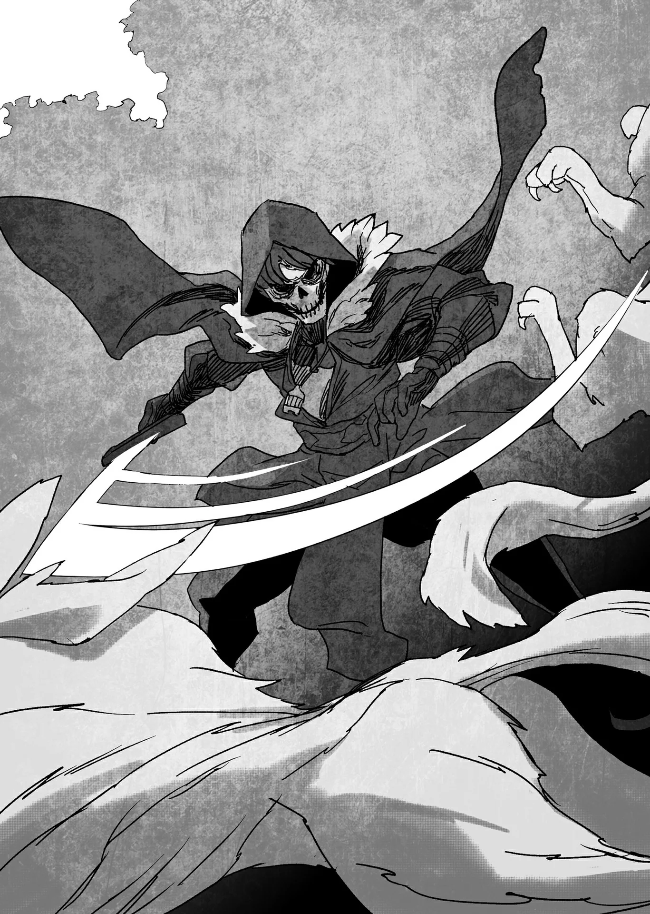

# Chương 94: Tập 4 Chương 2 - Nguyên Liệu Chế Tạo Vũ Khí Cho Đệ Tử (1)

Sau khi hạ gục con Ent Jyulapus đầu tiên, tôi tiếp tục săn lùng thêm những con khác suốt một lúc. Con quái vật trước đó vốn đột biến từ một cây bạch dương, và tôi đoán thứ gỗ mình thu được có phẩm chất khá tốt. Dẫu vậy, tôi vẫn muốn thu thập thêm vài loại gỗ khác nữa.

Dù Ent Jyulapus nhìn chung đều là quái vật dạng cây gỗ, nhưng chúng có thể đột biến và hiện hình từ rất nhiều loài cây khác nhau. Theo lời Lorraine, mỗi loại gỗ lại mang những đặc tính riêng biệt. Dù vậy, Lorraine cũng nói cô không nhắm tới loại gỗ cụ thể nào cho ủy thác lần này, nên tôi quyết định cứ thu thập thêm vài loại khác để cho chắc ăn. Cuối cùng, tôi đã gom được gỗ từ những con Ent biến dị từ cây gỗ mun và cây linh sam, chừng đó hẳn là đủ cho nhu cầu của mình.

Tôi cũng chạm trán một con Ent Jyulapus vốn từng là một dạng dây nho. Lúc bị chém trúng, nó vỡ vụn ra và tưới lên người tôi một lượng lớn axit ăn mòn cực mạnh. Nó còn ném những khối cầu axit về phía tôi, biến bản thân thành một kẻ địch vô cùng phiền toái. Dĩ nhiên tôi miễn nhiễm với mọi loại độc tố, nhưng ngay cả tôi cũng hiểu axit vẫn có thể khiến cơ thể mình bị bỏng. May mắn thay, chiếc áo choàng tôi đang mặc dường như có khả năng kháng axit đôi chút, nên tôi mới có thể bình yên vô sự vượt qua đòn tấn công đó. Nhưng dẫu vậy, tôi thực sự chẳng hề muốn đụng phải thứ như thế thêm một lần nào nữa.

Thực lòng mà nói, sau cuộc chạm trán đó, tôi quyết định dừng hẳn việc săn lùng Ent. Giá như tôi sử dụng được ma thuật, tôi chỉ việc bắn một ma pháp từ xa là có thể an toàn phân biệt được đâu là Ent và đâu là cây cối thông thường. Thế nhưng, điều đó ở thời điểm hiện tại đối với tôi vẫn là bất khả thi. Tôi cũng từng nghĩ tới chuyện nhờ cậy Edel, và sau đó quả thực đã hỏi thử nó. Nhưng kết cục vẫn chỉ là công cốc. Mục đích tôi tới đây là để kiếm nguyên liệu, trong khi Edel chỉ biết đúng hai ma pháp: một lưỡi đao gió và một hỏa cầu. Một cái sẽ khiến thân gỗ bị chém nham nhở, còn cái kia thì sẽ thiêu rụi cả khu vực này mất. Có lẽ việc khống chế uy lực của những ma pháp mới học được này vẫn còn quá khó đối với Edel chăng? Dù sao đi nữa, vấn đề này chỉ có thể giải quyết bằng việc tôi phải nỗ lực học hỏi ma thuật thực thụ trong tương lai gần.

Dẫu chính Edel là đứa nắm vững cách dẫn dắt và định hình nguồn năng lượng này trước tiên, nhưng một phần lý do nó làm vậy hẳn là vì muốn hỗ trợ tôi. Có rất nhiều loài quái vật sở hữu khả năng hòa lẫn vào môi trường xung quanh, và Ent Jyulapus chỉ là một trong số đó; nếu tôi chẳng có cách nào nhận biết được chúng khi cần thiết—ngoài việc vung thứ gì đó gõ bừa vào thân cây—thì sẽ cực kỳ rắc rối. Dù tôi có thế nào đi chăng nữa, thì tôi cũng đâu phải là người tối cổ cơ chứ.

Nếu ở một nơi như Mê Cung Nguyệt Ảnh, những nỗi lo âu như vậy hẳn là không cần thiết. Nhưng với những khu vực bên dưới tầng này thì chẳng ai dám chắc được điều gì. Tiến bộ là điều tốt, đúng vậy, nhưng lũ quái vật kiểu đó quả thực rất đáng bận tâm. Tôi nghĩ mình chỉ còn nước dốc hết sức mà thôi.

Tôi tiếp tục rảo bước, và chẳng bao lâu sau khu rừng mở ra một khoảng đất trống rộng thênh thang. Ngay chính giữa khoảng đất là thứ lẽ ra không nên tồn tại trong một khu rừng tự nhiên ngoài đời thực: một cầu thang dẫn xuống phía dưới. Nơi nó dẫn tới chẳng phải đâu xa, mà chính là tầng kế tiếp của mê cung này, tầng bốn.

Chừng đó là điều tôi có thể nhận ra theo trực giác. Thế nhưng khi bình tâm suy ngẫm, tôi nhận ra mình vẫn chẳng hiểu lý do vì sao những mê cung này lại được tạo ra. Ai đã dựng nên một nơi như thế này, và vì mục đích gì? Đó là tác phẩm của các vị thần chăng? Hay là của tộc tiên? Dù có vô số giả thuyết được đưa ra, nhưng sự tồn tại của mê cung vẫn là một trong những bí ẩn vĩ đại nhất của thế giới.

Giờ đây, tôi chẳng dám mong mỏi gì vào việc giải mã bí ẩn đó. Chuyện ấy có lẽ nên dành cho những người như... Lorraine thì hơn.

Công việc của tôi đơn giản hơn nhiều. Tất cả những gì tôi phải làm là đánh bại quái vật—những con quái vật chẳng khác gì lũ đang lang thang quanh khu vực lối vào cầu thang lúc này.

Tuy tôi rất mong chờ được khám phá tầng bốn, nhưng có vẻ như mê cung không hề đồng tình với sự nhiệt huyết ấy của tôi. Đang tụ tập và lảng vảng quanh lối cầu thang là không ít Sói Rừng.

Sói Rừng, đúng như tên gọi của chúng, là quái vật dạng sói chủ yếu sinh sống trong rừng. Chúng cũng định cư tại tầng ba này. Từng cá thể đơn lẻ thì rất yếu, bởi chúng chẳng qua chỉ là loài sói có bộ lông rậm rạp hơn một chút. Nhưng chúng sẽ trở thành mối nguy hiểm khôn lường khi tấn công theo bầy đàn. Bản thân loài quái vật này thường săn mồi theo cách đó; đấy là bản năng của chúng. Khi có khá nhiều con tụ tập lại như lúc này, một vài con sói sẽ cất tiếng hú, dùng ma pháp cường hóa những con quái vật khác ở xung quanh. Chúng thực sự đáng bận tâm đúng như những gì tôi vừa nói.

Tệ hơn nữa là có tới năm con sói đang ở trước mặt tôi. Thật là phiền toái...

Nhưng tôi buộc phải tiêu diệt chúng nếu muốn bước tiếp. Dẫu sao chúng cũng đang chắn lối đi dẫn tới cầu thang, và việc cố lao vượt qua chúng sẽ là một thử thách không hề nhỏ.

Tuy nhiên, tôi vẫn có quyền lựa chọn. Tôi hoàn toàn có thể chỉ đơn giản là quay về nhà trong ngày hôm nay mà không tiến sâu hơn nữa. Thành thực mà nói, tôi đã có thừa nguyên liệu để chế tạo vài cây đũa phép: gỗ của Ent Jyulapus dùng làm thân đũa phép, còn Ma Tinh thu được từ lũ Orc Binh đã gục ngã sẽ được gắn ở đầu gậy để làm vật dẫn ma pháp.

Do Orc Binh vốn là quái vật thường thấy ở tầng bốn và tầng năm, nguyên liệu thu hoạch từ chúng là hoàn toàn thỏa đáng để tạo ra một cây đũa phép. Nhưng việc những con Orc Binh đó đi lạc quá xa khỏi tầng gốc của mình đã khiến phẩm chất Ma Tinh của chúng bị suy giảm... điều đó càng thôi thúc tôi thu thập Ma Tinh tốt hơn. Chúng tôi đang làm đũa phép cho những người mới bắt đầu như Alize và bản thân tôi, nên nguyên liệu phẩm chất hơi kém một chút vẫn có thể chấp nhận được. Thế nhưng các vật dẫn ma pháp thường có xu hướng phát nổ nếu được tổng hợp từ nguyên liệu dưới chuẩn, và tôi không hề muốn Alize phải sử dụng một thứ nguy hiểm đến vậy. Do đó, nếu có thể thì tôi muốn thu thập thêm các loại Ma Tinh khác... và đó là lý do đưa tôi tới đây.

Nghĩ kỹ hơn thì tôi thậm chí có thể dùng Ma Tinh của Sói Rừng. Nhưng tôi vẫn chưa thể trở về nhà được; tôi vẫn chưa thu thập xong nguyên liệu mình cần cho vũ khí của Alize. Và một khi đã cất công tới tận đây rồi, chi bằng cứ mang về vài chiến lợi phẩm từ tầng bốn. Chắc chắn tôi sẽ có thể thu thập được không ít nguyên liệu đa dạng ở dưới đó.

Cân nhắc tất cả những yếu tố đó, tôi nghĩ mình chẳng còn lựa chọn nào khác ngoài việc đánh bại bầy Sói Rừng trước mặt.

Tôi đặt tay lên hông, rút thanh kiếm của mình ra. Tôi truyền Ma Lực vào thanh kiếm và cơ thể, cường hóa cho cả hai. Sói Rừng là loài quái vật ỷ lại vào tốc độ. Một đòn phủ đầu chuẩn xác chắc chắn sẽ chi phối cục diện trận chiến về sau.

Đòn đánh đầu tiên buộc phải thấy máu.

Tôi dậm mạnh một chân xuống đất, nâng kiếm lên để tung ra một đòn tiên hạ thủ vi cường.

◆◇◆◇◆

...Gyawaaan!!!

Cùng một tiếng thét xé tai, con quái vật nhảy lùi ra xa khỏi tôi sau khi trúng một nhát chém từ lưỡi kiếm. Mục tiêu của tôi chẳng phải ai khác ngoài con Sói Rừng to lớn nhất trong bầy ở gần lối cầu thang. Nếu phải đoán, thì con sói này chính là con đầu đàn. Tôi không thể chắc chắn nên mới quyết định ra tay trước, dù có vẻ như tôi đã đoán trúng phóc.

Khi tiếng hú vang lên, những con Sói Rừng khác ở xung quanh lập tức tiến vào trạng thái cảnh giác, trừng mắt nhìn tôi từ vị trí của chúng. Rồi, chúng đồng loạt lao tới tấn công.

Đó chưa phải một vết thương chí mạng, nhưng dường như lũ quái vật đã nổi giận vì chuyện tôi đánh trúng thủ lĩnh của chúng. Trung thành đấy, nhưng quá đỗi dễ đoán. Động tác của chúng rất dễ nắm bắt, nên tôi có thể nói đây là một đòn phủ đầu thành công.

Tôi xoay người về phía con sói đầu tiên đang lao tới, chém một nhát vào người nó rồi dùng sức nặng của lưỡi kiếm hất văng nó đi, trước khi làm điều tương tự với con tiếp theo. Dù chúng có nhanh đến mức nào, một đòn tấn công trực diện và thẳng đuột như thế sẽ chỉ bị hất văng bởi một nhát chém đúng thời điểm. Chẳng có chuyến đi săn nào dễ dàng hơn thế này—cho tới khi con quái vật đầu đàn sớm nhận ra những gì tôi đang làm.

Bằng một tiếng hú lớn nữa, nó cảnh báo cho những con Sói Rừng khác.

Tôi bắt đầu nhận ra Sói Rừng sở hữu lớp da khá dày. Một đòn tấn công đơn thuần của tôi thực sự không gây cản trở được chúng là bao. Quả không hổ danh là Mê Cung Tân Nguyệt... Quái vật ở đây có sức bền bỉ cao hơn hẳn, rất có thể là vì tôi đang ở gần lối vào tầng bốn.

Tôi đã hạ gục lũ Ent Jyulapus tương đối dễ dàng là vì tôi tình cờ có thể xác định được điểm yếu của chúng. Người ta có thể nói tôi nắm giữ khá nhiều lợi thế trước chúng. Thế nhưng, trong trường hợp của lũ Sói Rừng này... Đây dường như là một cuộc chạm trán tương đối cam go.

Sau khi lấy lại bình tĩnh nhờ tiếng hú đầy uy lực của con đầu đàn, những chuyển động của bầy Sói Rừng trông thấy rõ là của những thợ săn lão luyện. Có vẻ như lũ sói sẽ không còn để lộ nhiều sơ hở cho tôi khai thác nữa, khiến tình thế lúc này rơi vào thế bế tắc. Nếu trận chiến cứ tiếp tục kéo dài thế này, thể lực của tôi chắc chắn sẽ cạn kiệt. Trong thoáng chốc, tôi toan tính quẳng Edel—kẻ nãy giờ chỉ biết đậu trên vai tôi mà chẳng thèm tham chiến—về phía bầy sói làm mồi nhử. Phản ứng của Edel đến cực kỳ nhanh: đại ý là "Đừng có mà mơ". Được rồi, ta chiều theo ý mày vậy, con chuột kia...

Trong trường hợp đó, tôi chẳng còn cách nào khác.

Thịt heo chính là giải pháp.

Tôi thò tay vào túi ma thuật, lôi ra một tảng thịt heo được bọc trong một chiếc lá Hoonoki Maalt—nói cách khác là thịt Orc được gói ghém cẩn thận—rồi ném nó về phía lũ quái vật. Vì không thể dùng chuột làm mồi nhử, tôi sẽ dùng thịt Orc. Không phải một kế hoạch quá đỗi sáng tạo, nhưng thịt Orc được coi là món cao lương mỹ vị đối với cả con người lẫn quái vật.

Khi mùi hương của miếng thịt thoảng qua mũi bầy Sói Rừng, chúng buông lỏng cảnh giác chỉ trong một thoáng chốc. Đó chính xác là điều tôi đang tìm kiếm.

Tôi lao mình về phía trước theo một động tác quen thuộc. Vung kiếm lên, tôi truyền Ma Lực vào lưỡi kiếm, nhắm tung ra một đòn quyết định.

Nếu cần chém đứt thứ gì đó, Ma Lực là ứng cử viên sáng giá nhất. Tuy nhiên, việc dùng Ma Lực để chém một vật thể cứng đồng nghĩa với việc sẽ tiêu tốn một lượng Ma Lực không hề nhỏ. Tôi muốn tiết kiệm năng lượng của mình, nên đã hạn chế lượng Ma Lực truyền vào lưỡi kiếm. Dẫu vậy, nếu rơi vào tình huống xấu nhất là lượng Ma Lực dự trữ cạn kiệt, thì đến lúc đó tôi chỉ việc quay về nhà là xong.

Con đầu đàn của bầy Sói Rừng, như thể nhận ra tôi đã chờ đợi khoảnh khắc này, nhanh chóng sủa ba tiếng ngắn. Hẳn là có ý bảo: "Đừng có để miếng thịt làm phân tâm!" Nói ra câu đó thật tệ hại, khi mà chính bản thân con sói đầu đàn cũng đang nhỏ dãi trước mùi hương của nó.

Thịt Orc thực sự ngon đến thế sao? Chà, tôi đoán là ngon thật...

Tuy nhiên, bầy sói nhận ra thì đã hơi muộn màng. Tới khi sự chú ý của chúng quay trở lại với tôi, tôi đã cắm ngập lưỡi kiếm vào cổ một trong những con quái vật.

Mọi chuyện tới giờ vẫn ổn, nhưng đúng như dự đoán... phần thịt này quá cứng. Sức chịu đựng của lũ quái vật này khác biệt rõ rệt so với những tầng trước. Nếu là một con Goblin hay một con Orc thông thường, lượng Ma Lực này đã thừa sức chém bay đầu một trong hai con một cách gọn ghẽ.

Nhưng lũ quái vật này vẫn có thể bị chém đứt, nên chuyện đó không phải là bất khả thi. Có lẽ đây là một dấu hiệu từ mê cung, báo rằng các tầng đầu với những con quái vật dễ dàng bị hạ gục chỉ bằng một chút Ma Lực đã chấm dứt tại đây.

Tôi gồng cơ bắp ở cánh tay trong khi gia tăng lượng Ma Lực truyền vào thanh kiếm. Nhờ đó, con sói bị đâm sững sờ bất động. Kèm theo một cảm giác nặng trịch, lưỡi kiếm lún sâu hơn vào da thịt con Sói Rừng. Bằng một động tác dứt khoát, tôi kéo phăng lưỡi kiếm qua, bề mặt sắc bén của nó chém ngọt qua thớ thịt của con quái vật. Một tiếng bịch trầm đục vang lên—và đầu của con Sói Rừng đã rơi xuống mặt đất.

Quái vật kiên cường hơn nhiều so với vẻ ngoài của chúng.

Cái đầu con sói nằm trên mặt đất quay cuồng dữ dội sang bên này bên kia, vẫn trừng trừng nhìn về phía tôi trong những giây phút cuối đời. Thân xác nó cũng vẫn đứng vững thêm một lúc, vừa đứng vừa run rẩy. Tuy nhiên, tôi đoán nó chẳng thể sống thêm được bao lâu sau khi đầu lìa khỏi cổ, bởi chỉ vài giây sau nó đã ngã vật xuống đất. Thân xác bất động, đôi mắt của cái đầu giờ đã nhắm nghiền.

...Một con đã gục. Còn bốn con nữa.

Trận chiến vẫn chưa kết thúc, nhưng từ giờ trở đi mọi chuyện sẽ dễ dàng hơn nhiều. Rốt cuộc thì lũ Sói Rừng đặc thù này vốn đã quen săn mồi theo đàn đúng năm con.

Vì sao tôi biết điều này ư? Bởi vì giờ đây đã có những khoảng hở trong quy luật tấn công của chúng. Thời điểm áp sát của chúng đã lệch nhịp thấy rõ. Trước đó các đòn phối hợp của chúng tương đối hoàn hảo, nên chuyển biến mới này khiến chúng trở nên dễ đối phó hơn đáng kể.

Bầy Sói Rừng dường như kinh ngạc trước cái cách tôi nhắm vào những kẽ hở giữa các đợt tấn công của chúng, trông có vẻ chết lặng và không biết phải phản ứng ra sao. Để đáp lại, con sói đầu đàn—lúc này đã lộ rõ vẻ kích động—nghiến chặt hai hàm nanh trước khi lao thẳng về phía tôi.

Ta có thể kết liễu chuyện này ngay lúc này.

Tôi giương kiếm lên một lần nữa, truyền Ma Lực vào lưỡi kiếm khi nhắm thẳng vào cổ con sói. Nếu tôi để chúng tổ chức lại đội hình và tập hợp lại, kẽ hở trong các đợt tấn công mà tôi vừa tạo ra sẽ hoàn toàn biến mất. Bầy năm con của chúng giờ chỉ còn lại một nhóm bốn con. Bây giờ chính là thời cơ thích hợp để ra tay.

Tuy nhiên, đối với con sói, việc tôi lao vào tận dụng cơ hội này có lẽ cũng chính là cơ hội mà chúng đang tìm kiếm. Nếu tôi chùn tay trong đợt tấn công lúc này, tôi sẽ phải chuyển sang thế phòng thủ, và trong trường hợp đó, trận chiến chắc chắn sẽ kéo dài lê thê.

Sói Rừng là loài quái vật nổi danh với khả năng bộc phát sức mạnh, lấy những đòn đánh nhanh và uy lực làm vũ khí. Nhưng chúng lại chẳng có mấy thể lực. Chúng mạnh hơn sói thường, nhưng không có khả năng chiến đấu kéo dài quá vài chục phút, và chắc chắn không thể giằng co hàng giờ đồng hồ với một mạo hiểm giả sở hữu các kỹ thuật vận dụng Ma Lực. Nếu tôi không giải quyết dứt điểm ngay tại đây và lúc này, chiến thắng sẽ phụ thuộc hoàn toàn vào thời điểm lũ sói kiệt sức.

Được rồi. Tới luôn đi.

Nâng cao thanh kiếm quá đầu, tôi xoay người về phía con sói đầu đàn, tung ra một nhát chém bổ xuống đầy hung hiểm. Bản thân nó cũng có con bài giấu kín, khi bộ lông của nó bắt đầu phát ra ánh sáng màu xanh lục mờ ảo. Có phải nó đang truyền Ma Lực vào cơ thể không? Dù không biết nó định làm gì, nhưng tôi hiểu rằng con sói lúc này đang chiến đấu một cách nghiêm túc. Không... Việc con quái vật tung ra năng lực này ngay lúc này—rất có thể đó chính là con át chủ bài của nó.

Tôi có thể cảm nhận được một áp lực nhất định tỏa ra từ con quái vật. Con Sói Rừng này to lớn hơn đôi chút so với những con còn lại, có lẽ là vì nó là thủ lĩnh của lũ quái vật này.

Nhưng tôi không thể thua ở đây được. Tôi vẫn chỉ là Đồng Cấp. Tôi vẫn còn một chặng đường dài phía trước để trở nên đủ mạnh hòng đánh bại một kẻ địch như thế này một cách dễ dàng...

Tôi tập trung cao độ vào suy nghĩ ấy, giáng lưỡi kiếm xuống cổ con Sói Rừng. Lưỡi kiếm cắm sâu, chém ngọt qua lớp da thịt. Tôi đã tăng lượng Ma Lực truyền vào vũ khí của mình lên gần năm mươi phần trăm, nhờ thế mà chẳng gặp phải chút lực cản nào. Nó là thủ lĩnh của lũ quái vật này, nên tôi đâu thể mong đợi mình sẽ đánh bại được nó chỉ bằng chừng ấy sức mạnh như trước.

Cùng với đó, đòn tấn công đã thành công mỹ mãn, và tôi rút thanh kiếm của mình qua phần da thịt còn lại. Đầu của nó lúc này đang rơi xuống đất. Tôi đã thắng, nhưng—

Nó há to miệng. Kèm theo một tiếng vút vang dội, thứ trông như một lưỡi đao xanh lục phát sáng bay ra từ cái mồm há hốc của con quái vật, phóng thẳng về phía tôi.

Chết tiệt!

Tôi hoảng hốt gập người về phía trước, cố gắng né tránh đòn tấn công. Lưỡi đao gió màu xanh sượt qua người tôi trong đường tơ kẽ tóc, suýt chút nữa đã sượt qua má tôi. Ngay sau đó, một âm thanh vang rền như sấm nổ vang lên từ phía sau lưng tôi—tiếng của thứ gì đó đang nứt toác và gãy vụn. Quay đầu lại, tôi chứng kiến một thân cây lớn đổ rạp sang một bên, rõ ràng là đã bị ma pháp kia chém đứt ngọt xớt.

Nó vẫn còn sống sao...?

Đáng lẽ tôi phải nhận ra điều này ngay khi hạ gục con Sói Rừng đầu tiên mới phải... Nhưng ai mà ngờ được nó lại có thể thi triển ma pháp trong tình trạng như thế chứ. Thật là một diễn biến ngoài dự liệu...

Cái đầu của con sói thủ lĩnh lúc này đã im lìm, nên tôi đoán đó chính là đòn tấn công cuối cùng của nó. Dẫu vậy, tôi không hề có ý định lơ là cảnh giác. Tôi tự nhủ phải cẩn trọng với ba con quái vật còn lại. Tôi phải cẩn thận ngay cả sau khi chúng đã bị tiêu diệt.

Dù nói là vậy, nhưng những con sói còn lại giờ đây đã mất đi thủ lĩnh, và động tác của chúng trở nên cực kỳ dễ đoán. Chúng cũng chẳng còn khả năng tung ra bất kỳ đòn phối hợp nào nữa. Tất cả những gì chúng làm chỉ là lao thẳng về phía tôi theo một đường thẳng, hy vọng có thể cắn trúng tôi một phát ra trò.

Về phần mình, tôi chỉ việc hạ gục từng con một—cảm giác gần như quá đỗi đơn giản. Sự cam go của cuộc chạm trán mà tôi vừa than thở cách đây ít phút đã hoàn toàn biến mất không còn tăm tích.

Cuối cùng, tôi chỉ mất thêm vài phút để đánh bại những con sói còn lại, giờ đây đã tận mắt thấu hiểu bầy Sói Rừng liên kết với nhau thành đàn có thể đáng sợ tới mức nào. Với vài nhát chém dứt khoát, trận chiến đã đi đến hồi kết.

◆◇◆◇◆

Xác của một con Sói Rừng mang lại cho mạo hiểm giả khá nhiều nguyên liệu hữu dụng. Dĩ nhiên là có Ma Tinh của nó, nhưng ngoài ra còn có bộ da sói. Khi còn sống, lũ sói đã cường hóa da và lông của chúng hết mức có thể, đến độ ngay cả thanh kiếm sắc bén nhất cũng khó lòng làm tổn hại đến chúng một cách dễ dàng. Thoạt nhìn, da của Sói Rừng cứng đến khó tin, nhưng chính tấm da ấy giờ đây lại mềm mại đến bất ngờ khi chạm vào, do đã mất đi toàn bộ sức căng trước đó khi chết đi. Tấm da mịn màng, sờ vào rất thích tay. Nó cũng êm ái tương tự khi tôi tựa vào, bộ lông ấm áp. Người ta hoàn toàn có thể thiếp đi khi vuốt ve nó.

Bộ lông của Sói Rừng thường có nhu cầu rất cao, và được dùng trong việc sản xuất áo khoác, thảm trải sàn, thảm trang trí và những thứ tương tự. Chúng phải được mổ xẻ và bảo quản cẩn thận vì những tấm da lông đó có giá trị một khoản tiền kha khá. Dù không thể chế tạo thành vũ khí hay áo giáp, nhưng đó vẫn là một nguồn thu nhập quan trọng.

Tuy nhiên nanh và răng của nó có thể được gia công thành công cụ, nên tôi cũng sẽ thu hoạch cả chúng nữa. Bộ lông là một chuyện, nhưng xác của Sói Rừng còn đem lại khá nhiều nguyên liệu hữu ích khác nữa. Thật là vô cùng thỏa mãn.

Sau khi thu hoạch xong các nguyên liệu thích hợp, tôi đào một cái hố dưới đất, chôn cất những gì còn sót lại của lũ quái vật. Phải, tôi hoàn toàn có thể vứt lại những cái xác ở đó, nhưng tôi đã giao chiến với bầy sói này ngay tại lối vào của chiếc cầu thang dẫn xuống dưới. Làm vậy sẽ gây bất tiện cho các mạo hiểm giả đi từ các tầng dưới lên, và thậm chí cả những mạo hiểm giả hiện đang ở khu vực này. Tôi khó lòng nghĩ ra mạo hiểm giả nào lại thấy thích thú trước một bầy quái vật tụ tập ở ngay đầu cầu thang mê cung.

Edel cũng giúp đỡ trong quá trình đó, dùng phong ma pháp của nó để xua tan mùi máu tươi còn vương vất.

Tất cả những gì còn sót lại lúc này chỉ là những vệt máu bắn tung tóe cùng vài mẩu thịt vụn trên mặt đất, nhưng tôi chẳng thể làm gì hơn với chúng. Ít nhất thì một lượng máu nhỏ cùng những mẩu thịt vương vãi thế này cũng không đến mức thu hút cả một đàn quái vật khổng lồ... Nhiều nhất có lẽ cũng chỉ tầm chục con hoặc cỡ đó. Các mạo hiểm giả đi lên từ các tầng sâu hơn thường cực kỳ cẩn trọng trong lúc leo lên. Nếu những mảnh vụn ở đây thực sự thu hút một lượng quái vật kha khá, thì lũ quái vật nói trên sẽ có thể nhìn thấy từ đằng xa. Những mạo hiểm giả không đủ sức đánh bại một nhóm đông đảo rất có thể sẽ từ bỏ và quay trở về.

Về cơ bản thì ở đây không còn vấn đề gì tồn đọng nữa.

Dù vậy tôi vẫn phải ghi nhớ những gì đã diễn ra ở đây ngay cả khi bước xuống tầng bốn... Sẽ thật quá đỗi ngu ngốc nếu bằng cách nào đó tôi lại đâm đầu vào một đàn quái vật do chính mình gián tiếp tạo ra mà chẳng hề hay biết chúng ở đó, rồi bỏ mạng trong quá trình ấy.

Một bầy quái vật tiềm tàng ở cầu thang tầng ba... Một bầy quái vật tiềm tàng ở cầu thang tầng ba... Một bầy quái vật tiềm tàng ở cầu thang tầng ba...

Tốt rồi. Mình đã lẩm bẩm ba lần rồi.

Vẫn vừa lẩm bẩm lời nhắc nhở vừa bước xuống tầng bốn, tôi cẩn thận bước đi chậm rãi và dè chừng.
