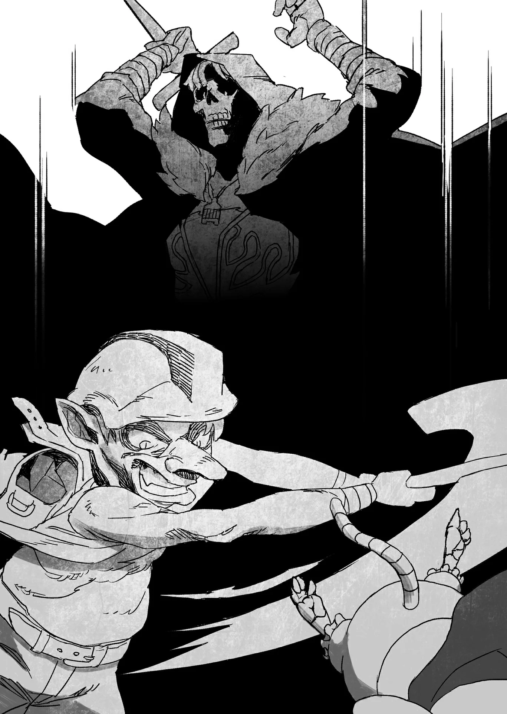

# Chương 96: Tập 4 Chương 2 - Nguyên Liệu Chế Tạo Vũ Khí Cho Đệ Tử (3)

Ngọn núi bay của tầng bốn được chia thành hai khu vực chính: một vách đá lộ thiên bên ngoài có phần gồ ghề, và một chuỗi các hang động thông nhau nằm sâu bên trong lòng núi. Những hang động này vừa đóng vai trò như lối đi lại vừa như các đường hầm, và mạo hiểm giả thường có thể thu thập đủ loại quặng lẫn đá quý từ bên trong đó.

Đó chính là mục tiêu của tôi.

Bởi tôi muốn chế tạo và tặng cho Alize một loại kiếm kim loại nhẹ nào đó, nên tầng bốn là địa điểm hoàn hảo để thu thập các loại quặng và kim loại cần thiết.

Tôi tiếp tục leo lên ngọn núi bay. Chẳng mấy chốc, tôi đã tìm thấy một lối vào, và sau khi xác nhận không có quái vật nào ở khu vực lân cận, tôi cẩn thận và lặng lẽ luồn vào bên trong hang động.

◆◇◆◇◆

Cấu trúc của những đường hầm này tương đối phức tạp. Người ta bảo rằng nếu tiến quá sâu vào bên trong, mạo hiểm giả hoàn toàn có thể bị lạc và chẳng bao giờ quay trở lại được nữa.

Trong trường hợp bình thường, một tấm bản đồ vẽ chi tiết phần bên trong phức tạp là thứ bắt buộc để định hướng, và một mạo hiểm giả thông thường dĩ nhiên sẽ phải bỏ tiền mua một vật phẩm như vậy. Tôi thì khác, tôi sở hữu Bản Đồ Akasha. Dù nó chỉ hiển thị những khu vực mà đích thân tôi đã thám hiểm qua, nhưng giờ đây tôi hoàn toàn không có khả năng bị lạc. Việc không phải tốn tiền mua thêm bản đồ thương mại cũng là một điểm cộng. Đổi lại, những ghi chú và các địa điểm đáng chú ý thường thấy trên bản đồ bán ngoài thị trường lại không hề hiển thị với tôi, bao gồm cả các khu vực người ta thường có thể đào quặng. Tôi đoán mình sẽ phải tự thân vận động tìm kiếm tất cả những vị trí này thôi.

Tiếp tục rảo bước dọc theo các đường hầm, tôi bắt gặp một vách đá bị sập một phần. Nếu phải đoán, hẳn đã có ai đó đào quặng tại chính vị trí này trước tôi. Tuy một số vị trí như thế này còn lưu lại dấu vết khai thác của người khác, nhưng phần lớn thì không. Dẫu vậy, khả năng quặng vẫn còn sót lại trong khu vực này vẫn rất cao.

Tôi rút một vật nhỏ trông như tấm ván từ trong túi ma thuật của mình ra. Đó là một tấm bảng gỗ rẻ tiền, một dụng cụ có khả năng phản ứng với những dấu vết ma thuật yếu ớt. Bản thân nó cũng là một loại ma cụ.

Tôi giơ nó lên khe hở trên vách đá trước mặt. Sau khi kiên nhẫn chờ đợi một hồi lâu, tôi cảm nhận tấm bảng khẽ rung lên một chút đồng thời tỏa ra ánh sáng mờ nhạt. Nhờ đó, tôi hiểu ra một điều: thứ quặng mà mình cất công tìm kiếm bấy lâu nay quả thực đang nằm đâu đó trong những bức tường đá này.

Cụ thể hơn, thứ tôi đang tìm kiếm là một loại kim loại có tên gọi là "Ma Thiết". Nó cứng hơn nhiều so với sắt thông thường, đồng thời nhìn chung còn có độ tương thích ma lực rất tốt. Đó là một loại kim loại tương đối đắt đỏ.

Ma Thiết sở hữu vài đặc tính khá thú vị. Nếu một người dẫn truyền ma lực qua nó, một phần ma lực sẽ bị kim loại này hấp thụ, còn phần còn lại sẽ bị phản xạ và đẩy ra ngoài. Chính hiện tượng đẩy ma lực này là thứ mà tấm bảng trên tay tôi đang phản ứng lại. Tôi chắc chắn sẽ tìm thấy một ít Ma Thiết nếu chịu khó đào sâu hơn vào bức tường sụp lở một phần này.

Giá như tôi đạt tới trình độ của Lorraine, tôi sẽ có thể liếc mắt một cái là nhận ra ngay vật thể đó có chứa ma lực hay không—nhưng dĩ nhiên, kỳ tích cỡ đó vượt xa tầm với của tôi rồi.

Rút chiếc cuốc chim từ trong túi ra, tôi quay người đối diện với vách đá, lấy thế chuẩn bị.

Đã đến lúc lấy thứ mình cần rồi.

Những tiếng leng keng chát chúa của kim loại va vào đá vang vọng khắp các đường hầm khi tôi tiếp tục đào khoét vách đá.

Chiếc cuốc chim chuyên dụng này được chế tạo để có khả năng chịu tải ma lực. Nhờ đó, người dùng có thể truyền ma lực vào nó và tiếp tục đào bới mà không gặp bất kỳ trở ngại nào.

Tôi kiên trì đào sâu hơn vào vách đá. Nếu việc này kéo dài quá lâu, tôi rất có thể sẽ không đủ ma lực... Nhưng với tốc độ này thì chắc mọi chuyện sẽ ổn thôi.

Tôi hy vọng là vậy.

Một lúc sau, một tia sáng mờ nhạt lấp lánh phía sau vách đá lọt vào mắt tôi. Đó dường như là một mạch quặng nào đó—thứ quặng chứa Ma Thiết mà tôi đang tìm kiếm.

Tôi đẩy nhanh tốc độ đào bới. Những bức tường màu tro xám trở nên cứng hơn thấy rõ khi tôi tiếp tục đào sâu vào trong, nhưng với sức mạnh phi phàm phi nhân loại hiện tại cùng lượng ma lực đang cuộn chảy trong huyết quản, mấy tầng đá hơi cứng một chút này khó lòng làm khó được tôi.

Tôi đã có thể khai thác được phần quặng mình cần một cách dễ dàng đến đáng ngạc nhiên. Tuy nhiên...

"Chất lượng quả thực chẳng ra sao..."

Tôi xoay xoay khối quặng chứa Ma Thiết trên tay. Hầu hết khối quặng này chỉ toàn tạp chất mà tôi không cần, và chỉ một cái liếc mắt cũng đủ để tôi nhận ra điều đó.

Nếu tôi sử dụng thứ nguyên liệu này, tôi sẽ phải khai thác một lượng cực kỳ lớn mới có thể chiết xuất ra được chút Ma Thiết nào đó, và người ta cũng khó lòng chế tạo ra một món vũ khí ra hồn với chất lượng quặng cỡ này. Tôi không hề nhắm tới việc tạo ra một thứ vũ khí thủ công bậc thầy vượt xa tiêu chuẩn thông thường, nhưng khối quặng này đơn giản là... quá nhiều tạp chất so với mục đích của tôi. Dù nhìn chung tôi có thể chấp nhận một lượng tạp chất nhất định trong kim loại, nhưng chất lượng của mạch quặng này thực sự quá kém cỏi.

Đúng là khối quặng này do tôi đã bỏ không ít công sức đào bới mới có được, nhưng dẫu vậy, tôi vẫn bỏ mặc nó nằm lại trên mặt đất, quyết tâm tìm kiếm một mạch quặng tốt hơn.

Tuy nhiên, tôi chẳng hề cảm thấy thất vọng. Thực ra, tôi đã lường trước điều này ở một mức độ nhất định rồi. Nghe đồn quặng trên ngọn núi bay này càng vào sâu trong các đường hầm thì độ tinh khiết và chất lượng sẽ càng cao, nên tôi đã biết tàm tạm rằng một điểm khai thác nằm tương đối gần lối vào sẽ không mang lại nhiều kết quả. Dù vậy, tôi vẫn muốn đích thân đào thử ít nhất một lần để xác nhận những gì mình đã nghe ngóng trước khi tiếp tục tiến bước.

Tôi đoán điều này vốn là lẽ dĩ nhiên đối với một mê cung—người ta sẽ chẳng bao giờ biết được nó cất giấu những gì nếu không chịu dấn thân vào những tầng sâu thẳm nhất bên trong.

◆◇◆◇◆

Tôi cảm giác như mình vừa thấy thứ gì đó thoáng chập chờn nơi khóe mắt—một hình bóng, hay có lẽ là một cái bóng đen. Có ai khác ở đây chăng? Việc có những mạo hiểm giả khác hiện diện ở nơi này cũng chẳng phải chuyện gì lạ lùng.

Thế nhưng... có điều gì đó rất bất thường. Cứ như thể chính sự tồn tại của sinh mệnh này... đang bất ổn định vậy. Tôi cũng không thể nói chắc chắn được.

Dù sao đi nữa, tôi nghĩ mình nên tự mình đến xem sao...

Nhưng mà... không được. Chính vì tính tò mò mà ngay từ đầu tôi mới rơi vào cái cảnh mang thân xác như thế này. Đáng lẽ tôi phải đặt sự an toàn của bản thân lên trên hết mới phải...

Ít nhất thì tôi đã nghĩ như vậy. Nhưng chẳng mấy chốc, tôi, Rentt Faina, lại một lần nữa đầu hàng trước tính hiếu kỳ của mình. Nếu không có cái tính cách ấy, tôi đã chẳng phải trải qua tất cả những biến cố cho đến tận bây giờ. Cơ mà tôi đoán việc mình hành động như thế này vốn dĩ là chuyện đương nhiên rồi.

Tất cả những gì tôi cần làm chỉ là lập tức bỏ chạy ngay khi có bất kỳ dấu hiệu nguy hiểm nào. Xét tới lượng năng lượng mà tôi đã tiêu hao từ nãy đến giờ, tôi hoàn toàn có thể tự tin khẳng định mình đủ sức chạy trốn với tốc độ tương đối ổn thỏa.

Nhưng dĩ nhiên, sẽ là cam go nhất nếu tôi lại đụng phải một con rồng nào đó thêm lần nữa. Dù đó chỉ là một sự xui xẻo hy hữu một lần trong đời thôi. Tôi đoán một chuyện như thế hẳn sẽ không lặp lại đâu.

Tôi tiến lại gần nơi mình vừa thoáng thấy cái bóng.

Thế nhưng...

Chẳng có ai ở đó cả. Có lẽ chỉ là do tôi tưởng tượng ra thôi...

"...Ngươi là ai? Từ đâu tới đây?" một giọng nói cất lên từ phía sau lưng tôi.

Giật bắn mình, tôi lập tức quay phắt lại, chỉ để nhìn thấy một cô bé đang đứng trước mặt mình.

Cô bé trông... còn rất nhỏ. Có lẽ chỉ tầm khoảng năm hoặc sáu tuổi.

Thế nhưng khí chất toát ra từ cô bé lại chẳng hề giống một đứa trẻ con chút nào. Ánh mắt cô bé ngập tràn vẻ nghi hoặc, thậm chí là bực bội. Đó là nét biểu cảm mà chỉ người lớn mới có thể lộ ra.

Tôi bối rối không biết phải nói gì, miệng há hốc trong lúc chật vật tìm kiếm từ ngữ thích hợp. Đúng lúc ấy...

"...Ta không biết. Không... Ta... Ta là..."

Lại có một giọng nói khác vang lên từ phía sau lưng tôi. Không phải giọng phát ra từ cổ họng tôi.

Có vẻ như còn có một người khác ở phía sau lưng, nên tôi quay người lại—để rồi chạm mặt một kẻ kỳ dị, khoác trên mình một chiếc áo choàng cũ kỹ rách rưới tả tơi.

Kẻ khoác áo choàng kia trông chẳng hề bình thường chút nào. Nhìn chăm chú vào người đó, tôi bất giác cảm thấy đối phương là một sự tồn tại dị thường mà mình không bao giờ có thể thấu hiểu được, và cõi lòng tôi tràn ngập một cảm giác bất an sâu sắc. Có vẻ như kẻ đó đang suy nghĩ, chìm đắm trong dòng tâm tưởng trước câu hỏi của cô bé.

Rốt cuộc người này là ai chứ...

Khi ý nghĩ ấy vừa lướt qua tâm trí tôi, cô bé liền bước xuyên thẳng qua người tôi, tiếp tục cất lời với kẻ khoác áo choàng. Giờ đây khi quan sát cô bé từ một khoảng cách nhất định, tôi mới nhận thấy hình bóng cô bé có phần... trong suốt.

Liệu cô bé có thực sự tồn tại không? Hay đơn giản là cô bé không hiện diện bằng xương bằng thịt ở nơi này? Phải chăng đó là lý do cô bé không thể nhìn thấy tôi?

Quan sát kỹ hơn, kẻ khoác áo choàng dường như cũng có phần trong suốt.

"Không biết ư? Ngươi không biết mình từ đâu tới sao? Nhưng muốn tới được nơi này, hẳn ngươi phải đi từ nơi khác đến chứ... vậy mà lại không biết ư?" cô bé hỏi.

Bóng người khoác áo choàng lắc đầu. "Ta... Ta không biết. Ta không biết. Ta không biết... gì cả. Ta... Ta là ai? Ta là thứ gì? Đây là đâu?!"

Khi kẻ đó cất tiếng hét, sự run rẩy càng trở nên dữ dội hơn. Ngay sau đó, chiếc mũ trùm trên đầu bị hất tung rơi hẳn ra ngoài.

...Khoan đã nào.

Tôi không hề ngờ rằng mình lại chứng kiến một cảnh tượng như thế này. Tôi cảm thấy một sự kinh ngạc sâu sắc trào dâng từ tận đáy lòng.

Kẻ khoác áo choàng đứng trước mặt tôi... lại là một Khô Lâu. Một Khô Lâu mang ánh sáng le lói trong hốc mắt... Một Khô Lâu có tư duy logic và khả năng suy luận. Trên hộp sọ của nó dường như có một hình xăm phức tạp, với những đường hoa văn phát ra ánh sáng xanh lam mờ ảo. Tôi chưa từng nhìn thấy một hình xăm như vậy bao giờ... Nhưng đây không thể nhầm lẫn vào đâu được... chính là một Khô Lâu.

Một Khô Lâu—loại quái vật rất giống với hình hài của chính tôi cách đây một khoảng thời gian.

...Đó rốt cuộc là ai chứ, tôi tự hỏi.

Bước một bước về phía trước, tôi tiến lại gần cả hai. Tôi muốn quan sát Khô Lâu khoác áo choàng kỳ lạ này ở cự ly gần hơn.

Đáng tiếc thay, như thể cảm nhận được ý định của tôi, bóng người khoác áo choàng dường như từ từ tiêu tán, nhạt nhòa khỏi thực tại, trước khi biến mất hoàn toàn vào cõi hư vô. Cô bé tra hỏi kẻ đó cũng biến mất theo, hình ảnh của cô bé dần dần mất đi màu sắc rồi tan biến vào cõi hư không. Tất cả những gì còn sót lại trong những đường hầm cằn cỗi chỉ là bản thân tôi cùng những vách đá lặng câm xung quanh. Đó là một cảm giác cô độc đến cùng cực, tựa như những gì vừa diễn ra trước mắt tôi chẳng qua chỉ là một ảo ảnh không hơn không kém.

"Rốt cuộc chuyện đó là sao chứ...?" Tôi bất giác lẩm bẩm.

Chẳng có ai đáp lại thắc mắc của tôi. Lời hồi đáp duy nhất chỉ là một tiếng vọng trống rỗng, khẽ khàng vang vọng qua các đường hầm.

Liệu những hiện tượng như thế này có thường xuyên xảy ra ở tầng bốn không?

Không... Điều đó hẳn là không thể nào. Nếu quả thực là vậy, thì đến giờ trong các quán rượu hẳn đã tràn ngập những lời đồn thổi về chuyện này rồi. Ít nhất thì tôi cũng phải nghe phong phanh về nó bằng cách này hay cách khác chứ.

Vậy thì... liệu có khả năng hiện tượng kỳ lạ này xảy ra chỉ vì thân phận hiện tại của tôi hay không?

Tại sao lại như thế được chứ...? Đó chỉ là sự trùng hợp ngẫu nhiên thôi sao? Hay đây là điều tất yếu chắc chắn phải xảy ra?

Tôi chẳng có cách nào biết được.

Sau khi ngẫm nghĩ về vấn đề này một hồi, tôi đành bỏ cuộc khi nhận ra mình đơn giản là chẳng có câu trả lời nào. Tôi đoán mình có thể suy nghĩ về chuyện đó vào một dịp khác.

Trên thế gian này có biết bao điều không thể giải thích nổi—những bí ẩn chưa có lời giải, bao gồm cả nguyên nhân khiến tôi biến thành Undead. Việc phân định rạch ròi giữa điều mình có thể biết và điều mình có lẽ chẳng bao giờ biết được là rất quan trọng. Bản thân điều đó cũng là một kỹ năng sinh tồn thiết yếu.

Hiện tại, tôi phải tập trung vào việc mình cần làm: thu thập nguyên liệu.

Càng tiến sâu vào những đường hầm này, độ tinh khiết và chất lượng của Ma Thiết mà tôi tìm kiếm sẽ càng cao. Và vì vậy... tôi phải tiếp tục tiến bước về phía trước. Còn về chuyện đã xảy ra hôm nay, tôi đoán mình cứ tạm thời cất giấu nó vào một góc trong tim là được rồi.

◆◇◆◇◆

"Guuugyaaa!!!"

Một tiếng kêu phi nhân loại vang rền khắp các đường hầm.

Thanh kiếm của tôi lúc này đang cắm sâu vào mặt con quái vật trước mắt—khuôn mặt của một con Goblin Mỏ Quặng. Đáng lẽ tôi đã nhắm vào cổ nó, nhưng con quái vật lại nhanh nhẹn hơn tôi tưởng, và kết cục là nó đã né được đòn chí mạng.

Đúng như cái tên của mình, Goblin Mỏ Quặng khác biệt so với loài Goblin thông thường. Trước hết, chúng sinh sống ở những nơi dồi dào quặng, phổ biến là vùng đồi núi và các khu vực tương tự. Chúng còn sở hữu những kỹ năng độc đáo nhất định, cụ thể là nghề đúc rèn. Mặc dù chúng khó lòng có thể lành nghề như Người Lùn, và chẳng có khả năng tạo ra các dụng cụ chuẩn xác cùng ma cụ, nhưng chúng biết đủ kiến thức về đúc rèn để tạo ra kiếm, khiên và những thứ tương tự.

Điều này đồng nghĩa với việc hẳn phải có một phòng luyện kim nằm ở đâu đó trong ngọn núi này, dẫu tôi hoàn toàn không hay biết vị trí chính xác của nơi đó ở đâu. Dù các mạo hiểm giả trước đây đã từng nhiều lần định vị và phá hủy các phòng luyện kim nói trên, nhưng rốt cuộc một phòng luyện kim khác lại sẽ mọc lên thay thế.

Cơ sở hạ tầng ở quy mô như vậy dường như chẳng phải là một việc dễ dàng... Nhưng nghĩ lại thì, mê cung vốn là một nơi rộng lớn mênh mông. Nếu một người nghiêm túc muốn thám hiểm toàn bộ tầng bốn, người đó chắc chắn sẽ cần nhiều hơn một hay hai ngày. Có lẽ là vài tuần, hoặc thậm chí là vài tháng trời.

Dẫu vậy, việc có thể khám phá hết tất cả những gì nơi đây có được có lẽ vẫn là bất khả thi. Xét theo quy mô khổng lồ của tầng này, rất có khả năng vài phòng luyện kim như vậy đã được xây dựng dở dang sẵn, và nếu một phòng bị phá hủy, lũ goblin đó chỉ đơn giản là chuyển sang phòng tiếp theo. Nếu điều này quả thực là đúng, thì những phòng luyện kim này sẽ chẳng bao giờ bị xóa sổ hoàn toàn, bất kể bao nhiêu thời gian trôi qua đi chăng nữa. Tất cả những gì chúng cần làm chỉ là vận chuyển một số dụng cụ chuyên dụng từ địa điểm này sang địa điểm khác, vậy là xong.

Ít nhất thì Goblin Mỏ Quặng cũng có khả năng chế tạo các ma cụ đơn giản, và còn có thể ngăn chặn nhiệt độ cùng khói từ các phòng luyện kim này làm lộ vị trí của chúng. Điều đó khiến cho việc tìm kiếm một căn phòng như vậy trở nên vô cùng khó khăn. Nếu lũ Goblin này được trang bị những tri thức như thế, tại sao chúng không đơn giản là sống hòa bình với con người chứ, người ta có thể nghĩ như vậy, nhưng trong thực tế, quả thực có một số bộ tộc Goblin sinh sống theo cách thức đó.

Thế nhưng, Goblin Mỏ Quặng ở tầng bốn dường như lại mang một thứ lòng kiêu hãnh nào đó mà con người khó lòng hy vọng thấu hiểu được. Có lẽ đây chính là lý do khiến chúng không thể chung sống hòa bình với nhân loại nói chung.

Nhờ vào toàn bộ quá trình đúc rèn và chế tác của mình, Goblin Mỏ Quặng trông khác biệt so với loài Goblin thông thường, thường được vũ trang bằng áo giáp và vũ khí được chế tác tương đối tinh xảo. Ngay cả màu da của chúng cũng khác; có lẽ là một kiểu thích nghi tự nhiên với môi trường sống nhiều đất đá của mình. Da của Goblin Mỏ Quặng có màu nâu đất, khác hẳn với làn da xanh lá của Goblin thông thường. Chúng cũng vạm vỡ hơn đáng kể, có lẽ là nhờ toàn bộ số quặng mà chúng đã khai thác vào lúc rảnh rỗi.

Nếu Goblin thông thường là lũ nhóc tì nhỏ thó phiền toái chỉ biết cắn trộm mắt cá chân, thì Goblin Mỏ Quặng lại rất giống những con khỉ đột thu nhỏ nhưng cơ bắp cuồn cuộn.

Thực sự kinh hãi.

Tốc độ vung đòn của chúng, kết hợp với sức mạnh cơ bắp tuyệt đối, đồng nghĩa với việc Goblin Mỏ Quặng là những đối thủ đáng gờm hơn nhiều so với Lizardman. Tệ hơn nữa, chúng còn được huấn luyện sử dụng binh khí, và từng cử động đều toát ra trình độ võ thuật nhất định.

Dù đã dính một vết thương từ lưỡi kiếm của tôi, con Goblin chẳng mấy chốc đã thoát khỏi cơn hoảng loạn, lập tức lấy lại bình tĩnh và trừng mắt đầy đe dọa về phía tôi. Quả đúng như dự đoán, quái vật càng lúc càng trở nên khó tiêu diệt hơn khi người ta dấn thân vào các tầng sâu hơn...

Tôi chợt nghĩ rằng việc ở lại đây một thời gian và hấp thu sinh mệnh lực của lũ quái vật này cũng chẳng phải là một ý tồi. Ý tôi không phải là mình chưa trở nên mạnh hơn, nhưng có lẽ nhịp độ đi xuống các tầng sâu của tôi hơi quá nhanh. Đáng lẽ tôi nên tự lượng sức mình trước khi quyết định đi một mạch xuống tận tầng bốn, nhưng giờ mà nghĩ ngợi những chuyện đó thì cũng đã hơi muộn màng rồi.

Dẫu vậy, tôi vẫn chưa phải chịu bất kỳ vết thương nghiêm trọng nào, và tôi vẫn đang xoay xở để chiến đấu với kẻ địch ở thế tương đối ngang ngửa, dù có phần căng thẳng. Mọi chuyện quả thực sẽ rất tệ nếu tôi quyết định tiến sâu hơn nữa.

Hay có lẽ tôi nên chiến đấu ở mức độ khó khăn đó, và biết đâu lại chạm tới những tầm cao trưởng thành mới bằng cách liên tục đặt mình vào vòng nguy hiểm...? Không, không được. Làm thế thì quá đỗi liều lĩnh.

Dù sao đi nữa, những suy nghĩ đó tốt hơn hết là nên để về nhà rồi hẵng bận tâm. Hiện tại, điều quan trọng hơn là phải xử lý con Goblin Mỏ Quặng trước mắt này đã.

Nó đang cầm một cây rìu hai tay lớn trên tay, thứ vũ khí mà tôi sẽ thấy rất khó khống chế, chứ đừng nói đến chuyện vung vẩy chung quanh. Thế nhưng đối với con Goblin Mỏ Quặng, cây rìu này có lẽ chẳng nặng nề chút nào.

Thứ vũ khí ấy trông thật thô thiển; nó không những nặng nề mà còn khó kiểm soát... Vậy mà con Goblin Mỏ Quặng dường như đã thuần thục nó từ lâu lắm rồi. Nó dùng mặt phẳng của lưỡi rìu để đỡ những nhát chém của tôi, biến món vũ khí hai tay của mình thành một chiếc khiên chắn tạm thời. Khi lưỡi kiếm của tôi bật ra khỏi bề mặt rìu, nó sẽ lập tức phản công ngay.

"...Hự!"

Tôi vừa né được một cú vung rìu của con quái vật trong đường tơ kẽ tóc, vậy mà con Goblin Mỏ Quặng vẫn không hề giảm bớt nhịp độ tấn công. Con Goblin nắm chặt cây rìu, bổ thẳng xuống như muốn bổ đôi người tôi ra làm hai nửa gọn gàng. Dù bản thân tôi không dám chắc liệu thân thể hiện tại của mình có dễ bị chém đứt phăng ra như thế hay không, nhưng tôi chẳng hề hào hứng muốn đích thân nếm trải điều đó chút nào.

Thế rồi, tôi chợt nhận ra rằng cái chết hoàn toàn có thể gõ cửa tìm đến mình vào bất cứ khoảnh khắc nào.

Tôi hơi hoảng hốt né tránh hết sức bình sinh, nôn nóng muốn tránh khỏi lưỡi rìu hai tay đang giáng xuống. Tuy nhiên, cú né của tôi không hoàn hảo, và lưỡi của thứ vũ khí đã sượt qua má tôi. Một vệt rách mảnh khẽ hằn lên khuôn mặt tôi... trước khi lành lại chỉ trong vài giây, biến mất hoàn toàn không để lại dấu vết.

Có vẻ như lúc này tôi đã sở hữu khả năng hồi phục tương đối nhanh chóng trước những vết chém nhẹ.

Dù vậy, tôi quả thực có cảm nhận được một cảm giác mệt mỏi nhẹ từ chuyện đó. Đúng là tôi có thể tự chữa lành, nhưng có những rủi ro rõ ràng đi kèm trong quá trình ấy. Xét cho cùng, những mạo hiểm giả từng thực sự đối đầu với Ma Cà Rồng đều khẳng định rằng chúng thường lập tức lành lặn trở lại sau khi chịu hầu hết các vết thương do đao kiếm chém phải.

Tuy Hạ Cấp Ma Cà Rồng cũng sở hữu những đặc tính tái sinh này, nhưng cơn mệt mỏi nhói lên mà tôi vừa cảm thấy rất có thể là dấu hiệu cho thấy khả năng tái sinh của tôi có giới hạn... nhất là nếu tôi phải chịu những vết thương khủng khiếp. Tôi đoán ngay cả Ma Cà Rồng cũng chẳng thể tái sinh vô tận được...

Dù tôi không biết có ai từng tiến hành thử nghiệm để xác nhận điều này hay chưa, cũng như chẳng hề có ghi chép nào nói về điều đó, nhưng phần lớn những người chọn chiến đấu với Ma Cà Rồng thường quyết định nhắm thẳng vào điểm yếu của chúng. Trong trường hợp như vậy, giới hạn tái sinh thực ra cũng chẳng quan trọng lắm. Rốt cuộc thì chẳng ai lại rảnh rỗi đi tiêu diệt một con Ma Cà Rồng bằng một phương pháp vòng vo hơn cả.

Dù vết thương của tôi khá nhẹ, nhưng lực tác động từ cú đánh lại rất lớn, và tôi lăn lông lốc một đoạn trước khi lấy lại thăng bằng, một lần nữa giương lưỡi kiếm về phía con Goblin Mỏ Quặng. Xác nhận tôi sắp sửa tung ra một đòn tấn công, con Goblin Mỏ Quặng lại giơ mặt phẳng của lưỡi rìu lên, như thể muốn phòng ngự—

"...Gyaaaahh!" con Goblin Mỏ Quặng thét lên khi bất ngờ vung cây rìu ra phía sau.

Cái gì...? Tôi định nhìn cho rõ hơn thì phát hiện ra Edel đang ở đó. Quyến thuộc của tôi vừa phóng một ma pháp về phía con quái thú: Phong Đao. Thế nhưng vào thời điểm con Goblin kịp vung rìu quay lại, Edel đã lùi ra một khoảng cách an toàn, khiến tôi vô cùng nhẹ nhõm.

Khi con Goblin lúc này đã bị phân tâm hoàn toàn, tôi chớp lấy thời cơ, lao vọt về phía trước và vung lưỡi kiếm nhắm thẳng vào phần đầu đang sơ hở của nó. Món vũ khí của tôi chém sâu vào trong, làm vỡ nát hộp sọ của nó trước khi xẻ đôi người con Goblin ra làm hai nửa gọn gàng.

Với một cơn co giật run rẩy, con Goblin Mỏ Quặng đổ gục xuống mặt đất, máu tươi phun xối xả từ cái xác đã đứt lìa nằm trên mặt đất.
