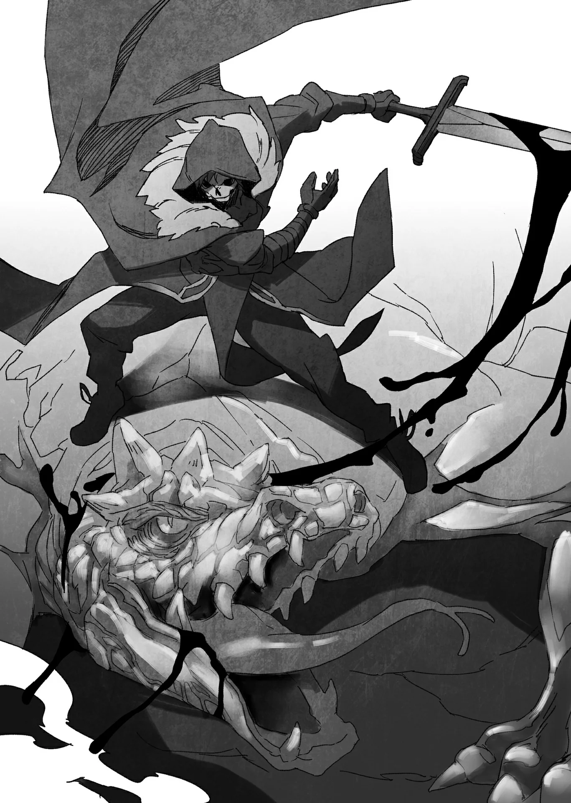

# Chương 97: Tập 4 Chương 2 - Nguyên Liệu Chế Tạo Vũ Khí Cho Đệ Tử (4)

Dù đã bắt tay vào mổ xác con Goblin Mỏ Quặng, nhưng chẳng mấy chốc tôi nhận ra trên người nó chẳng bới ra được bao nhiêu thứ. Vũ khí và trang bị của nó, cùng viên Ma Tinh nằm gần tim thì còn có ích, chứ phần xác còn lại thì chẳng dùng vào việc gì được.

Cắt tai phải mang về lĩnh thưởng cũng được, dù hiện tại ở Hội chẳng có ủy thác săn lùng nào. Ngay từ đầu tôi còn chẳng nhớ nổi từng thấy ủy thác kiểu đó bao giờ chưa, nên đem về chắc cũng chỉ phí công, nhưng dẫu vậy tôi vẫn quyết định cứ cắt lấy cái tai. Dù sao một cái tai cũng chẳng tốn mấy chỗ trong túi.

Còn về vũ khí và trang bị... Chà, dù đúng là chúng được rèn từ Ma Thiết đào trong mấy đường hầm này, nhưng tay nghề rèn của Goblin chẳng có gì ấn tượng. Độ tinh khiết của quặng lẫn cách gia công vũ khí còn quá nhiều điểm trừ. Đã vậy cây rìu lại chỉ vừa cỡ tay Goblin, nên có vác về cũng chẳng bán được bao nhiêu.

Về lý thì nung chảy cây rìu rồi tái sử dụng số kim loại đó cũng được, nhưng lại tốn thêm thời gian với công sức để tinh luyện lại. Tính đi tính lại, vác thẳng một tảng quặng chứa Ma Thiết tới cho thợ rèn xem ra còn đỡ tốn kém hơn.

Tôi quyết định cứ để mặc cây rìu nằm đấy.

Bù lại, viên Ma Tinh có kích cỡ lẫn phẩm chất khá ổn, nên tôi lập tức cất vào túi. Viên tinh thể này có thể dùng làm nguyên liệu chế tạo đũa phép... còn nếu không được thì đem bán lấy chút tiền cũng chẳng thiệt.

Dẫu vậy... tôi nghĩ xác một con Goblin Mỏ Quặng chắc cũng chỉ vớt vát được đến thế là cùng.

Xong xuôi, tôi lại cất bước, tiếp tục hành trình lần mò trong các đường hầm.

◆◇◆◇◆

Tôi cảm giác mình đã đi khá sâu vào trong lòng núi. Càng tiến bước, không khí xung quanh càng trở nên tù đọng, ngột ngạt.

Với địa hình đường hầm thế này, chuyện một vài đoạn đặc quánh khí độc là hoàn toàn có thể xảy ra. Tuy nồng độ bình thường không cao, nhưng tôi từng nghe nói thỉnh thoảng có những đoạn hầm phải phong tỏa vì lượng khí độc đột ngột tăng vọt. Dù hiện tại Hội không đưa ra cảnh báo nào, tôi cũng chẳng thể dám chắc những đường hầm này tuyệt đối không có khí độc.

Tóm lại, cứ mặc định là khu vực xung quanh ít nhiều đều có độc cho chắc ăn.

Nhưng tôi lại kháng mấy loại độc này cực tốt. Ngay từ hồi còn là Ngạ Quỷ, tôi đã miễn nhiễm hoàn toàn với đủ thứ độc rồi. Chắc lúc còn làm Khô Lâu cũng chẳng khác là bao.

Dù sau đó đã tiến hóa thành Hạ Cấp Ma Cà Rồng, khả năng kháng độc của tôi dường như chẳng hề suy giảm. Những lúc thế này mới thấy biết ơn cái thân xác hiện tại. Nhờ vậy mà tôi có thể bước tiếp mà chẳng gặp trở ngại nào.

Tôi đâu dám ảo tưởng mình toàn năng hay bất tử, bởi chuyện khả năng hồi phục có giới hạn đã nhắc tôi nhớ rõ điều đó. Có điều dạo gần đây hình như tôi hơi liều thật, cứ nghĩ mình làm mấy việc chết người cũng chẳng sao, coi thường nguy hiểm chỉ vì bản thân là Undead. Chẳng biết có phải tôi đã dần chai sạn trước hiểm nguy... Không, nếu phải diễn tả cho đúng thì nó giống một linh cảm hơn, linh cảm rằng chừng này chưa đủ để lấy mạng tôi.

Có lẽ do tôi quá tự tin vào năng lực của mình, hoặc cũng có thể là phản ứng sinh ra từ thân phận của một kẻ thuộc hàng ngũ xác sống. Dù sao thì trường hợp này xem chừng nghiêng về vế đầu nhiều hơn, nên tôi liền chậm bước lại, thận trọng vừa đi vừa dòm ngó xung quanh. Mạo hiểm giả nhát gan mới là kẻ sống thọ nhất, người ta vẫn thường bảo thế mà.

Cuối cùng, một cánh cửa đôi đồ sộ hiện ra trước mắt tôi.

Chà, giờ thì... tính sao đây nhỉ?

Hay đúng hơn là giờ nên làm gì mới phải? Cánh cửa này rõ ràng là lối vào phòng thủ lĩnh. Liệu cứ thế bước vào có ổn không?

Trực giác Undead cứ thúc giục tôi không thôi. Đi tiếp thôi. Vào trong luôn đi nào, nó bảo thế. Nhưng kinh nghiệm mạo hiểm giả nhiều năm lại can ngăn, nhắc tôi nên săn thêm vài con quái quanh khu này rồi hẵng tính. Đó chắc chắn là phương án an toàn hơn.

Nhưng mà... chắc chẳng đến nỗi đâu.

Vậy thì... cứ vào thôi.

Có biến thì cùng lắm lại co giò chạy về chỗ này là xong.

Đúng là phòng thủ lĩnh thật, nhưng tôi khó lòng tưởng tượng nổi ở tầng bốn lại có căn phòng bẫy chết người không đường lui. Bình thường loại phòng đó chỉ xuất hiện ở tầm tầng bốn mươi trở xuống. Dù xét căn phòng tôi từng đụng độ ở Mê Cung Nguyệt Ảnh thì khó mà coi đây là quy tắc bất di bất dịch, nhưng dẫu sao chuyện đó cũng chỉ là ngoại lệ hiếm hoi chứ chẳng phải lẽ thường.

Khác với bận trước, tôi đâu có mò vào lối đi bí mật nào, cũng chẳng bị dịch chuyển đi đâu rồi phải vượt qua cả đống chướng ngại mới tới được đây. Cánh cửa này cứ thế sừng sững ngay trước mắt, lồ lộ ra đấy thôi. Nếu thực sự có cơ quan phức tạp nào, hẳn các mạo hiểm giả hay lui tới tầng này đã bàn tán rôm rả từ lâu rồi.

Nghĩ đi nghĩ lại, tôi kết luận đây khó lòng là một căn phòng đặc biệt. Tuyệt đối không thể nào... vậy nên bước vào chắc cũng chẳng sao.

Tôi tự nhủ đi nhủ lại câu đó trong lúc đặt tay lên cánh cửa.

Tôi đang chủ quan ư? Liều lĩnh chăng? Hay chỉ đơn thuần là thấy bồn chồn? Thế mà chẳng hiểu sao tôi lại có linh cảm rằng riêng phòng thủ lĩnh này sẽ chẳng mấy nguy hiểm.

Ít nhất thì... đây cũng là nơi muốn rút lui lúc nào cũng được.

Dù vậy tôi vẫn gợn lên chút cảm giác sai sai. Do cái gọi là trực giác Undead chăng?

Làm mạo hiểm giả thì chuyện bất thường quái gở gặp như cơm bữa. Nếu cứ câu nệ từng li từng tí rồi lần lữa mãi, tôi sẽ chẳng làm nên trò trống gì.

Thế nên... chắc ổn thôi. Tôi không sai, cũng chẳng hề liều lĩnh.

Tôi dồn lực đẩy mạnh cánh cửa, lặng lẽ nhìn nó mở toang cùng một tiếng rầm trầm đục.

À. Hóa ra đúng là một phòng thủ lĩnh bình thường.

◆◇◆◇◆

Liếc qua khe cửa, xem chừng những phán đoán của tôi cơ bản đều chuẩn xác.

Có điều, con quái vật thủ lĩnh nằm sừng sững giữa phòng lại hơi có vấn đề. Thân hình hộ pháp, lớp vảy bóng loáng, bốn chân bám chặt nền đá, cùng một chiếc sừng lớn kết bằng quặng và đá tảng trên đầu... Tất cả như muốn phô trương trọn vẹn sức mạnh của nó. Chỉ liếc qua cũng đủ biết kẻ này tuyệt đối không dễ xơi: trước mắt tôi chính là một con Terra Drake.

Nó là một dạng Á Long, chính xác hơn là một phân loài ưa sống dưới lòng đất. Dù chỉ là phân loài cấp thấp, nhưng dẫu sao vẫn mang dòng máu Rồng; xét mặt bằng chung, sức mạnh của nó cực kỳ đáng gờm. Đáng lẽ loài quái vật này hiếm khi xuất hiện ở tầng bốn, nhưng khả năng gặp phải nó ở đây vẫn hoàn toàn có thể xảy ra.

Dù sao thì con Terra Drake giữa phòng cũng không quá khổng lồ. So với tôi thì nó to thật đấy, nhưng nếu đặt cạnh một con Rồng trưởng thành thì nó nhỏ hơn nhiều, chỉ bằng chừng một phần tư. Nhắm chừng... nó dài khoảng bốn mét. Nếu vậy thì... biết đâu tôi vẫn có cửa đối phó được với con Drake này.

Dẫu vậy... tôi vẫn thấy kích cỡ của nó hơi lạ. Thường thì các giống Rồng càng sống lâu càng to lớn và mạnh mẽ. Thấy con Drake này nhỏ hơn hẳn một con Rồng trưởng thành, tôi đoán sức mạnh của nó chưa đến mức áp đảo hoàn toàn.

Vừa đảo mắt đánh giá con Terra Drake, tôi vừa cân nhắc kỹ lưỡng mọi bề.

Tôi liếc về phía cánh cửa. Cửa không dày lắm. Cùng đường thì tôi vẫn có thể phá cửa tháo chạy.

Nghĩ vậy, tôi có cơ sở để tin rằng đây không phải loại phòng thủ lĩnh nhốt chết người. Dĩ nhiên không loại trừ khả năng cửa làm từ chất liệu đặc biệt nào đó khiến nó khó lòng bị phá hủy, nhưng nhìn qua thì trông nó cũng chẳng khác mấy so với vách đá xung quanh.

Trận đánh chưa bắt đầu mà đã tính đường tháo chạy nghe hơi buồn cười, nhưng đây cũng là một phần chiến lược tối quan trọng. Nắm rõ mọi chuyện rồi thì... triển thôi.

Xốc lại tinh thần, tôi chậm rãi bước vào phòng. Dù tôi đã tiến gần đến giữa phòng, cánh cửa vẫn chẳng có dấu hiệu khép lại. Đúng như dự đoán, muốn chạy trốn khỏi trận này là hoàn toàn khả thi.

Thấy thế tôi mới thở phào nhẹ nhõm. Tôi từ tốn tuốt kiếm, bắt đầu dẫn Ma Lực vào lưỡi thép.

Vào thế sẵn sàng nghênh chiến.

Con Terra Drake bốn chân chẳng hề nhúc nhích lấy một phân, chỉ trừng trừng nhìn về phía tôi. Chắc nó đang dò xét, hoặc đợi tôi tới gần hơn. Đằng nào thì điều đó cũng có nghĩa là tôi nên ra tay trước... hoặc ít ra lúc đó tôi tưởng vậy.

Tôi từ từ tăng tốc rồi lao vút lên. Đúng lúc đang bứt tốc...

"...GUURRRGGYYYAAAAAA!!!"

Một tiếng gầm xé tai vang lên từ cuống họng nó.

Nhưng chừng đó không cản nổi tôi. Chẳng chút chần chừ, tôi nhắm thẳng đầu con quái thú, vung kiếm ngay khi vừa áp sát. Ngặt nỗi...

Keng!

Kèm theo tiếng kim loại chát chúa, lưỡi kiếm của tôi khựng lại. Con Terra Drake đã đỡ được đòn tấn công.

Nhưng chuyện này chẳng liên quan gì đến độ cứng của vảy. Đã là phân loài Á Long thì da vảy cứng chắc là điều đương nhiên, ai cũng đoán được. Bản thân tôi cũng thừa biết trước khi vung kiếm rồi.

Dù trước giờ chưa từng thực sự giao chiến với Terra Drake, chí ít tôi cũng có chút hiểu biết về giống loài này, kể cả khả năng phòng ngự tự nhiên của nó. Chính vì thế tôi mới dồn nhiều Ma Lực vào vũ khí và cơ thể hơn hẳn mọi khi.

Thế mà con quái vật vẫn chặn đứng nhát kiếm của tôi. Ngay lúc tôi vung kiếm chém xuống, một thứ tựa như tấm khiên bằng đất đá đã trồi lên bọc lấy đầu con Terra Drake. Tấm khiên trông như chiếc mũ giáp sắt ấy được tạo thành từ đất đá vương vãi gần đó, gần như chắc chắn là do nó vừa tức tốc ngưng tụ lại khi tôi ra tay.

Đây đích thị là ma pháp, lại còn do quái vật thi triển.

Chính xác thì đây là ma pháp nguyên tố. So với ma thuật con người dùng ngày nay, ma pháp nguyên tố đã có từ rất lâu đời, nhưng độ hữu dụng cùng uy lực của nó thì không thể xem nhẹ. Khi dùng ma thuật, thần chú rất có ích nhưng việc định hình hình ảnh ma pháp trong đầu cũng quan trọng chẳng kém. Ngược lại, ma pháp nguyên tố bắt nguồn từ các hiện tượng tự nhiên nên cực kỳ dễ hình dung.

Chưa kể, ma pháp nguyên tố còn có thể phát huy tác dụng theo nhiều cách rất lợi hại, mà thứ tôi vừa tận mắt chứng kiến là một ví dụ.

Đó là khả năng biến môi trường xung quanh thành vũ khí. Chẳng hạn, nếu dùng ma pháp nguyên tố thổ ở nơi sẵn đất đá, việc tận dụng chúng xung quanh sẽ rất dễ dàng. Lượng Ma Lực cần dùng nhờ thế cũng giảm bớt, lại còn tăng được sức công phá hay cường hóa thêm cho phép thuật. Con Terra Drake trước mắt chính là làm theo cách đó. Nó gom đất đá quanh mình lại tạo thành tấm khiên đỡ đòn của tôi.

Nhìn địa hình xung quanh, nhiều khả năng đống đá nó vừa dùng có chứa quặng Ma Thiết với hàm lượng rất cao. Đống đá ấy lại được ma pháp của Terra Drake gia cố thêm, hèn gì tạo nên lớp phòng ngự kiên cố đến thế.

Dĩ nhiên tôi chẳng có bằng chứng xác thực nào cho điều đó, nhưng rõ ràng con Drake đã đỡ được đòn tấn công của tôi. Nghĩ theo lẽ thường một cách lý trí thì coi như ván này tèo rồi.

Tôi vừa đánh phủ đầu bằng một đòn dồn đẫm Ma Lực, một trong những đòn mạnh nhất tôi có thể tung ra, vậy mà con Drake lại đỡ nhẹ như không. Nhưng nếu bỏ cuộc ngay lúc này thì dù có tốn bao nhiêu năm nữa, tôi cũng đừng hòng với tới danh hiệu mạo hiểm giả Mithril Cấp.

Tôi vẫn còn nhiều chiêu chưa tung. Quân bài tẩy vẫn còn giấu kín, và tấm khiên đá kia biết đâu lại có điểm yếu chưa lộ ra.

Tôi tạm lùi lại, định bụng quan sát xem con Terra Drake tính giở trò gì tiếp theo. Như đọc được ý nghĩ của tôi, con Terra Drake lập tức lao thẳng tới đáp trả, áp sát với tốc độ kinh hoàng.

Vừa nhận ra tình thế nguy ngập thì con Drake đã lù lù ngay trước mặt. Hoảng hốt, tôi liều mạng lách sang một bên. Con Terra Drake phản ứng nhanh như chớp. Lấy thân hình đồ sộ làm trục, nó xoay người quất mạnh cái đuôi từ trên xéo xuống. Tưởng đã né kịp thì cái đuôi đã ập tới, chẳng cho tôi lấy một giây để thở. Không còn cách nào khác, tôi đành giơ bản kiếm lên đỡ. Đuôi con Drake đập thẳng vào người, hất tôi bay vút lên không trung.

Rầm!

Tôi đập sầm vào vách đá phát ra một tiếng vang dội, đá vụn rơi rào rào xuống xung quanh. Lực va đập mạnh đến khủng khiếp, đủ thấy uy lực của đòn vừa rồi ghê gớm cỡ nào.

Tệ hơn nữa là con Terra Drake chưa chịu dừng lại. Nó thừa thắng xông lên, lao thẳng tới chỗ tôi.

Phải tránh không để trúng thêm đòn nữa...

Đó là ý nghĩ duy nhất trong đầu tôi lúc này, khi toàn thân vẫn còn ê ẩm vì dư chấn từ cú va đập.

Nếu lại né sang bên thì kiểu gì cũng ăn thêm một cú quất đuôi nữa. Thế thì...

Tôi đứng im bất động, mặc cho con Drake hùng hổ xông lại gần. Một chân đặt lên vách đá, tôi canh đúng khoảnh khắc ngay trước khi nó húc trúng mình.

Mục tiêu của tôi là lưng nó.

Liệu mình có làm được không...?

Dòng chảy thời gian như bị kéo giãn ra, mỗi tích tắc trôi qua dài tựa thiên thu. Lúc này tôi đang ở vào thế nguy hiểm nhất.

Cùng lắm thì tôi có thể truyền Khí Lực vào cánh để vọt nhanh ra xa, nhưng làm vậy thì con Drake chắc chắn lại đuổi bám tiếp.

Cầu trời... phải được đấy.

Từng hạt cát của thời gian đông kết chầm chậm trôi đi.

Đầu con Terra Drake đã đến thật gần... Tôi từ từ duỗi chân, nhắm thẳng đỉnh đầu nó. Con quái vật vẫn chẳng hề hay biết.

Con Drake húc sầm vào chỗ tôi vừa đứng ban nãy, cuốn lên một đám bụi mù mịt che khuất tầm mắt nó.

Tôi thì khác, tôi chẳng phụ thuộc vào thị giác thông thường mà nhìn như phần lớn Undead: cảm nhận qua thân nhiệt.

Đúng là nhờ ơn cái thân xác này.

Thực ra, bị đập sầm vào vách đá mà chỉ hơi choáng váng qua loa cũng phần nhiều nhờ vào cơ thể này. Chứ người bình thường thì chắc chắn đã bỏ mạng từ đời nào rồi.

Tôi giẫm chân xuống, vững vàng đứng trên đỉnh đầu con Terra Drake. Ngay lúc đó, tôi đã giương cao kiếm, chém thẳng xuống.

Nếu bị con Drake phát hiện, tôi sẽ lộ sơ hở và ăn trọn đòn phản kích. Nhưng đây cũng là cơ hội ngàn vàng duy nhất của tôi. Chỉ cần chém trúng, tôi sẽ hạ gục được nó chỉ bằng một đòn.

Nghĩ thế, tôi vung kiếm chém xuống. Nhưng...

Lưỡi kiếm vừa cắm phập vào cổ nó, chỉ chút nữa thôi là xong chuyện, thì...

Gần như chớp mắt, một tấm khiên đá lập tức bọc lấy cổ nó, hất văng kiếm của tôi ra. Xem ra chưa thể kết liễu nó dễ dàng thế được, dù tôi cũng kịp để lại một vết thương khá sâu trên mình con quái vật.

Giờ thì rõ rồi, tấm khiên đá chẳng phải là không thể xuyên thủng. Nhưng rõ ràng đòn tương tự sẽ không ăn thua lần thứ hai.

Tôi nhanh chân chạy dọc sống lưng con Drake để lẩn khỏi tầm mắt nó. Đến cả Terra Drake cũng khó lòng xác định chính xác kẻ địch trên lưng mình. Dường như biết rõ điều đó, con Drake bắt đầu giãy giụa điên cuồng hòng hất tôi xuống.

Chắc nó sắp xoay vòng tại chỗ lần nữa, nhưng lúc này hai chân tôi đã vững vàng trên mặt đất. Tôi tiếp đất ngay sát hông con Drake, vừa vặn nhìn thấy phần bụng dưới của nó.

Chính là lúc này.

Nghĩ vậy, tôi dồn thật nhiều Ma Lực lẫn Khí Lực vào lưỡi kiếm. Đã đến lúc... Ma Khí Dung Hợp Thuật.

Vung kiếm một đường chém ngang thật rộng, tôi rạch ngọt qua phần bụng đang hở của con Drake. Khác hẳn lớp vảy cứng ngắc quanh cổ và lưng, da bụng Terra Drake mềm hơn nhiều nên chém vào rất ngọt. Dĩ nhiên một phần nhờ tôi dùng Dung Hợp Thuật, nhưng tôi không ngờ lưỡi kiếm lại lướt đi nhẹ tênh đến thế. Xem chừng đây chính là điểm yếu của nó.

Chi tiết này cũng từng được ghi trong cuốn bách khoa quái vật tôi từng đọc. Có điều để một con Drake chịu tự phơi bụng trước mặt kẻ thù là cực kỳ khó, khiến chỗ đó thành vị trí khó lòng đánh trúng. Lần này đúng là tôi gặp may.

Sức sống của con Terra Drake dai dẳng đến kinh ngạc. Bụng bị chém toạc ra mà nó vẫn chưa chịu chết. Nó gượng dậy ngay tức khắc rồi lại lao về phía tôi. Chỉ vài cú giậm chân, hàng loạt ngọn thương đất đá liền trồi lên khỏi mặt đất, hết ngọn này tới ngọn khác. Tôi thoăn thoắt lách né từng mũi thổ thương, thu hẹp khoảng cách để dứt điểm trận đấu. Thấy tôi áp sát, con quái vật càng điên cuồng tấn công. Những ngọn thương đất đá giờ ngưng tụ ngay giữa không trung, lao vun vút về phía tôi.

Chắc vì dính đòn đau nên con Drake có vẻ mất tập trung, ma pháp tấn công của nó bay loạn xạ, chẳng chuẩn xác chút nào. Dù uy lực chấn động vẫn rất ghê gớm, nhưng so với lúc nó còn sung sức thì chẳng còn đe dọa được ai.

Lao thẳng tới trước mặt con quái vật, tôi bật nhảy lên cao, nhắm thẳng đầu nó mà chém. Tôi đoán tấm khiên đá kia sắp sửa hiện ra... và đúng như dự tính, y xì như vậy.

Lúc tôi giáng kiếm xuống, con Terra Drake lại cố dựng tấm khiên lên lần nữa. Nhưng độ kết dính của lớp đá gom vội đã giảm sút thảm hại. Đống đá chắp vá lỏng lẻo ấy chẳng khác nào da thịt mềm trước uy lực Ma Khí Dung Hợp Thuật của tôi.

Chỉ bằng một nhát chém dứt khoát mượt mà, lưỡi kiếm ngọt sớt phạt đứt cổ con Terra Drake khiến cái đầu rơi rụng. Gần như cùng lúc, thân hình đồ sộ của nó mềm nhũn ra rồi đổ sụp xuống nền đá với một tiếng rầm nặng trịch.

