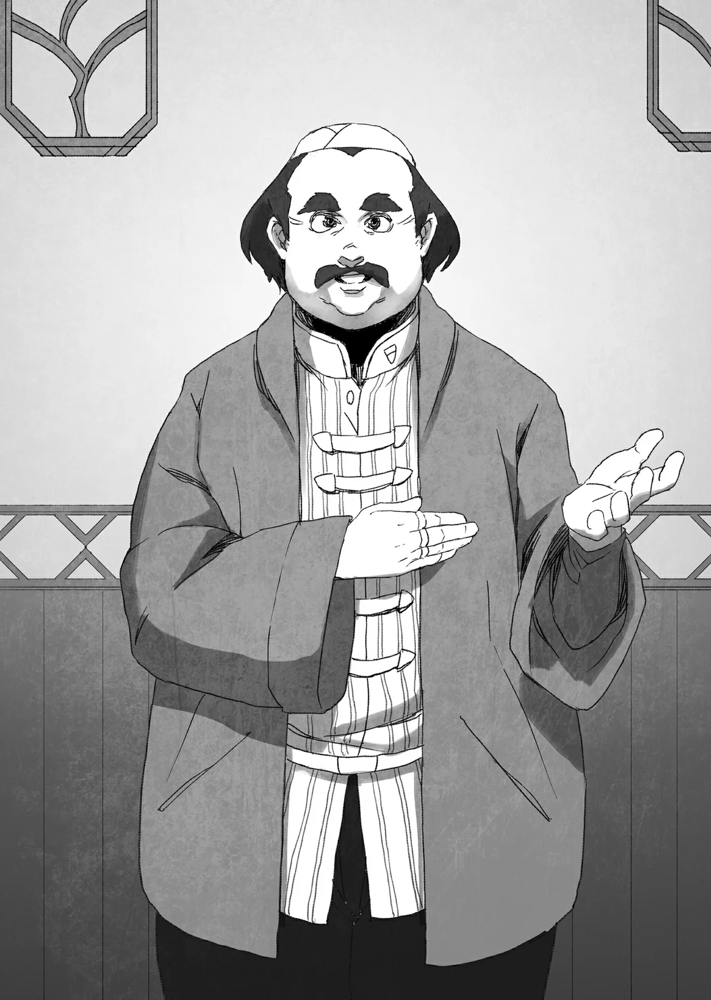

# Chương 103: Tập 4 Chương 3 - Thương Hội Stheno (2)

"Vậy tôi xin phép thất lễ..."

Dứt lời, một người đàn ông to lớn với chiếc bụng phệ bước vào phòng. Y phục của ông ta mang màu sắc rực rỡ, rất ra dáng một thương nhân. Toàn bộ phong thái cùng sự hiện diện của ông toát lên khí chất của một nhân vật có tầm ảnh hưởng đặc biệt. Nếu phải đoán, thì đây hẳn không phải ai khác ngoài người đứng đầu Thương hội Stheno.

Hay là tôi đã đoán sai...? May mắn thay, suy đoán của tôi nhanh chóng được chứng thực.

"Hóa ra ngài chính là mạo hiểm giả đã tiêu diệt con Tarasque đó... Ngài Rentt Vivie, đúng chứ? Tôi vô cùng xin lỗi vì đã đường đột mời ngài đến đây theo cách thiếu nhã nhặn như thế này. Tôi là người đứng đầu Thương hội Stheno, Sharl Stheno. Về những sự việc phát sinh vừa qua... tôi xin gửi lời tạ lỗi chân thành nhất. Nếu ngài không phiền, chúng tôi dự định sẽ giảm giá cho ngài khi mua sắm tại thương hội, kèm theo các hình thức bồi thường và ưu đãi khác có thể sẽ hữu ích cho ngài..." Nói đoạn, Sharl Stheno cúi đầu.

Đến cả tôi cũng cảm thấy hơi áy náy khi đột nhiên được đưa ra nhiều điều kiện có lợi đến thế ngay từ đầu. Dẫu vậy, trong lòng tôi vẫn dấy lên nỗi nghi ngờ. Liệu đằng sau sự dàn xếp này có uẩn khúc gì khác mà tôi chưa biết chăng...?

Trong trường hợp thông thường, những nhượng bộ kiểu này thường chỉ được đưa ra trong quá trình thương lượng giá cả hay những việc tương tự; ít nhất thì trước đây khi tôi bán các vật phẩm quý hiếm cho những thương hội khác nhau cũng đều như vậy. Ấy thế mà...

Liệu có phải nguyên liệu Tarasque giá trị đến mức ấy? Hay là kẻ khao khát có được chúng sở hữu quyền lực quá lớn? Dù là trường hợp nào, tôi cũng không thể lơ là cảnh giác ở nơi này. Nghĩ đến đó thôi cũng đủ thấy phiền toái rồi.

Tôi điều chỉnh lại chiếc mặt nạ để lộ nửa dưới khuôn mặt. Không để cảm xúc thật lộ ra ngoài, tôi bật cười và bắt chuyện với vị thương nhân một cách tự nhiên.

"Mạo hiểm giả Đồng Cấp, Rentt Vivie, rất hân hạnh được diện kiến. Ngoài ra, về tình hình hiện tại... Thật ra ngài không cần phải bận tâm đến mức đó đâu. Dù sao thì chính tôi là người quyết định có mặt ở đây hôm nay. Nghĩ đến chuyện con Tarasque mà mình đã vất vả tiêu diệt lại sắp được bán với giá gấp mấy lần mức ước tính của buổi đấu giá... Thú thật, chẳng có mạo hiểm giả nào mà không mừng rỡ cả. Thậm chí tôi còn vui đến mức nhảy chân sáo bước thẳng tới thương hội của ngài hôm nay đấy."

Vị thương nhân bật cười khi nghe thấy vế cuối trong câu nói của tôi.

"Ngài Rentt quả là một người cởi mở đến không ngờ đấy. Khác hẳn so với những lời đồn thổi. Họ miêu tả ngài là một người... nói sao nhỉ, cứng nhắc hơn nhiều."

Đó là một câu nói tôi không thể xem nhẹ. Rốt cuộc tin đồn về tôi đã lan truyền xa đến mức nào rồi? Tôi quyết định dò hỏi sâu thêm về chuyện này.

"Ngài bảo có lời đồn ư? Kiểu như thế nào vậy? Thú thật, tôi vốn không nhạy bén lắm với mấy chuyện này đâu. Chẳng hạn như việc người khác nghĩ gì về mình..."

Có lẽ với thân phận Rentt Faina thì tôi khá nổi tiếng, nhưng với tôi của hiện tại...

Số người tôi tiếp xúc đã giảm đi đáng kể. Ngoại trừ Lorraine, Clope và vài người khác, tôi gần như không giao thiệp gì với các mạo hiểm giả bình thường. Họa hoằn lắm thì tôi chỉ nhặt được một hai món đồ ai đó đánh rơi rồi đem trả lại cho họ. Những lúc ấy đôi bên cũng chẳng trò chuyện gì sâu sắc.

Không phải tôi không muốn nói chuyện với họ, mà là nguy cơ bí mật của tôi bị bại lộ luôn chực chờ nếu tôi nấn ná lại quá lâu. Trái lại, Sharl thì...

"Hừm... Thưa ngài Rentt. Là một thương nhân, tiết lộ nguồn tin của mình thực sự không phải là hành vi đáng hoan nghênh, nhưng vụ việc lần này lại hoàn toàn do phía chúng tôi gây ra. Lúc trước tôi có nhắc đến các điều khoản nhượng bộ, đúng chứ? Tôi sẽ thực hiện đúng như đã hứa. Nào... để bắt đầu thì..."

Ồ. Quả là một thương nhân thấu hiểu lòng người đến không ngờ...

"Bắt đầu từ đâu đây nhỉ?" Sharl tiếp tục. "Thành thật mà nói, thưa ngài Rentt, việc thu thập thông tin về ngài khó khăn đến mức đáng kinh ngạc. Chúng tôi biết ngài là mạo hiểm giả—chuyện đó thì quá đỗi dễ dàng. Nhưng chúng tôi lại không biết ngài là người như thế nào. Tuy nhiên, dù bản thân tôi không hề đồng tình, thưa ngài, nhưng dư luận ngoài kia lại miêu tả ngài là 'một kẻ hết sức đáng sợ'..."

"Ngài nói vậy rốt cuộc là có ý gì?"

"Dù ngài là một mạo hiểm giả Đồng Cấp, ngài lại hầu như chẳng nói chuyện với ai. Có lẽ khi ấy người ta chỉ nghĩ ngài là một kẻ khép kín, không mấy bận tâm đến người khác chăng? Tuy nhiên, những mạo hiểm giả từng tận mắt chứng kiến cử chỉ và hành tung của ngài trong mê cung lại không hề thấy thực lực của một mạo hiểm giả Đồng Cấp, mà là một thứ gì đó vượt trội hơn nhiều."

Ra là vậy... Thỉnh thoảng tôi cũng chạm mặt vài mạo hiểm giả... Tôi đoán hẳn cũng có kẻ đi ngang qua lúc tôi đang giao chiến. Không can dự vào chuyện của người lạ vốn là một trong những quy tắc bất thành văn của mê cung. Dẫu vậy, chẳng có điều gì ngăn được một mạo hiểm giả lén lút quan sát kẻ khác. Tùy theo tình huống, một mạo hiểm giả thậm chí còn có thể công khai theo dõi trận chiến của người ta. Đó không phải hành động lịch sự, nhưng tuyệt nhiên không hề bị cấm đoán. Phần lớn mạo hiểm giả cũng chẳng mấy bận tâm, miễn là kẻ đứng xem không vướng chân vướng tay họ.

Hẳn Sharl đã thu thập thông tin bằng cách này, thông qua việc dò hỏi những mạo hiểm giả từng chạm trán tôi trên đường đi đâu đó.

Nhưng mà... khép kín và không mấy bận tâm đến người khác ư? Đúng là tôi không nói chuyện nhiều lắm... chí ít là ngoại trừ Sheila ở hội. Rồi còn có cả Dario ở phòng mổ xẻ nữa, dẫu chú ấy là người phụ trách ở đó, chứ tôi thực sự chẳng hề trò chuyện với ai khác...

Hừm... Chẳng lẽ trông tôi lại giống một kẻ không có nổi lấy một người bạn sao?

Sự thật là tôi chẳng có ai thật. Nếu phải chỉ vào một người và tuyên bố người đó là bạn mình... thì ừ, có Lorraine đấy.

Tôi không nên suy nghĩ quá sâu về chuyện này làm gì. Tôi đã bắt đầu cảm thấy nỗi cô đơn ùa về rồi đấy.

Dẫu vậy, sự thật là thời còn sống tôi từng có rất nhiều bạn bè.

"Xem ra ngài đã quá khen rồi! Dù sao thì tôi cũng chẳng phải nhân vật đáng chú ý gì cho cam. Rốt cuộc ngoài kia vẫn còn bao nhiêu người khác có cùng trình độ với tôi..."

Tôi không hề khiêm tốn ở điểm này. Thành thật mà nói, nếu phải tự đánh giá thực lực của bản thân, có lẽ tôi chỉ ở tầm mạo hiểm giả Hạ Ngân Cấp, hoặc chí ít là quanh quẩn đâu đó? Dù trong tay tôi nắm giữ không ít quân bài tẩy và thỉnh thoảng lại bộc phát tiềm năng kinh người, nhưng đó hoàn toàn không phải trạng thái bình thường trong cuộc sống thường nhật của tôi.

Nói đúng hơn thì khoảng cách giữa Rentt Faina và tôi lúc này là tương đối lớn. Tôi cũng tin tưởng chắc chắn rằng kể từ giờ trở đi mình sẽ còn mạnh hơn nữa. Đó là một điều tốt.

Sharl gật đầu trước lời tôi nói. "Tôi cũng từng nghe những tin đồn tương tự. Tôi còn nghe bảo rằng ngài làm việc vô cùng hiệu quả, thưa ngài Rentt. Ngài không chỉ mạnh mẽ mà còn không để lộ bất kỳ sơ hở nào cho kẻ thù. Ngài không đánh những trận nắm chắc phần thua, hoặc người ta nói đại khái là thế... Rồi cả luồng khí tức chấp niệm ấy nữa... Tôi đoán là sự kiên định chăng? Nó dường như gần như... phi nhân loại. Dẫu chính bản thân tôi cũng không hiểu rõ điểm cuối cùng này cho lắm, thưa ngài Rentt..."

Không đánh những trận nắm chắc phần thua ư... Tôi đúng là sẽ bỏ chạy nếu thấy tình hình sắp sửa chuyển biến theo chiều hướng xấu. Thật kỳ lạ là điều đó lại được đánh giá rất cao.

Còn về sự kiên định... Trông tôi thực sự toát ra vẻ như thế sao? Hừm. Quả thật tôi luôn muốn dốc hết sức và nỗ lực hết mình, nhưng tôi đâu hề có ý định phát ra luồng... khí tức kỳ lạ này chứ? Hoàn toàn không.

Còn về nhận xét trông tôi có vẻ phi nhân loại... Thì ừ. Ngay từ đầu tôi đã chẳng phải con người rồi—dĩ nhiên là tôi không thể nói ra điều đó. Mặc dù trong thoáng chốc tôi từng tự hỏi liệu mình có thể thử lòng Sharl bằng một câu như vậy để xem phản ứng của ông ta ra sao không. Thế nhưng nếu làm thế, cuộc sống của tôi trong xã hội loài người sẽ lập tức chấm dứt. Kể cả đó chỉ là lời nói đùa bỡn cho vui... tôi cũng không thể khinh suất đến mức ấy được.

"Hừm... Vậy tóm lại người đời xem tôi là một kẻ nhát gan và nguy hiểm sao? Đại khái là thế nhỉ? Xem ra tôi chẳng có nét gì đáng để khen ngợi rồi."

"Sao ngài lại diễn giải theo cách đó chứ, thưa ngài Rentt...? Dù sao đi nữa... có lẽ chúng ta nên gác chuyện đó sang một bên. Tuy nhiên, có một điều mà chúng tôi tuyệt nhiên không thể nào tra ra được, bất kể đã đào bới kỹ đến mức nào," Sharl nói, một tay đặt lên trán và chậm rãi lắc đầu. Tôi nghiêng đầu khó hiểu.

"Hửm? Đó là chuyện gì vậy?"

"Nơi chốn ngài sinh ra, thưa ngài Rentt. Chà, chúng tôi biết ngài đến từ Đế Quốc Rermutt, nhưng chúng tôi không thể tìm hiểu được gì nhiều hơn thế. Liệu tôi có thể mạn phép hỏi ngài sinh ra ở đâu được không?"

"Hả...? Tôi, Rentt Faina, là người đến từ Đế Quốc Rermutt á?" là những gì tôi suýt thốt ra. Tuy nhiên, tôi từng nghe nói Lorraine và Sheila đã phối hợp với nhau để che giấu bớt lai lịch của tôi, nên tôi cũng không quá đỗi ngạc nhiên.

Sheila, người có quyền tiếp cận hồ sơ tại Hội Mạo Hiểm Giả, nhiều khả năng đã chỉnh sửa vài loại giấy tờ và đăng ký thông tin này dưới sự hỗ trợ của Lorraine. Nếu phải đoán, mối quan hệ thân thiết giữa tôi và Lorraine rất có thể đã khiến người ta lầm tưởng tôi xuất thân cùng quê với cô. Mạo hiểm giả thường có lai lịch mập mờ bất minh, nhưng đó vốn là bản chất của cái nghề này rồi.

Tôi hoàn toàn có thể nói thật cho Sharl biết, nhưng đó là điều tôi không thể tùy tiện làm trước mặt một thương nhân. Đúng là tôi có đôi chút kỳ lạ, nhưng hiếm có ai lại đi điều tra người khác gắt gao đến mức này. Thật may là chúng tôi đã chuẩn bị chu đáo từng chi tiết nhỏ khi dựng nên thân phận cho tôi. Trên thực tế, chuyện tôi gặp gỡ một thương nhân như thế này cũng là một trong vô số kịch bản mà Lorraine từng lường trước.

"Chuyện đó cũng chẳng có gì bí hiểm đâu, ha ha. Ngài đã từng nghe nói đến Thành Phố Cơ Giới Aavan chưa? Dĩ nhiên là ở Đế Quốc Rermutt rồi."

Tôi chẳng biết chút gì về nơi đó cả. Tôi thậm chí còn chưa từng đặt chân đến. Lorraine từng kể cho tôi nghe về địa danh ấy, và đó là lý do duy nhất khiến tôi biết đến nó.

Chẳng hạn, tôi biết đó là một thành phố của sắt thép, ma pháp và dầu mỏ. Nơi ấy rất phát triển, tràn ngập đủ loại ma cụ và máy móc cơ khí. Giữa chốn đó là vô số thợ cơ khí cùng các ma pháp sư. Họ là những công nhân và thợ thủ công miệt mài tạo ra các sản phẩm mới, làm việc thâu đêm suốt sáng, suốt ngày suốt tháng. Đó là nơi thu hút biết bao người đổ về tìm kiếm việc làm. Dẫu vậy, tôi không rõ liệu đây có phải là lý do khiến Aavan có nhiều trẻ mồ côi đến thế hay không, những đứa trẻ phải làm việc kiếm sống trong vai trò người hầu và phụ việc.

Nhiều kẻ từ các khu ổ chuột lặn lội đến Aavan vì bị cám dỗ bởi viễn cảnh có được manh áo miếng cơm để tự nuôi sống bản thân. Tôi cũng sẽ đóng vai một trong những đứa trẻ mồ côi đó—hoặc ít nhất câu chuyện của tôi được thêu dệt là như vậy.

Dứt lời, tôi miêu tả bầu không khí cùng mùi vị đặc trưng của Aavan, những chi tiết mà tôi còn nhớ từ những bức phác thảo mà Lorraine từng cho tôi xem về nơi đó. Về phần Sharl, ông ta có vẻ đã tin.

"Tôi hiểu rồi. Hóa ra là như vậy..."

Chỉ nhìn thoáng qua thì không thể nào biết được liệu vị thương nhân có tin lời tôi nói hay không. Nhưng có vẻ như những lời tôi vừa kể cũng mang đôi chút sức thuyết phục. Tôi đã trả lời kha khá câu hỏi của ông ta, và hy vọng là mình không phạm phải sai lầm chết người nào...

Tôi tự nhủ trong bụng lát nữa sẽ hỏi Lorraine xem những câu trả lời của mình đạt chất lượng ra sao.

"Có vẻ như chúng ta đã trò chuyện khá lâu rồi, thưa ngài Rentt," Sharl tiếp lời. "Tôi cảm thấy lúc này mình đã hiểu rõ hơn về tính cách của ngài. Nhưng than ôi, đã đến lúc rồi. Vị khách đến gặp ngài sẽ tới đây sớm thôi... Ngài thấy như vậy có ổn không?"
