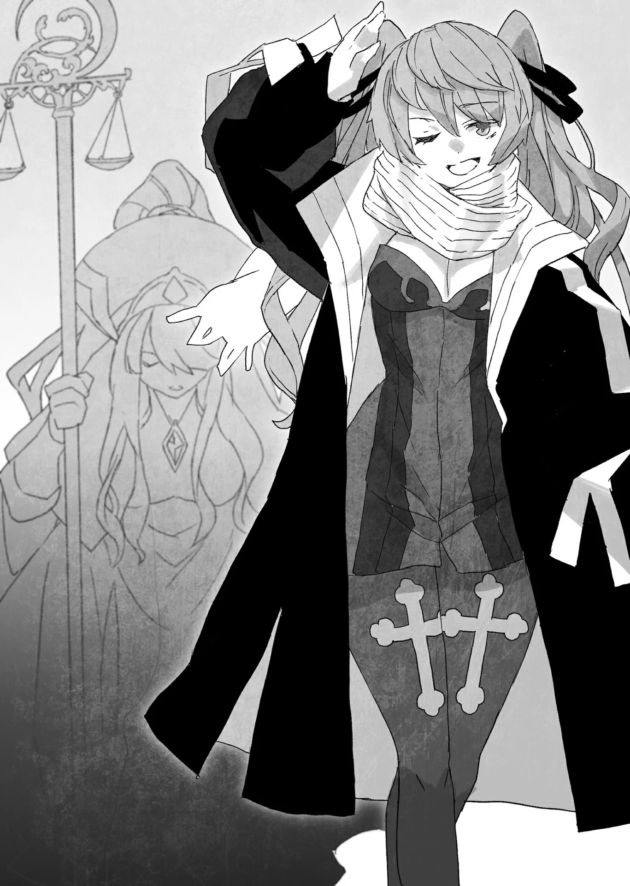

# Chương 104: Tập 4 Chương 3 - Thương Hội Stheno (3)

Ngay khi tôi vừa gật đầu trước câu hỏi của ông...

Cốc, cốc...

Vài tiếng gõ cửa dồn dập vang lên từ cánh cửa gỗ. Thật đúng lúc làm sao.

"...Tiểu thư Nive Maris và Tiểu thư Myullias Raiza đã tới ạ," một giọng nói cất lên từ phía bên kia cánh cửa. Rất có thể là người nhân viên khi nãy.

Sharl đưa mắt nhìn tôi như để dò hỏi ý kiến. Tôi gật đầu thêm một lần nữa.

"Làm phiền mở cửa giúp ta."

Dứt lời, ông đứng dậy. Tôi cũng làm theo ông.

Cánh cửa mở ra... và hai người phụ nữ bước vào. Hai người phụ nữ xinh đẹp đến ngỡ ngàng, hút hồn người đối diện.

Một người sở hữu mái tóc màu xám tro cùng đôi mắt đỏ rực sáng lấp lánh. Thật khó lòng đoán định nổi nét biểu cảm hay ý đồ của cô ấy. Người còn lại có mái tóc màu bạc và đôi mắt màu tím như thạch anh. Người phụ nữ này toát ra một vầng khí chất hư ảo, thanh thuần.

Cả hai có lẽ trẻ hơn hai mươi một chút, hoặc có thể tầm khoảng hai mươi lăm. Dù nhìn chung tôi không hề giỏi đoán tuổi phụ nữ cho lắm, nhưng tôi nghĩ bản thân cũng ước lượng được đôi phần.

Bây giờ tôi hiếm khi lui tới những chốn như thế, song ngày trước, các bậc tiền bối mạo hiểm giả thường hay dắt tôi đến mấy quán rượu có các cô gái tiếp rượu tại bàn. Họ thường hỏi, "Ôi, anh đoán xem em bao nhiêu tuổi nào?", và những lần tôi đoán trúng thì hiếm hoi vô cùng. Còn các bậc tiền bối của tôi lại đoán được tuổi của các tiếp viên, thường chỉ lệch khoảng hai đến ba tuổi là cùng. Đó quả là một kỳ tài lạ lùng của họ. Rốt cuộc làm thế nào mà họ biết được những chuyện ấy chứ?

Mà thôi, chuyện đó lúc này chẳng đáng để bận tâm.

Khi hai người phụ nữ bước vào, người nhân viên lui ra ngoài phòng và khép cánh cửa lại sau lưng.

"Rất hân hạnh được gặp hai vị, Tiểu thư Nive, Tiểu thư Myullias. Vị đang đứng trước mặt hai vị đây không ai khác chính là mạo hiểm giả đã tiêu diệt con Tarasque, ngài..."

Sharl ngập ngừng bỏ lửng câu nói, quay sang nhìn tôi như thể muốn giục tôi tự giới thiệu bản thân. Có lẽ bởi cách ông xưng hô với hai người phụ nữ như thế, nên tôi thấy rõ ràng hai người này đều có địa vị xã hội rất cao.

Thật là một vị thương nhân biết thấu hiểu lòng người đến bất ngờ...

Tôi tự giới thiệu: "Rentt Vivie, mạo hiểm giả Đồng Cấp, rất hân hạnh được diện kiến."

Tôi cúi đầu. Ngay lúc đó, tôi nghe thấy một giọng nói đáp lại theo cách khá bất ngờ.

"Ôi dào, tôi không câu nệ mấy thứ lễ nghi kiểu đó đâu! Ngẩng đầu lên đi, ngài Rentt. Tôi cũng đâu phải ai đó đặc biệt gì cho cam... À. Hừm. Có khi Tiểu thư Myullias mới là người đặc biệt—quan trọng đấy chứ! Ấy, không, không. Tôi chẳng quan trọng hay đặc biệt gì đâu. Dù đúng là tôi có tước vị thật, nhưng về cơ bản tôi cũng chỉ là một công dân bình thường thôi mà."

Tôi từ từ ngẩng đầu lên, có chút thận trọng, và rồi nhìn thấy một trong hai người phụ nữ đang nở nụ cười rạng rỡ.

Theo những gì tôi nghe được, người vừa lên tiếng chính là người phụ nữ tóc xám, Nive. Thật ra, tôi từng nghe đến tên cô từ trước rồi.

Nive Maris... Đó không ai khác ngoài tên của một mạo hiểm giả Kim Cấp đến từ vùng đất láng giềng. Cô sở hữu tài năng cùng thực lực khó tin, và được cho là mạo hiểm giả Kim Cấp tiệm cận bậc Bạch Kim Cấp nhất xét về sức mạnh. Để ghi nhận những thành tựu cùng chiến công của cô, cô đã được ban phong tước vị Nữ Chuẩn Nam tước. Có lẽ đó chính là lý do cô thốt ra những lời vừa rồi.

Còn về chiến công của cô... Chà. Đó là những chiến công chẳng hề hòa hợp chút nào với tôi cả...

"Vâng. Tôi cũng là một mạo hiểm giả, và tôi từng nghe danh tiếng của cô. Nếu tôi nhớ không lầm, cô từng tiêu diệt một con Trung Cấp Ma Cà Rồng lập tổ trong một thành phố lớn. Thợ Săn Ma Cà Rồng... Nive Maris."

Vì lý do này hay lý do khác, cô là một mạo hiểm giả dường như chuyên đi tiêu diệt ma cà rồng. Dẫu vậy, phần lớn mục tiêu của cô chỉ là Hạ Cấp Ma Cà Rồng, Thi Quỷ và những sinh vật tương tự. Thế nhưng, cô từng tiêu diệt một con Trung Cấp Ma Cà Rồng cùng bầy đàn của nó, quét sạch chúng khỏi thành phố nơi chúng cắm rễ. Chiến tích này chính là điều khiến danh tiếng của cô vang xa khắp chốn.

Dù cô quả thực rất mạnh, cô còn sở hữu những năng lực truy lùng những con ma cà rồng trà trộn giữa người sống và che giấu hình dạng của chúng. Ít nhất thì tôi cũng biết đến chừng đó.

Thế nhưng, tôi lại chẳng hề biết cô dùng phương thức gì để phát hiện ra lũ ma cà rồng đó...

Dù thế nào đi nữa, chuyện cô đã nghiền nát một con Trung Cấp Ma Cà Rồng cùng bầy đàn của nó là sự thật không thể chối cãi. Vậy thì cô thực sự có bản lĩnh đúng như những lời đồn đại.

Tại sao một kẻ như thế này—thậm chí còn là thiên địch của tôi—lại xuất hiện ở đây cơ chứ? Chẳng lẽ vận rủi của tôi cũng không có lấy một giới hạn nào sao?

Đó là những gì tôi nghĩ từ tận đáy lòng. Lúc này tôi chỉ muốn co giò bỏ trốn và rời khỏi đây ngay lập tức. Tôi sẽ quay sang cô và nói: "Tôi xin lỗi, nhưng cô là Thợ Săn Ma Cà Rồng, còn tôi là Ma Cà Rồng. Chúng ta không thể chung sống hòa thuận được đâu. Chào cô nhé."

Nhưng dĩ nhiên tôi chẳng thể làm chuyện như thế. Điều duy nhất tôi có thể làm là nói chuyện với họ để tìm hiểu xem họ muốn gì, rồi sau đó trở về nhà một cách tự nhiên... Tôi chẳng thấy còn lối thoát nào khác trong tình cảnh này.

Chuyện gì sẽ xảy ra nếu thân phận ma cà rồng của tôi bị vạch trần? Mọi sự khi ấy coi như chấm hết. Tất cả những gì tôi có thể làm là liều mạng chiến đấu, rồi sau đó trốn tới một vùng đất xa xôi nào đó và bắt đầu gầy dựng lại cuộc đời từ đầu. Liệu mọi chuyện rồi sẽ ra sao...?

Tôi hoàn toàn không tài nào nắm bắt nổi bầu không khí này. Nive trông... rất bình thường. Nói đúng hơn thì trông cô vô cùng vui vẻ. Tôi cảm thấy như thể mình đang nhìn chăm chú vào một vực thẳm không thấy đáy. Ấy vậy mà, cô chẳng hề biểu lộ bất kỳ dấu hiệu hung hăng hay cảnh giác nào đối với tôi... Vậy là tôi chưa bị phát hiện sao? Rốt cuộc là thế nào đây?

Trước mắt tôi chỉ là một cô gái trẻ đang nhìn mình, không hơn không kém. Thế nhưng, tôi có cảm giác khoảng cách giữa hai chúng tôi có thể bị thu hẹp lại trong chớp mắt, và tôi có thể túm lấy cổ áo cô mà hỏi: "Rốt cuộc là thế nào?!" Nhưng nếu tôi làm vậy, tôi gần như chắc chắn sẽ mất mạng.

Tôi đồ rằng chẳng còn cách nào khác ngoài việc tiếp tục trò chuyện. Nếu bị lộ tẩy, đến lúc đó nước đến chân thì nhảy vậy.

"Ồ, ra là ngài cũng biết đến tôi đấy nhỉ. Không ngờ danh tiếng của tôi lại truyền tới tận nơi thôn quê hẻo lánh như thế này... Á! Tôi không có ý chế giễu nơi này đâu nhé, nên ngài bỏ qua cho tôi nha," Nive nói, gần như lập tức xin lỗi vì nhận xét về vị trí địa lý của Maalt.

Dù tôi không mấy để tâm, nhưng có những kẻ sẽ cực kỳ phật ý trước những phát ngôn như vậy.

"Thôn quê hẻo lánh cái nỗi gì? ĐÂY. LÀ. MỘT. THÀNH. PHỐ!" hẳn họ sẽ nói như thế.

Dù sao thì nơi đây cũng chẳng hẳn là một thành phố cho lắm... Cho dù người ta có nói hươu nói vượn thế nào đi nữa, Maalt thực sự chỉ là một thị trấn nhỏ hẻo lánh nơi thôn quê. Cực kỳ hẻo lánh. Đó là điều mà một kẻ sống ở đây suốt một thời gian dài như tôi, Rentt Faina, có thể khẳng định. Đó là một chân lý không thể chối cãi. Một sự thật hiển nhiên.

"Không đâu. Đúng như cô nói, nơi này khá là hẻo lánh... Còn vị tiểu thư đằng kia thì sao ạ?"

Tôi ra hiệu về phía người phụ nữ tóc bạc. Cô nhanh chóng đáp lời.

"Tôi xin thứ lỗi vì đã chậm trễ giới thiệu bản thân. Tôi là Thánh Nữ Myullias Raiza, phụng sự cho Giáo Hội Lobelia. Rất hân hạnh được làm quen với ngài."

Cô nhìn thẳng về hướng tôi. Gần như ngay lập tức, tôi cảm thấy một luồng cảm giác êm dịu, kỳ lạ xâm nhập vào cơ thể mình. Nó không hề gây đau đớn; nói đúng hơn thì cảm giác ấy như thể tôi đang được bao bọc bởi một thứ xúc cảm mâu thuẫn khôn tả.

Thứ này... là cái gì vậy?

Trong lúc tôi còn đang suy ngẫm, tôi có thể cảm nhận được Thần Lực bên trong mình đang cộng hưởng, cứ như thể nó sắp sửa bị kéo tuột ra khỏi chính cơ thể tôi vậy. Chuyện này là...

Tôi quay sang nhìn Myullias, người lúc này đang lộ rõ vẻ kinh ngạc trên nét mặt.

"Có phải ngài... được ban phước Thần Lực không?" cô hỏi.

Tôi muốn hỏi làm sao cô biết, nhưng bản thân tôi cũng đã có sẵn những nghi vấn cho riêng mình. Tôi nghĩ tạm thời mình nên giữ nguyên bộ mặt bình thản thì hơn.

"Cảm giác vừa rồi... chẳng hay có phải là do cô làm không?"

"Vâng, tôi định ban phước cho ngài bằng Thần Lực... Vốn dĩ bổn phận của tôi là chém tan bóng tối... Ừm, tôi nên diễn đạt chuyện này thế nào đây..."

Myullias nhanh chóng liếc mắt nhìn Nive. Dường như cô gặp khó khăn trong việc giải thích hành động của mình. Thế nhưng, Nive chỉ đơn thuần bật cười trước cử chỉ đó.

"Ái chà, không đâu. Thứ lỗi cho chuyện đó nhé. Đúng như ngài nói đấy, ngài Rentt, tôi khá là nổi tiếng, ngài thấy rồi đó? Thành thử lúc nào cũng có kẻ rắp tâm thủ tiêu tôi cả! Nếu chỉ là đòn tấn công thông thường hay đại loại thế thì tôi thừa sức xử lý, tôi đoan chắc đấy, nhưng tôi phải hết sức cẩn trọng trước những thứ như độc dược, ngài biết mà. Đó là lý do vì sao Thánh Nữ của chúng ta, Tiểu thư Myullias, hôm nay lại có mặt ở đây cùng chúng tôi... Nói đúng hơn thì tôi đã nhờ cô ấy đi cùng để thanh tẩy môi trường xung quanh. Tôi cũng dùng được Thần Lực, nhưng mấy khoản như thanh lọc với ban phước... tôi dở tệ mấy thứ đó lắm. Có một phụ tá từ Giáo Hội Lobelia thực sự giúp ích nhiều lắm đó! Vốn dĩ tôi rất giỏi khoản phát hiện ma cà rồng, ngài thấy đấy. Lũ chúng nó yếu trước Thần Lực và mấy thứ đại loại thế, và nếu là một con yếu ớt, chỉ cần đập Thần Lực vào người nó là bùm một cái! Lên thiên đường ngay tắp lự."

Nive nói.

Rõ ràng Nive là người thích nói nhiều. Dẫu lời lẽ của cô rất suồng sã và thỉnh thoảng có phần tưng tửng, nhưng nội dung bên trong lại có phần quan trọng hơn nhiều...

Myullias là một Thánh Nữ của Giáo Hội Lobelia. Việc Nive có thể yêu cầu một người hộ tống riêng theo cách như thế này... tôi dễ dàng hiểu được tầm ảnh hưởng và quyền lực mà cô nắm giữ lớn đến dường nào. Và rồi còn có cả lời tuyên bố về việc cô rất giỏi nghiệp vụ của mình nữa chứ...

Nhưng ma cà rồng lại yếu trước Thần Lực ư? Bản thân tôi vẫn mang trong mình Thần Lực, vậy mà trông tôi vẫn hoàn toàn bình yên vô sự đấy thôi... Liệu trước đây tôi từng nghe thấy điều gì tương tự như thế chưa nhỉ? Tôi không nghĩ là có...

Liệu điều đó có thật không? Chà, người ta có thể dẫn truyền Thần Lực vào vũ khí và dùng nó để đả thương ma cà rồng... Nhưng chỉ dùng đơn thuần Thần Lực để đập chúng thôi ư? Tôi chưa bao giờ nghe nói về điều gì như thế cả. Nếu chuyện đó thực sự là thật, thì việc săn ma cà rồng ắt hẳn đã trở thành lãnh địa độc quyền của các Thánh Giả và Thánh Nữ rồi.

Thế nhưng thực tế lại không phải như vậy. Vậy thì đó là lời nói dối sao? Phương pháp này dường như là bất khả thi.

Có lẽ Nive đã nhận ra nỗi hoài nghi của tôi.

"Chà, cũng không hẳn là hoàn toàn chẳng có tác dụng gì nếu ngài làm theo cách thông thường đâu, ngài biết đấy? Tôi có cách riêng của mình, ngài thấy đó. Để tìm ra một cách chắc chắn. Một phương pháp luận vô cùng bài bản. Thậm chí chính tôi còn là người khám phá ra nó nữa cơ! Đó là lý do vì sao tôi làm được, còn người khác thì không. Chỉ đơn giản thế thôi."

◆◇◆◇◆

"Một phương pháp luận vô cùng bài bản, cô nói sao..."

Liệu thực sự có một thứ như vậy sao? Ngoại trừ những gì tôi biết về Thần Lực và cách sử dụng nó theo bản năng, tôi chẳng có bất kỳ kiến thức nào khác về vấn đề này cả. Do đó, ngay từ đầu tôi đã không thể đánh giá nổi liệu chuyện như vậy có khả thi hay không...

Nói đúng hơn thì Nive đang bảo rằng chỉ duy nhất mình cô mới làm được điều đó. Liệu điều này có khả thi không, cho dù cô có tinh thông các cách thức vận dụng Thần Lực đi chăng nữa...? Tôi chẳng có cách nào để xác thực tính chân thực trong những lời cô nói.

Tôi liếc nhìn Myullias, người đang đứng bên cạnh Nive. Nét mặt của cô thoáng vẻ nghi ngờ thầm lặng, gần như thể chính cô cũng đang thầm bảo: "Thật sao? Giờ cô làm được trò đó rồi à?"

Dường như hai người phụ nữ này không hẳn là có mối quan hệ hòa thuận với nhau cho lắm. Nive có thể đã yêu cầu một người phụ tá, song có lẽ cô không hề chỉ đích danh Myullias. Hừm.

"Đúng vậy, phương pháp luận đấy!" Nive tiếp tục. "Với kỹ thuật này, tôi đã trở thành một Thợ Săn Ma Cà Rồng bách phát bách trúng! Dĩ nhiên, con người bình thường sẽ chẳng cảm thấy mảy may chút gì cho dù tôi có làm thế với họ đi chăng nữa. Đó là... nếu họ là một con người bình thường."

Vậy thì... rốt cuộc tất cả những chuyện này có nghĩa là gì đây? Tôi đã bị phát hiện rồi sao? Hay là chưa? Tôi hoàn toàn không thể đưa ra bất kỳ phán đoán nào về tình cảnh của bản thân.

Cái..."phương pháp luận" này của cô. Liệu cô đã thực hiện nó rồi sao? Không, đâu thể nào như thế được. Nếu cô đã làm rồi, ắt hẳn tôi đã bị bắt sống và lúc này đang trong quá trình bị tiêu diệt rồi.

Có một câu nói khá nổi tiếng về Nive Maris: răng và móng vuốt của cô tồn tại chỉ vì mục đích duy nhất là xé xác lũ Ma Cà Rồng. Vậy thì trong trường hợp này, tôi đoán là mình vẫn chưa bị phát hiện chăng?

Tuy nhiên, cô đang nghi ngờ tôi. Tôi hiểu được chừng đó. Tôi cũng biết cô đang dò la thông tin. Trong trường hợp đó, liệu cô có thể nhận ra tôi là một Ma Cà Rồng bằng phương pháp kỳ lạ này của mình không?

Tôi tiếp tục băn khoăn, lo lắng cho số phận bí mật của mình.

"Ồ, ngài nghi ngờ tôi sao? Không, không. Tôi hiểu mà. Tôi hiểu chứ. Ban đầu chẳng ai tin khi tôi nói ra điều đó cả, ngài biết đấy? Thế nên có lần nọ, tôi phát hiện một con Ma Cà Rồng đang đi lại lượn lờ trên đường phố, thế là tôi xé xác nó ngay tại trận... và ai nấy đều đối xử với tôi như một kẻ sát nhân, thấy chưa? Nhưng dĩ nhiên, ngay khoảnh khắc họ nhận ra thứ tôi vừa giết là một con Ma Cà Rồng, một món tiền thưởng hậu hĩnh đã được trao cho tôi. Ừm... dạo đó quả là một thảm họa tai ương, đúng không nhỉ?"

Nive bật cười. Giờ thì tôi có thể mường tượng ra cảnh tượng đó trong tâm trí mình rồi... Đó quả là một cảnh tượng kinh hoàng.

Nhưng rõ ràng không cần nói cũng biết, việc đột ngột tấn công một người qua đường rồi xé xác họ ắt sẽ khiến người ta bị đối xử như một kẻ giết người. Đứng từ góc độ của Nive, việc không trừ khử một con Ma Cà Rồng ngay khi vừa phát hiện có lẽ sẽ rất nguy hiểm cho những người dân sinh sống tại nơi đó. Dẫu vậy, việc giết chóc giữa thanh thiên bạch nhật trước bàn dân thiên hạ... Đương nhiên họ sẽ bị coi là kẻ sát nhân rồi. Nói đúng hơn thì họ sẽ bị tống giam ngay lập tức mới phải.

Dĩ nhiên, một mạo hiểm giả đủ mạnh để săn lùng và tiêu diệt Ma Cà Rồng sẽ chẳng dễ gì bị tóm gọn. Thế nhưng, nếu họ thực sự vô tội và không có gì phải giấu giếm, nhiều khả năng họ sẽ hợp tác với chính quyền.

"Thế nên... Vì có vẻ ngài không hẳn tin tôi cho lắm, hay là ngài thử một lần xem sao nhé? Chỉ một lần thôi? Đó là một trải nghiệm khá hiếm có đấy, ngài biết không? Nói sao nhỉ... Nó gần giống như một sự ban phước của thần linh vậy? Gần như thế? Đại loại vậy? Phần lớn thời gian, người bình thường đều rất đỗi vui mừng khi thấy nó! Tôi đồ rằng người bình thường là thế đấy nhỉ? Thần Lực là một thứ tốt lành; nó mang lại phước lành cùng hạnh phúc và những điều tương tự, hoặc ít ra là họ nghĩ thế. Rồi ngài còn có các đoàn thể tôn giáo đi loanh quanh cùng những nhân vật thần thánh của họ và đủ thứ, nhưng họ đâu có ban phước cho mọi người thường xuyên đến vậy! Thành thử điều đó giúp công việc của tôi dễ dàng hơn nhiều, thấy chưa? Ban phước cho người đi đường ấy mà. Ôi, không, không. Đó hoàn toàn không phải là lời chỉ trích Giáo Hội Lobelia đâu nhé... phải không nè?"

Sắc mặt của Myullias tối sầm lại thấy rõ khi Nive tiếp tục bài độc thoại dông dài. Thoạt nhìn lướt qua thì khó lòng nhận biết, nhưng rõ ràng Myullias ngày càng trở nên kém hào hứng hơn với nhiệm vụ của mình.

Dù Nive đã phủ nhận, nhưng những lời bình phẩm của cô rõ ràng là một sự chỉ trích nhắm vào các hội đoàn và tổ chức tôn giáo. Nhất là Giáo Hội Lobelia, họ chỉ chịu ban phước lành khi các Thánh Nữ của họ xuất hành vì mục đích này hay mục đích khác. Tôi đồ rằng họ làm vậy chỉ vì tiền, xét theo cách thức vận hành toàn bộ hệ thống Nước Thánh của họ.

Đổi lại việc tương đối hiếm khi xuất hiện trước công chúng, Giáo Hội lại sở hữu kha khá những người sử dụng Thần Lực hùng mạnh đáng chú ý. Phải chăng là vì họ được trả thù lao hậu hĩnh?

Nghĩ lại thì Giáo Hội Đông Thiên sống qua ngày chỉ bằng những mẩu bánh vụn và sự thanh đạm... Chà, giáo hội đó cũng có những người sử dụng Thần Lực hùng mạnh, bằng chứng cho thấy con người không phải lúc nào cũng có khuynh hướng thiên về điều ác.

"Thử sao, Tiểu thư Nive? Ngài nói vậy chứ... chuyện đó thực sự khá đáng sợ đấy," tôi rụt rè nói.

Hàm ý đằng sau lời tôi nói rất đỗi đơn giản: Không đời nào! Đó là một ý tồi! Tôi sẽ rơi vào thế kẹt mất! Thế nhưng Nive dường như không hiểu điều này.

"Ái chà, xin lỗi về chuyện đó nhé. Ngài thấy đấy, người khác không thực sự tin tưởng tôi cho lắm... Nhất là với một kẻ như tôi. 'Liệu ta có thể tin một con bé tưng tửng như thế không?' 'Không, chắc là không rồi.' Đừng lo. Tôi hiểu mà. Ôi, tôi hiểu quá đi chứ... Tuy nhiên. Tôi không hề thêu dệt nên những câu chuyện hoang đường về thực lực của bản thân. Dẫu vậy thì... hừm. A! Ngài Sharl. Ngài có muốn thử một chút không? Tôi thấy vẻ thích thú lộ rõ trên mặt ngài kìa, hửm?"

Nive đột ngột chuyển hướng chú ý sang vị thương nhân, người nãy giờ vẫn đứng lắng nghe chúng tôi suốt từ đầu đến giờ. Nhiều khả năng ông giữ im lặng suốt quãng thời gian qua là vì sự chu đáo, không muốn ngắt lời cuộc trò chuyện giữa Nive và tôi.

Ngay từ đầu, Nive mới là người muốn gặp tôi. Có lẽ ông đã quyết định bản thân không nên can dự vào cuộc trò chuyện trừ phi tình huống thực sự đòi hỏi.

Chà, trong trường hợp này, Nive đã nói thẳng với ông. Thế nhưng, nét mặt Sharl lại chẳng hề có vẻ gì như thế cả. Nói đúng hơn thì trông ông có phần hơi lo lắng.

"Nào, nào! Cứ nghĩ theo hướng này xem! Ngài nhận được sự ban phước của thần linh! Nếu ngài nói ra điều đó, chẳng phải tin tức ấy sẽ có tác động tích cực đến chuyện làm ăn buôn bán sao? Lại còn có những lợi ích hữu hình nữa cơ chứ, ôi, đúng vậy! Quái vật sẽ không dám bén mảng lại gần ngài trong một khoảng thời gian dài đâu, ngài biết đấy! Và, không giống như Giáo Hội Lobelia, tôi sẽ chẳng đòi hỏi bất kỳ khoản tiền dâng thập phân hay thù lao nào cả! HOÀN TOÀN MIỄN PHÍ LUÔN ĐÓOOOO! Tôi nghĩ đây là một món hời quá hời đấy chứ, phải không nào?" Nive nói, cứ như thể đang cố chào bán cho một thương nhân chính món hàng của ông ta vậy.

Sharl dường như chẳng hề mặn mà với chuyện này cho lắm. Có lẽ bởi ông đã cảm nhận được rằng chuyện này sẽ chẳng bao giờ chịu kết thúc trừ phi ông gật đầu đồng ý...

"...Tôi hiểu rồi. Chuyện đó thực sự không đau chút nào chứ ạ?" Sharl lên tiếng, nhấn mạnh vào nửa sau câu nói của mình.

Nive gật đầu vẻ từng trải. "Vâng. Đó là nếu ngài không phải là một Ma Cà Rồng. Nếu ngài là một Ma Cà Rồng thì đau đấy, ôi, đúng vậy, đau thấu trời luôn. Nhưng mục đích của nó là thế mà! Ngài... đâu phải là Ma Cà Rồng, đúng chứ?"

Tia sáng lấp lánh lại hiện về trong đôi mắt cô, ngay khoảnh khắc cô thốt ra phần cuối câu trả lời.

Đó là một đôi mắt đáng sợ. Đôi mắt như đâm thấu vào tận đáy lòng tôi. Chẳng còn lấy một dấu vết nào của cái tính khí tưng tửng mà cô đã thể hiện suốt từ nãy đến giờ. Lời lẽ của cô cũng không còn nhẹ nhàng, cũng chẳng còn mang giọng điệu đùa cợt nữa.

Thì ra đây chính là Thợ Săn Ma Cà Rồng, Nive Maris...

Sharl nuốt nước bọt trong thoáng chốc khi nhận thấy nét biểu cảm thoáng qua của Nive. Tuy nhiên, ông nhanh chóng đưa ra lời đáp.

"Dĩ nhiên rồi. Tôi sẽ là kẻ nói dối nếu bảo rằng mình không muốn trường sinh bất lão, đúng vậy... Nhưng tôi không nghĩ mình lại muốn từ bỏ nhân tính của mình. Không bao giờ, nếu điều đó đồng nghĩa với việc tôi sẽ biến thành một con quái vật. Nếu cuộc đời tôi phải đi đến hồi kết, tôi muốn được nhắm mắt xuôi tay như một con người và thanh thản ra đi với sự ban phước cùng lòng khoan dung của các vị thần. Chà... xét trên mọi phương diện, có lẽ tôi chưa sống một cuộc đời đủ sùng đạo để có thể ra đi theo cách thanh thản như thế..." Sharl vừa nói vừa cười cay đắng.

Tôi biết phải làm sao đây? Tôi thành thật xin lỗi vì đã biến thành quái vật, nhưng đó đâu phải là thứ tôi cố tình làm hay chủ tâm tìm kiếm. Nói đúng hơn thì tôi chỉ muốn được trở lại làm người. Vậy nếu tôi nói điều gì tương tự như thế thì chắc tôi sẽ an toàn, đúng không?

Đại loại như việc cảm nhận lòng kiêu hãnh của một con người. Ít nhất thì đó là những gì tôi nghĩ trong lòng.

Nive nhanh chóng đáp lại.

"Dù sao ngài cũng là một thương nhân mà. Để gây dựng được một cửa hàng lớn cỡ này, tôi chắc rằng đã có khối chuyện xảy ra. Nhưng ngài biết đấy, tôi không nghĩ các vị thần lại hẹp hòi đến thế đâu, đúng chứ? Chắc chắn các ngài sẽ không đày đọa ngài xuống địa ngục chỉ vì một chút... hoạt động buôn bán thương nhân đâu. Phải không, Tiểu thư Myullias?"

Nive nhìn sang người bạn đồng hành của mình. Myullias nhìn Nive với sự pha trộn giữa vẻ hoài nghi và tính hiếu kỳ. Có lẽ Myullias cũng chẳng rõ liệu Nive có thực sự tin vào những gì mình vừa nói hay không.

Với nét mặt mơ hồ, Myullias đáp: "Tôi không tài nào dò thấu được ý chỉ của các vị thần. Tất cả những gì tôi biết là các vị thần sẽ không phân biệt đối xử. Bất kỳ ai mong mỏi sự cứu rỗi đều sẽ được cứu rỗi."

"Thấy chưa? Có câu trả lời rồi đấy nhé," Nive thản nhiên nói.

Sharl chỉ tiếp tục cười ngượng nghịu, nhưng giờ đây trông ông có vẻ đã nhẹ nhõm hơn trước số phận của mình.

"Vậy thì, thưa Tiểu thư Nive... Xin làm phiền cô vậy. Đúng như cô vừa nói khi nãy, cô không phiền nếu tôi dùng việc này để quảng bá chứ? Rằng tôi, Sharl Stheno, đã nhận được sự ban phước của thần linh từ Thợ Săn Ma Cà Rồng, Tiểu thư Nive Maris..."

Xét theo bản chất câu hỏi của Sharl, tôi có thể đoán rằng rất ít người biết Nive sở hữu trữ lượng Thần Lực. "Chẳng phải trước giờ cô vẫn giấu giếm điều đó sao?" ắt hẳn mới là bản chất thực sự trong câu hỏi của Sharl.

Về phần Nive...

"Ồ, tôi không phiền chút nào đâu. Đằng nào thì tôi cũng đâu có giấu, thấy chưa. Ai biết thì sẽ biết thôi. Vậy thì, vì tôi đã có được sự đồng ý của ngài, tôi sẽ làm ngay bây giờ nhé?"

"À, vâng. Xin mời cô."

Dứt lời, Sharl quỳ hai gối xuống trước mặt Nive.

Tư thế đó y hệt tư thế của các tín đồ Giáo Hội Lobelia, một cách thức chuẩn mực để người ta tiếp nhận sự ban phước của thần linh.