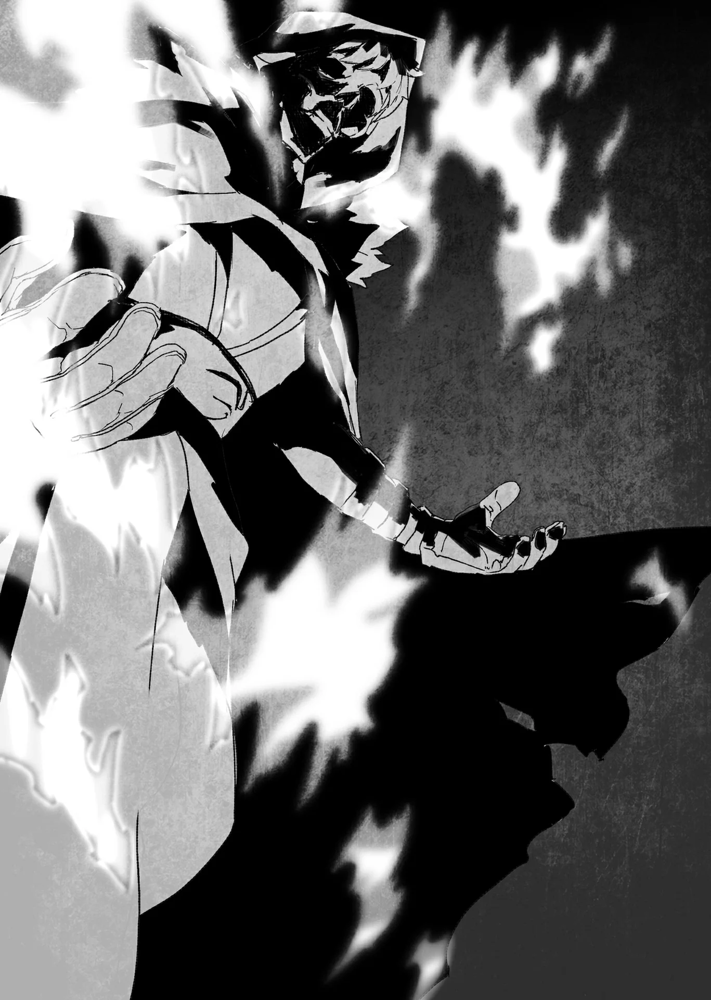

# Chương 105: Chương đệm Tập 4 - Thánh Nữ Myullias Raiza (1)

Đợi Sharl quỳ gối ngay ngắn vào chỗ, Nive giơ tay ra, giữ cách đỉnh đầu vị thương nhân một quãng. Các ngón tay cô khum lại, như thể đang định vốc lấy thứ gì.

Tôi lờ mờ thấy từng vệt Thần Lực le lói tụ lại trong lòng bàn tay cô.

Ma Lực mắt thường không thấy được, nhưng Thần Lực thì hơi khác một chút. Chỉ cần tập trung, người ta vẫn có thể lờ mờ nhận ra. Đứng từ xa thì dĩ nhiên gần như không thể thấy, nhưng ở khoảng cách gần thế này thì với tôi chẳng thành vấn đề.

Có điều, khối Thần Lực cô đang ngưng tụ trước mắt tôi đậm đặc đến kinh người. Nếu tôi mà bắt chước làm trò đó, lượng Thần Lực trong người chắc đã cạn sạch từ đời nào.

Nive Maris tuy mang tước vị Nữ Chuẩn Nam tước, nhưng xét cho cùng vẫn là một mạo hiểm giả. Thật bất ngờ khi thấy một người có trữ lượng Thần Lực khổng lồ đến thế lại bôn ba nơi hoang dã như vậy. Bình thường, những ai sở hữu ngần ấy Thần Lực ắt đã sớm nhận được lời mời từ các giáo đoàn hay các đoàn thánh kỵ sĩ. Các tổ chức ấy hẳn sẽ tìm đủ mọi cách để chèo kéo những nhân tài như cô vào hàng ngũ của mình.

Nghĩ vậy, tôi đoán Nive chắc hẳn phải có toan tính riêng. Rất có thể là chuyện săn Ma Cà Rồng, xét theo tất cả những gì tôi quan sát được từ nãy đến giờ.

Một tiếng 'bụp' khẽ vang lên, rồi ngọn lửa nhỏ lập lòe hiện ra giữa đôi bàn tay khum lại của Nive. Đó tuyệt nhiên không phải một ngọn lửa bình thường. Nó tỏa ánh sáng êm dịu, mang sắc trắng rực rỡ. Thật kỳ bí làm sao...

Có điều, tôi biết rõ ngọn lửa kia chính là do Thần Lực ngưng tụ lại mà thành.

"Thánh Hỏa đấy, thấy chưa? Ngay cả trong giới dùng Thần Lực, cũng chỉ ai được trời phú cho trữ lượng dồi dào, lại khổ luyện thuần thục mới cụ thể hóa được nó ra thôi. Có thể xem đây là một dạng ngọn lửa thần thánh trú ngụ bên trong mỗi người đấy."

Myullias đứng quan sát bên cạnh, nhìn ngọn lửa với vẻ mặt vừa ngỡ ngàng vừa hiếu kỳ.

"Sao cô lại dùng thứ như vậy để phân biệt Ma Cà Rồng với dân thường chứ...?"

Nive vừa bảo kỹ thuật này là ngón nghề độc nhất vô nhị của riêng mình, nhưng câu hỏi của Myullias lại cho thấy không ít người cũng làm được điều tương tự.

Myullias nói tiếp: "Người nhận được ân phước từ Thánh Hỏa thường bộc lộ những năng lực riêng biệt tùy theo thể chất mỗi người. Cách thức vận dụng nó nhiều vô kể. Tôi đoán Thánh Hỏa của Tiểu thư Nive đã được chuyên hóa để phát hiện Ma Cà Rồng... Cũng có khả năng đó..."

Xem ra Myullias rất dè dặt, nhất quyết không chịu khẳng định điều gì chắc chắn.

Nếu dốc sức khổ luyện vì mục tiêu đó, liệu mình có dùng được thứ tương tự không nhỉ? Rồi liệu khi ấy mình có nhận được loại sức mạnh đặc biệt nào từ nó không? Chẳng hiểu sao, tôi lại cảm thấy năng lực của mình cùng lắm cũng chỉ dừng ở mức ủ phân hay bón thêm dưỡng chất cho cây cỏ mà thôi...

Tôi quay sang Myullias. "Tiểu thư Myullias cũng dùng được ngọn lửa như vậy sao?"

"Với tôi thì chuyện đó gần như không tưởng... Tôi không có lượng Thần Lực khổng lồ dường ấy, cũng chẳng đủ trình độ và kỹ thuật để làm được như vậy."

"Vậy trong Giáo Hội Lobelia có bao nhiêu người làm được như thế...?"

"Chuyện đó... Tôi xin lỗi, nhưng đây không phải điều tôi được phép tiết lộ cho người ngoài," Myullias thoáng bối rối đáp.

Câu trả lời của cô cho thấy rõ tôi vừa hỏi một điều không nên hỏi.

Dù vậy, cô vẫn nói tiếp: "Tôi không tiện nhắc tới giáo hội, nhưng nhìn chung rất ít người sử dụng Thần Lực đạt tới trình độ này. Một tổ chức thông thường có lẽ chỉ có... tầm hai, ba người là cùng. Theo những gì tôi biết thì là vậy."

Rất có thể cô đã ngầm gộp giáo hội vào danh sách 'những tổ chức thông thường' ấy. Một câu giải thích tuy úp mở nhưng cũng đủ thỏa mãn thắc mắc.

Từ những gì nghe được về Nive và chiến tích của cô, tôi từng ngỡ cô phải là người cực kỳ cứng nhắc. Ai ngờ Nive lại chẳng giống người của giáo phái chút nào.

Nghĩ kỹ lại thì... Nive quả thực chẳng sùng đạo gì, nhưng mấy câu châm chọc bóng gió cô nhắm vào giáo hội cùng các tổ chức tương tự cũng đủ làm bất kỳ ai phát cáu. Đã thế cái giọng điệu của cô lúc nói ra lại còn...

Trong lúc tôi còn mải nghĩ vẩn vơ, ngọn lửa trắng giữa hai lòng bàn tay Nive đã phình to đến mức đáng kinh ngạc. Nó bốc cao chạm tới trần nhà, chỉ cách vài phân nữa là những lưỡi lửa đã liếm vào dầm phòng. Nếu Sharl mà thấy cảnh này, chắc chắn ông ấy sẽ khiếp vía. May cho ông là đôi mắt vẫn đang nhắm nghiền, và có lẽ đó chính là sự cứu rỗi cho tinh thần của ông lúc này. Dù sao thì rơi vào cảnh bị ngọn lửa khổng lồ dường ấy ụp ngay trên đầu, ai mà chẳng nghĩ mình cầm chắc cái chết.

Cả một cột lửa sừng sững bốc lên rành rành như thế, vậy mà căn phòng lại chẳng hề oi bức hay ngột ngạt. Đứng ở chỗ mình, tôi thậm chí chẳng thấy cảm giác gì. Tuyệt nhiên không có chút hơi nóng nào tỏa ra từ ngọn lửa.

Ngước nhìn lên, ngọn lửa trông như đang táp dữ dội vào các thanh xà trần, thế nhưng tôi không hề thấy bất kỳ vết cháy xém hay hư hại nào. Xem ra ngọn Thánh Hỏa này của cô về căn bản khác hẳn với thứ lửa bình thường mà tôi vẫn quen thuộc.

Ngay sau đó, Nive hé mở hai bàn tay đang khum lại. Tựa như một dòng nước êm đềm, Thánh Hỏa trút xuống người vị thương nhân, từng giọt sáng trắng muốt tí tách rơi xuống thân thể ông.

Lửa kìa! Sharl sắp bốc cháy mất!

Ấy vậy mà, những giọt lửa lỏng đó chẳng hề làm Sharl bị bỏng. Cả người ông thoáng bừng sáng khi ngọn lửa quấn quanh, từ từ bao trùm lấy thân thể... rồi lặng lẽ biến mất không còn tăm tích.

Từng giọt cứ thế tiếp tục rơi xuống, lặp đi lặp lại cảnh tượng ấy. Cuối cùng, vũng lửa trong tay Nive cạn sạch, căn phòng chìm vào một khoảng lặng kỳ lạ, cứ như thể từ nãy đến giờ chưa từng có chuyện gì xảy ra.

"Vậy là rõ nhé! Có vẻ ngài Sharl đây chẳng phải Ma Cà Rồng gì hết! Được rồi! Người tiếp theo nào!" Nive gần như reo toáng lên khi bắt gặp ánh mắt tôi.

Nghe thấy thế, Sharl mở mắt ra, thở phào nhẹ nhõm một hơi rõ to.

Nhưng sao cô ta lại nói cứ như thể đang đứng làm việc ở dây chuyền sản xuất thế này?

Dù rất muốn nói thẳng câu đó với Thợ Săn Ma Cà Rồng Nive Maris, nhưng cô đâu phải người tôi có thể tùy tiện đôi co. Dù thế nào chăng nữa, tôi cũng không thể liều mạng để mình bị kiểm tra y như Sharl được.

Giờ phải làm sao đây?

Có cách nào chuồn được không nhỉ...?

A... Có cách rồi.

"Theo như Tiểu thư Nive vừa nói ban nãy, người nhận lời chúc phúc này thì quái vật sẽ không dám bén mảng lại gần, có đúng không?"

"Hừm... Đúng là thế thật..."

"Thế thì, tôi vốn là mạo hiểm giả. Không đụng được quái vật thì rắc rối to, nên xin phép cho tôi được từ chối..."

Một cái cớ tuyệt vời đấy Rentt ạ, tôi thầm nhủ. Nhưng Nive thì...

"Ôi dào, ngài Rentt đừng lo chuyện đó! Tôi lược bớt riêng phần ấy đi là được chứ gì. Chẳng có vấn đề gì hết đâu."

Đáp nhanh thật đấy...

Tôi đã cố hết sức để tỏ ý thoái thác, nhưng xem chừng Nive quyết chẳng buông tha. Cơ mà tôi cũng đâu thể chịu lùi bước dễ dàng như thế.

"Phải chi tôi làm trước thì chắc chẳng sao, nhưng tận mắt thấy cảnh vừa rồi thì... chà, tôi thấy mình không đủ can đảm để đón nhận lời chúc phúc này đâu..."

Đó chẳng phải một cái cớ vô lý. Dù có được cam đoan là an toàn tuyệt đối, trên đời này làm gì có ai không sợ bị thứ nhìn y hệt như lửa, mà đích thực cũng là lửa, thiêu đốt cơ chứ.

Nhưng Nive thì...

"Tôi hiểu cảm giác của ngài mà... Hừm. Hay là do tôi đa nghi nhỉ? Ngài Rentt này... nãy giờ ngài cứ lấm la lấm lét sao ấy nhỉ? Lại còn hơi né tránh nữa... Hay là ngài cảm thấy không khỏe trong người à?" Nive khẽ nghiêng đầu nói. Tia sáng quen thuộc ấy lại lóe lên trong mắt cô. Đó chính là ánh mắt cô từng dùng khi tra vấn Sharl về khả năng ông là Ma Cà Rồng.

Tôi như nghe thấy tiếng mình nuốt nước bọt đánh ực trong bụng. Âm thanh ấy vang rền cả tâm trí, nhưng tôi tuyệt đối không để lộ ra nét mặt.

Bình tĩnh nào...

"Tôi đâu có ý né tránh. Chỉ là... tôi sợ thôi mà? Ý tôi là sợ ngọn lửa ấy. Chỉ có thế thôi."

Nói đúng hơn là sợ bị lộ tẩy thì có. Nhưng tôi đâu thể nói toạc ra điều đó, đành kiếm bừa cái cớ là mình sợ lửa.

Nive như thể đã bị thuyết phục, chậm rãi gật đầu. "Thật ra nó đâu có đáng sợ đến thế đâu chứ? Vậy thì... Hừm. Chắc hôm nay tôi bỏ qua vậy... đùa đấy. ĐƯỢC RỒI! Tới luôn nào!"

Dứt lời, Nive giơ một cánh tay về phía tôi. Những dải lửa trắng bắn vọt ra nhanh đến mức mắt thường không thể theo kịp, và toàn bộ đều nhắm thẳng vào tôi.

Hỏng rồi. Tôi buộc phải né chúng, nhưng... Quả không hổ danh mạo hiểm giả Kim Cấp, cô nhắm bắn chuẩn xác đến kinh người. Không chỉ chuẩn xác thông thường, từng dải lửa của Nive không hề trượt một tia nào. Tôi chỉ biết nuốt nước mắt vào trong trước thực lực và trình độ còn quá non kém của mình.

Dù thể xác hiện tại đem lại cho tôi bao nhiêu sức mạnh và ưu thế, tôi vẫn quá nhỏ bé khi đặt cạnh một mạo hiểm giả Kim Cấp đang mấp mé bước chân vào Bạch Kim Cấp.

Nhưng ngẫm lại cũng phải, cái màn bắt quỳ gối như với Sharl thì làm sao áp dụng được cho người đi đường bình thường. Kể cả trong tình cảnh này, tôi cũng phải thừa nhận Nive còn nhiều cách khác để truyền ngọn lửa của mình tới mục tiêu.

Tôi thoáng tự hỏi rốt cuộc mình đang làm cái trò gì vậy, lại đi thán phục và suy nghĩ vẩn vơ giữa tình thế ngàn cân treo sợi tóc này. Tôi đang cháy, ngọn lửa đang bùng lên dữ dội. Những đốm lửa trắng lập lòe liếm láp từng tấc cơ thể tôi. Toàn thân tôi lúc này bị ngọn lửa bao trùm, y hệt như cảnh tượng vừa thấy ở Sharl ít phút trước.

Liệu với năng lực này, Nive có vạch trần được tôi là Ma Cà Rồng không? Nếu chuyện đó bị phơi bày, chắc chắn bao nhiêu người sẽ phải lao đao...

Hàng trăm cảm xúc cuộn xoáy như bão táp trong tâm trí tôi.

Thế rồi...

"...Ủa. Cũng... đâu có sao. Thật ra chẳng thấy nóng chút nào..."

Kỳ lạ thay, hoàn toàn ngoài dự liệu, chẳng có gì bất thường xảy ra cả. Có thể chỉ là cảm giác chủ quan, nhưng theo những gì tôi thấy thì dù ngọn lửa đang bốc lên ngùn ngụt, bản thân tôi vẫn không có điểm nào khác lạ.

Thế nghĩa là... mình qua ải rồi ư?

Một thoáng hân hoan dâng lên trong lòng, như thể tôi vừa thắng một canh bạc.

Lẽ ra tôi phải biết ngọn lửa ấy chẳng hề nóng từ trước rồi mới phải, nhất là khi đã tận mắt thấy Sharl. Tập trung cảm nhận lại ngọn lửa, đó quả thực là một cảm giác rất đỗi lạ kỳ. Nếu phải diễn tả bằng lời, cảm giác ấy giống như ngọn lửa đang cù tôi vậy. Từng luồng lửa như đang len lỏi chọc ngoáy vào bên trong, dò xét khắp mọi ngóc ngách cơ thể tôi.

Thở phào nhẹ nhõm khi thấy mọi chuyện êm xuôi, tôi bắt đầu tận hưởng cảm giác ấy. Thậm chí dường như Thần Lực bên trong tôi cũng trở nên rộn ràng, dồi dào sinh khí hơn.

Hay là do mình tưởng tượng nhỉ? Cơ mà cứ giữ nguyên trạng thái thế này thêm một lúc cũng chẳng tệ chút nào... Cảm giác này rất giống khi người ta ngâm mình vào bồn nước nóng.

Nhưng tôi đâu thể cứ đứng mãi thế này. Sau một hồi, cảm giác như được xoa bóp và chọc nhẹ từ sâu bên trong cơ thể dần dần tan biến. Ngọn lửa bao quanh cũng nhanh chóng lụi tàn.

Khi ngọn lửa trắng đã tan biến hoàn toàn, dường như đã kiểm tra xong xuôi, Nive nhìn thẳng vào tôi rồi dõng dạc tuyên bố...

"Xem ra ngài Rentt cũng chẳng phải Ma Cà Rồng nốt!"

Đâu có, tôi là Ma Cà Rồng đích thực mà!

Tôi chỉ muốn chỉ thẳng vào mình mà đính chính cho Nive biết, nhưng thôi đành nín nhịn cho qua. Trời đất ơi, tôi thèm được nói toạc ra với cô ấy biết chừng nào, dẫu biết chỉ cần thốt ra lời đó thì cái chết chắc chắn đang chực chờ nuốt chửng lấy tôi...

May sao, chuyện dại dột đó đã không xảy ra.
