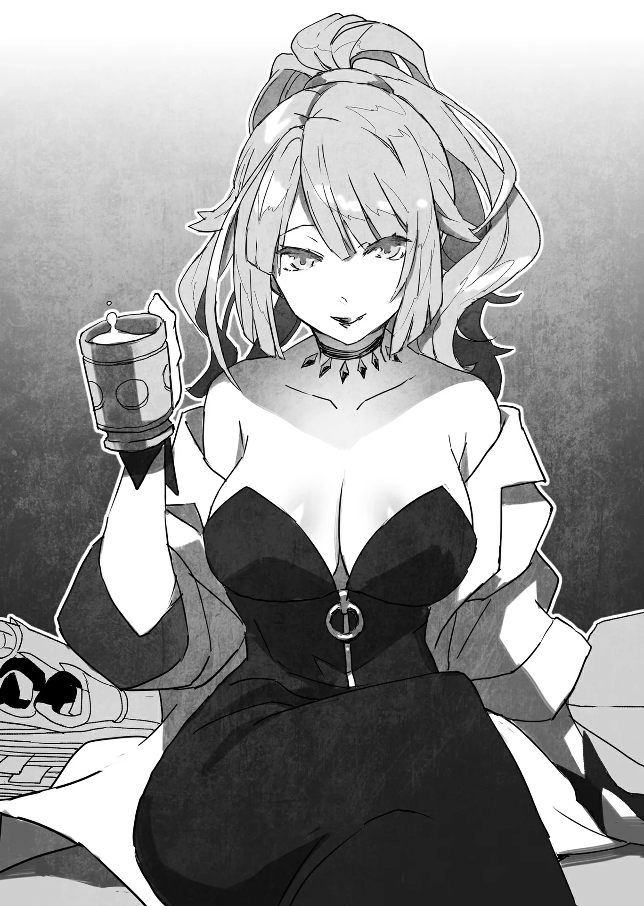

# Chương 111: Phần kết Tập 4

"Ồ, anh về rồi đấy à. Thế chuyện bên đó thế nào rồi?"

Rời Thương hội Stheno trở về, vừa mở cửa bước vào dinh thự của Lorraine, thứ đầu tiên tôi nghe thấy chính là tiếng của cô.

Tiếng của Lorraine... rốt cuộc tôi cũng đã về đến nhà. Cảm xúc ấy cứ thế trào dâng từ tận đáy lòng tôi.

Lần này tôi vừa bước qua một lằn ranh khá hiểm nghèo; chính tôi cũng tự hiểu điều đó. Có lẽ tôi đã hơi bất cẩn một chút, nhưng làm sao tưởng tượng nổi chuỗi sự việc lại diễn ra như thế. Tôi vốn chỉ định đi bán ít nguyên liệu thôi mà. Chuyện hy hữu đến mức chẳng khác nào đang đi giữa đường phố Maalt mà bị thiên thạch rơi trúng đầu.

Dù lần này tôi bình an vô sự, nhưng cô gái tên Nive ấy có trực giác rất nhạy khi đánh hơi Ma Cà Rồng. Chắc chắn một ngày nào đó chúng tôi sẽ lại chạm mặt nhau.

"Có khá nhiều... chuyện ngoài dự tính xảy ra. Nhưng tôi vẫn ổn."

"Gì cơ...? Anh lại vướng vào chuyện kỳ quặc gì nữa rồi à?" Lorraine nói, nét mặt thoáng vẻ bực mình. Dù vậy, cô vẫn sẵn lòng lắng nghe những gì tôi sắp kể.

"Dù sao thì cũng ngồi xuống đi đã, rồi nói cho rõ xem nào."

◆◇◆◇◆

"...Nive Maris, lại còn thêm một Thánh Nữ của Giáo Hội Lobelia nữa... Dù nghĩ thế nào đi nữa thì đó cũng toàn là những người anh chẳng hề muốn chạm mặt đâu, Rentt." Lorraine thở dài khi tôi kể xong đại khái mọi chuyện.

Tôi gật đầu đáp lời. "Quả đúng như cô nói... Nhưng Nive có một bí thuật phát hiện Ma Cà Rồng, hoặc ít ra cô ấy khẳng định thế. Thứ đó lại chẳng có chút tác dụng nào lên tôi cả. Có lẽ lần này tôi gặp may."

"À, phải rồi. Là Thánh Hỏa mà anh vừa nhắc tới đấy à? Hồi ở quê nhà, tôi từng thấy một người thi triển thuật này rồi. Thời ấy, nó được xem là một bí thuật rất hiếm và được các giáo hội canh giữ hết sức cẩn mật. Vì thế, thông tin chi tiết về nó cứ gọi là mù mờ hết sức, nhưng khi bắt tay vào tìm hiểu thì tôi thấy thú vị vô cùng. Đáng tiếc là dù tôi có hỏi han thế nào cũng chẳng ai chịu nói cho nghe. Vốn dĩ nghe đâu những ai không được Thần Lực ban phước thì không tài nào nhìn thấy ngọn lửa ấy, đúng chứ? Vậy nghĩa là người thi triển ở quê tôi đã cố tình làm cho ngọn lửa hiện rõ lên... Hừm. Hồi đó tôi từng đề nghị họ làm cho xem để nắm rõ cơ chế vận hành của nó, nhưng họ nhất quyết không chịu hợp tác đấy chứ."

"Mà này, Rentt... Thuật dò tìm ấy thật sự không có chút tác dụng nào lên anh sao? Kể cả khi anh đúng là một dạng Ma Cà Rồng đi nữa?"

Chính tôi cũng chẳng thể trả lời câu hỏi ấy. Nive từng tự tin tuyên bố cô có thể phát hiện và vạch mặt Ma Cà Rồng trăm phát trăm trúng. Nếu coi đó đúng là sự thật và lần theo mạch suy nghĩ ấy...

"...Có khi nào tôi hoàn toàn chẳng phải Ma Cà Rồng không nhỉ...?" Tôi lẩm bẩm, tự nói với chính mình nhiều hơn là với ai khác. Lorraine cũng trầm ngâm suy nghĩ một hồi rồi mới đưa ra nhận định.

"Cũng không phải là không thể đâu. Ngay từ đầu, Rentt à, chúng ta vốn đâu có cách nào khẳng định chắc chắn anh thực sự là Ma Cà Rồng. Khô Lâu, Ngạ Quỷ, Thi Quỷ, Ma Cà Rồng... Nhìn bề ngoài thì anh liên tục tiến hóa từ quái vật Undead này sang quái vật Undead khác, đúng chứ? Chẳng qua chúng ta chỉ phỏng đoán rằng anh có thể là một dạng Ma Cà Rồng nào đó thôi. Ngay từ hồi còn là một đống xương biết đi, anh vốn đã chẳng giống một Khô Lâu bình thường rồi. Xét hết mọi chuyện đó thì Rentt à, điều ấy hoàn toàn có thể xảy ra đấy."

Lorraine nói có lý, dù đó là một nhận định vừa sắc bén vừa nan giải.

Nói thật lòng thì đúng như cô nói, chính tôi cũng chẳng hiểu rõ bản thân hiện tại là thứ gì. Tôi là quái vật ư? Hay không phải? Ranh giới giữa hai bên, có nhìn nhận tích cực nhất thì cũng hết sức mập mờ. Tôi thực sự chẳng tài nào biết được.

Nhưng dựa vào những gì chúng tôi quan sát bấy lâu, khả năng tôi là quái vật quả thực rất cao. Nói đúng hơn thì, nếu tin theo mạch lập luận hiện tại, tôi hẳn phải là một dạng quái vật nào đó.

Thế nhưng nếu lật ngược lại vấn đề theo lời Lorraine, liệu có phải ngay từ đầu, tôi đơn thuần chỉ là một thực thể giống Khô Lâu chứ không thực sự là Khô Lâu? Cứ theo đà đó thì chẳng cách giải thích nào nghe thỏa đáng được. Khi ấy, mọi dự đoán về tương lai của tôi chỉ còn biết dựa vào những bước tiến bản thân đã trải qua cho tới lúc này.

Dù sao đi nữa, suốt thời gian qua tôi vẫn liên tục tiến hóa, hệt như Tiến Hóa Bản Thể của lũ quái vật. Thế cũng được rồi, ít nhất tôi cũng có cái để làm mốc đối chiếu.

Về chuyện này, Lorraine đã tốn nhiều thời gian suy ngẫm hơn tôi rất nhiều.

"Giờ mới nói điều này thì hơi muộn, Rentt à, nhưng ngay từ đầu chúng ta vốn đã biết anh khác hẳn quái vật thông thường rồi. Lúc nãy anh vừa nhắc tới đấy thôi, đúng không? Rằng Thần Lực chẳng có chút tác dụng nào lên anh. Đó là vì anh rất đặc biệt, Rentt. Kết luận hiển nhiên là thế. Đến nước này thì biết được chừng ấy có lẽ cũng đủ rồi. Khả năng rõ ràng tiếp theo là do anh vốn được ban cho trữ lượng Thần Lực, không như lũ Undead thông thường. Chẳng lẽ đó lại không phải là nguyên nhân sao?"

"Thần Lực sao..."

Theo lời Nive, Ma Cà Rồng rất kỵ Thần Lực. Đơn giản là không đời nào có chuyện tồn tại một con Ma Cà Rồng lại biết dùng sức mạnh thần thánh.

Thế nhưng tôi vẫn dùng Thần Lực của mình bình thường. Còn vì sao sau khi biến thành sinh vật giống Ma Cà Rồng mà tôi vẫn dùng được nó thì tôi chịu, chẳng tài nào hiểu nổi. Hay đây là đặc tính còn giữ lại từ thời tôi còn sống và từng dùng qua nó?

Ít nhất thì cảm giác mỗi lần dùng Thần Lực của tôi chẳng hề thay đổi chút nào. Chuyện đó thì tôi dám chắc. Phải chăng Lorraine muốn nói rằng chỉ cần bản thân có sẵn Thần Lực trong người là sẽ miễn nhiễm với nó, kể cả khi bị kẻ khác đem Thần Lực đánh lên mình?

Nếu đúng như lời Nive nói thì Thánh Hỏa sẽ gây ra đau đớn tột cùng cho Ma Cà Rồng. Thế mà tôi lại chẳng thấy như vậy chút nào trước Thần Lực. Đó là lý do ngọn lửa ấy không có tác dụng sao...? Vì tôi là một thực thể đặc biệt gần giống Ma Cà Rồng, chứ hoàn toàn không phải Ma Cà Rồng thực thụ? Ngẫm lại thì điều đó có vẻ dễ tin hơn...

Lorraine nói tiếp: "Với chất độc, ma pháp hay những thứ tương tự cũng thế thôi, đúng không? Nếu một người có sẵn kháng tính thì các đòn tấn công đó sẽ mất tác dụng hoặc bị triệt tiêu. Chuyện ấy thì quá dễ hiểu rồi. Đơn giản mà, đúng chứ? Rentt, theo tôi nhớ thì Thần Lực của anh là có được nhờ sửa lại ngôi đền cũ ở quê nhà, đúng không?"

Cách đây một thời gian, tôi từng kể cho Lorraine nghe lý do vì sao ban đầu tôi được ban cho Thần Lực. Đó cũng chẳng phải chuyện gì to tát nên tôi chẳng việc gì phải giấu.

Trong số những người bạn thời tôi còn sống, hiếm ai biết tôi được ban cho cả ba nguồn năng lượng. Chuyện đó tuy cực kỳ hiếm thấy, nhưng tôi lại chẳng thể phát triển được tiềm năng của mình. Hoặc đơn giản là do tôi cái gì cũng biết một chút nhưng chẳng tinh thông món nào. Ngày trước chuyện của tôi vốn là như thế.

Dù nhìn theo cách nào thì đó cũng là lời miêu tả rất chuẩn xác...

"Đúng vậy. Ngôi đền ấy vốn khá xập xệ... Thực ra phần lớn nó đã bị cây cối trong rừng che lấp. Hơn phân nửa dân làng ở quê tôi còn chẳng biết đến sự tồn tại của nó. Tôi thấy hơi tiếc... nên đã tự tìm cách dọn sạch bụi rậm xung quanh, quét tước sạch sẽ rồi chỗ nào hỏng thì sửa lại. Việc ấy cũng ngốn kha khá thời gian, nhưng đó là chuyện từ trước khi tôi trở thành mạo hiểm giả cơ. Hồi ấy tôi có khối thời gian rảnh."

"Anh nói nghe đơn giản ghê, Rentt. Cứ làm như sửa một ngôi đền là xong ngay được ấy. Dù anh nói thế nào thì việc đó cũng đòi hỏi tay nghề không vừa đâu, đúng không?"

"Một bác thợ mộc trong làng đã chỉ dạy cho tôi những thứ cần biết. Mắt tôi vốn nhìn chi tiết và căn độ chuẩn xác khá tốt nên học mấy điều cơ bản rất nhanh, còn lại thì cứ vừa làm vừa mò mẫm thôi. Phải nói đó là một đợt rèn luyện rất tốt."

"Vẫn tháo vát như mọi khi nhỉ... Ấy thế mà giữa bao nhiêu thứ, anh lại thiếu đúng tư chất để thăng tiến trong nghề mạo hiểm giả. Các vị thần nghiệt ngã thật đấy, đúng không?"

"Tôi không nghĩ thế đâu. Dù sao thì giờ tôi cũng thừa sức nhắm tới đỉnh cao rồi. Biết đâu trong trường hợp của tôi, các vị thần thực ra lại tương đối nhân từ ấy chứ."

"Anh lạc quan quá mức rồi đấy, Rentt à. Nhưng cũng phải thôi, đó đúng là một trong những điểm tốt của anh mà. Mà anh bảo đó là một ngôi đền đúng không? Ngôi đền ấy dựng lên để thờ vị thần nào vậy?"

"À thì..." Tôi chẳng có câu trả lời cụ thể nào. "Tôi cũng chịu. Dù sao đó cũng là ngôi đền chẳng ai lui tới mà. Có lẽ mấy cụ cao niên trong làng sẽ biết đôi điều về nó..."

"Thế à... Vậy thì Rentt này. Hay chúng ta làm một chuyến về làng của anh đi?" Lorraine đột nhiên đề nghị mà chẳng báo trước câu nào.

