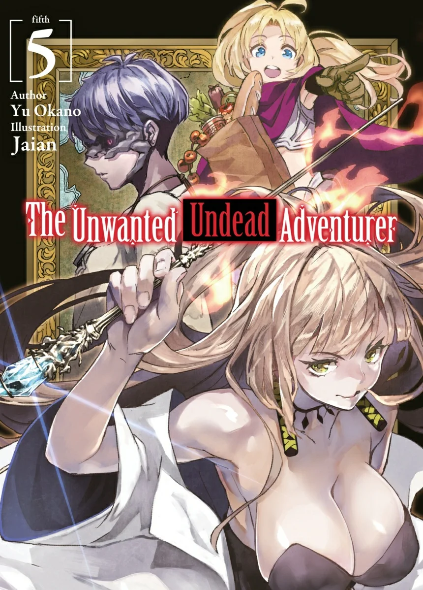
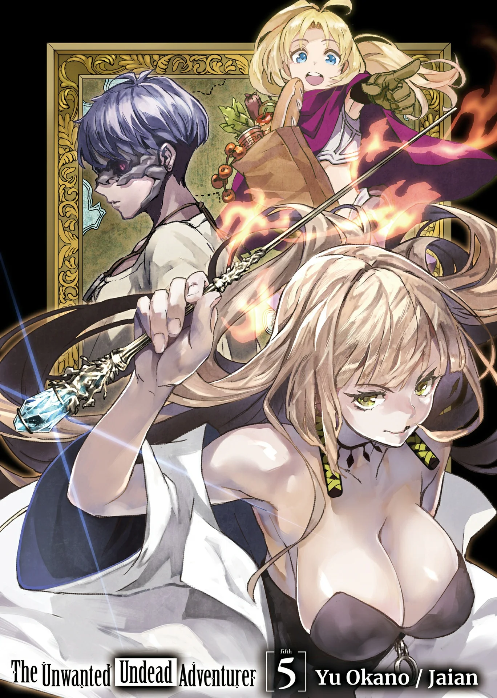
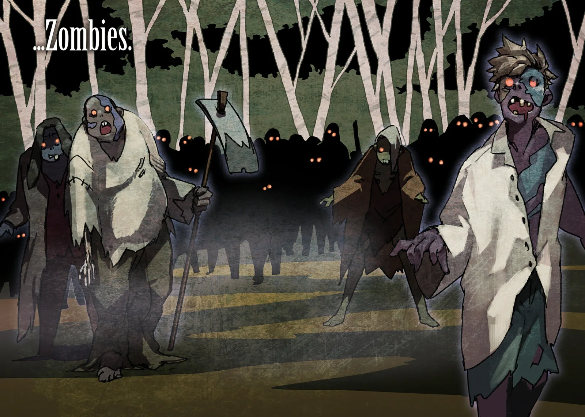
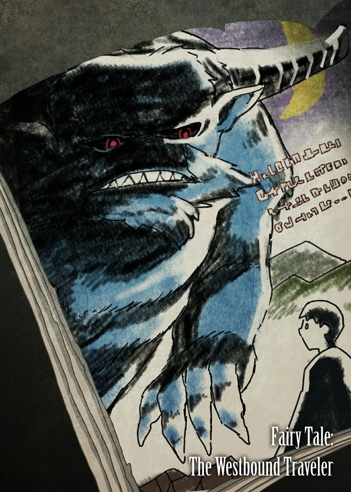
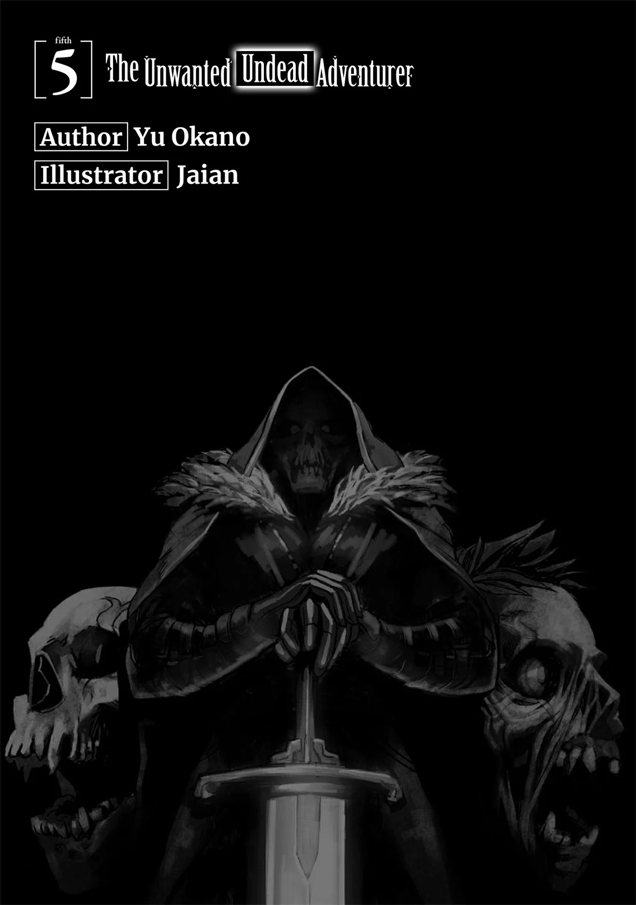
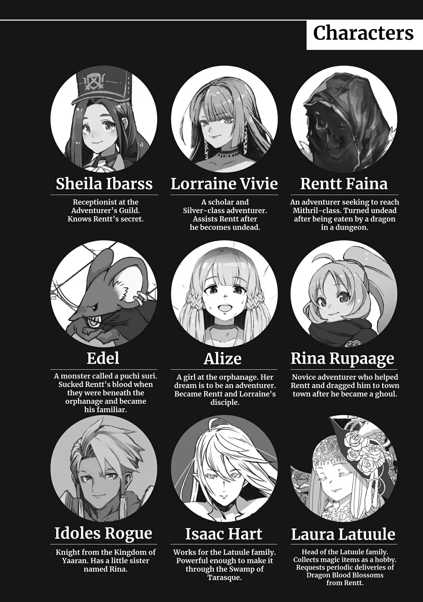
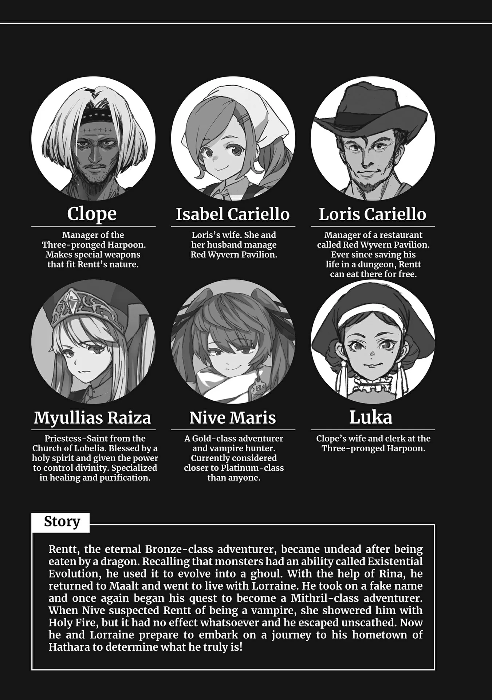
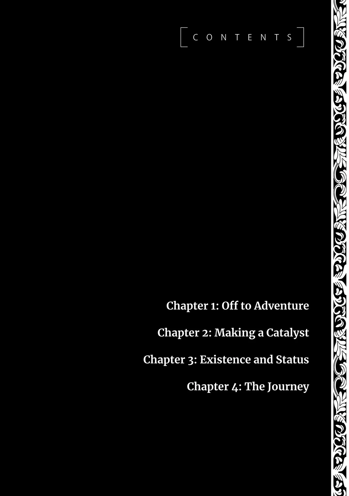
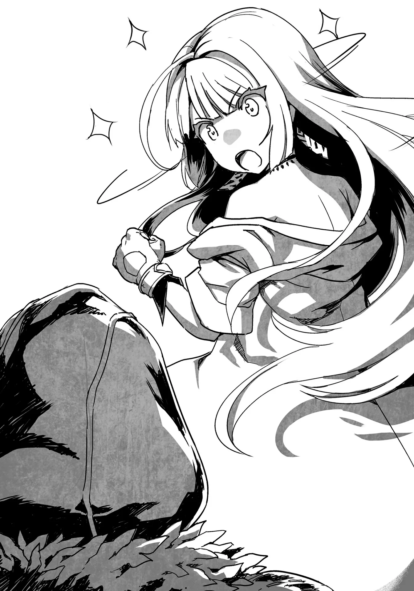

# Chương 115: Tập 5 Chương 1 - Lên Đường Mạo Hiểm (1)

Tôi chưa từng nghĩ chỉ một người phụ nữ lại có thể sở hữu nhiều sách đến thế.

Dù đã nhiều lần chứng kiến sự giàu có của gia tộc Latuule, tôi vẫn phải trầm trồ khi tận mắt thấy kho sách của họ. Bản thân Lorraine cũng có cả đống sách, nhưng thư viện của cô chẳng thấm vào đâu so với quy mô nơi này. Đã vậy, cô chỉ tập trung vào các lĩnh vực nghiên cứu của mình, còn gia tộc Latuule dường như có sách của đủ mọi thể loại.

"Cũng mất bao năm trời mới gầy dựng được bộ sưu tập này đấy. Thật ra cứ có đủ thời gian thì việc đó cũng chẳng khó khăn gì cho lắm," Laura nói.

Isaac tìm kiếm bất cứ thứ gì viết về Thần Lực có thể giúp ích cho tôi, để tôi với Laura rảnh rang đứng nhìn. Tôi đứng nhìn người quản gia rà soát khắp các kệ sách, leo lên bước xuống thang mà đâm ra áy náy. Dù sao thì anh ta bận rộn lục tìm khắp thư viện này cũng chỉ vì tôi. Đáng ra tôi nên giúp một tay, ngặt nỗi tôi chẳng biết cuốn nào ở đâu mà lần.

Nhìn bước chân dứt khoát của Isaac giữa các dãy kệ là biết anh ta đã thuộc lòng cách bài trí nơi này. Công việc này chẳng làm khó được anh ta, chỉ là kho sách quá đồ sộ nên phải tốn chút thời gian mà thôi.

Anh ta chất lên bàn nhiều sách tới mức tôi đếm không xuể. Tôi tự hỏi liệu có cần nhiều đến mức này không. Chẳng phải tôi ghét đọc sách, nhưng xét cho cùng tôi vẫn chỉ là một mạo hiểm giả bình thường. Đọc hiểu thì tôi vẫn đọc được, kể cả những văn bản tương đối phức tạp, nhưng sách chuyên môn thì lắm lúc cũng khá hóc búa. Khoản này chắc tôi phải nhờ cậy Lorraine rồi.

"Sách vở chẳng bao giờ xuống giá nhỉ? Chắc chẳng đời nào tôi mua nổi từng này cuốn."

"Thật vậy sao, ngài Rentt? Tôi có nghe phong thanh về những chiến tích gần đây của ngài đấy. Kể cả không tính đến ủy thác của tôi, nghe đồn ngài cũng kiếm được bộn tiền nhờ bán các bộ phận của Tarasque mà."

Đúng là thu nhập của tôi dạo này đã dư dả hơn hẳn. Hôm nọ tôi vừa bán được các bộ phận của Tarasque, và dẫu ủy thác Hoa Long Huyết của Laura không phải lý do chính cho lần ghé thăm này, tôi vẫn quyết định ít nhất phải giao một đợt trước khi lên đường. Tôi có mang theo một ít bên người và ban nãy vừa nhận tiền thù lao xong.

Nive vẫn còn ở trong thị trấn nên tôi chỉ muốn rời Maalt càng sớm càng tốt, nhưng đi đường dài thì phải chuẩn bị kỹ lưỡng. Dự tính khâu chuẩn bị sẽ mất khoảng một tuần, nên tôi định tạt qua Đầm Lầy Tarasque lần nữa để hái thêm một đợt hàng về giao. Nhờ chuyến đi trước mà tôi đã nắm sơ được địa hình, vả lại đầm lầy độc vốn chẳng làm hại được tôi. Giờ tôi có thể tìm đến chỗ Hoa Long Huyết nhanh hơn trước nhiều, nên việc tranh thủ lúc chuẩn bị để đi hái thêm một ít hoàn toàn nằm trong tầm tay.

Đã vậy, từ Orc cho đến các loài quái vật khác, tôi còn thu thập được nhiều loại nguyên liệu mê cung hơn hẳn trước kia. Chừng ấy là quá đủ để trang trải cuộc sống rồi.

Thế nhưng sách vở vẫn là thứ xa xỉ ngoài tầm với. Dĩ nhiên mua dăm ba cuốn thì tôi mua được, nhưng chẳng thấm vào đâu so với số lượng bày la liệt ở nơi này. Chỗ này chắc phải tốn hàng ngàn, nếu không muốn nói là hàng vạn đồng bạch kim. Khi chạm tới những con số khổng lồ cỡ đó, người ta tính theo đơn vị đồng mithril thì hợp lý hơn. Có điều tôi chưa từng được tận mắt thấy một đồng nào như thế. Chúng chỉ được giao dịch giữa chính quyền và các thương đoàn lớn; dân thường chẳng bao giờ có cơ hội nhìn thấy chúng. Dẫu vậy, tôi đoán Laura hẳn phải sở hữu một lượng nhiều đến mức đáng kinh ngạc.

Gạt chuyện đó sang một bên, có điều này làm tôi thắc mắc.

"Tin tức lan truyền nhanh thật đấy. Tôi mới bán các bộ phận của Tarasque gần đây thôi mà."

Laura mỉm cười. "Mọi chuyện xảy ra ở Maalt đều lọt vào tai gia tộc Latuule cả thôi."

Ngẫm lại câu trả lời của cô bé, tôi thấy hơi rợn người. Tôi không rõ lời đó thật hư ra sao, nhưng gia tộc của cô bé quả thật có ảnh hưởng rất lớn đến bộ máy vận hành Maalt. Có lẽ việc họ nắm rõ ngay cả những giao dịch nhỏ nhặt nhất giữa một cá nhân với một cửa hiệu buôn bán cũng chẳng có gì đáng ngạc nhiên.

Isaac lên tiếng xen ngang: "Tôi tin chừng này chắc đã đủ rồi, thưa ngài." Anh ta kết thúc lượt tìm kiếm khắp thư viện và đứng cạnh một chồng sách. Thay vì xếp tất cả vào một chỗ, anh ta đã chia chúng thành ba phần riêng biệt.

Isaac ra hiệu về phía một trong các chồng sách. "Những cuốn này viết về cách ứng dụng Thần Lực, chẳng hạn như thánh ma pháp, ma pháp thần thánh hay thánh kiếm thuật. Tôi đề xuất ngài nên bắt đầu với những cuốn này."

Các dạng thức của Thần Lực hẳn bao gồm ma pháp thần thánh và thánh ma pháp. Còn thánh kiếm thuật, tôi đoán đó là việc dùng trang bị thần thánh làm chất xúc tác để vận dụng Thần Lực. Dù vậy, tôi chẳng biết nhiều về chủ đề này cho lắm. Nhắc tới Thần Lực, tôi chỉ nắm được những chi tiết sơ sài nhất. Dù có muốn tìm hiểu kiến thức đó đi chăng nữa, phần lớn cũng không được phổ biến ra ngoài. Cách duy nhất là tự mình mày mò tìm hiểu.

Isaac chỉ tay sang chồng sách thứ hai và nói tiếp: "Những cuốn thư tịch này viết về các thần tinh linh, cội nguồn của Thần Lực. Hẳn ngài cũng biết người ta thường nói thần tinh linh nhiều không đếm xuể, nên chỗ này vẫn chưa bao quát hết được. Có điều, chúng không chỉ miêu tả về các thần tinh linh mà còn chứa đựng vô số ghi chép về cách thức họ hình thành, vì thế để đọc hiểu hết có lẽ sẽ tốn kha khá thời gian và vốn hiểu biết. Tôi khuyên ngài nên nghiền ngẫm chúng từ từ."

Có vô vàn câu hỏi phức tạp xoay quanh các thần tinh linh. Phần lớn các tôn giáo muôn hình vạn trạng trên thế giới này đều thờ phụng những vị thần khác nhau. Ngay cả những nơi tôn thờ cùng một vị thần cũng có những truyền thuyết khác biệt. Trong lịch sử đã nổ ra biết bao cuộc chiến tranh tôn giáo, không ít lần khiến cả một giáo phái lẫn vị thần họ tôn thờ bị xóa sổ hoàn toàn. Muốn nghiên cứu thấu đáo chủ đề này đòi hỏi phải có vốn học thức vô cùng đồ sộ.

Tôi thì làm gì có được vốn học vấn như thế, nên đành phải nhờ cậy Lorraine. Ngại nhờ vả cô quá nhiều thì có ngại thật, nhưng dù sao cô cũng say mê nghiên cứu. Cơ hội được đọc vài cuốn sách mới có lẽ sẽ khiến cô vui lòng. Dẫu vậy, tôi biết mình nên thấy biết ơn. Tôi luôn trân trọng tất cả những gì cô đã làm cho tôi cả về thể chất lẫn tinh thần.

"Những cuốn thư tịch cuối cùng này viết về điểm đến tiếp theo của ngài, Làng Hathara. Chúng chứa đựng những mẩu chuyện dân gian quanh vùng đất ấy. Không có nhiều sách vở về chủ đề này cho lắm, nhưng tôi tin rằng chúng có thể sẽ giúp ích được phần nào."

Chồng sách cuối cùng mà Isaac nhắc tới nhỏ hơn hẳn hai chồng kia. Thật ra gọi là một chồng thì cũng chẳng đúng lắm, bởi ở đó chỉ có vỏn vẹn hai cuốn. Dẫu vậy, tôi vẫn không khỏi bất ngờ khi biết những cuốn sách ghi chép các mẩu chuyện dân gian bản địa ấy lại thực sự tồn tại. Làng quê hay thị trấn nào cũng có vài câu chuyện dân gian, nhưng hiếm khi có ai kỳ quặc tới mức cố công gom góp tất cả lại thành sách. Lẽ ra việc hoàn toàn không có cuốn sách nào thuộc thể loại đó mới là điều bình thường. Vậy mà ở đây lại có tới hai cuốn.

Tôi lật giở từng trang của cả hai cuốn sách. Một cuốn là sách tranh, trong khi cuốn kia là những bài viết về văn học dân gian từ khắp mọi vùng quanh Maalt, chứ không chỉ riêng Hathara. Giờ thì tôi đã hiểu vì sao chúng lại tồn tại. Ngay cả cuốn sách tranh cũng khắc họa những câu chuyện nổi tiếng từ Maalt cùng các vùng lân cận. Thời thơ ấu, tôi từng được nghe trưởng làng kể vài câu chuyện trong số này. Đọc lại, lòng tôi dâng lên một cảm giác hoài niệm.

"Chừng này là quá đủ rồi. Tôi tin chắc chúng sẽ giúp tôi tìm ra manh mối nào đó. Đọc hết chỗ này có vẻ sẽ mất khá nhiều thời gian, nhưng tôi có một người bạn sẽ rất hào hứng với chuyện đó đấy."

"Ý ngài là Lorraine sao?" Laura hỏi.

Cô bé nói tỉnh bơ như thể chuyện mình biết tỏng là điều đương nhiên. Điều ấy khiến tôi hơi giật mình, nhưng cũng đành chịu thôi.

"Phải rồi. Đúng vậy. Đống sách này hẳn sẽ khiến cô ấy thích mê."

Thư viện ngập tràn những đầu sách mà tôi chưa từng thấy bao giờ. Những chiếc giá ở hai đầu căn phòng chứa những cuốn sách mà người ta có thể tìm thấy ở bất kỳ hiệu sách nào tại Maalt, nhưng chỗ đó chỉ chiếm một phần nhỏ mà thôi. Các kệ sách khác chất kín những cuốn tôi chưa từng thấy ngoài tiệm, thậm chí ở nhà Lorraine cũng không có. Nếu Lorraine có mặt ở đây, cô ấy rất có thể sẽ xem nơi này chẳng khác nào một kho báu. Lúc nhắc đến cô ấy ban nãy, trong đầu tôi chỉ toàn hình dung ra cảnh đó.

"Nếu vậy thì lần tới ngài cứ thoải mái dẫn Lorraine tới đây cùng nhé. Dạo gần đây tôi cũng không dùng căn phòng này nhiều cho lắm. Tôi chắc rằng những cuốn sách cũng sẽ rất vui khi có ai đó ghé qua đọc chúng," Laura đáp.

"Cô bé không phiền thật chứ? Lorraine có thể dành cả ngày ở đây đấy. Cô ấy thậm chí có khi còn chẳng chịu về nữa là."

Lorraine vẫn có nhận thức thông thường và biết phép tắc xã giao, nhưng mỗi khi nhìn thấy một cuốn sách hợp gu, đầu óc cô ấy rất dễ bị lỏng vài con ốc. Có điều, nếu biết tôi nói câu đó, cô ấy có thể sẽ nổi đóa lên và khăng khăng rằng mình đâu có tệ đến mức ấy.

Lời cảnh báo của tôi chẳng hề làm Laura bận tâm. "Không sao đâu. Cô ấy có thể đến và đi tùy thích. Tôi cũng đang muốn có một người bạn để vừa uống trà vừa trò chuyện đây," cô bé nói.

Một người bạn ư? Tôi tự hỏi liệu có phải Laura đang cô đơn hay không. Nghĩ vậy về một thân chủ thì hơi thất lễ, nhưng người đứng đầu một gia tộc hiển hách cỡ đó có lẽ cũng khó lòng tìm được bạn bè. Tôi thấy chuyện ấy chẳng khó hình dung chút nào. Nhưng biết đâu đó chỉ là một cái cớ, có lẽ cô bé nói vậy để người khác khỏi phải ngại ngùng mà thôi.

"Vậy thì tôi sẽ nói lại chuyện đó với Lorraine khi gặp cô ấy. Nhưng để cho chắc, tôi xin hỏi lại lần nữa. Cô bé thực sự chắc chắn chứ?" Tôi muốn có một lời xác nhận sau cùng.

Laura gật đầu. "Vâng, hoàn toàn chắc chắn," cô bé trả lời với vẻ thích thú.

◆◇◆◇◆

Tôi rời khỏi dinh thự Latuule, ghé qua nhà Lorraine đón cô, rồi cả hai cùng đến cô nhi viện.

"Nhân tiện, Laura Latuule bảo lần tới tôi có thể dẫn cô đi cùng đấy," tôi báo cho Lorraine biết trên đường đến đó.

Cô ấy tỏ vẻ sững sờ. "Thật sao? Mọi điều anh kể về cô ta khiến tôi nghĩ cô ta là một người phụ nữ quyền lực nhưng thích sống ẩn dật cơ đấy."

Lorraine biết gần như mọi điều cần biết về các gia tộc cai quản thành phố này, nhưng gia tộc Latuule dường như là lỗ hổng duy nhất trong vốn hiểu biết của cô. Lịch sử, tính cách và tư tưởng của họ, cô chỉ có thể đoán chừng qua những gì nghe tôi kể lại.

Bản thân tôi cũng từng thử dò la về họ, nhưng chẳng thu được kết quả gì. Có thể gia tộc Latuule đủ thế lực để bưng bít mọi sự thật, hoặc cũng có thể ngay từ đầu vốn chẳng có mấy điều để điều tra. Có điều, sau khi tận mắt chứng kiến tòa dinh thự cùng vị gia chủ và Isaac, tôi thấy khả năng thứ hai khó mà xảy ra.

Càng nghĩ tôi càng thấy gia tộc này kỳ lạ, nhưng họ lại tử tế với tôi một cách đáng kinh ngạc. Chừng đó vẫn chưa đủ sao? Chưa ư? Ừ thì dĩ nhiên là chưa. Thế nhưng mỗi lần tiếp xúc với họ, tôi chẳng mảy may cảm thấy cần phải đề phòng. Từ trước tới giờ, tôi toàn nhận được những thỏa thuận hậu hĩnh, những món quà thú vị, thậm chí còn được họ giúp tìm tài liệu cho chuyện riêng của mình. Họ đối xử với tôi chỉ toàn là lòng tốt.

Đôi khi tôi tự hỏi liệu họ có mưu tính thầm kín nào không. Thú thật thì hẳn là phải có rồi. Tôi đã nỗ lực hết sức mình, nhưng tôi vẫn chỉ là một mạo hiểm giả Đồng Cấp thấp kém. Những năng lực quái vật cùng khả năng thao túng cả Ma Lực, Khí Lực lẫn Thần Lực cùng một lúc biến tôi thành một mẫu vật hiếm có, nhưng nếu chỉ xét về sức mạnh thuần túy, khá lắm thì tôi cũng chỉ miễn cưỡng vượt qua mức của một Ngân Cấp mà thôi. Những mạo hiểm giả có thực lực cỡ đó ngoài kia chẳng hề thiếu. Gia tộc này đâu cần phải lãng phí thời gian vào một kẻ như tôi.

Phán đoán duy nhất của tôi là họ có cùng mục tiêu với Nive và muốn bắt giữ một Ma Cà Rồng. Nhưng nếu đúng là thế, họ hẳn đã ra tay từ lâu rồi. Dù chưa từng tận mắt chứng kiến thực lực của Isaac, nhưng một con người có thể một mình giải quyết êm xuôi chuyện ở Đầm Lầy Tarasque chắc chắn không phải dạng vừa. Nếu đôi bên từng giao chiến, tôi buộc phải cho rằng mình sẽ thua. Và khi biết được quy mô khối tài sản của gia tộc Latuule, Isaac không thể nào là người duy nhất chiến đấu cho họ. Họ có thể giam cầm tôi mà chẳng tốn mấy công sức.

Tôi cũng cân nhắc khả năng họ có toan tính nào đó khi để tôi tự do hành động dưới sự giám sát của mình, nhưng toan tính ấy có thể là gì chứ? Họ chẳng có gì để hưởng lợi cả. Tôi tuy đặc biệt, nhưng tất cả những gì tôi làm chỉ là đi vào mê cung, săn quái vật và giao hàng. Đôi khi tôi lang thang hết đêm này qua đêm khác. Nếu ngay cả tôi cũng có thể hoàn thành mục tiêu của họ, thì việc họ tự mình làm ắt hẳn phải nhanh hơn nhiều.

Vì lẽ đó, tôi không nghĩ họ có toan tính mờ ám nào cả.

Hoặc ít ra thì phần nhiều là không.

Nếu vậy thì Laura chọn đối xử tốt với tôi chỉ vì rất khó tìm được ai có thể đến Đầm Lầy Tarasque, đúng như lời cô bé đã nói. Đó là một mục đích đơn giản, dễ hiểu và hết sức bình thường. Sự hào phóng của cô bé có vẻ cũng chẳng phải vì đánh giá tôi có giá trị đặc biệt gì. Chỉ đơn giản vì cô bé là một người cực kỳ tốt bụng mà thôi.

Ừm.

"Nói là sống ẩn dật thì không hẳn, đúng hơn là cô bé thích sống lặng lẽ thôi. Cô bé không muốn gây chú ý, nhưng theo tôi thấy thì cũng chẳng phải đang lẩn trốn điều gì," tôi đáp lời Lorraine.

Cô ấy lộ vẻ băn khoăn. "Vậy tại sao khi tôi thử tìm hiểu về cô ta, tôi lại hầu như chẳng tìm thấy bất cứ thứ gì?"

"Hầu như ư? Ý cô là cô đã mò ra được thứ gì đó chứ không phải hoàn toàn trắng tay sao?"

"Phải. Tôi đã tìm thấy họ của gia tộc cô ta trong vài biên bản họp cũ của hội đồng thành phố. Có vẻ như gia tộc cô ta thực sự có tham gia vào việc điều hành thành phố. Nhưng dạo gần đây họ hầu như chẳng làm bất cứ điều gì cả. Và nói là gần đây, ý tôi là trong vòng một thế kỷ qua đấy."

"Điều tra ra được chừng đó cũng cừ thật đấy."

Các cuộc họp hội đồng do lãnh chúa địa phương chủ trì và có sự tham gia của nhiều gia tộc có thế lực ở Maalt nhằm quyết định phương thức điều hành thành phố. Những biên bản cuộc họp sẽ không được cho thường dân xem. Thế nhưng bằng cách nào đó, Lorraine đã xoay xở để đọc được chúng.

"Tôi nhờ người ta giúp chút thôi. Họ yêu cầu tôi đền đáp bằng việc điều chế một ít thuốc, nhưng chuyện đó chẳng có gì to tát cả."

Tức là một cuộc trao đổi có qua có lại. Thuốc do Lorraine điều chế bằng thuật giả kim có hiệu quả cực kỳ cao. Chắc hẳn cô đã được một người quen biết rõ điều đó ngỏ lời nhờ cậy.

Tay nghề của Lorraine rất cừ, nhưng cô chỉ bán những món hàng thông thường nhất cho các hiệu thuốc và Hội Mạo Hiểm Giả ở Maalt. Cách duy nhất để có được thuốc đặc chế từ cô là thương lượng riêng, ngặt nỗi cô luôn đặt việc nghiên cứu lên hàng đầu. Lorraine thường xuyên từ chối các lời yêu cầu; chỉ vào những dịp như thế này cô mới chấp thuận.

"Ngón nghề của cô đôi khi quả thực rất tiện đấy. Đáng ra hồi trước tôi nên học thuật giả kim mới phải." Nếu vậy thì biết đâu hồi còn là một mạo hiểm giả Đồng Cấp bình thường, tôi đã không đến mức nghèo túng như thế. Ngay lúc đó thì suy nghĩ ấy nghe rất có lý, nhưng Lorraine lại lắc đầu.

"Bây giờ anh học thuật giả kim thì chắc được rồi, nhưng hồi trước anh chắc chắn chẳng có đủ Ma Lực cho việc đó đâu. Tôi e là hồi ấy khó mà làm nổi đấy," cô khẳng định.

Chà, hồi đó tôi thừa biết điều ấy rồi. Đó là lý do vì sao tôi chưa từng học nó, dẫu có quen biết một nhà giả kim bậc thầy.

Không có Ma Lực thì cũng chẳng phải không làm giả kim được, nhưng muốn kiếm ra tiền từ nghề này thì phải có một lượng Ma Lực nhất định. Tất nhiên mỗi lần điều chế đều có thể dùng Ma Tinh để bù vào, nhưng như thế thì vừa tốn kém vừa mất thời gian. Nếu phải đến mức ấy thì thà đi săn quái vật và giao hàng còn hiệu quả hơn.

"Vậy rốt cuộc tại sao Laura lại mời tôi?"

Lorraine quay trở lại chủ đề chính, nên tôi trả lời cô: "Thì lần trước khi ghé thăm dinh thự Latuule, tôi có kể với họ chuyện mình sắp đi tìm hiểu nguồn gốc Thần Lực trong người, tức vị thần tinh linh nào đó đã ban phước cho tôi. Thế là họ cho tôi mượn một số tài liệu để tham khảo."

"Ồ thật sao? Ý anh là sách vở ấy à? Đó là thứ nằm ngoài lĩnh vực nghiên cứu của tôi, nên tôi không có nhiều tài liệu về chủ đề đó cho lắm."

Lorraine quả thực có một số tài liệu nghiên cứu liên quan, nhưng chỉ là những thứ phổ biến đại trà mà thôi. Cô chẳng có thứ gì hé lộ những bí mật của Giáo Hội cả. Có điều, những cuốn sách tôi mượn từ Laura thoạt nhìn qua dường như chứa đầy những thông tin không dành cho người ngoài. Tôi không khỏi thắc mắc vì sao cô bé lại có chúng. Đó là một điều bí ẩn, nhưng nghĩ ngợi về chuyện ấy lúc này cũng chẳng để làm gì.

Dù sao đi nữa, tôi kể thêm cho Lorraine nghe: "Phải, là sách. Và họ cất giữ chúng trong một thư viện đồ sộ đến khó tin. Đó là một căn phòng rộng thênh thang với những giá sách chạy từ bức tường này sang bức tường khác. Ngay cả các bức tường cũng là những giá sách chật ních thư tịch từ sàn nhà lên tận trần. Mọi cuốn sách của họ trông đều rất có giá trị."

Gương mặt Lorraine bừng sáng. "Cái gì cơ?! Đó là lý do cô ta mời tôi tới sao?!"

"Đúng thế. Tôi bảo với cô bé rằng tôi có quen một con mọt sách và rất muốn cho người đó xem nơi ấy, thế là Laura bảo cô bé biết thừa tôi đang nói về cô, và cô cứ thoải mái ghé qua bất cứ lúc nào."

"Làm tốt lắm, Rentt. Giờ mà anh bảo thì tôi cũng sẵn lòng liếm ủng cho anh luôn đấy."

Trông cô chẳng giống như đang nói đùa chút nào, nên tôi nghĩ tốt nhất là mình nên từ chối cho lành.

Rồi Lorraine lấy lại bình tĩnh và nói tiếp: "Vậy là anh chỉ nhắc tới tôi như một người bạn của anh, thế mà cô ta lại biết anh đang ám chỉ tôi ư? Nghĩ kỹ lại thì chuyện đó cũng hơi rợn đấy. Anh chưa từng kể với cô ta về tôi, đúng không?"

"Không, tôi chưa từng."

Điều này thật kỳ lạ, nhưng nó cho thấy Laura sở hữu khả năng thu thập tin tức rất đáng nể. Dẫu vậy, sự quan tâm của gia tộc này dành cho tôi vẫn thật kỳ quặc. Có lẽ Lorraine cũng nghĩ như thế.

"Chà, nếu họ cho tôi mượn sách thì tôi tin chắc họ là một gia đình tuyệt vời rồi. Nhưng mất cảnh giác quá mức khi ở bên họ nghe chừng là một ý tồi đấy," cô nói.

Thế nhưng Lorraine vẫn quyết định sẽ đến thăm dinh thự Latuule. Lời hứa hẹn về những cuốn sách đã hoàn toàn mê hoặc cô.
