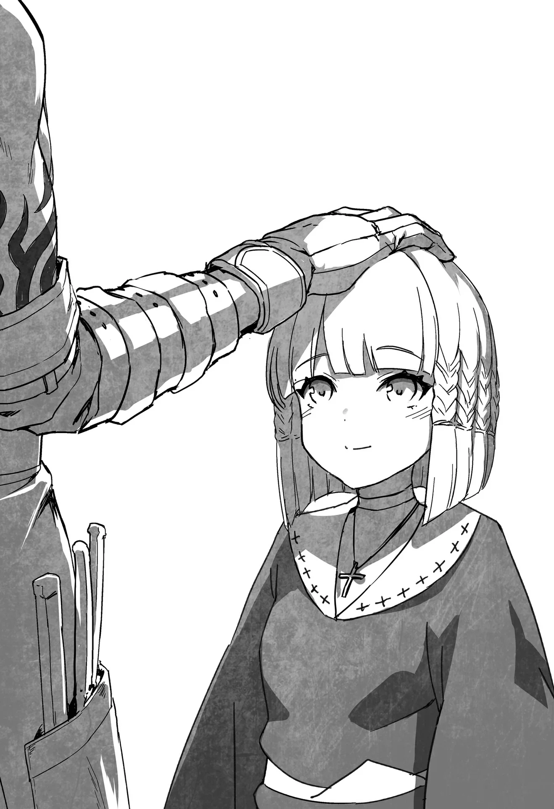

# Chương 117: Tập 5 Chương 1 - Lên Đường Mạo Hiểm (3)

"Hai người đều ở đây sao ạ? Hôm nay có việc gì cần tìm em sao?" Alize vừa hỏi vừa nhìn về phía chúng tôi.

"Ừ, có chút chuyện," tôi đáp lời.

"Dạ? Bộ có chuyện gì phức tạp lắm sao ạ?"

"Cũng không hẳn là vậy, nhưng sắp tới chúng tôi sẽ phải rời thị trấn để đi giải quyết công việc một thời gian. Tôi muốn báo cho em biết là các buổi học tạm thời sẽ phải hoãn lại," tôi thông báo cho cô bé.

Alize trông có vẻ sửng sốt. "Một thời gian là bao lâu ạ? Một năm? Hay hai năm?" cô bé hỏi dồn.

Chúng tôi đâu có ý định đi lâu đến mức ấy, nên Lorraine lắc đầu đáp lại: "Không, không đâu, chỉ khoảng hai tuần thôi. Chúng tôi sẽ sớm quay về để dạy em nhiều hơn nữa."

Alize thở phào nhẹ nhõm. "May quá đi mất. Em cứ đinh ninh hai người sẽ rời đi mãi mãi cơ chứ. Nếu chỉ có vậy thì tốt quá rồi ạ," cô bé nói.

Không phải tôi muốn rời khỏi thị trấn lâu đến thế, nhưng tôi thắc mắc tại sao cô bé lại nghĩ vậy. Tôi không kìm được bèn hỏi: "Sao em lại nghĩ chúng tôi sẽ đi mãi mãi?"

"Bởi vì anh đang nỗ lực để trở thành mạo hiểm giả Mithril Cấp mà, đúng không ạ? Nếu vậy thì việc đến vương đô sẽ giúp anh đạt được mục tiêu đó nhanh hơn nhiều. Hơn nữa cô Lorraine lại là một ma pháp sư cừ khôi, chưa kể còn là một học giả xuất sắc nữa. Em lo rằng hai người ở thành phố lớn sẽ tốt hơn nhiều so với việc ở một nơi hẻo lánh như chốn này."

Điều đó cũng dễ hiểu thôi. Đúng là tôi từng nghĩ đến chuyện chuyển đi vào một thời điểm nào đó. Song chuyện ấy vẫn còn xa vời lắm.

Dù sao đi nữa, ấn tượng của Alize về tôi xem chừng không giống với suy nghĩ của cô bé về Lorraine. Trong mắt em, tôi chỉ là người đang cố gắng đạt được điều gì đó, trong khi Lorraine đã là người thành đạt rồi. Chà, cô bé nói cũng chẳng sai.

Lorraine bật cười trước những băn khoăn của Alize. "Tôi đâu phải là học giả vĩ đại đến thế. Bản thân tôi thấy ma thuật của mình cũng tạm ổn, nhưng cũng chẳng có gì quá đỗi đặc biệt đâu. Rentt cũng vậy thôi. Đúng là anh ấy muốn đạt tới Mithril Cấp, nhưng liệu anh ấy có đủ trình độ để bươn chải ở vương đô không? Theo tôi thấy thì chưa hẳn đâu. Trước khi tính chuyện rời đi hẳn, chúng tôi sẽ dạy cho em những điều cơ bản để trở thành một ma pháp sư và mạo hiểm giả," cô tuyên bố.

Kế hoạch của chúng tôi đúng là như vậy. Những kiến thức cơ bản sẽ không mất quá nhiều thời gian để tiếp thu, vì thế chúng tôi hoàn toàn có ý định thong thả chỉ dạy cho cô bé. Một năm thì có thể hơi lâu, nhưng nếu chúng tôi đi vài tháng rồi thỉnh thoảng quay về dạy dần từng chút một thì cũng chẳng sao. Xét theo khía cạnh đó, Alize chẳng có gì phải lo lắng cả.

Cô bé gật đầu với Lorraine. "Thế thì tốt quá rồi ạ. Nếu cả hai người đều bỏ đi, em nghĩ mình sẽ chẳng bao giờ có thể trở thành mạo hiểm giả được mất," cô bé quả quyết.

"Thật thế sao? Chà, ngay cả khi chuyện đó không thành, tôi nghĩ em hoàn toàn có thể trở thành một người kể chuyện hoặc một thi nhân hát rong đấy chứ. Ít nhất là xét theo màn đọc truyện vừa rồi của em," Lorraine trêu đùa.

Đến tận lúc này Alize mới nhận ra chúng tôi đã đứng nghe em kể chuyện nãy giờ. Cô bé đỏ bừng mặt.

"Hai người nghe thấy hết rồi sao ạ? Ngại chết đi được."

Tôi an ủi cô bé: "Có gì đâu mà phải xấu hổ. Dù vậy, việc biến người lữ hành thành một đầu bếp quả là một lựa chọn thú vị đấy chứ. Em đam mê đồ ăn đến thế cơ à?"

"Anh Rentt! Đương nhiên là không phải rồi ạ, nhưng nếu có một vương quốc ẩm thực thật thì em cũng muốn ghé thăm thử xem sao," cô bé mỉm cười đáp lại.

Một vương quốc ẩm thực sao? Đương nhiên là chẳng có nơi nào như thế tồn tại rồi. Tất cả chỉ bắt nguồn từ trí tưởng tượng của Alize mà thôi. Song một vùng đất nơi bạn có thể thưởng thức mọi món ngon trên đời thì quả là một giấc mơ có thật. Ngay cả người lớn cũng khao khát được đến đó. Giới quý tộc luôn săn lùng của ngon vật lạ, thế nên họ sẵn sàng chi những khoản tiền cắt cổ để mua các bộ phận quái vật tươi sống. Quanh vùng này chẳng có gì nhiều ngoài thịt Orc, nhưng những vùng khác lại có chủng loại phong phú hơn hẳn. Trong số đó có cả nấm biết cử động lẫn cá bay.

"Nói chuyện này làm tôi thấy đói bụng rồi đấy. Mà thôi. Alize này, không nhất thiết phải là ngay bây giờ, nhưng tôi có thể xin em một chút thời gian được không?" tôi hỏi.

"Để làm gì thế ạ?" Alize hỏi ngược lại tôi.

"Tôi muốn làm cho em một bộ trang bị. Tôi đã thu thập xong nguyên liệu rồi, nhưng em cần phải đến tiệm rèn để lấy số đo. Tôi cũng dự định nhờ thợ rèn làm một vật dẫn ma thuật nữa. Nếu em muốn thì chúng ta cũng có thể làm việc đó trong hôm nay luôn."

Dẫu vậy, tôi không nghĩ cô bé sẽ nhận lời ngay tắp lự trước lời mời đường đột này. Tất cả những gì tôi muốn chỉ là báo cho em biết hôm nay sẽ không có buổi học nào, và hỏi xem hôm nào em sẽ rảnh rỗi. Tiện nhất thì đúng là giải quyết xong xuôi ngay lập tức, nhưng như thế thì hơi đòi hỏi quá. Bản thân Alize cũng bận rộn với những công việc riêng của mình.

Thế nhưng cô bé lại khiến tôi bất ngờ. "Hừm. Hôm nay em cũng không có lịch trình gì bận rộn cả, nên chắc là được thôi ạ. Có điều, em phải xin phép Sơ Lillian trước khi đưa ra câu trả lời cho hai người," cô bé nói với tôi.

Thời gian của chúng tôi tuy không phải là vô tận, nhưng chờ đợi một lát thì chẳng thành vấn đề. Nếu không được, chúng tôi hoàn toàn có thể dùng ngày hôm nay để đi mua sắm các nhu yếu phẩm cho chuyến đi sắp tới. Vì thế hai đứa tôi gật đầu.

"Được rồi, không sao đâu. Chúng tôi sẽ chờ ở đây," tôi đáp.

"Vâng ạ, em hiểu rồi. Vậy hai người đợi em một lát nhé!" Alize nói rồi rời khỏi nhà nguyện.

◆◇◆◇◆

Một lúc sau, Alize quay trở lại. Hôm nay cô bé được phép ra ngoài, thế là chúng tôi quyết định cùng nhau tới tiệm rèn. Khi xong việc ở đó, tôi dự định sẽ chế tạo một chiếc đũa phép từ các bộ phận của bầy Ent Jyulapus mà tôi từng đánh bại.

Dù vậy, nó không chỉ dành riêng cho Alize. Trong chuyến đi kéo dài hai tuần sắp tới, tôi muốn luyện tập ma thuật bằng cách sử dụng vật dẫn, thế nên tôi cũng có lý do để chuẩn bị một cây đũa phép cho bản thân mình.

"Ồ, Rentt và Lorraine đấy à. Ơ kìa..."

Đã khá lâu rồi chúng tôi mới lại ghé thăm tiệm Ba Chĩa của Clope. Vừa bước chân vào, chúng tôi đã được Luka, người vợ đang trông coi cửa tiệm của Clope cất tiếng chào đón.

Khi nhìn thấy khuôn mặt tôi, nét mặt cô ấy tràn ngập vẻ kinh ngạc, bối rối và có chút bồi hồi hoài niệm. Giờ đây chiếc mặt nạ của tôi chỉ còn che một nửa khuôn mặt, nên tôi đoán đó chính là lý do. Đã lâu lắm rồi tôi không lộ gương mặt cũ ở quanh đây, bởi vậy phản ứng của cô ấy cũng là điều dễ hiểu.

"Chào cô, lâu quá không gặp. Đây là Alize, đệ tử của chúng tôi. Chúng tôi đến đây để đặt làm chút trang bị. Anh Clope có ở đây không?" tôi hỏi.

"À, có chứ, xin đợi một lát. Tôi đi gọi anh ấy ngay đây. Anh ơi! Anh à!!!" Luka chạy vội ra lò rèn ở gian phòng phía sau rồi cất tiếng gọi lớn.

Lorraine dõi mắt nhìn theo bóng lưng cô ấy. "Anh có chắc là muốn để họ nhìn thấy mặt mình không đấy?" cô hỏi cộc lốc.

"Chà, tôi chắc là ổn thôi. Che giấu khuôn mặt mãi cũng khiến tôi chẳng thoải mái chút nào. Tôi không còn lo lắng về chuyện đó nữa rồi, không thành vấn đề đâu."

Tôi nói một cách lấp lửng vì có Alize ở đó, nhưng Lorraine hiểu rõ ý tôi. Trước kia tôi chỉ là một Undead đơn thuần, song đến lúc này, vẻ ngoài của tôi đã chẳng khác gì một con người bình thường. Thánh Hỏa cũng đã xóa tan mọi nghi ngờ về việc tôi là một Ma Cà Rồng, nên tôi cho rằng bản thân sẽ không còn rước lấy bất kỳ rắc rối nào nữa.

Alize nghiêng đầu thắc mắc, nhưng cô bé vẫn luôn hiểu chuyện như mọi khi. Cảm nhận được cuộc trò chuyện của chúng tôi không phải việc mình nên xen vào, cô bé bèn bước lùi lại rồi quan sát các món trang bị xung quanh cửa tiệm.

"Tôi hiểu rồi. Dù sao thì anh cũng có thể bằng cách nào đó dàn xếp ổn thỏa thủ tục đăng ký ở Hội Mạo Hiểm Giả, thế nên chắc là sẽ ổn thôi," Lorraine nói rồi gật đầu, thừa biết quy trình đăng ký của hội có vô số kẽ hở.

Tôi gật đầu đáp lại rồi tiến lại gần Alize khi cô bé đang ngắm nghía đống trang bị trong tiệm. "Em có ưng món nào không?" tôi hỏi.

Alize khéo léo không đụng chạm đến cuộc trò chuyện giữa tôi và Lorraine. "Em cũng không rõ nữa, nhưng em nghĩ mình không dùng được thứ gì quá nặng đâu ạ."

Cô bé nhìn về phía một thanh đại kiếm đồ sộ. Món đó ngay cả tôi cầm vào cũng thấy chật vật. Đến thời điểm này tôi đã đủ khỏe để nhấc nó lên, thậm chí có thể vung được, nhưng tôi không đủ dũng khí để sử dụng nó với tư cách một mạo hiểm giả độc hành. Còn Alize thì chắc chắn sẽ bị sức nặng của nó đè bẹp dúm mất thôi.

"Chà, em không phải bận tâm về mấy thứ khổng lồ này đâu. Vả lại, người thợ rèn mà em sắp gặp là một tay kỳ cựu đấy. Tôi khuyên em nên hỏi xin lời khuyên của anh ấy trước khi đưa ra bất kỳ quyết định nào."

"Thật thế ạ? Anh và cô Lorraine cũng sẽ giúp em chứ ạ?" Alize hỏi, giọng điệu đúng chuẩn một người đệ tử ngoan ngoãn.

Tôi tỏ ý tán thành: "Đương nhiên rồi."

◆◇◆◇◆

"Cậu chắc là mình nên làm vậy chứ?" Clope vừa bước vào vừa hỏi. Tôi đoán ý anh ấy muốn hỏi tại sao tôi lại để lộ mặt.

"Khi ra ngoài, tôi thường che kín toàn bộ khuôn mặt thế này đây," tôi đáp lại rồi nghịch ngợm chiếc mặt nạ để biến đổi hình dạng cho nó che kín tất cả, làm cho gương mặt tôi trông như một chiếc đầu lâu.

"Trước giờ tôi chẳng nhận ra chiếc mặt nạ đó có gì đặc biệt cả. Này, tháo nó ra cho tôi xem thử coi," Clope yêu cầu.

Sau khi anh ấy nhắc tới, tôi mới nhận ra rằng nhiều khả năng mình chưa từng kể cho Clope nghe về chiếc mặt nạ. Anh ấy là một thợ rèn tài ba có con mắt tinh tường không chỉ dừng lại ở vũ khí và áo giáp, nhưng tôi đồ rằng chiếc mặt nạ này quá đỗi kỳ dị đối với anh ấy. Có thể anh ấy sẽ nhận ra nó là một loại ma cụ nào đó, song sẽ chẳng bao giờ đoán ra được hiệu quả của nó đâu. Rốt cuộc thì chính tôi đã tự mình nghiên cứu và nhờ cậy Lorraine giúp đỡ mà vẫn công cốc đấy thôi. Tôi ngờ rằng chẳng ai biết thực chất nó là thứ gì.

"Nếu anh tháo được nó ra thì tôi rất sẵn lòng cho anh xem đấy," tôi cười khẩy. Anh ấy không thể nhìn thấy mặt tôi, nhưng ánh mắt tôi đã để lộ nụ cười.

Háo hức trước lời thách thức, Clope xắn tay áo lên. "Gì cơ? Được thôi, nếu cậu đã khăng khăng như thế," anh ấy nói rồi bước lại gần, đặt hai tay vào hai bên chiếc mặt nạ.

Clope dùng hết sức bình sinh giật mạnh, nhưng nó không hề suy chuyển lấy một li. Tất cả những gì anh ấy làm được chỉ là kéo căng da mặt và làm tôi đau điếng. Cũng như hầu hết thợ rèn, Clope sở hữu đôi cánh tay rất khỏe khoắn. Việc tạo ra những trang bị có thể trụ vững qua bao chuyến phiêu lưu đòi hỏi một thể lực đáng nể. Thoạt nhìn Clope có vẻ gầy gò, nhưng thực chất lại cơ bắp và dẻo dai. Và người đàn ông đó đang ra sức giật một vật dính chặt vào mặt tôi, thế nên bạn có thể hình dung ra nỗi đau đớn ấy rồi đấy. Song tôi là một dạng Ma Cà Rồng, nên khả năng chịu đựng và hồi phục của tôi rất cao. Nếu không thì da mặt tôi đã bị lột sạch từ lâu rồi. Trong một khoảnh khắc, tôi thấy mừng vì mình đã biến thành quái vật, nhưng sau khi suy xét một cách lý trí, đó cũng chính là lý do duy nhất khiến tôi phải đeo chiếc mặt nạ này.

"Tôi nghĩ thế là đủ rồi đấy," tôi bảo Clope sau khi đã thấy ngán ngẩm.

"Hả? Ồ," anh ấy thở dài rồi buông tay khỏi mặt tôi. "Nhưng mà chết tiệt thật, nó dính chặt kinh khủng. Cái quái gì với chiếc mặt nạ đó thế hả?"

"Tôi cũng chịu. Hình như nó được mua từ một gánh hàng rong, nhưng từ lúc đeo vào là tôi không tài nào tháo ra được nữa. Ít nhất thì nó cũng cho tôi một cái cớ để không phải gỡ ra, vả lại tôi có thể thay đổi diện mạo của nó nên cũng không đến nỗi tệ. Song tốt nhất là tôi chẳng muốn phải đeo thứ này suốt phần đời còn lại đâu."

Mạo hiểm giả thường hay đeo mặt nạ, nhưng tôi thì chẳng có nhu cầu đó. Hơn nữa, dù tôi không phiền lòng khi phải đeo nó trong những chuyến phiêu lưu, nhưng việc không thể tháo ra lúc ngủ hay tắm rửa quả thực rất khó chịu. Tôi đang dần quen với nó, nhưng nếu có cơ hội tháo được ra, tôi sẽ chớp lấy ngay tức khắc.

"Nghe có vẻ như nó bị nguyền rủa rồi. Nếu lời nguyền không quá mạnh thì chỉ cần chút thanh tẩy bằng Thần Lực là giải quyết được thôi, nhưng cậu hoàn toàn có thể tự làm việc đó mà," Clope phỏng đoán, thừa biết tôi có thể sử dụng Thần Lực.

"Tôi thử rồi, chẳng ăn thua. Thậm chí có người khác từng tình cờ làm việc đó giúp tôi, nhưng cũng chẳng có gì xảy ra cả." Thánh Nữ Myullias từng ban phước khắp cơ thể tôi bằng Thần Lực, vốn có tác dụng thanh tẩy. Nhưng rốt cuộc chiếc mặt nạ vẫn dính nguyên ở đó. Lại còn có cả Thánh Hỏa của Nive nữa, song thứ đó lại khác biệt so với thanh tẩy. Dù sao đi nữa, nó vẫn không chịu rời ra, và có nghĩ ngợi nhiều cũng chẳng để làm gì.

"Nghĩa là thanh tẩy thông thường không có tác dụng sao?"

"Đúng vậy."

"Hừm. Lorraine này, cô có biết cách nào gỡ nó ra không?" Clope hướng sự chú ý sang cô.

Cô lắc đầu: "Nếu biết thì tôi đã làm từ lâu rồi. Tôi đã tìm hiểu kỹ càng nhưng chẳng phát hiện được gì nhiều."

Lorraine cũng là một mạo hiểm giả, và dù cô hầu như luôn thực hiện các ủy thác trong bộ áo choàng pháp sư, cô vẫn mặc áo giáp nhẹ bên trong. Cô cũng mang theo một con dao găm để cận chiến và mổ xẻ quái vật, thế nên thỉnh thoảng cô vẫn ghé qua tiệm rèn này và có quen biết với Clope.

Anh ấy có vẻ trầm ngâm trước câu trả lời của cô. "Vậy sao? Đến cô mà cũng chịu à? Để tôi thử tìm hiểu thêm xem sao," anh ấy kết luận rồi nhìn ra phía sau chúng tôi, nơi Alize đang lẩn trốn. "Thế hôm nay chỉ làm đồ cho con bé thôi à?"

Alize đã nép mình trốn đi bởi vẻ ngoài có phần dữ dằn của Clope. Anh ấy tuy gầy gò nhưng ánh mắt lại vô cùng sắc lạnh. Một khi đã dán mắt vào thứ gì, anh ấy sẽ không bao giờ rời mắt đi chỗ khác. Những bé gái trạc tuổi ấy hẳn sẽ thấy anh ấy rất đáng sợ.

"Alize, không sao đâu. Chú ấy tốt bụng hơn vẻ bề ngoài nhiều. Vả lại, nếu Rentt không làm em sợ thì việc gì phải sợ một người đàn ông bình thường này chứ? Chẳng phải ngớ ngẩn lắm sao?" Lorraine vừa chỉ ra vừa đẩy Alize về phía trước. Nếu phải chọn xem giữa một kẻ vận áo choàng đen đeo mặt nạ đầu lâu với một gã bặm trợn to mồm ai đáng sợ hơn, thì có lẽ việc đó sẽ khó khăn hơn bạn tưởng đấy. Hai người họ gợi lên những nỗi sợ hãi hoàn toàn khác nhau. Mà chuyện đó cũng chẳng quan trọng.

"Alize, đây là Clope, người thợ rèn đã giúp đỡ tôi từ trước cả khi tôi trở thành mạo hiểm giả. Như Lorraine đã nói đấy, anh ấy không đáng sợ như vẻ bề ngoài đâu. Anh ấy sẽ là người làm trang bị cho em," tôi bảo Alize.

Cô bé hạ quyết tâm rồi bước lên một bước về phía anh ấy. "Cháu là Alize, đứa trẻ ở Cô Nhi Viện Thứ Hai Maalt và là đệ tử của anh Rentt cùng cô Lorraine ạ. Rất vui được gặp chú ạ," cô bé lễ phép chào. Hồi đầu khi tôi mới đến cô nhi viện, cô bé cũng đón tiếp tôi rất niềm nở, thế nên cách cư xử này của em chẳng có gì đáng ngạc nhiên. Nhưng không giống như lúc ấy, giờ đây em đang đi cùng những người mà mình có thể nương tựa, bởi vậy cử chỉ của em có phần rụt rè, bẽn lẽn hơn. Điều đó có nghĩa là khi tôi đến cô nhi viện trước kia, em đã phải gồng mình vượt qua giới hạn của bản thân. Nghĩ đến chuyện hồi ấy mình hẳn đã làm cô bé sợ hãi đến nhường nào, tôi không khỏi thấy áy náy. Dù vậy, giờ thì cũng đã muộn rồi.

"Ồ, một đứa nhóc không sợ chú sao. Hiếm thấy thật đấy. Được rồi, chú cũng rất vui được gặp cháu. Vậy là chú chỉ cần làm trang bị cho cháu thôi đúng không?" Clope vừa nói vừa xoa đầu Alize. Anh ấy luôn dịu dàng, ấm áp với phụ nữ và trẻ con. Nhờ thế mà anh ấy mới lấy được một người vợ xinh đẹp như Luka. Và nếu nhìn kỹ hơn vào gương mặt nghiêm nghị của anh ấy, ta sẽ thấy nó khá điển trai và thanh tú.

Người ta từng bảo tôi có một khuôn mặt búng ra sữa. Tôi tự hỏi không biết bây giờ họ sẽ nói gì. Da dẻ tôi đã tái nhợt hơn, và tôi cảm thấy ánh mắt mình sắc sảo hơn trước, nên tôi đoán trông mình không còn non nớt như xưa nữa. Còn về phần Lorraine, nhìn từ góc độ nào cô cũng là một người phụ nữ trưởng thành. Dẫu vậy, liệu trông cô có đúng với tuổi thật hay không thì khó mà nói được. Có thể gọi cô là một mỹ nhân trí thức không rõ tuổi tác. Tựa hồ dòng chảy của thời gian chẳng hề để lại dấu vết gì trên dung mạo của cô. Điều đó đủ để khiến tôi phải ghen tị. Dù theo như tôi biết, bản thân tôi cũng chẳng thể già đi được nữa rồi.

"Dạ vâng!" Alize cất tiếng đáp lời Clope.

"Phải rồi, còn về nguyên liệu thì tôi đã nhặt được một ít trong mê cung. Anh có thể xem qua chỗ đó trước được không?" tôi xen vào.

Clope nhướng mày: "Vậy sao? Dạo này cậu thực sự có thể tiến vào những mê cung đó rồi à? Làm tôi ấn tượng rồi đấy. Được rồi, mọi người đi theo tôi nào. Tôi sẽ dẫn các bạn ra lò rèn," Clope nói rồi rảo bước đi. Chúng tôi nối gót theo sau anh ấy.
