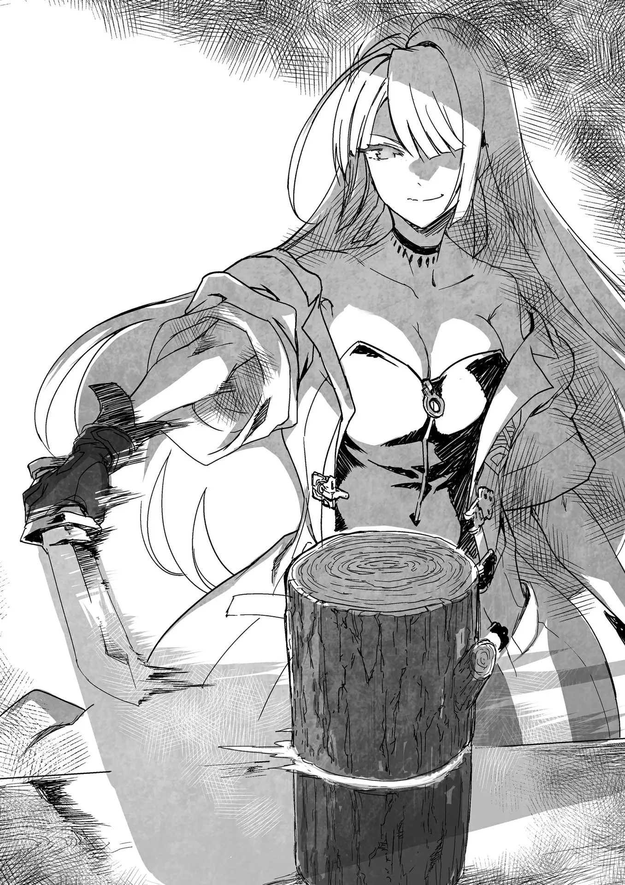

# Chương 119: Tập 5 Chương 1 - Lên Đường Mạo Hiểm (5)

"Thử mấy món này xem," Clope vừa nói vừa quẳng chỗ vũ khí lên bàn. Có đủ mọi chủng loại, trong đó vài món mà đem gợi ý cho người mới thì đúng là vô lý hết sức. Đặc biệt là cái phi luân.

"Ờm... cháu chẳng biết nên bắt đầu từ đâu nữa," Alize lí nhí.

Chưa từng mua vũ khí bao giờ nên cô bé bối rối cũng phải. Hồi mới chập chững vào nghề, tôi học cách chiến đấu từ một người thợ săn. Vũ khí chính của tôi khi ấy là cung và dao găm như bao thợ săn khác, nên tôi chẳng bao giờ phải bận tâm nghĩ ngợi. Đến lúc quyết định làm mạo hiểm giả, tôi đã dùng dao găm thành thạo và tự mày mò học thêm kiếm. Hầu hết những điều căn bản tôi đều đã nắm vững từ dạo đó. Nói cách khác, dù tốt hay xấu thì tôi cũng chưa từng phải đắn đo lựa chọn.

Về sau, tôi nhờ một mạo hiểm giả thỉnh thoảng ghé thị trấn làm hộ vệ cho thương buôn lưu động chỉ cho mấy đường kiếm thông dụng để nâng cao tay nghề. Tôi nhớ khi mình đánh đấm cứng cáp hơn đôi chút, anh ta cũng nhiệt tình chỉ dạy hơn hẳn. Thế nhưng một ngày nọ, anh ta không quay lại thị trấn nữa mà thay bằng một người khác. Bỏ mạng trong nhiệm vụ hay đã dạt sang vùng đất nào, tôi chịu chẳng rõ. Anh ta không phải mạo hiểm giả ở Maalt, nên có cố dò hỏi quanh thị trấn cũng bằng thừa. Họa chăng đến trụ sở khu vực của Hội ở thành phố lớn hơn thì may ra mới tra được tung tích, nhưng việc đó chắc tốn không ít thời gian. Vả lại hồi ấy anh ta từng bảo: "Gặp lại được thì gặp, không gặp thì thôi." Đó là một người kỳ lạ, sống chẳng màng đích đến, nhưng giờ thì tôi đã hiểu tâm trạng của anh ta khi ấy. Đó cũng là lý do chính khiến tôi không còn bận tâm đến việc cất công đi tìm nữa.

Dù sao đi nữa, hoàn cảnh của Alize không bị bó buộc như tôi hồi trước, nhưng được tự do chọn lựa lại khiến mọi thứ rắc rối hơn. Những lúc thế này mới là lúc cần đến lời khuyên của một người thầy.

Lorraine buông một câu gợi ý bâng quơ: "Hừm, em dùng được ma thuật, nên chắc đó sẽ là đòn đánh tầm xa chủ lực của em rồi. Còn vũ khí chủ yếu để cận chiến, có lẽ em nên chọn món nào phù hợp với hướng đó."

"Ồ, cháu có Ma Lực à? Thế thì khỏi cần mấy thứ này rồi," Clope nói rồi gạt đống cung, phi luân cùng các vũ khí tầm xa khác sang một bên. Trên bàn giờ chỉ còn lại mấy món cận chiến phổ biến: kiếm, dao găm, thương, rìu, đại kiếm và vài thứ tương tự.

"Cháu không chắc mình cầm nổi thanh này đâu," Alize vừa nói vừa với tay thử nhấc thanh đại kiếm lên. Hóa ra không khó như cô bé tưởng. Đứa trẻ mười hai tuổi nếu ráng sức thì vẫn cầm nổi thanh đại kiếm, có điều người cô bé cứ chao đảo trông đến là nguy hiểm.

"Thế thì món này cũng loại luôn nhé," Clope vừa nói vừa nhấc phắt thanh đại kiếm khỏi tay cô bé đang loạng choạng rồi gạt sang một bên. Làm thợ rèn mà không có sức thì khó lòng bám trụ nổi với nghề, nên cơ bắp của anh ấy chẳng phải dạng vừa. Clope cầm thanh đại kiếm dễ như bỡn, chẳng chút khó khăn.

"Anh Rentt cũng dùng loại này đúng không anh?" Alize vừa hỏi vừa nhấc một thanh kiếm lên.

Chẳng cần tôi phải nhận đó là vũ khí chính của mình, nhưng tôi vẫn có đôi lời muốn thanh minh. "Đâu phải tôi chỉ biết dùng mỗi kiếm. Món nào tôi cũng xài được cả đấy," tôi vừa nói vừa nhấc thương rồi rìu lên, làm mẫu thế thủ chuẩn chỉ của từng món cốt để khoe mẽ một chút.

"Oa! Cái gì anh Rentt cũng biết làm hết," Alize tấm tắc khen. Tôi bắt đầu phổng mũi đắc ý, cho tới khi Clope chịu không nổi phải cất giọng.

"Chỉ tổ phí hoài tài năng, cái thằng này thật là," Clope ngao ngán nói.

"Bảo cái gì cũng biết nhưng chẳng tinh thứ nào thì đích thị là Rentt rồi. Nhà nào cũng nên sắm lấy một người như anh ấy thì tiện phải biết," Lorraine đùa.

"Giờ tôi đánh đấm cũng ra trò lắm rồi đấy nhé, nói cho cô biết," tôi hơi bực mình cãi lại.

"Dĩ nhiên là tôi biết thừa rồi, đùa chút thôi. Có điều Rentt cũng chỉ được cái món nào cũng biết một chút thôi, nên em không nhất thiết phải chọn vũ khí chỉ vì anh ấy dùng đâu," Lorraine nói với Alize. Cô ấy đoán được Alize có thể sẽ chọn kiếm vì thấy tôi dùng nó làm vũ khí chính, nên mới lên tiếng khuyên nhủ.

Chuyện này bình thường chẳng mấy đứa trẻ phải đắn đo đến thế, nhưng nếu hiểu rõ hoàn cảnh của Alize thì cũng là lẽ tự nhiên. Alize là trẻ mồ côi, từng phải nhìn sắc mặt người khác để mưu sinh, nên khi đứng trước quyền tự do lựa chọn thế này, cô bé thấy rất khó quyết định. Chúng tôi hiểu điều đó nên mới trêu đùa qua lại để không khí bớt phần nặng nề. Lorraine vốn nhạy ý, còn Clope vì thương trẻ con nên phối hợp ăn ý đến bất ngờ.

Đôi mắt cô bé mở to hơn một chút. "Thật vậy sao anh?" Alize hỏi.

"Ừ, dĩ nhiên rồi. Dù là thương, cung, rìu hay món gì khác cũng được. Bất kể là thứ nào, tôi đều có thể dạy em. Có điều tôi chẳng dám nhận mình giỏi giang xuất chúng ở món nào đâu nhé." Tôi vốn định bảo thay vào đó mình sẽ giúp cô bé thành mạo hiểm giả hàng đầu, nhưng rốt cuộc lại chẳng thể thốt nên lời.

Clope liền lên tiếng đỡ lời: "Thôi nào, trêu cậu ta làm gì. Cái thằng này suốt ngày chỉ mê mải luyện thế thủ với mấy đòn cơ bản thôi đấy. Nhìn động tác của nó bây giờ, chú e là khó ai dạy căn bản cho cháu tốt hơn nó đâu. Vừa dứt khoát lại vừa thuần thục lắm," người thợ rèn tấm tắc khen.

Dù vậy, tôi chẳng dám nhận mình giỏi giang đến thế. Dẫu sao tôi vẫn chỉ là một tay Đồng Cấp, nhưng được nghe khen như vậy quả thật tôi cũng thấy vui trong lòng.

"Được khen thế thì quá lời cho tôi rồi. Tay nghề tôi cũng tàm tạm thôi, nên em đừng kỳ vọng quá nhiều nhé. Tôi tin mình có thể rèn cho em thành một mạo hiểm giả vững vàng, nhưng có vươn lên thành hạng nhất được hay không thì phải dựa vào nỗ lực và tài năng của em. Đừng quên điều đó đấy," tôi dặn dò Alize.

"Vâng, anh đừng lo, em hiểu mà," cô bé mau mắn đáp lời.

Rốt cuộc, có vẻ như trong mắt Alize tôi chỉ là một mạo hiểm giả hạng ba. Tôi có thoáng hụt hẫng trong giây lát, nhưng chưa kịp nghĩ ngợi gì thêm thì cô bé đã nói tiếp.

"Em rất thích thêu thùa, mà thêu thùa là phải đan từng sợi chỉ mảnh lại thành một hoa văn lớn. Nếu cẩn thận, tỉ mỉ từng chút một thì có thể tạo nên những tác phẩm tuyệt đẹp, nhưng mất nhiều thời gian và công sức lắm. Làm mạo hiểm giả chắc cũng thế đúng không anh? Anh đã kiên trì rèn luyện suốt ngần ấy năm mới mạnh mẽ được như bây giờ, còn em đến giờ vẫn chưa làm được trò trống gì cả," cô bé khiêm tốn nói.

Tôi chẳng biết liệu mình có xứng đáng nhận một cô bé ngoan ngoãn và chu đáo thế này làm đệ tử hay không. Có khi tôi nên lên thẳng vương đô, gõ cửa từng mạo hiểm giả hàng đầu để xin họ nhận cô bé làm đệ tử mới phải. Ý nghĩ đó thoáng qua trong đầu tôi chừng một giây, nhưng tôi không thể làm thế. Tôi đã nhận lời dạy dỗ Alize thì rèn luyện cho cô bé là trách nhiệm của tôi. Ít nhất tôi cũng phải kiên trì chỉ bảo cho đến khi cô bé có đủ kiến thức và kỹ năng để tự đứng vững với tư cách một mạo hiểm giả. Câu tôi nói tiếp theo không hẳn vì lý do ấy, chỉ là tôi nhận ra mình đã buột miệng thốt ra.

"Mới mấy hôm trước, em đã nắm được hết những thứ cơ bản về ma thuật từ Lorraine rồi còn gì? Em đang làm rất tốt rồi đấy chứ. Cứ đà này thì chẳng mấy chốc em sẽ vượt qua tôi thôi." Câu này nghe chẳng khác nào lời của một ông bố bà mẹ cuồng con. Có lẽ đầu óc mình có vấn đề thật rồi.

◆◇◆◇◆

Alize đăm chiêu nhìn hai món vũ khí còn lại. Cô bé đã thử đủ để biết món nào không hợp, dần dà loại bớt cho tới khi chỉ còn hai lựa chọn này.

"Dao găm với kiếm à? Em phân vân không biết chọn món nào sao?" tôi hỏi.

"Vâng. Dao găm dễ mang theo hơn, nghe có vẻ rất hợp với em, nhưng khi đã làm mạo hiểm giả thì kiếm có lẽ sẽ dễ dùng hơn." Nói cách khác, bản thân cô bé ưng dao găm hơn, nhưng xét về mặt thực tế thì lại thấy kiếm hữu dụng hơn.

Nỗi đắn đo của cô bé rất dễ hiểu, và suy nghĩ như vậy là hoàn toàn có cơ sở. Quái vật vốn dĩ rất nguy hiểm. Goblin thì xử lý tương đối dễ, nhưng loài Orc lại có lớp mỡ và cơ bắp dày cộm, còn Slime thì nhầy nhụa và vô định hình. Dùng dao găm đối phó với chúng sẽ rất chật vật. Người ta cần một thứ vũ khí có lưỡi dài hơn.

Có điều Alize lại biết ma thuật. Lúc này tuy mới chỉ dừng ở Ma Thuật Sinh Hoạt là chính, nhưng chỉ cần học được những ma pháp tấn công cấp thấp nhất thì cô bé hoàn toàn đủ sức chiến đấu với cả Orc lẫn Slime. Nói đúng hơn thì đối phó với Slime bằng ma thuật là chuẩn nhất. Với Alize, vũ khí chỉ là giải pháp cuối cùng khi kẻ địch áp sát quá gần.

Đó là hướng đi của nhiều mạo hiểm giả, nhưng tôi cũng muốn cô bé biết chiến đấu bằng vũ khí. Có lẽ cái tôi của một người làm thầy đang lên tiếng chăng. Hiểu rõ điều đó nên tôi không khuyên cô bé nghiêng về bên nào. Tôi muốn cô bé tự mình chọn lấy, chỉ là trong đầu tôi đang nảy ra một gợi ý. Khi nhìn sang Lorraine, dường như cô ấy cũng có chung ý nghĩ. Hai chúng tôi khẽ gật đầu với nhau.

"Alize này, em chọn món nào tôi thấy cũng ổn cả, nhưng tôi muốn cho em xem thứ này để dễ quyết định hơn. Lorraine."

Nghe tôi gọi tên, Lorraine cầm con dao găm lên. "Nhìn này," cô nói rồi truyền Ma Lực vào lưỡi dao. Nói đúng hơn là cô kích hoạt một ma pháp. Từ mũi dao găm lập tức nhô ra một lưỡi kiếm trong suốt. Lorraine thiết lập ma pháp sao cho dù trong suốt nhưng vẫn thấy rõ lưỡi kiếm này có hình khối vật chất, phản chiếu ánh sáng trong phòng. Chiều dài của nó xấp xỉ một thanh kiếm.

"Lorraine," Clope gọi rồi đặt một khúc gỗ nhỏ lên bàn.

"Alize, lùi lại một chút nhé. Xem đây," Lorraine nhắc nhở rồi vung một nhát chém ngang khúc gỗ. Bản thân con dao găm hoàn toàn không chạm vào khúc gỗ, chỉ có phần lưỡi kiếm trong suốt lướt qua. Một đường cắt hơi chéo xuất hiện trên thân gỗ, chia nó làm đôi.

Nhát chém của cô trông thật đáng nể, mà cũng phải thôi, bởi chính tôi là người đã chỉ dạy cho cô ấy. Dù hơi ngậm ngùi khi phải thừa nhận, nhưng tốc độ của cô thậm chí còn nhanh hơn tôi hồi còn là con người. Có điều Lorraine vốn xuất chúng về ma thuật, nên việc cường hóa thể chất hoàn toàn nằm trong tầm tay. Cô thừa sức ra đòn mạnh hơn nữa, nhưng vào lúc này thì chưa cần thiết.

"Vừa rồi là gì thế ạ?" Alize hỏi.

"Ma thuật đấy," Lorraine đáp. "Tôi kéo dài lưỡi dao găm ra bằng một thanh kiếm. Đây không phải ma pháp quá khó, nên em hoàn toàn có thể dùng dao găm để xoay xở."

Nói chung cứ chọn thứ mình thích vẫn là tốt nhất, như thế sẽ tiếp thu nhanh hơn. Nếu cô bé thích chọn dao găm nhưng lại thấy lưỡi kiếm dài hơn sẽ hữu ích hơn, thì việc tận mắt thấy một món vũ khí đáp ứng được cả hai tiêu chí hẳn sẽ giúp cô bé dễ hạ quyết tâm. Dẫu Lorraine bảo ma pháp này không khó, bản thân tôi lại chẳng thể nào thi triển nổi. Nguyên nhân chủ yếu là do hồi trước tôi thiếu hụt Ma Lực, nên có lẽ bây giờ tôi đã học được rồi, song phần lớn mạo hiểm giả dùng được chiêu này ít nhất cũng phải từ Ngân Cấp trở lên. Thế thì với tôi nó đâu có đơn giản chút nào.

"Lorraine, không phải tôi nghi ngờ gì cô, nhưng ma pháp này Alize học nổi không đấy?" tôi thì thào.

"Không học được thì tôi đã chẳng thị phạm cho xem. Hôm trước em ấy đã thể hiện rất nhiều tiềm năng với Ma Thuật Sinh Hoạt rồi còn gì. Đã làm được đến mức đó thì chỉ cần chịu khó học, em ấy nhất định sẽ học được thôi," cô thì thào đáp lại.

Nghe vậy là tôi yên tâm rồi. Tôi quay lại nhìn Alize. "Thế em thấy thế nào? Có giúp em quyết định được gì chưa?" tôi hỏi.

"Vâng. Nếu làm được như vậy thì em thấy chọn dao găm là ổn rồi. Anh cũng thấy thế đúng không?" Giọng cô bé nghe chừng đã hạ quyết tâm.

Tôi gật đầu. "Được đấy. Nhưng tôi cũng phải dặn trước là nếu muốn học chiêu đó, em sẽ phải luyện cả kiếm lẫn dao găm, vất vả gấp đôi đấy. Em chịu nổi không?" Dù chẳng muốn nói điều gì làm lung lay quyết định của cô bé, tôi vẫn buộc phải nhắc trước. Nếu dùng vũ khí vụng về rồi mất mạng thì mọi thứ coi như công cốc. Không ít mạo hiểm giả từng bỏ mạng vì lẽ đó, nhưng tôi đã lờ mờ đoán được Alize sẽ đáp lại thế nào.

"Em chưa biết sau này sẽ ra sao, nhưng em sẽ cố hết sức. Em sẽ dốc lòng học tập để trở thành một mạo hiểm giả, nên anh Rentt hãy chỉ bảo cho em thật nhiều nhé."

"Dĩ nhiên rồi. Tôi và Lorraine sẽ rèn giũa em thành một mạo hiểm giả thực thụ," tôi quả quyết.

"Và cả một ma pháp sư kiêm học giả nữa chứ," Lorraine bồi thêm một câu.

◆◇◆◇◆

"Thế tóm lại là cậu chỉ muốn tôi rèn một con dao găm thôi chứ gì?" Clope hỏi, nhưng tôi lắc đầu.

"Không, tốt nhất là rèn cả dao găm lẫn kiếm. Chỗ nguyên liệu này đủ mà đúng không anh?" tôi bảo.

Clope hiểu ngay ý tôi: "Ừ nhỉ, con bé cũng phải tập kiếm nữa chứ. Với lại khi chưa học được ma pháp kia thì nó vẫn cần kiếm thật để luyện tập."

"Ý tôi chính là thế. Biết dùng kiếm cũng sẽ giúp em ấy mở rộng thêm kỹ năng." Kiếm là món vũ khí tiêu chuẩn của hầu hết mạo hiểm giả. Biết dùng nó thì chỉ có lợi chứ chẳng thiệt đi đâu.

"Thế thì tôi rèn cả hai. Mà cậu muốn tôi dùng loại Ma Thiết nào?" Anh ấy muốn hỏi là chọn Ma Thiết thường hay loại nhiễm Ma Lực rồng.

Chuyện này thì rõ rành rành rồi. "Cứ dùng Ma Thiết thường giúp tôi nhé."

"Cậu chắc chứ? Tôi cứ tưởng cậu muốn làm cho con bé một món thật tốt cơ đấy."

"Mới bắt đầu mà đã dùng đồ quá khác biệt thì Alize dễ nhiễm thói quen xấu lắm. Tôi phải tính trước chuyện đó."

"À, ra vậy. Được thôi. Thế còn chỗ Ma Thiết này thì cậu tính sao?" Clope hỏi rồi nhìn sang thỏi Ma Thiết nhiễm Ma Lực rồng.

"Chừng đó thì rèn được bao nhiêu hả anh? Một con dao găm hay thế nào?"

"Ừm, chắc được nhiều hơn thế một chút. Không nhiều bằng chỗ Ma Thiết thường, nhưng cũng kha khá đấy. Đủ để tôi có nguyên liệu thử tay nghề."

"Nếu vậy anh thử kết hợp với một trong mấy cái cây tôi trồng để rèn một thanh kiếm xem sao được không?"

"Này này, tôi đã bảo muốn rèn kiếm thì cần nhiều nguyên liệu hơn thế rồi mà. Cứ cho là bỏ qua lá Thánh Thụ đi, thì cậu kiếm đâu ra máu Ma Cà Rồng bây giờ? Còn cả Ma Tinh nữa chứ."

Máu Ma Cà Rồng thì tôi lấy được, chỉ có điều Ma Tinh thì chắc không dễ kiếm đến thế.

"Máu Ma Cà Rồng thì tôi tự xoay xở được. Còn Ma Tinh thì—"

"'Tự xoay xở' cơ đấy? Thật không đấy?" Clope định gặng hỏi thêm, nhưng tôi phớt lờ anh ấy rồi nói tiếp.

"Dùng Ma Tinh của Tarasque liệu có được không?" Đó là thứ tôi có khả năng kiếm được. Dù sẽ tốn chút công sức, nhưng không phải bất khả thi. Lũ đó chưa tới tầm Bạch Kim Cấp, nhưng chắc cũng xêm xêm cỡ Kim Cấp.

Clope trầm ngâm một lúc rồi mới đáp: "Dùng thì chắc cũng được thôi, nhưng thế thì phí thỏi Ma Thiết này quá. Nếu cậu gom đủ lá Thánh Thụ với một viên Ma Tinh Bạch Kim Cấp, tôi có thể rèn ra một thanh kiếm đỉnh cao đấy chứ chẳng đùa."

"Nhưng anh nghĩ tôi đào đâu ra mấy thứ nguyên liệu đó bây giờ?" Biết đâu ngày nào đó tôi kiếm được thật, nhưng chắc chắn không phải lúc này. Clope dường như cũng thừa biết chuyện đó.

"Ừ thì cậu nói cũng phải. Được rồi, tôi sẽ làm thử xem sao. Đằng nào rèn xong chắc vẫn còn dư lại một ít. Tôi sẽ để dành lại một phần cho tới ngày cậu mang lá Thánh Thụ tới tìm tôi nhé," anh ấy cười bảo.
