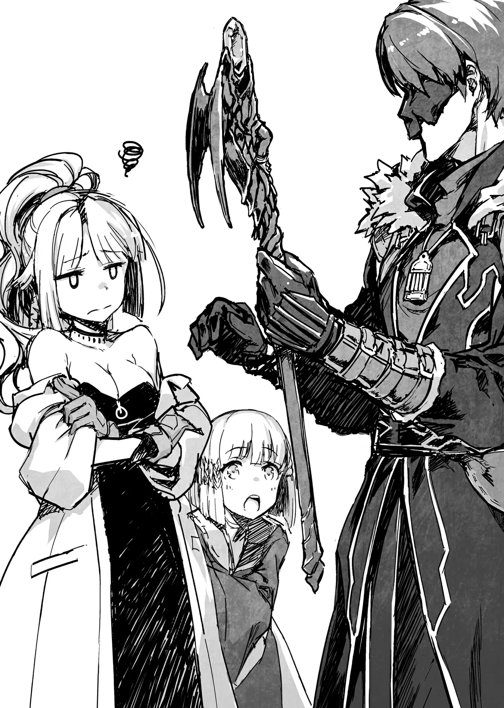

# Chương 123: Tập 5 Chương 2 - Chế Tạo Vật Dẫn (4)

"Được rồi, xong rồi đấy. Làm tốt lắm, Alize." Nghe tiếng Lorraine, tôi quay sang nhìn. Alize đang nắm chặt cây đũa phép vừa làm xong. Viên Ma Tinh đã gắn chắc chắn, từ cây đũa tỏa ra luồng Ma Lực ổn định đặc trưng của một ma cụ.

"Vậy là em có đũa phép rồi," Alize thích thú ngắm nghía thanh gỗ. Trán lấm tấm mồ hôi, hơi thở dồn dập, xem chừng cô bé cũng đã thấm mệt.

"Giờ em có thể thử dùng nó để niệm phép rồi. Cả anh nữa, Rentt. Xong chưa đấy?" Lorraine vừa nói vừa nhìn sang tôi, rồi mắt bỗng mở to kinh ngạc.

"Lại nữa à?"

"Gì cơ?" tôi hỏi. Tôi xong gần như cùng lúc với Alize. Thật ra tôi sang công đoạn cuối sớm hơn cô bé, chỉ là mất thêm chút thời gian tỉ mẩn với phần đầu đũa.

Cô chỉ tay vào cây đũa của tôi. "Cái đó. Chỗ đầu đũa của anh kìa. Tay nghề ấn tượng thật đấy," cô lẩm bẩm.

Tò mò, Alize bèn ló đầu ra từ sau lưng Lorraine, ngó nghiêng cây đũa của tôi.

"Oa, cái gì thế này? Tỉ mỉ quá chừng luôn," cô bé sửng sốt thốt lên.

Lorraine cầm cây đũa phép của tôi lên, ngắm nghía đủ mọi góc độ. "Con rồng đang ngậm viên Ma Tinh trong miệng này. Tượng rồng điêu khắc tinh xảo đến khó tin đấy chứ. Kiểu chạm trổ thế này bình thường chẳng ai làm nổi chỉ bằng mỗi việc điều khiển Ma Lực đâu đấy," Lorraine nhận xét.

Nói cho rõ thì đây chính là con rồng đã nuốt chửng tôi. Hồi đó cứ ngỡ đời mình thế là hết, nên hình bóng nó hằn sâu vào tâm trí tới mức vừa định tạc là hiện ra ngay trong đầu. Thú thật, chính tôi cũng thấy chọn hình này hơi kỳ cục. Lorraine dường như cũng nghĩ vậy, bởi cô nhìn tôi như nhìn kẻ mất trí khi lại chọn khắc đúng con quái vật từng xơi tái mình. Nhưng có Alize ở đây nên chúng tôi chẳng thể bàn sâu về chuyện đó, tôi đành hỏi sang chuyện khác đang thắc mắc.

"Thế ngoài điều khiển Ma Lực ra thì người ta tạo hình đầu đũa kiểu gì?"

"À, mấy chi tiết trang trí kiểu đó thường được làm ngay từ lúc gọt phôi đũa cơ. Người ta hay chừa phần đầu to hơn một chút rồi dùng dao tỉa dần thành hình mình muốn."

"Sao phải nhọc công đến thế?" tôi hỏi. Tôi thấy dùng Ma Lực uốn nắn thì tha hồ tạo hình theo ý mình hơn chứ. Tôi cứ tưởng người ta ngại làm cách này chỉ vì nó đòi hỏi phải tập trung cao độ và tốn thời gian thôi.

Lorraine ôm đầu than thở. "Dùng Ma Lực thì chỉ nắn được đến một chừng mực nào đó thôi, chứ tỉ mỉ cỡ này thì bình thường chẳng ai làm nổi. Trừ phi anh là bậc thầy điều khiển Ma Lực, còn không thì tự tay chạm khắc bằng dụng cụ chuyên dụng sẽ cho kết quả tốt hơn nhiều. Có điều hình như mấy quy tắc đó chẳng áp dụng được với anh thì phải," cô cằn nhằn.

"Vậy là anh Rentt giỏi đặc biệt luôn ạ?" Alize hỏi.

"Ừm, nói thế cũng không sai. Đương nhiên thợ thủ công bậc thầy cũng làm được cỡ này, nhưng Rentt còn chưa từng đụng vào món này bao giờ cơ mà. Xưa nay tôi vẫn biết anh ấy khéo tay, nhưng tận mắt thấy anh ấy trổ tài ngay trong lĩnh vực chuyên môn của mình, tôi lại càng thấm thía điều đó," Lorraine nói.

"Thế chắc tôi phải xin lỗi cô rồi," tôi cười trừ nhận lỗi.

"Anh chẳng có gì phải xin lỗi cả. Trái lại, thế này là tuyệt hảo rồi. Lần tới làm đũa phép, tôi sẽ để anh lo phần đầu đũa. Nếu làm thế thì mình có thể..." Lorraine cúi đầu bắt đầu lẩm bẩm tính toán một mình rồi mới ngước lên. "Thôi, dù sao thì đũa phép của hai người cũng xong rồi. Cả hai cây đều rất ổn. Giờ hai người có thể thử xem chúng phát huy hiệu quả làm vật dẫn ra sao."

"Vâng ạ!" Alize reo to, át đi những lời thì thầm đầy vẻ đáng ngờ của Lorraine.

◆◇◆◇◆

Đã đến lúc thử xem đũa phép hoạt động ra sao. Tôi định niệm phép ngay tại chỗ, nhưng Lorraine đã kịp ngăn lại: "Đừng có thử trong nhà tôi. Ra ngoài đi." Hiếm khi thấy cô biết suy nghĩ thực tế như vậy.

Cả nhóm kéo nhau ra ngoài, nhưng cũng chỉ đi tới một bãi đất trống ven thị trấn.

"Giờ thì muốn gây nổ thế nào cũng được, chẳng ai than phiền đâu," Lorraine bảo.

Dù cô cam đoan thế, tôi khó mà tin chủ đất này lại chịu để yên. Tuy khoảng đất khá rộng nhưng đằng xa vẫn thấy lác đác mấy nóc nhà. Gây nổ khéo người ta chẳng để ý thật, nhưng tôi cũng không dám chắc.

"Chủ bãi đất này không khó chịu sao?" tôi hỏi Lorraine.

"Sao mà khó chịu được. Đất của tôi mà."

"Hả?" tôi buột miệng thốt lên. Câu trả lời hoàn toàn bất ngờ, nhưng thế thì hiểu vì sao Lorraine lại tỉnh bơ như vậy rồi. Nếu đây là đất của cô thì chúng tôi muốn làm gì chẳng được. Trừ phi mở toang cánh cổng dẫn tới Địa Ngục để lũ ác ma tràn vào tấn công thành phố. Thế thì to chuyện thật, nhưng chắc chắn chẳng đến mức nghiêm trọng cỡ đó đâu. Dù mấy tay ma pháp sư trong truyền thuyết hay cổ tích toàn vướng vào mấy vố tai hại kiểu ấy, chứ tôi thì còn chẳng biết làm sao để mở nổi cái cổng như thế.

"Số là tôi có vài thí nghiệm không tiện làm ở nhà. Thế nên hồi trước tôi mới mua bãi đất này. Chỗ này cách trung tâm thị trấn đủ xa nên dù rộng thênh thang nhưng giá cũng không đắt lắm," Lorraine giải thích.

Dù cô nói vậy, bãi đất này rộng đến mức khó mà có giá rẻ được. Nhưng tôi biết Lorraine nhiều tiền. Nguồn tài chính của cô xưa nay vẫn là một ẩn số. Đến mua một căn nhà với cô còn chẳng phải chuyện gì to tát, nên việc này cũng không làm tôi ngạc nhiên cho lắm.

Dù sao đi nữa, nếu đúng là vậy thì chẳng có gì phải lo. Có điều, tôi tự hỏi liệu việc này có nguy hiểm đến mức bắt buộc phải chạy tít ra ngoài trời thế này không.

"Này, cây đũa phép đầu tay mà nguy hiểm đến thế cơ à?" tôi hỏi Lorraine.

"Bình thường thì không đâu. Tùy từng phép, nhưng đa số người mới đều dùng được ma pháp sơ cấp trong nhà mà chẳng hề hấn gì. Có điều với trường hợp của anh thì tôi hơi bất an một chút. Trình độ điều khiển Ma Lực của anh thừa sức giúp mọi chuyện không đến nỗi tệ, nhưng cẩn tắc vô áy náy. Với lại Alize cũng có sẵn lượng Ma Lực dồi dào, khéo em ấy lại khó kiềm chế. Tôi không muốn hai người phải vừa thử ma thuật vừa thấp thỏm lo âu, nên ra đây là tiện nhất."

Nếu càng nhiều Ma Lực càng khó kiểm soát, thì thi triển ma thuật qua đũa phép có lẽ sẽ cho cảm giác rất khác so với khi niệm chay, bởi vật dẫn vốn dùng để ổn định và khuếch đại Ma Lực. Ổn định thì tốt, chứ khuếch đại khéo lại thành vướng víu. Bị mất kiểm soát vì tác dụng phụ đó có lẽ chính là điều khiến Lorraine lo lắng.

"Thôi thì, dù sao cứ thử một lần xem sao. Tôi mới chỉ dạy hai người ma thuật cơ bản, nên cứ dùng mấy phép đó đi. Dù gì đây cũng là cách dễ nhất để biết cây đũa của mình mạnh cỡ nào," Lorraine bảo.

Tôi và Alize cùng gật đầu.

"Alize, em thử trước đi. Còn nhớ câu chú không đấy?"

"Dạ có, em làm được mà ạ!"

"Giỏi lắm. Vậy tôi với Rentt lùi lại một quãng nhé. Khi nào tôi ra hiệu thì hãy bắt đầu."

"Vâng ạ!"

Chúng tôi lùi ra xa một đoạn, rồi Lorraine gọi với bảo Alize bắt đầu được rồi.

"Hỡi ngọn lửa, hãy lấy Ma Lực của ta làm nguồn nuôi dưỡng và hiển hiện trước mắt ta: Aliumage!" cô bé cất giọng xướng niệm. Ma Lực trong người Alize ngưng tụ lại rồi chảy tràn vào cây đũa. Nguồn năng lượng cuộn trào cho tới khi ngọn lửa bùng lên từ đầu đũa. Lửa cháy dữ dội hơn tôi tưởng, đến mức tôi phải ngờ vực không biết đây có phải ma pháp sơ cấp thật không. Trước đây mỗi lần tôi dùng phép này, lửa chỉ leo lét nơi đầu ngón tay, đằng này nó bốc lên ngùn ngụt chẳng khác nào ngọn đuốc.

"Gì... gì thế này ạ?" Alize lắp bắp, hoảng hốt trước quầng lửa quá lớn.

Lorraine bước lại gần niệm phép dập lửa, khiến Alize thở phào nhẹ nhõm. Tôi cũng tiến lại cạnh cô bé.

"Tuyệt lắm, Alize. Anh không ngờ ma thuật cơ bản mà em cũng tạo ra được quầng lửa lớn thế này đấy," tôi khen ngợi.

"Chính em cũng có ngờ đâu ạ," cô bé đáp, nét mặt vẫn còn thoáng vẻ căng thẳng.

Lorraine nghe thấy cuộc trò chuyện bèn xen vào: "Hình như hai người hiểu sai vấn đề rồi đấy. Bình thường chẳng ai tạo ra ngọn lửa lớn đến mức ấy đâu, nhưng như tôi bảo, Alize có lượng Ma Lực dồi dào nên lửa mới to như vậy. Đa số người mới học mà không có đũa phép thì đố làm nổi trò này, bất kể nhiều Ma Lực đến đâu, nhưng có đũa phép vào là khác hẳn ngay. Nó giúp người ta kiểm soát ma thuật và dùng Ma Lực hiệu quả hơn. Có điều chuyện này cũng chẳng phải hoàn toàn là điều tốt đâu," cô bảo.

"Không tốt ở chỗ nào hở cô?" Alize tò mò hỏi.

"Nếu quá ỷ lại vào đũa phép, có ngày em sẽ không tài nào kiểm soát nổi Ma Lực khi thiếu nó. Thậm chí em còn chẳng thể vận chuyển nổi Ma Lực nếu trong tay không cầm đũa."

"Chuyện đó nghiêm trọng lắm ạ?"

"Đúng thế, có thể nói là chí mạng luôn ấy chứ. Khi đó muốn chiến đấu như một ma pháp sư, lúc nào tay em cũng phải chạm vào cây đũa phép. Vậy mà đám trẻ bây giờ vẫn cứ chọn dựa dẫm hoàn toàn vào đũa phép để dùng ma thuật đấy thôi. Đi đường đó dễ hơn nhiều mà. Mới nhập môn đã tập ngay với đũa phép, vừa đủ dùng là đã vội vã lên đường đi làm mạo hiểm giả. Thật đáng buồn," cô bảo, giọng cứ như thể bản thân không phải người trẻ tuổi vậy.

Tôi định đùa một câu, nhưng thấy vẻ mặt cô nghiêm túc quá nên thôi. Đúng là cô đã quá tuổi kết hôn trung bình thật, nên bảo cô hết trẻ cũng chẳng sai. Tôi cũng trạc tuổi cô, chỉ nhỉnh hơn đôi chút. Có điều xét về độ chững chạc, người ta toàn tưởng tôi nhỏ tuổi hơn cô.

"Nhưng em thấy mấy ma pháp sư quanh Maalt vẫn dùng ma thuật mà chẳng cần đũa phép suốt đấy thôi ạ," Alize thắc mắc.

Lorraine gật đầu. "Đúng vậy, thỉnh thoảng tôi cũng thấy họ làm đồ đạc mua sắm lơ lửng trên đường về nhà. Lần đầu nhìn thấy cảnh đó, tôi cũng bất ngờ lắm. Ở Đế Quốc chẳng còn ai làm vậy nữa, nên lâu lắm rồi tôi mới lại thấy cảnh đó," Lorraine nói, nhắc tới quê hương của mình, Đế Quốc Rermutt. Nơi đó vốn được coi là một nền văn minh tiên tiến với những bước tiến vượt bậc trong lĩnh vực ma thuật, nhưng riêng mảng dùng ma thuật không cần đũa phép thì có lẽ còn phải xem lại.

"Sao Đế Quốc lại thành ra như thế?" tôi hỏi.

"Tôi vừa nhắc đến nhược điểm của đũa phép, nhưng chúng cũng có ưu điểm. Có đũa phép thì làm những việc tỉ mỉ dễ hơn nhiều so với dùng tay không, mà thi triển phép quy mô lớn cũng thế. Đế Quốc nghiên cứu rất nhiều về vũ khí ma thuật và ma cụ, thế nên ma pháp sư bên đó lúc nào cũng thủ sẵn đũa phép bên mình. Khi dùng một món đồ đủ thường xuyên, người ta sẽ bắt đầu phụ thuộc vào nó. Cứ thế lâu dần, ai nấy đều cho rằng luyện với đũa phép ngay từ đầu sẽ hiệu quả hơn. Hệ quả là tư duy ở Đế Quốc dần xoay chuyển theo hướng đó. Đương nhiên vẫn có người dùng được ma thuật mà không cần đũa, nhưng họ chẳng bao giờ tạo được tầm ảnh hưởng trong giới ma pháp sư Đế Quốc. Cả tôi cũng nằm trong số đó," cô giải thích.

Tôi đồ rằng đó là cái giá phải trả khi một thứ gì đó trở nên quá tiện lợi. Có điều những lời Lorraine vừa nói dường như hé lộ đôi điều về lý do năm xưa cô rời bỏ Đế Quốc.

Lorraine đổi giọng. "Thôi, chuyện đó nói thế đủ rồi. Trước mắt cứ tập trung vào đũa phép của hai người đã. Dù tôi chê bai đủ điều nhưng nhìn chung chúng vẫn là công cụ hữu ích. Giờ đến lượt anh đấy, Rentt. Tôi với Alize sẽ lùi lại."

Tôi gật đầu, sẵn sàng thử cây đũa phép mới.

◆◇◆◇◆

"Này, hai người lùi xa quá rồi đấy? Rốt cuộc cô nghĩ tôi tính làm cái trò gì hả?"

Tôi không kìm được bèn lên tiếng hỏi. Lorraine bảo họ sẽ lùi lại, nhưng từ chỗ tôi nhìn ra thì hai người họ bé tí như hai chấm nhỏ. Khoảng cách này xa gấp mười lần lúc nãy chúng tôi đứng xem Alize làm. Không biết tôi đã làm gì khiến họ hoảng hay không, nhưng ngẫm lại thì một Ma Cà Rồng Undead quả thực cũng đáng để người ta phải đề phòng.

"Bọn tôi sẵn sàng rồi, Rentt!" Lorraine hét với lại từ đằng xa. Chắc thế nghĩa là tôi dùng ma thuật được rồi. Ở khoảng cách xa tít tắp thế này, họa có chuyện gì điên rồ lắm mới làm họ bị vạ lây được, nên có khi vậy lại hay.

Tôi chọn đúng phép Alize vừa dùng, một phép thuộc Ma Thuật Sinh Hoạt mang tên Aliumage. Xem Alize làm rồi nên tôi biết ngọn lửa trông ra sao, nghĩ bụng chắc làm theo cũng dễ ợt. Đũa phép vừa tăng cường khả năng kiểm soát vừa khuếch đại Ma Lực, làm sao mà tôi thất bại cho được. Việc duy nhất cần bận tâm là tiết chế uy lực của phép, nhưng kiểu gì cũng phải thử một lần mới quen tay.

Thú thật, đây chẳng phải lần đầu tôi dùng đũa phép. Nhưng đó là chuyện hồi tôi còn sống và trong người gần như chẳng có chút Ma Lực nào, nên có muốn khuếch đại cũng lấy đâu ra. Một giọt nước có nhân lên mấy lần thì cũng chỉ thành vài giọt. Giờ thì Ma Lực của tôi rõ ràng đã dồi dào hơn hẳn, kết quả ắt sẽ rất khác. Nghĩ vậy, tôi vận Ma Lực tràn khắp cơ thể, dồn về bàn tay rồi rót thẳng nguồn năng lượng ấy vào cây đũa phép.

"Hỡi ngọn lửa, hãy lấy Ma Lực của ta làm nguồn nuôi dưỡng và hiển hiện trước mắt ta: Aliumage," tôi đọc câu chú, và lửa lập tức phun trào từ đầu đũa. Cảm giác như sức mạnh của mình được cây đũa khuếch đại lên gấp bội, tôi hoảng hốt thu bớt Ma Lực lại. Dù vậy, ngọn lửa dữ dội vẫn bùng cháy ngùn ngụt. May mà xung quanh chẳng có nhà cửa nào. Quyết định đứng xa tít tắp của Lorraine hóa ra lại quá sáng suốt. Xưa nay tôi vẫn rất tự tin vào khả năng điều khiển Ma Lực của mình, mà sau vụ này cũng đâm chột dạ.

Đúng là tôi cần làm quen thêm với đũa phép, nhưng thấy lửa bùng lên tôi không hề hoảng hốt như Alize. Dù sao hơn hai mươi lăm năm sống trên đời của tôi cũng đâu phải để trưng. Tôi ngưng tiếp Ma Lực cho ngọn lửa và điều chỉnh hướng của nó trong lúc quan sát thêm vài giây. Thấy lửa đã tắt hẳn, tôi bèn vẫy tay gọi Lorraine và Alize.

"Qua đây được rồi!" tôi gọi to.

Hai người họ nán lại quan sát một chốc xem có an toàn thật không rồi mới bước lại gần. Cẩn thận thế cũng phải. Đũa phép hoàn toàn có thể vô tình bị kích hoạt, và nếu còn chút Ma Lực nào sót lại bên trong thì khéo lại sinh ra phản ứng kỳ quặc. Họ muốn nán lại xem có xảy ra chuyện đó không.

"Aliumage của anh to khủng khiếp luôn ấy," Alize trầm trồ.

"May mà chúng tôi đứng tít đằng kia đấy, không thì khét lẹt thành than rồi," Lorraine mỉm cười bảo. Thật ra chắc cô cũng dựng kịp kết giới để bảo vệ cả hai thôi, nhưng rủi ro thì ai mà biết trước được. Nhìn chung cô nói chẳng sai.

"Cơ mà lửa to cỡ đó thì hơi quá đà đối với Aliumage rồi. Biết là anh nhiều Ma Lực, nhưng cái phép ấy làm sao ra được ngọn lửa kinh thế."

"Thật à? Nhưng mắt thấy tai nghe rồi, cô chối sao được," tôi phân bua.

"Cũng đúng. Hừm, Rentt, anh thử phép khác xem. Anh biết phép hệ thủy thuộc Ma Thuật Sinh Hoạt tên là Mah chứ?"

Phép Mah tạo ra chừng một cốc nước, rất tiện cho mạo hiểm giả, và cũng là một trong số ít ỏi những phép tôi dùng được hồi lượng Ma Lực còn còm cõi. Tôi lờ mờ đoán ra Lorraine đang tính gì.

"Biết chứ. Tôi hiểu rồi, ý cô là thử xem các nguyên tố khác có bị như thế không hả?" tôi đoán.

Có những người bẩm sinh đã vượt trội ở một nguyên tố ma thuật nhất định. Đa số con người dùng được mọi loại phép ngang nhau, nhưng cũng có kẻ lại thiên hẳn về một hệ cụ thể. Có nhiều giả thuyết lý giải chuyện này. Chẳng hạn sinh ra gần núi lửa thì người ta dễ thuần thục hỏa ma pháp hơn. Hoặc nếu được thần tinh linh ban phước, người đó cũng có khả năng tinh thông các phép thuộc nguyên tố của tinh linh ấy.

Tôi từng được một thần tinh linh hệ thực vật ban phước, nên nói đúng ra thì tôi phải kỵ lửa mới phải chứ. Nhưng có lẽ mọi thứ không đơn giản như tôi nghĩ. Quái lạ thật, nhưng hẳn Lorraine muốn tôi xác định cho rõ xem sở trường thực sự của mình nằm ở đâu.

Tôi quyết định thử phép Mah. Lorraine và Alize lại lùi ra xa phòng hờ. Chẳng biết có cần thiết đến thế không, nhưng sau cú vừa rồi thì tôi cũng chẳng trách họ được.

Nghe Lorraine ra hiệu, tôi liền niệm phép: "Hỡi dòng nước, hãy thấm nhuần Ma Lực của ta và ngưng tụ trước mắt ta: Mah."

Các phép thuộc Ma Thuật Sinh Hoạt đều có câu xướng niệm na ná nhau. Vốn là ma thuật cơ bản nên cấu trúc của chúng rất đơn giản, có điều chính vì vậy mà người ta lại càng dễ lẫn lộn giữa các câu chú. Cũng vì thế mà lúc Lorraine hỏi có nhớ phép không, tôi mới chẳng dám tự tin hoàn toàn.

Tôi không dám chắc mình đọc có đúng từng chữ không, nhưng thấy Ma Lực dồn vào đũa thì cũng yên tâm phần nào. Rồi nước bắt đầu đọng lại nơi đầu đũa. Đó là một quả cầu nước khá lớn, nhưng chẳng thấm vào đâu so với quầng lửa to tướng đến buồn cười lúc nãy. Khối nước này có chăng chỉ nhỉnh hơn ngọn lửa của Alize một chút, vậy thôi.

Tôi giữ quả cầu nước thêm vài giây để ngắm nghía rồi để nó tan đi. Chờ nước biến mất hẳn, Lorraine và Alize mới đi lại gần.

"Biết ngay mà. Khéo anh lại có thiên phú dị thường với hỏa ma pháp đấy chứ," Lorraine lẩm bẩm suy nghĩ.

Thấy kết quả sờ sờ ra đó, tôi cũng đành chịu. "Ít nhất thì cũng khá hơn thủy ma pháp. Mà giờ tôi lại tò mò muốn biết mấy nguyên tố khác thì sao rồi đấy," tôi bảo.

"Tôi cũng muốn thử thêm lắm, nhưng đâu thể cái gì cũng lôi ra thử được. Dù gì đây cũng là hai phép duy nhất anh biết dùng, đúng không? Dạy câu chú thì chắc anh thi triển được mấy phép sơ cấp khác ngay thôi, nhưng mới cho anh thử Ma Thuật Sinh Hoạt mà đã thót tim thế này rồi. Hôm nay dừng ở đây thôi," Lorraine dứt khoát kết thúc buổi tập.

Khoản này thì cô nói đúng. Với hai phép đó tôi đã có đủ kinh nghiệm để duy trì chúng, chứ gặp phép lạ thì chẳng nói trước được. Chắc cũng làm được thôi, nhưng lỡ xảy ra sự cố thì trở tay không kịp. Bản thân tôi còn chưa hiểu hết cơ thể mình, nên cẩn thận một chút cũng chẳng thừa.
