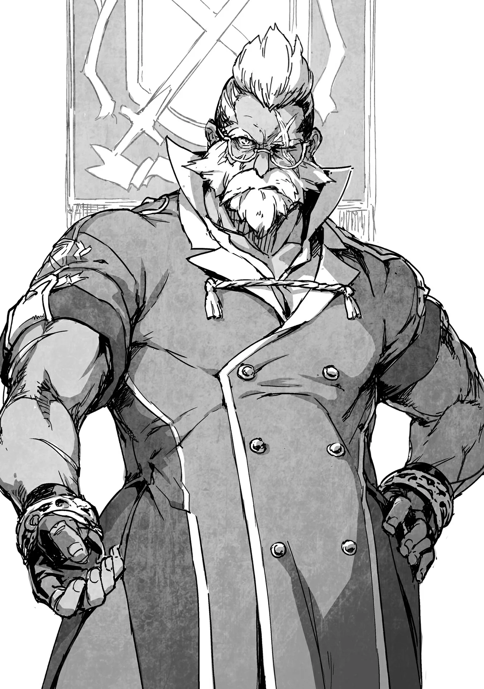

# Chương 125: Tập 5 Chương 3 - Sự Tồn Tại và Thân Phận (1)

"Anh Rentt? Hôm nay có chuyện gì mà anh đến đây thế?"

Sheila ngẩng đầu lên khỏi quầy tiếp tân, tò mò dõi theo tôi khi tôi bước tới gần. Nỗi băn khoăn của cô hẳn là vì thời điểm tôi ghé qua. Vào giờ muộn thế này chẳng ai lại đi nhận ủy thác. Người ta cũng không thể lĩnh thù lao cho các công việc đã hoàn thành vào lúc này, thành thử cô chẳng tài nào đoán được lý do tôi có mặt ở đây.

"À, tôi có chút việc cần xử lý. Cô Sheila liên lạc với Hội Trưởng giúp tôi được không? Tôi muốn nói chuyện với ông ấy."

Sheila ngạc nhiên. "Anh Rentt, anh có sao không đấy? Khi anh bước vào đây, tôi cũng lờ mờ đoán được nguyên do, nhưng Hội Trưởng không dễ tính như vậy đâu," cô chắp nối các manh mối rồi lên tiếng cảnh báo.

Chẳng có mấy lý do khiến tôi phải cất công đến gặp Hội Trưởng. Điều quan trọng nhất trong số đó chính là tình trạng đăng ký hiện tại của tôi, và đó cũng là nguồn cơn khiến cô phải lo lắng.

"Tôi biết chứ, nhưng đâu phải tôi đã làm chuyện gì xằng bậy. Tôi tin ông ấy sẽ sẵn lòng lắng nghe tôi giải thích thôi," tôi phân trần.

"Tôi thấy những gì anh làm đủ để bị quở trách cả đống rồi đấy," Sheila nói, giọng đầy vẻ hoài nghi.

Đăng ký hai lần không hẳn là tội trạng gì ghê gớm, song tôi cũng chẳng thể biện bạch rằng đó hoàn toàn không phải là hành vi sai phạm. Xét theo phương diện ấy thì cô nói đúng. Dẫu vậy, đây cũng chẳng phải đại tội tày đình gì, thế nên tôi có thể tìm cách sửa sai. Có lẽ cũng cần phải thận trọng đôi chút, nhưng tôi không nghĩ sự tình lại nghiêm trọng đến mức ấy.

"Nhiều người cũng làm chuyện sai trái mà. Dù sao thì cứ để tôi nói chuyện với Hội Trưởng đi," tôi nhắc lại.

Sheila thoáng vẻ bất an trong giây lát. "Nếu anh đã kiên quyết như vậy thì chắc cũng không có vấn đề gì đâu. Mời đi lối này," cô nói rồi đứng dậy.

◆◇◆◇◆

Chúng tôi dừng lại trước một cánh cửa, và Sheila gõ nhẹ hai tiếng.

"Hội Trưởng, là tôi, Sheila Ibarss đây ạ. Mạo hiểm giả Đồng Cấp Rentt Vivie muốn diện kiến ngài. Cậu ấy đang ở đây cùng tôi."

Một giọng nói trầm đục, thô ráp vang lên đáp lại, song lại mang vẻ ngập ngừng. "Mạo hiểm giả Đồng Cấp Rentt Vivie à? Được rồi, cho cậu ta vào đi."

Sheila giật mình trước câu trả lời ấy. "Rõ ạ," cô đáp rồi mở cửa. Cô ra hiệu bảo tôi bước vào trong, nhưng bản thân không đi vào cùng tôi. Thay vào đó, cô khép cửa lại sau lưng tôi. Tôi nghe thấy tiếng bước chân cô rời đi, hẳn là quay lại vị trí làm việc của mình.

Bên trong căn phòng, một người đàn ông đang ngồi bên bàn làm việc. Tôi nhận ra ngay đây chính là Hội Trưởng. Phần lớn hội trưởng đều thăng tiến dần lên từ các vị trí nhân viên trong hội. Công việc này phần nhiều là xử lý giấy tờ sổ sách, nhưng luồng khí thế bức người tỏa ra từ người đàn ông này tuyệt nhiên không thuộc về một kẻ làm việc bàn giấy. Đôi cánh tay của ông trông cuồn cuộn vạm vỡ ngang ngửa những mạo hiểm giả phong trần và bặm trợn nhất, nếu không muốn nói là còn hơn thế, cùng một vết sẹo lớn chạy dọc chính giữa mắt trái. Bộ trang phục rộng thùng thình che khuất thân hình ông, song tôi vẫn có thể nhận ra vóc dáng hộ pháp ấy. Con mắt bên phải trừng trừng nhìn tôi như ánh mắt của một chiến binh thực thụ.

Ngoại hình phong trần thô ráp của ông cũng là điều dễ hiểu; ông vốn từng là một mạo hiểm giả. Ông giải nghệ vì chấn thương, song trước khi kịp trở về quê hương, Tổng Hội Trưởng Yaaran đã bổ nhiệm ông làm Hội Trưởng Maalt. Đó là một chuyện vô cùng dị thường. Việc giải nghệ nghề mạo hiểm để vào làm việc tại hội là chuyện khá phổ biến, nhưng lập tức trở thành hội trưởng ngay tắp lự quả là một bước thăng tiến vượt bậc. Nhiều người từng phản đối quyết định này, và tôi nghe nói đã có không ít hỗn loạn nổ ra tại Hội Mạo Hiểm Giả Maalt sau biến cố ấy, song mọi chuyện đã dần ổn thỏa vào thời điểm tôi bước chân vào nghề mạo hiểm giả. Giờ đây, hội nơi này hoạt động trong tình trạng tốt hơn nhiều so với hầu hết các thành phố khác.

"Hử, là cậu đấy à? Ồ, tôi nên tự giới thiệu trước đã nhỉ. Tôi là Hội Trưởng của Hội Mạo Hiểm Giả Maalt, Wolf Hermann. Rất vui được gặp cậu, mạo hiểm giả Đồng Cấp Rentt Vivie," ông nói.

Cách ông nhấn giọng từng từ có chút gì đó kỳ lạ.

◆◇◆◇◆

Tôi thầm lo mình sẽ bị đấm một cú trước cả khi kịp mở miệng nói câu gì. Cách ông thốt lên câu "Rất vui được gặp cậu" nghe gần như đầy vẻ châm chọc mỉa mai. Lý do duy nhất chỉ có thể là: đây chẳng phải lần đầu tiên chúng tôi gặp mặt. Giờ đây câu hỏi đặt ra là ông đã biết được bao nhiêu? Tôi đoán chắc ông biết không ít. Chừng nào tôi còn sinh sống ở thị trấn này, tin tức sẽ bằng cách này hay cách khác lọt tới tai hội. Huống chi cả lai lịch của tôi dưới danh nghĩa Rentt Faina lẫn các hoạt động dưới cái tên Rentt Vivie đều được ghi chép và lưu trữ đầy đủ tại đây. Nếu ông chịu bỏ thời gian suy ngẫm, đã có thừa bằng chứng để suy đoán rằng Rentt Faina và Rentt Vivie là cùng một người. Trái lại, việc tôi chưa bị lộ tẩy trước thời điểm này mới thực sự là điều kỳ lạ.

Chẳng phải vì tôi là một nhân vật quan trọng gì cho cam. Chẳng có lý do nào để bất kỳ ai ngoài những người bạn cũ — những người mà tôi gần như đã giãi bày mọi sự — lại bận tâm đến hoàn cảnh của tôi. Thành thử chỉ còn lại những người quen biết sơ giao thậm chí chẳng thể gọi là bạn bè, song họ lại quá tường tận về mảng tối của nghề mạo hiểm giả. Nếu không thấy bóng dáng một ai đó quanh quẩn đâu đây nữa, hầu hết sẽ mặc định rằng người đó đã bỏ mạng. Thật quá đỗi đau buồn khi nhắc đến người đã khuất, thế nên người ta thường có xu hướng tránh đả động tới. Những sự việc kiểu này vẫn xảy ra như cơm bữa. Tôi không thể hình dung nổi có ai lại muốn điều tra cặn kẽ xem rốt cuộc chuyện gì đã xảy đến với mình.

Dẫu vậy, thường thì vẫn có vài lời đồn đại phong thanh lan truyền, nhưng cho đến nay tôi vẫn chưa nghe thấy bất kỳ lời đồn nào về cái chết của chính mình. Điều đó đồng nghĩa với việc ai đó đang giữ kín thông tin ấy. Tôi lờ mờ đoán được đó là ai, song tất cả cũng chỉ là phỏng đoán.

Tôi quyết định giả vờ như chẳng nhận ra điều gì khác lạ. Có lẽ tôi có thể đánh trống lảng trong khi tìm hiểu xem sự thể ra sao.

"Vâng, rất vui được gặp Hội Trưởng. Tôi là Rentt Vivie, một mạo hiểm giả Đồng Cấp. Tôi biết chuyện này đường đột, nên rất cảm kích vì ông đã dành thời gian tiếp chuyện tôi."

Hội Trưởng Wolf trông có vẻ đã phát ngấy. "Thôi thôi dẹp đi, thế là đủ rồi đấy. Tôi ghét nhất là bị lãng phí thời gian, Rentt Faina. Tôi thừa biết lý do cậu có mặt ở đây. Là về chuyện đăng ký hai lần của cậu chứ gì? Tôi sẽ ra tay xử lý giùm cậu vụ đó, chỉ cần kể hết mọi chuyện cho tôi nghe," ông tuyên bố, vượt ngoài mọi dự liệu.

Tôi nuốt nước bọt cái ực. "Tôi hoàn toàn chẳng hiểu ông đang nói về chuyện gì cả."

"Tôi đã bảo dẹp đi rồi mà. Nhưng xem chừng cậu vẫn chưa chịu hiểu ra vấn đề nhỉ. Tôi biết chứ, chúng ta hầu như chẳng mấy khi giáp mặt nhau, huống hồ là trò chuyện nhiều lời. Nhưng tôi đã để mắt tới cậu từ lâu lắm rồi đấy, cậu có biết không?"

Trước đây tôi chưa từng biết điều đó, nhưng giờ thì tôi đã rõ. Đúng hơn thì trước kia tôi cũng đã lờ mờ nhận ra phần nào. Ông từng vài lần bông đùa hỏi liệu tôi có muốn về làm việc cho hội hay không. Tôi chưa từng nghĩ ông nói nghiêm túc, nhưng sau này tôi nghe Sheila kể lại mới biết ông hoàn toàn có ý đó thật. Dẫu không rõ ông nhìn thấy điều gì ở tôi, song chắc chắn là ông đã để mắt tới tôi. Dù vậy, tôi vẫn băn khoăn không hiểu chuyện đó thì có can hệ gì tới tình cảnh lúc này.

"Khi hay tin cậu mất tích, nói thật lòng với cậu nhé, tôi là người sốc nhất trong số tất cả mọi người đấy. Cậu hỏi tại sao ư? Thực ra thì, tôi đã đinh ninh rằng bất cứ lúc nào cậu cũng có thể từ bỏ đời mạo hiểm giả để về làm việc cho hội. Thế rồi cậu đùng một cái biến mất tăm mất tích, và xét theo cái cách sự việc xảy ra, tôi cứ ngỡ cậu đã bỏ mạng rồi. Nghề mạo hiểm giả vốn dĩ là thế mà. Chúng ta đều thừa hiểu chuyện đó luôn có thể xảy đến. Dẫu vậy, tôi vẫn không khỏi bàng hoàng. Đáng lẽ cậu đã có thể giúp công việc của tôi nhàn hạ hơn rất nhiều, thực sự kéo giảm tỷ lệ tử vong của mạo hiểm giả quanh vùng này xuống, vậy mà tôi lại để mất cậu," Wolf giải thích.

Tôi chưa từng có ý định từ bỏ nghiệp mạo hiểm. Tôi đã trải qua ngót nghét mười năm mà chẳng gặt hái được thành tựu nào đáng kể, nên tôi hiểu được vì sao ông lại có suy nghĩ đó, song tôi quá đỗi ngoan cường để có thể bỏ cuộc dễ dàng như vậy.

Wolf dường như đọc thấu những gì tôi đang nghĩ. "Chà, có lẽ chừng nào còn khỏe mạnh thì cậu sẽ không đời nào từ bỏ, nhưng càng có tuổi thì thân thủ lại càng chậm chạp đi. Sẽ có một ngày cậu dính phải một đòn đánh mà không thể nào hồi phục nổi. Khi ấy thì đừng hòng tiếp tục làm mạo hiểm giả được nữa, và cậu sẽ cần một công việc khác. Tôi nghĩ cậu hẳn sẽ muốn một công việc gần gũi với giới mạo hiểm giả nhất có thể, nên nếu nhận được lời mời từ hội thì cậu sẽ đồng ý thôi. Cậu thấy tôi nói có đúng không?"

Tôi cũng không dám chắc. Nếu tôi bị thương nặng đến mức không thể tiếp tục dấn bước trên con đường mạo hiểm, thì có lẽ đó sẽ là lựa chọn duy nhất của tôi. Hẳn là tôi cũng muốn làm một công việc gì đó gắn bó mật thiết với nghề mạo hiểm. Tôi yêu công việc của mình đến nhường ấy cơ mà.

"Cậu đang thắc mắc tại sao tôi lại nghĩ thế chứ gì?" Wolf hỏi. "Bởi vì chuyện y hệt cũng từng xảy đến với chính tôi. Cứ nhìn vào con mắt này của tôi mà xem. Ngày nay tôi chẳng thể ra ngoài phiêu lưu mạo hiểm được nữa, nhưng chí ít tôi vẫn có thể bồi dưỡng thế hệ mạo hiểm giả kế cận. Tôi chưa từng ngờ rằng hội lại chiêu mộ mình, nhưng cuộc đời luôn đầy rẫy những điều bất ngờ. Với lại cánh mạo hiểm giả thích làm việc dưới trướng một cựu mạo hiểm giả hơn nhiều so với việc phải phục tùng mấy kẻ hợm hĩnh chẳng biết ất giáp gì. Tôi dám chắc Tổng Hội Trưởng Yaaran cũng từng là một cựu mạo hiểm giả, nên tôi nghĩ đó chính là lý do ngài ấy chọn tôi. Nhất là đối với cái hội nằm tít nơi hẻo lánh xa xôi này. Và tôi cũng từng dự định sẽ làm điều tương tự cho cậu đấy."

Những lời ông nói nghe rất có lý, nhưng tôi vẫn muốn biết tại sao lại nhắm đúng vào tôi. Các hội trưởng hiếm khi nào thèm bận tâm kiểm tra thông tin về những mạo hiểm giả Đồng Cấp. Có đến hàng trăm kẻ như chúng tôi, và chức vụ hội trưởng chẳng cho phép ông có nhiều thời gian rảnh rỗi đến thế.

"Tôi đã để mắt đến cậu suốt một thời gian, và khi nhận được báo cáo về kỳ thi thăng hạng Đồng Cấp, có một điều đã đập ngay vào mắt tôi. Đành rằng thỉnh thoảng vẫn có người thi đỗ ngay từ lần đầu tiên, chuyện đó thì chẳng có gì lạ. Nhưng vấn đề nằm ở cái cách cậu vượt qua nó cơ, Rentt à. Cậu né được mọi cạm bẫy. Đó tuyệt đối không phải là thứ mà một tên lính mới có thể làm được. Cậu hoặc là phải sở hữu bề dày kinh nghiệm đầy mình, hoặc là phải có bản lĩnh cực kỳ cao cường. Thế nên tôi mới tra cứu tên của cậu, và cái tên Rentt Vivie khiến tôi nhớ ngay đến một mạo hiểm giả khác từng thu hút sự chú ý của tôi, Rentt Faina. Cậu hiểu ý tôi nói rồi chứ?"

◆◇◆◇◆

Lời giải thích của Wolf rất dễ hiểu. Trong hoàn cảnh đó, tôi có thể hiểu được bằng cách nào mà ông lại nhận ra thân phận của tôi sớm đến vậy. Tôi vốn chẳng cất công che giấu thân phận cho lắm, và đó chính là nguyên do lớn nhất. Nếu thực sự muốn ẩn mình hoàn toàn, tôi hẳn đã chọn một cái tên khác biệt hơn hẳn và tìm đến một thị trấn khác để hành nghề sau khi lấy được chứng chỉ mạo hiểm giả. Tôi quen biết quá nhiều người ở thị trấn này để có thể giấu nhẹm bản thân một cách tuyệt đối. Tôi vốn đã lường trước điều đó, và đó là lý do vì sao tôi để những người bạn của mình biết rõ tôi là ai. Ngay cả đối với hội, tôi cũng hiểu rằng sớm muộn gì mình cũng phải giãi bày về chuyện đăng ký hai lần. Nếu muốn lời giải thích của mình có sức thuyết phục khi thời khắc ấy đến, tôi cần phải để thân phận của mình lộ ra đủ rõ ràng.

Tôi không nắm quá rõ Hội Trưởng Wolf là người như thế nào, song tôi biết Hội Mạo Hiểm Giả Maalt ít dính líu đến các vụ gian lận và thông đồng cấu kết hơn hẳn những nơi khác. Nơi đây cũng có tỷ lệ tử vong của mạo hiểm giả thấp hơn. Ngoài ra, ấn tượng tôi có được qua vài lần trò chuyện ngắn ngủi mách bảo rằng ông là người biết thấu tình đạt lý. Tôi cảm thấy chừng nào mình còn thành thật, ông sẽ sẵn lòng lắng nghe tôi phân trần.

Việc để lộ thân phận một cách công khai như thế có thể xem là một canh bạc, song nó đã đem lại kết quả bởi ông đã nắm bắt đủ manh mối để quả quyết tôi chính là Rentt Faina. Không hẳn là tôi muốn ông nhận ra tất thảy mọi điều, nhưng giá như ông tự xâu chuỗi mọi sự rồi chủ động gọi tôi vào nói chuyện thì tốt biết mấy. Thực tế thì ông đã chắp nối được toàn bộ, song rốt cuộc tôi vẫn phải là người chủ động tìm đến ông.

Dù thế nào đi nữa, kế hoạch của tôi xem chừng cũng đã đơm hoa kết trái. Tất nhiên, tôi vẫn chưa thể đặt trọn niềm tin vào nhân phẩm của Wolf vào lúc này, nhưng tôi quyết định chí ít mình có thể mở lời trò chuyện thêm đôi chút với ông.

"Đó là toàn bộ lý do khiến ông tin rằng tôi là Rentt Faina sao? Chỉ vì tên của chúng tôi na ná nhau ư? Thật vô lý. Tên tôi được đặt theo một vị Thánh Giả, cũng giống như biết bao người khác mà thôi. Còn Vivie có thể không phải là một họ phổ biến ở đất nước này, nhưng ở Đế Quốc thì người ta bắt gặp nó nhan nhản khắp nơi," tôi khăng khăng phân trần.

"Rõ ràng chuyện đâu chỉ có bấy nhiêu. Đâu chỉ có thế, tôi còn cả đống bằng chứng khác nữa kia kìa. Thứ nhất, chính là phong cách chiến đấu của cậu. Thứ hai, là nơi cậu đang sinh sống. Rốt cuộc thì cậu có thể gọi đó là trực giác, nhưng điều đó chẳng thành vấn đề. Rentt Faina, tôi không trách cậu về chuyện đăng ký hai lần hay việc che giấu danh tính, tôi chỉ muốn biết lý do tại sao thôi.

"Trước đây cậu chưa từng có nhiều thiên phú mạo hiểm, và tôi dám chắc cậu cũng từng mang những nỗi âu lo mơ hồ về tương lai của mình, song chừng đó chẳng đủ lý do để cậu từ bỏ danh tính vốn có. Cậu từng hòa nhã thân thiện với các mạo hiểm giả khác trong thị trấn, lại có mối quan hệ gắn bó sâu sắc với cánh tình báo. Ngay cả thị dân cũng yêu quý cậu đến mức hễ vừa thấy mặt là ném cho cậu mớ hoa quả rau củ. Tôi thực sự không tài nào hiểu nổi. Cớ sao lại phải khoác lên người bộ áo choàng cùng chiếc mặt nạ gớm ghiếc ấy rồi hành nghề dưới một cái tên khác? Bản thân tôi cũng từng là mạo hiểm giả, nên tôi đã gặp không ít kẻ mang trong mình những hoàn cảnh kỳ quái. Tôi từng biết một gã phải trốn chạy khỏi sự truy lùng của quý tộc, và một gã mang bí mật hệ trọng đến mức kiên quyết không chịu lộ diện. Tôi từng nghĩ cậu có lẽ cũng cùng chung cảnh ngộ, nhưng tôi có cảm giác cậu chẳng phải loại người như thế, vậy nên giờ tôi không kìm được mà phải tò mò. Kể cho tôi nghe đi, nếu cậu không phiền. Đổi lại, tôi sẽ dành cho cậu vài sự biệt đãi. Thỏa thuận này đâu có tệ, đúng chứ?"

Đến đoạn cuối, giọng Wolf nghe cứ như thể đang nài nỉ vậy. Tôi không rõ ông chân thành đến mức nào, song trông ông có vẻ thực sự khao khát muốn biết. Có lẽ đây chỉ là một phần trong mưu tính của ông, nhưng tôi muốn tin tưởng ông. Hơn nữa, Wolf ít nhiều cũng đã đoán trúng phóc. Tôi đã xóa bỏ được những nghi ngờ nhắm vào mình, song Nive vẫn đang bám sát gót tôi, và tôi quả thực đang nắm giữ một bí mật cần phải giấu kín liên quan đến bản chất Ma Cà Rồng của mình. Dẫu vậy, tôi không biết mình nên hé lộ bao nhiêu hay liệu ông có chịu tin hay không. Theo như những gì tôi biết, ngay khoảnh khắc tôi thốt ra rằng mình là một Ma Cà Rồng, ông có thể sẽ vung tay trảm sát tôi ngay lập tức. Wolf tuy đã giải nghệ, nhưng thời còn trai trẻ ông từng là một mạo hiểm giả đầy uy lực. Tôi không rõ ông đã chạm tới cấp bậc nào trước khi giải nghệ, song luồng khí thế bức người của ông đủ để tôi thấu hiểu rằng dẫu không thể tiếp tục phiêu lưu mạo hiểm được nữa, ông vẫn mạnh hơn tôi gấp bội phần.

Thừa nhận mình là một con quái vật chẳng khác nào hành vi tự sát, song sau cuộc thảo luận từ nãy đến giờ, tôi cảm thấy mình có xu hướng muốn giãi bày mọi chuyện với ông. Wolf là một người đàn ông dễ mến. Ông đã nắm thấu mọi ngóc ngách trong hoàn cảnh của tôi ngoại trừ điều tôi cần che giấu nhất, cụ thể là bản chất Ma Cà Rồng, và ông đưa ra một thỏa thuận rất dễ bề chấp nhận. Đó chẳng khác nào một lòng tốt hiếm thấy ở một hội trưởng. Những kẻ khác thì mải mê với chuyện cấu kết và các hoạt động phi pháp. Sự hào hiệp ấy khiến tôi tin rằng ông thực sự là một người tốt. Nó thôi thúc tôi thốt ra những lời tiếp theo.

"Ông có thể chứng minh mình đáng để tin cậy không? Đăng ký hai lần vốn dĩ đã là hành vi vi phạm quy tắc. Ông là Hội Trưởng, liệu có thực sự nên dung túng cho chuyện đó chăng?" tôi hỏi.

Wolf bật cười. "Bắt đầu từ câu hỏi thứ hai của cậu nhé, tôi nghĩ cậu thừa biết chuyện đăng ký hai lần chẳng có gì to tát. Hình phạt nặng nhất mà tôi có thể đưa ra cùng lắm là cấm cậu nhận ủy thác trong vài ngày, hoặc có lẽ là phạt tiền một khoản, nhưng chỉ có thế mà thôi. Chẳng có gì đáng phải lo lắng ở điểm đó cả. Còn về câu hỏi đầu tiên, tôi chẳng thể ép cậu phải tin mình, nhưng nếu chúng ta ký một khế ước ràng buộc ma pháp quy định rằng tôi sẽ không tiết lộ bất kỳ điều gì cậu kể thì sao? Dù chuyện đó có thể kéo theo vài rắc rối, chúng ta vẫn có thể bàn bạc kỹ lưỡng các chi tiết vụn vặt. Dù sao thì, nó cũng sẽ ngăn không cho bí mật của cậu bị lọt ra ngoài. Nếu sau ngần ấy chuyện mà cậu vẫn chưa chịu tin tôi, thì..."

"Thì sao nữa cơ?" tôi hỏi. Bản thân tôi vốn không định là người chủ động đề xuất khế ước ràng buộc ma pháp. Quả thực chúng không thể bị phá vỡ, thế nên lòng tin sẽ không còn là vấn đề nữa, song các bản khế ước vẫn có thể tồn tại kẽ hở. Dù cảm kích trước thiện chí bày tỏ sự tin cậy của ông, tôi vẫn không dám chắc mình nên nói gì.

"Ngay bây giờ tôi sẽ kể cho cậu nghe bí mật của mình," Wolf nói. "Hồi trước tôi từng bị người ta cười nhạo rất nhiều. Trở lại thời tôi còn là mạo hiểm giả, tôi từng ấp ủ một giấc mơ. Mọi người đều nghĩ đó chỉ là một trò đùa, song với tôi thì nó hoàn toàn nghiêm túc. Bất kể ai coi thường tôi, bất kể ai lăng mạ sỉ nhục tôi, tôi vẫn kiên định quyết tâm biến nó thành hiện thực. Rốt cuộc tôi lại dừng chân ở chốn này, nhưng tôi chưa từng hối tiếc vì mình đã dám ước mơ. Hóa ra là thế này đấy, Rentt à, tôi từng muốn trở thành một mạo hiểm giả Mithril Cấp. Đó là lý do vì sao tôi quý mến cậu. Chúng ta rất giống nhau."

Có lẽ điều đó sẽ chẳng mang nhiều ý nghĩa đối với bất kỳ ai khác. Xét cho cùng, việc chạm tới Mithril Cấp là một mục tiêu hoang đường mà chẳng ai thèm coi là nghiêm túc. Đó chỉ là kiểu khoác lác thường thấy ở cánh lính mới. Song ánh mắt của Wolf mách bảo tôi rằng ông hoàn toàn nói thật lòng. Chúng tôi cùng chia sẻ một mục tiêu và cùng ngậm ngùi trước sự bất lực của chính mình, và theo cách ấy, giữa chúng tôi đã hình thành một mối dây liên kết. Giờ đây tôi không thể không tin tưởng ông. Đây là tất cả đối với tôi, giấc mơ mà tôi đã mang theo suốt cả cuộc đời. Có lẽ tôi đang quá đỗi ngây thơ hoặc bốc đồng, song điều đó chẳng thể ngăn bước tôi.

"Được rồi, tôi tin ông, Hội Trưởng Wolf," tôi gật đầu nói.
