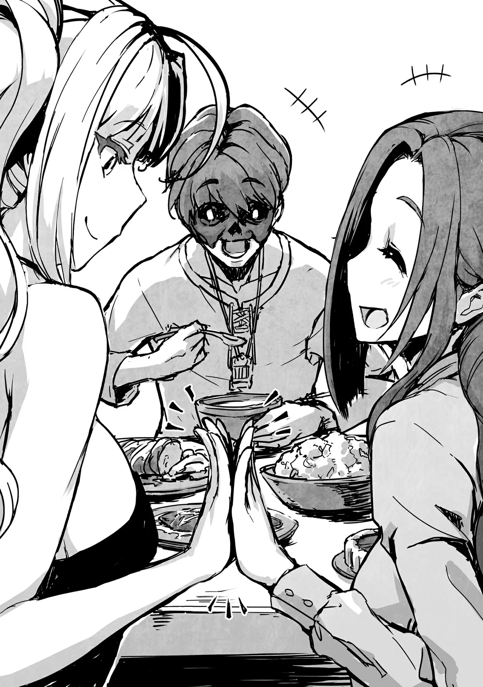
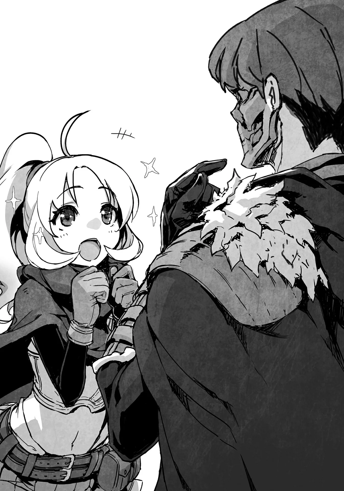

# Chương 128: Tập 5 Chương 3 - Sự Tồn Tại và Thân Phận (4)

Trước khi rời khỏi hội, tôi đã hỏi xem Sheila có muốn đi ăn tối cùng tôi không. Thức ăn tự nó không phải là mục đích chính, mà quan trọng hơn là tôi muốn kể cho ai đó tường tận hoàn cảnh của mình về những chuyện đã diễn ra ngày hôm nay. Ban đầu tôi vốn chẳng hề có ý định giãi bày mọi sự với Wolf, nhưng giờ sự đã rồi thì chẳng thể nào thay đổi được nữa. Dù sao thì tôi cũng đã có một nhân viên của hội đứng về phía mình, đó là Sheila. Cô có thể giúp chuyển lời giữa Wolf và tôi. Thêm vào đó, dẫu chẳng bị giao phó nhiều việc, hiện tại trên danh nghĩa tôi vẫn làm việc cho hội. Điều đó biến Sheila thành tiền bối của tôi ở nơi làm việc, thế nên tôi muốn hỏi cô về các quy tắc. Nhờ những tập sách mỏng đặt bên quầy tiếp tân, tôi cũng nắm được đôi chút về các quy định và kỳ vọng của họ đối với mạo hiểm giả, song tôi lại hoàn toàn mù tịt về những quy tắc nội bộ dành cho nhân viên mà Wolf đã đề cập. Tôi đoán họ cũng có những tập tài liệu tương tự dành riêng cho nhân viên và rồi sẽ bảo tôi đọc sau, nhưng tôi vẫn muốn nắm được những điều cơ bản trước lúc ấy.

Sheila lờ mờ nhận ra tôi mời cô vì những lý do ấy, nên cô đã đồng ý ghé qua nhà Lorraine sau giờ làm.

◆◇◆◇◆

Đồ ăn lúc nào cũng ngon lành. Hàng loạt món ăn được bày biện trên bàn, mỗi món đều là thành quả hợp tác giữa Lorraine và Sheila. Có chút máu được hòa lẫn vào trong, song hương vị lại có phần khác biệt so với thường ngày. Hôm nay ngon hơn hẳn lệ thường, nhưng tôi tự hỏi tại sao lại như vậy.

"Hôm nay cô nêm nếm thức ăn theo cách khác à?" tôi hỏi. Phần lớn thời gian Lorraine đều tự nấu nướng một mình, thế nên có lẽ sự tham gia của Sheila đã làm biến đổi mùi vị đôi chút, song dường như không chỉ có vậy. Dẫu thế, tôi cũng chẳng biết phải giải thích ra sao.

"À thì, đồ ăn hôm nay chứa cả máu của tôi lẫn Sheila," Lorraine giải thích. "Tôi đã bảo cô ấy không cần phải làm đến mức ấy, nhưng cô ấy cứ nằng nặc đòi."

Điều đó quả thực đã giải thích cho hương vị đậm đà phức hợp này. Tôi chẳng rõ là do máu của hai người hòa quyện lại tạo nên vị ngon, hay do bản thân máu của mỗi người vốn dĩ đã thơm ngon rồi. Dẫu sao thì Sheila có lòng chia sẻ máu của mình cũng thật là tốt.

"Cô Sheila, cô không bận tâm sao?" tôi hỏi cô.

"Tôi cũng có chút để tâm, nhưng anh là Ma Cà Rồng và cần máu để sống mà. Tôi đã biết điều đó kể từ lúc chúng ta lập khế ước, nhưng anh toàn lấy máu từ cô Vivie. Cô ấy bảo mỗi tháng chỉ tầm một bình, nhưng tôi e rằng rồi sẽ có ngày cô ấy ngã bệnh mất, thế nên tôi nghĩ thử dùng máu của mình cũng là ý hay," cô nói. Wolf cũng từng lo lắng về đúng điều tương tự. Bình máu gần nhất mà Lorraine đưa cho tôi cũng sắp cạn rồi, vậy nên có thêm người đóng góp thì tôi vô cùng cảm kích.

Đồ ăn có pha máu dĩ nhiên chỉ dành riêng cho tôi. Lorraine và Sheila thì dùng bữa như bình thường.

"Nếu vậy thì tôi rất vui lòng đón nhận. Nhưng quay lại vấn đề chính đã," tôi nói rồi chuyển đề tài sang những điều Hội Trưởng Wolf đã trao đổi với mình. Đại để, tôi thông báo cho họ biết rằng tôi đã giãi bày hoàn cảnh của mình, rằng ông ấy thấu hiểu cho điều đó, và vấn đề đăng ký hai lần của tôi có thể được giải quyết êm thấm nếu tôi gia nhập đội ngũ nhân viên hội.

"Ra là vậy," Lorraine đáp lại. "Nghe chừng chẳng có vấn đề gì to tát nữa rồi. Coi bộ toàn bộ số tài liệu anh thu thập rốt cuộc lại chẳng dùng được vào việc gì cả." Lorraine từng phụ giúp chỉnh lý các tập hồ sơ mà tôi tập hợp. Những góp ý của cô thực tế đã giúp nội dung tài liệu trở nên dễ hiểu hơn nhiều. Song rốt cuộc nó lại thành ra một phen tốn công vô ích.

"Tôi đã trao thẳng chúng cho ông ấy rồi. Xin lỗi vì đã khiến cô phải phụ giúp uổng công," tôi cất lời xin lỗi.

Lorraine lắc đầu. "Nếu ông ta đã tin tưởng anh, thì giở trò đe dọa không phải là ý kiến hay. Tôi vốn định khuyên anh nên giữ kín chúng để phòng khi có biến cố xảy ra sau này, nhưng anh xưa nay đâu phải mẫu người chủ động tính toán mấy chuyện đó. Không sao cả," cô nói.

Dẫu vậy, cô không bảo là tôi không thể giữ kín chúng, bởi cô thừa biết tôi có thể làm được. Chỉ là tôi không muốn làm vậy mà thôi.

"Dù vậy, một kẽ hở cho phép anh duy trì việc đăng ký hai lần ư? Tôi nhớ mang máng là có quy tắc ấy tồn tại, nhưng ngạc nhiên là Hội Trưởng lại nhắc đến nó nhanh như thế. Theo tôi được biết thì quy định ấy đã không còn được áp dụng ở Maalt suốt mấy thập kỷ qua rồi," Sheila cất lời.

"Thật vậy sao?" Tôi nghiêng đầu. Tôi cứ ngỡ quy tắc đó không được tiết lộ cho mạo hiểm giả nhưng vẫn thường được nhân viên sử dụng.

"Vâng, quy định đó dành cho nhân viên khi muốn khảo sát hoặc thu thập thông tin từ giới mạo hiểm giả. Có điều dạo này chúng tôi đâu cần phải đích thân làm mạo hiểm giả mới lấy được những thông tin đó, nên chẳng ai dùng đến nữa. Cũng không có nhiều ý nghĩa cho lắm," Sheila giải thích.

Nghe chừng cơ chế này coi như đã chết từ lâu, vậy mà Wolf lại nghĩ ngay ra nó trong chớp mắt.

"Tôi đoán là ngay từ đầu Hội Trưởng đã mưu tính dùng điều đó để lung lạc anh rồi," Lorraine nói.

"Chắc là vậy, nhưng hà cớ gì phải đi xa đến mức đó chứ?" Tôi trăn trở.

"Ông ta đã để mắt đến anh suốt một thời gian dài rồi. Tôi đồ rằng ông ta cũng cân nhắc cách lôi kéo anh gia nhập hội ngần ấy thời gian. Trong đó bao gồm cả việc tìm cách thuê anh trong khi anh vẫn làm mạo hiểm giả. Ông ta thực sự đánh giá rất cao anh đấy."

Nói cách khác, đây là phương án ông đã trăn trở trong đầu kể từ khi tôi trở thành mạo hiểm giả Đồng Cấp. Dẫu vậy, tôi hồ nghi việc ông lại coi trọng tôi đến nhường ấy.

"Nghe rất giống phong cách của ngài ấy. Ngài ấy suy nghĩ sâu xa về những chuyện này lắm. Nhìn vẻ ngoài thì dễ hiểu lầm, nhưng tôi nghe nói ngài ấy thông minh lắm đấy. Dù sao ngài ấy cũng là một người tốt," Sheila chen ngang, đưa ra lời minh chứng củng cố cho suy đoán của Lorraine.

Nếu quả thực là vậy thì ông đã nắm trọn tôi trong lòng bàn tay. Song việc thao túng một kẻ như tôi hẳn chẳng có gì khó khăn, bởi tôi vốn có xu hướng tùy cơ ứng biến, nước chảy bèo trôi. Tôi quyết định không bận tâm về chuyện đó nữa. Dù sao chuyện này cũng chẳng gây hại gì cho tôi, và nếu có biến cố gì phát sinh, lúc ấy hãy tính tiếp.

Dẫu thế, buông lỏng quá mức có thể dẫn tới hậu quả đau đớn về sau, đúng như những gì tôi dần cảm nhận được trong thời gian gần đây.

◆◇◆◇◆

Sau khi bữa tối kết thúc và mọi sự đã được giải thích tỏ tường, chúng tôi tiễn Sheila về nhà rồi quay lại thư thả ngồi trong phòng khách của Lorraine.

"Có vẻ như rắc rối đăng ký hai lần của anh đã được giải quyết xong xuôi rồi, vậy anh định dùng cái tên nào đây?" Lorraine hỏi.

"Ồ, tôi cứ dùng tên Rentt Vivie một thời gian nữa cũng ổn thôi. Đổi tên trong lúc Nive vẫn còn quanh quẩn ở đây có thể sẽ nguy hiểm," tôi nói.

Lorraine gật đầu. "Chà, anh nói cũng có lý. Nhưng tôi bất ngờ là lại có cách giải quyết ấy đấy. Tôi cứ ngỡ họ sẽ xóa bỏ một trong hai cái tên cơ."

"Ừ, ban đầu ông ấy có gợi ý điều đó. Ông ấy còn bảo tôi có thể kết hôn với cô để giải quyết, nhưng làm sao tôi làm chuyện đó được chứ."

Lorraine phun toẹt cả ngụm rượu vang ra ngoài. "Thế là có ý gì hả?" cô cau có hỏi.

"Tôi có thể kết hôn với cô và đổi sang họ Vivie, rồi nói rằng hội đã quên xóa cái tên tôi đăng ký trước đó. Tôi cũng hết hồn khi nghe ông ấy nói thế, nhưng rốt cuộc thì chẳng cần phải dùng tới hạ sách ấy. Dù sao thì hôm nay đi ngủ thôi. Ngày mai chúng ta sẽ đi mua những thứ cần thiết cho chuyến đi đúng không? Chúc ngủ ngon nhé."

Đã đến lúc chuẩn bị mọi thứ cần thiết, nên tôi có hẹn đi mua sắm cùng Lorraine vào ngày mai. Nếu muốn thì tôi có thể thức trắng đêm cũng chẳng sao, nhưng Lorraine dù sao cũng chỉ là người phàm.

"Ừ, phải rồi. Chúc ngủ ngon, Rentt."

Tôi vẫy tay chào rồi về phòng mình. Tôi hy vọng ngày mai sẽ thấy vài ma cụ thú vị, nhưng chúng tôi chỉ định mua những vật dụng thật sự cần thiết, nên chắc điều đó khó mà xảy ra.

◆◇◆◇◆

"Kết hôn hả?" Lorraine lẩm bẩm khi chỉ còn lại một mình. Từ ngữ ấy nghe thật lạ lẫm đối với cô.

Cô đã qua độ tuổi kết hôn trung bình từ lâu, song không ít phụ nữ ở độ tuổi của cô vẫn thành đôi với những người quen cũ. Nếu anh giữ cái tên Rentt Vivie, điều đó cũng đồng nghĩa với việc anh sẽ ở rể nhà cô.

"Kết hôn hả?" Lorraine lặp lại lần nữa rồi nhắm mắt lại. Cô cố hình dung ra viễn cảnh đó, nhưng nó chỉ mang lại cho cô một cảm giác ngưa ngứa bồn chồn.

◆◇◆◇◆

"Ồ! Trông cái đó thú vị đấy chứ," tôi nói rồi chạy ào tới một quầy hàng rong ven đường.

Họ bày bán khá nhiều ma cụ kỳ lạ. Phần lớn các ma cụ hữu dụng đều được tìm thấy ở những cửa tiệm chuyên doanh ma cụ, nơi chúng được giám định và bán kèm bản phân tích bằng văn bản, song người ta cũng có thể bắt gặp chúng ở các quầy hàng rong.

Chi phí giám định ma cụ rất đắt đỏ. Khi mạo hiểm giả tìm thấy ma cụ trong mê cung, họ thường mang đến hội hoặc tiệm ma cụ để giám định, nhưng nếu chúng rõ ràng là vô dụng, hoặc sau khi giám định mà hóa ra chẳng dùng được vào việc gì, chúng sẽ trôi dạt về nơi này. Ví dụ phổ biến cho loại trước là những chiếc kim găm chẳng làm được tích sự gì ngoài việc nảy tưng tưng tại chỗ, những bông hoa biết hát (mà tiếng hát chẳng hay ho gì, nghe như tiếng ồn rác tai), và những ngọn đuốc cứ bùng cháy rồi tắt ngúm ngẫu nhiên không chừng. Ví dụ cho loại sau là những thanh ma kiếm chẳng hề được cường hóa chút nào, hay thứ thuốc trông giống hệt thuốc hồi phục nhưng chẳng mang lại tác dụng gì ngoài việc gây đau bụng. Không phải mọi vật phẩm tìm thấy trong mê cung đều có công dụng thực tế. Chẳng ai mua chúng trừ phi hiếu kỳ, biết được công năng tiềm ẩn của những món đồ này, hoặc là lũ trẻ con muốn tìm đồ chơi. Rốt cuộc, chúng đều tìm đường dạt đến những quầy hàng rong này.

"Trông chẳng khác gì đồ chơi trẻ con với rác rưởi. Sao anh lại muốn mấy thứ này cơ chứ?" Lorraine lẩm bẩm rồi nhíu mày.

Chúng tôi đang ở khu chợ để mua các nhu yếu phẩm linh tinh. Có đồ ăn bảo quản, đá mài cầm tay, quần áo, thuốc và nhiều thứ khác. Tự thân Lorraine có thể bào chế các loại thuốc phẩm chất cao nên chúng tôi không nhất thiết phải mua, nhưng thu thập nguyên liệu để chế tạo chúng thì phiền phức lắm, vậy nên chúng tôi chọn mua sẵn. Ma vật cũng có thể tấn công chúng tôi trên đường đi, thành thử chúng tôi cần dụng cụ chứa đựng bất kỳ nguyên liệu hữu dụng nào rơi ra từ chúng. Trước đây, tôi từng dùng lá cây Hoonoki Maalt để bọc thịt Orc và dùng bình để chứa dịch Slime. Khi nhắc đến những món đồ như vậy, mua ở các cửa hiệu lớn sẽ có chất lượng tốt hơn hàng rong, nhưng hàng rong lại bán với giá rẻ. Tôi thường đến các cửa hiệu lớn khi cần đồ cho công việc, song đây chỉ là một chuyến đi cá nhân. Chất lượng có kém hơn đôi chút cũng chẳng sao. Dẫu vậy, tôi vẫn phải cảnh giác trước những món hàng không đáng tin cậy.

"Chính cái vẻ vô giá trị của chúng mới khiến tôi muốn có đấy. Nếu chỉ mua những thứ có ích thì chán ngắt lắm."

Lorraine ôm đầu trước lý lẽ của tôi. "Anh đang giở giọng triết lý với tôi đấy à? Tôi chẳng tài nào hiểu nổi."

Tôi vốn định vặn lại rằng đó là tinh thần mạo hiểm, nhưng tôi thừa biết ai sẽ là kẻ trông ngớ ngẩn trong cuộc đối thoại này. Dù sao thì tôi vẫn muốn mấy món ma cụ đó, tôi không thể kìm lòng được.

"Thôi thì, anh muốn tiêu tiền của mình thế nào tùy thích. Tôi cũng vừa mua một cuốn sách chẳng có mấy tác dụng thực tiễn, nên ở chừng mực nào đó tôi cũng hiểu được suy nghĩ của anh," Lorraine chịu nhượng bộ, trên tay cầm cuốn sách dày bọc bìa da mà cô mua ở quầy hàng rong chúng tôi vừa ghé qua lúc nãy. Nó có tựa đề "Nấu Ăn Từ Ma Vật: Biến Bộ Phận Kém Chất Lượng Thành Món Ngon", một cái tên mang lại cảm giác chẳng lành. Nấu nướng bằng các bộ phận của ma vật là chuyện bình thường, song khía cạnh "kém chất lượng" khiến tôi tự hỏi rốt cuộc họ muốn ám chỉ điều gì. Có thể là Slime chăng, nhưng ngay cả thứ đó cũng có thể chế biến thành món nuốt trôi được. Tôi chỉ biết cầu nguyện sao cho mình không bao giờ phải động tới cuốn sách này.

"Ồ, đằng kia còn vài quầy bán sách nữa kìa," Lorraine chỉ tay. "Rentt, tôi qua đó xem sao nhé. Anh cứ thoải mái ngắm nghía ma cụ thỏa thích đi. Tầm một tiếng nữa chúng ta gặp nhau ở băng ghế phía đông quảng trường trung tâm nhé."

Cô rảo bước về phía khu vực tập trung đông đúc các quầy bán sách, có lẽ là để lùng mua thêm vài cuốn sách kỳ quái nữa. Tôi chẳng rõ chúng có tác dụng gì, nhưng hai chúng tôi lại có điểm tương đồng ở khoản ấy. Đó chính là điều đã gắn kết chúng tôi bên nhau suốt một thập kỷ qua.

Chỉ còn lại một mình để ngắm nghía ma cụ, tôi đưa tay về phía một tấm bảng kỳ bí đang trôi lơ lửng cách mặt đất chừng ba phân.

"Ôi, tôi xin lỗi."

Người đứng cạnh tôi cất lời xin lỗi. Cô gái cũng định chộp lấy món đồ cùng lúc và chạm vào tay tôi. Cú va chạm chẳng làm tôi đau đớn chút nào nên tôi không để bụng, song tôi lại thấy kỳ quặc khi có ai đó cũng hứng thú với món đồ này. Dĩ nhiên là trừ bản thân tôi ra. Dẫu vậy, tôi giấu đi cảm xúc của mình và ngước lên trò chuyện cùng cô.

"Không sao đâu, tôi..." Tôi bắt đầu mở lời, nhưng rồi thời gian như ngưng đọng lại.

"Có chuyện gì sao ạ? Mặt tôi dính gì à?" cô hỏi.

Câu trả lời là trên đó có mắt, mũi và miệng, song đó không phải điều khiến tôi sững sờ không thốt nên lời. Tôi từng gặp người phụ nữ này trước đây. Cô gái sở hữu mái tóc vàng óng và đôi mắt xanh biếc. Gương mặt khiến cô trông còn rất trẻ, nhưng hứa hẹn sẽ trổ mã thành một đại mỹ nhân trong vài năm tới. Diện mạo ấy có phần tương phản với bộ giáp da và thanh kiếm cô đang đeo bên mình. Tôi chưa từng ngờ rằng lại gặp cô ở nơi này.

"Không, chẳng có gì đâu. Cô có nhận ra tôi không?" tôi hỏi.

"Khoan đã, chúng ta từng gặp nhau rồi sao? Một chiếc mặt nạ che nửa mặt, một chiếc áo choàng đen..." Giọng cô nhỏ dần khi cố vắt óc suy nghĩ.

Có vẻ như cô đã quên, nhưng rồi tôi chợt nhớ ra một chuyện. Chiếc mặt nạ của tôi trông đã khác so với lần cuối chúng tôi gặp mặt.

"Xin lỗi nhé, thế này thì sao?" Tôi nói rồi biến đổi chiếc mặt nạ thành hình đầu lâu che kín toàn bộ khuôn mặt. Tôi cũng trùm mũ áo choàng lên đầu và bước đi lảo đảo đầy vẻ khả nghi. Đôi mắt cô mở to kinh ngạc.

"Ôi, anh là anh Rentt phải không?!" cô hét lên. Tôi biến đổi mặt nạ trở lại như cũ, cởi mũ trùm đầu xuống và gật đầu.

"Ừ, đúng vậy. Lâu rồi không gặp nhé, Rina."
