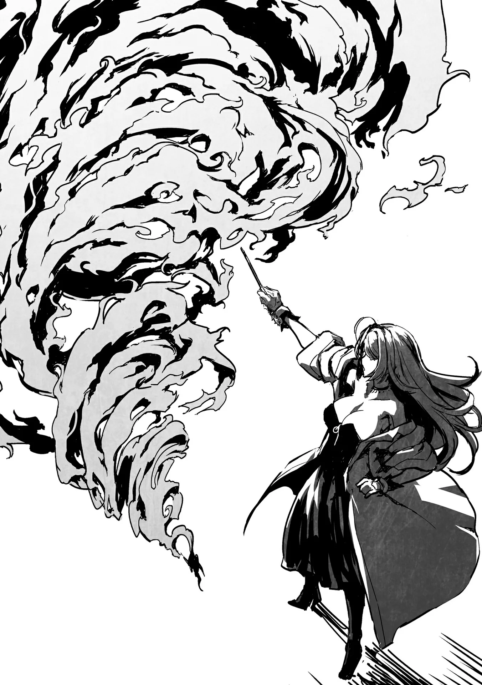
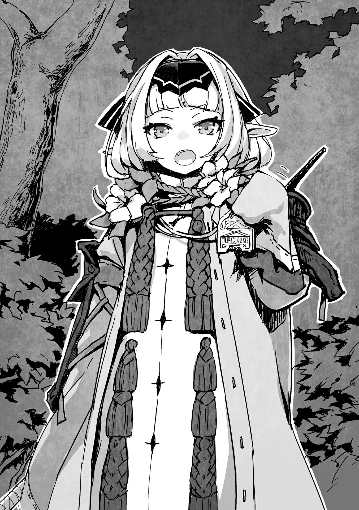

# Chương 131: Tập 5 Chương 4 - Chuyến Hành Trình (2)

Lorraine và tôi chăm chú quan sát những cái xác thối rữa biết đi. Chúng khoác trên mình những bộ quần áo rách rưới, tay cầm giáo tre và cuốc cào. Lũ quái vật này được gọi là Zombie, một phân loài khác thuộc chủng Undead. Chúng khác với tôi ở chỗ tôi là Ma Cà Rồng và cần năng lượng từ máu để tồn tại, trong khi Zombie lại không bị ràng buộc bởi giới hạn ấy. Bù lại, có lẽ vì thế mà Zombie thường dễ gãy vụn và yếu ớt.

Dẫu vậy, chúng vẫn là mối đe dọa lớn đối với những người bình thường. Giới học giả cho rằng về mặt cấu trúc, các sinh vật sống luôn tự kìm hãm để không bộc phát toàn bộ sức mạnh nhằm tránh gây áp lực quá lớn lên cơ thể, nhưng Zombie thì vốn đã chết rồi. Cơ thể chúng có thể cử động và vặn vẹo theo những cách không tưởng. Đầu chúng có thể xoay tít một vòng tròn, còn tay chân thì vung vẩy quái đản như thể không hề có khớp xương. Những đặc tính dị thường ấy đôi khi còn biến chúng thành nỗi phiền toái đáng ngạc nhiên đối với các mạo hiểm giả.

Tuy nhiên, lý do lớn nhất khiến người ta phải tránh xa chúng chính là mùi hôi thối nồng nặc cùng thân xác bẩn thỉu. Chúng thường mang theo mầm bệnh trên người. Sẽ chẳng sao nếu chúng cứ lang thang vô định đằng xa, nhưng chúng tôi không thể để chúng bén mảng lại gần khu hạ trại. Cần phải tiêu diệt chúng ngay lập tức. Cả Lorraine và tôi đều nhanh chóng đi đến cùng một kết luận. Vấn đề còn lại chỉ là nên hạ gục chúng bằng cách nào.

"Liệu ma thuật có hiệu quả không?" tôi hỏi Lorraine.

"Chắc là được đấy. Nếu anh ra tay thì người sẽ dính bẩn mất, nên việc này cứ để tôi lo," cô nói.

Lorraine rút đũa phép ra rồi tiến về phía lũ Zombie. Cô khẽ vung vẩy đũa phép khi bước lại gần. Tôi còn đang tự hỏi cô định làm gì thì nhận ra một luồng gió bắt đầu thổi từ phía chúng tôi về hướng lũ Zombie. Cô đã thi triển ma pháp không niệm chú. Đó chỉ là ma pháp cấp thấp, nhưng việc thi triển nhẹ như không thế này đã phô diễn trọn vẹn thực lực của Lorraine. Bản thân tôi cũng có thể làm được điều tương tự, song chỉ giới hạn ở vài ba phép Ma Thuật Sinh Hoạt mà tôi đã dùng đi dùng lại suốt mười năm qua, nên chẳng có gì đáng để tự hào cả. Những phép ấy không đòi hỏi khả năng tiết chế cao. Tuy nhiên, ma pháp Lorraine đang dùng thì không đơn giản như vậy. Cô phải duy trì luồng gió thổi ổn định liên tục, nên độ khó ắt hẳn không hề nhỏ. Mục đích của việc này là để ngăn mùi hôi thối hoặc những mảnh thịt Zombie văng về phía chúng tôi.

Khi Lorraine tiến đến trước mặt lũ Zombie, chúng bắt đầu vây quanh cô. Dấu hiệu của sự sống đã thu hút chúng tới khu trại của chúng tôi, nhưng thị lực của chúng có vẻ rất kém. Chúng chẳng đoái hoài gì đến tôi hay bất cứ thứ gì quanh cỗ xe mà dồn toàn bộ sự chú ý vào một mình Lorraine. Vì lo ngại có thể còn những con khác đang phục kích, tôi vẫn cảnh giác cao độ nhưng không phát hiện điều gì bất thường xung quanh. Vả lại, Zombie cũng chẳng đủ thông minh để biết rình rập ai. Không có lý do gì phải quá đỗi bận tâm. Dù vậy, tôi vẫn cảm nhận được thêm một số con Zombie ở đằng xa, nhưng vì lý do nào đó mà số lượng của chúng đang giảm dần đều, nên cũng không đáng ngại. Có thể chúng đang tàn sát lẫn nhau, đụng độ cướp đường, hoặc chạm trán các mạo hiểm giả khác. Trước mắt, tôi chọn cách giữ cẩn trọng, nhưng tốt nhất vẫn là tập trung chú ý vào Lorraine.

"Được rồi, thế này là vừa đẹp," Lorraine cất tiếng khi đã bị bao vây tứ phía. "Không có ai khác ở gần đây chứ? Tốt lắm. 'Gió, ta lệnh cho ngươi hãy thổi. Lửa, ta lệnh cho ngươi hãy cháy. Hãy hóa thành lốc xoáy thiêu rụi vạn vật xung quanh ta. Paloom Igni Su Turbo,'" cô cất lời niệm chú.

Những ngọn lửa bùng lên quanh Lorraine, kéo theo một luồng gió mạnh quét qua. Gió cuộn xoáy quanh biển lửa và tạo thành một cơn lốc rực cháy. Bộ não mục rữa của lũ Zombie dường như vẫn còn hoạt động đôi chút trong vô vọng khi chúng cố tháo chạy khỏi cơn lốc. Thế nhưng uy lực của nó quá đỗi khủng khiếp; ngọn lửa đỏ rực thiêu rụi chúng thành tro tàn.

Thi triển hỏa ma pháp ở gần rừng trông chẳng khác nào hành động tự sát, nhưng đó chỉ là chuyện của những ma pháp sư nghiệp dư. Một người ở đẳng cấp như Lorraine hoàn toàn có thể kiểm soát ma pháp đủ tốt để ngăn ngọn lửa lan rộng. Còn nếu là tôi thử làm, chắc chắn chúng tôi sẽ phải đối mặt với một trận cháy rừng dữ dội. Nghĩ đến viễn cảnh ấy thôi cũng đủ thấy rợn người, đến mức tôi chẳng tài nào gom đủ can đảm để thử.

Chỉ một lát sau, toàn bộ lũ Zombie đã bị thiêu ra tro. Phép thuật đó sở hữu uy lực đáng sợ, nhưng Lorraine vẫn còn nương tay. Câu chú của cô có thể hoàn chỉnh hơn thế nhiều, thậm chí cô còn cố tình thêm vào một đoạn để kiềm chế bớt sức mạnh của ma pháp. Khi cơn lốc rực lửa thu nhỏ lại rồi tan biến, Lorraine vẫn đứng sừng sững nguyên vẹn tại nơi nó từng hoành hành. Cô quay người về phía tôi.

"Rentt, qua đây đi," cô gọi.

Tôi tự hỏi cô muốn gì rồi bước lại gần, để rồi nhìn thấy một đống tro tàn cùng những viên Ma Tinh. Chúng hiển nhiên là rơi ra từ lũ Zombie, nhưng cứ ngỡ chúng đã bị thổi bay tứ tán rồi chứ. Trình độ kiểm soát ma pháp của cô quả thực là điều đáng kinh ngạc, nhưng giờ thì tôi đã hiểu lý do Lorraine gọi mình tới.

"Tôi cứ nghĩ thiêu rụi chúng thành tro là đủ rồi, nhưng gom hết lại một chỗ thế này thì xem ra vẫn chưa xong. Tôi có thể dùng Nước Thánh, nhưng tiện có anh ở đây. Anh xử lý giùm vụ này được không?" cô đề nghị.

Nói cách khác, đống tro tàn và những viên Ma Tinh kia vẫn còn vương đầy tà khí cùng chướng khí. Cô muốn tôi dùng sức mạnh của mình để thanh tẩy chúng.

◆◇◆◇◆

Nhiều loại quái vật ô uế đòi hỏi phải thanh tẩy sau khi bị tiêu diệt, và các mạo hiểm giả thường xử lý việc này theo vài cách khác nhau. Phương pháp Lorraine vừa nhắc tới là dùng Nước Thánh tưới lên xác chết. Cách này khá hiệu quả với hầu hết quái vật, trừ những con hùng mạnh nhất, nên đây là chiến thuật tương đối phổ biến. Thế nhưng phần lớn mạo hiểm giả lại chẳng buồn bận tâm làm gì. Nước Thánh rất tốn kém, và hiếm có mạo hiểm giả nào luôn mang nó bên người. Nếu nhận ủy thác tiêu diệt quái vật ô uế, bất kỳ mạo hiểm giả nào có lương tri và hiểu biết thông thường cũng sẽ mang theo một ít, nhưng không ít người chọn cách phớt lờ vì thấy quá phiền hà hoặc sợ thâm hụt tiền thù lao.

Thay vào đó, họ cứ mặc kệ xác chết ở lại. Đây là một hành động tệ hại bởi xác của quái vật ô uế sẽ nguyền rủa vùng đất nơi chúng gục xuống, dần dà biến nơi đó thành vùng đất không thể sinh sống được, tương tự như trường hợp của Đầm Lầy Tarasque. Chướng khí từ Zombie chỉ đủ mạnh để làm cho vùng đất quanh xác chúng trở nên cằn cỗi trong vài năm, nhưng tốt nhất vẫn là nên xử lý thỏa đáng. Đó chính là lý do Lorraine gom toàn bộ tro tàn lại một chỗ. Có lẽ cô thu thập Ma Tinh chỉ để chúng tôi đem bán sau này, nhưng bản thân chúng cũng cần phải được thanh tẩy.

Khi quái vật bị thiêu thành tro như trường hợp này, đôi lúc việc thanh tẩy là không cần thiết. Nếu chúng bị cơn lốc thổi bay tán loạn, tà khí và chướng khí sẽ bị phân tán đủ mỏng để không gây nguy hại. Nó có thể khiến người qua đường hơi khó chịu một chút hoặc làm chậm sự phát triển của cây cỏ, nhưng cũng chỉ đến thế mà thôi. Dù vẫn chẳng hay ho gì, song mức độ đó vẫn có thể chấp nhận được.

Nhưng Lorraine là một mạo hiểm giả biết nghĩ, nên cô luôn mang theo Nước Thánh bên mình và hẳn sẽ dùng đến nếu không có tôi ở đây. Cơ mà tôi lại đang có mặt ở đây, thành thử cô chẳng cần phải tốn kém nữa. Nước Thánh rất đắt đỏ, nên tiết kiệm được chừng nào hay chừng nấy. Ngược lại, Thần Lực mà tôi tiêu hao rồi cũng sẽ tự hồi phục theo thời gian. Điều đó cho thấy những người sử dụng Thần Lực hữu dụng đến mức nào.

"Vậy thì để tôi làm cho," tôi nói. Tôi đưa hai tay về phía đống tro tàn cùng Ma Tinh rồi bắt đầu rót Thần Lực vào đó. Cả thanh tẩy lẫn trị liệu đều là những việc mà tôi có thể thực hiện theo bản năng, và đó là một điểm rất tuyệt vời của Thần Lực. Phương pháp bài bản có lẽ sẽ mang lại hiệu quả cao hơn, nhưng để học được điều đó, tôi sẽ phải gia nhập một tổ chức tôn giáo nào đó. Bằng không, tôi sẽ phải nhờ cậy một người sử dụng Thần Lực tự do chỉ dạy. Những người như thế tuy hiếm hoi nhưng không phải là không có.

Tôi từ từ rót thêm Thần Lực cho đến khi luồng khí tà ác bốc lên từ đống tro tàn và Ma Tinh tan biến hoàn toàn vào không khí. Có vẻ như chúng đã được thanh tẩy sạch sẽ, tôi khẽ thở phào nhẹ nhõm. Tôi biết cách làm, nhưng chưa từng được học hành bài bản, nên cũng chẳng dám chắc phương pháp của mình có hoàn toàn chuẩn xác hay không. Ít nhất thì lần này cũng không xảy ra vấn đề gì, duy chỉ có một điều kỳ lạ.

"Cái bao phân bón biết đi lại trổ tài rồi đấy à. Đây là chuyện sẽ xảy ra mỗi khi anh thanh tẩy thứ gì đó sao?" Lorraine lẩm bẩm khi nhìn chằm chằm vào đống tro đã được thanh tẩy.

"Đừng có gọi tôi như thế nữa," tôi gắt lên. "Nhưng nhìn vào kết quả này thì tôi cũng đành thừa nhận cô nói chẳng sai chút nào," tôi đáp lời rồi cũng đưa mắt nhìn xuống đống tro tàn. Có những mầm cây non đang nhú lên từ đống tro ấy, và tôi biết chúng đâm chồi được là nhờ có Thần Lực của mình. Cây cối không thể mọc trên vùng đất bị ô uế, nên điều này chứng tỏ phép thanh tẩy đã phát huy tác dụng, thế nhưng việc bản thân lại có thêm một lý do nữa để bị gán cho cái danh bao phân bón biết đi khiến tôi chỉ biết cạn lời.

"Mà thôi, dù sao chuyện này cũng đâu có hại gì," Lorraine kết luận. "Giờ có thể an tâm nhặt Ma Tinh lên rồi chứ?"

Tôi nhìn vào những viên tinh thể và xác nhận không còn sót lại chút tà khí hay chướng khí nào. "Ừ. Cơ mà tôi nghĩ Ma Tinh của Zombie cũng chẳng bán được bao nhiêu tiền đâu."

"Chắc là vậy, nhưng tôi có thể dùng chúng để nghiên cứu Tử Linh Thuật. Chúng sẽ là vật liệu hoàn hảo cho mục đích đó."

Lorraine nói thản nhiên như không, nhưng Tử Linh Thuật vốn được coi là một dạng cấm thuật. Nó không bị chính quyền cấm đoán, và người ta cũng không bị xử tử nếu lỡ dùng nó, song nó lại bị xem là trái với luân thường đạo lý. Bản thân Tử Linh Thuật được cho là một bí thuật truyền kỳ đã thất truyền theo dòng thời gian. Tất cả những gì còn sót lại chỉ là vài lời đồn đại đầy điềm gở. Có lẽ đó là lý do Lorraine muốn nghiên cứu, nhưng nếu quyết tâm thì cô hoàn toàn có khả năng phục dựng lại Tử Linh Thuật, và nghĩ đến điều đó thôi cũng thấy hơi rợn người. Thế nhưng tôi không ngờ Lorraine lại có hứng thú với thứ này.

"Sao cô lại nghiên cứu Tử Linh Thuật?" tôi thắc mắc hỏi.

"Nó có thể giúp hiểu rõ hơn về Undead. Tử Linh Thuật đã bị lãng quên từ lâu, nên nghiên cứu những Undead còn đang tồn tại có lẽ sẽ nhanh hơn, nhưng biết đâu thứ này lại giúp ích được phần nào," cô trả lời.

Giờ thì tôi đã hiểu. "Vậy là cô làm thế vì tôi sao?" tôi hỏi.

Lorraine nhìn tôi như thể tôi vừa hỏi một câu hết sức ngớ ngẩn. "Hiển nhiên là vậy rồi. Bằng không thì tôi việc gì phải dính líu đến cấm thuật làm chi. Mà, đằng nào thì nghiên cứu nó cũng đâu đến mức bị xử tử, nên cũng chẳng phải chuyện gì quá đỗi nghiêm trọng," cô đáp.

Tôi cảm thấy như mình đang đặt thêm một gánh nặng lên vai cô. "Xin lỗi nhé," tôi áy náy nói.

"Đó không phải lời nên nói trong hoàn cảnh này đâu, Rentt à. Anh còn câu khác để nói cơ mà."

"Ừ. Cảm ơn cô vì tất cả sự giúp đỡ nhé."

"Thôi đi, chúng ta là bạn bè mà. Bận tâm làm gì chuyện đó."

◆◇◆◇◆

Một khoảng thời gian trôi qua sau đó.

"Ồ? Có ai đó đang tới kìa. Lần này là người sống thật sự sao?" Lorraine nói.

Tôi cũng nhận ra điều đó. Lũ Zombie mà tôi cảm nhận được ở đằng xa lúc trước đã biến mất, nên người này hẳn là kẻ vừa giao chiến với chúng. Bất kể thứ gì đang tiến về phía chúng tôi, nó chỉ có một mình. Ngoài kia từng có một lượng Zombie không hề nhỏ, nên nếu đây là con người, ắt hẳn người đó phải đủ mạnh để một mình tiêu diệt toàn bộ số quái vật ấy. Đó chắc chắn là một kẻ sở hữu bản lĩnh phi phàm. Sẽ rất tốt nếu đó là một mạo hiểm giả, nhưng ngộ nhỡ là đạo tặc hay hạng người tương tự thì mọi chuyện có thể trở nên tồi tệ. Cả Lorraine và tôi đều thủ thế cảnh giác, sẵn sàng đón nhận bất cứ điều gì sắp sửa xảy ra.

◆◇◆◇◆

"Một đứa trẻ ư?" Lorraine thì thầm khi có một bóng người bước ra từ trong rừng.

Cô ấy không thể nào đúng được. "Làm sao một đứa trẻ bình thường lại có mặt ở nơi khỉ ho cò gáy này được chứ?" tôi phản bác. Có thể chuyện đó không hoàn toàn bất khả thi, song xác suất là vô cùng thấp. Dù vậy, đối phương trông đúng là một đứa trẻ thật, ngoại trừ một vài đặc điểm nổi bật đến khác thường.

"Ta cứ ngỡ lũ Zombie chạy trốn về hướng này. Há chẳng phải hai người các ngươi đã hạ sát chúng rồi sao?" đứa trẻ cất lời bằng một giọng điệu cổ xưa đến khó tin. Đó là lối ăn nói mà chẳng còn ai dùng từ trước cả thời ông bà tôi. Dù vậy, chúng tôi vẫn hiểu được ý của cô bé, nên chí ít hai bên vẫn có thể giao tiếp được. Trong làng tôi cũng từng có những bậc cao niên nói chuyện kiểu này, còn Lorraine thì vốn xuất thân từ một thế giới quy tụ toàn những bậc tiền bối lớn tuổi.

"Đúng vậy, là tôi đã xử lý chúng. Tro tàn của chúng ở ngay đằng kia kìa," Lorraine đáp lời người ngỡ như là một đứa trẻ, vừa nói vừa chỉ tay về phía đống tro.

Đứa trẻ gật đầu. "Tro tàn ư? Ngươi là một ma pháp sư sao? Ra vậy, Ma Lực của ngươi quả thực phi thường. Lũ Zombie đó đối với ngươi chỉ là chuyện cỏn con. Ấy thế nhưng, cũng do ta sơ suất không tiêu diệt được hết nên mới để chúng chạy tới tận đây. Hãy thứ lỗi cho ta," cô bé khiêm nhường nói.

Điều đó có nghĩa lũ quái vật này chính là mục tiêu của cô bé vì một lý do nào đó. "Rốt cuộc lũ Zombie đó từ đâu ra vậy?" tôi tò mò cất tiếng hỏi.

"À, chừng bốn thập kỷ trước quanh đây từng có một ngôi làng, nơi dân làng từng sinh sống. Zombie không cần thức ăn để duy trì sinh mạng, bởi thế chúng sẽ tồn tại mãi cho tới khi bị tiêu diệt hoàn toàn. Tuy nhiên, suốt ngần ấy năm chẳng có lấy một bóng người nào đặt chân tới vùng đất này, thành thử lũ Zombie cứ chìm trong trạng thái ngủ đông suốt bấy lâu nay."

Mặc dù Zombie không cần thức ăn, điều đó cũng khiến chúng trở nên chậm chạp và thụ động. Nếu không có ai ở xung quanh để tấn công, chúng sẽ ngưng trệ mọi hoạt động. Đó được gọi là trạng thái ngủ đông. Hẳn là đã có thứ gì đó đánh thức chúng dậy, mà nhiều khả năng chính là đứa trẻ này khi cô bé bước vào tàn tích của ngôi làng.

Tôi chẳng biết phải nói gì trước sự thật ấy. Tôi đồ rằng đó chính là ý nghĩa thực sự của việc trở thành một Undead. Bất tử không đồng nghĩa với đang sống. Người ta vẫn tiếp tục tồn tại, nhưng nếu chẳng còn một ai trên cõi đời này nhớ đến mình, thì sự tồn tại ấy cũng chẳng khác nào đã chết. Tôi cảm thấy điều đó bi thảm khôn cùng, và những cảm xúc ấy ắt hẳn đã thoáng hiện lên nét mặt tôi, khiến đứa trẻ hiểu lầm.

"Chớ bận lòng, ta đã chôn cất tất cả bọn họ để họ không còn quay lại nữa. Mặc kệ họ vất vưởng như thế quả thực quá đỗi đáng thương," cô bé vừa nói vừa tiến lại gần đống tro tàn. "Ta tình cờ lại là một bậc thầy về thần thuật, và thanh tẩy tà khí chính là sở trường của ta. Có cần ta thanh tẩy luôn đống tro này không? Khoan đã, hử?"

Từ những lời cô bé nói, tôi đã linh cảm chuyện này có thể dẫn tới rắc rối, nhưng mọi sự đã quá muộn màng. Nếu cô bé thực sự có thể sử dụng Thần Lực, thì chẳng có cách nào che giấu được nữa. Và tôi biết cô bé nói thật, bởi tôi có thể nhìn thấy đôi bàn tay cô đang tràn trề Thần Lực. Điều đó lý giải vì sao cô bé lại có thể săn lùng lũ Zombie dễ dàng đến vậy.

"Tà khí đã được thanh tẩy rồi sao? Thiêu chúng thành tro đâu thể mang lại hiệu quả như thế này được. Há chẳng lẽ các ngươi đã dùng tới Nước Thánh?" cô bé gặng hỏi.

Lorraine rút ra một lọ Nước Thánh. "Đúng vậy, tôi luôn mang theo phòng những lúc như thế này."

Đứa trẻ tỏ vẻ tin phục. "Hô hô, ngươi quả là sáng suốt hơn hẳn đám mạo hiểm giả tầm thường ngày nay. Lũ Undead rình rập khắp nơi nơi, và chúng cần phải được dọn dẹp sạch sẽ sau khi bị tiêu diệt để tránh gieo rắc thảm họa. Ngày xưa, ai nấy trong chúng ta cũng đều thủ sẵn Nước Thánh bên mình, thế mà giờ đây... Ái chà, thứ lỗi cho tật cằn nhằn của ta."

"Sao cũng được," tôi đáp lại một cách mơ hồ, trong lòng thầm nghĩ ngay khoảnh khắc này đây cô bé đang trò chuyện với một Undead đấy thôi. Tôi không chủ tâm che giấu, nhưng cũng chẳng hào hứng gì với việc thổ lộ thân phận cho một người sử dụng Thần Lực, nên đành im lặng chờ xem chuyện gì sẽ xảy ra tiếp theo.

"Tuy nhiên, toàn bộ đã được thanh tẩy sạch bong không tì vết. Nước Thánh không thể nào triệt để đến nhường này. Khoan đã! Cỏ non ư? Trong đống tro tàn sao? Lại còn tỏa ra Thần Lực nữa chứ! Các ngươi đang giấu giếm ta điều gì đúng không?!" cô bé cuống cuồng gặng hỏi.

Chúng tôi vốn giữ khoảng cách vì cẩn trọng, thế nhưng cô bé đã áp sát ngay bên cạnh chỉ trong chớp mắt. Chuyện này tuyệt nhiên không phải trò đùa, và tôi chẳng cần dựa vào Thần Lực cũng nhận ra cô bé sở hữu thân thủ vô cùng xuất chúng. Dẫu vậy, nếu đối phương có ý định tấn công, chúng tôi vẫn có đủ khoảng trống để phản kích, nên tình hình vẫn nằm trong tầm kiểm soát. Dù sao thì tôi cũng không cảm nhận được chút sát khí nào và thấy chưa có lý do gì phải rút vũ khí ra.

Dù sao đi nữa, Lorraine vẫn lên tiếng đáp lại đứa trẻ. "Chúng tôi đâu có ý đó, nhưng hai bên đã kịp trò chuyện câu nào đâu. Thậm chí chúng ta còn chưa biết tên nhau nữa là," cô nói bằng giọng điệu hết sức chân thành.

Về mặt kỹ thuật, đúng là chúng tôi đang che giấu việc tôi đã dùng Thần Lực để thanh tẩy, nhưng những lời cô nói với đứa trẻ thì chẳng có câu nào là dối trá cả.

Đứa trẻ dường như cũng đồng tình với cô. "Quả thật, chính ta còn chưa tự giới thiệu bản thân. Đó là lý do các ngươi lại cảnh giác cao độ đến thế sao?"

Đứa trẻ tỏ vẻ ngây thơ vô tội, nhưng xét theo bộ pháp điêu luyện khi cô bé tiếp cận chúng tôi ban nãy thì tất cả chỉ là vỏ bọc. Cô bé này dường như cũng ứng biến rất nhanh nhạy.

"Hừm, đã lâu lắm rồi ta mới thấy những mạo hiểm giả có khí phách cứng cỏi đến vậy. Hãy cho ta biết tên tuổi của các ngươi đi. Dĩ nhiên, ta sẽ bắt đầu trước. Ta là Alhildis, một mạo hiểm giả mọn. Ta thuộc Kim Cấp đấy nhé! Hãy nhìn cho kỹ đây," đứa trẻ cất lời rồi chìa ra tấm thẻ mạo hiểm giả của mình.

Khi các mạo hiểm giả chạm trán nhau, đây là phương thức đơn giản nhất để thiết lập niềm tin. Tấm thẻ vàng óng ánh của cô bé trông đúng là hàng thật.

Chúng tôi vẫn còn dè chừng, nhưng Alhildis đã hào phóng ném tấm thẻ sang cho chúng tôi. "Cứ kiểm tra cho đến khi các ngươi vừa lòng thì thôi," cô bé nói.

Đến nước này thì chẳng có lý do gì để cho rằng đó là đồ giả mạo nữa, nhưng cũng có một số tên đạo tặc chuyên làm giả thẻ mạo hiểm giả để ngụy trang. Sau tất cả những gì đã chứng kiến ở cô bé từ nãy tới giờ, khả năng đó trong trường hợp này dường như khó lòng xảy ra, song tôi vẫn cẩn thận xem xét tấm thẻ để đảm bảo an toàn.

Cả Lorraine và tôi đều cảm thấy chúng tôi đã quá đa nghi với Alhildis, điều mà đáng lẽ chúng tôi sẽ không làm nếu không phải vì vẻ bề ngoài của cô bé. Chúng tôi tỉ mỉ kiểm tra tấm thẻ cho đến khi xác định nó hoàn toàn hợp lệ rồi ném trả lại cho cô bé.

"Xin lỗi vì chúng tôi đã nghi ngờ cô," Lorraine nói. "Nhưng cô cũng phải thông cảm cho tâm trạng của chúng tôi chứ. Quanh vùng này hiếm khi nào thấy người thuộc tộc Elf xuất hiện lắm."

Phải, những người thuộc tộc Elf như Alhildis quả thực vô cùng hiếm gặp tại vùng này. Cô sở hữu đôi tai nhọn tuyệt đẹp cùng đôi mắt xanh biếc như bầu trời. Mái tóc vàng óng được cắt tỉa kiểu đầu bob dài chấm vai. Cô mang vóc dáng của một bé gái chừng mười tuổi nhưng phong thái toát ra lại chẳng khác nào một bà lão. Gặp một người như vậy, không thể nào không nảy sinh lòng hoài nghi cho được.